# Methods and results: ballistic calculator, terrain and object model for Squad

Report for the thesis on computational ballistics. Russian version: [`thesis-methods-and-results.ru.md`](thesis-methods-and-results.ru.md).
Written 2026-11-04 from the evidence that exists in the repositories; nothing in it was measured in a running game.
Updated 2026-11-05: the voxel figures of sections 4, 7 and 8 were measured again with the exact conservative voxelisation
(`AGL` `e34e481`, memory fix `f116a2b`, issue #23) on the final `.vcol` files; the figures of the earlier sample-lattice builder are
kept as "old" next to them.
Final state 2026-11-05: the report was read again against SquadCalc `dev` 45.33.0, Squad Ballistics 1.6.1 and the agl `dev`
branch; sections 1.5, 2.3, 9.3 and 12 to 15 are new or rewritten, the PENDING tables are filled with the evidence that exists
(the GPU timings were added on 2026-11-12, section 12.4), and every issue number, file path and commit named
in the report is checked by `tools/release/check_report_refs.py` (section 13).
Updated 2026-11-09: section 16 (the Detailed tactical map: method, accuracy against an independent render, GPU against CPU,
performance, the faults found and fixed) is new; a row in section 15.
Updated 2026-11-10: section 16 was reviewed as an examiner would: every claim of the v2 text has an interval or is marked UNVERIFIED or
PENDING, five measurements on all 25 maps are new (16.3.6 to 16.3.10: roads, water, crowns, roof heights, contours), three faults of v2
were found and fixed in the pipeline (16.6), and the symbols were revised on measured contrast (16.10); the revised tiles are measured
against v2 on every map whose rebuild had finished (16.10), and the outline F1 has bootstrap intervals (16.3.3); a row in section 15.
Updated 2026-11-10: section 1.6 (the bearing and the marker distance as the game shows them, against the calculator's) is new, and
section 2.3 has the circles drawn in metres on the two maps whose corners are not square (SC 45.49.0); rows in sections 10 and 15.
Updated 2026-11-10: section 2.5 (every map picture registered on the world with the client's pixels: the layer minimaps the game
takes from each layer's data asset, Skorpo's rectangle, the basemap on the game's corners, the HQ tiles, the terrain and
topographic maps removed, the relief layer's offset settled) is new (SC 45.50.0), and the last row of section 2.3 points to it; a
row in section 15. Its registration tool is committed and rerun (`tools/maptiles/py/register_images.py`,
`tools/browser_check/hq_sharpness.mjs`), so its figures and the last row of section 2.3 are VERIFIED; a row in section 13.
Updated 2026-11-11: section 2 rests on the heightmaps on the landscape's own vertices (2.1: the corner grid against the
lattice at 283.8 M vertices; 2.2: the server-log audit on both grids; 2.4: the placement totals on the lattice), and section 3
has the detail where objects stand and its measurement on the research's 50 windows (SC 45.51.0); a row in section 15.
Updated 2026-11-12: one final build of every map layer (agl `d0ae886`; the Standard HD of Black Coast and Yehorivka with `f9f8382`) is
served as SquadCalc 45.51.0: section 16.10 measures it against v2 on all 25 maps (the gate, the five measures on one reference, the
outline F1 with intervals), 16.6 has the two faults it showed (the sky dome over Standard HD; Skorpo's ground beyond the
landscape drawn as sea, `deadline-squad/mapping-squad#2`; both fixed, Skorpo's in the served tiles since 2026-11-12 21:23 UTC, agl
`efb521b` merged as `9c2920f`), and the heightmaps on the landscape's vertices of section 2 are the served
ones (2.4); a row in section 15.
Updated 2026-11-13: section 1.2 says which shots the closed form solves and which the numerical search does, with the constants of
the search, and no longer calls the Rust solver a function-for-function port (it lacks the JavaScript filter of 45.40.0, the warm
start and `trajectory().above`); the Rust parity test is described with its grid and its result (SC 45.51.0); a row in section 15.
Updated 2026-11-15: section 17 (every calculation of the calculator as a numbered formula in mathematical notation: 143 formulas with symbols, units,
domains, tolerances and error bounds, each evaluated independently against the code; the related work; 68 known deviations of the code from the formulas;
the mapping of the computation inventory to the formulas) is new; a row in section 13 and one in section 15.
Updated 2026-11-16: sections 1.1, 1.2, 1.3 and 17 were read again against SquadCalc `dev` `ef176dde6` (45.52.0) and Squad Ballistics `dev` `7a8753b`
(1.7.4). Both calculators now fly the server's frame of 1/49.87 s with the motor on `ceil(T/dt) - 1` frames; the page reads heights through the Rust
engine, whose surface has no jump at the edge of the detail; the Rust solver has the muzzle filter, the warm start and the path test of the JavaScript one;
`getBearing` returns 0 for north. Of the 68 deviations of 17.12, seven were removed by 45.52.0 and one was removed in part; they say so, with the commit; the others were read again and keep their numbers
or have the new ones; 17.13 says which scripts were run again at the new revision and which were not; a row in section 15.

## 0. How to read this report

Every number carries a source and one of four labels (the fourth, ASSUMED, is used where a number is not in the server files at all).

| Label | Meaning |
|---|---|
| **VERIFIED** | Produced by a committed tool or test from the game files (Squad dedicated server build 26005357, SteamCMD app 403240), and the repository records the command and the output. A dagger (†) means the author of this report re-ran it on 2026-11-04. |
| **INFERRED** | Follows from verified data by an argument that is stated next to it. |
| **UNVERIFIED** | Recorded in a commit message, an issue or a note without a reproducible output, or not measurable from the server files, or not measured. |
| **ASSUMED** | Not in the dedicated-server files at all and used because the model needs a number: Workshop mods, the bore and zoom of handheld weapons (they come from the client's animation), the native C++ explosion defaults, SquadCalc's default lifespan; the reason is stated next to it (`DP`). |

A row marked **PENDING** is a measurement that does not exist; it names the action that produces it. After the final pass none is
left: the GPU timings, the last one, were measured on 2026-11-12 (section 12.4).

**Scope.** The report covers the 25 maps that the Squad dedicated server package can play and holds the files of: `LevelRotation.cfg`
names 25 levels, one of which has no level files in the package and is not covered, and Jensen's Range, which is not in the
rotation, is, so the 25 maps are the 24 playable levels of the inventory plus Jensen's Range (`H-README`, "Map inventory: what
the server package can play", VERIFIED). Terrain, objects and weapon data are all derived from the server package; no
community-made map data is a source of any figure.

### Source key (revisions the figures were read at)

| Key | What | Revision |
|---|---|---|
| `SC` | SquadCalc fork (`deadline-squad/deadline-squadcalc`), branch `dev` | `e18519025de3`, version 45.33.0 (first draft: `2f1ae898ed90`, 45.24.0); sections 1.1, 1.2, 1.3 and 17: `ef176dde6`, version 45.52.0 |
| `SB` | Squad Ballistics overlay app, branch `main` (identical to `dev` `5ffcec9`) | `f702127`, version 1.6.1 (first draft: `5f11d21c837b`, 1.6.0); sections 1.1, 1.2, 1.3 and 17: `7a8753b`, version 1.7.4 |
| `AGL` | deployment and tools repository, branch `dev` | `fc0500c` (first draft: `7438c08dbb76`); this report, `tools/release/` and `tools/release/check_report_refs.py` are added on top |
| `#22` | `deadline-squad/deadline-squadcalc#22`, "Completion checklist", items A1-D5 | read 2026-11-04, comments up to 2026-11-05 22:36 UTC |
| `#20` | `deadline-squad/deadline-squadcalc#20`, voxel evaluation tables | comment of 2026-11-05 (6670455739) |
| `#26`, `#27` | `deadline-squad/deadline-squadcalc#26` (thin openings), `#27` (precision margin) | open, read 2026-11-05 |
| `CL` | `SC:CHANGELOG.md`, entries 45.25.0 to 45.33.0 | |
| `SBS` | `SB:docs/sight-scales.md` | audit of 2026-11-05 |
| `V-README` | `AGL:tools/volumetric/README.md` | |
| `H-README` | `AGL:tools/heightmaps/README.md` | |
| `M-README` | `AGL:tools/maptiles/README.md` | build of 2026-11-09; the revision of 2026-11-10 (section 16.10) served since the final build of 2026-11-12 (SquadCalc 45.51.0) |
| `E-README` | `SC:engine/README.md` | |
| `CS` | `AGL:tools/volumetric/docs/collision-semantics.md` | |
| `SDMG` | `AGL:tools/volumetric/docs/structure-damage.md` | |
| `NR` | `AGL:tools/volumetric/docs/native-rules.md` | merged into `dev` as `7438c08`, read at that revision |
| `DP` | `AGL:tools/volumetric/docs/data-provenance.md` and `data-provenance.tsv` | added on the branch `fix/provenance`; counts of 2026-11-05, SC 45.30.0, SB 1.6.1 |
| `GA` | `AGL:docs/game-data-audit.md`, the calculator's map and weapon tables against the game files; tool `AGL:tools/game_audit/README.md` | audit of 2026-11-10, SC 45.40.0, SB 1.7.2 |

Paths below are relative to the repository named in the key. The equipment: one workstation, 15 GB of RAM, a GTX 1650 (4 GB) for the GPU timings of section 12.4.

## 1. Ballistic model

### 1.1 Model

The projectile model is the game's own, read from the Linux server binary and the cooked Blueprints (`SB:ballistics.py`
module docstring; evidence in `deadline-squad/squad-ballistics#4`, UNVERIFIED here because the issue was not re-read).

| Element | Value | Source | Label |
|---|---|---|---|
| Air drag | none | `SB:ballistics.py` docstring | VERIFIED (code reading of `USQProjectileMovement`) |
| Gravity | `g = ProjectileGravityScale x 9.80 m/s^2` (`DefaultGravityZ` = -980 cm/s^2) | `SB:ballistics.py` `GRAVITY = 9.80`; commit `f22e343` | VERIFIED |
| Launch speed | `WeaponConfig.MuzzleVelocity`, along the barrel from the socket `Attach_Muzzle` | `SB:ballistics.py`, `AGL:tools/game_ballistics/README.md` | VERIFIED |
| Server step | one velocity-Verlet step per server frame, speed cap `MaxSpeed` from the first step. Measured frame: 20.052 ms (median 49.87 Hz over 48 055 ten-second samples of the production server log, 99.51 % of them at 49.5 Hz or more). The server's motor rule is `ceil(T / dt) - 1` frames. Both calculators fly this frame and apply this rule: Squad Ballistics 1.7.4 (`SB:ballistics.py`, `FRAME_TIME`, `boost_steps`) and SquadCalc 45.52.0 (`SC:src/js/squadBallistics.js:95`, `boostSteps` lines 140-143; Rust `SC:engine/src/flight.rs:61`). Before, they stepped 20.000 ms and `ceil(T / dt)` frames; the shift against the model within weapon limits was: UB-32 up to 9.90 m, other motor rockets up to 1.18 m, shells without a motor under 1 mm | `SB:ballistics.py` docstring; `AGL:docs/research-native-core.ru.md` section 2.4; `#49` | VERIFIED: the scheme (addresses in the docstring), the frame time (server logs), the motor condition and the spawn inside the RPC (server binary). INFERRED from stock engine behaviour: the first movement tick happens in the frame of the spawn. Applied in the calculators since SquadCalc 45.52.0 (`4dddc7dcc`, `69e451776`) and Squad Ballistics 1.7.4 (`b29fbba`); `#49` closed on 2026-11-16 |
| Rocket motor | constant `acceleration` for `acceleration_time` along the rotation, which follows the velocity (`bRotationFollowsVelocity`) | same | VERIFIED |

"Exact vacuum parabola" is exact for a coasting shell (mortar, grenade, a gun round below its speed cap). The report does
not claim it for all weapons: a motor along the barrel axis is two parabolas (closed form), a shell coasting at its speed
cap has a closed form for the path angle, and a motor that pushes along the path or a launch above the cap has none and
is flown with the game's frames of 20.052 ms (`SB:ballistics.py` docstring, VERIFIED).

### 1.2 Solver

Read at SquadCalc `dev` `ef176dde6`, version 45.52.0 (not at the revision of the source key). For a target at horizontal
distance `d` and height `h` above the barrel pivot, speed `v` and gravity `g`, the two elevations of a plain parabola (low and
high arc) are `theta = atan((v^2 -/+ sqrt(v^4 - g (g d^2 + 2 h v^2))) / (g d))` (`SB:README.md`, section "How it works").
SquadCalc takes this closed form only for a plain parabola that the speed cap does not clamp: `isParabola(shot) && g > 0 &&
!clampsBefore(shot, height)`, that is no motor, no muzzle offset that moves with the elevation, no launch above the cap, and
no fall faster than the cap before the target (`SC:src/js/squadBallistics.js`, `solveElevation`, lines 1083-1092, `isParabola`
line 214, `clampsBefore` line 227; Rust `SC:engine/src/flight.rs`, `solve_elevation_with`, lines 1009-1021). The low arc is taken
from the product of the two roots, not from `(v^2 - sqrt(...)) / (g d)`, which subtracts nearly equal numbers at short range (F9 of section 17.3). VERIFIED (code reading).
The mortar, whose muzzle moves with the elevation, a shot with a rocket motor, and a launch or a coast at the speed cap are
not solved by the formula.

Every other shot is solved numerically (`solveElevation` lines 1094-1105; `solve_elevation_with` lines 1023-1060), in two steps:

1. The elevation that sends the projectile highest at the distance, `peakAngle` (line 964): a golden-section search over
   plus and minus `ELEVATION_LIMIT` (pi/2 - 1e-6 rad, line 74), stopped when the bracket is narrower than `ANGLE_TOLERANCE`
   = 1e-10 rad (line 77, loop at line 972) or after `MAX_ITERATIONS` = 200 (line 90). A target above the projectile's
   height at that elevation is out of range: both arcs NaN.
2. Each arc, `findRoot` (line 1002): a bracket from the peak, opened by `BRACKET_STEP` = 0.02 rad (line 83) and doubled until
   it holds the root, then narrowed by the Illinois variant of regula falsi on `heightAt(shot, angle, distance) - height`,
   stopped when the height error is at most `HEIGHT_TOLERANCE` = 1e-9 m (line 80) or the bracket is narrower than
   `ANGLE_TOLERANCE` (loop at line 1043), at most `MAX_ITERATIONS` iterations. When the bracket reaches the elevation
   limit with the height still at or above the target, the arc has no root inside the limit and is NaN.

The Rust solver has the same constants (`flight.rs` lines 46 to 57) and the same two steps (`peak_angle` line 864,
`find_root` line 896). The function the searches evaluate, `heightAt` (line 567), is closed form for a coasting shell and for
a shell coasting at its speed cap (`coastHeight`, line 487, called at line 625) and for a motor along the barrel's axis
(line 605), and it flies the first step of a launch above the cap exactly before it coasts (line 619). Only a motor that
pushes along the path, or an axis motor that the cap could clamp, is read from a table of flights of the game's frames
(`fliesBoostInSteps`, line 176; `BoostTable`, line 323: nodes every `BOOST_NODE_SPACING` = 1
degree, line 100, four-point Lagrange interpolation, line 576). This is the division that the last paragraph of section 1.1
gives, except that a launch above the cap is one exact step followed by the closed-form coast. VERIFIED (code reading).

The solver exists twice in SquadCalc: in JavaScript (`SC:src/js/squadBallistics.js`, `squadFiringSolution.js`) and in Rust
(`SC:engine`, `flight`, `weapon`). The Rust one follows the JavaScript one, with the same model, constants and search. At
`9664362c9` (45.51.0) the two differed in three places; the commit `4dddc7dcc` of 45.52.0 ("Fly the server frame, and bring the Rust solver level with the JS one")
removed all three (VERIFIED, code reading, at `ef176dde6`):

* The JavaScript `solveElevation` returns NaN for a root whose launch point is not short of the target (`pastMuzzle`, line 1101;
  since SquadCalc 45.40.0, `04cf787e1`, `SC:CHANGELOG.md`); `solve_elevation_with` now has the same filter (`past_muzzle`,
  line 1032). The example of the earlier reading (Mortar, default shell: `velocity` 110 m/s, `gravity` 9.8 m/s^2, `pivotHeight` 0.0245 m,
  `muzzleForward` 1.569 m, `muzzleUp` 0.002 m; `SC:src/data/weapons.js`; target 0.5 m away and 1 m up) gives the same answer in both:
  low NaN and high 89.988 degrees (`solveElevation(shot, 0.5, 1)` and `Flight::new(shot).solve_elevation(0.5, 1.0)`, run 2026-11-16 on `ef176dde6`;
  before, the Rust one gave 62.760 degrees for the low arc). The Mortar's own minimum distance is 51.8 m (`SC:src/data/weapons.js:47`).
* The JavaScript solver takes a warm start (`guess`, `WARM_STEP` line 87, `findRoot` line 1002) and a precomputed peak (`peak`); the Rust one takes
  both in `SolveHints` (`solve_elevation_with`; `solve_elevation(distance, height)` is the call without hints), with the same `WARM_STEP` (`flight.rs:57`).
  The JavaScript header says the warm start gives the same root to the search tolerances (lines 66 to 68).
* The profile test `trajectory().above` that the fire coverage uses (lines 631 and 686) has the Rust counterpart `Flight::above` (line 1073), with the
  `RangeMax` table of the profile. The JavaScript `trajectory` object as such is not ported: its `height`, `at` and `above` are `height_at`, `path_at` and `above`
  (`SC:engine/README.md`); `weapon.rs` says of itself "without the UI and spread parts" (module documentation, first lines).

The module documentation of `flight.rs` calls the Rust solver "a port, function for function" of the JavaScript one, and `E-README` says that it is held to it by
the parity test. This report states what the test shows and nothing wider.

The parity test of the Rust solver, `SC:engine/tests/parity.rs`, runs `engine/tools/js/reference.mjs` under Node (the real
`Weapon` and `SquadFiringSolution`) over every shell that has a `ballistics` name: 19 distances (0.5, 1, 2, 3, 4, 5, 15, 51, 150, 340,
450, 700, 1000, 1236, 1500, 2060, 2500, 5000 and 8000 m) x 9 target heights (-300, -100, -40, -10, 0, 10, 25, 100 and 200 m);
8 close distances (0.1, 0.25, 0.5, 1, 2, 3, 4 and 5 m) x 7 heights (-2, -1, 0.5, 1, 2, 3 and 5 m), where the muzzle has already passed some targets and the barrel's own
line runs through others; and for a weapon with gravity 18 cases around its maximum range (0.5, 0.9, 0.99, 0.999, 1.001 and 1.01 of it, at -40, 0 and
+25 m). It compares both arcs, the sight angle, both times of flight, the hold time and the maximum range, to 1e-9 degree and
1e-9 s (1e-9 relative above 10 s). It also checks paths against terrain profiles, `Flight::above` with and without a `RangeMax`
against `trajectory().above`. At `ef176dde6`: 155 shells, 37 957 cases, 227 897 values, 924 paths (308 clear), 0 mismatches, the worst 3.0e-10 degree and 1.2e-8 s
(`cargo test --release --test parity -- --nocapture` in `SC:engine` on an export of `ef176dde6`, run 2026-11-16; VERIFIED†).
Unlike the grid of 45.51.0, this one reaches the region where the two solvers used to differ (targets from 10 cm, muzzle past the target).

### 1.3 Parity of the two implementations

`AGL:tools/direct_fire/compare.py` runs SquadCalc's real `Weapon` and `SquadFiringSolution` under Node and Squad
Ballistics' `solve()` on the same grid (15 distances from 0.5 m to 8000 m x 9 target heights from -300 m to +200 m, plus
fractions 0.5-1.01 of each weapon's own maximum range at -40, 0 and +25 m) for every shell of every weapon both apps have,
low and high arc, time of flight, velocity, minimum distance and elevation limits. Tolerance 1e-6 degree / second.

| Quantity | Value | Source | Label |
|---|---|---|---|
| Weapons compared | 167 | `compare.py` output, SC `ef176dde6` + SB `7a8753b`, run 2026-11-16 (the first run, 2026-11-05, SC `e18519025de3` + SB `f702127`: 104 weapons) | VERIFIED† |
| Cases compared | 32 652 | same (the first run: 20 178 cases, the same count at the first draft and in `CL` 45.31.0; the weapon list and the grid have grown since) | VERIFIED† |
| Mismatches | 0 | same (on both runs); also recorded in SB commit `f22e343` | VERIFIED† |
| Max-range differences | none (`{}`) | same | VERIFIED† |

Command: `python3 tools/direct_fire/compare.py <Squad-Ballistics checkout> <SquadCalc checkout>` (7 s on one core on 2026-11-05, 11 s on 2026-11-16). The run after the lifespan change (SC 45.31.0, SB 1.6.1) still has 0 mismatches, so the 4-40 s lifespans are the same in the two apps.
Scope: the two solvers agree with each other. Agreement with the real game is the next subsection.

### 1.4 Agreement with the game

| Check | Result | Source | Label |
|---|---|---|---|
| Weapon data (velocity, gravity scale, motor, cap) of every weapon of both apps against the cooked Blueprints | `diff.md` lists every difference; the long-verified mortar (110 m/s, x1) and UB-32 (300 m/s, -50 m/s^2 for 2 s, x2) are reproduced | `AGL:tools/game_ballistics/README.md`, `gamecheck.py` | VERIFIED (method); `diff.md` itself is not stored, but `DP` (`data-provenance.tsv`) stores the comparison per weapon and input |
| AGS-17 hold-time model (185 m/s, x1.8) against in-game measurements | 67 measurements, 279-1931 m on level ground, agreement 0.7 % in v^2/g; RMS 5.34 m with refitted speed and top | `AGL:tools/game_ballistics/README.md`; `SB:RELEASE_NOTES.md` (SB#13) | UNVERIFIED here: the 67 measurements are the owner's in-game data, stored as `AGS17_HOLD_TABLE` in `SB:tests/test_ballistics.py` and checked there by `test_ags17_hold_time_matches_in_game_measurements` (passes on 2026-11-14); the figures of this row were not recomputed |
| Simulation with the game's values (muzzle that moves with the elevation) | solutions land within 1 mm; the UB-32 had missed by up to 22 m at short range before | `SC:CHANGELOG.md`, entry 45.7.0 | UNVERIFIED (a changelog statement) |
| Every input of the firing solution (velocity, gravity, motor, cap, rotation, drag, launch point, spread, lifespan, explosion, bore, zoom, limits, minimum distance, scale offset, hold model) of all 104 SB and 135 SC weapons: value used, game value, source asset, label | 2 704 labelled rows: VERIFIED 1 762, INFERRED 367, UNVERIFIED 53, ASSUMED 522; 0 unexplained differences from the game after one fix: the projectile lifespan (`InitialLifeSpan`), which the 108 generated direct-fire weapons of SC had as the default 100 s and SB lacked, is now the game's 4-40 s in both apps (SC 45.31.0, SB 1.6.1); weapons inherited from the upstream table, fitted or from mods are named in `DP` section 6 | `DP`, `AGL:tools/game_ballistics/provenance.py` (run on the existing dump, build 26005357) | VERIFIED† for the equalities; the labels INFERRED / UNVERIFIED / ASSUMED are the point of the table |
| Launch heights of vehicle mounts | taken from the game files for AGS-17, MK19, SPG-9 on listed vehicles | `SB:RELEASE_NOTES.md` | VERIFIED (file data); not checked in game, see section 10 |

### 1.5 Sight scales of the overlay (audit of 2026-11-05)

`SBS` audits every scale the Squad Ballistics overlay draws in a sight against the server package (build 26005357); its own labels
are VERIFIED, COMPUTED (physics from verified inputs, read here as INFERRED), ASSUMED and MEASURED (owner's in-game data, not in the
repositories, read here as UNVERIFIED).

| Scale | Result | Source | Label |
|---|---|---|---|
| Mark offset `focal x tan(angle - bore)` | rectilinear projection with a horizontal FOV; matches an independent integrator pixel by pixel | `SBS`; `SB:tests/test_mark_end_to_end.py` | VERIFIED (committed test) |
| Zoom and bore of the 78 emplaced and vehicle entries | equal to the game files, no difference | `SBS`; `SB:tests/test_game_weapons.py`, `SB:tests/test_sight_data.py` | VERIFIED |
| Zoom and bore of the 26 hand-held launchers | x1 and 0 assumed; the files hold `SeparateAdsFov` (RPG-7V1 61, RPG-28 37, C90-CR 69, Carl Gustav 77, MAAWS 60, NLAW 70, RPG-29 optic 49, grenade launchers 80-90), but whether it replaces or scales the FOV setting is native code; open as `deadline-squad/squad-ballistics#17` (one in-game measurement settles it) | `SBS` "Differences found" 2 | ASSUMED (value), UNVERIFIED (meaning) |
| Range ladder, greatest distance | `LADDER_MAX_DISTANCE` was 5000 m ("no map is wider than 5000 m diagonally"); the game's play areas measure up to 7043 m (Yehorivka) and 9 of 17 maps measured are over 5000 m, so it is 8000 m now (SB 1.6.1) | `SBS`; `SB:tests/test_sight_scales.py`; `SB:tests/data/play_areas.json` | VERIFIED (data and test); the 17 maps are the ones with a play-area spline in the dump, not all 25 |
| Range ladder ticks (25-1000 m steps) | follow the mark; the step set is a display choice | `SBS` | INFERRED |
| Mil scale 6400 per circle | the game names the unit "MILLIRADIAN (mil)"; the earlier formula `x 17.78` differs by 0.012 % (0.2 mil at 1500 mil) | `SBS` | VERIFIED (unit name), UNVERIFIED (formula, its disassembly is no longer on disk) |
| Mortar firetable | 50 m steps up to 1250 m in the game; ours reaches 1236 m | `SBS` | VERIFIED |
| Mortar top elevation | 88.8 degrees (1578.7 mil) since 2026-11-10: the mount pitches the tube 0 to 43.8 degrees (`PitchInterval` of `BP_GenericDeployableMortarVehicle`) above the 45 degrees that the game's own sight adds to the tube pitch (`UMG_MortarControl`, Kismet bytecode). The upstream figure 88.875 (1580 mil), used until SB 1.7.1 and SC 45.37.0 and labelled ASSUMED here, gave a target between 51 m and 51.8 m on level ground a solution the tube cannot be laid on; the minimum distance is now the range at the mount's stop, 51.8 m | `SBS`; `GA` sections 2.2 and 2.4; `AGL:tools/game_audit/data/mount_limits.json` (read by `AGL:tools/game_audit/mounts.py`) | INFERRED (the limit is computed from the mount's pitch; the pitch range and the 45 are each VERIFIED) |
| Reticle marks (mil dots, range marks) | not drawn; the server package keeps widget layout and texture metadata but no pixels | `SBS` | UNVERIFIABLE from the server files |

### 1.6 Bearing and distance as the game shows them (2026-11-10)

The calculator's distance and bearing are the game's: a research pass of 2026-11-10 put 20 000 pairs of points on each of the 25
maps through `getDist` and `getBearing` and through the game's own formulas and found 1.4e-12 m and 2.3e-13 degree (its scripts are
not committed). What differs is what the game shows a player. It was decoded from the native code of the server build 26005357,
whose vtable symbols are exported and whose members the UHT reflection names, and from the widget Blueprints of the client build
26234431.

| Item | Value | Source | Label |
|---|---|---|---|
| Bearing on the HUD compass (`USQCompassMK2`) | clockwise from world -Y, the map's up, in (0, 360]: exactly north reads 360. The plain text cuts the bearing toward zero to a whole degree (`cvttss2si`) and pads it to three digits, so the compass shows 045 for every bearing from 45.0 to just below 46.0. In the deployable mortar's view (`bPreciseBearingMode`) it prints `%.1f` | native code at `0xa65ec50` (disassembly not committed); `SB:compassreader.py` reads the screen by the same rule; the game frames `SB:tests/data/compass_j_058.png` (mortar view, `182.0`) and `SB:tests/data/compass_a_063.png` (`119`) | INFERRED (decoded, both modes seen in frames of the game); the cut at the whole degree UNVERIFIED in game |
| Aiming error of the display until SC 45.48.0 | the calculator showed the bearing to a tenth (45.7). A player who turns until the plain compass shows that bearing rounded to a whole degree, R, stops somewhere in [R, R + 1): -0.5 to +1.5 degrees from the bearing, +0.5 degree on average if the stop is anywhere in that degree with equal chance. Sideways at 1 km: 8.7 m on average, up to 26 m | the rule above | INFERRED |
| Display since SC 45.49.0 | the three digits the plain compass shows when it points exactly at the target, then a smaller tenth within that degree. The tenth is rounded as `%.1f` rounds it but never past 9: 45.96 reads 045.9, where `%.1f` gives 46.0 and the plain compass shows 046 only from 46.0. Exactly north reads 360.0, a bearing a hair under 360 reads 359.9. The keypad panel, the calculation popups and their summary, and the target dialog show it; the help of the bearing says that the compass cuts off the tenth. A stop anywhere in the degree shown is less than 1 degree from the bearing (17.5 m at 1 km) and has no bias on average, and the tenth says where in that degree to aim | `SC:src/js/compass.js`; `SC:tests/compass.test.mjs` (7 tests), `SC:tests/targetPopup.test.mjs`; `AGL:tools/browser_check/coords_check.mjs` on the 45.49.0 build: 045.9 in the popup, its summary and the dialog for 45.96 degrees, 360.0 due north, 026.6 in the panel for 26.565 degrees | VERIFIED (display); INFERRED (error) |
| Numbers passed on | unchanged: Squad Ballistics reads the numeric bearing of `window.squadBallistics.targets()` and SquadMortarOverlay gets the text it got before | `SB:maplink.py` (`make_target`); `SC:src/js/smcConnector.js` | VERIFIED (code reading) |
| Distance to a map marker on the HUD compass (`USQCompassMarker`) | the slant distance `sqrt(dx² + dy² + dz²)`, cut toward zero to a step of the curve `CompassMarkerDistanceResolution`: 1 m under 30 m, 5 m to 100 m, 10 m to 300 m, 50 m to 1999 m, 100 m from 2000 m. A marker 1049 m away reads 1000; a height difference of 100 m adds 5.0 m at 1000 m, one of 50 m adds 4.1 m at 300 m. The calculator's distance is the horizontal one the solver needs (section 1.2); since SC 45.49.0 the help of the distance says how the two differ | native code at `0xa65e840` and the curve of `UMG_Compass_Marker` (client); `SC:public/locales/en/tooltips.json` (`markerDistance`) | INFERRED (decoded); UNVERIFIED in game |
| Map up, compass 0 and the calculator's north | the same direction: the game's map widget turns nothing (map right = world +X, map up = world -Y), and the client's minimap textures lie on the world axes within 0.05 degree on 25 of 25 maps (registration against the served heightmaps in 0.05 degree steps: 0.00 on 21 maps, -0.05 on Skorpo and Manicouagan, +0.05 on Sumari, +0.10 on Harju with a hillshade and 0.00 with the slope). On Skorpo only the landscape actor is turned (yaw -2.006 degrees, `GA` O9), which the heightmaps take in; the comment in `SC:src/data/maps.js` that guessed a 2.02 degree turn of Skorpo's image is corrected in SC 45.49.0 | registration scripts not committed; `AGL:tools/game_audit/data/landscapes.json` | INFERRED (texture alignment); VERIFIED (landscape yaw) |

Two tests on the Training server settle the UNVERIFIED rows. On foot, turn slowly toward a flag whose bearing the calculator gives and
note where the compass changes from 045 to 046. Put a map marker on a flag about 1 km away and 50 m higher or lower, and compare
the compass with `trunc(sqrt(d² + h²) / 50) x 50`.

## 2. Terrain


Source and method: the cooked Chaos heightfields of the landscape levels, placed with the landscape actor's transform
(16-bit per tile, 0.3-6.4 mm a step; vertices 0.5-1.2 m apart), fused by maximum with the collision of the placed static
meshes and, where it rises 0.5 m above the game terrain and a placement of the game explains it (section 2.4), with the SDK
surface of SquadHeight 1.3.0 (1.6 cm). 16-bit PNG and lossless WebP of the same levels whose samples are the landscape's own
vertices (heightmaps built from 2026-11-10; before, a sample every metre from the minimap's corner, 0.5 m on Chora and
Kokan, and a WebP rounded to 1 cm) (`H-README`, "Sources and fusion", "Grid", "WebP form").

### 2.1 Interpolation rule and grid

The game splits each quad into two triangles along the diagonal from (x, y) to (x+1, y+1). On points where the other
diagonal would differ by more than 5 mm, this diagonal is the closer in 79 of 89 (17 of 20 above 2 cm) (`H-README`,
"Interpolation: the game's triangles", `py/compare_interpolation.py`): VERIFIED. On a grid whose nodes are the game's
vertices, bilinear against triangle reads RMS 0.3-2.2 cm (up to 0.2-1.1 m on the steepest quads) and triangle 0.0-0.1 cm,
measured on the 12 maps whose vertices were on the corner grid: VERIFIED.

The corner grid was a resample of the vertices on 18 maps: they lie 0.4 cm (Kokan) to 49 cm (Jensen) off its samples, or at
another spacing (Anvil 0.75 m, Black Coast 1.0039 m, Logar 0.9999 m, Skorpo 1.2 m and turned by -2.006195 degrees). From
2026-11-10 the heightmap's samples are the vertices on every map (`meta.json` `origin_m`, `resolution_m`, `yaw_deg`;
`AGL:tools/heightmaps/py/lattice.py`), and SquadCalc 45.51.0 reads them along the landscape's own axes. Error of the page's
read against the game's collision on bare ground (`H-README`, "Grid"; `py/compare_native_vertices.py`: every landscape vertex
inside the bounds and up to 200 000 random points between them where both heightmaps hold the bare landscape), the served
heightmaps on the corner grid against the heightmaps on the vertices, cm:

| Map | Vertex spacing (m) | Vertices | Corner grid p99 / max (cm) | Lattice p99 / max (cm) | Points between | Corner grid p99 / max (cm) | Lattice p99 / max (cm) |
|---|---|---|---|---|---|---|---|
| Al Basrah | 1 | 10.8 M | 0.54 / 2.95 | 0.05 / 0.06 | 136 k | 0.47 / 1.03 | 0.05 / 0.05 |
| Anvil | 0.75 | 13.2 M | 17.56 / 238.30 | 0.09 / 0.10 | 159 k | 11.50 / 84.76 | 0.08 / 0.09 |
| Black Coast | 1.00394 | 11.5 M | 11.32 / 344.12 | 0.16 / 0.16 | 110 k | 6.63 / 33.48 | 0.14 / 0.16 |
| Chora | 0.5 | 19.8 M | 0.38 / 0.39 | 0.38 / 0.39 | 60 k | 0.37 / 0.38 | 0.37 / 0.39 |
| Fallujah | 1 | 7.0 M | 0.50 / 37.21 | 0.06 / 37.53 | 154 k | 0.46 / 0.51 | 0.05 / 0.06 |
| Fools Road | 1 | 2.6 M | 8.90 / 156.06 | 0.08 / 0.08 | 167 k | 5.27 / 68.02 | 0.07 / 0.08 |
| Goose Bay | 1 | 10.4 M | 8.97 / 72.82 | 0.12 / 0.13 | 129 k | 5.28 / 21.54 | 0.11 / 0.12 |
| Gorodok | 1 | 13.8 M | 0.57 / 3.75 | 0.07 / 0.08 | 167 k | 0.48 / 1.18 | 0.06 / 0.07 |
| Harju | 1 | 11.5 M | 0.58 / 6.37 | 0.09 / 0.10 | 143 k | 0.46 / 1.21 | 0.08 / 0.09 |
| Jensen | 1 | 14.4 M | 4.33 / 37.87 | 0.07 / 0.07 | 179 k | 2.60 / 11.42 | 0.07 / 0.07 |
| Kamdesh | 1 | 11.5 M | 0.50 / 0.51 | 0.15 / 0.16 | 141 k | 0.43 / 0.51 | 0.14 / 0.15 |
| Kohat | 1 | 9.2 M | 1.46 / 189.42 | 0.29 / 0.30 | 86 k | 0.92 / 153.37 | 0.27 / 0.29 |
| Kokan | 0.5 | 23.0 M | 0.49 / 1.18 | 0.07 / 0.08 | 184 k | 0.44 / 0.57 | 0.06 / 0.07 |
| Lashkar | 1 | 13.1 M | 0.50 / 0.51 | 0.13 / 0.13 | 139 k | 0.44 / 0.51 | 0.11 / 0.13 |
| Logar | 0.9999 | 2.5 M | 17.69 / 64.95 | 0.10 / 0.10 | 160 k | 10.16 / 46.12 | 0.09 / 0.10 |
| Manicouagan | 1 | 10.2 M | 7.96 / 69.74 | 0.16 / 0.16 | 126 k | 4.67 / 21.83 | 0.14 / 0.16 |
| Mestia | 1 | 3.0 M | 0.69 / 12.08 | 0.19 / 0.20 | 105 k | 0.51 / 3.13 | 0.17 / 0.19 |
| Mutaha | 1 | 6.0 M | 0.63 / 3.44 | 0.05 / 0.05 | 160 k | 0.51 / 1.74 | 0.05 / 0.05 |
| Narva | 1 | 6.1 M | 0.50 / 0.51 | 0.08 / 0.09 | 156 k | 0.45 / 0.51 | 0.07 / 0.08 |
| Pacific | 1 | 13.5 M | 0.50 / 0.51 | 0.12 / 0.13 | 166 k | 0.43 / 0.51 | 0.11 / 0.12 |
| Sanxian | 1 | 4.7 M | 0.50 / 0.51 | 0.09 / 0.10 | 45 k | 0.46 / 0.51 | 0.09 / 0.10 |
| Skorpo | 1.2 | 21.2 M | 11.31 / 131.67 | 0.80 / 0.82 | 130 k | 6.40 / 36.12 | 0.72 / 0.81 |
| Sumari | 1 | 1.0 M | 0.57 / 1.42 | 0.11 / 0.11 | 120 k | 0.48 / 0.94 | 0.10 / 0.11 |
| Tallil | 1 | 16.3 M | 4.14 / 37.09 | 0.06 / 0.07 | 149 k | 2.41 / 12.59 | 0.05 / 0.06 |
| Yehorivka | 1 | 27.4 M | 0.92 / 7.11 | 0.19 / 0.20 | 137 k | 0.62 / 2.36 | 0.17 / 0.19 |

Reading: on the vertices the page's read is within 0.82 cm of the game's collision at each of the 283.8 M landscape vertices and 3.4 M points between them on every map (Skorpo, whose 16-bit step is 1.6 cm; 0.05-0.39 cm on the others), against up to 3.44 m on the corner grid (Black Coast; Anvil 2.38 m, Kohat 1.89 m, Fools Road 1.56 m, Skorpo 1.32 m), except at one seam of Fallujah: two of its six streaming proxies disagree at 30 shared vertices along x = -510 m by up to 37.5 cm, the game's collision steps there, and a grid with one height per vertex is off on one side by up to that much (the 37.53 cm in the table; `H-README`, "Grid"). VERIFIED.

### 2.2 Accuracy against the server's own logs

Ground truth: positions the dedicated server wrote in its log (placed map markers, deployables, spawn points, explosions;
the player capsule centre minus 0.88 m), from the Training server only, anonymised by `log_points.awk` to
`<map> <kind> x y z` (`H-README`, "Audit against the game server"; `py/audit_ground_truth.py`).

| Map | bilinear within 2 cm | nearest within 2 cm | triangle within 2 cm | n | Label |
|---|---|---|---|---|---|
| Fallujah | 90 % | 79 % | 92 % (p95 5.5 cm; bilinear 10.1, nearest 8.0) | 107 points that agree with the log or differ by the grid (within 15 cm); 36 of 143 points are more than 15 cm off, each with a static mesh on or beside it, or Z = 0 in the log | VERIFIED |
| Goose Bay | 92 % | 60 % | 92 % | not recorded | VERIFIED (percentages), n UNVERIFIED |
| Yehorivka | 96 % | 63 % | 97 % | not recorded | VERIFIED (percentages), n UNVERIFIED |
| Black Coast | 89 % | 63 % | 91 % | not recorded | VERIFIED (percentages), n UNVERIFIED |

Reading: **89-97 % of the audited points are within 2 cm** for the bilinear and triangle reads (nearest: 60-79 %). The
sample is points that are ground traces in the log; it is not a random sample of the map and the log is the only
reference. The raw log lines are not in the repositories (they contain players' data). Other terrain checks (`H-README`):
game terrain against SquadHeight on open ground, median difference 0.0 mm on every map, RMS 0.5-14 cm; against the
landscape's own vertices on a 0.5 m grid RMS 0.000 (Chora) and 0.017 cm (Kokan) against 8.91 and 0.89 cm for 1 m
(VERIFIED).

The same audit on the heightmaps on the landscape's vertices (section 2.1; the 25 maps built on 2026-11-10, whose `heightmap.png`
the served ones of the final build repeat byte for byte on all 25 maps, 2.4), 12 maps, on the points where the game's landscape
itself is within 2 cm of the log and neither heightmap has an object at the point (`grid_object` of `py/audit_ground_truth.py`),
triangle read, cm:

| Map | n | Corner grid within 2 cm | p95 | max | Vertices within 2 cm | p95 | max |
|---|---|---|---|---|---|---|---|
| Fallujah | 76 | 95 % | 2.9 | 33.9 | 95 % | 2.9 | 33.9 |
| Goose Bay | 148 | 94 % | 2.1 | 10.6 | 99 % | 1.2 | 10.7 |
| Yehorivka | 152 | 99 % | 1.2 | 11.5 | 99 % | 1.3 | 11.5 |
| Black Coast | 120 | 95 % | 1.9 | 3.5 | 100 % | 0.9 | 1.9 |
| Al Basrah | 47 | 100 % | 0.5 | 1.6 | 100 % | 0.5 | 1.5 |
| Harju | 66 | 97 % | 1.0 | 6.3 | 97 % | 1.0 | 6.3 |
| Jensen | 20 | 100 % | 0.8 | 1.1 | 100 % | 0.1 | 0.3 |
| Kokan | 9 | 100 % | 0.0 | 0.0 | 100 % | 0.0 | 0.0 |
| Manicouagan | 12 | 100 % | 0.3 | 0.4 | 100 % | 0.1 | 0.1 |
| Narva | 9 | 100 % | 0.1 | 0.1 | 100 % | 0.1 | 0.1 |
| Skorpo | 13 | 92 % | 3.2 | 6.2 | 100 % | 0.5 | 0.6 |
| Tallil | 17 | 88 % | 2.4 | 3.4 | 100 % | 0.3 | 0.4 |
| 12 maps | 689 | 96.2 % | 1.7 | 33.9 | 98.7 % | 1.1 | 33.9 |

Reading: on the vertices **98.7 % of these ground points are within 2 cm** (corner grid 96.2 %), the 95th percentile is
1.1 cm (1.7 cm). The points beyond 2 cm are the same on both grids and read the same height on both: small objects between
the nodes (a kerb, a step; up to 33.9 cm on Fallujah), not the grid. On all points the audit classes as ground (`ok` and
`sub-cell`, as in the table above) the triangle read is within 2 cm on 92 % of Fallujah (107 points), 96 % of Goose Bay (162),
97 % of Yehorivka (167) and 95 % of Black Coast (165) (`H-README`, "Audit against the game server"): VERIFIED.

### 2.3 Map grid and minimap corners (audit of 2026-11-05)

The in-game grid starts (A1) at the north-west corner of the minimap. The corners are `MapTextureCornerZero` and `MapTextureCornerOne`
in the `SQWorldSettings` of each gameplay layer; `py/minimap_corners.py` reads them for the 219 layers of build 26005357 and reduces
them to metres per map (`H-README`, "Minimap corners and the grid", `py/test_minimap_corners.py`). The game's three grid levels
(scale factors 1, 3, 9 of `W_SQMapGridLines`) are SquadCalc's 300 m keypad, 100 m and 33.3 m sub-keypads, which the grid already had.

| Finding | Value | Source | Label |
|---|---|---|---|
| Image corners of SquadCalc against the game's corners, 24 maps | within 1.00 m (largest: Black Coast 1.00 m); the images' corners are the game's, rounded or truncated | `H-README` table | VERIFIED |
| Skorpo | west edge 9.5 m, east edge 10.5 m off (the image corners were fitted to the upstream image), so every Skorpo grid line was 9.5 m west of the game's, and its keypad text and entry stayed 9.5 m off until SC 45.48.0 | `H-README`; `CL` 45.30.0 | VERIFIED |
| Skirmish and Seed layers with a minimap of their own (Chora, Mutaha, Tallil, Skorpo, Goose Bay, Manicouagan, Black Coast) | their grid starts up to 1.2 km from the map's (Chora Skirmish v1: 1007 m east, 1222 m south); a few regular layers differ by 0.5-1.5 m (Manicouagan RAAS v1/v2) | `CL` 45.30.0 | VERIFIED |
| Fix of the lines (SC 45.30.0) | the drawn lines start at the game's corner of the loaded layer, else at `SDK_data.minimap.game`; the image, heightmap, volume and markers keep the image corners; tests `SC:tests/squadGrid.test.mjs` (game corners of all 25 maps within 1 m of the image except Skorpo) and the first keypad line of `AGL:tools/browser_check/grid_check.mjs` | `CL` 45.30.0 | VERIFIED for the lines only |
| What 45.30.0 left counted from the image (found 2026-11-10) | the keypad text (the box under the cursor, the markers' popups, a weapon's Move To box) and the keypad entry still counted from the map image's corner: the middle of Chora Skirmish v1 read G07-1-7 where the game's text is C3 - 3 - 7, Skorpo's text was 9.5 m off and that of eight other maps up to 1 m; the entry read the game's unpadded C3-3-7 as C33-7; the strip after the last whole keypad had no letter or number on 24 of the 25 maps; on the ten Seed and Skirmish layers with a minimap of their own the lines and labels ran over the whole map | `AGL:tools/browser_check/grid_check.mjs` on the 45.47.0 build: 21 of its 29 checks fail | VERIFIED |
| Fix of the text, entry, labels and extent (SC 45.48.0) | the keypad text and entry count from the grid's corner and give nothing outside the layer, as the game; the game's text is read with or without padding and spaces; the last, partial column and row are labelled at their middle; the grid ends at the layer's edges and its labels run along them; Mestia's labels stay over their columns, where the game's empty last slot moves them up to 279 m | `SC:tests/keypad.test.mjs` and `SC:tests/squadGrid.test.mjs` on `SC:tests/fixtures/gameKeypads.json` (eight layers: the game's text 1 m inside the corners and at the middle, labels, line counts); `AGL:tools/browser_check/grid_check.mjs`, all 29 checks pass on the 45.48.0 build | VERIFIED against the game's rule on those eight layers and, in the browser, on Skorpo, Chora Skirmish v1 and Al Basrah; INFERRED for the other layers (the same code on each layer's corners). The rule is decoded from the server binary and Blueprint bytecode (`USQMapConversions::MapLocationToGridCoordinateString`, `W_SQMapHorizontalBar`/`VerticalBar`) by tools that are not committed; UNVERIFIED in game |
| Maps whose corners are not square | Skorpo 6849 m by 6869 m (north to south 0.292 % longer), Black Coast 4598 m by 4599 m (0.022 %); the other 23 maps are square. The calculator's map is a square of 256 units, so on these two maps a metre east and a metre north are different numbers of units; points (`toMeters`, `fromMeters`, distance, bearing) are converted with a scale per axis and agree with the game within 1.5e-12 m (section 1.6) | `SC:src/data/maps.js` | VERIFIED |
| Circles until SC 45.48.0 | drawn with one Leaflet radius, R times the east scale: R m east to west but R x 6869 / 6849 m north to south on Skorpo. In the browser on the 45.48.0 build the mortar's 1236.9 m range ring was 1240.56 m north to south (+3.6 m), the UB-32's 2184.3 m ring 2190.58 m (+6.3 m at whole pixels, +6.38 m exactly) and the FOB's 400 m exclusion circle 401.22 m (+1.2 m); a 250 m capture zone was 0.7 m longer. On Black Coast the excess was 0.02 % (0.5 m at 2184 m). Distances, bearings and elevations were not affected | `AGL:tools/browser_check/coords_check.mjs` on the 45.48.0 build: 14 checks fail; `SC:tests/groundShapes.test.mjs` | VERIFIED |
| Fix of the circles (SC 45.49.0) | every circle and ellipse sized in metres is drawn with the map's east and north scales (`SC:src/js/groundShapes.js`, through `squadMinimap.fromMeters`): the range rings, the circles of FOB, mortar, Hell Cannon and UAV markers, the spread and damage ellipses, the target grid, the capture zones and the protection zones; turned capture boxes and capsules are turned in metres. On Skorpo the rings measure 1236.9364 m and 2184.3259 m both ways (the geometry within 3e-10 m, the SVG path within half a pixel, 0.21 m at zoom 6), the FOB circles 150 m and 400 m and the damage radii 6.5056 m and 12.5381 m. The unit tests hold the circles of all 25 maps within 1 cm at 400, 1236.9 and 2184.3 m, and the drawn ellipses on Skorpo, Black Coast and Al Basrah to 1e-9 of the ellipse in metres. A circle drawn by hand stays a circle in map units, through the point it is dragged to; the lengths along a flag path are measured with both scales too (`SC:src/js/libs/leaflet-measure-path.js` `segmentMetres`; with the east scale only they read a north-south segment of Skorpo 0.29 % short) | `SC:tests/groundShapes.test.mjs`; `SC:tests/measurePath.test.mjs`; `AGL:tools/browser_check/coords_check.mjs`, all 16 checks pass on the 45.49.0 build | VERIFIED |
| Extent of the upstream map images, and image orientation where `Corner0` is not the north-west one (Fools Road, Gorodok, Jensen, Kokan, Lashkar, Logar, Mestia, Mutaha, Narva, Skorpo, Yehorivka list it swapped on some layers) | measured with the client's pixels (section 2.5): every upstream basemap is the game's texture, neither flipped nor turned (best of the 8 orientations, correlation 0.99 to 1.00 on the 25 maps), and lies where section 2.5 says | section 2.5; `register orientation` (`M-README`, "Where each map picture lies on the world") | VERIFIED |

### 2.4 Objects that only the SDK's map has (2026-11-10)

SquadHeight was traced in the Squad SDK, whose version of a map is not the installed build's, so its surface above the terrain is a
height of the game only where the game has something there. A grid point keeps SquadHeight's surface when it lies under the collision
box of a static mesh placement of the server, or under the box of a mesh placement that the client scene shows (client build 26234431:
static, instanced, foliage and spline meshes, Blueprint components, water planes; spline meshes bent with their roll), 1 m around the
box and between its bottom and top included, or when a client mesh wider and longer than 800 m (background mountains, the ocean and
lake planes) passes within 1 m of it. Elsewhere the game's own surfaces stand: its terrain, its static collision, and the terrain or
water of such a vast mesh under SquadHeight's surface (`H-README`, "Which of SquadHeight's objects are taken";
`AGL:tools/heightmaps/py/evidence.py`, `build_heightmap.fuse`).

| Finding | Value | Source | Label |
|---|---|---|---|
| Points where SquadHeight stands 0.5 m and more above the terrain, 25 maps | 28 515 530 on the corner grid; a placement explains 27 949 202 (20 946 035 only one of the client: 18 713 366 the water and mountains of a mesh wider than 800 m, the rest foliage and Blueprint components; 25 566 only one of the server). On the landscape's vertices (section 2.1) 28 621 312, of which 28 052 108 are explained | `H-README` | VERIFIED |
| Points that no placement explains | 566 328 on the corner grid (569 204 on the vertices); 554 201 of them lie on the server's own static collision at the same height and do not change (Gorodok 405 962, Narva 148 238) | `H-README` | VERIFIED |
| Points lowered | 12 127 points, 11 480 m², on 6 maps: Al Basrah 11 226 (up to 22.48 m, median 6.17 m: the background city of the `_Vista` level along the map's edge and walls in open sand), Chora 792 on its 0.5 m grid (198 m², up to 8.44 m), Kokan 71 (17.8 m², up to 9.41 m), Skorpo 16 (a tree crown 30.7 m above the terrain that no tree of the game reaches), Anvil 17 (up to 0.72 m), Gorodok 5 (up to 1.84 m); the other 19 maps do not change | `H-README` | VERIFIED |
| The client's landscape at those points | equal to the server's (largest difference 0.00 m) and nowhere within 0.5 m of SquadHeight's surface: none of it is terrain of the game | `H-README` | VERIFIED |
| `build` of the six maps against the served heightmaps | differs exactly at the points above, by the measured lowering to 1 cm, and elsewhere only at 12 764 points of Gorodok, one 16-bit level (1.4 mm) lower, where the server's collision holds SquadHeight's surface to the millimetre | `H-README` | VERIFIED |
| Served heightmaps | generated 2026-10-30 and 2026-10-31, with every object of SquadHeight and on the corner grid, served until 2026-11-12; since then (SquadCalc 45.51.0) those of the final build: `heightmaps.sh build` of agl `d0ae886` on 2026-11-11, with the placement rule and on the landscape's vertices (section 2.1), with the terrain raster and the volume layer published on that grid; the served folder holds the build's files byte for byte | `H-README`; section 16.10 | VERIFIED |

### 2.5 Map pictures on the world (2026-11-10)

Every picture the calculator shows was registered on the world with the pixels of the Squad client (build 26234431, whose
paks open without a key). Method 1: the picture's edges against the level's own features (static meshes, tree crowns and
roads drawn in the same frame), normalised cross-correlation in 8 x 8 windows over the map, an affine fit, the displacement
at the four corners and the middle of each edge (+ = drawn east or south of the feature); a figure on fewer than 20 windows
is not counted. Method 2, independent of the objects: the terrain shading the picture carries (band-pass of its log
luminance) against the game's ground lit from the direction fitted over the map. Both are
`AGL:tools/maptiles/py/register_images.py` (`maptiles.sh register`, `M-README`, "Where each map picture lies on the world";
30 tests in `AGL:tools/maptiles/py/test_register_images.py` recover synthetic shifts, scales, turns and rectangles), and
every figure of the table is its output, rerun on 2026-11-10 (commands in section 13); displacements under about 0.4 m are
below the method (the Detailed layer, drawn from the same level data, reads 0.08 to 0.40 m on 23 maps, Tallil 0.80 m and
Pacific 1.07 m on 6 windows). Where the calculator draws
each picture is VERIFIED by committed tests (`SC:tests/mapImages.test.mjs`, 11 tests: on 45.49.0 the file
does not load, as `mapImages.js` is missing, and with that module over 45.49.0's map table the two Skorpo tests fail) and in
Chromium (`AGL:tools/browser_check/layer_minimap_check.mjs`, 13 checks, all pass on the 45.50.0 build with the pictures of
`layer-minimaps`).

| Finding | Value | Source | Label |
|---|---|---|---|
| Which minimap a layer shows | the game takes the texture and its corners from the layer's data asset (`Gameplay_Layer_Data/<layer>`, class `BP_SQLayer`: `OveriddenMinimapTexture`, and `MinimapCornersPosition` when `bIsValid`) over its level (`SQWorldSettings`: `MapTexture`, `MapTextureCornerZero`/`One`); the layer API gives the level's. Build 26234431: 219 levels, 221 data assets (83 set a texture, 204 valid corners); 21 layers show a texture other than their map's, in 18 textures | `M-README`, "Layer minimaps"; `AGL:tools/maptiles/py/layer_minimaps.py`, 29 tests in `AGL:tools/maptiles/py/test_layer_minimaps.py` | VERIFIED from the client's files; that the game draws the data asset's texture is INFERRED from the textures lining up with the world only so (Black Coast Seed v1, Narva and Yehorivka Skirmish); UNVERIFIED in game |
| Layer minimaps before SC 45.50.0 | drawn from the layer API's texture and corners: Black Coast Seed v1 showed `Black_Coast_Minimap_Seed_v1`, which shows another part of the island, 490.5 to 862 m from its features; Narva Skirmish v1, Yehorivka Skirmish v1, v1 WP and v2 and Fallujah Skirmish v1 showed the whole-map picture, where the game shows one 2.3 to 2.9 times finer (Narva, Yehorivka) or another drawing (Fallujah) | `M-README`, "Where each map picture lies on the world": `register locate` (Black Coast), `register layer-minimaps` (`finer`) | VERIFIED |
| The 21 layer minimaps of SC 45.50.0 against the world, worst corner (windows) | Goose Bay Seed 0.12 (41), Black Coast Seed 0.24 (25), Mutaha Seed 0.32 (59), Skorpo Skirmish 0.32 (35), Narva Skirmish 0.33 (56), Tallil Seed and Skirmish v1 0.42 (42), Chora Skirmish 0.44 (38), Mutaha Skirmish 0.59 (51), Yehorivka Skirmish v1 and v1 WP 0.79 (33), Fallujah Seed and Skirmish 0.88 (42), Al Basrah Seed v1, v2 and Skirmish v1, v2 0.97 to 1.00 (45 to 47), Manicouagan Seed 1.12 (23), Tallil Skirmish v2 1.15 (31), Gorodok Skirmish 1.54 m (25); Yehorivka Skirmish v2 0.53 m on 13 windows. The game draws them there too: the error is the texture's own | `M-README`, "Where each map picture lies on the world": `register layer-minimaps` on the manifest `layer-minimaps.json` of `layer-minimaps` | VERIFIED; the placement over the manifest's corners VERIFIED (`SC:tests/mapImages.test.mjs`; in Chromium Mutaha Seed v1, Black Coast Seed v1 and Narva Skirmish v1 within 0.1 m) |
| The upstream basemap on the 11 maps whose image corners are rounded | drawn over the image corners it lay up to 1.00 m (Black Coast) from where the game draws it; SC 45.50.0 draws it over the game's corners (`minimap.game`). Against the world, worst corner (windows) over the image corners / over the game's: Black Coast 2.38 (49) / 1.40 (50), Goose Bay 0.97 (55) / 0.21 (55), Logar 0.76 (30) / 0.33 (30), Sumari 0.77 (29) / 0.67 (28), Narva 0.49 (60) / 0.50 (60), Manicouagan 0.65 (58) / 0.66 (61), Gorodok 1.55 (25) / 1.61 (25), Kokan 0.47 (43) / 0.77 (43), Yehorivka 4.59 (62) / 4.60 m (62); Chora 2.09 / 2.36 m (16) and Fools Road 0.42 (6) / 0.41 m (7) on too few windows. Where the game draws it the texture is within 1 m of the world on 6 of the 9 maps with 20 windows or more; Yehorivka's is its own trees, drawn 0.1 % too large | `M-README`, "Where each map picture lies on the world": `register basemaps` (`image`, `basemap_game`) | VERIFIED; the placement VERIFIED (`SC:tests/mapImages.test.mjs`: Black Coast 1.0 m west and 0.47 m north of the rounded corner, 0.98 m east and 0.51 m south of the other) |
| Skorpo's basemap and HQ tiles (`Skorpo_Minimap_RAAS_v3_fix`) | the texture shows (-3611.1, -3291.8) to (3257.7, 3575.8) m: 6868.8 m where the image corners span 6849 m and the game's 6850 m. Over the image corners it lay 0.14 m off at the west edge and 19.54 m at the east (features, 31 windows; shading 19.68 m), over the game's 9.39 and 9.04 m. Over the measured rectangle: within 0.08 m at the edges and 0.24 m at the worst corner (33 windows); by its shading 0.44 and 0.57 m west at the two edges (34 windows), so no scale is left. SC 45.50.0 draws the basemap there (`minimap.image` in `SC:src/data/maps.js`) and the HQ tiles with an offset and a scale per axis in the transform of each tile level (`SC:src/js/stretchedTileLayer.js`): in Chromium the corner tiles of zoom 4 end within 0.3 px (0.5 m) of the rectangle, 12 px past the image corner in the east | `M-README`, "Where each map picture lies on the world": `register basemaps skorpo` (`game`, `image`), `register rect` | VERIFIED; the placement VERIFIED (`SC:tests/mapImages.test.mjs`, `AGL:tools/browser_check/layer_minimap_check.mjs`); that the game draws the texture 9 m off is INFERRED from its corners, UNVERIFIED in game |
| Upstream HQ tiles (8192 px, zoom 0 to 5) against the 4096 px basemap | sharper wherever the page zooms past the image's pixel: mean gradient of the same view 1.03 (zoom 2), 1.09 (3), 1.25 (4), 1.80 (5), 1.90 (6), 2.05 (7), 2.12 (8) times the image's (Skorpo, Chromium screenshots of SC 45.48.0, before both were drawn on the rectangle the texture shows; on 45.50.0 0.95, 1.01, 1.27, 1.67, 1.92, 2.03, 2.19); so the tiles are kept and stretched onto the rectangle their picture shows (identity on the 13 maps whose image corners are the game's), not re-cut from the 4096 px texture | `AGL:tools/browser_check/hq_sharpness.mjs` (`AGL:tools/browser_check/README.md`) | VERIFIED; the transform VERIFIED (`SC:tests/mapImages.test.mjs`: the grid's corners at the rectangle's to 0.005 m on every map, Leaflet's own placement under the identity) |
| Terrain and topographic maps of upstream | colour where the basemap lies, but their baked hillshade (from upstream's 8-bit heightmap, which itself lies within 0.31 m on 22 maps and 0.89 m on Sanxian; Mestia and Narva on too few windows) is scaled against the world on 9 maps: Skorpo 43.1 m (also turned about 0.24 degrees), Jensen 23.7, Narva 10.3, Tallil 7.5, Black Coast 6.3, Chora 5.8, Kokan 5.6, Harju 3.7, Mutaha 3.6 m. No placement fixes colour and shading together; removed in SC 45.50.0: the relief layer below shows the terrain, the Detailed layer has the contour lines | `M-README`, "Where each map picture lies on the world": `register upstream-relief` | VERIFIED |
| The calculator's relief layer (`AGL:tools/maptiles/py/relief.py`), which the review read 0.2 to 1.9 m south-east of the ground and left undecided | registered at zoom 4 against a plain multi-directional hillshade it reads 0.2 to 1.8 m south-east at the centre of every map but Skorpo and Sanxian (Jensen +1.80 m east, +0.52 m south; Sanxian +2.28 and +1.03 m against its bare ground, which is not the heightmap the layer shades, and +0.21 and +0.27 m against that heightmap); against the same heights shaded with the layer's own formula (`relief.shade_map`, `relief.blend`, run in the layer's image `Dockerfile.relief`) within 0.01 to 0.03 m on eight served heightmaps, 0.11 m on Sanxian and 0.25 m on Skorpo, and within 0.19 m of the bare ground on the other 15 maps (towns read 0.30 to 0.66 m off the bare ground: the heightmap's buildings shade too). The offset is the drawing: the anisotropic sky-view term darkens the slopes facing away from 315 degrees; the frame is right and nothing changes | `M-README`, "Relief layer (PMTiles)": `register relief`, `register relief --reference heightmap` | VERIFIED; the frame VERIFIED (`relief.build` refuses a heightmap whose frame differs from the tiles') |

## 3. Objects


Collision of every placed static mesh (complex triangle meshes from the cooked Chaos data, else boxes, spheres,
capsules, convex hulls) sampled at each grid point (`H-README`, "Sources and fusion").

| Check | Result | Source | Label |
|---|---|---|---|
| Game objects against SquadHeight on Skorpo | recall 98.9 %, precision 99.5 %, heights within 0.5 m on 99.75 % of shared object cells (median 5 mm); 99.99 % of all cells within 0.5 m | `H-README`, `py/compare_objects.py` | VERIFIED |
| Error of the 1 m grid on object cells, dense 1 km window of Fallujah, against the 0.25 m grid as reference | RMS 0.931 m (bilinear read), 0.951 m (triangle read, 2 % worse); equal on terrain | `H-README`, `py/compare_resolution.py` | VERIFIED |
| Target height on objects, the accuracy research's 50 dense windows (two 200 m windows per map; truth every 0.25 m: the landscape and the server's collision), 7 489 877 points on objects | more than 0.5 m off: served heightmaps (corner grid) 12.01 %, on the vertices 11.93 %, with the detail where objects stand 8.40 % (more than 2 m: 4.20, 4.09 and 3.00 %; RMS 117.9, 117.1 and 112.5 cm); lower in 49 of the 50 windows; the other 24 509 714 points of the windows 4.10 and 4.02 % (more than 2 m: 2.48 and 2.64 %; RMS 83.9 and 88.5 cm) | `H-README`, "Detail where objects stand"; the research's window tools (not committed) | VERIFIED |
| The volume layer's surfaces on the same points | the roof choice (top of the voxel column) 12.56 % more than 0.5 m off; the heightmap clamped into the column's top voxel 7.77 % (7.78 % with the detail, RMS 151.7 cm against 112.5), and on the ground beside the objects 11.05 % against 4.02 % without the clamp | same | VERIFIED |
| Detail where objects stand (SC 45.51.0) | `heightmap.detail.bin`: the lattice subdivided by 2 on 1.20 % of the quads, threshold 0.25 m (Fallujah 0.5 m, Sanxian 1 m), 18.2 MB for the 25 maps; WebP and detail 280.8 MB within the 336.9 MB of the PNG. A 0.25 m sub-grid would leave 4.75 % of the object points more than 0.5 m off against 7.42 % at 0.5 m (estimate on the server-only fusion) but take 126.9 against 29.5 MB at the heightmap's step | `H-README`; `SC:engine/src/heightmap/detail.rs` (the decoder of 45.52.0; the figures were measured with its JavaScript predecessor), `SC:tests/squadHeightmaps.test.mjs`; `AGL:tools/heightmaps/py/test_heightmap_detail.py` | VERIFIED |
| SquadCalc's old 8-bit heightmap of Skorpo against SquadHeight | error up to 1.05 m (2.09 m steps) | `H-README`, `py/compare_squadcalc.py` | VERIFIED |

**Reading of the RMS 0.93-0.95 m:** it is the resolution error of the 1 m grid on object cells (roofs, walls, trees) with
the 0.25 m grid as reference, not an error against the game. It is the reason for the voxel layer. A reference of 0.25 m
is itself a sample of the same triangles: INFERRED to be adequate because the exact tracer (section 6) is independent of it.

**Reading of the detail:** on the points on objects of the 50 windows it takes the share more than 0.5 m off from 12.01 to
8.40 % within the size the PNG had (section 2.1 keeps bare ground exact), while on the ground beside the objects the share
more than 2 m off rises from 2.48 to 2.64 %; the rest is what half the spacing cannot hold and the objects SquadHeight has
where the server's collision has none. The voxel surfaces are no better default: clamped into the voxel column, the ground
beside the objects goes wrong. They stay the target dialog's choice.

## 4. Voxel layer (`VCOL1`)

A top-surface heightmap cannot represent what is under a bridge deck or behind a wall thinner than a cell. The layer
stores, per occupied column, the z-runs of voxels that a Visibility-blocking collision triangle intersects
(`V-README`, "Representation").

| Property | Value | Source | Label |
|---|---|---|---|
| Format | `VCOL1`: per occupied column the z-runs, varint-packed, gzip; decoder in Rust/wasm (`SC:engine/src/voxel.rs`), JavaScript (`AGL:tools/volumetric/js/vcol.mjs`), WGSL (`SC:engine/wgsl/voxel.wgsl`); writer `py/codec.py` | `V-README` | VERIFIED |
| Voxel | 0.5 m horizontal x 0.25 m vertical for the evaluated files (1.0 m x 0.25 m also built) | `V-README` | VERIFIED |
| A voxel is marked | when a blocking triangle intersects it (exact conservative voxelisation: per row, column and cell the triangle is cut by the slab or rectangle and its z-range marked; half-open voxel boxes); voxels at or under landscape + 0.1 m are dropped; the facing of each triangle (up, down) is kept as separate sets | `V-README`, `py/columns.py` | VERIFIED |
| Fallujah statics, size (gzip) | exact voxeliser, 2026-11-05 (old in brackets): 1.0 x 0.25 m: 1.28 MB, 10.4 M voxels (1.57 MB, 8.4 M); 1.0 x 0.5: 1.01 MB (1.16); 2.0 x 0.5: 0.37 MB (0.40); 0.5 x 0.25: 3.37 MB, 25.4 M voxels (4.73 MB, 20.1 M); 0.5 x 0.5: 2.60 MB (3.44); trees add 0.44 M voxels at 1.0 m (unchanged). More voxels, smaller files, probably because a filled surface is one long run (not checked) | `V-README` | VERIFIED |
| Fallujah whole-map comparison | 7.5 MB PNG heightmap, 1.3 MB voxel 1.0 m (1.6), 3.4 MB voxel 0.5 m statics (4.7); the published-format file with statics and foliage at 0.5 m is 3.72 MB (old 5.07 MB, which held statics and trees) | `V-README` | VERIFIED |
| Decode / one 40 m segment test (Fallujah 0.5 m statics + foliage, Node 26) | 380 ms / 28 us (old 322 ms / 28 us; the old file decoded again now: 337 ms / 26 us) | `V-README`, `js/bench.mjs` | VERIFIED (one run each, shared machine) |
| Memory in the browser (Fallujah 0.5 m) | 101 MB of typed arrays (ids, run starts, runs; old file 99 MB) | `js/bench.mjs` | VERIFIED (the arrays' `byteLength`; not the page's total) |

Files built and published (the exact conservative builder, agl dev `e34e481` + `f116a2b`, issue #22 items B2 and B5; sizes are the gzip
files as served, 2026-11-05, MB = 10^6 bytes): **all 25 maps**.

| map | voxels | columns | volume.vcol MB | terrain.bin MB | total MB |
|---|---:|---:|---:|---:|---:|
| Al Basrah | 30 451 611 | 6 651 616 | 6.7 | 4.0 | 10.6 |
| Anvil | 10 967 659 | 3 799 365 | 3.8 | 3.3 | 7.1 |
| Black Coast | 56 465 424 | 11 436 477 | 29.8 | 5.0 | 34.9 |
| Chora | 91 931 376 | 46 320 086 | 36.9 | 5.1 | 42.0 |
| Fallujah | 26 207 218 | 4 293 607 | 3.7 | 2.2 | 5.9 |
| Fool's Road | 11 313 484 | 1 954 982 | 6.2 | 1.0 | 7.1 |
| Goose Bay | 31 546 317 | 8 328 396 | 15.0 | 3.6 | 18.6 |
| Gorodok | 84 623 955 | 16 190 947 | 39.3 | 5.8 | 45.1 |
| Harju | 83 968 689 | 14 156 430 | 41.2 | 3.9 | 45.1 |
| Jensen | 723 221 | 113 863 | 0.1 | 3.6 | 3.7 |
| Kamdesh | 26 351 783 | 5 611 970 | 14.4 | 5.4 | 19.7 |
| Kohat | 5 294 803 | 2 140 481 | 2.0 | 6.5 | 8.5 |
| Kokan | 2 198 643 | 536 181 | 0.7 | 4.0 | 4.7 |
| Lashkar | 32 899 158 | 12 971 740 | 13.3 | 9.9 | 23.2 |
| Logar | 3 044 202 | 789 524 | 1.3 | 1.1 | 2.4 |
| Manicouagan | 63 760 981 | 9 631 372 | 17.6 | 5.2 | 22.7 |
| Mestia | 13 341 383 | 3 114 491 | 7.6 | 1.2 | 8.8 |
| Mutaha | 4 367 244 | 755 369 | 1.0 | 1.7 | 2.7 |
| Narva | 22 401 380 | 4 478 752 | 6.0 | 1.8 | 7.8 |
| Pacific | 6 432 244 | 1 597 851 | 2.8 | 5.2 | 8.0 |
| Sanxian | 53 268 036 | 7 028 913 | 16.4 | 3.8 | 20.2 |
| Skorpo | 35 144 900 | 10 512 339 | 24.8 | 8.9 | 33.7 |
| Sumari | 5 052 864 | 1 903 765 | 1.0 | 0.4 | 1.3 |
| Tallil | 25 877 723 | 16 031 048 | 5.2 | 4.6 | 9.8 |
| Yehorivka | 122 097 455 | 18 617 851 | 48.6 | 13.0 | 61.6 |

`volume.vcol` 0.1 to 48.6 MB, `terrain.bin` 0.4 to 13.0 MB, 1.3 to 61.6 MB per map, 455 MB in all. In headless Chromium the biggest
map (Yehorivka, 48.6 + 13.0 MB) is ready 3.3 to 3.7 s after the setting is turned on and Chora (46 million columns) 4.2 to 4.4 s; the resident
memory of the browser's whole process tree goes from 1.4 GB (page alone) to 2.8 GB (Yehorivka) and 3.3 GB (Chora), 2.1 to 2.3 GB for Skorpo, Black Coast,
Harju and Gorodok; nothing failed on a 15 GB host (`volume_check.mjs`, `E-README` "Files served for each map"; VERIFIED, one run each). Build times: section 12.2.

### 4.1 What the game files contain (Fallujah)

44 452 static placements (13 856 components), 72.1 M collision triangles, 99.98 % complex (`CTF_UseComplexAsSimple`);
3 012 placements block nothing, 36 do not block Projectile; 274 708 foliage instances of which 11 616 block (VERIFIED,
`V-README`, `extractor inventory`). The collision-profile table of the engine (`DefaultEngine.ini`) is in an encrypted
pak index which was not circumvented; the effective Projectile response of each placed object is read from its own
serialised `BodyInstance` (`CS` section 3). Windows: the glass sections of 97 meshes (65 buildings) have collision enabled
in the cooked complex mesh (628 628 + 191 036 triangles, 0 disabled) (`CS` section 4, VERIFIED).

## 5. Collision primitives

Primitives of every `BodySetup` `AggGeom` multiplied by mesh placements (`AGL:tools/volumetric/semantics/primitive_counts.py`,
`CS` section 7, totals in `AGL:tools/volumetric/data/primitives.json`; VERIFIED, all 25 maps). Convex hulls dominate and
spheres are almost absent.

| map | box | sphere | capsule | convex | meshes with shapes |
|---|---:|---:|---:|---:|---:|
| albasrah | 166 445 | 2 | 370 | 1 392 624 | 11 989 |
| anvil | 16 536 | 6 | 1 359 | 76 939 | 3 395 |
| blackcoast | 18 161 | 2 | 105 | 145 315 | 2 663 |
| chora | 5 507 | 0 | 396 | 64 719 | 6 301 |
| fallujah | 69 546 | 2 | 59 | 250 916 | 3 415 |
| foolsroad | 2 521 | 0 | 15 | 10 123 | 623 |
| goosebay | 11 243 | 0 | 32 | 60 865 | 1 401 |
| gorodok | 8 288 | 0 | 547 | 108 795 | 1 687 |
| harju | 48 538 | 2 | 59 | 166 611 | 4 413 |
| jensen | 2 424 | 0 | 39 | 7 536 | 519 |
| kamdesh | 1 662 | 0 | 2 | 59 655 | 3 992 |
| kohat | 2 442 | 0 | 817 | 28 025 | 2 210 |
| kokan | 7 037 | 0 | 374 | 10 805 | 738 |
| lashkar | 4 049 | 5 | 1 210 | 70 959 | 3 083 |
| logar | 1 883 | 5 | 111 | 24 572 | 957 |
| manicouagan | 17 902 | 0 | 33 | 122 328 | 3 583 |
| mestia | 1 515 | 0 | 109 | 27 125 | 787 |
| mutaha | 8 562 | 0 | 1 109 | 59 790 | 4 871 |
| narva | 48 393 | 0 | 79 | 98 148 | 4 164 |
| pacific | 366 | 2 | 0 | 1 529 | 42 |
| sanxian | 24 701 | 0 | 89 | 731 115 | 2 918 |
| skorpo | 8 152 | 0 | 87 | 111 154 | 7 348 |
| sumari | 15 300 | 2 | 973 | 32 691 | 3 302 |
| tallil | 15 864 | 0 | 665 | 64 624 | 1 172 |
| yehorivka | 14 498 | 0 | 83 | 340 220 | 3 642 |

Which of the two representations (complex triangles or these simple shapes) a projectile trace uses is **UNVERIFIED**
(`CS` section 1, test T6); the owner cancelled the in-game tests (#22, decision 1), so the model uses the complex mesh
as the upper bound and `CS` section 4 gives both bounds.

## 6. Exact reference tracer and its fixed bug

`AGL:tools/volumetric/py/reference.py` is the reference: float64 Moller-Trumbore segment-triangle tests against every
Visibility-blocking triangle of the map, no voxels, no sampling of the geometry. It is independent of the voxel builder,
and a Rust BVH (`SC:engine/src/bvh.rs`, `trace.rs`) is checked against it.

**The bug.** `TriangleIndex.tiles_on` sampled a segment every 2 m over 8 m tiles and skipped tiles that a segment only
clips at a corner, so triangles in those tiles were never tested. Fixed in `AGL` commit `d0ac55a` (merged as `9852b75`,
2026-11-04). Effect, measured by rerunning with the same inputs and seeds:

| Where | Effect | Source | Label |
|---|---|---|---|
| 20 000 Fallujah segments | 22 affected | commit message `d0ac55a` | VERIFIED (commit message; the regression test is in `tests/test_volumetric.py`) |
| Fallujah, 3 000 LOS pairs | five counts moved by one pair each (exact blocks 2 217 instead of 2 216, heightmap false BLOCKED 141 -> 140, voxels 0.5 m false BLOCKED 169 -> 168; 6.17 % -> 6.13 % wrong); the 1.0 m run: heightmap false CLEAR 134 -> 135, voxels false BLOCKED 251 -> 250 | `V-README` | VERIFIED |
| Kohat, Fallujah (window evaluation) | none: `cases.csv` identical before and after | `V-README` | VERIFIED |
| Logar | one pair flips its grazing flag (grazing-free 4.23 % -> 4.20 % heightmap, 2.00 % -> 1.97 % voxels) | `V-README` | VERIFIED |
| Rust BVH against the reference on Fallujah, 100 000 segments | with the stock sampler 21 disagreed (6 reference no-hit, 15 reference later hit); all 21 recomputed against every triangle whose box meets the segment equal the BVH to 1e-15; 0 disagreements afterwards, worst hit-point difference 3.9e-13 m, 29 947 hits | `E-README`, "BVH against the exact tracer on Fallujah" | VERIFIED |

The conclusions of the earlier evaluation did not change. The data set of the BVH test was repaired by the recheck tool
(`SC:engine/tools/recheck_expected.py`) rather than regenerated; the README says so, and this is the only difference
from a regeneration.

## 7. Evaluation of the models against the exact tracer

### 7.1 Line-of-sight pairs (Fallujah, Kohat, Logar)

3 000 eye-level pairs, 10-60 m apart, inside a 600 m window around the densest columns, decided by the exact tracer
(reference.py, fixed). "Grazing" = the exact answer flips when the segment moves 0.25 m. Statics columns 0.5 x 0.25 m for
the voxels; `terrain` from the extracted landscape for Kohat and Logar (`V-README`, "Result on Fallujah"). **Re-measured on
2026-11-05 with the exact voxeliser's columns**, "old" being the sample-lattice builder. The pair draw puts 80 % of its points
near object columns, so new columns change the draw; to compare like with like, the old columns chose the pairs and the new ones
were scored (scratch variants of `eval_los.py`; the heightmap column reproduces the old figures to the pair, which shows the
pairs are the same). All figures VERIFIED.

| Fallujah, 3 000 pairs | 1 m heightmap | voxels 1.0 x 0.25 m, old -> new | voxels 0.5 x 0.25 m, old -> new |
|---|---|---|---|
| judged wrong | 9.5 % | 8.4 % -> 8.4 % | 6.1 % -> **5.8 %** |
| wrong, ignoring grazing | 5.1 % | 4.0 % -> 4.0 % | 1.9 % -> **1.5 %** |
| false CLEAR | 144 | 2 -> **0** | 16 -> **0** |
| false BLOCKED | 140 | 250 -> 252 | 168 -> 174 |

(The 1.0 m and 0.5 m columns are separate runs on different random pairs. Heightmap in the 1.0 m run: 8.7 % / 5.2 %,
135 false clear, 127 false blocked. With the landscape sampled from the extracted heights, the 0.5 m run gives heightmap
9.6 % / 5.7 %, voxels 5.6 % / 1.5 % -> 5.4 % / 1.3 %, false clear 147 / 12 -> 147 / 0, false blocked 156 -> 161. A fresh
draw from the new columns gives other pairs: 0.5 m heightmap 8.3 % / 4.6 %, voxels 5.9 % / 1.8 % (0 false clear, 178 false
blocked); 1.0 m heightmap 9.8 % / 5.6 %, voxels 9.1 % / 4.1 % (0, 272).)

| 3 000 pairs | Kohat heightmap | Kohat voxels, old -> new | Logar heightmap | Logar voxels, old -> new |
|---|---|---|---|---|
| wrong | 2.3 % | 2.2 % -> 2.1 % | 7.9 % | 6.4 % -> **6.8 %** |
| wrong, ignoring grazing | 0.7 % | 0.5 % -> 0.4 % | 4.2 % | 2.0 % -> **2.2 %** |
| false CLEAR | 40 | 3 -> 0 | 76 | 2 -> 0 |
| false BLOCKED | 28 | 63 -> 64 | 162 | 190 -> **204** |

Kohat is dense (8 792 statics placements, 4.3 M triangles), Logar open rural terrain (4 098 placements, 2.6 M triangles); the
old columns of the two maps were rebuilt from the commit before the exact voxeliser and reproduce the old voxel counts
(2 852 236, 1 592 422), which is why the pairs are the same. **Logar got worse** (+14 false blocked, +0.4 points wrong; still 1.1
points better than the heightmap), Kohat and Fallujah got better; the false clear is gone on all three and the cause of the extra
false blocked on Logar was not isolated (its voxel count grew least, +14 % against +22 % and +27 %).
Pattern: the heightmap fails by letting shots through walls, decks and buildings (false CLEAR); the voxels remove that and pay
with blocking up to a voxel diagonal from real geometry (the first builder's 25 checked false blocks lay 0.05-0.55 m from geometry;
with the exact voxeliser every not-grazing false block of the 100 000-segment runs was checked to meet a triangle of the voxel it
names, `V-README`). The gain is largest where objects are dense (Fallujah) and smallest on Kohat, where the terrain
dominates (INFERRED from the three maps; three maps are not a sample of 25).

### 7.2 Windows, doorways and interiors (`py/eval_openings.py`)

Share of cases where the model gives the reference answer (up to 120 cases per category, seed 11, 600 m window, full
`.vcol`; n in brackets) (`V-README`). The voxel column is old -> new on **the same cases** (a scratch variant draws the
points from the old `.vcol` and scores the new one); VERIFIED:

| category (truth) | Fallujah heightmap / voxels | Kohat heightmap / voxels | Logar heightmap / voxels |
|---|---|---|---|
| opening: inside -> outside, clear | 0 % / 49 % -> 49 % (105) | 0 % / 35 % -> **29 %** (51) | 0 % / 12 % -> 12 % (101) |
| room_clear: same roof, clear | 0 % / 73 % -> 71 % (78) | 0 % / 84 % -> **81 %** (120) | 0 % / 65 % -> **62 %** (120) |
| wall: inside -> outside, blocked | 100 % / 100 % -> 100 % (120) | 100 % / 99 % -> 100 % (120) | 100 % / 100 % -> 100 % (120) |
| room_partition: same storey, blocked | 100 % / 99 % -> 100 % (120) | 100 % / 98 % -> 100 % (120) | 100 % / 99 % -> 100 % (120) |
| room_floor: other storey, blocked | 100 % / 100 % -> 100 % (120) | 100 % / 100 % -> 100 % (120) | 100 % / 100 % -> 100 % (120) |

The heightmap treats every roofed space as solid and never sees an opening; the voxels find about half of the openings on
Fallujah and fewer on Kohat and Logar. This is a weakness of the voxel layer and is reported as such. The exact voxeliser finds
the same share on Fallujah and Logar, 6 points fewer on Kohat, and 2-3 points fewer of the open room interiors on all three maps,
and blocks walls and partitions every time (99, 98, 99 % -> 100 %): thin openings are closed (on Jensen a 0.5 m wide gap in a
window wall is filled and the target dialog no longer offers the windows of that building, VERIFIED by decoding both files). A
fresh draw gives openings 39 % / 43 % / 15 % and room_clear 65 % / 58 % / 70 % on other cases.

**Limitation: thin openings (`#26`, open).** A window or doorway about a voxel wide is filled by the conservative voxels of its own frame
(hypothesis, not verified: a gap narrower than about 1.5 voxels on the 0.5 x 0.25 m grid; no run varied the grid). Verified on Jensen by
decoding both files: the wall at y = -205 to -204.5 had a 0.5 m gap at x = 127.0 to 127.5 and is solid across x = 124 to 128 now, so
the target dialog offers `roof +6.30` only at (127, -205), where the old file offered `window +1.57` and `window +4.45`; the exact tracer
still has the opening (1 081 clear positions at the window height). The window of the building at Jensen (131, -199), 1.6 m over the
landscape, is still offered (`window:0`), which is why the browser checks use it. The error is in the blocking direction (a shot
that the game lets through is refused), the opposite of the heightmap's. Options ranked in `#26`: (1) rely on the precision regions, which
recover the windows of a target from the exact triangles (only Jensen has one published); (2) add a sparse "hole" layer for target
heights derived from the exact triangles; (3) a 0.25 m grid near buildings. Recommended there: (1) now, measure (2) before building it.


## 8. Voxel DDA parity, precision pass

### 8.1 Exact voxel-column DDA (Jensen, Kokan)

100 000 random segments per map (70 % start within 3 m of an occupied voxel, 3-500 m long, inside the densest 1 km
window, at least 0.25 m above the landscape); the exact answer is the BVH of `SC:engine` over the Visibility triangles of the same layers; the
voxel file and the triangles agree (0 file voxels missing from a rebuild, 0 above-ground rebuilt voxels missing from the
file). The engine's DDA is a two-dimensional Amanatides-Woo walk over the columns, with a jump to the first run in the
segment's height range (`E-README`, "Voxel DDA against the python model and the exact triangles"; `V-README`):

| 100 000 segments | Jensen old | Jensen (statics, 85 KB) | Kokan old | Kokan (statics + foliage, 697 KB) | Label |
|---|---|---|---|---|---|
| DDA clear, sampled model blocked | 0 | 0 | 0 | 0 | VERIFIED |
| DDA blocked, sampled model clear | 101 | 77 | 193 | 179 | VERIFIED |
| exact blocked / clear | 29 732 / 70 268 | 30 071 / 69 929 | 12 709 / 87 291 | 13 214 / 86 786 | VERIFIED |
| false CLEAR (of them grazing) | 129 (14) | **0** | 83 (9) | **0** | VERIFIED |
| false BLOCKED (of them grazing) | 3 948 (2 637) | 3 922 (2 607) | 8 331 (3 840) | 8 499 (4 055) | VERIFIED |
| wrong, all / without grazing | 4.08 % / 1.43 % | 3.92 % / 1.31 % | 8.41 % / 4.57 % | 8.50 % / 4.44 % | VERIFIED |
| WGSL f32 (SwiftShader, a CPU) wrong, all / without grazing | 4.08 % / 1.43 % | 3.92 % / 1.31 % | 8.41 % / 4.56 % | 8.50 % / 4.44 % | VERIFIED |
| WGSL against native DDA: blocked/clear flips, other first voxel | 1, 9 | 0, 9 | 1, 1 | 0, 0 | VERIFIED |
| wasm against native DDA | equal on all 200 000 | equal on all 200 000 | | | VERIFIED |
| DDA speed (shared machine, load 11 to 13, all threads) | 416 000 seg/s | 518 700 seg/s | 167 000 seg/s | 570 500 seg/s | VERIFIED, not comparable across the two runs (different load) |

"Old" is the first, sample-lattice builder with its own segments; the other columns are the exact conservative voxelisation
(`py/columns.py`, issue #23, `AGL` `e34e481`) on the final `.vcol` files, measured on 2026-11-05 with 100 000 segments drawn again
from those files, so the exact answers differ as well. On the same old segments the new files give 4.04 % (Jensen) and 8.51 %
(Kokan) wrong, false blocked 4 039 and 8 508: the total is slightly better on Jensen and **0.10 points worse on Kokan**, because
the 83 false clear that disappear are fewer than the 177 false blocked that appear.

Explained, per `E-README`: all not-grazing false blocks (1 315 + 4 444) were checked and the reported voxel overlaps a triangle.
There is no false clear to explain: the old builder lost the voxel holding the exact hit in all 115 + 74 not-grazing cases (its
sample lattice missed a clipped corner), the exact voxelisation marks every voxel a triangle meets. The conservative file has more
voxels (673 122 -> 723 221 on Jensen, 2 007 949 -> 2 198 643 on Kokan) but a smaller `.vcol` (112 531 -> 85 476 B, 789 376 ->
696 798 B). Fallujah (statics + foliage, window with 45.3 M triangles, 26.2 M voxels): false clear 0 (old 494), false blocked 5 682,
wrong 5.68 % / 2.29 % without grazing (old 6.10 % / 2.60 %) (VERIFIED).

### 8.2 Precision pass (`RTRI1`)

Around one target, the voxels decide what is far from geometry, and the exact triangles of the 150 m square around the
target decide what comes within 0.6 m of an occupied voxel. Same segments; 16 regions per map; target = end of the segment
(`E-README`, "Precision pass", `SC:engine/tests/last-run-precision.txt`):

| 100 000 segments | Jensen voxel -> precision | Kokan voxel -> precision | Fallujah voxel -> precision | Label |
|---|---|---|---|---|
| false CLEAR | 0 -> 0 (old 129 -> 8) | 0 -> 1 (old 83 -> 4) | 0 -> 0 (old 494 -> 35) | VERIFIED |
| false BLOCKED | 3 922 -> 301 (old 3 948 -> 279) | 8 499 -> 866 (old 8 331 -> 858) | 5 682 -> 428 (old 5 609 -> 409) | VERIFIED |
| wrong, all / without grazing | 3.92 % / 1.31 % -> **0.30 % / 0.11 %** (old 4.08 % / 1.43 % -> 0.29 % / 0.10 %) | 8.50 % / 4.44 % -> **0.87 % / 0.45 %** (old 8.41 % / 4.57 % -> 0.86 % / 0.47 %) | 5.68 % / 2.29 % -> **0.43 % / 0.17 %** (old 6.10 % / 2.60 % -> 0.44 % / 0.17 %) | VERIFIED |
| sent to the exact pass | 42.4 % (old 42.0 %) | 37.4 % (old 37.0 %) | 60.4 % (old 60.1 %) | VERIFIED (not typical: the segments were chosen near geometry) |
| region file min / median / max | 57 B / 100 KB / 5.0 MB | 1.04 / 2.48 / 3.52 MB | 6.48 / 15.9 / 26.0 MB | VERIFIED |
| time per segment, one thread | 3.8 -> 6.2 us | 7.8 -> 10.6 us | 11.0 -> 40.2 us | VERIFIED, shared machine; Fallujah regions answered one at a time, not comparable with the other two (old run: load ~20, 69.8 -> 50.0 us) |
| target at the segment start: wrong / without grazing | 0.01 % / 0.00 % (old 0.00 % / 0.00 %) | 0.11 % / 0.05 % (old 0.10 % / 0.05 %) | 0.03 % / 0.01 % (old 0.04 % / 0.02 %) | VERIFIED |

Fallujah: statics + foliage (the voxel file holds both), densest 1 km window with 45.3 M triangles, 16 regions of 1.8 - 7.3 M
triangles, python under 4 GB and the Rust test under 5 GB (`E-README`, "Precision pass"). The regions were rebuilt from the final
`.vcol`; the Jensen region published on the site is identical to the rebuilt one after gunzip, so it was left as it is.

**Honest reading.** The exact voxelisation removes the false clear (129 / 83 / 494 -> 0) and with it the precision pass's
inherited false clear, but after the pass the wrong share is **0.01 points worse on Jensen and Kokan and 0.01 better on Fallujah**,
and the voxel walk alone is 0.09 points worse on Kokan: what is left is the voxel walk outside the 150 m square, which the
conservative file blocks slightly more often. The one Kokan false clear is a ray 0.04 mm from the shared edge of two 5 cm foliage
triangles; the region file's vertex lattice is 0.1 mm, so it is the file's stated precision (VERIFIED by querying the region:
shifting the segment 1 mm up hits).

With the exact triangles of the whole window available the pass has 0 wrong answers at **every** margin tested (0, 0.25, 0.3, 0.5,
0.6, 1.0 m) on Jensen and Kokan; with the old files margin 0 left 129 / 83 false clear and 0.3 m left one on Kokan, which is why 0.6 m
was chosen. The share sent to the exact pass is 34 % / 22 % at margin 0 against 45 % / 41 % at 0.6 m. 0.6 m is kept because
the published region and the file served today use it (`#27`, open, proposes dropping the margin: about a quarter fewer re-checks); a margin of 0 with 150 m regions was not run (not run on Fallujah either: 45.3 M
triangles do not fit the cap) (VERIFIED for the sweep, not run for the change).

## 9. Structure damage for FOB and HAB

Question: damage of shells to player-built structures (FOB radio, HAB, HESCO, sandbags, bunkers). Owner decision
2026-11-04: no penetration or through-obstacle calculation; armour-piercing rounds do not damage structures; HE and HEAT
explode on them (`#22`, decision 1). Source `SDMG`, data `AGL:tools/volumetric/data/structure_damage.json`, code
`SC:src/js/structureDamage.js`.

### 9.1 Data (VERIFIED, read from the cooked Blueprints)

| Fact | Value |
|---|---|
| Deployable Blueprints with a health | 227 of 235, in 49 groups of (health, damage-type table), 45 with a table |
| FOB radio (`BP_FOBRadio_AFU`) | 300 HP; Frag 0.1, HEAT 0.05, HAT 0.1, Explosives 0.5, Kinetic 0.01 (insurgent radio: HAT 1.0) |
| HAB (`ADF_Hab_Desert`) | 500 HP; Frag 0.01, HEAT 0.031579, HAT 0.008, Explosives 0.1, Kinetic 0.003125 (`BP_Deployable_Hab`: 100 HP; `IMF_hab`: 400; `MEI_Hab`: 300) |
| HESCO barrier (`BP_Hesco_ADF_Forest`) | 200 HP; Frag 0.01, HEAT 0.01, HAT 0.05, Explosives 0.25, Kinetic 0.005 |
| Mortar round (`BP_Mortarround4`) | impact 10 (Fragmentation); explosion 350, 0-40 m, falloff 7; secondary 250, 1-6 m, falloff 3.5 (Explosives) |
| Physical-material fields (`damage_absorbed`, `armor_thickness_mm`, `allow_penetration`) | not connected to explosion damage on structures; they belong to bullet penetration |

Multipliers were authored per structure, not per material. `lethality_modifier` and `splash_radius_modifier` do not exist
in the game data (`CS` section 6).

### 9.2 Calculation

First version (`SDMG` section 4, INFERRED): direct hit `impact x Modifier x direct + R(d) x Modifier x directRadial`, near
miss `R(d) x Modifier x indirect`, plus the secondary explosion, with `R(d) = damage x (1 - (d - inner)/(outer - inner))^falloff`.
Worked result (direct hit, full health; INFERRED because the combination is native code): mortar round on the FOB radio
161 per round, **2 rounds**; on a HAB (500 HP) 28.6 per round, **18 rounds**; on a HESCO barrier 66.1 per round,
**4 rounds**; a 125 mm HEAT round on a HAB 8 rounds, on a HESCO barrier 10 (`SDMG` section 4).

Static disassembly of the server binary (`NR`, VERIFIED by instruction bytes pinned in `tests/test_native_rules.py`)
resolves the combination for `ASQDeployable::TakeDamage` and changes four points of the first version:
the table is matched by exact class and an unlisted damage type does no damage; radial damage on a direct hit uses
`DirectHitDamageMultiplier`, while `DirectHitRadialDamageMultiplier` is read only by vehicles and emplacements; point
damage is `amount x Modifier` without the direct multiplier; and `ExplosiveMinimumDamage` is a floor added after the modifier
(`Lerp(Min, Base x Modifier x m, scale)`), non-zero for ten of the app's projectiles. Where the multiplier is 1 and
`Min` is 0, which includes the mortar examples above, the numbers are unchanged (`NR` section 4). The distance that scales
radial damage is from the explosion origin (impact point + 20 cm along the normal, asset-overridable) to the point where a
ray to the component's bounding-box centre first hits the structure on the Visibility channel (`NR` section 3).

What stays UNVERIFIED: how the Blueprint passes `ImpactDamageToApply` and the secondary explosion to `TakeDamage`
(cooked Kismet bytecode, `NR` 1.4); whether a hit shell is a deployable or an emplaced-vehicle actor for tripod items;
every figure in the shells-to-destroy tables, since none was measured in game (the tests were cancelled, `#22` decision 1;
`NR` section 6 lists the smallest measurements).

### 9.3 Native rules in the app, review fixes and the known deviation

`CL` 45.25.0 moved the app from the first, guessed combination to the rules read from the server (`NR`): the radial part of a direct
hit uses the direct-hit multiplier, the impact has no hit multiplier, `ExplosiveMinimumDamage` is a floor the modifier does not scale (ten
projectiles; 125 mm HEAT 35), a type that passes damage only on a direct hit does nothing to a near miss, the burst is measured from the
impact point moved along the normal (1 m for the mortar round, 0.15 m for tank HEAT), damage types are matched by exact class and health is
clamped to 0..max. The code is `SC:src/js/structureDamage.js`, the data are regenerated by `AGL:tools/volumetric/semantics/structure_damage.py export`,
and `SC:tests/structureDamage.test.mjs` encodes the native-rules cases (all failing against the previous implementation). Shells to destroy at full health,
one shell each, old guess / game rules, for a direct hit and a burst 3, 5 and 10 m away (`CL` 45.25.0; INFERRED, computed from verified
tables and the native rules, none measured in game):

| Shell on structure | direct hit | 3 m | 5 m | 10 m |
|---|---|---|---|---|
| mortar on the FOB radio | 2 / 2 | 8 / 8 | 22 / 22 | 65 / 65 |
| mortar on a HAB | 18 / 18 | 81 / 85 | 342 / 350 | 1071 / 1083 |
| mortar on a HESCO barrier | 4 / 4 | 17 / 17 | 126 / 129 | 429 / 434 |
| 125 mm HEAT on the FOB radio | 3 / 3 | 30 / 30 | 39 / 20 | 131 / 11 |
| 125 mm HEAT on a HAB | 8 / 8 | 80 / 80 | 103 / 40 | 344 / 18 |
| 125 mm HEAT on a HESCO barrier | 10 / 10 | 100 / 100 | 130 / 22 | 435 / 8 |

The 12 x 14 direct-hit table of `SDMG` changed in three cells (mortar on sandbags 9 to 10, BM-21 on the observation tower 51 to 50 and on the
mortar emplacement 10 to 11). The independent review of 45.22 to 45.26 (`CL` 45.27.0) found and fixed, with tests that fail without the fixes:
a *Landscape* target counted as behind an obstacle about half the time (the solver lands the shell up to 2e-6 m under the ground), a doubled
volume-worker load, a buried voxel that hid the ground in front of it, malformed volume and region files accepted (run lengths that wrap
in 64-bit arithmetic, non-finite header values), a skipped or case-sensitive sha256 check of the volume files, the heatmap not recomputed
when the range, elevation limits or gravity scale changed, and a contradiction in the README about open windows and doorways.

**Known deviation, left as it is (`CL` 45.27.0, `SDMG`).** For a structure whose collision box is inside the outer radius but whose ray hit
point is beyond it, the engine's `InternalTakeRadialDamage` returns `Min` (`Lerp(Min, Damage, 0)`), while the app, which has neither collision
nor ray, returns 0 beyond the outer radius. For the ten projectiles with `Min > 0` the game can deal up to `Min` (125 mm HEAT: 35) where the
app shows nothing, at the edge of the radius. The case needs the structure's collision shape, which the data does not hold; the structure
tooltip (six languages) and the source say so. UNVERIFIED in game.

## 10. Limitations and owner decisions


| Item | Status | Source |
|---|---|---|
| No penetration or through-obstacle calculation, by design | owner decision 2026-11-04 | `#22`, "Owner decisions" 1 |
| Windows: open (no glass, where players can enter) are holes in the geometry and stay holes; closed ones belong to non-playable apartments and are solid; no special glass logic | owner decision | `#22`, decision 2; `CS` section 1 |
| Doors: fully open or absent, so a doorway is always a hole; door leaves not modelled | owner decision | `#22`, decision 2 |
| In-game collision tests T1-T9 | cancelled (O1) | `#22` |
| Which trace (complex or simple) projectiles use; water; foliage vs mortar | UNVERIFIED | `CS` sections 3, 7 |
| Launch heights of the vehicle mounts without data (MK19 M1117, RHIB; AGS-17 on Kozak-2M1 and RHIB) | not measured in game; Squad Ballistics SB#12 | `SB:RELEASE_NOTES.md`; `#22` O2 |
| Launch height of the stationary AGS-17, MK19, SPG-9 (SB#13): files say 0.347 / 0.368 / 0.637 m, entries use 1 m | unchanged; the 67 measurements cannot tell 0.347 from 1 m (RMS 5.34 m both) | `SB:RELEASE_NOTES.md` |
| C90-CR, DZJ-08, RPG-28: values from the game files, no in-game shots | not measured | `#22` O2; `SB:RELEASE_NOTES.md` (SB#9) |
| QLZ87 beyond 400 m | not measured | `#22` O2 |
| GPU timings | measured once the build host's GTX 1650 was enabled: 6.6 M voxel segments/s and 39.6 M `trace_segments` segments/s on the GPU (1 000 000 segments, the committed run `SC:engine/wgsl/bench/last-run-gtx1650.txt` of 2026-11-12, two earlier runs agree), against 7 361 and 52 591 per second on SwiftShader (a CPU emulation, 100 000 segments, 2026-11-04); item C9 of `#22` is answered by the table in section 12.4 | section 12.4; `#22` C9 |
| Thin openings (a window or doorway about a voxel wide) are closed by the conservative voxels | open, `#26`; recommended: precision regions now | section 7.2 |
| Hand-held launchers use zoom x1 and bore 0; the game's `SeparateAdsFov` is ignored | open, `deadline-squad/squad-ballistics#17`; needs one in-game measurement | `SBS` |
| Grid of Skirmish and Seed layers and of Skorpo started elsewhere than the game's | the lines fixed in SC 45.30.0, the keypad text, entry, labels and extent in SC 45.48.0; the image orientation for a swapped `Corner0` cannot be checked without pixels, and the keypad rule was not checked in game | section 2.3 |
| The HUD compass's cut to a whole degree and the slant, stepped distance to a map marker | decoded from the native code, not measured in game; one test on Training settles each | section 1.6 |
| Structure damage at the edge of the outer radius for the ten projectiles with a minimum damage | the app returns 0, the engine up to `Min` (35 for 125 mm HEAT) | section 9.3 |
| Dynamic spread of grenade machine guns (AGS-17, MK19, QLZ87) | the input of the game's curve is not recovered from the binary; the app uses a constant | section 11 |
| The voxel layer finds about half of the openings on Fallujah (49 %), 29 % on Kohat, 12 % on Logar | measured, section 7.2 | `V-README` |
| Voxel layer is conservative by up to a voxel diagonal; false blocked grows with density | measured | `V-README`, `E-README` |
| Screens other than 16:9 | out of scope (owner decision); the program warns once | `SB:RELEASE_NOTES.md` (SB#10) |
| Ground truth for terrain: Training server logs, ground traces only | single reference | `H-README` |
| No client pak used; no decryption of the encrypted pak index | scope and licence decision | `CS` section 8 |
| Repositories are private; public release allowed from 2027 | owner decision | task statement |

## 11. Native rules (status)

`NR` (static disassembly of the server binary, owner's installed copy, nothing run; merged into `dev` as `7438c08`)
exists and the figures of section 9.2 that depend on it are cited to it. Its own labels: deployable damage rule, engine radial law, event construction, explosion-to-structure distance, vehicle table:
VERIFIED; `ImpactDamageToApply` path and secondary explosion: INFERRED / NOT RECOVERED; dynamic MOA (AGS-17, MK19,
QLZ87): PARTLY RECOVERED. The static data are verified (curve `FC_MOACurve_GenericGMG`, 15 MOA at 0 s to 50 MOA at
0.75 s, cycle times 0.15 / 0.171 / 0.125 s) and so is the way the spread is composed from the current MOA, but the rule that makes the curve's
input grow and decay is **not recoverable from the binary**: no code of `ASQWeapon` writes it (62 instruction sites with that offset checked, the
writes belong to an unrelated class), so it is in Blueprint bytecode that was not decoded or acts by property name (`NR` section 2). The app therefore keeps a constant
spread for these weapons (the resting 15 / 3 / 7 MOA for the generated weapons, the sustained 50 for the AGS-17, `DP`), INFERRED. The smallest measurement that settles it is the
AGS-17 group-size test (ten bursts of ten rounds at a wall 100 m away, the radius of the group at shots 1, 5 and 10; Training only, with the owner's go-ahead).
The deviation of section 9.3 is the other finding of the native-rules work that the app does not model.

## 12. Evidence tables that were PENDING (filled 2026-11-05)

### 12.1 Reverse-position heatmap against the exact tracer (`#22` item C5)

For a target at its chosen height, the ground positions up to the weapon's range (at most 2000 m) with a clear line of fire to it
(`SC:src/js/positionHeatmap.js`; method in `E-README`, "Position heatmap"; shipped in SC 45.26.0, `CL`). The check is
`SC:engine/tools/js/heatmap_validate.mjs`: the same classifier with the voxels, with the voxels plus the target's precision region, and in
Node with every line of fire traced against the BVH of the exact collision triangles of the 1 km window; same landscape file in the three, so the
positions differ only by what the objects do. "Wrong" is false CLEAR plus false BLOCKED over the positions; the share is that sum divided by the positions
(INFERRED, arithmetic on the cells). DF_M2A1_50 (3 MOA), range 200 m, cell 2 m, 360 rays.

| Target (Jensen) and height | positions | voxels only: false CLEAR / false BLOCKED (wrong) | with region: false CLEAR / false BLOCKED | Source | Label |
|---|---:|---|---|---|---|
| (127, -205) window +1.57 m, first lattice file | 31 560 | 1 / 275 (0.87 %) | 0 / 0 | `E-README` "Against the exact triangles"; `#22` comment 6643831594 | VERIFIED (file since replaced) |
| (127, -205) window +4.45 m, first lattice file | 31 560 | 1 / 1 337 (4.24 %) | 0 / 0 | same | VERIFIED (file since replaced) |
| (127, -205) roof +6.30 m, exact file | 31 560 | 0 / 2 355 (7.46 %) | 0 / 8 (0.03 %, all beyond 100 m from the target) | `E-README` | VERIFIED |
| (127, -205) landscape, exact file | 31 560 | 0 / 717 (2.27 %) | 0 / 0 | `E-README` | VERIFIED |
| (131, -195) three-storey building, four heights, exact file | not tabulated here | 0 false CLEAR; false BLOCKED 0, 139, 0, 571 (floor +3.30, floor +0.30, roof, landscape) | 0 / 0 at all four | `E-README` | VERIFIED |
| (131, -199) window:0 (1.6 m), exact file, the target of the browser check | 31 089 | 0 / 182 (0.59 %) | 0 / 0 | `#22` comment 6670882449; `#26` update; raw output `~/work/ui-shots/heat-val-volumes2/` on the build host, not in the repositories | UNVERIFIED (issue comment only) |

The page's own run equals the Node run on all but 5 of 36 360 positions (last-bit flips of a line against a voxel face; scores differ by at most 1)
(`#22` comment 6643831594, UNVERIFIED as a count). Reading: with the region of the target the heatmap has no error but eight positions on the
roof; without it the error is false BLOCKED only, lines that graze a voxel corner or a frame, and a window target loses its beams (section 7.2, `#26`). The first lattice
file also had one false CLEAR; the exact file has none. Time per heatmap: section 12.4.

### 12.2 Map coverage: 25 of 25 maps, sizes and build times (`#22` items B2, B5)

All 25 `volume.vcol` + `terrain.bin` are built with the exact conservative builder (agl `e34e481`, memory fix `f116a2b`) and published
(`#22` comment 6670882449, SC 45.32.0); sizes and counts are in the table of section 4 (VERIFIED: sha256 and bytes in `meta.json` equal the
served files, header `VCOL1`, cell 0.5, per map). The 25 per-map `build.log` files of the final builds are empty (0 bytes) and contain no
FAILED; the old `~/data/volumetric/build_all.log` (2026-10-31) still lists FAILED for maps rebuilt since. Build times are not in any
repository: the systemd user journal of the build host (units `volr-a`, `volr-b`, `volr-c`, `volr-d`, `volr-final`, `volr-fix`) has a start and an
end line per map from `build_all.sh`, and the table gives the wall-clock time of the run that ended without FAILED and wrote the file (the time of the file agrees to a minute).
It is wall-clock on a shared host with up to four builds running at once (statics, foliage, columns and encoding together), so it is an
indication of cost, not a benchmark. UNVERIFIED (journal, not reproducible from the repositories).

| map | wall-clock | map | wall-clock | map | wall-clock |
|---|---|---|---|---|---|
| Al Basrah | 1 h 51 min | Kamdesh | 1 h 05 min | Narva | 18 min |
| Anvil | 30 min | Kohat | 9 min | Pacific | 14 min |
| Black Coast | 1 h 07 min | Kokan | 3 min | Sanxian | 1 h 22 min |
| Chora | 15 min (`volr-fix`; two earlier attempts FAILED) | Lashkar | 1 h 02 min | Skorpo (0.5 x 0.5 m) | 58 min |
| Fallujah | 34 min | Logar | 4 min | Sumari | 3 min |
| Fool's Road | 42 min | Manicouagan | 41 min (`volr-final`) | Tallil | 17 min |
| Goose Bay | 49 min | Mestia | 13 min | Yehorivka | about 1 h 44 min (INFERRED) |
| Gorodok | 1 h 55 min (`volr-final`) | Mutaha | 11 min | Jensen | 33 s |
| Harju | 30 min (`volr-final`) | | | | |

Yehorivka has no end line: the unit `volr-fix` was stopped at 20:30 UTC and the build continued outside it; the figure is the time from the unit's start (19:43)
to the `.vcol` file (21:27). Chora, Yehorivka, Harju, Manicouagan and Gorodok each have earlier FAILED attempts in the journal (their cause is not examined here); only the
run that finished is timed. Load times of the biggest files in the browser: section 4.

### 12.3 Damage footprint with voxel cover on the live site (`#22` item C6)

`squadDamage.damageField(heightAt, explosion, cell, progress, objects)`: with the volume layer a soldier is also covered when the voxel
walk finds a voxel between the explosion and him; the round lands at the height chosen for the target (SC 45.26.0, `CL`). Tests that fail on the previous commit and
pass now: `SC:tests/squadDamage.test.mjs`, and `SC:tests/volumeLayer.test.mjs` "cover" through the real wasm engine on a wall with a doorway
(the soldier behind the wall is covered, damage 0; the one in line with the doorway is not; an explosion 6 m up sees over the wall; an impact off the
landscape answers size 0) (VERIFIED, committed tests). Live measurement by `AGL:tools/browser_check/heatmap_check.mjs` on the Jensen window target (2026-11-04, `#22` comment 6643831594):

| Zone of the Jensen window target (pixels) | kill | wound | covered |
|---|---:|---:|---:|
| heightmap cover | 37 | 391 | 1 086 |
| voxel cover | 59 | 214 | 1 516 |

Reading: with the voxels the blast reaches through the openings (more kill, fewer wound pixels) and the rest is covered. UNVERIFIED: the counts are in the
issue comment only, were measured with the first lattice file (the windows of that building at (127, -205) are closed in the exact file, `#26`), and were not
measured again. The hit-probability line (rounds to kill) still reads the heightmap.

### 12.4 Timings: CPU and GPU measured (`#22` item C9)

| Measurement | Result | Source | Label |
|---|---|---|---|
| Heatmap, all 25 maps, wasm engine in a worker of headless Chromium 153, idle host (load 1.8), 80 480 positions at 600 m and 2000 m | 0.7 to 8.7 s per heatmap (median 2.0 s), 8 to 108 us per position (median 25 us); the earlier 2 to 26 s were measured at load average 22 | `E-README` "Time"; `AGL:tools/browser_check/heatmap_timing.mjs`; raw JSON `~/work/ui-shots/heatmap-timings-volumes2.json` on the build host | VERIFIED (one run, table in the README) |
| With a precision region (Jensen, 36 000 positions at 200 m) | region load 7.1 to 7.7 s (1.93 MB, quiet host), then 1.9 to 2.2 s for the trace against 1.0 to 1.5 s voxel only (Node, wasm) | `E-README` "Time" | VERIFIED (one run each) |
| WGSL voxel kernel on SwiftShader (a **CPU emulation** of a GPU) | 7 200 and 11 400 segments/s on a loaded host, about 19 000 on an idle one before; says nothing about a GPU | `SC:engine/wgsl/test/last-run-voxel.txt`; `E-README` | VERIFIED (CPU emulation only) |
| **WGSL kernels (`trace_segments`, `trace_trajectories`, `heatmap`, `voxel_segments`) on a real GPU**: Chromium 153.0.8010.12, WebGPU on Vulkan, adapter `nvidia` / `turing` (not a fallback adapter; GeForce GTX 1650 Mobile, 4 GB, driver 580.178.04, `timestamp-query` present), GPU idle (0 %, 9 MiB) and host load average 0.4, 2026-11-12 21:53 UTC, bench page fixtures (60 000 Fallujah triangles, the Jensen voxel columns), median of 5 timed runs by the GPU's own timestamps, the run committed as `SC:engine/wgsl/bench/last-run-gtx1650.txt` | `trace_segments` 25.23 ms for 1 000 000 segments = 39.6 M segments/s (100 000: 3.0 ms = 33.1 M/s; 10 000: 1.1 ms). `trace_trajectories` 20.0 ms for 1 000 000 chord segments = 49.9 M/s (100 000: 1.0 ms = 96.2 M/s; 10 000: 0.8 ms). `voxel_segments` 151.5 ms for 1 000 000 segments = 6.60 M segments/s (100 000: 17.3 ms = 5.79 M/s; 10 000: 2.25 ms = 4.45 M/s). `heatmap` 13.1 ms for 100 000 candidates (about 130 rays each) = 7.66 M candidates/s; its time is nearly flat from 1 000 to 100 000 candidates (13 to 22 ms) and the 1 000- and 10 000-candidate rows are as slow as each other (22.0 ms), so only the 100 000 row is a rate (the cause is not investigated). All 12 size rows passed the float64 check on their samples (0 differing of 2 000 / 625 / 1 000 / 300 / 5 000). Two runs of the same flags four minutes earlier (raw output not committed) agree at 1 000 000 segments within 0.1 % (`trace_segments` 25.25 ms both), 1 % (`voxel_segments` 152.4 and 152.2 ms) and 6 % (`trace_trajectories` 19.1 and 20.3 ms), and took 12.8 and 16.6 ms for `heatmap` at 100 000 candidates. On the same page and fixtures SwiftShader (8 vCPU server, 2026-11-04) gave, at 100 000 segments or candidates, 52 591 `trace_segments`, 174 209 `trace_trajectories` and 7 361 `voxel_segments` segments/s and 5 046 `heatmap` candidates/s (`SC:engine/wgsl/bench/last-run-swiftshader.txt`), so the GPU is about 630 times faster on `trace_segments`, 550 times on `trace_trajectories`, 790 times on `voxel_segments` and 1 500 times on `heatmap` (the SwiftShader `heatmap` figure is one wall-clock run, not a median of timestamps; the factors compare two machines and are an order of magnitude, not a ratio to quote). These are kernel times only (no upload or readback), on a small BVH, so they rank devices and show scaling, they are not a per-map figure | `SC:engine/wgsl/bench/last-run-gtx1650.txt`, made with the committed driver `SC:engine/wgsl/bench/run_headless.mjs` (`GPU=1`; SquadCalc `dev`, change `584396af2`; the rest of `engine/wgsl` is identical to the `e18519025de3` of the key), with the command below; its README `SC:engine/wgsl/bench/README.md` | VERIFIED (the committed run; two earlier runs agree) |

**How the GPU row was made.** The harness `SC:engine/wgsl/bench/run_headless.mjs` drives `bench.html` in Chromium through Playwright; with `GPU=1` it starts a headed Chromium with `--enable-unsafe-webgpu --enable-features=Vulkan --use-angle=vulkan` instead of the headless SwiftShader default. Chromium cannot use the NVIDIA device headless: its own Vulkan instance fails (`vulkan_instance.cc: vkCreateInstance() failed: -7`) and WebGPU falls back to SwiftShader, so the run is headed, on a virtual display (Xvfb; the machine has no display). The recorded run is `SC:engine/wgsl/bench/last-run-gtx1650.txt`; its header holds the command, the date and the state of the machine. Command, in the SquadCalc checkout:

```
GPU=1 nice xvfb-run -a node engine/wgsl/bench/run_headless.mjs 10000,100000,1000000 1000,10000,100000 5 120
```

Without `--use-angle=vulkan` one attempt returned no adapter. The page prints the adapter line (`vendor nvidia, architecture turing, isFallbackAdapter false`); a run that prints `swiftshader` measures a CPU. The WGSL voxel kernel's comparison with the Rust DDA and the exact triangles (`SC:engine/wgsl/test/run_voxel.mjs`, the numbers of section 8.1) was not run on the GPU: it needs the data of `engine/tests/voxel_parity.rs`; the bench page's own check of the same kernel passed. The heatmap row of the first table (wasm engine) is a CPU figure; the `heatmap` kernel row above is the GPU one.

## 13. Reproducibility

**What is needed.** The dedicated server package (SteamCMD app 403240, build 26005357), the three repositories at the revisions of the key table, the
`squadcalc-heightmaps-py` image (`docker build tools/heightmaps/py`), the .NET SDK image for the extractor, Node 22+ and a Rust toolchain for the engine.
**Rebuild the voxel layer** (the recipes are in `V-README`, "Reproduce" and "Publishing to the site and the browser check"): `tools/heightmaps/heightmaps.sh extract`, then
`tools/volumetric/build_all.sh 0.5 0.25` (Skorpo: `build_all.sh 0.5 0.5 skorpo`), then `python py/publish_volume.py` for the site; a dense map takes about an hour (section 12.2).
**Re-run the evaluations**: `eval_los.py` and `eval_openings.py` (sections 7.1 and 7.2), the `voxel_parity` and `precision_parity` cargo tests (section 8), `heatmap_validate.mjs`
(section 12.1), the rows below. **The release bundle** (`tools/release/build_release.sh`, `tools/release/README.md`) archives the three repositories at one commit each, the built page, the
documents and the evaluation tables, scans for secrets (`tools/release/test_scan.sh` tests the scan) and writes `MANIFEST.json` with commits, versions and SHA-256.
**This report**: `python3 tools/release/check_report_refs.py` checks that every file path, commit and issue number it names resolves (needs `gh`; `--no-issues` skips the issues).

Python runs in the `squadcalc-heightmaps-py` image, the extractor in the .NET SDK image, as in `tools/heightmaps/heightmaps.sh`.


Python runs in the `squadcalc-heightmaps-py` image (`docker build tools/heightmaps/py`), the extractor in the .NET SDK
image, as in `tools/heightmaps/heightmaps.sh`. Game data: the dedicated server, SteamCMD app 403240, build 26005357.

| Result | Command (from the repository root named) |
|---|---|
| Parity SB / SC, 167 weapons | `AGL`: `python3 tools/direct_fire/compare.py <SB checkout> <SC checkout>` |
| Weapon data against the paks | `AGL:tools/game_ballistics/README.md`: `extractor dumpall ...`, `collect.py`, `gamecheck.py` |
| Data provenance of every input per weapon | `AGL`: `python3 tools/game_ballistics/provenance.py --resolved <resolved.json> --dump <dump> --sb <SB> --sc <SC> --check tools/volumetric/docs` (`DP` section 9); test: `tools/volumetric/tests/test_data_provenance.py` |
| Heightmaps | `AGL`: `tools/heightmaps/heightmaps.sh setup / extract / build` (`build` reads the client scenes of `tools/maprender` for section 2.4), `deploy`; tests: `python -m unittest discover -p 'test_*.py'` in `tools/heightmaps/py` |
| Terrain audit against logs | `cat SquadGame*.log \| awk -f tools/heightmaps/log_points.awk \| sort -u > points.txt`; `py/audit_ground_truth.py <heightmaps> <map> points.txt --extract <root>` |
| Interpolation, resolution, objects | `py/compare_interpolation.py`, `py/compare_resolution.py`, `py/compare_objects.py` |
| One voxel map | `AGL`: `tools/volumetric/build_map.sh fallujah 0.5 0.25` (about 1 h for a dense map); all: `build_all.sh 0.5 0.25`; status: `python py/status_table.py` |
| LOS evaluation and openings | `AGL:tools/volumetric/py`: `eval_los.py`, `eval_openings.py` (see `V-README`, "Reproduce") |
| Exact BVH against the reference | `SC:engine`: `cargo test --release --features threads --test fallujah -- --ignored --nocapture` (needs `ENGINE_FALLUJAH_DIR`) |
| Voxel DDA parity | `SC:engine`: `ENGINE_VOXEL_DIR=out ENGINE_VOXEL_MAPS=jensen,kokan cargo test --release --features threads --test voxel_parity -- --ignored --nocapture` |
| Precision pass | `py/build_region.py <map>.vcol out/regions --centre X Y --radius 150 --margin 0.6 <tris.npz>`; `cargo test ... --test precision_parity -- --ignored --nocapture` |
| Collision semantics, primitives | `AGL:tools/volumetric/semantics`: `primitive_counts.py`, `static_semantics.py`, ... (`CS` section 8) |
| Structure damage | `SC`: `npm test` (`tests/structureDamage.test.mjs`); data: `AGL:tools/volumetric/data/structure_damage.json` |
| Native rules | `NR` section 7: `nm -D -C`, `objdump -d`, `python3 -m unittest tests.test_native_rules` |
| Publish the voxel files of a map | `AGL:tools/volumetric/py`: `publish_volume.py`, `publish_regions.py` (`V-README`, "Publishing to the site and the browser check") |
| Heatmap against the exact triangles | `SC`: `node --import ./engine/tools/js/hooks.mjs engine/tools/js/heatmap_validate.mjs --served <heightmaps/jensen> --region region_221_-229.rtri --tris jensen.tris.bin --window=-404,-1104,1000 --target=127,-205 --weapon DF_M2A1_50 --height window:1,window:0 --range 200 --out <dir>` (`E-README`) |
| Heatmap time per map; browser checks | `AGL:tools/browser_check/heatmap_timing.mjs`, `heatmap_check.mjs`, `volume_check.mjs`, `targets_check.mjs`, `grid_check.mjs` (`AGL:tools/browser_check/README.md`) |
| GPU benchmark | `SC:engine/wgsl/bench/bench.html` (section 12.4) |
| Minimap corners and grid audit | `AGL:tools/heightmaps/py`: `minimap_corners.py dump`, `table`; `SC`: `npm test` (`tests/squadGrid.test.mjs`, `tests/keypad.test.mjs`) |
| Compass reading and circles in metres (sections 1.6, 2.3) | `SC`: `npm test` (`tests/compass.test.mjs`, `tests/targetPopup.test.mjs`, `tests/groundShapes.test.mjs`); `AGL`: `node tools/browser_check/coords_check.mjs <site URL> --shots <dir>` |
| Map pictures on the world (sections 2.3, 2.5) | `AGL`: `tools/maptiles/maptiles.sh layer-minimaps`, `register-setup`, then `register layer-minimaps`, `register locate blackcoast Black_Coast_Minimap_Seed_v1 -950 -1200 50 -200 650:800:25 --crop 0.3 0.85 0.2 0.7`, `register basemaps`, `register rect skorpo basemap -3611 -3293 3238 3576`, then over its `fitted` `-3610.82 -3292.07 3257.53 3575.89`, then over that run's `fitted` rounded to 0.1 m, `-3611.1 -3291.8 3257.7 3575.8` (the first and the last also with `--reference shade`), `register orientation`, `register upstream-relief`, `register relief` and `register relief --reference heightmap` (`M-README`, "Where each map picture lies on the world"); tests: `python -m unittest test_register_images` in `tools/maptiles/py` (relief image); HQ tiles: `node tools/browser_check/hq_sharpness.mjs <site URL>` on builds 45.48.0 and 45.50.0 |
| Game-data audit of the calculator's tables: mount limits, minimum distances, landscapes, minimap corners, FOB radius, protection zones, API layers | `AGL`: `tools/game_audit/game_audit.sh` with `extract-mounts`, `extract-layer-data`, `extract-landscapes`, `extract-layers`, `derive`, `check`, `api` (`AGL:tools/game_audit/README.md`); report `GA`; tests: `python3 -m unittest discover -s tools/game_audit`, `node --test tools/game_audit/` |
| Sight-scale audit | `SB`: `python -m pytest` (`tests/test_sight_scales.py`, `test_game_weapons.py`, `test_sight_data.py`, `test_mark_end_to_end.py`) |
| Provenance counts | `AGL:tools/volumetric/tests/test_data_provenance.py` |
| Reference check of this report | `AGL`: `python3 tools/release/check_report_refs.py` |
| Formulas of section 17 against the code | scripts in `~/data/research/native-core-2026-11-13/formulas/`, one directory per group; the table of section 17.13 names script, cases and largest difference per formula. The code paths of section 17 are read at SC `ef176dde6` (45.52.0) and SB `7a8753b`: `SQUADCALC_REPO=<checkout of ef176dde6> python3 tools/release/check_report_refs.py` |
| Whole release bundle | `AGL`: `tools/release/build_release.sh` (manifest with commits, versions and SHA-256); scan test: `tools/release/test_scan.sh` |

## 14. Threats to validity

| Threat | What it means for the figures | Source |
|---|---|---|
| **No in-game validation of the whole chain.** The tests T1-T9 were cancelled; agreement is with the game files, with the server's own logs (terrain) and with an exact tracer on the game's own triangles | a projectile may meet other geometry than the complex mesh the model uses as the upper bound; the only in-game data are the owner's 67 AGS-17 measurements (`AGS17_HOLD_TABLE` in `SB:tests/test_ballistics.py`), which test a shell without a motor or a speed cap | `#22` decision 1, O1; section 1.4, 5 |
| **Open windows and doors are holes, closed windows are solid, no glass logic** (owner decision) | a closed door or a window opened by players in game is not modelled; real glass is ignored | `#22` decision 2; `CS` section 1 |
| **Thin openings are closed by the voxels** | the opposite error: a shot the game allows is refused; 29 % of the openings are found on Kohat, 12 % on Logar | section 7.2; `#26` |
| **The grid origin depends on the layer** | fixed from the layers' own corners in SC 45.30.0 for the lines and in SC 45.48.0 for the keypad text, entry, labels and extent; the image orientation where `Corner0` is swapped and the extent of the upstream images cannot be checked without client pixels | section 2.3 |
| **Native-rules deviation at the outer radius** | structure damage at the edge of the radius is 0 in the app and up to `Min` in the engine for ten projectiles; the impact-damage path and the secondary explosion are INFERRED | section 9.3; `NR` |
| **Dynamic MOA rule not recovered** | the spread of grenade machine guns is a constant in the app, the game's grows with sustained fire (15 to 50 MOA over 0.75 s on the curve) | section 11; `NR` section 2 |
| **No community data as source** | all figures come from the server package; the only external dataset in the terrain fusion is the SDK surface of SquadHeight 1.3.0, used where it lies 0.5 m above the game terrain and a placement of the server or of the client scene explains it (section 2.4, `H-README`); the client package (build 26234431, read without a key) gives the scenes of the Detailed and Standard HD layers (section 16) and, in the terrain fusion, only the test of section 2.4; the encrypted pak index is not circumvented, so client-only content (minimap pixels, reticles) is out of reach | `H-README`; `CS` section 8 |
| **Small and non-random samples** | LOS pairs on three maps (Fallujah, Kohat, Logar), DDA segments on three (Jensen, Kokan, Fallujah), segments chosen near geometry; terrain ground truth from the Training server's logs, n unrecorded for three maps; three maps are not a sample of 25 | sections 2.2, 7, 8 |
| **Paired comparisons** | the old-to-new figures use the same pairs or cases on purpose; a fresh draw gives other figures (listed beside them), so only differences within a pairing are meaningful | sections 7.1, 7.2, 8.1 |
| **The reference tracer is software too** | it had a bug (section 6); it is independent of the voxel builder and agrees with the Rust BVH to 3.9e-13 m on 100 000 segments, but a bug common to both would not show | section 6 |
| **Timings come from one shared machine, one run each** (the GPU timings: one committed run on the idle GPU of that machine, two earlier runs agree; kernel times of a small test BVH) | cost indications, not benchmarks | sections 4, 8, 12.4 |
| **Provenance: 522 inputs are ASSUMED and 53 UNVERIFIED** of 2 704 | Workshop mods, hand-held bore and zoom, native explosion defaults, launch heights without data | `DP` |
| **Scope limits by owner decision** | Linux only, 16:9 screens only, no penetration calculation | `SB:RELEASE_NOTES.md` (SB#10); `#22` decision 1 |

## 15. Changelog of the evidence (first draft 2026-11-04 to final 2026-11-05)

| What changed | Why | Source |
|---|---|---|
| Reference tracer fixed (tiles that a segment only clips at a corner were never tested) | 22 of 20 000 Fallujah segments affected, the conclusions of the evaluation did not change | section 6; AGL `d0ac55a` |
| Voxel builder replaced by an exact conservative voxelisation; the sample lattice bug found | the Tallil investigation (the statics step never finished: 99.4 % of the sample points belonged to triangles outside the grid; fixed in `columns.py`, AGL `85c93df`) showed that the lattice also skipped half of each triangle (`triu_indices`, about 11 % of voxels missing) and could not prove a voxel hit by a clipped corner (`#23`); the exact builder is AGL `e34e481`, memory `f116a2b`. False CLEAR went to 0 on every evaluated map | section 7, 8; `#22` comments of 2026-11-05 |
| All evaluation tables measured again (old -> new) | the first tables were of the lattice builder; Logar and Kokan came out slightly worse (Logar +14 false blocked, Kokan +0.10 points), the precision pass 0.30 / 0.87 / 0.43 % wrong | sections 7, 8; `#20` comment 6670455739 |
| Thin openings (window thinning) documented as a limitation | the conservative voxels fill gaps of about a voxel: Jensen's windows at (127, -205) are gone, openings found on Kohat 35 -> 29 % | section 7.2; `#26` |
| Voxel files published for all 25 maps (11 before) | `#22` B2, B5: 0.1 to 48.6 MB per map; `terrain_raster.py` made memory-safe for Chora | section 4, 12.2; SC 45.32.0 |
| Projectile lifespan | the provenance table found 108 generated weapons with SC's default 100 s against the game's 4-40 s; both apps carry the game's value and refuse a shot that takes longer | section 1.4; SC 45.31.0, SB 1.6.1; `DP` |
| Provenance table with labels (VERIFIED 1 762, INFERRED 367, UNVERIFIED 53, ASSUMED 522) | every input of the firing solution per weapon with its source | section 1.4; `DP` |
| Ladder limit 5000 -> 8000 m | the sight-scale audit: the game's play areas measure up to 7043 m; the hand-held ADS FOV opened as `deadline-squad/squad-ballistics#17` | section 1.5; SB 1.6.1 |
| Mortar top elevation 88.875 -> 88.8 degrees, minimum distances from the mounts (2026-11-10) | the game-data audit read the pitch range of every artillery mount and what its sight adds (mortar 0..43.8 + 45); the minimum distance of the five weapons their mount stops is the range at that stop (51.8, 51.8, 358, 985.1 and 147.1 m); the same audit corrected, in the calculator, the display range of the BTR-4 AGS, the range circle of the hell cannon (923 -> 924 m), the landscape fields of seven maps, the FOB exclusion radius of 38 layers and the protection zone of two Goose Bay layers | section 1.5; `GA`; SC 45.38.0 (`35e56973b`, `69bd47058`, `cede4aa71`, `d67f8d190`), SB 1.7.2 (`8c3b7cd`) |
| Grid origin | the grid audit against the minimap corners of 219 layers: Skorpo 9.5 m west, Skirmish and Seed layers up to 1.2 km; on 2026-11-10 the keypad text, entry, labels and extent were found still counted from the image or drawn over the whole map | section 2.3; SC 45.30.0, SC 45.48.0 |
| Bearing and distance as the game shows them, circles in metres (2026-11-10) | the compass cuts the bearing to a whole degree, so a player who turned to the calculator's bearing rounded to a whole degree was +0.5 degree off on average and up to 1.5; the compass's marker distance is slant and cut to 50 m steps; every circle was 0.29 % long north to south on Skorpo. SC 45.49.0 shows the compass's three digits with the tenth after them, explains both in its help and draws each circle with a scale per axis | sections 1.6, 2.3; `CL` 45.49.0 |
| Structure damage on the native rules; review fixes; the deviation at the outer radius documented | static disassembly of `ASQDeployable::TakeDamage` replaced the guessed combination; the independent review of 45.22 to 45.26 found the defects listed in `CL` 45.27.0 | section 9.3; SC 45.25.0, 45.27.0; `NR` |
| Native rules: dynamic MOA reported as not recoverable | 62 instruction sites searched, none writes the input | section 11; `NR` section 2 |
| Heatmap and damage-footprint tables filled; exact-file re-measure | `#22` C5, C6; (131, -199) replaces the window target the exact file closed | section 12.1, 12.3 |
| Map count: 25 server-derived maps | the inventory of the server package; the scope sentence of section 0 | `H-README`; SC 45.29.0 |
| Browser-check fixes | `targets_check` failure was a stale hover timer, not the data (`deadline-squad/deadline-squadcalc#28`, SC 45.33.0) | `CL` 45.33.0 |
| Detailed tactical map v2 (section 16, 2026-11-09) | the build of 2026-11-09 replaces that of 2026-10-29; the evaluation found Manicouagan's land drawn as sea, the lakes missing, engine placeholder textures in Standard HD and three faults of the outline evaluator, all fixed before the figures were measured | section 16; `M-README` |
| Review and revision of the Detailed map (section 16, 2026-11-10) | intervals and pooled statistics for the placement gate (188 windows); roads, water, crowns, roof heights and contours measured on all 25 maps; false water along streams, rivers drawn dry and two wrong class rules found in v2 and fixed in the pipeline (served since the final build, section 16.10); symbols revised on colour differences computed for normal and colour-deficient vision; the size table of 16.4 corrected; the outline F1 of v1, v2, the revision and HD with block-bootstrap intervals; the revised tiles measured against v2 map by map | section 16.3.3, 16.3.6 to 16.3.10, 16.6, 16.10; `M-README` |
| SquadHeight's objects only where the game has them (2026-11-10) | SquadHeight was traced on the SDK's version of each map: 12 127 points of 6 maps held objects that neither the server nor the client scene has (Al Basrah's background city up to 22.5 m); `build` takes the game's surfaces there, served since the final build (SquadCalc 45.51.0) | section 2.4; `H-README` |
| Spline roll in Standard HD, road sides and collision without a mesh in the Detailed tiles (2026-11-10) | Standard HD drew rolled spline meshes on their side (20 maps); road widths took the unrolled side axis (no tile changes); the old raster kept collision that the scene does not show (4 531 m² on 13 maps: Manicouagan's dam over the reservoir, Kamdesh's background mountains) | section 16.6 |
| Map pictures on the world (2026-11-10) | the client's pixels registered every picture on the world: Black Coast Seed v1 showed another part of the island (490.5 to 862 m), five Skirmish layers the whole-map picture where the game shows its own, Skorpo's basemap lay 19.5 m short in the east, the terrain and topographic maps' relief up to 43 m off; the relief layer's south-east offset is its shading, not its frame | section 2.5; SC 45.50.0 |
| Heights on the landscape's vertices, the WebP at the PNG's step, the detail where objects stand, no 8-bit fallback (2026-11-11) | the accuracy research found the heightmap's grid off the vertices on 18 maps (Skorpo turned, Anvil 0.75 m), the WebP rounded to 1 cm, the 1 m grid metres off next to objects and Black Coast's 8-bit fallback 5.7 m off at the median; the 25 maps are rebuilt on the vertices with a detail of half the spacing where objects stand, and SquadCalc 45.51.0 reads them without a fallback | sections 2.1, 2.2, 2.4 and 3; `H-README`, "Grid", "Detail where objects stand"; SC 45.51.0 |
| Final build of every map layer (2026-11-12) | one build of the 25 maps from agl `d0ae886` (heightmaps on the landscape's vertices, volume layer, Detailed, Detailed in the game's colours, Standard HD, relief) replaces v2 and the heightmaps of 2026-10-30; its gate found the sky dome over Black Coast's and Yehorivka's Standard HD (fixed, `f9f8382`), its measures Skorpo's ground beyond the landscape drawn as sea (fixed in `efb521b`, merged as `9c2920f`, `deadline-squad/mapping-squad#2`; Skorpo's Detailed rebuilt and served since 2026-11-12 21:23 UTC); served as SquadCalc 45.51.0 | sections 2.4, 16.6, 16.10 |
| Solver wording corrected (2026-11-13) | the audit of 2026-11-13 found that 1.2 gave the closed form as the solver, although the code takes it only for a plain parabola and searches numerically for every other shot, and called the Rust solver a function-for-function port, although it lacks the JavaScript filter of 45.40.0 (a root whose muzzle is past the target), the warm start and `trajectory().above`; the parity test's grid does not reach the region where the two differ | section 1.2; SC `9664362c9` (45.51.0), `04cf787e1` |
| Every calculation of the calculator as a numbered formula (2026-11-15) | the thesis had no formula in mathematical notation; Appendix A of the research report and the 19 computations of its section 9.1 are now 143 numbered formulas with units, domains, tolerances and error bounds, each evaluated independently against the code (section 17.13); the flight model is stated as the server's (frame 1/49.87 s, motor on ceil(T/frame) - 1 frames), which the code of 45.51.0 did not follow; related work uses verified sources only and says that no primary paper was found for three of the problems; 68 known deviations of the code are listed (section 17.12) | section 17; `deadline-squad/mapping-squad#4`, `deadline-squad/deadline-squadcalc#48` and `deadline-squad/deadline-squadcalc#49` |
| Section 17 read again at SquadCalc 45.52.0 and Squad Ballistics 1.7.4 (2026-11-16) | 45.52.0 changed what 17 states: the frame and the motor rule of the model (issue 49), the stable low root, the muzzle filter and the warm start of the Rust solver, the heights through the Rust core with a continuous surface at the edge of the detail (issues 41, 45, 46) and the bearing of north; every citation of section 17 was moved to the new lines, the deviations that the release fixed are marked with the commit (7 of the 68 fixed, one in part), the scripts of the groups that read changed code were run again (section 17.13) | sections 1.1, 1.2, 1.3, 17; SC `ef176dde6` (commits `460f0e6c4`, `4dddc7dcc`, `69e451776`), SB `7a8753b`; `deadline-squad/deadline-squadcalc#41`, `#45`, `#46`, `#49` |

## 16. Detailed tactical map (the "Detailed" layer, build of 2026-11-09, reviewed 2026-11-10, final build of 2026-11-12)

The Detailed layer of SquadCalc is a topographic map of every map drawn from the game files: ground cover, relief, contours,
water, roads, tracks, crop fields, buildings, walls, rocks, trees and roof heights, served as 256 px WebP tiles
(`M-README`). This section records how the build of 2026-11-09 (v2) is made, how close it is to the game, and what it costs,
against the build that was live until then (v1, 2026-10-29). Sources: Squad dedicated server build 26005357 (ground, physical
materials, collision, splines, ocean actors) and Squad game client build 26234431 (the visible LOD 0 meshes, materials, foliage,
landscape weightmaps, lakes). Sections 16.1 to 16.9 describe v2, the build served from 2026-11-09 to 2026-11-12, whose tiles are kept,
and their figures were produced by the commands of section 16.9 on it; section 16.10 gives the revision of the symbols of 2026-11-10
and the final build that carries it, one build of all 25 maps served since 2026-11-12 as SquadCalc 45.51.0, measured against v2 map
by map. The label is VERIFIED unless stated otherwise.

### 16.1 What changed from v1 to v2

| Element | v1 (live 2026-10-29 to 2026-11-09) | v2 | Source |
|---|---|---|---|
| Buildings, walls, rocks, props | server collision on a 0.25 m grid | the client's visible LOD 0 meshes, highest surface on a 0.1 m grid, 2 x 2 samples per cell, drawn on the GPU | `M-README`, objects row |
| Trees and bushes | a disc per instance from the collision radius | the top-down outline of the mesh's LOD 0, turned and scaled with the instance | `M-README` |
| Relief | one light from the north-west | multi-directional oblique-weighted hillshade (Mark 1992), contrast matched to the single light | `M-README` |
| Tracks painted into the landscape | not drawn | the landscape's path layers from the client's weightmaps | `M-README` |
| Crop fields | crops drawn as trees (Yehorivka's wheat as forest) | crop plants as fields: cover and height on the 1 m grid, tinted from low to tall crops, hatched | `M-README` |
| Roof relief | shaded from the height above the ground under the roof | shaded from the roof's own top; coloured by height over the ground smoothed by 6 m | `M-README` |
| Road width | the width the road meshes are laid with | the width their material shows from above | `AGL:tools/maptiles/py/road_width.py` |
| Buildings at the overview zooms | light roofs vanish on snow and sand, no outline coarser than 1.5 m/px, a car in a 10 m pixel at a tenth of its colour | roofs held 90 grey levels below the ground around them, a 1 px outline at every zoom, coverage raised at pixels wider than 1 m | `M-README`, the three rules after the table of what is drawn |
| Sea level | the median Z of every actor with "ocean" in its name (Manicouagan: 42 m above its ocean, the land drawn as sea) | the ocean blueprints (`BP_Ocean*`) only | `AGL:tools/maptiles/py/features.py` `sea_level` |
| Lakes and reservoirs | not drawn (Manicouagan's reservoir dry) | the `BP_Lake*` planes of the weather layers | `AGL:tools/maptiles/py/scene_objects.py` `water_planes` |
| Finest zoom | 0.17 to 0.32 m/px | 0.066 to 0.124 m/px (table 16.3.1) | `meta.json` of the tiles |

### 16.2 Method

**Object raster.** For every 0.1 m cell the highest visible surface over its four sample points, its class (structure, wall,
rock, vegetation, bridge) and its height above the ground. The surface is found by an orthographic camera looking straight down
with a "greater" depth test: each mesh is one instanced draw of its triangles, its placements the instances, the fragment writes
height and class (`AGL:tools/maptiles/py/scene_raster_gpu.py`). Meshes are drawn in ascending class order with a strict test, so a
tie goes to the lower class index, as in the numpy reference rasteriser (`SCENE_RASTER=cpu`). The two share everything but the
sampling (ground, coverage, thin objects: `scene_objects.raster_block`); section 16.3.2 compares them cell by cell.

**Crowns.** Each foliage instance is the top-down outline of its mesh's LOD 0, stamped once per mesh (`AGL:tools/maptiles/py/crowns.py`),
turned and scaled with the instance and lit from the map's light; a crown up to 8 px across is taken from a cache of stamps at 7.5°
and quarter-pixel steps (its edge moves by at most a quarter pixel).

**Relief.** MDOW after Mark (1992, USGS Open-File Report 92-422, doi:10.3133/ofr92422): four lights from the azimuths 360°, 315°, 270° and
225°, each weighted by sin²(aspect − azimuth) (the weights sum to 2). Two things differ from the report and are choices of this layer, not
of its source: the lights stand 45° above the horizon (the report's 30°), and the spread is multiplied by 2.5, a typical value of the ratio
of the single light's spread to the four lights' (1.8 to 2.7 over 21 maps with 2 m gradients: Sanxian 1.83, Al Basrah 2.65, Kamdesh 2.70;
on a map at either end the relief is up to a quarter weaker or stronger than one light gave).

**Roof relief.** A roof or deck is shaded by the slope of its own top (ground plus height above ground), with the ground added back
bilinearly as the heights were measured, and coloured by its height over the ground smoothed by a 6 m Gaussian. Shading the height
above the local ground drew the ground's relief on flat roofs: a 1.5 m step of the ground under a deck gave a 44 grey-level line
on it, 3 levels now (`test_scene.RoofRelief`); adding back a cubic ground left a 16-level ridge along a jetty's edge.

**Crop fields.** Crop plants (wheat, maize, poppies, cannabis, potatoes by mesh name; wild flowers and field grass are not crops)
are no crowns: each covers the disc of its mesh's reach on the 1 m grid, smoothed by 1.5 m so that a field's rows close; the field
is tinted from the low crops' colour (0.6 m) to the tall crops' (2 m, what hides a soldier) and hatched at the finer zooms.

**Road width.** A landscape spline's segment has the width its meshes are laid with; what the game shows of it is the part of the
mesh whose material is opaque from above. Each server segment takes the (mesh, materials) variant of the client's spline mesh
components along it (the components override the mesh's own material slots: on Gorodok 2007 of the dirt road's components carry
`M_GoroDirtRoad`); the opacity across the mesh comes from the colour texture's alpha above the masked clip of 1/3, from the `Masks`
texture's green channel for road layers, or from a ramp over a fifth of the width at each side for roads painted into the virtual
texture, read through the mesh's UV as a function of the side coordinate. The `Dirt_Road_Long` family shows 0.861 of its width,
`MI_Dirtroad_LandscapeBlend` 0.574, asphalt 0.85 to 0.96, 81 opaque variants all of it.

**Buildings at the overview zooms.** Three rules, each from a measured cause. The structure ramp's light roofs (luma 170-196 for
2-5 m) stood 50-76 grey levels below Goose Bay's snow (246), where the game's own minimap has a median step of 125 at roof edges:
the ramp is squeezed towards its darkest stop until its lightest roof is 90 levels below the ground around it (the ground's luma on
3.2 m cells, a function of the map alone so a roof looks the same in every block), keeping the order of heights. The outline
stopped at 1.5 m per pixel; it is now 1 px at every zoom, the inner height steps still only at 1.5 m and finer. The pyramid's
coverage is a mean, so a 2 x 5 m car in a 10 m pixel was drawn at a tenth of its colour; at pixels wider than 1 m the coverage c is
drawn as 1 − (1 − c)^(px / 1 m).

**Water.** The sea is the Z of the ocean blueprints (`BP_Ocean*`) of the weather layers. A lake is a `BP_Lake*` actor: a flat
30 x 30 m plane (`SM_env_river`) scaled and turned to the lake, which the game draws over the landscape, so there is water where the
ground lies below the plane inside its rectangle; a dam or bank that rises above the plane ends the lake. The server holds no
collision body for these planes, and the client scene's lake material is a dynamic instance named after its weather-layer level
(`WL_<map>_Water`), which the object filter had taken for a hidden water surface.

**Objects only the server has.** What the scene raster does not draw but the server's static collision holds (the frames of
unfinished tents, fences, signs and stands thinner than 0.3 m, which the raster drops as thin) stays from the old 0.25 m raster where
no scene object lies within 2 m and the scene shows it: at least half of a run's metres hold, in them or beside them, an object of the
scene 0.3 m and more above the ground, however thin (a cell of the scene raster before its thin objects are taken out, or an edge of a
shown mesh: `scene_prep.shown_runs`). A run of which the scene shows nothing is collision without a mesh over it and is left out
(16.6). The staircase outline of the runs kept is smoothed: the cell's coverage is the bilinear
interpolation of the 0.25 m mask, stretched so the half level (the outline) stays in place; height and class come from the
nearest old cell.

**Open sea.** A 4 x 4 tile block with nothing but sea 13 m and deeper within its reach is not drawn: its tiles are hard links to one
tile of the deep water's colour (the same bytes the drawing gives).

### 16.3 Accuracy

#### 16.3.1 Placement against an independent render of the game's meshes

The gate of every build compares the finest tiles with the Standard HD layer (`AGL:tools/maprender/README.md`), a camera render of the
same client meshes that shares no code with the rasteriser (both read one extraction of the scene, so the gate checks the rasteriser and
the tile frame, not the extraction): eight 76.8 m windows around the largest roofs, each wholly inside the map, both layers resampled to
0.1 m, the sub-pixel peak of the cross-correlation of their edge images; pass when the median over at least four measured windows is
under 0.1 m on both axes (`AGL:tools/maptiles/py/check_alignment.py`). A positive offset means the tiles lie east (x) or south (y) of HD.

| Map | Finest zoom, m/px (v1 → v2) | Median offset x, y (m) | Windows measured / within 0.1 m | Largest deviation from the median (m) |
|---|---|---|---|---|
| skorpo | 7 (0.2090) → 8 (0.1045) | 0.002, -0.032 | 8 / 8 | 0.055 |
| yehorivka | 7 (0.1938) → 8 (0.0969) | 0.011, -0.014 | 8 / 8 | 0.096 |
| tallil | 6 (0.2856) → 8 (0.0714) | -0.034, -0.010 | 8 / 6 | 0.168 |
| kohat | 6 (0.2818) → 8 (0.0704) | -0.017, -0.033 | 8 / 7 | 0.122 |
| sanxian | 6 (0.2808) → 8 (0.0702) | 0.019, 0.012 | 7 / 7 | 0.056 |
| blackcoast | 6 (0.2806) → 8 (0.0702) | 0.012, -0.031 | 7 / 6 | 0.086 |
| lashkar | 6 (0.2645) → 8 (0.0661) | 0.008, -0.067 | 6 / 5 | 0.134 |
| gorodok | 6 (0.2480) → 7 (0.1240) | 0.001, -0.008 | 7 / 7 | 0.039 |
| chora | 6 (0.2480) → 7 (0.1240) | -0.037, -0.020 | 8 / 8 | 0.051 |
| pacific | 6 (0.2461) → 7 (0.1230) | 0.007, 0.015 | 6 / 6 | 0.071 |
| harju | 6 (0.2461) → 7 (0.1230) | -0.013, -0.027 | 8 / 8 | 0.075 |
| manicouagan | 6 (0.2460) → 7 (0.1230) | -0.014, -0.039 | 8 / 8 | 0.054 |
| goosebay | 6 (0.2460) → 7 (0.1230) | -0.007, -0.020 | 8 / 7 | 0.116 |
| jensen | 6 (0.2446) → 7 (0.1223) | -0.016, -0.017 | 6 / 4 | 0.120 |
| albasrah | 6 (0.2441) → 7 (0.1221) | -0.013, 0.016 | 8 / 6 | 0.098 |
| kamdesh | 6 (0.2461) → 7 (0.1230) | 0.016, -0.003 | 8 / 8 | 0.047 |
| anvil | 6 (0.1868) → 7 (0.0934) | -0.012, 0.017 | 8 / 8 | 0.083 |
| fallujah | 6 (0.1834) → 7 (0.0917) | -0.003, 0.011 | 8 / 7 | 0.120 |
| narva | 6 (0.1709) → 7 (0.0854) | -0.022, -0.005 | 8 / 6 | 0.085 |
| mutaha | 6 (0.1682) → 7 (0.0841) | -0.003, -0.037 | 8 / 8 | 0.043 |
| kokan | 5 (0.3047) → 7 (0.0762) | 0.005, 0.002 | 8 / 8 | 0.039 |
| mestia | 5 (0.2930) → 7 (0.0732) | 0.006, -0.003 | 8 / 7 | 0.145 |
| foolsroad | 5 (0.2166) → 6 (0.1083) | -0.006, -0.007 | 7 / 7 | 0.073 |
| logar | 5 (0.2150) → 6 (0.1075) | -0.056, -0.052 | 8 / 4 | 0.187 |
| sumari | 4 (0.3174) → 6 (0.0793) | -0.001, 0.002 | 6 / 6 | 0.079 |

All 25 maps pass: the largest median offset is 0.067 m, the largest deviation of one window from its map's median 0.187 m; 188 windows measured, 170 of them within 0.1 m.

Uncertainty. Over the 188 measured windows of the 25 maps the offset is -0.005 m in x (95 % interval of the mean -0.011 to 0.002) and -0.012 m in y (-0.018 to -0.005), with standard deviations of 0.045 and 0.047 m: the tiles lie 12 mm north of HD on average, a bias the interval separates from zero and that is a tenth of a cell of the scene raster. The radial offset of a window has a median of 0.047 m (interval 0.043 to 0.053), a 95th percentile of 0.126 m and a root mean square of 0.066 m. The medians of the table rest on 6 to 8 windows each; their bootstrap intervals are at most 0.153 m wide (logar), and every map's interval lies inside ±0.1 m.

The height reference (the contoured ground against the served precise heightmap on open ground) agrees to 0.0009 m (the largest median difference over the 25 maps; open ground 0.50-1.00 of the samples). Both are
the server's landscape collision, so this is a check that the renderer reads the same ground as the calculator, not an accuracy of
the ground; the lines drawn from it are measured in 16.3.10.
The heightmap gate (the outlines of buildings against the heightmap's bumps) is reported but resolves decimetres, not centimetres:
its windows are 1 m samples taken at the nearest node and scatter by up to several pixels (Kokan −5.24 to −0.04 px).

#### 16.3.2 GPU raster against the CPU reference

Narva, level 0 (28 000 x 28 000 cells of 0.1 m), the GPU raster against the numpy reference of the same code
(`SCENE_RASTER=cpu`), cell by cell:

| Cells | Covered, GPU | Covered, CPU | Covered by one only | Height equal | Within 1 cm | Within 10 cm | Class differs |
|---|---|---|---|---|---|---|---|
| 784 000 000 | 26 591 018 | 26 590 909 | 1 161 (0.0044 %) | 99.83 % | 99.99 % | 99.998 % | 95 |

Of the 1 161 cells covered by one only, 1 004 have one to three of their four samples covered: they lie on a triangle's edge, where
the GPU's rasterisation rule and the reference's point-in-triangle test decide a sample on the edge differently. The other 157 are
fully covered in one and empty in the other; the thin-object filter, which keeps a cell by the footprint of its half-covered
neighbours, turns an edge difference into a whole cell (INFERRED). Time: GPU 244 s (raster 326 s with the cell work of four worker processes) against 1990 s
on four CPU processes.

#### 16.3.3 Building outlines against the game's own minimap textures

Seed and Skirmish layers ship a minimap texture of their own that shows the buildings as the game draws them. The edges of the
tiles, of HD and of v1 are compared with the texture's around the buildings (structures 3 m and taller, grown by 4 m, inside the play
area; `AGL:tools/maptiles/py/outline_accuracy.py`): F1 at 1, 2 and 3 px tolerance. A picture's edges are its strongest pixels in the
number the texture has around the buildings, so a picture is not scored on how many lines it draws (contours, forest texture) but on
where its strongest ones lie. The texture's offset from the map frame is one per layer, kept only when its correlation peak is clear
(5 standard deviations above the search window and not at its border).

| Layer texture | Pixel (m) | F1 at 1 / 2 / 3 px: v1 | v2 | Standard HD | Shift |
|---|---|---|---|---|---|
| skorpo_skirmish | 0.84 | 0.829 / 0.926 / 0.967 | 0.846 / 0.925 / 0.963 | 0.852 / 0.932 / 0.967 | measured |
| tallil_seed | 0.57 | 0.827 / 0.916 / 0.955 | 0.842 / 0.925 / 0.960 | 0.818 / 0.903 / 0.944 | measured |
| blackcoast_seed | 0.56 | 0.385 / 0.555 / 0.689 | 0.368 / 0.531 / 0.672 | 0.357 / 0.508 / 0.632 | not measured (peak 2.5 σ) |
| manicouagan_seed | 0.49 | 0.591 / 0.692 / 0.761 | 0.609 / 0.710 / 0.781 | 0.687 / 0.779 / 0.837 | measured |
| goosebay_seed | 0.49 | 0.724 / 0.809 / 0.859 | 0.751 / 0.824 / 0.870 | 0.816 / 0.876 / 0.911 | measured |
| mutaha_seed | 0.34 | 0.551 / 0.684 / 0.769 | 0.635 / 0.739 / 0.803 | 0.627 / 0.750 / 0.830 | measured |

v2's F1 at 1 px is above v1's on five of the six layers (by 0.015 to 0.084) and above HD's on Tallil and Mutaha. The Black Coast
layer's texture cannot be placed: its correlation peak is 2.5 standard deviations high (the pair builder's own registration correlation
is 0.027), so its F1 is at an unmeasured shift and says nothing.

**Intervals.** The table above has none: its zone comes from the scene raster, which a build deletes once the tiles are drawn. The same
evaluator was therefore run again on a zone taken from the old collision raster alone (structures 3 m and taller in `obj_h2`, grown by
4 m; `outline_revised.py`, kept with the report's generators), from the final build's prepared data: the build drops that raster once a
map is rendered, so `prep.py` of the build's tools wrote it again for the six maps, with the build's ground to the bit. It scores v1, v2,
the final build and the Standard HD served with v2 (the reference of 16.3) on one zone with a bootstrap over squares of 64 texture
pixels (2 000 draws, seed 0, the same squares for every picture, so the differences are paired; the edges are chosen once on the whole
zone, as the evaluator does). A shift marked * is not measured and its F1 says nothing.

| Minimap pair | Zone px / squares | Shift (m) | F1 at 1 px (95 % interval): v1 | v2 | final build | Standard HD | v2 − v1 | final − v2 |
|---|---|---|---|---|---|---|---|---|
| blackcoast_seed | 68677 / 79 | 0.00, 0.00 * | 0.386 (0.354 … 0.416) | 0.370 (0.339 … 0.397) | 0.372 (0.341 … 0.399) | 0.360 (0.317 … 0.398) | -0.016 (-0.035 … 0.002) | 0.002 (-0.004 … 0.008) |
| goosebay_seed | 162596 / 132 | 0.00, 0.00 | 0.726 (0.704 … 0.747) | 0.754 (0.730 … 0.776) | 0.767 (0.743 … 0.789) | 0.819 (0.802 … 0.833) | 0.028 (0.017 … 0.038) | 0.013 (0.007 … 0.020) |
| manicouagan_seed | 155618 / 172 | 0.00, 0.00 | 0.592 (0.562 … 0.619) | 0.611 (0.578 … 0.642) | 0.610 (0.579 … 0.639) | 0.685 (0.650 … 0.720) | 0.019 (0.001 … 0.037) | -0.001 (-0.004 … 0.003) |
| mutaha_seed | 490125 / 279 | 0.00, 0.00 | 0.546 (0.533 … 0.557) | 0.632 (0.620 … 0.644) | 0.636 (0.625 … 0.648) | 0.622 (0.607 … 0.637) | 0.086 (0.074 … 0.097) | 0.004 (0.003 … 0.006) |
| skorpo_skirmish | 69252 / 147 | 0.00, 0.00 | 0.828 (0.814 … 0.841) | 0.844 (0.829 … 0.857) | 0.845 (0.832 … 0.858) | 0.851 (0.833 … 0.866) | 0.016 (0.005 … 0.026) | 0.001 (-0.004 … 0.007) |
| tallil_seed | 223608 / 152 | 0.00, 0.00 | 0.831 (0.820 … 0.840) | 0.835 (0.826 … 0.845) | 0.831 (0.821 … 0.840) | 0.808 (0.797 … 0.818) | 0.004 (-0.003 … 0.012) | -0.004 (-0.007 … -0.003) |

Over the 5 pairs whose shift is measured, v2's F1 at 1 px on the collision zone differs from its F1 on the scene's zone of 16.3.3 by at most 0.007 (the same tiles, the zone alone), and the two zones put v1, v2 and HD in the same order on 5 of 5. v2 is above v1 with an interval of the difference above zero on 4 of 5 (goosebay_seed, manicouagan_seed, mutaha_seed, skorpo_skirmish). The final build against v2: goosebay_seed 0.013 (0.007 … 0.020); manicouagan_seed -0.001 (-0.004 … 0.003); mutaha_seed 0.004 (0.003 … 0.006); skorpo_skirmish 0.001 (-0.004 … 0.007); tallil_seed -0.004 (-0.007 … -0.003); above v2 with an interval above zero on 2 of 5, below it with an interval below zero on tallil_seed. HD is above v2 on 3 of 5; v2 is above HD on mutaha_seed, tallil_seed, as in 16.3.3. The final build drew Standard HD again; its F1 against that of the HD served with v2: goosebay_seed 0.026 (0.019 … 0.034); manicouagan_seed 0.057 (0.045 … 0.068); mutaha_seed 0.003 (-0.005 … 0.012); skorpo_skirmish -0.004 (-0.009 … 0.003); tallil_seed -0.031 (-0.037 … -0.025). Black Coast's shift is not measured (*), so its row says nothing.

#### 16.3.4 Road width against Standard HD (two maps, first measurement)

Edges measured on straight, isolated stretches of the finest HD tiles (0.25 m/px; 50 % crossing from the ground's colour to the
road's): Gorodok's 7 m dirt roads 0.826 of their laid width (n = 632) against the predicted 0.861, 0.23 m narrower, under one HD
pixel; Goose Bay's 10 m dirt roads 0.871 (n = 90) where the landscape under them is not painted, the full width where it is (the
road-coloured ground layer under the spline, drawn by the tiles' ground cover). The edge detector resolves about 3 px; UNVERIFIED
beyond that. Section 16.3.6 repeats the measurement on all 25 maps with intervals.

#### 16.3.5 Water against Standard HD

The water mask of the renderer against HD's water (colour classes of the HD tiles, IoU): Manicouagan, whole map at zoom 4,
0.149 before the sea and lake fixes, 0.870 after (HD water covered 0.155 → 0.973); the reservoir window at the dam 0.061 → 0.929.
Lakes added: Manicouagan 1 263 678 m², Gorodok 21 778 m², Kokan 16 943 m² (rice paddies), Mutaha 13 514 m², Sanxian 3 214 m²; no
water removed on any map. The HD colour classifier is approximate (a few percent of "outside" is classifier noise); the figures (16.7) are the stronger evidence.
This paragraph measured one map. Section 16.3.7 measures all 25 and finds two faults of v2 that this one map could not show.

#### 16.3.6 Roads against Standard HD, all maps

`AGL:tools/maptiles/py/measure_accuracy.py` (`maptiles.sh measure`). At up to 240 stations per map on straight stretches of the road
splines (the road within 6 m of the station turns by less than 4°, no other spline within the half width plus 10 m), the colour profile
across the road, averaged along 6 m of it, is taken from the finest tiles and from HD at 0.05 m. Centreline: the peak of the
cross-correlation of the two profiles' edge strengths, turned into a world offset with the sign of 16.3.1. Width: in each picture the
distance between the points where the profile is halfway from the ground's colour to the road's. Intervals are 95 % percentile bootstrap
intervals of the median over the stations (2 000 draws, seed 0).

| Map | Stations (centre / width measured) | Centre offset x, y: median (m) | 95 % interval x; y (m) | Width, tiles / HD: median (interval) | Width, tiles / laid |
|---|---|---|---|---|---|
| skorpo | 240 (169 / 191) | 0.015, 0.001 | 0.005 … 0.024; -0.010 … 0.010 | 0.80 (0.71 … 0.91) | 0.99 |
| yehorivka | 240 (167 / 164) | 0.000, 0.001 | -0.000 … 0.001; 0.000 … 0.002 | 1.16 (1.12 … 1.25) | 1.00 |
| tallil | 240 (182 / 227) | -0.000, 0.000 | -0.002 … 0.003; -0.006 … 0.004 | 1.05 (1.03 … 1.07) | 1.00 |
| kohat | 240 (187 / 215) | 0.002, -0.002 | -0.001 … 0.012; -0.009 … 0.004 | 1.20 (1.13 … 1.24) | 1.00 |
| sanxian | 240 (156 / 187) | 0.002, -0.004 | -0.007 … 0.025; -0.045 … 0.000 | 0.84 (0.81 … 0.88) | 1.00 |
| blackcoast | 240 (171 / 224) | 0.000, -0.092 | -0.017 … 0.022; -0.201 … -0.029 | 1.32 (1.14 … 1.52) | 1.01 |
| lashkar | 240 (56 / 226) | -0.006, -0.068 | -0.146 … 0.225; -0.483 … 0.031 | 2.12 (2.07 … 2.14) | 2.06 |
| gorodok | 240 (216 / 229) | -0.002, 0.000 | -0.006 … -0.000; -0.003 … 0.002 | 1.06 (1.05 … 1.07) | 1.00 |
| chora | 197 (182 / 181) | 0.001, 0.002 | -0.000 … 0.004; 0.000 … 0.004 | 1.04 (1.02 … 1.12) | 1.01 |
| pacific | 66 (61 / 63) | 0.004, 0.000 | 0.000 … 0.008; -0.001 … 0.001 | 1.05 (1.04 … 1.06) | 1.03 |
| harju | 240 (191 / 194) | 0.017, 0.009 | 0.000 … 0.048; -0.011 … 0.047 | 0.78 (0.75 … 0.80) | 1.00 |
| manicouagan | 240 (148 / 221) | 0.003, -0.003 | -0.016 … 0.026; -0.019 … 0.021 | 0.76 (0.74 … 0.78) | 1.00 |
| goosebay | 240 (141 / 221) | 0.017, 0.100 | -0.013 … 0.087; 0.024 … 0.319 | 0.86 (0.85 … 0.87) | 1.19 |
| jensen | 212 (124 / 72) | 0.000, 0.029 | -0.008 … 0.007; 0.000 … 0.079 | 1.20 (1.14 … 1.34) | 1.10 |
| albasrah | 240 (201 / 220) | -0.000, -0.000 | -0.004 … 0.001; -0.004 … 0.001 | 0.99 (0.94 … 1.04) | 0.99 |
| kamdesh | 240 (57 / 226) | -0.010, 0.045 | -0.287 … 0.070; 0.001 … 0.157 | 0.48 (0.48 … 0.49) | 0.99 |
| anvil | 240 (169 / 177) | 0.000, 0.000 | -0.002 … 0.002; -0.000 … 0.001 | 1.00 (0.99 … 1.01) | 1.01 |
| fallujah | 240 (146 / 164) | -0.007, 0.006 | -0.022 … 0.000; -0.001 … 0.041 | 2.22 (2.03 … 2.38) | 1.00 |
| narva | 240 (214 / 216) | 0.002, -0.001 | 0.000 … 0.005; -0.005 … 0.000 | 0.82 (0.76 … 0.85) | 1.00 |
| mutaha | 240 (210 / 220) | 0.000, -0.000 | -0.000 … 0.002; -0.005 … 0.000 | 0.92 (0.86 … 0.99) | 0.99 |
| kokan | 240 (103 / 220) | 0.001, 0.006 | -0.021 … 0.021; -0.013 … 0.050 | 1.26 (1.22 … 1.28) | 1.00 |
| mestia | 215 (180 / 181) | -0.000, 0.000 | -0.002 … 0.001; -0.002 … 0.002 | 1.68 (1.13 … 1.93) | 1.60 |
| foolsroad | 240 (170 / 222) | -0.043, -0.013 | -0.081 … -0.019; -0.045 … 0.000 | 0.89 (0.85 … 0.92) | 1.00 |
| logar | 148 (64 / 141) | 0.002, -0.002 | -0.046 … 0.019; -0.148 … 0.016 | 1.41 (1.34 … 1.48) | 1.01 |
| sumari | 71 (18 / 41) | 0.043, 0.041 | 0.005 … 0.157; 0.001 … 0.084 | 1.68 (1.52 … 2.12) | 1.19 |

Over the 25 maps the median centreline offset is 0.000 m in x (interval over the maps 0.000 to 0.002) and 0.000 m in y (-0.001 to 0.002); the largest median of one map is 0.100 m (goosebay). The roads lie on HD's to within a pixel of the finest tiles on every map. The width ratio has a median of 1.05 over the maps but ranges from 0.48 to 2.22: where HD's road has no edge of its own (a road painted into the ground, a track under trees) the half-contrast points measure the texture, so the ratio is VERIFIED as agreement only on the maps whose interval is narrower than 0.1 (13 of 25).

#### 16.3.7 Water against Standard HD, all maps

Water against HD's on the whole map at a pixel of 0.4 to 1.7 m (zoom 4). HD's water colours are
learned from the map itself: a colour bin is water when at least 200 of its pixels lie in the core of the tiles' water and at least half
of all its pixels lie in the tiles' water. The measure is therefore of the outline; a lake that HD has in a colour the tiles' water never
meets is not found (INFERRED limitation). The shoreline distance is from each shore pixel of HD's water to the nearest shore pixel of
the tiles'.

| Map | Pixel (m) | Water of v2 (ha) | IoU, v2 | IoU, revised | HD water in v2 / revised | Shore distance, median / 90th pct (m): v2 | revised |
|---|---|---|---|---|---|---|---|
| skorpo | 1.67 | – | – | – | – / – | – / – | – / – |
| yehorivka | 1.55 | – | – | – | – / – | – / – | – / – |
| tallil | 1.14 | – | – | – | – / – | – / – | – / – |
| kohat | 1.13 | 14.6 | 0.610 | 0.615 | 0.906 / 0.978 | 1.1 / 5.6 | 1.1 / 6.1 |
| sanxian | 1.12 | 983.5 | 0.994 | 0.982 | 0.997 / 1.000 | 1.1 / 4.6 | 2.2 / 15.6 |
| blackcoast | 1.12 | 453.9 | 0.682 | 0.924 | 0.691 / 0.965 | 145.3 / 835.8 | 19.1 / 236.0 |
| lashkar | 1.06 | 23.8 | 0.859 | 0.758 | 0.974 / 0.997 | 1.1 / 2.4 | 1.1 / 3.4 |
| gorodok | 0.99 | 61.6 | 0.872 | 0.882 | 0.923 / 0.964 | 1.4 / 7.8 | 1.0 / 8.9 |
| chora | 0.99 | 16.5 | 0.650 | 0.717 | 0.834 / 0.973 | 1.0 / 5.3 | 1.0 / 5.0 |
| pacific | 0.98 | 1471.2 | 0.989 | 0.989 | 0.997 / 0.998 | 59.2 / 227.6 | 60.3 / 228.5 |
| harju | 0.98 | 555.4 | 0.987 | 0.978 | 0.995 / 1.000 | 1.0 / 5.7 | 1.4 / 9.3 |
| manicouagan | 0.98 | 141.7 | 0.936 | 0.916 | 0.969 / 0.999 | 1.0 / 9.3 | 2.8 / 21.8 |
| goosebay | 0.98 | 251.4 | 0.960 | 0.939 | 0.976 / 1.000 | 1.4 / 7.0 | 6.3 / 24.4 |
| albasrah | 0.98 | 168.3 | 0.915 | 0.881 | 0.974 / 0.994 | 1.0 / 27.3 | 1.4 / 28.9 |
| kamdesh | 0.98 | 1.6 | 0.225 | 0.160 | 0.971 / 0.996 | 1.0 / 3.0 | 2.0 / 4.2 |
| anvil | 0.75 | 1.2 | 0.098 | 0.786 | 0.099 / 0.982 | 63.1 / 415.8 | 2.1 / 6.9 |
| fallujah | 0.73 | 35.4 | 0.773 | 0.768 | 0.944 / 0.978 | 2.2 / 16.2 | 3.0 / 18.9 |
| narva | 0.68 | 71.6 | 0.963 | 0.928 | 0.997 / 0.999 | 0.7 / 3.4 | 1.4 / 5.0 |
| mutaha | 0.67 | 15.4 | 0.932 | 0.862 | 0.982 / 1.000 | 0.7 / 1.4 | 0.7 / 2.4 |
| kokan | 0.61 | 49.7 | 0.421 | 0.706 | 0.482 / 0.847 | 6.1 / 150.1 | 6.8 / 140.9 |
| mestia | 0.59 | 1.3 | 0.037 | 0.134 | 0.991 / 0.998 | 5.5 / 7.6 | 1.2 / 1.7 |
| foolsroad | 0.43 | 3.8 | 0.572 | 0.551 | 0.901 / 0.920 | 2.2 / 6.5 | 2.5 / 7.0 |
| logar | 0.43 | 0.2 | 0.358 | 0.328 | 0.995 / 0.995 | 1.0 / 2.5 | 0.9 / 1.8 |
| sumari | 0.64 | – | – | – | – / – | – / – | – / – |

23 maps have water to compare; for v2's tiles, each against its own HD reference, the median IoU is 0.84 (range 0.03 to 0.99). The columns of the table score v2's tiles and the revision against one HD reference per map (learned from the union of the two). "Revised" is the water the renderer draws with the two fixes of 16.6, taken as a mask at zoom 4: it has no bridges, piers, boats or crowns over the water, which HD and the tiles have, so its IoU is not like for like with the tiles'. The share of HD's water that is covered is: it rises on 20 of 20 maps (median 0.974 → 0.996; lowest after the fixes 0.847, kokan). IoU rises by more than 0.02 on 5 maps, most on anvil 0.10 → 0.79, kokan 0.42 → 0.71, blackcoast 0.68 → 0.92, mestia 0.04 → 0.13, chora 0.65 → 0.72. It falls by more than 0.02 on lashkar 0.86 → 0.76, mutaha 0.93 → 0.86, kamdesh 0.22 → 0.16, narva 0.96 → 0.93, albasrah 0.91 → 0.88, logar 0.36 → 0.33, goosebay 0.96 → 0.94, foolsroad 0.57 → 0.55, manicouagan 0.94 → 0.92: maps with objects on open water, or with so little water that the learned reference is unstable. The tiles of the final build are measured against HD on all 25 maps in 16.10.

#### 16.3.8 Tree crowns

At up to 300 trees per map with no other crown within the two radii plus 1 m (conifers, deciduous trees and palms of a crown radius of
1.5 m and more), on the picture of the crown at 0.1 m (the colour distance from the ground around it). Against the scene's foliage
instances: whether a crown is drawn there, and the mean offset of its centroid from the instance's pivot (a mesh is not symmetric about
its pivot, but the yaws are, so a mean away from zero is a misplacement). Against HD: the cross-correlation peak of the two layers'
pictures, split into the component across the light, which is the placement, and along it: HD darkens the ground south-east of a crown
and the tiles cast no crown shadow, so the peak along that axis measures the shadow (median −0.7 m on Gorodok), not the crown.

| Map | Lone trees / drawn | Centroid from the pivot, mean x; y (m) | 95 % interval x; y (m) | Against HD, across the light: median (interval), m | n |
|---|---|---|---|---|---|
| skorpo | 300 / 300 | 0.002; 0.005 | -0.018 … 0.022; -0.015 … 0.025 | -0.005 (-0.036 … 0.024) | 205 |
| yehorivka | 300 / 300 | 0.006; -0.004 | -0.019 … 0.032; -0.028 … 0.020 | 0.007 (-0.006 … 0.031) | 298 |
| tallil | 300 / 300 | 0.018; -0.025 | -0.016 … 0.050; -0.056 … 0.005 | 0.013 (0.003 … 0.024) | 277 |
| kohat | 300 / 300 | -0.002; 0.025 | -0.031 … 0.022; 0.003 … 0.048 | -0.001 (-0.015 … 0.011) | 201 |
| sanxian | 300 / 300 | -0.016; 0.063 | -0.060 … 0.030; 0.018 … 0.110 | -0.005 (-0.033 … 0.016) | 222 |
| blackcoast | 300 / 300 | 0.008; 0.027 | -0.015 … 0.030; 0.007 … 0.049 | -0.016 (-0.051 … 0.014) | 162 |
| lashkar | 300 / 300 | 0.004; -0.001 | -0.014 … 0.022; -0.022 … 0.019 | 0.010 (-0.011 … 0.031) | 225 |
| gorodok | 300 / 300 | -0.022; 0.010 | -0.045 … 0.002; -0.013 … 0.031 | 0.021 (0.003 … 0.046) | 182 |
| chora | 300 / 298 | 0.013; -0.003 | -0.006 … 0.032; -0.022 … 0.018 | 0.006 (-0.000 … 0.012) | 289 |
| pacific | 167 / 167 | -0.021; -0.005 | -0.053 … 0.009; -0.040 … 0.029 | 0.019 (0.007 … 0.041) | 137 |
| harju | 300 / 300 | -0.011; 0.002 | -0.038 … 0.015; -0.022 … 0.026 | -0.004 (-0.017 … 0.010) | 289 |
| manicouagan | 300 / 300 | 0.008; -0.015 | -0.013 … 0.030; -0.037 … 0.009 | 0.013 (-0.017 … 0.055) | 153 |
| goosebay | 300 / 300 | 0.015; -0.001 | -0.007 … 0.037; -0.024 … 0.023 | -0.009 (-0.044 … 0.038) | 224 |
| albasrah | 235 / 235 | -0.004; 0.006 | -0.025 … 0.019; -0.015 … 0.030 | -0.003 (-0.020 … 0.013) | 226 |
| kamdesh | 300 / 300 | -0.005; -0.007 | -0.024 … 0.014; -0.026 … 0.012 | -0.013 (-0.029 … 0.006) | 266 |
| anvil | 300 / 300 | 0.012; 0.006 | -0.010 … 0.035; -0.018 … 0.029 | -0.016 (-0.043 … -0.003) | 235 |
| fallujah | 300 / 300 | 0.001; 0.019 | -0.022 … 0.028; -0.010 … 0.044 | 0.009 (-0.009 … 0.026) | 190 |
| narva | 300 / 300 | 0.009; -0.010 | -0.015 … 0.032; -0.034 … 0.014 | -0.005 (-0.011 … 0.002) | 274 |
| mutaha | 300 / 300 | 0.007; 0.028 | -0.026 … 0.039; -0.006 … 0.062 | 0.005 (-0.012 … 0.020) | 269 |
| kokan | 300 / 300 | 0.002; 0.004 | -0.021 … 0.025; -0.018 … 0.026 | -0.005 (-0.011 … -0.000) | 291 |
| mestia | 300 / 300 | 0.006; -0.012 | -0.012 … 0.025; -0.028 … 0.006 | 0.016 (-0.005 … 0.043) | 198 |
| foolsroad | 300 / 300 | 0.020; -0.001 | -0.000 … 0.043; -0.023 … 0.022 | 0.018 (-0.002 … 0.041) | 259 |
| logar | 300 / 300 | 0.007; -0.003 | -0.015 … 0.029; -0.024 … 0.017 | 0.021 (-0.018 … 0.052) | 238 |
| sumari | 101 / 101 | 0.002; -0.006 | -0.031 … 0.034; -0.038 … 0.027 | 0.011 (-0.037 … 0.054) | 64 |

Every lone tree is drawn on 23 of 24 maps (the lowest share is 0.993). The mean offset of a crown's centroid from its instance is within 0.063 m on every map, and the offset against HD across the light has a median of 0.005 m over the maps (largest 0.021 m).

#### 16.3.9 Roof heights against the served heightmap

The roof labels are the 98th percentile of the client meshes' height over the ground in a building. The served heightmap is the
server's collision of another game build, made by another rasteriser (`H-README`). For every label on a roof at least 3 m deep that
lies on an object of the heightmap (a rise of 2 m and more over the bare ground) holding no other label, the same percentile of the
heightmap's rise in that object:

| Map | Labels / compared | Label − heightmap: median (interval), m | MAD (m) | Within 0.5 m | Within 1 m |
|---|---|---|---|---|---|
| skorpo | 292 / 270 | 0.24 (0.22 … 0.28) | 0.18 | 0.69 | 0.86 |
| yehorivka | 436 / 397 | 0.20 (0.19 … 0.21) | 0.11 | 0.77 | 0.82 |
| tallil | 381 / 340 | 0.05 (0.04 … 0.07) | 0.05 | 0.86 | 0.94 |
| kohat | 153 / 133 | 0.07 (0.06 … 0.08) | 0.05 | 0.98 | 1.00 |
| sanxian | 617 / 516 | 0.08 (0.07 … 0.09) | 0.06 | 0.87 | 0.95 |
| blackcoast | 361 / 320 | 0.19 (0.17 … 0.21) | 0.12 | 0.82 | 0.91 |
| lashkar | 492 / 476 | 0.03 (0.03 … 0.04) | 0.04 | 0.98 | 0.99 |
| gorodok | 201 / 171 | 0.18 (0.15 … 0.20) | 0.09 | 0.75 | 0.82 |
| chora | 112 / 90 | 0.11 (0.07 … 0.16) | 0.09 | 0.94 | 0.98 |
| pacific | 13 / 13 | 0.11 (0.02 … 0.22) | 0.10 | 0.92 | 0.92 |
| harju | 462 / 415 | 0.14 (0.12 … 0.16) | 0.10 | 0.84 | 0.91 |
| manicouagan | 452 / 358 | 0.08 (0.07 … 0.09) | 0.07 | 0.92 | 0.96 |
| goosebay | 486 / 443 | 0.12 (0.10 … 0.13) | 0.08 | 0.90 | 0.96 |
| jensen | 62 / 39 | 0.08 (0.04 … 0.18) | 0.08 | 0.90 | 0.90 |
| albasrah | 1248 / 1070 | 0.12 (0.10 … 0.15) | 0.15 | 0.64 | 0.78 |
| kamdesh | 312 / 312 | 0.01 (0.00 … 0.01) | 0.03 | 1.00 | 1.00 |
| anvil | 354 / 305 | 0.08 (0.07 … 0.09) | 0.06 | 0.91 | 0.98 |
| fallujah | 831 / 729 | 0.08 (0.06 … 0.09) | 0.08 | 0.76 | 0.85 |
| narva | 489 / 431 | 0.17 (0.15 … 0.20) | 0.12 | 0.76 | 0.88 |
| mutaha | 679 / 568 | 0.05 (0.04 … 0.06) | 0.06 | 0.79 | 0.90 |
| kokan | 219 / 183 | 0.07 (0.06 … 0.08) | 0.04 | 0.99 | 1.00 |
| mestia | 32 / 23 | 0.15 (0.08 … 0.18) | 0.06 | 0.96 | 0.96 |
| foolsroad | 45 / 42 | 0.21 (0.16 … 0.33) | 0.12 | 0.76 | 0.86 |
| logar | 167 / 142 | 0.07 (0.06 … 0.08) | 0.05 | 0.92 | 0.99 |
| sumari | 278 / 249 | 0.06 (0.05 … 0.07) | 0.05 | 0.96 | 1.00 |

Over the maps the median difference is 0.08 m (interval over the maps 0.07 to 0.14; per map 0.01 to 0.24): the labels read 8 cm higher than the server's collision, with 90% of 8035 roofs within 1 m. The two builds and rasterisers agree on roof heights to well under the 1 m the labels are rounded to; the tail beyond 1 m is roofs whose collision is a simpler body than the mesh (INFERRED from the worst cases, not classified).

#### 16.3.10 Contour lines against the heightmap

The pixels of the contour lines are found by colour on plain ground (the contour colour blended over the ground's, the centre pixel of
a line), in 48 windows of 512 px at three zooms of each map. The heightmap, interpolated as the renderer does (a cubic B-spline through
the 1 m samples), gives the height under each pixel. The interval is the one of the ladder 1, 2, 5, 10, 20, 50, 100, 200 m whose
multiples the heights lie closest to, against the error of a pixel placed at random (a quarter of the line spacing); the error of a
pixel is its distance to the nearest true level line, |height − level| / slope.

| Map | Zoom (m/px) | Interval by rule / fitted (m) | Distance to the level line: median (interval), m | in px | Within 1 px | Line pixels |
|---|---|---|---|---|---|---|
| skorpo | 4 (1.672) | 5 / 50 | 0.765 (0.733 … 0.800) | 0.46 | 0.663 | 3841 |
| skorpo | 7 (0.209) | 2 / 10 | 0.087 (0.085 … 0.089) | 0.41 | 0.723 | 9858 |
| skorpo | 8 (0.104) | 2 / 2 | 0.025 (0.025 … 0.025) | 0.24 | 0.995 | 16598 |
| yehorivka | 4 (1.550) | 2 / 2 | 0.141 (0.139 … 0.144) | 0.09 | 1.000 | 18319 |
| yehorivka | 7 (0.194) | 2 / 2 | 0.028 (0.027 … 0.029) | 0.14 | 0.999 | 4985 |
| yehorivka | 8 (0.097) | 2 / 2 | 0.022 (0.021 … 0.022) | 0.22 | 0.993 | 8109 |
| tallil | 4 (1.143) | 1 / 1 | 0.100 (0.100 … 0.101) | 0.09 | 1.000 | 89216 |
| tallil | 6 (0.286) | 1 / 1 | 0.032 (0.031 … 0.032) | 0.11 | 0.999 | 25145 |
| tallil | 8 (0.071) | 1 / 1 | 0.048 (0.047 … 0.049) | 0.67 | 0.749 | 8251 |
| kohat | 4 (1.127) | 5 / 5 | 0.109 (0.105 … 0.112) | 0.10 | 0.990 | 3972 |
| kohat | 6 (0.282) | 2 / 2 | 0.033 (0.033 … 0.034) | 0.12 | 0.996 | 11042 |
| kohat | 8 (0.070) | 2 / 2 | 0.028 (0.028 … 0.029) | 0.40 | 0.880 | 11535 |
| sanxian | 4 (1.123) | 1 / 1 | 0.107 (0.089 … 0.115) | 0.10 | 1.000 | 330 |
| sanxian | 6 (0.281) | 1 / 1 | 0.036 (0.035 … 0.037) | 0.13 | 1.000 | 1247 |
| sanxian | 8 (0.070) | 1 / 1 | 0.044 (0.042 … 0.046) | 0.62 | 0.763 | 3280 |
| blackcoast | 4 (1.123) | 5 / 5 | 0.107 (0.103 … 0.114) | 0.10 | 0.999 | 900 |
| blackcoast | 6 (0.281) | 2 / 2 | 0.036 (0.035 … 0.037) | 0.13 | 0.998 | 3529 |
| blackcoast | 8 (0.070) | 2 / 2 | 0.038 (0.036 … 0.039) | 0.54 | 0.829 | 4634 |
| lashkar | 4 (1.058) | 5 / 5 | 0.107 (0.094 … 0.111) | 0.10 | 0.951 | 1076 |
| lashkar | 6 (0.265) | 2 / 2 | 0.030 (0.029 … 0.031) | 0.11 | 0.992 | 4332 |
| lashkar | 8 (0.066) | 2 / 2 | 0.029 (0.027 … 0.030) | 0.44 | 0.851 | 2180 |
| gorodok | 3 (1.984) | 5 / 5 | 0.162 (0.155 … 0.172) | 0.08 | 0.968 | 3781 |
| gorodok | 6 (0.248) | 1 / 1 | 0.033 (0.032 … 0.033) | 0.13 | 0.999 | 12797 |
| gorodok | 7 (0.124) | 1 / 1 | 0.026 (0.026 … 0.027) | 0.21 | 0.993 | 14925 |
| chora | 3 (1.984) | 5 / 5 | 0.192 (0.190 … 0.194) | 0.10 | 1.000 | 17254 |
| chora | 6 (0.248) | 2 / 2 | 0.038 (0.038 … 0.039) | 0.15 | 0.998 | 16662 |
| chora | 7 (0.124) | 2 / 2 | 0.028 (0.027 … 0.028) | 0.22 | 0.999 | 35514 |
| pacific | 3 (1.969) | 5 / – | – | – | – | 158 |
| pacific | 6 (0.246) | 2 / 2 | 0.032 (0.030 … 0.034) | 0.13 | 1.000 | 765 |
| pacific | 7 (0.123) | 2 / 2 | 0.026 (0.025 … 0.027) | 0.21 | 0.998 | 1549 |
| harju | 3 (1.969) | 5 / – | – | – | – | 47 |
| harju | 6 (0.246) | 2 / 2 | 0.035 (0.034 … 0.037) | 0.14 | 0.999 | 882 |
| harju | 7 (0.123) | 2 / 2 | 0.026 (0.025 … 0.026) | 0.21 | 0.998 | 3289 |
| manicouagan | 3 (1.968) | 5 / 5 | 0.205 (0.187 … 0.217) | 0.10 | 0.999 | 868 |
| manicouagan | 6 (0.246) | 2 / 2 | 0.035 (0.034 … 0.036) | 0.14 | 1.000 | 3054 |
| manicouagan | 7 (0.123) | 2 / 2 | 0.026 (0.026 … 0.027) | 0.21 | 0.996 | 7048 |
| goosebay | 3 (1.968) | 5 / – | – | – | – | 178 |
| goosebay | 6 (0.246) | 2 / 2 | 0.046 (0.043 … 0.048) | 0.19 | 1.000 | 422 |
| goosebay | 7 (0.123) | 2 / 2 | 0.032 (0.031 … 0.033) | 0.26 | 0.999 | 2286 |
| jensen | 3 (1.957) | 5 / 5 | 0.172 (0.171 … 0.174) | 0.09 | 1.000 | 56202 |
| jensen | 6 (0.245) | 2 / 2 | 0.026 (0.026 … 0.026) | 0.11 | 1.000 | 23913 |
| jensen | 7 (0.122) | 2 / 2 | 0.027 (0.027 … 0.028) | 0.22 | 0.997 | 21628 |
| albasrah | 3 (1.953) | 2 / 2 | 0.143 (0.141 … 0.146) | 0.07 | 0.999 | 22321 |
| albasrah | 6 (0.244) | 1 / 1 | 0.026 (0.025 … 0.026) | 0.11 | 0.999 | 18897 |
| albasrah | 7 (0.122) | 1 / 1 | 0.025 (0.024 … 0.025) | 0.20 | 0.997 | 21637 |
| kamdesh | 3 (1.969) | 5 / 5 | 0.164 (0.159 … 0.172) | 0.08 | 1.000 | 3308 |
| kamdesh | 6 (0.246) | 2 / 2 | 0.029 (0.029 … 0.030) | 0.12 | 0.998 | 8114 |
| kamdesh | 7 (0.123) | 2 / 2 | 0.026 (0.025 … 0.026) | 0.21 | 0.996 | 13589 |
| anvil | 3 (1.494) | 2 / 2 | 0.120 (0.117 … 0.122) | 0.08 | 0.999 | 11534 |
| anvil | 6 (0.187) | 2 / 2 | 0.021 (0.021 … 0.022) | 0.11 | 0.999 | 6493 |
| anvil | 7 (0.093) | 2 / 2 | 0.020 (0.019 … 0.020) | 0.21 | 0.992 | 11949 |
| fallujah | 3 (1.467) | 2 / 2 | 0.129 (0.127 … 0.131) | 0.09 | 0.999 | 27158 |
| fallujah | 6 (0.183) | 1 / 1 | 0.019 (0.019 … 0.020) | 0.11 | 0.997 | 15933 |
| fallujah | 7 (0.092) | 1 / 1 | 0.019 (0.018 … 0.019) | 0.20 | 0.990 | 19660 |
| narva | 3 (1.367) | 2 / 2 | 0.141 (0.138 … 0.143) | 0.10 | 1.000 | 8007 |
| narva | 6 (0.171) | 2 / 2 | 0.024 (0.024 … 0.025) | 0.14 | 0.997 | 3787 |
| narva | 7 (0.085) | 2 / 2 | 0.020 (0.019 … 0.020) | 0.23 | 0.990 | 6880 |
| mutaha | 3 (1.345) | 1 / 1 | 0.109 (0.107 … 0.111) | 0.08 | 1.000 | 22914 |
| mutaha | 6 (0.168) | 1 / 1 | 0.019 (0.019 … 0.020) | 0.12 | 0.995 | 12896 |
| mutaha | 7 (0.084) | 1 / 1 | 0.019 (0.018 … 0.019) | 0.22 | 0.957 | 13862 |
| kokan | 3 (1.219) | 5 / 5 | 0.100 (0.098 … 0.102) | 0.08 | 1.000 | 10497 |
| kokan | 5 (0.305) | 2 / 2 | 0.034 (0.034 … 0.035) | 0.11 | 1.000 | 21070 |
| kokan | 7 (0.076) | 2 / 2 | 0.039 (0.038 … 0.040) | 0.51 | 0.852 | 9757 |
| mestia | 3 (1.172) | 5 / 5 | 0.121 (0.117 … 0.128) | 0.10 | 1.000 | 2271 |
| mestia | 5 (0.293) | 2 / 2 | 0.041 (0.040 … 0.042) | 0.14 | 0.996 | 7263 |
| mestia | 7 (0.073) | 2 / 2 | 0.033 (0.032 … 0.034) | 0.45 | 0.860 | 15639 |
| foolsroad | 2 (1.732) | 10 / – | – | – | – | 136 |
| foolsroad | 5 (0.217) | 2 / 2 | 0.032 (0.031 … 0.033) | 0.15 | 0.998 | 8005 |
| foolsroad | 6 (0.108) | 2 / 2 | 0.023 (0.023 … 0.024) | 0.21 | 0.995 | 23021 |
| logar | 2 (1.720) | 10 / 10 | 0.149 (0.146 … 0.155) | 0.09 | 0.992 | 4654 |
| logar | 5 (0.215) | 2 / 2 | 0.024 (0.024 … 0.024) | 0.11 | 0.996 | 23901 |
| logar | 6 (0.107) | 2 / 2 | 0.023 (0.023 … 0.023) | 0.21 | 0.995 | 36460 |
| sumari | 2 (1.270) | 5 / 5 | 0.104 (0.103 … 0.106) | 0.08 | 0.995 | 22313 |
| sumari | 4 (0.317) | 2 / 2 | 0.033 (0.033 … 0.034) | 0.11 | 0.987 | 29436 |
| sumari | 6 (0.079) | 2 / 2 | 0.053 (0.052 … 0.054) | 0.66 | 0.763 | 10597 |

The fitted interval equals the rule's at 69 of 71 map-zooms measured; the others are skorpo z4 (5 / 50 m), skorpo z7 (2 / 10 m). The median distance of a drawn contour pixel to the true level line is 0.13 px over all map-zooms (largest 0.67 px), and 98.0% of the line pixels lie within one pixel.

### 16.4 Performance

Workstation tk104: 15 GB RAM, GTX 1650 (4 GB). The scene lane (GPU raster, then `scene_prep.py` with 4 workers) of one map runs while
the previous map renders (6 workers, 9 GB), so the wall time of the 25 maps is about the render time.

| Map | Tiles | MB (v1 → v2) | Covered 0.1 m cells | GPU raster (s) | scene_prep (s) | Render (s) |
|---|---|---|---|---|---|---|
| skorpo | 87 381 | 179.1 → 590.3 | 19 383 995 | 589 | 1183 | 2295 |
| yehorivka | 87 381 | 202.8 → 704.9 | 12 571 775 | 411 | 631 | 4384 |
| tallil | 87 381 | 38.3 → 431.3 | 35 313 930 | 801 | 767 | 3045 |
| kohat | 87 381 | 62.5 → 673.5 | 6 844 452 | 357 | 669 | 3519 |
| sanxian | 87 381 | 44.2 → 509.0 | 80 807 710 | 256 | 188 | 3299 |
| blackcoast | 87 381 | 61.0 → 635.9 | 22 318 065 | 267 | 310 | 3223 |
| lashkar | 87 381 | 94.7 → 991.4 | 18 311 907 | 381 | 562 | 4616 |
| gorodok | 21 845 | 70.4 → 251.7 | 11 094 512 | 350 | 290 | 2143 |
| chora | 21 845 | 45.1 → 155.2 | 9 009 368 | 265 | 516 | 943 |
| pacific | 21 845 | 25.5 → 64.6 | 504 985 | 37 | 382 | 815 |
| harju | 21 845 | 64.1 → 216.9 | 39 331 963 | 616 | 408 | 1556 |
| manicouagan | 21 845 | 36.5 → 256.0 | 38 538 050 | 332 | 217 | 1547 |
| goosebay | 21 845 | 63.4 → 207.6 | 70 135 121 | 793 | 542 | 1051 |
| jensen | 21 845 | 30.1 → 109.3 | 4 948 333 | 52 | 339 | 638 |
| albasrah | 21 845 | 49.6 → 190.9 | 67 360 494 | 718 | 274 | 1359 |
| kamdesh | 21 845 | 66.2 → 219.4 | 28 910 627 | 467 | 397 | 1087 |
| anvil | 21 845 | 61.0 → 203.8 | 18 022 333 | 348 | 308 | 1243 |
| fallujah | 21 845 | 45.5 → 162.9 | 57 228 393 | 348 | 289 | 1144 |
| narva | 21 845 | 37.1 → 127.5 | 26 591 018 | 291 | 214 | 1156 |
| mutaha | 21 845 | 44.6 → 154.6 | 28 596 176 | 125 | 69 | 800 |
| kokan | 21 845 | 15.9 → 153.1 | 5 699 344 | 82 | 175 | 759 |
| mestia | 21 845 | 16.4 → 158.9 | 37 803 519 | 236 | 134 | 1249 |
| foolsroad | 5 461 | 18.7 → 58.9 | 2 512 426 | 116 | 72 | 288 |
| logar | 5 461 | 18.0 → 60.6 | 8 656 009 | 94 | 87 | 245 |
| sumari | 5 461 | 4.1 → 40.5 | 7 658 743 | 65 | 71 | 212 |
| **25 maps** | 955 725 | 1395 → 7329 |  | 8400 (2.3 h) | 9094 (2.5 h) | 42616 (11.8 h) |

The tiles grow 5.3 times: the finest zoom is one to two levels deeper (0.066-0.124 m/px against 0.17-0.32). Open-sea blocks are hard
links to one tile (Skorpo 20 400 tiles, Sanxian 13 072, Pacific 11 360, Black Coast 10 176, Harju 2 160).

### 16.5 Decisions taken on evidence

| Question | Evidence | Decision |
|---|---|---|
| Ground cover from the client's landscape layers instead of the server's physical materials? | the dominant client layer's physical material equals the server's cover in 100 % of the landscape quads of Kamdesh and 89 % of Al Basrah | keep the server's physical materials: they are what the game's physics uses, and the client adds no class the server lacks |
| Tint outside the play area in the tiles? | the play area depends on the gameplay layer (up to 1.2 km apart on one map, section 2.3); SquadCalc draws the layer's borders | not baked into the tiles |
| Roof colour at the overview zooms | the three rules of 16.2 raise the outline F1 of 16.3.3: Goose Bay 0.750 → 0.762, Manicouagan 0.595 → 0.625, Mutaha 0.563 → 0.635 (same scene, tiles rendered without and with them); the roofs of Mutaha are light in the game and now dark grey-brown | keep the contrast: a map is read by its building edges; the colour is a map symbol, not the game's paint |
| Outline evaluator | the first version used the x scale for y (Skorpo's 7.53 m "shift"), took a noise peak as the shift (Black Coast) and scored line density (Manicouagan's tiles 73 % edge pixels against the texture's 24.5 %) | rewritten as in 16.3.3; v1/v2/HD all re-scored |

### 16.6 Faults found and fixed during the evaluation

| Fault | How it showed | Cause | Fix |
|---|---|---|---|
| Manicouagan's land drawn as sea (v1 and v2) | the map centre blue, the reservoir dry | the sea level was the median Z of 38 actors named "ocean", 33 of them ambient sound splines along the river up to 117 m | sea level from `BP_Ocean*` only (`features.sea_level`, `test_scene.SeaLevel`); Sanxian moved 0.20 m and Black Coast 0.04 m too |
| Lakes and reservoirs missing | Manicouagan's reservoir dry after the sea fix | the lake material's path names its level `WL_<map>_Water`, read as a hidden water surface; the server has no body for the planes | lakes as water planes (`scene_objects.water_planes`) |
| Engine placeholder textures in Standard HD | the grid and cross patterns of `BlendFunc_DefBase` and `BlendFunc_DefBlend` on 20 landscape layers of 8 maps; the HD gate could not measure Kokan, Fools Road and Sumari | a layer without a texture of its own took the texture nearest its colour, engine ones included | engine textures never a layer's texture (`maprender` `ground_fit.layer_details`, AGL `1027d79`); the 8 maps re-rendered, all pass the gate |
| HD gate windows over the map's edge | Gorodok passed on its median, but 5 of its 8 windows were centred 0.5 m from the edge (the walls along the border are its largest "roofs"), half of each beyond the map, off by up to 1.8 m | the windows were chosen by roof size alone | only windows wholly inside the map (`check_alignment.hd_window_centres`, `test_scene.HdWindows`); all 25 maps checked again |
| False water along streams (v1 and v2; found 2026-11-10 by 16.3.7) | Goose Bay's 3 m streams 35 to 45 m wide, a pond 60 m wide on Mestia's 6 m stream | the "static water planes" of the server were water meshes laid along splines (`SplineMeshComponent`), taken at the bounds of the undeformed mesh, 30 x 30 m: all 381 planes of Goose Bay, 818 of Chora, 670 of Skorpo | spline meshes are no planes (`features.water_planes`, `test_cartography.WaterPlanes`); fixed; in the served tiles since the final build (SquadCalc 45.51.0, 16.10) |
| Rivers drawn dry (v1 and v2; found 2026-11-10 by 16.3.7) | Anvil's river, 131 000 m² in HD, 12 000 m² of water in the tiles | the water of a river spline was drawn below the height of the spline's centre line; the river's surface is its mesh's, which lies up to 0.5 m above that line (median 0.16 m on Anvil) | the top of the scene's river and pond meshes on the 1 m grid is the surface (`scene_prep.river_surface`, `test_cartography.RiverMeshes`); fixed; in the served tiles since the final build (16.10) |
| Power plant drawn as vegetation, decks as buildings (v2; found 2026-11-10 by the audit) | Sanxian's silos and cooling towers green; Black Coast's road bridge a dark bar, Sanxian's quay a house 18 m tall | the class rule matched "plant" in "PowerPlant" (73 mesh names of the 5 143 in the 25 scenes); pavement, road line and dock meshes had no class and were structures (164 names) | `features.object_class` (`test_cartography.ObjectClasses`, every changed name listed by the test's source); fixed; in the served tiles since the final build (16.10) |
| The table of 16.4 gave v2's size as v1's | "590.3 → 590.6 MB" beside "the tiles grow 5.3 times" | the collector read v1's size from the folder that by then held v2 | the size of the kept v1 tiles (`collect_v3.py`); table and sentence agree |
| A claim of "under 1 cm" for the heightmap gate | the windows scatter by pixels | 1 m samples at the nearest node | the README states decimetres |
| Spline meshes on their side in Standard HD (found 2026-11-10) | Manicouagan's double pipeline, crash barriers, railway tracks and fences drawn as thin lines beside their splines; with the roll, 20 maps draw spline meshes more than 0.3 m differently (Jensen, Kohat, Kokan, Lashkar and Pacific do not) | `maprender` bent a spline mesh without the component's roll: a mesh that runs along its Y axis, which the landscape splines stand up by a roll of −90°, lay on its side and off its line | one deformation for both layers, `AGL:tools/heightmaps/py/spline_mesh.py` (`test_spline_mesh`, `test_maprender.SplineBendTest`): with the roll, 9 943 of the 10 419 rolled components of the 25 maps lie within 2 cm of the server's cooked collision box on the median of their mesh, without it up to 103 m off; fixed; in the served HD tiles since the final build (16.3 measured against the HD served with v2) |
| Road width across the wrong axis of a rolled mesh (found 2026-11-10) | none in the tiles | `road_width.py` took the side axis of the unrolled bend, which for a mesh rolled by −90° is its height | the axis the roll lays level and the side it turns it to (`spline_mesh.axis_across`, `test_scene.RoadWidth`); 474 of the 102 115 road components of the 25 maps (10 maps) are such meshes, all opaque over their whole width, so no segment changes (0 segments, 0.0 m) |
| Collision without a mesh kept from the old raster (found 2026-11-10) | Manicouagan's dam a block 2 to 3 m above the reservoir where the game shows water (275 m²); Kamdesh's background mountains as blocks along the map's edge | the old-raster rule of 16.2 kept every run of the server's collision 2 m from the scene's objects, the collision of meshes the game shows as something else or not at all (river and lake planes, terrain meshes, road meshes, the gap of a ruined wall) included | a run stays only where the scene shows an object in at least half of its metres (`scene_prep.shown_runs`, `test_scene.OldRasterMerge`); on the 25 maps, of 1 542 runs (29 690 m²) the 1 423 that stay (25 159 m²) are shown in 75 % or more of their metres, the 119 that go (4 531 m² on 13 maps: Kamdesh 1 905, Anvil 1 143, Chora 510, Manicouagan 507 m²) in 10 % or less; fixed; in the served tiles since the final build (16.10) |
| Sky dome over Standard HD (final build; found 2026-11-12 by the gate) | the gate of Black Coast and Yehorivka measured no window: their HD tiles were one flat colour | since the depth range follows the scene (`2cfc6ac`), the lighting's sky sphere, a mesh of the scene kilometres across, set the range and covered the whole render from above; one material was calibrated and drawn everywhere | the sky dome is left out of the HD scene (`maprender` `scene_render.is_skipped`, `test_maprender.SkippedPlacementTest`; `e5541cb`, merged into `dev` as `f9f8382`); the two maps rendered again with `f9f8382` pass the gate with 6 of 6 and 8 of 8 windows within 0.1 m |
| Skorpo's ground beyond the landscape drawn as sea (final build; found 2026-11-12 by 16.10) | the background mountains south of the play area and the island in the north-east corner deep water: 49.2 % of the map water against v2's 37.4 % | `scene_prep.scenery_ground` takes as void the ground outside the landscape under an absolute 0.01 m, SquadHeight's floor taken to lie on the heightmap's minimum; on the landscape's vertices Skorpo's minimum is 4.06 cm lower (`z_min_m` −360.7578 against −360.7172 m), so no void is found, no scenery is taken in (0 m² against 7 095 495 m² in the v2 build, scene logs of 2026-11-07 to 2026-11-09) and the ground lies 67 m under the sea level; the other 24 maps' floors lie within 0.0025 m of their minimum | the scenery fill measures the floor outside the landscape on each map: ground less than 0.01 m above the lowest ground outside the landscape is the void (`scene_prep.scenery_ground`, `test_scene.py`; `efb521b`, merged into `dev` as `9c2920f`, `deadline-squad/mapping-squad#2`); Skorpo's prep, scene, render, gate and measures again with `9c2920f` (scene log: 7 095 495 m² of ground beyond the landscape taken in, 0 m² on it): water 37.4 % of the map, IoU 0.980 against HD (before 0.925); fixed; in the served tiles since 2026-11-12 21:23 UTC |

### 16.7 Figures

Every panel carries a scale bar and a north arrow (north is up: the tile frame's y axis points south); the header of a figure made for the revision (16.9 on) names the window's centre in metres and its width.

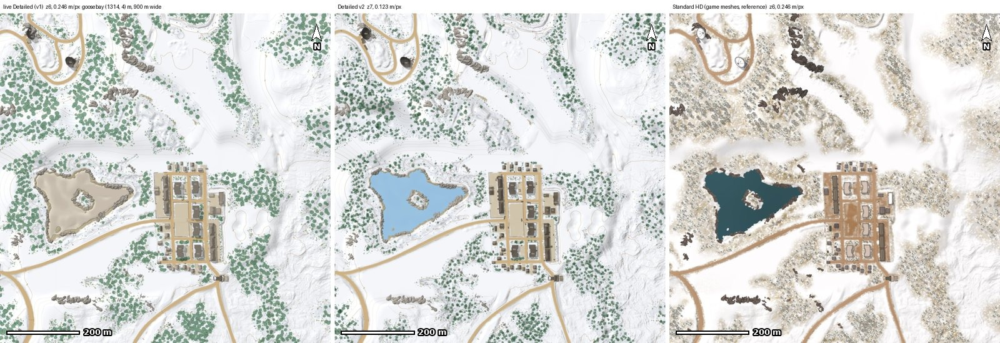

*Figure 16.1.* Goose Bay, 900 m: v1, v2, Standard HD. The lake is water, the houses on snow read at this zoom, trees are their meshes' outlines.

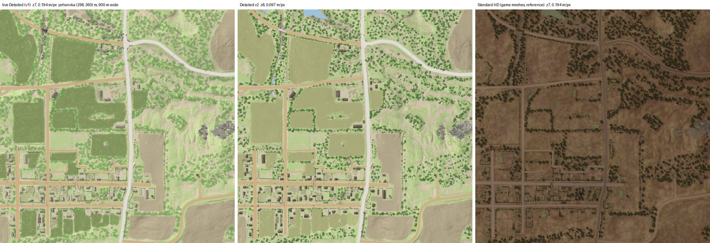

*Figure 16.2.* Yehorivka, 900 m: the wheat fields are fields (v1 drew them as forest), the tree rows along them as in HD.

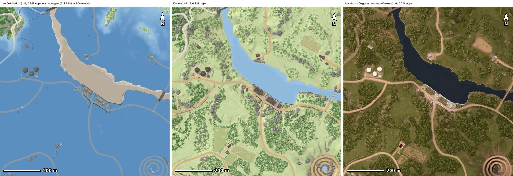

*Figure 16.3.* Manicouagan, 900 m at the dam: v1 drew the land as sea (the sea level of the sound splines); v2 has the reservoir up to the dam.

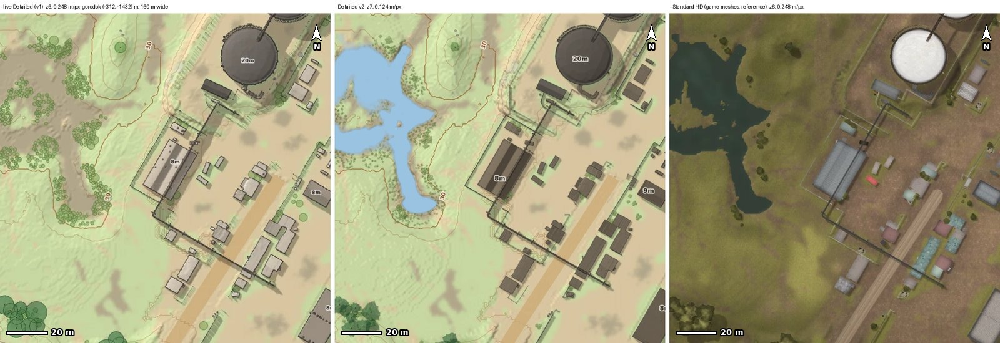

*Figure 16.4.* Gorodok, 160 m: building outlines from the client's meshes (v1: the server's 0.25 m collision).

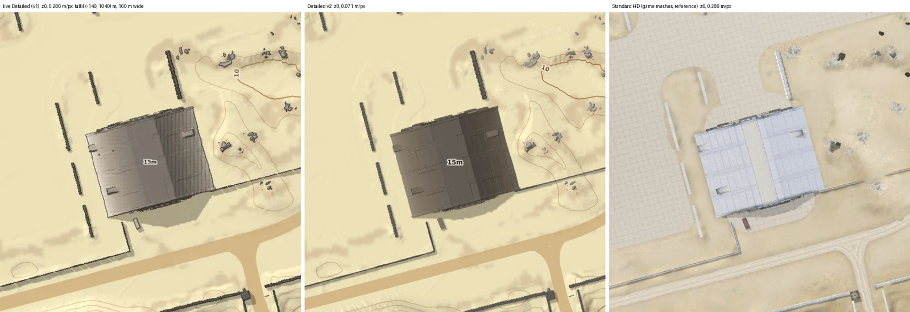

*Figure 16.5.* Tallil, 160 m: 0.071 m/px against 0.286; the roof panels and skylights as in HD.

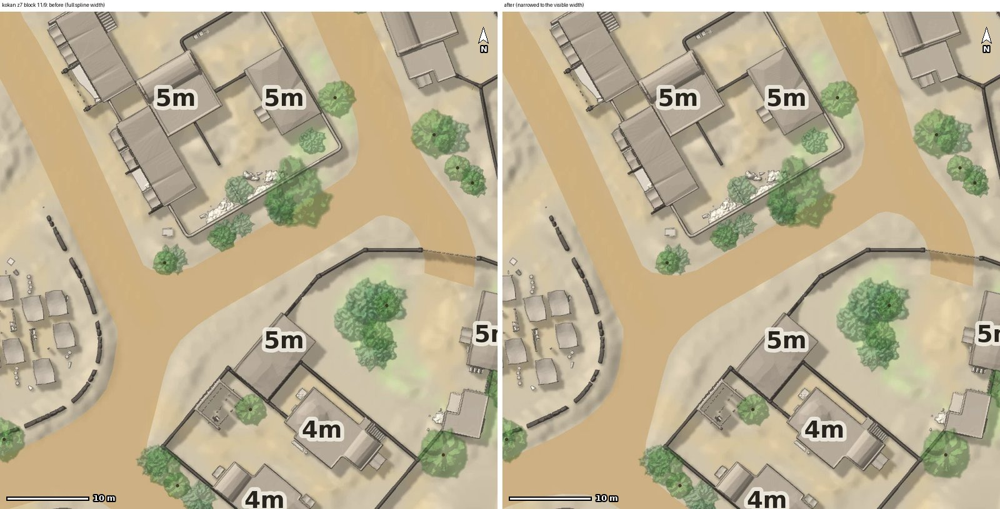

*Figure 16.6.* Kokan, zoom 7: dirt roads at their laid width (left) and at the width their material shows (right).


*Figure 16.7.* Goose Bay, zoom 3 (1.97 m/px): before and after the three legibility rules.

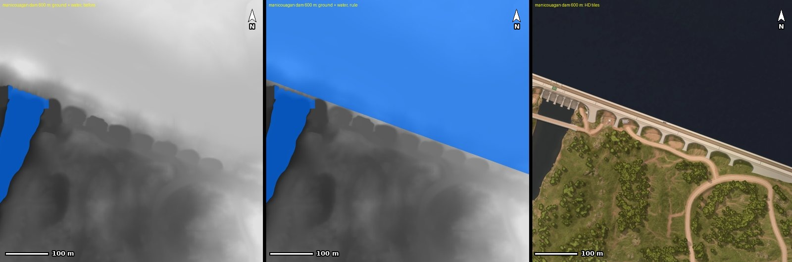

*Figure 16.8.* Manicouagan, 600 m at the dam: water before the fixes, water after (the lake plane ends at the dam), Standard HD.

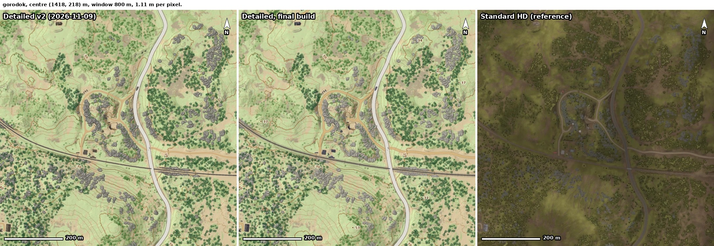

*Figure 16.9.* Gorodok, 800 m at the railway junction (1418, 218): v2, the final build, Standard HD. Slate buildings, a railway with ties, cased dirt roads, summits with their height, lighter rocks.

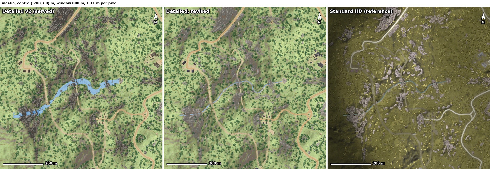

*Figure 16.10.* Mestia, 800 m (-700, 60): the 60 m pond and the wide streams of v2 are the spline meshes' bounds; the final build draws the streams at their meshes' width; the ground beyond the landscape is quiet.

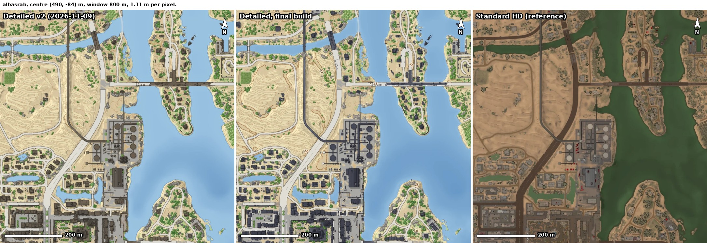

*Figure 16.11.* Al Basrah, 800 m at the refinery (490, -84): v2, the final build, Standard HD; structures against sand and the river's depth.

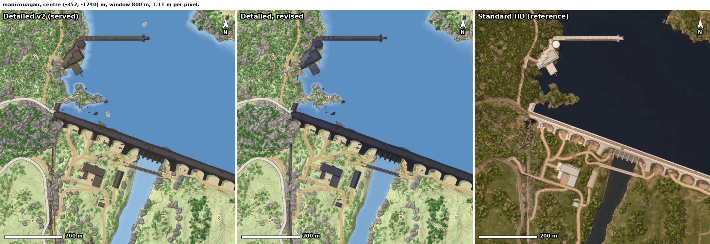

*Figure 16.12.* Manicouagan, 800 m at the dam (-352, -1240): v2, the final build, Standard HD; no contour labels on the reservoir, summits on the land.


*Figure 16.13.* Gorodok, 400 m, v2 (top) and the final build (bottom) under normal vision, protanopia, deuteranopia and tritanopia (Machado et al. 2009): the buildings stay apart from the crowns, the dirt roads keep their casing.

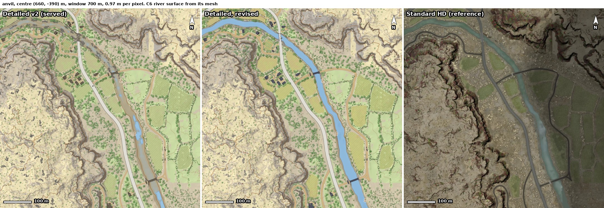

*Figure 16.14.* Anvil, 700 m of the river (660, -390): v2, the final build, Standard HD. v2 draws the river dry; the final build draws it up to its mesh's surface.


*Figure 16.15.* Sanxian, 200 m at the power plant (-465, -1140): object classes by v2's rules (the silos vegetation) and by the revised rules, Standard HD.

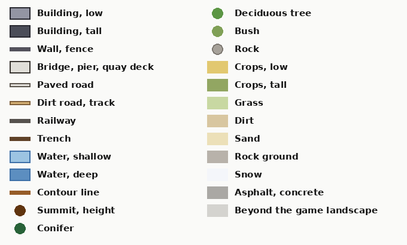

*Figure 16.16.* The legend the final build's tiles carry in their meta.json, as the page shows it.

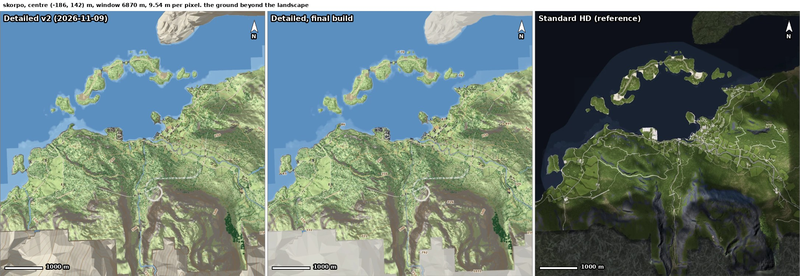

*Figure 16.17.* Skorpo, the whole map: v2, the final build as served (rebuilt on 2026-11-12 with the fix of 16.6) and Standard HD. The first tiles of the final build drew the mountains south of the play area and the island in the north-east corner as sea; the rebuild draws them as ground, as v2 does.

### 16.8 Limitations

* The ground cover is the server's physical material, not the client's painted layers: where a map's art differs from its physics
  (Lashkar's dirt that the game paints green), the tiles follow the physics.
* Roofs are drawn in the map's ramp, darker than many roofs in the game (section 16.5).
* Kohat's low-poly scenery beyond the landscape is drawn as ground relief.
* The raster measures heights over `ground.npy` and the renderer adds back `top_ground.npy`, which differs where scenery fills a void
  beyond the landscape (Skorpo 7.1 km², Kohat 4.6 km²); no object cell lies on such a fill on the maps checked (Kokan 0 of 253 680,
  Mutaha 0), so no drawn roof is affected; INFERRED for the other maps.
* Standard HD, the reference of 16.3.1, renders the same client meshes: it checks the rasteriser and the frame, not the game's
  content.
* The outline F1 depends on the minimap textures that ship with a layer: six layers of five maps can be scored, and Black Coast's
  cannot be placed.
* GPU against CPU (16.3.2) was compared on one map, Narva; INFERRED for the others from the shared code.
* The measures of 16.3.6 to 16.3.8 and the gate take Standard HD as the truth. HD is drawn from the same extraction of the client scene,
  so an object the extraction lacks or misplaces is wrong in both and found by neither; only 16.3.9 and 16.3.10 compare with data of
  another build and another tool (the served heightmap).
* Legibility is argued from an audit by eye of 336 comparison pictures and from colour differences computed for simulated colour vision
  (16.10); no reader with a colour vision deficiency and no player was tested. UNVERIFIED as a usability result.
* The figures of 16.1 to 16.9 describe v2, served from 2026-11-09 to 2026-11-12; 16.10 measures the final build, served since then
  (SquadCalc 45.51.0), against v2 on all 25 maps.
* The intervals of the outline F1 (16.3.3) are on the collision raster's zone; the scene's zone of the table of 16.3.3 would need the scene
  rasters kept after a build.
* A class is the mesh's, not its use: a retaining wall laid as a jetty (Manicouagan, `SM_Foundations_RetainingWall_01` at about
  (−300, −1547) m) is drawn as a wall, where HD shows a light quay.
* Scattered scrub is a carpet of crown dots at 3 m/px and coarser (Kamdesh, Logar). Drawing crowns under 1.5 px as their summed cover was
  tried and taken back: it calmed the scrub but made forests paler and their edges softer than v2's, and a forest edge is what a player reads.
* Crowns take one colour per class and species: a desert shrub is as green as a temperate bush (Logar, Kamdesh), where the game's is dry.

### 16.9 Reproducibility

Game builds: Squad dedicated server 26005357 and Squad client 26234431 (SteamCMD apps 403240 and 393380). One workstation (16.4). Every
random choice (stations, trees, windows, bootstrap draws) uses a fixed seed, so a rerun gives the same numbers.

| Result | Command (`AGL` repository root) |
|---|---|
| All tiles | `tools/maptiles/maptiles.sh extract`, `prep`, `scene`, `render` (per map or all; `WORKERS`, `MEMORY`; GPU raster on the host with `$PYTHON`) |
| Placement gate, height reference | `tools/maptiles/maptiles.sh check <map>` → `$WORK/check/<map>.json` |
| Outline F1 | `OUTLINE_BEFORE=<v1 tiles> tools/maptiles/maptiles.sh outline <map>` → `$WORK/check/<map>_outline_<pair>.json` |
| GPU against CPU | `SCENE_RASTER=cpu tools/maptiles/maptiles.sh scene narva` into a second work directory, then the cell comparison of `top_h0`, `top_c0`, `top_v0` |
| Tests | `docker run ... squadcalc-maptiles-py python -m unittest discover -p 'test_*.py'` in `tools/maptiles/py` (`M-README`, the list of files); `test_scene_gpu.py` on the host |
| Standard HD | `tools/maprender` (`AGL:tools/maprender/README.md`) |

### 16.10 Revision of the symbols (2026-11-10) and the final build (2026-11-12)

**Audit.** Every map was looked at in 336 pictures: the whole map, and windows of 800 m, 120 m and 36 m at its buildings, a
shore, its strongest relief, its roads and a forest edge, each beside Standard HD and the game's own minimap. The audit recorded 399 defects, 44 of them of the kind that misleads a player or hides something a player needs; the complete table is with the report's sources. The ones the revision answers are in the table of changes; the ones it does not are in 16.8.

**Conventions the revision follows.** Imhof's rules for relief (a main light from the upper left, flat ground in a middle tone: *Cartographic
Relief Presentation*, 1965, English edition 2007) and the multidirectional variant of Mark (1992) were already the layer's. From the Swiss
national map's key (swisstopo, *Conventional signs*, 2022: roads by width class, railways with ties, spot heights, lake depth) and the
colour convention of military topographic maps (black for man-made features, blue for water, green for vegetation, brown for relief:
TC 3-25.26, *Map Reading and Land Navigation*) come the dark neutral buildings, the cased roads, the railway ties and the spot heights.
Class colours are chosen by measured difference, after Harrower & Brewer (2003, *The Cartographic Journal* 40(1)): CIEDE2000 of the colours
as drawn, under normal vision and the three dichromacies simulated with the matrices of Machado, Oliveira & Fernandes (2009, *IEEE TVCG*
15(6)); map colours are told apart reliably from a difference of about 10 (Brychtová & Çöltekin 2017, *CaGIS* 44(3)).

**Changes.** Each has a cause that was measured or seen in the audit, a rule, and a test that fails when the rule is taken back
(`AGL:tools/maptiles/py/test_cartography.py`; all 18 take-backs were caught).

| Symbol | Before (v2) | Cause | Revised |
|---|---|---|---|
| Structures | a grey-brown ramp by height | 8.5 from a conifer under deuteranopia (21.2 normal), 9.4 from a shadow; buildings lost among crowns and rocks at 1.5 m/px | a slate ramp (CIELAB hue 285°, L* 74 to 25 in even steps): 25.7 (29.8) and 19.4 |
| Rocks | grey with the buildings' dark rim | louder than the buildings (Gorodok, Fallujah, Yehorivka) | lighter, with a grey rim |
| Dirt roads | a fill without casing | the fill is 2.6 from forest floor under deuteranopia and 3.5 under protanopia | a casing at half an asphalt road's strength: 10 and more on every ground but dirt and mud |
| Railways | a dark line | 2.7 from a wall | cross ties every 4 m at 1 m/px and finer |
| Water colour | linear from shallow to deep over 12 m | a ford and a 2 m channel 4 grey levels apart | the square root of the depth: half the range in the first 3 m |
| Shore | the rim of the water's cover | a faint band at the finest zooms | the level line of half cover, 1.2 px at every zoom |
| Rivers | below the spline's centre line | 16.6: Anvil dry | below the top of the river's mesh |
| Static water planes | every water mesh's bounds | 16.6: streams 40 m wide | not the meshes laid along splines |
| Summits | none | hilltops could not be read (Lashkar, Pacific, Kohat) | the tops 4 m and more above the ground 60 m around them, as a dot with the height |
| Ground beyond the game's landscape | shaded and contoured like ground | the loudest surface of Kohat, Skorpo, Chora, Mestia, Sumari | towards a grey, a third of the relief, no contours, labels or summits |
| Contour labels | anywhere on a major contour | labels on lakes (Manicouagan's reservoir) | none under water or beyond the landscape |
| Decks, pavements | structures | 16.6: bridge a dark bar | one class, light with a dark rim; lower than 1 m over the ground drawn flat as pavement |
| Low crops | a tint 3.7 from tall grass (0.2 under protanopia) | fields invisible without their hatch | a wheat colour |
| Legend | none | a reader had no key to the symbols | `legend` in the tiles' `meta.json`, shown by the page (`SC:src/js/detailedLegend.js`) |

**Contrast of the palette** (`AGL:tools/maptiles/py/palette_contrast.py`, `maptiles.sh palette`): the lowest CIEDE2000 over the ten ground
covers, of the pairs of classes that meet on the map and of each class against its ground.

| Classes | v2: normal / protan / deutan / tritan | revised: normal / protan / deutan / tritan |
|---|---|---|
| building 5 m – conifer | 21.2 / 10.9 / 8.5 / 28.4 | 29.8 / 27.7 / 25.7 / 18.7 |
| building 5 m – deciduous | 27.5 / 22.2 / 20.0 / 31.6 | 35.8 / 33.9 / 32.4 / 27.5 |
| building 5 m – rock | 12.7 / 13.0 / 12.4 / 13.0 | 23.7 / 23.2 / 24.0 / 22.4 |
| building 5 m – shadow | 9.4 / 9.0 / 8.9 / 9.0 | 19.4 / 19.0 / 19.5 / 17.8 |
| wall – conifer | 21.2 / 13.5 / 10.6 / 23.7 | 27.3 / 24.3 / 21.8 / 18.3 |
| dirt road – contour major | 21.7 / 22.0 / 19.3 / 21.2 | 22.9 / 23.1 / 20.4 / 22.2 |
| crop low – crop tall | 7.5 / 5.3 / 5.6 / 10.0 | 9.6 / 6.0 / 7.3 / 17.8 |
| conifer – deciduous | 11.1 / 11.0 / 11.6 / 10.2 | 11.1 / 11.0 / 11.6 / 10.2 |
| against its ground: building 2 m | 23.0 / 23.1 / 22.9 / 22.7 | 31.1 / 30.9 / 31.1 / 30.7 |
| against its ground: wall | 28.4 / 28.6 / 28.1 / 28.5 | 34.1 / 33.8 / 34.0 / 33.1 |
| against its ground: conifer | 21.8 / 14.7 / 16.6 / 29.1 | 21.8 / 14.7 / 16.6 / 29.1 |
| against its ground: deciduous | 14.9 / 7.8 / 7.2 / 21.2 | 14.9 / 7.8 / 7.2 / 21.2 |
| against its ground: bush | 12.0 / 6.8 / 5.7 / 13.8 | 12.0 / 6.8 / 5.7 / 13.8 |
| against its ground: dirt road | 12.8 / 3.5 / 2.6 / 23.7 | 12.8 / 2.8 / 3.3 / 24.4 |
| against its ground: dirt road casing | – | 10.4 / 10.2 / 9.5 / 10.5 |
| against its ground: water shallow | 35.2 / 34.0 / 34.4 / 14.5 | 35.2 / 34.0 / 34.4 / 14.5 |
| against its ground: contour major | 23.0 / 22.3 / 19.2 / 23.0 | 23.0 / 22.3 / 19.2 / 23.0 |
| against its ground: crop low | 3.7 / 0.2 / 0.8 / 8.6 | 6.4 / 6.6 / 6.1 / 3.2 |

The fills of ground-like classes (rock on asphalt, a paved road on gravel, a bridge deck) stay under 10 by design: their rim or casing
carries them. Every label is above the WCAG 2.1 text contrast of 4.5 on its halo (contour 6.8, roof 14.3, summit 9.8).

**Final build.** One build of all 25 maps carries the revision into the served layers. It ran from agl `dev` `d0ae886` from 2026-11-11 05:18 to 2026-11-12 17:25 UTC (every step with its exit code in the build's log): the heightmaps on the landscape's vertices with their terrain raster and volume layer (sections 2 to 4), the Detailed tiles (prep.py, the scene raster on the GPU, the scene step, the render), the Detailed tiles in the game's colours of the three maps that have a fitted style (albasrah, fallujah, gorodok), Standard HD and the relief, then the gate and the measures. The gate failed on Black Coast and Yehorivka with no window measured: their Standard HD was one flat colour, the lighting's sky dome drawn over the whole map (16.6). Their HD was rendered again with `f9f8382`, which leaves the dome out, and checked and measured again (18:57 UTC). The build was deployed on 2026-11-12 as SquadCalc 45.51.0; the tiles and heightmaps it replaced are kept beside the served folder (`maptiles.bak.20261112-1857-final-build`, `heightmaps.bak.20261112-1857-final-build`). Its measures showed Skorpo's ground beyond the landscape drawn as sea (16.6, `deadline-squad/mapping-squad#2`): Skorpo's Detailed was built again with `9c2920f` (prep, scene, render, gate and measures, `skorpo_fix.sh`; its Standard HD and heightmaps did not change) and replaced the served tiles on 2026-11-12 at 21:23 UTC; the tiles drawn as sea are kept as `maptiles-skorpo.bak.20261112-2123-sea`. Skorpo's gate, size, render time and measures below are the rebuild's. 25 of 25 maps pass the placement gate; the largest median offset is 0.054 m and the largest deviation of a window from its map's median 0.132 m. Over the 189 measured windows (177 within 0.1 m) the offset is -0.006 m in x (95 % interval of the mean -0.012 to 0.000) and -0.009 m in y (-0.014 to -0.003); the radial offset has a median of 0.045 m (interval 0.041 to 0.048) and a 95th percentile of 0.119 m. The height reference passes on 25 of 25 maps (largest median difference 0.0025 m). The heightmap gate fails on 6 maps, by 0.13 to 0.38 m on the larger axis (skorpo, yehorivka, tallil, sanxian, blackcoast, foolsroad; v2 failed it on 4: yehorivka 0.13 m, gorodok 0.04 m, manicouagan 0.21 m, foolsroad 0.12 m): it compares the outlines in the finest tiles, 0.07 to 0.12 m per pixel, with 1 m samples of the heightmap taken at the nearest node, so a map that lies right reads pixels off (here up to 3.6 px, 16.3.1); `check_alignment.py` makes it the gate only where a map has no Standard HD, and every map has one. The final build's render times are those of steps that shared the machine with two or three other lanes (`build_rest.sh`: prep and scene beside render, colour render and HD), so they say nothing of the renderer's speed against v2. The slowest step is the render in the game's colours: gorodok 73 847 s (20.5 h), albasrah 16 956 s (4.7 h), fallujah 9 542 s (2.7 h), where Gorodok's Detailed render took 2 395 s (`deadline-squad/mapping-squad#1`).

| Map | Gate, v2: median x, y (m) | Gate, final: median x, y (m); windows / within 0.1 m | Heightmap gate, final: median x, y (m) | Tiles MB, v2 → final | Render, v2 → final (s) |
|---|---|---|---|---|---|
| skorpo | 0.002, -0.032 | -0.004, -0.019; 8 / 8 | 0.125, 0.379 (fails) | 590.3 → 555.2 | 2295 → 2392 |
| yehorivka | 0.011, -0.014 | 0.014, -0.009; 8 / 8 | -0.094, 0.134 (fails) | 704.9 → 704.5 | 4384 → 7554 |
| tallil | -0.034, -0.010 | -0.015, -0.013; 8 / 6 | 0.038, 0.132 (fails) | 431.3 → 435.7 | 3045 → 5885 |
| kohat | -0.017, -0.033 | -0.012, -0.026; 8 / 8 | -0.030, -0.015 | 673.5 → 653.5 | 3519 → 6340 |
| sanxian | 0.019, 0.012 | 0.010, -0.014; 7 / 6 | 0.099, 0.129 (fails) | 509.0 → 509.0 | 3299 → 8417 |
| blackcoast | 0.012, -0.031 | 0.003, -0.014; 6 / 6 | -0.048, -0.138 (fails) | 635.9 → 627.6 | 3223 → 5013 |
| lashkar | 0.008, -0.067 | 0.012, -0.054; 6 / 5 | -0.000, 0.008 | 991.4 → 973.5 | 4616 → 8261 |
| gorodok | 0.001, -0.008 | -0.012, -0.001; 8 / 8 | -0.008, -0.021 | 251.7 → 251.7 | 2143 → 2395 |
| chora | -0.037, -0.020 | -0.036, -0.018; 8 / 8 | 0.002, 0.022 | 155.2 → 127.3 | 943 → 770 |
| pacific | 0.007, 0.015 | 0.027, 0.034; 7 / 7 | -0.049, 0.022 | 64.6 → 64.8 | 815 → 970 |
| harju | -0.013, -0.027 | -0.016, -0.021; 8 / 8 | -0.001, -0.037 | 216.9 → 218.9 | 1556 → 2288 |
| manicouagan | -0.014, -0.039 | -0.017, -0.042; 8 / 8 | 0.108, -0.048 | 256.0 → 259.8 | 1547 → 2896 |
| goosebay | -0.007, -0.020 | -0.006, -0.032; 8 / 7 | -0.072, 0.100 | 207.6 → 210.1 | 1051 → 2296 |
| jensen | -0.016, -0.017 | 0.004, -0.008; 6 / 5 | -0.115, 0.078 | 109.3 → 109.7 | 638 → 1146 |
| albasrah | -0.013, 0.016 | -0.022, 0.007; 8 / 7 | -0.002, -0.044 | 190.9 → 195.7 | 1359 → 1424 |
| kamdesh | 0.016, -0.003 | 0.003, -0.008; 8 / 8 | 0.012, -0.063 | 219.4 → 217.3 | 1087 → 2098 |
| anvil | -0.012, 0.017 | -0.021, 0.015; 8 / 8 | -0.025, -0.008 | 203.8 → 205.1 | 1243 → 1701 |
| fallujah | -0.003, 0.011 | 0.004, -0.008; 8 / 7 | 0.005, 0.016 | 162.9 → 165.0 | 1144 → 1004 |
| narva | -0.022, -0.005 | -0.026, 0.002; 8 / 7 | -0.071, -0.041 | 127.5 → 129.6 | 1156 → 2134 |
| mutaha | -0.003, -0.037 | -0.010, -0.031; 8 / 8 | 0.018, -0.030 | 154.6 → 154.8 | 800 → 2442 |
| kokan | 0.005, 0.002 | 0.006, 0.004; 8 / 8 | 0.000, -0.016 | 153.1 → 153.6 | 759 → 1498 |
| mestia | 0.006, -0.003 | 0.007, -0.001; 8 / 7 | -0.047, 0.004 | 158.9 → 153.5 | 1249 → 2443 |
| foolsroad | -0.006, -0.007 | -0.004, -0.007; 7 / 6 | 0.054, 0.236 (fails) | 58.9 → 59.4 | 288 → 599 |
| logar | -0.056, -0.052 | -0.032, -0.024; 8 / 7 | -0.037, -0.045 | 60.6 → 61.6 | 245 → 655 |
| sumari | -0.001, 0.002 | -0.002, 0.000; 6 / 6 | -0.011, 0.008 | 40.5 → 39.4 | 212 → 519 |

**Measures on the final build.** Each cell is v2 → final build. Both builds' tiles are measured by 16.3.6 to 16.3.10 against the final build's references (its prepared data, its Standard HD and the heightmaps on the landscape's vertices), so a change is the tiles' own; v2's cells therefore differ from 16.3, which measured v2 against the references served with it. Two columns give each build against the heightmap served with it (v2's are those of 16.3.9 and 16.3.10): the roof labels, which are not read from the tiles' pixels, and the contours, whose heights count from the heightmap's lowest point; the final build's heightmaps moved that point by up to 6.20 m (albasrah), so v2's contours read on them measure the move, not the drawing (albasrah: 612 px). Over the 25 maps the largest median offset of the final build's road centreline from HD's is 0.094 m (blackcoast); the median difference of the roof labels stays within 0.05 m of v2's on 21 of 25 maps (the others: skorpo 0.24 → 0.38, blackcoast 0.19 → 0.33, manicouagan 0.08 → 0.14, foolsroad 0.21 → 0.30); the median distance of the contours at the finest zoom stays within 0.02 px on 19 of 25 maps (the largest changes: sumari 0.66 → 0.88, lashkar 0.44 → 0.53, yehorivka 0.22 → 0.27, mutaha 0.22 → 0.27); every lone tree is drawn on 24 of 24 maps with trees. Water IoU rises by more than 0.02 on 5 of 22 maps with water in both builds (anvil 0.06 → 0.79, yehorivka 0.65 → 0.83, kamdesh 0.07 → 0.18, chora 0.61 → 0.68, kohat 0.49 → 0.51); it falls by more than 0.02 on tallil 0.84 → 0.80, mutaha 0.91 → 0.89, sumari 0.41 → 0.39. On mestia (0.02) the water of v2 was mostly false (the share of v2's water that is water in HD in brackets) and the final build's is under the 0.05 % of the map the measure needs. The tiles Skorpo's Detailed first had in the final build drew the ground beyond the landscape as sea (water 49.2 % of the map, IoU 0.925 against HD; 16.6); the rebuilt tiles that are served have 37.4 % (37.4 % in v2) and an IoU of 0.980 (v2 0.978).

| Map | Road centre, larger axis (m) | Road width, tiles / HD | Water IoU | Water, share of the map (%) | Roof label − heightmap (m) | Contours, finest zoom (px) | Lone trees drawn |
|---|---|---|---|---|---|---|---|
| skorpo | 0.012 → 0.010 | 0.80 → 0.76 | 0.978 → 0.980 | 37.383 → 37.399 | 0.24 → 0.38 | 0.24 → 0.24 | 300 → 300 / 300 |
| yehorivka | 0.001 → 0.000 | 1.18 → 1.08 | 0.653 → 0.832 | 0.529 → 0.711 | 0.20 → 0.22 | 0.22 → 0.27 | 300 → 300 / 300 |
| tallil | 0.004 → 0.008 | 1.06 → 1.08 | 0.837 → 0.801 | 0.478 → 0.503 | 0.05 → 0.08 | 0.67 → 0.70 | 300 → 300 / 300 |
| kohat | 0.003 → 0.006 | 1.22 → 1.26 | 0.487 → 0.509 | 0.684 → 0.678 | 0.07 → 0.08 | 0.40 → 0.40 | 300 → 300 / 300 |
| sanxian | 0.006 → 0.004 | 0.84 → 0.84 | 0.992 → 0.989 | 46.477 → 46.676 | 0.08 → 0.08 | 0.62 → 0.61 | 300 → 300 / 300 |
| blackcoast | 0.083 → 0.094 | 1.27 → 1.22 | 0.967 → 0.962 | 21.468 → 21.605 | 0.19 → 0.33 | 0.54 → 0.54 | 300 → 300 / 300 |
| lashkar | 0.008 → 0.003 | 2.13 → 2.11 | 0.810 → 0.812 | 1.265 → 1.337 | 0.03 → 0.03 | 0.44 → 0.53 | 300 → 300 / 300 |
| gorodok | 0.003 → 0.006 | 1.06 → 1.12 | 0.864 → 0.878 | 3.729 → 3.857 | 0.18 → 0.19 | 0.21 → 0.21 | 300 → 300 / 300 |
| chora | 0.001 → 0.002 | 1.04 → 1.10 | 0.605 → 0.677 | 0.998 → 0.972 | 0.11 → 0.11 | 0.22 → 0.26 | 298 → 300 / 300 |
| pacific | 0.005 → 0.024 | 1.05 → 1.11 | 0.989 → 0.989 | 90.496 → 90.560 | 0.11 → 0.11 | 0.21 → 0.21 | 167 → 167 / 167 |
| harju | 0.016 → 0.017 | 0.78 → 0.75 | 0.984 → 0.981 | 34.164 → 34.312 | 0.14 → 0.15 | 0.21 → 0.20 | 300 → 300 / 300 |
| manicouagan | 0.007 → 0.014 | 0.75 → 0.76 | 0.931 → 0.944 | 8.722 → 8.915 | 0.08 → 0.14 | 0.21 → 0.21 | 300 → 300 / 300 |
| goosebay | 0.069 → 0.062 | 0.86 → 0.88 | 0.963 → 0.972 | 15.472 → 15.348 | 0.12 → 0.17 | 0.26 → 0.25 | 300 → 300 / 300 |
| jensen | 0.068 → 0.080 | 1.26 → 1.37 | – → – | 0.000 → 0.000 | 0.08 → 0.05 | 0.22 → 0.22 | 0 → 0 / 0 |
| albasrah | 0.000 → 0.000 | 1.01 → 1.01 | 0.909 → 0.905 | 10.516 → 10.810 | 0.12 → 0.13 | 0.20 → 0.21 | 235 → 235 / 235 |
| kamdesh | 0.061 → 0.061 | 0.48 → 0.48 | 0.069 → 0.175 | 0.101 → 0.120 | 0.01 → 0.01 | 0.21 → 0.21 | 300 → 300 / 300 |
| anvil | 0.000 → 0.000 | 1.00 → 1.03 | 0.056 → 0.787 | 0.124 → 1.246 | 0.08 → 0.08 | 0.21 → 0.22 | 300 → 300 / 300 |
| fallujah | 0.018 → 0.010 | 2.23 → 2.19 | 0.768 → 0.775 | 3.917 → 4.009 | 0.08 → 0.08 | 0.20 → 0.20 | 300 → 300 / 300 |
| narva | 0.002 → 0.001 | 0.82 → 0.81 | 0.957 → 0.946 | 9.138 → 9.278 | 0.17 → 0.17 | 0.23 → 0.23 | 300 → 300 / 300 |
| mutaha | 0.001 → 0.001 | 0.96 → 0.96 | 0.913 → 0.885 | 2.029 → 2.119 | 0.05 → 0.06 | 0.22 → 0.27 | 300 → 300 / 300 |
| kokan | 0.011 → 0.019 | 1.25 → 1.22 | 0.289 → 0.287 | 7.970 → 8.087 | 0.07 → 0.07 | 0.51 → 0.52 | 300 → 300 / 300 |
| mestia | 0.000 → 0.002 | 1.68 → 1.07 | 0.024 → – | 0.229 → 0.034 | 0.15 → 0.15 | 0.45 → 0.45 | 300 → 300 / 300 |
| foolsroad | 0.036 → 0.054 | 0.89 → 0.88 | 0.337 → 0.356 | 1.133 → 1.205 | 0.21 → 0.30 | 0.21 → 0.21 | 300 → 300 / 300 |
| logar | 0.004 → 0.001 | 1.44 → 1.39 | – → – | 0.050 → 0.041 | 0.07 → 0.10 | 0.21 → 0.22 | 300 → 300 / 300 |
| sumari | 0.040 → 0.070 | 1.70 → 1.43 | 0.406 → 0.386 | 0.905 → 0.954 | 0.06 → 0.06 | 0.66 → 0.88 | 101 → 101 / 101 |

### 16.11 Reproducibility of the revision and the final build

| Result | Command |
|---|---|
| Measures of 16.3.6 to 16.3.10 | `tools/maptiles/maptiles.sh measure [map ...]` → `$WORK/check/<map>_{roads,water,crowns,heights,contours}.json`; the Python image of `maptiles.sh setup` (numpy 2.5.4, scipy 1.18.1, Pillow 13.0.0), bootstrap seed 0 |
| The final build | `build_all.sh` and `build_rest.sh` (kept with the report's sources) on agl `d0ae886`: `tools/heightmaps/heightmaps.sh build`, then per map `tools/maptiles/maptiles.sh prep`, `scene`, `render`, `colour-render` and `tools/maprender/maprender.sh render`, then `maptiles.sh relief`, `check` and `measure`; `hd_fix.sh` and `check_fix.sh` the Standard HD, gate and measures of blackcoast and yehorivka on `f9f8382`; `skorpo_fix.sh` Skorpo's prep, scene, render, gate and measures on `9c2920f`; every step's exit code in the build's `build.log` |
| v2 against the final build's references (16.10) | `measure_accuracy.py` in the container of `maptiles.sh measure`, `/tiles` the v2 tiles, `/hd`, `/heightmaps` and `/prep` the final build's (`run_jobs.sh`, with the report's generators); Skorpo's five measures of v2 rerun on the references of the rebuild (`skorpo_v2_rebuild.sh`, the same container and mounts, `/prep` and `/hd` as served) give files byte-identical to the first run's (`cmp`) |
| Skorpo's tiles drawn as sea (16.6, 16.10) | the water measure on them: `measure_accuracy.py water skorpo` in that container with `/tiles/skorpo` the kept `maptiles-skorpo.bak.20261112-2123-sea` → `skorpo_water.json` in a work folder of its own, which `collect_v3.py` reads (with the report's generators) |
| Pooled statistics of the gate, tables of 16.3 and 16.10 | `collect_v3.py <evaluation dir> <generators dir>`, `assemble16.py <parity json> <out dir>`, `insert16.py <docs dir>` (the generators kept with the report's sources) |
| Palette contrast | `tools/maptiles/maptiles.sh palette` |
| Water of v2 and of the revision against HD | `water_eval.py` (with the report's generators): `render.draw_water` on the prepared ground, zoom 4 |
| Tests and take-backs | `python -m unittest test_scene test_cartography test_layer_minimaps` in the Python image; `mutation_check.py` |
| Legend in the page | `SC`: `npm test` (`tests/detailedLegend.test.mjs`), `detailed_legend_check.mjs <site URL>` |
| Outline F1 with intervals (16.3.3) | `run_jobs.sh` (with the report's generators): `prep.py <map>` of the build's tools for the six maps into a folder of its own, then `outline_revised.sh`: `outline_revised.py <map> <pair> <out json> v1=<tiles> v2=<tiles> revised=<final tiles> hd=<HD served with v2> hd_final=<final HD>` → `check_new/outline/<pair>.json` |
| Figures 16.9 to 16.17 | `make_figures.sh` (with the report's generators): `fig_v3.py triptych`, `cvd`, `legend`, `classes` with `V2` the v2 tiles, `NEW` the final build's, `HD` its Standard HD |

## 17. Formulas: the calculations of the calculator in mathematical notation

This section states every calculation of SquadCalc as a numbered formula. Written 2026-11-15. It replaces the prose and ASCII formulas of
the code headers as the specification: the code is checked against it, not the other way round. Formulas are numbered F1, F2, ... in order of
appearance; the Russian version has the same numbers. The sources are the research report of 2026-11-13 (`AGL:docs/research-native-core.ru.md`: Appendix A and
section 9.1, the list of the computations that had no written formula) and the code itself.

### 17.1 Conventions and how each formula was checked

*Units and symbols.* Lengths are metres, times seconds, speeds m/s, angles radians unless a unit is written ("degrees", "mil", "$^\circ$"). A bearing is in degrees clockwise from north.
The symbols of a formula are listed with it. The map's coordinates are $(\varphi, \lambda)$ in map units ($P = 256$ units per map side); world coordinates are $x$ east and $y$ south in metres.

*Code references.* "Code" gives the file and line numbers at SquadCalc `dev` `ef176dde6` (version 45.52.0); the JavaScript file is the one the page runs, the Rust file the engine
(`SC:engine/src`) where a copy exists. A line number is a reading aid; the check of `AGL:tools/release/check_report_refs.py` resolves the file, not the line (`SQUADCALC_REPO=<checkout of ef176dde6> python3 tools/release/check_report_refs.py`). The first reading of this section was at `9664362c9` (version 45.51.0); where 45.52.0 made a statement false, the text says what changed and with which commit. The Squad Ballistics paths are read at `7a8753b` (version 1.7.4; its `ballistics.py` is the file of `c6dc653`, the commit of the first reading).

*Where a formula is the specification and the code differs.* Each such place is called a known deviation and is stated at the formula. The deviations found while writing this section are
listed in section 17.12.

*How a formula was checked.* For every numbered formula a script written from the formula (not from the code) evaluates it on sample inputs, in 50-digit decimal arithmetic where precision matters, and compares it with the output of the real JavaScript
or Rust function. The scripts and their raw output are kept outside the repository, in `~/data/research/native-core-2026-11-13/formulas/` (one directory per group, a header comment in each script gives its command). Section 17.13 lists, per formula,
the script, the number of cases and the largest difference found. A formula that is a definition or a constant with nothing to evaluate was checked against the data it names; the table says so.

*Error statements.* An approximation always carries a bound or a measured error. "Derived" means a bound proved here; "measured" means a number from a script of this section or from a FINDINGS file of the archive
(`~/data/research/native-core-2026-11-13/<group>/FINDINGS.md`, named where used).

### 17.2 The flight model

Notation of sections 17.2 and 17.3. All lengths in metres, times in seconds, speeds in m/s, angles in radians unless a unit is
written. The plane of the flight is $(x, y)$: $x$ is the horizontal distance from the barrel pivot towards the target, $y$ the
height above the ground under the weapon. $\theta$ is the barrel elevation, $\hat{\mathbf e}(\theta) = (\cos\theta, \sin\theta)$.
A shot has the parameters of the type `Shot` (`SC:src/js/squadBallistics.js:108-120`): launch speed $v_0$, gravity $g = k_g \cdot 9.80$
($k_g$ is the projectile's gravity scale), motor acceleration $a$ for the time $T$ (negative: the motor slows the projectile),
speed cap $V$ ($V = 0$: none), the flag "rotation follows velocity", pivot height $h$, muzzle offset $f$ along the barrel and $u$ above
its axis. The game's gravity vector is $\mathbf g = (0, -g)$.

**The frame.** The dedicated server moves a projectile once per server frame. The frame is measured from the server's own
frame-rate lines (research report, `AGL:docs/research-native-core.ru.md`, section 2.4): median 49.87 Hz
over 48 055 samples of the production server and 651 of the Training server.

$$\Delta t = \frac{1}{49.87\ \mathrm{Hz}} = 20.052\ \mathrm{ms} \tag{F1}$$

The calculator flies this frame since 45.52.0 (`FRAME_TIME`, `SC:src/js/squadBallistics.js:95`; `FRAME_TIME` in `SC:engine/src/flight.rs:61`); at `9664362c9` (45.51.0) it stepped $\Delta t = 0.02$ s (`SUBSTEP`). The
frame and the motor rule below (F2) are the subject of `deadline-squad/deadline-squadcalc#49`, and the formulas below are stated with $\Delta t$ as a parameter. The model has these labels: the frame is VERIFIED (server logs), the
condition of the motor and the spawn inside the network call are VERIFIED (server binary, build 26005357), and the first
movement of the projectile in the frame of its spawn is INFERRED from stock engine behaviour (research report, section 2.4).

**The motor frames.** The thrust acts on a frame only while $\operatorname{float}(t_0 + T) > t$ holds, with the creation time $t_0$
and the world time $t$. At the $k$-th movement of a projectile $t - t_0 = k\,\Delta t$, $k = 1, 2, \dots$. The thrust therefore
acts on the frames $k$ with $k\,\Delta t < T$:

$$N = \left\lceil \frac{T}{\Delta t} \right\rceil - 1, \qquad \chi_n = \begin{cases} 1, & n < N,\\ 0, & n \ge N,\end{cases}
\qquad n = 0, 1, 2, \dots \tag{F2}$$

where $n$ counts the frames of the flight from 0 and $\chi_n$ says whether the motor acts on frame $n$ (the $k$-th movement is frame
$n = k - 1$). The calculator uses $\lceil T/\Delta t - 10^{-9}\rceil - 1$ frames (`boostSteps`, `SC:src/js/squadBallistics.js:140-143`; Rust `boost_steps`, `SC:engine/src/flight.rs:100-105`), which is $N$ of F2
with the $10^{-9}$ that keeps a $T$ that is a whole number of frames, to rounding, from gaining one. For the motor times of `SC:src/data/weapons.js` the rule gives $N$ = 29, 32, 39, 54, 74
and 99 frames for $T$ = 0.6, 0.65, 0.8, 1.1, 1.5 and 2.0 s (the calculator before 45.52.0: 30, 40, 55, 75 and 100 for $T$ = 0.6, 0.8, 1.1, 1.5 and 2.0 s). Since 45.52.0 the
NLAW's `accelerationTime` is 0.65 s instead of 0.6 s, so that its rocket keeps its 250 m/s instead of 243.5 m/s (`SC:CHANGELOG.md`). The thrust lasts $N\,\Delta t$
seconds: 1.9852 s for the UB-32's 2.0 s, 0.6417 s for the NLAW's 0.65 s.

**The step.** Let $\mathbf p_n$, $\mathbf v_n$ be the position and velocity at the start of frame $n$ and $\mathbf R_n$ the
projectile's rotation (a unit vector). $\operatorname{clamp}_V(\mathbf w) = \mathbf w \cdot \min(1, V/\lvert\mathbf w\rvert)$ limits the
speed to $V$ (for $V = 0$ it does nothing). The initial state is $\mathbf p_0 = (x_0, y_0)$ from F5, $\mathbf v_0 = v_0\,\hat{\mathbf e}(\theta)$,
$\mathbf R_0 = \hat{\mathbf e}(\theta)$. One frame, velocity Verlet with a lagging rotation, is

$$\begin{aligned}
\mathbf u_n &= \operatorname{clamp}_V\!\big(\mathbf v_n + (\chi_n\,a\,\mathbf R_n + \mathbf g)\,\Delta t\big),\\
\mathbf p_{n+1} &= \mathbf p_n + \tfrac12\,(\mathbf v_n + \mathbf u_n)\,\Delta t,\\
\mathbf R_{n+1} &= \mathbf v_n / \lvert\mathbf v_n\rvert \ \text{(rotation follows velocity)},\quad \mathbf R_{n+1} = \mathbf R_n \ \text{(otherwise)},\\
\mathbf v_{n+1} &= \operatorname{clamp}_V\!\big(\mathbf v_n + (\chi_n\,a\,\mathbf R_{n+1} + \mathbf g)\,\Delta t\big).
\end{aligned} \tag{F3}$$

Between two frames the projectile moves on the straight chord from $\mathbf p_n$ to $\mathbf p_{n+1}$. The motor therefore pushes along
the path with a delay of one frame in the move, and a projectile fired above its cap is slowed to it in the first frame. VERIFIED:
the scheme is read from the game (`SB:ballistics.py` module docstring; `SC:src/js/squadBallistics.js:1-55`; code `flyBoost`,
`SC:src/js/squadBallistics.js:257-314`, `fly_boost`, `SC:engine/src/flight.rs:202`).

**Lemma (the chord).** Without motor and cap the acceleration is constant, and the nodes $\mathbf p_n$ of F3 lie exactly on the
continuous parabola $\mathbf p_0 + \mathbf v_0 t_n + \tfrac12\mathbf g t_n^2$, $t_n = n\,\Delta t$. Between the nodes the game follows
the chord, which lies below the parabola by at most

$$\delta_{\max} = \frac{g\,\Delta t^2}{8}, \qquad \text{for a path of horizontal length } L \text{ at horizontal speed } v_x:\ \ \delta_{\max} = \frac{g\,L^2}{8\,v_x^2}. \tag{F4}$$

Proof: the vertical distance of the chord from $y(x) = y_0 + \mu x - \tfrac{g}{2 v_x^2}x^2$ is $\tfrac{g}{2 v_x^2}(x - x_n)(x_{n+1} - x)$,
largest in the middle of the interval, $\tfrac{g}{2v_x^2}\,(L/2)^2$ with $L = v_x\,\Delta t$. For $g = 9.80$: 0.493 mm at 20.052 ms
(0.490 mm at the 0.02 s of 45.51.0); for $g = 19.6$ (gravity scale 2): 0.985 mm (0.980 mm). This is the floor of the error of every closed-form
formula below against the game: it is a property of the game's stepping, not of the formulas.

### 17.3 Closed-form flights

**Launch point.** The projectile starts at the muzzle, which moves with the elevation:

$$x_0 = f\cos\theta - u\sin\theta, \qquad y_0 = h + f\sin\theta + u\cos\theta. \tag{F5}$$

Symbols: $f$, $u$, $h$ in m (for the Mortar $f = 1.569$, $u = 0.002$, $h = 0.0245$). Domain: $\theta \in (-\pi/2, \pi/2)$.
Code: `launchPoint`, `SC:src/js/squadBallistics.js:240-247`; `launch_point`, `SC:engine/src/flight.rs:178`. Exact (two multiplications and an addition).

**A plain parabola.** A shell without motor, with the launch inside its cap, coasts on a parabola. At the distance $X$ from the pivot
($\tau = (X - x_0)/(v_0\cos\theta)$ is the time since launch):

$$y(\theta, X) = y_0 + \tau\Big(v_0\sin\theta - \frac{g}{2}\,\tau\Big), \qquad t(\theta, X) = \tau = \frac{X - x_0}{v_0\cos\theta}. \tag{F6}$$

Domain: $X > x_0$ (a distance behind the muzzle extrapolates the parabola backwards; `pastMuzzle` in F20 keeps that out of the answers).
Code: `coastHeight`, `SC:src/js/squadBallistics.js:487-504`, `coastAt` (time) line 536-556. Exact for the continuous parabola; against the
game's stepped scheme the error is at most the chord of F4, measured 1.15 mm over 2 328 cases.

**Elevation for a target (closed form).** For a target at the horizontal distance $D$ and the height $H$ above the ground under the
weapon, with the launch at the pivot ($f = u = 0$), let $s = H - h$ be the rise from the pivot. The hit condition $y(\theta, D) = H$ of
F6 is a quadratic in $\tau_\theta = \tan\theta$, whose roots are the low and the high arc:

$$\frac{g D^2}{2 v_0^2}\,\tau_\theta^2 - D\,\tau_\theta + \Big(s + \frac{g D^2}{2 v_0^2}\Big) = 0,\qquad
\Delta = v_0^4 - g\,(g D^2 + 2 s\,v_0^2),\qquad
\theta_{\mp} = \arctan\frac{v_0^2 \mp \sqrt{\Delta}}{g D}. \tag{F7}$$

The upper sign is the low (flat) arc, the lower the high (lofted) arc. A solution exists for $\Delta \ge 0$, that is below the safety
parabola $s \le \dfrac{v_0^2}{2g} - \dfrac{g D^2}{2 v_0^2}$. Domain of the closed form in the code: the shell has no motor, no muzzle offset, is not fired
above its cap, $g > 0$, and does not come down faster than its cap before the target ($v_0^2 + 2g(h - H) \le V^2$):

$$\text{closed form} \iff a\,T = 0 \ \wedge\ f = u = 0 \ \wedge\ \neg(V > 0 \wedge v_0 > V) \ \wedge\ g > 0 \ \wedge\ \neg\big(V > 0 \wedge v_0^2 + 2g(h - H) > V^2\big). \tag{F8}$$

Code: `solveElevation`, `SC:src/js/squadBallistics.js:1083-1092`, with `isParabola` (line 214) and `clampsBefore` (line 227); Rust
`solve_elevation`, `SC:engine/src/flight.rs:1009-1021`. For the 163 shells with gravity at target height 0, F8 holds for 42; the other 121 use the
searches of section 17.4. Error: a median of $10^{-16}$ rad against 60-digit arithmetic (ballistics/FINDINGS.md); this report
measured at most $1.1\cdot10^{-15}$ rad of the page's solver on 2 353 cases away from the envelope ($\Delta > 10^{-3}v_0^4$; the direct form of the low root would give $5.0\cdot10^{-15}$ rad). Near the envelope the error grows
as the problem becomes ill-conditioned: $\partial\theta/\partial\Delta \sim 1/\sqrt{\Delta}$, measured up to $3.9\cdot10^{-9}$ rad at $\Delta/v_0^4 \approx 10^{-12}$.

**The stable low root.** The direct form of the low root subtracts two nearly equal numbers when $\sqrt{\Delta}$ is close to $v_0^2$,
that is for short distances and fast shells. By Vieta's relation $\tan\theta_-\tan\theta_+ = 1 + 2 s v_0^2/(g D^2)$ the low root is
computed without the subtraction:

$$\tan\theta_- = \frac{g D^2 + 2 s\,v_0^2}{D\,\big(v_0^2 + \sqrt{\Delta}\big)}. \tag{F9}$$

The code computes the low root this way since 45.52.0 (`solveElevation`, `SC:src/js/squadBallistics.js:1090`, and the same in `solve_elevation_with`, `SC:engine/src/flight.rs`; commit `4dddc7dcc`): it divides the constant term of the quadratic by the high root, which is F9 written the other way round. At `9664362c9` (45.51.0) it used the direct form
F7 for the low root, which is the deviation that 17.12 listed. Measured error on the worst inputs ($v_0 = 1200$ m/s, $D = 0.5$–$5$ m; $g = 1$ and $2$): direct form
$1.5\cdot10^{-11}$ rad, F9 $2.8\cdot10^{-17}$ rad, the page's low root $5.6\cdot10^{-17}$ rad. The research report gives up to $7.4\cdot10^{-12}$ rad for the catalogue and $8.6\cdot10^{-10}$ rad for
$g < 3$ m/s². References: Boldo (2009) and Goldberg (1991), see section 17.11.

**The farthest target.** The set of reachable points is bounded by the safety parabola; at the height $H$ with $s = H - h$ the greatest distance
and, for $h = 0$ on level ground, the greatest range are

$$D_{\max}(s) = \frac{v_0}{g}\sqrt{v_0^2 - 2 g\,s}, \qquad D_{\max}(0) = \frac{v_0^2}{g}. \tag{F10}$$

For $s = 0$ and the elevation $45^\circ$. Code: `maxRange`, `SC:src/js/squadBallistics.js:1115-1134`: the closed form $v_0^2/g$ for a plain parabola with
$h = 0$ (line 1116); otherwise the largest $D$ with $\max_\theta y(\theta, D) \ge 0$ by doubling and then bisection until the bracket is shorter than
$10^{-3}$ m (loop line 1128, at most 200 steps). Error of the numerical branch: at most the 1 mm of the bisection.

**A motor along the barrel's axis.** The rotation stays $\hat{\mathbf e}$ (the UB-32's S-5), the closed form holds when the cap cannot clamp it
(`capBindsOnAxis`, line 162: $v_0 > V$ or $\lvert v_0 + aT\rvert + gT > V$ is false). The path along the axis is $L(t) = v_0 t + \tfrac12 a t^2$,
the position $\mathbf p(t) = \mathbf p_0 + \hat{\mathbf e}\,L(t) + \tfrac12\,\mathbf g\,t^2$. The time to reach the path length $\ell$ (stable form) and the
state when the motor stops after the time $T_m$ are

$$t(\ell) = \frac{2\ell}{v_0 + \sqrt{v_0^2 + 2 a\,\ell}}, \qquad
\mathbf p_m = \mathbf p_0 + \hat{\mathbf e}\Big(v_0 T_m + \tfrac12 a T_m^2\Big) + \tfrac12\,\mathbf g\,T_m^2, \qquad
\mathbf v_m = (v_0 + a T_m)\,\hat{\mathbf e} + \mathbf g\,T_m. \tag{F11}$$

The total acceleration $a\,\hat{\mathbf e} + \mathbf g$ is constant, so the flight is two parabolas joined at $T_m$: the second one is a plain parabola
F6 (or the capped coast F12) from $(\mathbf p_m, \mathbf v_m)$. The motor time $T_m$ is the thrust time of the model, $T_m = N\,\Delta t$ with $N$ from F2. The
calculator uses it since 45.52.0: `axisBoostTime` (`SC:src/js/squadBallistics.js:198-205`) is the burn time $N\,\Delta t$ (`burnTime`, line 151), shortened only for a flight without gravity that reaches its cap
(the NLAW reaches its 250 m/s in 0.6 s of its motor and is held there). At `9664362c9` it was $T_m = T$, exact only when $T$ is a multiple of $\Delta t$; for the UB-32 that was $T = 2.0$ s against $T_m = 1.9852$ s, up to 9.90 m at the target (research report, 2.4). Code: `heightAt`,
`SC:src/js/squadBallistics.js:605-617`. Error against the stepped scheme with the same $T_m$: the chord of F4, measured 1.37 mm over 48 cases.

**The capped coast.** A shell whose speed reaches the cap $V$ coasts at the constant speed $V$; the path angle $\gamma$ (downwards positive) turns
as $\dot\gamma = g\cos\gamma / V$. With the turn radius $R = V^2/g$, the state $(x_c, y_c, t_c, \gamma_c)$ at the onset of the cap, and $\gamma \in [\gamma_c, \pi/2)$:

$$x = x_c + R\,(\gamma - \gamma_c),\qquad y = y_c + R\ln\frac{\cos\gamma}{\cos\gamma_c},\qquad
t = t_c + \frac{V}{g}\big(\operatorname{artanh}\sin\gamma - \operatorname{artanh}\sin\gamma_c\big). \tag{F12}$$

(The research report's Appendix A.6 writes the same curve with $\gamma$ measured upwards; the sign of $\gamma - \gamma_c$ is changed here for the angle measured downwards, which the code uses, `turn`.)
The onset, for a coast that starts at $(x, y)$ with the velocity $(v_x, v_y)$ and $\tau$ the free-fall time, is where the speed $\sqrt{v_x^2 + (v_y - g t)^2}$ reaches $V$ on the way down:

$$t_c = \max\!\Big(0,\ \frac{v_y + \sqrt{V^2 - v_x^2}}{g}\Big), \qquad \cos\gamma_c = \min\!\Big(1, \frac{v_x}{V}\Big). \tag{F13}$$

The curve exists while $\gamma < \pi/2$; it never reaches a distance with $\cos\gamma \le 0$ (the code returns a very large negative height). Code: `coastHeight`
(lines 487-504), `coastAt` (536-556), `coast` (514-527); Rust `coast_height`, `coast_at`, `SC:engine/src/flight.rs:532-595`. The curve is the continuous limit of the stepped
clamp; error against the game's stepped scheme measured 1.15 mm over the 2 328 cases of plain and capped coasts (research report: at most 4.8 mm for the 23 capped shells; the worst
of the class 0.78 m between the stepped scheme and the *continuous* equations of motion is a property of the game).

**Launch above the cap.** A shell without motor fired faster than its cap ($v_0 > V$, tank HE) is slowed in the first frame, then coasts. After the first frame,
relative to the muzzle:

$$\mathbf w = (v_0\cos\theta,\ v_0\sin\theta - g\,\Delta t),\quad \mathbf v_1 = \mathbf w\,\frac{V}{\lvert\mathbf w\rvert},\quad
\mathbf p_1 = \tfrac12\,\big(v_0\,\hat{\mathbf e} + \mathbf v_1\big)\,\Delta t. \tag{F14}$$

Before $\mathbf p_1$ the path is the chord from the muzzle (`heightAt`, `SC:src/js/squadBallistics.js:619-623`), after it the capped coast F12 from $(\mathbf p_1, \mathbf v_1)$. Code:
`clampedLaunch`, lines 469-477. Exact for the stepped scheme at $\mathbf p_1$; error of the coast after it as for F12.

### 17.4 Stepped boosts and the numerical search for the elevation

**The stepped boost and its table.** A motor along the path (and an axis motor that the cap could clamp) has no closed form: the first $N$ frames are
flown with F3. The searches evaluate the flight thousands of times, so the substep points are tabulated over the elevation. Let $\mathbf q_k(\theta)$
be the point after $k$ frames of F3 relative to the muzzle ($k = 0, \dots, N$) and $\mathbf w_k(\theta)$ the velocity after $N$ frames. The table holds them at the nodes
$\theta_i = -\pi/2 + i\,\varepsilon$, $\varepsilon = \pi/180$ (1 degree, `BOOST_NODE_SPACING`, `SC:src/js/squadBallistics.js:100`; 181 nodes), each flown by F3 the first time it is needed. For an elevation
$\theta$ let $\xi = (\theta + \pi/2)/\varepsilon$, $j = \min(\max(\lfloor\xi\rfloor - 1, 0),\, 177)$ and $u = \xi - j$. The four nodes $j, \dots, j + 3$ interpolate:

$$\mathbf q_k(\theta) \approx \sum_{m=0}^{3} \lambda_m(u)\,\mathbf q_k(\theta_{j+m}),\qquad
\lambda_0 = -\tfrac{(u-1)(u-2)(u-3)}{6},\ \ \lambda_1 = \tfrac{u(u-2)(u-3)}{2},\ \ \lambda_2 = -\tfrac{u(u-1)(u-3)}{2},\ \ \lambda_3 = \tfrac{u(u-1)(u-2)}{6}. \tag{F15}$$

Code: `BoostTable.stencilInto`, `SC:src/js/squadBallistics.js:366-380` (weights lines 371-374); Rust `BoostTable::stencil`, `SC:engine/src/flight.rs:475`. The table is built per
distinct flight (key: $v_0, g, a, T, V$, the rotation flag), `boostTable`, lines 445-458.

*Error.* For a function with a continuous fourth derivative the error of cubic Lagrange interpolation at the middle of the interval ($u = 3/2$ of the stencil) is
$\tfrac{1}{24}\,\lvert u(u-1)(u-2)(u-3)\rvert_{u=3/2} = \tfrac{9}{384}$ times $\varepsilon^4 \max\lvert\mathbf q^{(4)}\rvert$, and $\varepsilon^4\,\mathbf q^{(4)} \approx \Delta^4\mathbf q$ (fourth difference over the nodes), so

$$\big\lVert \mathbf q_k(\theta) - \textstyle\sum_m \lambda_m \mathbf q_k(\theta_{j+m}) \big\rVert_\infty \ \le\ \frac{9}{384}\,\max_i \big\lvert \Delta^4 \mathbf q_k(\theta_i) \big\rvert . \tag{F16}$$

Measured on the 38 stepped boosts: the bound is attained to 0.1 % (ratio of the measured error at the middle to the bound: at most 1.001) on the 36 boosts whose speed stays below the cap, with the
largest error $1.2\cdot10^{-6}$ m. The two M3 MAAWS boosts reach the cap inside the boost (a kink of $\mathbf q_k(\theta)$, the fourth difference is no longer a bound): error up to
$1.5\cdot10^{-4}$ m. The comment at `BOOST_NODE_SPACING` (lines 96-98) states $2\cdot10^{-5}$ m for the boost and $6\cdot10^{-4}$ m for the flight just past its end; this measurement lies inside both.
Together with the closed-form coast after the boost, `heightAt` differs from the stepped scheme flown at the exact elevation by at most 3.9 mm over 1 140 random cases (the research report:
at most 2.5 cm for the whole class, ballistics/FINDINGS.md).

**Height inside the boost.** For a distance $X$ with $a_h = X - x_0$ ahead of the muzzle inside the boost, let $k$ be the frame whose chord holds it ($\bar x_k \le a_h < \bar x_{k+1}$, found by binary search,
$\bar x_k$, $\bar y_k$ the interpolated points). The height is the chord's:

$$y(\theta, X) = y_0 + \bar y_k + (\bar y_{k+1} - \bar y_k)\,\frac{a_h - \bar x_k}{\bar x_{k+1} - \bar x_k},\qquad t = \big(k + \tfrac{a_h - \bar x_k}{\bar x_{k+1} - \bar x_k}\big)\,\Delta t. \tag{F17}$$

Beyond the end of the boost it is the coast from $(\bar{\mathbf q}_N, \bar{\mathbf w})$ (F6 or F12) started at $t = N\,\Delta t$. Code: `heightAt`, `SC:src/js/squadBallistics.js:576-603`; `trajectory` `at`, lines 767-774.

**Highest elevation (golden section).** Let $\theta^\ast = \arg\max_\theta y(\theta, D)$ over $[-\theta_{L}, \theta_{L}]$, $\theta_L = \pi/2 - 10^{-6}$ (`ELEVATION_LIMIT`, line 74). The height has a single maximum over the elevation
(proved for plain parabolas from F7: $y$ is a concave quadratic in $\tan\theta$; checked on the catalogue for the other classes: 1 141 shell-distance pairs, no second maximum). The golden-section
search with $\phi = (\sqrt5 - 1)/2$ shrinks the bracket by $\phi$ per iteration:

$$w_k = 2\theta_L\,\phi^k,\qquad k_{\mathrm{stop}} = \Big\lceil \frac{\ln(2\theta_L / \epsilon_\theta)}{\ln(1/\phi)} \Big\rceil = 51,\qquad \epsilon_\theta = 10^{-10}\ \mathrm{rad}; \qquad \theta^\ast = \tfrac12(\text{lo} + \text{hi}). \tag{F18}$$

At most `MAX_ITERATIONS` = 200 iterations (line 90); the loop (`peakAngle`, `SC:src/js/squadBallistics.js:964-988`, test at line 972) stops at the width $\epsilon_\theta$ after 51 iterations and 53 evaluations of the height (the comment of the code and the
research report say 52 steps: it is 51 iterations; a documentation deviation). Rust `peak_angle`, `SC:engine/src/flight.rs:864`. Error: $\theta^\ast$ is only needed to find the bracket and to test the reach: a maximum is flat, so the height at $\theta^\ast$ is
the true maximum to rounding error; $\lvert\theta^\ast - \theta_{\mathrm{true}}\rvert$ itself is not bounded by $\epsilon_\theta$ and is not used as a result.

**Root of $F(\theta) = y(\theta, D) - H$ (bracket and Illinois).** If $F(\theta^\ast) < 0$ the target is out of reach (both arcs NaN). Otherwise each arc is bracketed from $\theta^\ast$: $b_j = \theta^\ast \pm \delta_j$ with
$\delta_0 = 0.02$ rad (`BRACKET_STEP`, line 83) and $\delta_{j+1} = 2\delta_j$, clamped to $\pm\theta_L$, until $F(b_j) < 0$; if $b_j$ reaches $\pm\theta_L$ with $F(b_j) \ge 0$ the arc has no root inside the limit and is NaN. Then, on $[a, b]$ with $F(a) \ge 0 > F(b)$, the Illinois form of regula falsi:

$$c = \frac{a\,F(b) - b\,F(a)}{F(b) - F(a)};\quad F(c) < 0:\ b \leftarrow c,\ \ F(c) \ge 0:\ a \leftarrow c;\quad
\text{if the same end is replaced twice in a row, the kept end's } F \leftarrow F/2. \tag{F19}$$

Stopping: $\lvert F(c) \rvert \le 10^{-9}$ m (`HEIGHT_TOLERANCE`, line 80), or $\lvert b - a\rvert \le 10^{-10}$ rad, or 200 iterations. The root returned is the last $c$.
Code: `findRoot`, `SC:src/js/squadBallistics.js:969-1024`; Rust `find_root`, `SC:engine/src/flight.rs:695`. A caller that solves a row of neighbouring targets passes the previous root as a guess; the bracket is then opened around
it from $2\cdot10^{-4}$ rad (`WARM_STEP`, line 87) and the root is the same to the tolerances above.

*Error.* The root lies inside the last bracket, so its error is at most the final width, $10^{-10}$ rad ($0.2$ mm at 2 km). The height error $\lvert F(c)\rvert$ is guaranteed $\le 10^{-9}$ m only when the loop stops on the height test; when it
stops on the width it is at most $10^{-10}\max\lvert F'\rvert$. Measured on 1 488 roots of 744 targets (shells with a muzzle offset or a cap): the largest angle error against the 50-digit root $9.99\cdot10^{-11}$ rad; the largest $\lvert F\rvert$
$1.2\cdot10^{-5}$ m for elevations below $86^\circ$ and $4.9\cdot10^{-2}$ m next to the vertical (target 10 m away, elevation $90^\circ - 0.3$ mrad, outside every weapon's limit). Bracket expansions per root 1–9 (mean 4.8),
Illinois steps 4–43 (mean 15.6; the comment at the head of the file says about 8).

**The solver.** Composition of the above, `solveElevation`, `SC:src/js/squadBallistics.js:1077-1106`:

$$\theta_{\mathrm{low}},\,\theta_{\mathrm{high}} = \begin{cases}
\text{F7}, & \text{F8},\\
\text{F19 on both sides of } \theta^\ast \text{ from F18}, & \text{otherwise},
\end{cases}\qquad \text{each root } \theta \text{ is replaced by NaN if } x_0(\theta) \ge D. \tag{F20}$$

The last condition (`pastMuzzle`, `SC:src/js/squadBallistics.js:1101`; Rust `past_muzzle`, `SC:engine/src/flight.rs:1032`) discards a root whose launch point is not short of the target. Both solvers have it since 45.52.0 (commit `4dddc7dcc`; the Rust one did not at `9664362c9`),
and the Mortar example of the earlier reading (target 0.5 m away and 1 m up) gives low NaN and high 89.988 degrees in both (run 2026-11-16). The output is NaN for a distance that is not positive or a height that is not finite, and for an arc without a root inside $\pm\theta_L$. Parity of JavaScript and Rust: 155 shells, 37 957 cases, 227 897 values, 924 paths against terrain profiles,
0 mismatches to $10^{-9}$ degree on the grid of `SC:engine/tests/parity.rs` (section 1.2).

**What the page shows.** The firing solution subtracts the weapon's sight offset $\alpha$ (`angleOffset`, degrees) from the root, converts, and evaluates the time of flight at the barrel angle (`getElevation`, `getSightAngle`, `getTimeOfFlight`,
`SC:src/js/squadFiringSolution.js:211-227, 238-241, 448-456`):

$$\theta_{\mathrm{shown}} = \theta - \alpha\frac{\pi}{180},\qquad \theta_{\mathrm{sight}} = \theta_{\mathrm{shown}} - \operatorname{atan2}(H - h_o,\ D),\qquad
\mathrm{mil} = \theta_{\mathrm{shown}}\,\frac{6400}{2\pi},\qquad T_{\mathrm{flight}} = t(\theta,\ D). \tag{F21}$$

$h_o$ is the weapon's `heightOffset` (m); $t(\theta, D)$ is the time of F6, F12 or F17. A weapon without gravity (the NLAW) flies the line of sight:
$\theta_{\mathrm{shown}} = \operatorname{atan2}(H - h_o, D) - \alpha\pi/180$ and $T_{\mathrm{flight}} = (D/\cos\theta_{\mathrm{shown}})\big/ v(D/\cos\theta_{\mathrm{shown}})$ with $v(\ell)$ the mean speed over the path $\ell$ (`getVelocity`). The unit is the
NATO mil, 6400 per circle (`radToMil`, `degToMil`, lines 474-496: $1^\circ = 6400/360 = 17.78$ mil). A projectile whose time of flight exceeds the lifespan of the shell has no solution (lines 67-71). The elevation is NaN
outside the weapon's elevation limits (`isInElevationRange`, lines 249-252).

**The path above a terrain profile.** The fire coverage asks whether a flight clears a terrain profile sampled every $q$ metres from the weapon (`trajectory().above`, `SC:src/js/squadBallistics.js:894-933`). With $G_i$ the profile
height at the distance $iq$, $z_w$ the ground height under the weapon in the profile's reference and $y(iq)$ the height of the path above that ground:

$$\mathrm{clear}(i_0, i_1) \iff \forall\, i \in [i_0, i_1]:\ \ z_w + y(i\,q) \ \ge\ G_i. \tag{F22}$$

A sample beyond the point where the capped coast turns straight down is under every profile. Evaluated sample by sample this costs $O(n)$ height evaluations. With a sparse table of maxima the answer is the same in
$O(\log n)$ comparisons when the path does not graze the terrain. The table over a profile $G_0, \dots, G_{n-1}$ holds $M_{l,i} = \max(G_i, \dots, G_{i + 2^l - 1})$:

$$M_{0,i} = G_i,\qquad M_{l+1,i} = \max(M_{l,i},\ M_{l,\,i + 2^l}),\qquad \max_{[a, b]} G = \max\big(M_{l,a},\ M_{l,\,b - 2^l + 1}\big),\ \ l = \lfloor\log_2(b - a + 1)\rfloor. \tag{F23}$$

(`RangeMax`, `SC:src/js/squadBallistics.js:634-669`: build $O(n\log n)$, query $O(1)$.) The path of a coast is concave in $x$ (a parabola, or the capped coast: a concave function), so it rises to an apex and falls; the samples split at the
apex (binary search on the sign of the slope) into two monotone stretches. On a monotone stretch from sample $a$ to $b$ the path height lies between its two ends $y_a$, $y_b$, hence

$$\max_{[a,b]} G \le \min(y_a, y_b)\ \Rightarrow\ \text{clear};\qquad \max_{[a,b]} G > \max(y_a, y_b)\ \Rightarrow\ \text{blocked}; \tag{F24}$$

otherwise the stretch is halved; a stretch of fewer than 8 samples (`COAST_LEAF`, line 103) is checked sample by sample (`concaveAbove`, lines 846-872). Without a table the capped coast is walked by rotating the path angle by $q/R$ per
sample and adding $\ln\cos\gamma$, with $\ln(1 + z) = z\,(1 - z\,(\tfrac12 - z\,(\tfrac13 - \tfrac{z}{4})))$ for $\lvert z\rvert < 10^{-3}$ (the truncation error is below $z^5/5 \le 2\cdot10^{-16}$; lines 922-931). Error of the incremental
walk against F12: $\le 3.5\cdot10^{-11}$ m on the checked cases. The decisions of F24 are exact (they use only inequalities of floating-point numbers).

### 17.5 Terrain: map, heightmap, obstacle test, exact intersection, fire coverage

**Scope.** The ground height at a map point is read from a 16-bit lattice (the heightmap of the map) with a triangle rule. This section states how a map point becomes a lattice position, how a level becomes metres,
how the height is interpolated (also on the finer grid next to walls), how the files that carry the levels are laid out and decoded, how the firing solution tests a shot against the ground by sampling, an exact test
that is proposed but not in the page, and how the fire coverage classifies cells. Whether a whole path stays above a profile (`above`) is defined in F22, F23 and F24 and is used here, not repeated.
The page reads heights through `SquadHeightmap.getHeight` (`SC:src/js/squadHeightmaps.js:238-243`), which hands the point, in the engine's frame, to the Rust core (`Heightmap::height_at`, `SC:engine/src/heightmap.rs:296-352`); before 45.52.0 a JavaScript reader did that. The research report calls these formulas A.8 to A.13. Every statement "checked" below compares the formula, evaluated by a script written from the formula,
with the real function of the page on the real heightmaps of the deployment (25 maps, 455 353 527 samples); the Python copy of the obstacle test is compared too. Numbers marked as archive figures come from the terrain audit of the research archive
(the file FINDINGS in its terrain directory, cited as the terrain audit) and were not measured again.

**Map point to world metres.** A map point is $(\varphi,\lambda)$ in map units: $P = 256$ units span the minimap, $\varphi \in [-P, 0]$ (latitude), $\lambda \in [0, P]$ (longitude). The minimap is the world rectangle
$[x_{\min}, x_{\max}] \times [y_{\min}, y_{\max}]$ in metres ($x$ east, $y$ south, Unreal frame): `bounds_m` of `meta.json`, equal to the corners in `SC:src/data/maps.js` on all 25 maps. The two axes have their own scale (Skorpo 6849 by 6869 m, Black Coast 4598 by 4599 m).
The offset between two map points, east $e$, north $n$ (north is $-y$) and distance $D$, uses the same scales:

$$\begin{aligned}
x &= x_{\min} + \lambda\,\frac{x_{\max}-x_{\min}}{P}, \qquad y = y_{\min} - \varphi\,\frac{y_{\max}-y_{\min}}{P},\\
e &= \Delta\lambda\,\frac{x_{\max}-x_{\min}}{P}, \qquad n = \Delta\varphi\,\frac{y_{\max}-y_{\min}}{P}, \qquad D = \sqrt{e^2 + n^2}.
\end{aligned} \tag{F25}$$

Code: `toEngine` (the same scales with the axis $y$ turned north, F27), `SC:src/js/squadHeightmaps.js:167-172`; `SC:src/js/squadMinimap.js:178-182` (`mapToGameScale` = size / `pixelSize`, `mapToGameScaleY`), lines 735-740 (`toMeters`), 750-755 (`fromMeters`).
Domain: the coverage marks a cell outside $\varphi \in [-P,0]$, $\lambda \in [0,P]$ as OUT (`SC:src/js/squadCoverage.js:115-118`); `getHeight` returns NaN more than half a sample outside the lattice (F26).

*Error.* None beyond float64 rounding (measured). *Check.* The corners and the sizes of `maps.js` equal `bounds_m` on 25 of 25 maps; the offsets of F25 equal `toMeters` on 50 000 random point pairs (25 maps), the difference is 0 (below $10^{-12}$ m).

**The lattice: world metres to a node (with yaw).** The samples form a lattice that may be turned by the yaw $\psi$ against the world axes. The file `meta.json` states it in Unreal's frame ($x$ east, $y$ south, the yaw clockwise): node $(c, r)$ (column $c$, row $r$) lies at
$\mathbf p(c,r) = \mathbf o + c\,s\,(\cos\psi, \sin\psi) + r\,s\,(-\sin\psi, \cos\psi)$. The Rust core works in the engine's frame ($X$ east, $Y$ north, the yaw counter-clockwise): $Y = -y$, $\psi_E = -\psi$, $\mathbf o_E = (o_x, -o_y)$, and the same node lies at
$\mathbf o_E + c\,s\,(\cos\psi_E, \sin\psi_E) + r\,s\,(\sin\psi_E, -\cos\psi_E)$. Its inverse, in the engine's frame, is

$$c = \frac{(X - o_X)\cos\psi_E + (Y - o_Y)\sin\psi_E}{s}, \qquad r = \frac{(X - o_X)\sin\psi_E - (Y - o_Y)\cos\psi_E}{s}. \tag{F26}$$

*Symbols.* $\mathbf o_E = (o_X, o_Y)$ (m) is the origin in the engine's frame, $s$ (m) is `resolution_m`, $\psi_E$ is the yaw in the engine's frame ($^\circ$, converted to radians; the core takes its sine and cosine once, `with_frame`, `SC:engine/src/heightmap.rs:98-145`); $W \times H$ are `width` and `height`. The lattice header is read by `gridLattice`:
origin `meta.origin_m ?? [bounds.min_x, bounds.min_y]`, $\psi$ = `meta.yaw_deg ?? 0` (`SC:src/js/heightmapWorker.js:254-257`), and the page hands the core `origin: [originX, -originY]` and `yawDeg: -yawDeg` (`SC:src/js/squadHeightmaps.js:148-150`); all 25 maps have `origin_m`. The spacing is 1 m on 19 maps, 0.75 m on Anvil, 0.5 m on Chora and Kokan, 0.9999 m on Logar,
1.003937 m on Black Coast and 1.2 m on Skorpo. Only Skorpo is turned: $\psi = -2.006195^\circ$ in the file (lattice 5906 by 5922). The lattice covers the whole minimap rectangle on all 25 maps. Code: `level_at`, `SC:engine/src/heightmap.rs:314-352` (`row` and `col`, lines 317-319).

*Domain.* There is no height (NaN) unless $-\tfrac12 \le c \le W - \tfrac12$ and $-\tfrac12 \le r \le H - \tfrac12$; a non-finite coordinate has none either. Inside, $c$ and $r$ are clamped to $[0, W-1]$ and $[0, H-1]$ (`SC:engine/src/heightmap.rs:321-325`).
`getHeight(latlng, none = NaN)` passes the NaN on or gives the value `none` (`SC:src/js/squadHeightmaps.js:238-243`). The firing solution reads NaN as "no height data" (`hasHeightData`, `SC:src/js/squadFiringSolution.js:39-44`); the callers that sample the ground around a point that may lie off the map pass `none` = 0, the lowest level of the map, which is not a ground height
(the coverage, `SC:src/js/squadCoverage.js:113`; the range search of the marker, `SC:src/js/squadMarker.js:282` and `323`; the target marker, `SC:src/js/squadTargetMarker.js:509`). In 45.51.0 every caller got 0 there.

The page turns a map point into the engine's frame once per map, with the scales of F25 and $Y = -y$:

$$X = x_{\min} + \lambda\,\frac{x_{\max}-x_{\min}}{P}, \qquad Y = -y_{\min} + \varphi\,\frac{y_{\max}-y_{\min}}{P}. \tag{F27}$$

Code: `toEngine` = `{x, xPerLng, y, yPerLat}`, `SC:src/js/squadHeightmaps.js:167-172`; `getHeight`, lines 238-243; the batch form `getHeights` (line 252) and the core's `heights(xy)` (`SC:engine/src/heightmap.rs:307-311`) do the same for many points.

*Error.* Float64 rounding only. *Check.* F27 followed by F26 is the former composition (F25, then F26 in Unreal's frame) with $Y = -y$ and $\psi_E = -\psi$ (derived, exact). The whole path from a map point to the height, Skorpo's yaw included, is compared with the real `getHeight` in the check of F29.
The six coefficients of the affine form of 45.51.0 (`toGrid`) do not exist any more; the core evaluates F26 directly.

*Fixed in 45.52.0.* The Rust `Heightmap` of 45.51.0 was an older port: no yaw, no origin from `meta.json`, no `z_min`, no detail grid, so it could not represent Skorpo
(ignoring $-2.006^\circ$ moves a point 3 000 m from the origin by 105 m), and the page did not call it for heights. Commit `460f0e6c4` (issue #41) gives it the lattice frame and the detail layer with validation, and the page reads every height through it; the JavaScript reader (`heightmapDetail.js` and the lookup in `squadHeightmaps.js`) is removed.

**Level to metres.** The 16-bit level $L$ of a sample is a number of steps above the lowest level $z_{\min}$ of the map:

$$h = \Delta\,L, \qquad \Delta = \max\!\Big(\frac{z_{\max} - z_{\min}}{65535},\ 10^{-3}\Big), \qquad L = \operatorname{round}\frac{z - z_{\min}}{\Delta} \in \{0, \dots, 65535\}, \qquad |e| \le \frac{\Delta}{2}, \quad e_{\mathrm{rms}} = \frac{\Delta}{\sqrt{12}}. \tag{F28}$$

*Symbols.* $z$ is the true surface height in metres, $z_{\min}$, $z_{\max}$ are `z_min_m`, `z_max_m` of `meta.json`, $\Delta$ (m) is `z_step_m` (equal to `webp.z_step_m`), $h$ is the height above $z_{\min}$; the absolute height is $z_{\min} + h$ (the volume layer adds `z_min_m`,
`SC:src/js/squadVolume.js:106`). The page only reads $\Delta$: `step = meta.webp.z_step_m` (`SC:src/js/heightmapWorker.js:191`), PNG fallback `meta.z_step_m` (line 212), and hands it to the core as `zStep` without a `zMin` (`SC:src/js/squadHeightmaps.js:148-150`); the core gives $z_{\min} + L\,\Delta$ with $z_{\min} = 0$ (`SC:engine/src/heightmap.rs:296-298`).
The rule for $\Delta$ is the builder's (build_heightmap.py of the deployment repository, not in the checked repositories), so it is checked against the 25 `meta.json` files.

*Error.* Derived: $|e| \le \Delta/2$ and RMS $\Delta/\sqrt{12}$. Measured over the 25 maps: $\Delta$ is between 1.00 mm and 16.24 mm, so $\Delta/2$ between 0.50 mm and 8.12 mm (Skorpo, relief 1 064 m; every other map is below 4 mm for $\Delta/2$).
The 1 mm floor binds on Al Basrah (raw value 0.7855 mm) and Mutaha (0.8762 mm). The rule and the files agree on 25 of 25 maps: the largest difference between $\Delta$ and `z_step_m` is $1.35\cdot10^{-9}$ m, within the $1.526\cdot10^{-9}$ m that the rounding of $z_{\min}$, $z_{\max}$ to 4 decimals allows.

*Known deviation.* The research report writes round; the builder rounds to nearest even (`rint`, evidence archive; the builder source was not available to check). The two differ only on exact halves; the bound holds for both.

**Interpolation in a quad: the triangle rule.** Four neighbouring samples form a quad. The game splits it into two triangles along the diagonal from $(i, j)$ to $(i+1, j+1)$, and the page reads the height on the triangle that holds the point:

$$\begin{aligned}
i &= \min(\lfloor r \rfloor, H - 2), \quad j = \min(\lfloor c \rfloor, W - 2), \quad v = r - i, \quad u = c - j,\\
\tilde L &= \begin{cases}
(1 - u)\,L_{00} + (u - v)\,L_{01} + v\,L_{11}, & u \ge v,\\
(1 - v)\,L_{00} + (v - u)\,L_{10} + u\,L_{11}, & u < v,
\end{cases} \qquad h = \Delta\,\tilde L.
\end{aligned} \tag{F29}$$

*Symbols.* $L_{00} = L(i, j)$, $L_{01} = L(i, j+1)$, $L_{10} = L(i+1, j)$, $L_{11} = L(i+1, j+1)$ are levels (dimensionless); $u, v \in [0, 1]$ are the fractions across and down the quad. The two planes agree on $u = v$, so the surface is continuous.
Code (the same expression written as $L_{00} + u\,(L_{01} - L_{00}) + v\,(L_{11} - L_{01})$ and the mirror): `level_at`, `SC:engine/src/heightmap.rs:327-351` (corners, lines 331-335; the two cases, 347-351). That the game uses this diagonal is the builder's finding (79 of 89 audited points); it was not checked here.

*Error.* None of its own; the quantisation of F28 and the choice of the diagonal remain. *Check.* An exact rational evaluation of F29 and of the code's form on 200 000 random quads (levels 0 to 65535, every fifth on the diagonal, every seventh on $u = 1$) differs by 0, and the branch jump on $u = v$ is 0.
The whole path of F27, F26, F28 and F29 (and F32 for quads with detail) was compared with the real `getHeight` (the page's class on the Rust core), with an own float64 implementation that uses its own PNG and detail decoders, at 33 500 seeded points per map
(12 000 uniform over the minimap, 9 000 inside quads with detail, 4 000 within 1.5 samples of the lattice border, 4 000 at nodes, edges, the diagonal and sub-grid edges, 1 500 outside the box, 3 000 in plain quads beside quads with detail):

| Map | Spacing, yaw | Quads with detail | Largest difference, detail on | Share of the step | Border points |
|---|---|---|---|---|---|
| Skorpo | 1.2 m, $-2.006^\circ$ | 160 897 | $2.3\cdot10^{-13}$ m | $1.4\cdot10^{-11}$ | $2.3\cdot10^{-13}$ m |
| Fallujah | 1 m | 310 512 | $1.4\cdot10^{-14}$ m | $1.2\cdot10^{-11}$ | $1.4\cdot10^{-14}$ m |
| Jensen | 1 m | 23 169 | $1.4\cdot10^{-14}$ m | $9.8\cdot10^{-12}$ | $7.1\cdot10^{-15}$ m |
| Anvil | 0.75 m | 266 411 | $2.8\cdot10^{-14}$ m | $1.6\cdot10^{-11}$ | $2.8\cdot10^{-14}$ m |
| Black Coast | 1.003937 m | 222 625 | $5.7\cdot10^{-14}$ m | $1.8\cdot10^{-11}$ | $2.8\cdot10^{-14}$ m |
| Chora | 0.5 m | 458 937 | $1.1\cdot10^{-13}$ m | $1.5\cdot10^{-11}$ | $1.4\cdot10^{-14}$ m |

Every point beyond the half-sample band (2 671 to 2 723 per map) returned NaN, with and without detail, and on none of them did the own side have a height. Points within $10^{-9}$ lattice units of a detail edge at which the own value moves by more than $10^{-6}$ m are excluded from the maxima (128 on Skorpo, none on the other five maps);
the page's rounding of $(c, r)$ picks the side there, and the difference at them is at most $2.3\cdot10^{-13}$ m, although the own value moves by up to $2.1\cdot10^{-6}$ m (the slope times the offset of $10^{-9}$ lattice units): the surface has no jump at a detail edge any more (the rule after F32).
The evidence archive compared the JavaScript reader of 45.51.0 with an independent implementation on 732 000 points of 6 maps: at most
$2.2\cdot10^{-9}$ m (terrain audit section 2.3).

*Fixed in 45.52.0.* The Rust copy of 45.51.0 had no yaw and no detail (F27); it is the page's reader now, and the comparison above is made against it.

**Difference from bilinear interpolation.** With the bilinear value $L_b = (1-u)(1-v)\,L_{00} + u(1-v)\,L_{01} + (1-u)\,v\,L_{10} + u\,v\,L_{11}$ and the twist $\tau = L_{00} - L_{01} - L_{10} + L_{11}$, the triangle value of F29 differs by

$$\tilde L - L_b = \tau\,w, \qquad w = \begin{cases} v\,(1 - u), & u \ge v,\\ u\,(1 - v), & u < v,\end{cases} \qquad 0 \le w \le \tfrac14, \qquad |\tilde L - L_b| \le \frac{|\tau|}{4}. \tag{F30}$$

Derived. For $u \ge v$, $L_{11} - L_{01} = (L_{10} - L_{00}) + \tau$, so $\tilde L = L_{00} + u(L_{01} - L_{00}) + v(L_{10} - L_{00}) + v\,\tau$ and $L_b$ is the same sum with $u v\,\tau$ in place of $v\,\tau$; the difference is $\tau\,v\,(1-u)$. The case $u < v$ is symmetric.
The maximum $w = \tfrac14$ is at the quad centre, so in metres $|\tilde h - h_b| \le |\tau|\,\Delta / 4$. The comment of the code (`SC:src/js/squadHeightmaps.js:224-227`) states the same.

*Known deviation.* The research report (A.11) gives the difference as $\tau\,v(1-u)$ and $\tau\,u(1-v)$ without a sign. In the code, triangle minus bilinear is $+\tau w$, and bilinear minus triangle is $-\tau w$. Example: $L_{00} = 0$, $L_{01} = 10$, $L_{10} = L_{11} = 0$, $u = \tfrac12$, $v = \tfrac14$:
triangle $5/2$, bilinear $15/4$, $\tau = -10$, $\tau w = -5/4$.

*Error.* What bilinear interpolation would cost (measured, evidence archive terrain audit section 2.3, 6 maps): bilinear minus triangle has median 0 to $9.7\cdot10^{-4}$ m, 99th percentile 0.011 to 0.151 m, maximum 1.1 to 59.2 m (the Skorpo cliff);
1.3 to 8.9 % of the points differ by more than 1 cm. Nearest sample minus triangle: 99th percentile 0.15 to 0.97 m, maximum 4.5 to 404 m. *Check.* Against the real `getHeight` without detail: the claim holds to $3.4\cdot10^{-13}$ m on Skorpo (30 829 points, largest $|\tilde h - h_b| = 121.9$ m)
and $2.1\cdot10^{-14}$ m on Fallujah (30 777 points, 11.93 m); $|\tilde h - h_b| \le |\tau|\Delta/4$ held at every point; 17 816 and 19 790 points had $\tau w \ne 0$. In exact rational arithmetic the identity has difference 0 and $\max w = 0.249999999991 \le \tfrac14$.

**The detail sub-grid next to walls.** A quad that has detail carries the lattice subdivided by an integer factor $f$ (the file `heightmap.detail.bin`, magic `HMD1`; $f = 2$ on all 25 maps, so spacing $s/2$). The stored node $(a, b)$ of a quad, row $a$ and column $b$ with $0 \le a, b \le f$ and not a corner of the quad, is

$$\begin{aligned}
S(a,b) &= \begin{cases} f\,L_{00} + b\,(L_{01} - L_{00}) + a\,(L_{11} - L_{01}), & b \ge a,\\ f\,L_{00} + a\,(L_{10} - L_{00}) + b\,(L_{11} - L_{10}), & b < a,\end{cases}\\
N(a,b) &= \Big\lfloor \frac{2\,S(a,b) + f}{2f} \Big\rfloor + \mathrm{unit}\cdot\rho, \qquad \rho = \begin{cases} z/2, & z \text{ even},\\ -(z+1)/2, & z \text{ odd},\end{cases}
\end{aligned} \tag{F31}$$

where $z \ge 0$ is the value of the node's varint. $S/f$ is the triangle value of F29 at $(u, v) = (b/f, a/f)$ (exact identity, checked for $f = 2, 3, 4$ on 3 by 2 000 random quads); $N$ is that value rounded half up plus a correction of $\rho$ units, so the file stores the corrections only.
The corners are not stored: $N(0,0) = L_{00}$, $N(0,f) = L_{01}$, $N(f,0) = L_{10}$, $N(f,f) = L_{11}$. A node may lie outside 0 to 65535. Code: `DetailLoad::advance`, `SC:engine/src/heightmap/detail.rs:287-344` (the residual, line 330; the rounded triangle value, `predicted_scaled`, lines 331-332 and 366-373; the level of the node, lines 333-337). Since 45.52.0 the core decodes the file; the page's `heightmapDetail.js` is removed.

*Constants.* $f = 2$ and $m = (f+1)^2 - 4 = 5$ nodes per quad on all 25 maps. $\mathrm{unit} = \max(1, \operatorname{round}(0.05\ \mathrm{m} / \Delta))$ levels (about 5 cm), observed on 25 of 25 maps (3 on Skorpo, 50 on Al Basrah and Mutaha).
The builder keeps a quad only if some node deviates from the corner read by more than `threshold_m`: 0.25 m on 22 maps, 0.5 m on Fallujah, 1.0 m on Sanxian (the page does not use it). Checked on 5 maps (Jensen, Fallujah, Sanxian, Skorpo, Mutaha): the smallest, over the quads, of the largest stored deviation
is 0.2529, 0.4984, 0.9872, 0.2436 and 0.2500 m, all within $\mathrm{unit}\cdot\Delta/2$ of the threshold.

File layout (gzip over the whole file, little endian):

| Offset (bytes) | Size | Field |
|---|---|---|
| 0 | 4 | ASCII `HMD1` |
| 4 | 4 | $f$ |
| 8 | 4 | unit |
| 12 | 4 | quad columns $W - 1$ |
| 16 | 4 | quad rows $H - 1$ |
| 20 | 4 | $n$, the number of quads with detail |
| 24 | $B = \lceil (W-1)(H-1)/8 \rceil$ | bitset: quad $q = i\,(W-1) + j$ is bit $q \bmod 8$ of byte $\lfloor q/8 \rfloor$, least significant bit first |
| $24 + B$ | to the end | $n\,m$ varints: for each set quad in increasing $q$, its nodes in row-major order $(a, b)$ without the four corners |

A varint is LEB128: 7 bits per byte, low group first, bit 7 set means another byte follows. The core refuses a wrong magic, dimensions that do not fit the heightmap, a factor outside 2 to 64, a set bit past the last quad, a population count different from $n$, a level that overflows and a position that does not end at the end of the file (`SC:engine/src/heightmap/detail.rs:209-260`, 321-337, 351); the page then keeps the coarse surface and sets `detailFailed`.

Reading a point $(u, v)$ inside a quad that has detail uses the finer triangle rule on the sub-quad that holds it:

$$a = \min(\lfloor f\,v \rfloor,\ f - 1), \quad b = \min(\lfloor f\,u \rfloor,\ f - 1), \quad v' = f\,v - a, \quad u' = f\,u - b, \qquad \tilde L = \operatorname{tri}\big(N(a,b),\,N(a,b{+}1),\,N(a{+}1,b),\,N(a{+}1,b{+}1);\ u', v'\big), \tag{F32}$$

where $\operatorname{tri}$ is the two-case rule of F29 on the four sub-nodes in the roles of $L_{00}, L_{01}, L_{10}, L_{11}$, and $h = \Delta\tilde L$. A quad without the bit is read with F29, unless it lies beside a quad that has it (below). Code: `Detail::level`, `SC:engine/src/heightmap/detail.rs:121-189` (the sub-quad and its fractions, lines 174-188), called from `level_at`, `SC:engine/src/heightmap.rs:336-346`.

*A quad without detail beside one with it.* The four quads that share an edge with the quad (above, below, left, right) are looked at. A quad that has the bit uses its own nodes. A quad without it takes the nodes on an edge it shares with a quad that has the bit from that quad (row $f$ of the quad above, row 0 of the one below, column $f$ of the one to the left, column 0 of the one to the right); every other node is the unrounded triangle value $S(a,b)/f$ of F31, and the corners are the corner levels.
If neither the quad nor one of the four has detail, the surface is F29. So a point on the edge between a quad with detail and one without is read from the same nodes from both sides, and the surface is continuous there. Code: `SC:engine/src/heightmap/detail.rs:130-172` (commit `460f0e6c4`, issue #46).

Which quads have detail, and where their nodes are, is found with a rank over the bitset (the core keeps the bitset in 64-bit words and a table of the counts before each word):

$$R(q) = \mathrm{ranks}\big[\lfloor q/64 \rfloor\big] + \operatorname{popcount}\!\big(\mathrm{word}_{\lfloor q/64 \rfloor}\ \mathrm{AND}\ (2^{\,q \bmod 64} - 1)\big), \qquad \mathrm{first}(q) = m\,R(q), \qquad \mathrm{pos}(a,b) = k - 1 - [k > f] - [k > f(f+1)], \quad k = a\,(f+1) + b. \tag{F33}$$

$R(q)$ is the number of set bits before quad $q$; the nodes of the quad start at index $m\,R(q)$ of the node array and node $(a, b)$ is at offset $\mathrm{pos}(a, b)$ in them. Code: `stored`, `SC:engine/src/heightmap/detail.rs:100-110` (rank, lines 107-108); `has`, lines 113-116; `stored_index`, lines 66-70; the table of counts, lines 246-251.

*Error.* The nodes are the builder's within $\mathrm{unit}\cdot\Delta/2$ (about 2.5 cm). The surface is continuous across an edge between a quad with detail and one without. In 45.51.0 it was not: the first used the half-spacing nodes and the second the corner read, and the jump, bounded by the builder's threshold, was
measured at most 0.48 m on Fallujah, 0.20 to 0.24 m on Anvil, Skorpo, Jensen, Yehorivka and Black Coast (evidence archive, terrain audit section 2.4). Detail changes the answer by more than 10 cm at 72 to 80 % of the points inside quads with detail (section 2.3; archive figures).
*Check.* The detail decoder written from the layout above (numpy) gives header fields equal to `meta.detail` (factor, unit, quads) on 25 of 25 maps. The nodes are decoded inside the core now and the page has no decoder to hash, so the nodes are checked through the heights of F32: they are part of the comparison of F29
(9 000 points inside detail quads and 3 000 in plain quads beside them per map, 6 maps). The index expression of F33 was compared with the row-major list for $f = 2$ to 8 (252 nodes, 0 wrong) and the rank with a bit-by-bit count for all 64 bit positions, bit 63 included (1 280 000 pairs, 0 wrong).

**PNG16 file: scanline filters.** `heightmap.png` is a 16-bit grey, non-interlaced PNG (signature `89 50 4E 47 0D 0A 1A 0A`; IHDR bit depth 16, colour type 0, interlace 0, otherwise the page does not use it). Its IDAT chunks, joined, are one zlib stream of $H\,(1 + 2W)$ bytes: row $y$ is a filter byte $f_y \in \{0, \dots, 4\}$
and $2W$ bytes, each sample as two big-endian bytes. The filters work on bytes with a distance of two bytes:

$$\begin{aligned}
\mathrm{Recon}_y(x) &= \big(\mathrm{Filt}_y(x) + \pi_{f_y}\big) \bmod 256, \qquad \pi_0 = 0,\ \ \pi_1 = a,\ \ \pi_2 = b,\ \ \pi_3 = \lfloor (a + b)/2 \rfloor,\ \ \pi_4 = \mathrm{Paeth}(a, b, c),\\
a &= \mathrm{Recon}_y(x - 2), \quad b = \mathrm{Recon}_{y-1}(x), \quad c = \mathrm{Recon}_{y-1}(x - 2) \quad (\text{a missing byte is } 0),\\
\mathrm{Paeth}(a,b,c) &= \begin{cases} a, & p_a \le p_b \ \wedge\ p_a \le p_c,\\ b, & p_b \le p_c,\\ c, & \text{otherwise},\end{cases} \qquad p_a = |b - c|,\ \ p_b = |a - c|,\ \ p_c = |a + b - 2c|.
\end{aligned} \tag{F34}$$

Code: `decodePng16`, `SC:src/js/heightmapWorker.js:105-172`; filters, lines 152-168; the page inflates with `DecompressionStream`. A filter byte above 4, a wrong size or another kind of PNG makes it return null.

*Error.* None (lossless). *Check.* An un-filter written from the PNG specification (in C) and the page's `decodePng16` give the same levels on 25 of 25 maps (SHA-256 equal). The real files use mostly Paeth: over all rows of the 25 maps the filter types None, Sub, Up, Average, Paeth occur
1 050, 359, 2 105, 2 and 96 827 times. Because Average hardly occurs, synthetic 16-bit images were encoded with every filter (an encoder written from the specification) and with a mixed image: both decoders reproduce the source levels in 6 of 6 images.

**WebP file and the 16-bit level.** `heightmap.webp` (announced by `format: "webp-rg16"`) is a lossless WebP: the RIFF container (`RIFF`, size = file size $- 8$, `WEBP`) with a `VP8L` chunk, which starts with the byte `0x2F` and a 32-bit word with 14 bits of $W - 1$, 14 bits of $H - 1$, one bit alpha_is_used (0) and 3 bits version (0),
so a side has at most 16 384 samples. The pixel is $(R, G, B, A) = (L \gg 8,\ L \bmod 256,\ 0,\ 255)$. The PNG and the WebP carry the same levels, and the page checks the sum of the levels before it uses the WebP:

$$L(y, x) = 256\,R_{y,x} + G_{y,x}, \qquad \Big(\sum_{y,x} L(y, x)\Big) \bmod 2^{32} = \mathrm{levels\_sum}. \tag{F35}$$

For the PNG, $R_{y,x}$ and $G_{y,x}$ are the high and low byte of the reconstructed sample (F34); for the WebP they are the red and green channels. Code: `decodeWebp`, `SC:src/js/heightmapWorker.js:77-95` (level at line 89; the image is read back in strips of 256 rows),
`sumLevels` lines 64-68, `loadWebp` lines 183-195 (check at line 190). On a failed decode or sum the page falls back to the PNG (`loadPng`, lines 206-216).

*Error.* None (lossless). *Check.* 25 of 25 maps: libwebp (through ctypes, with the RIFF and `VP8L` header parsed by hand) returns blue 0 everywhere, alpha 255 everywhere, the RIFF size correct, the same levels as the PNG, and a sum equal to `webp.levels_sum` of `meta.json`.
The browser's `createImageBitmap` path of the page was not run (no browser); the check uses the same library family but not the page's code.

**Landscape-only heights (TER2).** `terrain.bin` holds the landscape without the objects (the ground that the voxel layer stands on). It is gzip, little endian, on the lattice of F26 (the same $W \times H$ as the heightmap on 25 of 25 maps; the same origin, spacing and yaw on the 6 maps of the terrain audit):

| Offset (bytes) | Size | Field |
|---|---|---|
| 0 | 8 | `TER2` and four zero bytes |
| 8, 16, 24 | 3 times 8 | float64 `origin_x`, `origin_y`, `cell` |
| 32, 36, 40 | 3 times 4 | float32 `yaw_deg`, `z_min`, `step` |
| 44, 48, 52 | 3 times 4 | uint32 $W$, $H$, hole count $n_h$ |
| 56 | $W H$ | low bytes of the residuals |
| $56 + W H$ | $W H$ | high bytes of the residuals |
| $56 + 2 W H$ | to the end | $n_h$ varints (LEB128) |

The residuals are coded against the plane prediction left plus above minus above-left, and the holes as gaps between the sorted indices of the vertices:

$$\begin{aligned}
z &= b_{\mathrm{lo}} + 256\,b_{\mathrm{hi}}, \qquad \rho = \begin{cases} z/2, & z \text{ even},\\ -(z+1)/2, & z \text{ odd},\end{cases}\\
T(y,x) &= \big(T(y, x-1) + T(y-1, x) - T(y-1, x-1) + \rho(y, x)\big) \bmod 2^{16}, \qquad T = 0 \text{ outside the lattice},\\
\mathrm{idx}_k &= \sum_{k' \le k} v_{k'}, \qquad \text{vertex } \mathrm{idx}_k = y\,W + x \text{ is a hole}, \qquad z_{\mathrm{abs}} = z_{\min} + (T - 1)\,\mathrm{step}\quad (T \ne 0).
\end{aligned} \tag{F36}$$

$T = 0$ means no landscape under the vertex. $T$ is the two-dimensional prefix sum of $\rho$ modulo $2^{16}$. The older `TER1` file has a 40-byte header, float32 fields and no yaw. Code: `decodeTerrain`, `SC:src/js/volumeTerrain.js:59-99` (headers lines 19-36, residual 73-74, prediction 75-78, holes 82-97);
the read with the same triangle rule, `terrainHeight`, lines 110-136 (the height at line 135).

*Error.* Step 5 cm (`step` 0.05 m). Against this file the heightmap is within 5 cm at the node for the bulk of the vertices, median $|{\rm diff}| \approx 1.2$ cm (evidence archive, terrain audit section 2.5). *Check.* The decoder written from the layout (the levels as a prefix sum, the holes as a cumulative sum) produces levels and hole maps with the same SHA-256
as the page's `decodeTerrain` on 25 of 25 maps; the number of holes is 0 to 32 725 (Sanxian).

**The obstacle test (sampling).** The firing solution tests the line of fire against the heightmap at points a fixed distance apart, from 3 m behind the weapon to 3 m before the target, and reports the first point where the path is under the ground:

$$q = \min(1,\ s), \qquad x_k = 3 + k\,q \ \ (x_k \le D - 3), \qquad N = \Big\lfloor \frac{D - 6}{q} \Big\rfloor + 1, \qquad \text{blocked at } x_k \iff z_w + \zeta(x_k) < G(x_k), \qquad z_w = G(\mathbf w) + p. \tag{F37}$$

*Symbols.* $D$ (m) is the horizontal distance weapon to target, $s$ (m) the lattice spacing, $\mathbf w$ the weapon; $\zeta(x)$ (m) is the height of the path above the weapon's ground at the horizontal distance $x$ (the trajectory of `trajectory(shot, angle)`, from the real muzzle,
or 1.5 m above the ground for a weapon without muzzle model and `heightOffset`); $G(x)$ is `getHeight` at the point $x$ metres from the weapon towards the target (F29, F32); $p \ge 0$ (m) is the weapon marker's height padding.
For $D < 6$ there is no sample. The first blocked $x_k$ is reported as the distance $x_k$ and the obstacle height $G(x_k) - z_w$; no point between two samples is evaluated, and the first and last 3 m are never tested (`MUZZLE_CLEARANCE`, `TARGET_CLEARANCE`).
Both arcs are tested; the test is skipped for an arc without a solution and when the weapon or the target has no height (`hasHeightData`, `SC:src/js/squadFiringSolution.js:44` and `101`); a sample without a height (NaN, off the map) never blocks.

Code: `getObstacle`, `SC:src/js/squadFiringSolution.js:100-140` (step line 129, loop lines 130-138, test line 135, result line 136); `OBSTACLE_STEP` = 1, line 7; $z_w$, lines 39 and 47; padding default 0, `SC:src/js/squadMarker.js:160`;
`MUZZLE_CLEARANCE` = `TARGET_CLEARANCE` = 3 and `SHOULDER_HEIGHT` = 1.5, `SC:src/js/squadCoverageRays.js:27-33`. The loop adds $q$ to $x$ each time (floating point), which equals $3 + k q$ for $q = 1$, 0.75 and 0.5.
Copies: the Python overlay `first_obstacle`, `SB:ballistics.py:1428-1466` (constants lines 1420-1425); the Rust engine `first_terrain_hit`, `SC:engine/src/io.rs:582-613` (`TERRAIN_CLEARANCE` = 3, line 35), one sample per `resolution` along each path segment, not run here.

*Known deviation* (research report A.12 and inventory row 16). (1) The report writes $z_w$ as the ground under the weapon; the code adds the marker's height padding (default 0). (2) The inventory says "1 m steps"; the step is $\min(1, s)$: 0.5 m on Chora and Kokan, 0.75 m on Anvil, 0.9999 m on Logar, 1 m elsewhere
(Black Coast, 1.003937 m, and Skorpo, 1.2 m, give 1). (3) The Python copy takes the step from the profile that SquadCalc sends and samples at $x = i \cdot \mathrm{step}$ from $i = \lceil 3/\mathrm{step}\rceil$; this equals $x_k$ for step 1, which is the only step SquadCalc sends, and differs for step 2
(Python 4, 6, ..., the page 3, 5, ...). The inventory marked the semantics of the Python copy unverified; they are verified now (below).

*Error (sampling).* No false blocks (every sample lies on the surface). Misses, measured on 54 000 random real lines (6 maps, 3 weapons; evidence archive, terrain audit sections 3.2 to 3.4): the exact test blocks 39 649 lines and the page misses 236 of them (0.60 %): Tank AP 0.35 %, ZiS-3 0.37 %, Mk19 1.32 %; Skorpo 0.43 %, Black Coast 0.31 %, Jensen 0.42 %,
Anvil 0.61 %, Yehorivka 0.67 %, Fallujah 1.08 %. A missed shot is a median 5 cm (90th percentile 0.24 m) into the ground; the worst real one is 6.52 m (Fallujah). By step the misses of the 54 000 lines and the largest depth of a missed line are:

| Step (m) | 0.25 | 0.5 | 0.75 | 1 | 1.25 | 2 | 3 | 5 |
|---|---|---|---|---|---|---|---|---|
| Missed lines | 64 | 130 | 192 | 247 | 313 | 477 | 704 | 1 076 |
| Largest depth of a miss (m) | 1.32 | 1.63 | 5.55 | 6.52 | 9.29 | 25.32 | 31.03 | 28.94 |

(247 at step 1 against 236 above: on Anvil the production step is 0.75 m.) A 3 m wall 2 m before the target is not seen (exact test: blocked by 2.98 m for a tank round).

*Check.* The real `SquadFiringSolution.getObstacle` against a brute-force evaluation of F37 on random synthetic terrain (smooth noise and one-node spikes; spacings 1, 0.75, 0.5, 1.2 m; Tank AP, Mk19, Mortar; both arcs; random padding): 8 456 shots with a solution (4 916 blocked, 3 540 clear), 0 verdict differences,
largest difference of the reported distance 0 m and of the height $1.04\cdot10^{-12}$ m. The Python `first_obstacle` against the real JavaScript `getObstacle` on the same profiles at 1 m spacing (Tank AP and Mortar, both arcs, $D$ = 60 to 1 260 m): 1 920 cases (481 blocked, 479 clear, 960 without a solution), all agree, largest height difference $3.11\cdot10^{-12}$ m;
against the own predicate at steps 0.5, 0.75, 1, 2: 2 226 random shots, 0 differences.

**Hidden depth of a thin wall.** A wall of height $W$ that is one sample wide (a row of nodes raised by $W$ over flat ground) is crossed by the path at the angle $\alpha$ to the wall. Along the path the surface is a tent $W\,(1 - |x - x_c|\sin\alpha / s)^+$ (exact for the triangle rule: a row of equal nodes makes the height a function of the row alone).
A path flat at height just under $W$ is blocked exactly. The samples are $q$ apart; at the worst phase two samples are $q/2$ from the peak, and the part of the wall that the sampling cannot see is

$$g_{\max} = W\,\min\!\Big(1,\ \frac{q\,\sin\alpha}{2\,s}\Big). \tag{F38}$$

*Symbols.* $W$ (m) wall height, $q$ (m) sample spacing (the step $q$ of F37), $s$ (m) lattice spacing, $\alpha$ the crossing angle; the result is the largest penetration depth (m) that is not found. For $q\sin\alpha \ge 2s$ the sampling can miss the whole wall ($g_{\max} = W$).
For $s = 1$ m, $\alpha = 90^\circ$, $W = 3$ m the formula gives 0.375, 0.75, 1.50, 3.00 m for $q$ = 0.25, 0.5, 1, 2 m.

*Known deviation.* The research report (A.12) states the order $Wq/(2s)$ and the values 0.37 / 0.75 / 1.50 / 2.99 m. The measured maxima are 0.37498 / 0.74996 / 1.49993 / 2.99985 m, so the report's values are truncated measurements, and the formula saturates at $W$ = 3.00 m. The report's expression has no factor $\sin\alpha$;
it is correct for a perpendicular crossing and too large for other angles.

*Error / check.* Measured (own script on the real `SquadHeightmap` with synthetic walls; $W$ = 3 m, spacing $s$ = 1, 0.75, 0.5, 1.2 m, $q$ = 0.25 to 3 m, $\alpha$ = 90, 60, 30$^\circ$, 20 000 random phases for each of the 60 combinations): the largest $|\text{measured} - \text{formula}|$ is $1.50\cdot10^{-4}$ m
(the phase grid resolution is at most $4.5\cdot10^{-4}$ m); the measured value is always at or just below the formula. The evidence archive measured the same table on shots over a one-sample wall (terrain audit section 3.3): the 3 m wall, a shot 2.7 m above the ground (0.3 m penetration) is missed in 7.0, 36.8, 58.3, 77.2 and 78.1 % of the placements
at steps 0.25, 0.5, 1, 2 and 3 m.

A bound for any terrain follows from the Lipschitz constant $L_F$ of the clearance $F(x) = z_w + \zeta(x) - G(x)$ along the line:

$$g \le \frac{q}{2}\,L_F \ \ (\text{minimum inside the sampled range}), \qquad g \le q\,L_F \ \ (\text{minimum within } q \text{ of the last sample}), \qquad L_F = \max_x |F'(x)|. \tag{F39}$$

Derived. The sampled minimum of $F$ differs from the exact minimum by at most $L_F$ times the distance from the exact minimiser to the nearest sample; that distance is at most $q/2$ inside the range and at most $q$ at the end near $D - 3$. The one-node wall reaches the first bound with $L_F = W \sin\alpha / s$ (the path's own slope being 0).
With the step of up to 3 m of the coverage (F41) the same wall can be hidden completely, while the firing solution at 1 m hides at most half of it.

**Exact intersection of the path with the triangles (a proposal, not in the page).** Along the ground track the surface of F29 without detail is linear on each piece between crossings of the three families of lattice lines $c = k$, $r = k$ and $c - r = k$ ($k$ an integer): one piece lies in one triangle.
On a piece $G(x) = \alpha + \beta\,x$ and the free-flight path is the parabola $\zeta(x) = \zeta_0 + t\,x - \kappa\,x^2$, so the clearance is a quadratic. It is concave, so on a piece its minimum is at an end of the piece: the shot is blocked exactly when the clearance is negative at an end of some piece (the window ends at 3 m and $D - 3$ m included).
On the first piece with $F(x_a) \ge 0 > F(x_b)$ the entry into the ground is the larger root, written without cancellation:

$$\begin{aligned}
F(x) &= C + B\,x - \kappa\,x^2, \qquad C = \zeta_0 + z_w - \alpha, \quad B = t - \beta, \quad \kappa = \frac{g}{2\,v_x^2},\\
x^\ast &= \begin{cases} \dfrac{B + \sqrt{B^2 + 4\kappa C}}{2\kappa}, & B \ge 0,\\[8pt] \dfrac{2C}{\sqrt{B^2 + 4\kappa C} - B}, & B < 0.\end{cases}
\end{aligned} \tag{F40}$$

*Symbols.* $x$ (m) is the distance along the ground track from the start of the line; $\alpha$ (m) and $\beta$ (m per m) the intercept and slope of the surface on the piece; $\zeta_0$ (m) and $t$ (m per m) the intercept and slope of the parabola; $\kappa$ (1/m) the curvature from $g$ (m/s$^2$) and the horizontal speed $v_x$ (m/s);
$z_w$ (m) the weapon's ground. $B^2 + 4\kappa C \ge 0$ whenever $F(x_a) \ge 0$. If the line starts inside the ground ($F(x_a) < 0$ on the first piece) the entry is $x_a$ and there is no root. The cost is one evaluation per piece: 2.2 $D/s$ pieces on average over the directions, at most $2\sqrt2\,D/s$ (a line of length $D$ at the diagonal of the lattice). This test is not implemented in the page; the page uses F37.
Code: none in the page; the evidence archive keeps an independent implementation (the exact minimum over the crossings) that was used for the measurements of F37.

*Known deviation.* (1) The research report (A.13) calls the launch slope $\tau$, which is the twist in F30; here it is $t$. (2) F40 is exact for the surface of F29, which is linear between crossings of the lattice lines. With the detail grid (F32) the surface is still continuous and piecewise linear, but its pieces end at the crossings of the finer lines at multiples of $1/f$ as well, which this text does not list;
the proposal is stated for the surface without detail. In 45.51.0 the surface also jumped at the edge of a quad with detail by up to the builder's threshold (0.48 m on Fallujah) and the path could enter the ground at a jump instead of at a root; the evidence archive's reference evaluates both one-sided limits at every crossing for that reason. The jump is gone in 45.52.0 (`460f0e6c4`, F32). (3) The report's statement that a boosted or speed-capped path is a polyline of chords, each tested as a segment against a triangle, is ballistics; it was not checked here (the parabola case only).

*Error / check.* Exact for the surface (no approximation). Own implementation written from the text above, on the real `getHeight` without detail, random parabolas over the real maps (a line of 100 to 600 m starting in the central 80 % of the map, launch speed 60 to 300 m/s, start 0 to 4 m above the ground, aimed with the low arc to cross the end point between 1 m below and 5 m above its ground):

| Map | Parabolas (blocked / clear) | Pieces | Largest $\lvert F - F_{\text{page}}\rvert$ (m) | Entry root: largest $\lvert F_{\text{page}}(x^\ast)\rvert$ (m) | Dense 1 cm minimum minus exact minimum, lowest (m) |
|---|---|---|---|---|---|
| Fallujah | 150 (88 / 62) | 114 955 | $1.05\cdot10^{-9}$ | $1.74\cdot10^{-10}$ (78 roots, 10 lines start inside the ground) | $-3.45\cdot10^{-13}$ |
| Skorpo | 100 (43 / 57) | 63 620 | $1.07\cdot10^{-8}$ | $4.70\cdot10^{-10}$ (42 roots, 1 line starts inside the ground) | $-1.37\cdot10^{-12}$ |

The coefficients were compared with the real `getHeight` at 200 random points per piece (22 991 000 and 12 724 000 points). No 1 cm sample before $x^\ast$ lies under the ground (tolerance $10^{-9}$ m) and no root lay outside its piece. For the clear lines the lowest dense clearance is $+3.94\cdot10^{-3}$ and $+4.93\cdot10^{-2}$ m.
The exact minimum from the piece ends equals the archive reference to $2.04\cdot10^{-12}$ and $2.60\cdot10^{-13}$ m when its two sides of each crossing ($\pm10^{-7}$ m) are read the same way; without that, $1.5\cdot10^{-6}$ and $7.95\cdot10^{-8}$ m (slope times $10^{-7}$ m). By-product: the 1 m sampling of F37 misses 0 of 88 and 1 of 43 exactly blocked lines (0.10 m deep).
The archive's own validation with the detail grid on (dense 4 mm sampling against the exact minimum) was not repeated: its reference terrain (`exact.mjs`) is the surface of 45.51.0 with the jumps, and it differs from the page's `getHeight` by up to 0.30 m on Fallujah ($1.0\cdot10^{-12}$ m on Skorpo), so the two no longer describe the same surface.

**Fire coverage: geometry and classification.** The coverage overlay shows, for each cell around the first weapon marker, whether the weapon can hit it: the cells lie on rays, each ray is a sampled terrain profile, and the cell is classified from the path of each of its two arcs. With the weapon's range $R_{\max}$ (m, `getMaxDistance`) and the minimap, in order:

$$\begin{aligned}
R &= \min(R_{\max},\ 4000), \quad c = \max\!\big(5,\ R/320\big), \quad n_r = \min\!\Big(1440,\ \max\!\big(360,\ \big\lceil \pi R / c \big\rceil\big)\Big), \quad q = \max\!\big(1,\ \min(3,\ c/4)\big),\\
n_t &= \lfloor R/c \rfloor, \quad d_j = j\,c\ \ (j = 1, \dots, n_t), \quad N_s = \lceil R/q \rceil + 1, \quad i_0 = \lceil 3/q \rceil, \quad i_1(j) = \Big\lfloor \frac{d_j - \max(c, 3)}{q} \Big\rfloor,\\
\mathrm{clear}(\theta, k, j) &\iff z_g + \zeta_\theta(i\,q) \ge P_k[i] \ \ \text{for all } i \in [\,i_0,\ i_1(j)\,],\\
V_{kj} &= \begin{cases}
\mathrm{OUT}, & H_{kj}\ \text{is NaN},\\
\mathrm{LOW}, & \mathrm{fired}(\theta_{\mathrm{lo}}, j) \wedge \mathrm{clear}(\theta_{\mathrm{lo}}, k, j),\\
\mathrm{HIGH}, & \mathrm{fired}(\theta_{\mathrm{hi}}, j) \wedge \mathrm{clear}(\theta_{\mathrm{hi}}, k, j),\\
\mathrm{BLOCKED}, & \mathrm{fired}(\theta_{\mathrm{lo}}, j) \vee \mathrm{fired}(\theta_{\mathrm{hi}}, j),\\
\mathrm{OUT}, & \text{otherwise},
\end{cases} \qquad \text{the first line that applies.}
\end{aligned} \tag{F41}$$

*Symbols.* $R$ (m) the coverage radius; $c$ (m) the distance between two targets on a ray (the cell size); $n_r$ the number of rays; $q$ (m) the spacing of the profile samples; $n_t$ targets per ray; $N_s$ samples per ray; $k = 0, \dots, n_r - 1$ the ray; $j$ the target on it; $P_k[i]$ (m) the profile and $H_{kj}$ (m) the target height (F42);
$z_g = G(\text{weapon}) + p$ (m) the weapon's ground with the marker's padding; $\zeta_\theta(x)$ (m) the path above the weapon's ground at elevation $\theta$ (`trajectory(shot, angle).height(x)`); $[i_0, i_1(j)]$ the tested samples (empty: clear).
$\theta_{\mathrm{lo}}$, $\theta_{\mathrm{hi}}$ are the two elevations that reach $(d_j,\ H_{kj} - z_g)$ (`solveElevation`, F20); for a weapon without gravity only $\theta_{\mathrm{lo}} = \operatorname{atan2}(H_{kj} - z_g - \text{pivot},\ d_j)$ exists. $\mathrm{fired}(\theta, j)$ (the elevation $\theta$ can be laid and the shell lands) holds when $\theta$ is finite, it is not the high arc of a direct-fire weapon (`lowOnly`),
its value in degrees minus `angleOffset` lies in `elevationLimits`, for the high arc it also lies in `holdElevation` when the weapon has one, and the time of flight to $d_j$ is at most `projectileLifespan`. The test `clear` is the path-above-profile test of F22 (with F23 and F24).

*Geometry in closed form.* $n_r = \max(360, \lceil \pi R/5 \rceil)$ for $R \le 1600$ m and $n_r = 1006$ above it; the cap 1440 is never reached and 360 binds for $R \le 573$ m. Two neighbouring rays are at most $2c$ apart at the edge of the range. At most 321 920 cells (1 006 rays, 320 targets; the arrays hold 322 926 slots because index 0 of each ray, the weapon itself, is unused).
The step is $q = 1.25$ m at $c = 5$ m and grows as $c/4$ to the cap 3 m for $R \ge 3840$ m; the lower bound 1 m never binds, since $c \ge 5$. The first tested sample is at $i_0\,q$ = 3.0 to 3.75 m from the weapon and the last $\max(c, 3) = c$ metres (5 to 12.5 m) before the target are not tested. The volume layer (voxel objects) adds a second test not covered here.
Code: constants `CELLS_PER_RANGE` = 320, `MIN_CELL` = 5, `MAX_COVERAGE_RANGE` = 4000, `SC:src/js/squadCoverage.js:9-13`; range, cell, rays, ground, `lowOnly`, `SC:src/js/squadCoverage.js:115-138` (lines 120, 121, 123, 128, 137); the sampler `createRaySampler`
(stride line 117, step line 118, samples line 119), `SC:src/js/squadCoverageRays.js:114-135`; the classifier `createRayClassifier`, lines 147-253 (`clears` lines 178-183, `firedPath` lines 189-196, the value, lines 241-249); `computeCoverageRays`, lines 285-309; the batches for the two workers, `SC:src/js/coverageWorker.js:22-38`.

*Known deviation.* (1) The sampler uses $q \ge 1$ m whatever the lattice spacing, unlike F37: on Chora and Kokan (0.5 m) the coverage samples the ground every 1.25 to 3 m, 2.5 to 6 lattice spacings apart. (2) The comment at the top of `SC:src/js/squadCoverageRays.js:1-11` says "1 m per pixel, 0.5 m on Chora and Kokan"; Anvil is 0.75 m, Logar 0.9999 m and Skorpo 1.2 m.

*Error (measured).* With the step $q$ the same hidden depth as in F38 applies (a wall of one sample at $s$ = 1 m is fully hidden by a step of 2 m or more at a right angle). On real maps the production classification was compared with the same rays and cells classified on a profile sampled 5 or 6 times finer
(`above` of F22 on a F23 of the fine profile; the weapon at the middle of the map, padding 0, detail on):

| Map, weapon | $R$ (m) | Step $q$ then fine step (m) | Cells shown reachable (LOW or HIGH) | Of them blocked on the fine profile | Cells whose class differs |
|---|---|---|---|---|---|
| Fallujah, Tank AP | 4 000 | 3 then 0.5 | 3 200 | 511 (16.0 %) | 0.159 % |
| Fallujah, Mk19 | 4 000 | 3 then 0.6 | 46 221 | 4 899 (10.6 %) | 1.52 % |
| Jensen, Tank AP | 4 000 | 3 then 0.5 | 20 189 | 707 (3.5 %) | 0.220 % |
| Jensen, Mk19 | 4 000 | 3 then 0.6 | 129 064 | 1 507 (1.17 %) | 0.468 % |
| Fallujah, RPG-7 PG-7VR | 800 | 1.25 then 0.25 | 7 282 | 771 (10.6 %) | 0.958 % |
| Jensen, RPG-7 PG-7VR | 800 | 1.25 then 0.25 | 26 877 | 148 (0.55 %) | 0.184 % |

In all six runs no cell shown BLOCKED is clear on the fine profile, and there is no change involving OUT or between LOW and HIGH: sampling only hides obstacles. The fine profile is itself sampled (0.25 to 0.6 m), so these are lower bounds; one weapon position per map was used.
*Check.* The real `computeCoverageRays` against an own classifier that scans sample by sample (F41 with `trajectory().height`): 2 211 486 cells, 8 cases (AGS-17, RPG-29, M3 MAAWS, Tank AP at 1 500 m and at 4 000 m, NLAW, Mortar, Mk19; a height padding of 0.7 m; terrain of 3 m patches, some 5 to 11 m high, over smooth hills), 0 cells differ;
with cells declared outside the map (`inside` false east of 300 m), 57 960 cells, 0 differ and every outside cell is OUT. A spike of 5 000 m at each sample index of ray 0 is found exactly when $i_0 \le i \le i_1(j)$: 145 194 cases with cell and step (5, 1.25), (12.5, 3) and (6.25, 1.5625), 0 differences.
The parameters the page hands to the computation (a real `SquadCoverage` on a fake map, `computeInPage` captured) equal the formulas of F41 for all 145 weapons of `weapons.js` (0 differences); the closed form of $n_r$ was swept over $R \in (0, 4000]$ (0 differences; $n_r$ is between 360 and 1 006 and equals 360 for one weapon).

**Coverage: positions of the samples.** Ray $k$ starts east and turns towards north (counter-clockwise). The profile is sampled every $q$ metres, the targets every $c$ metres, with the heightmap read by F29 and F32:

$$\theta_k = \frac{2\pi k}{n_r}, \qquad P_k[i] = G\big(i\,q\cos\theta_k,\ i\,q\sin\theta_k\big)\ \ (0 \le i < N_s), \qquad H_{kj} = \begin{cases} G\big(d_j\cos\theta_k,\ d_j\sin\theta_k\big), & \text{the point is on the minimap},\\ \mathrm{NaN}, & \text{otherwise}.\end{cases} \tag{F42}$$

$G(e, n)$ is the page's height at the offset $e$ east and $n$ north (m) from the weapon, through the inverse of F25. A point is on the minimap when $\varphi \in [-P, 0]$ and $\lambda \in [0, P]$; the samples of the profile are not tested for that and read 0 beyond the half-sample band of F26 (`getHeight(·, 0)`, `SC:src/js/squadCoverage.js:113`). Code: `SC:src/js/squadCoverageRays.js:114-135` (heading line 125, profile line 128, targets lines 129-132);
`inside`, `SC:src/js/squadCoverage.js:115-118`. *Error.* None of its own beyond F29. *Check.* Part of the comparison of F41 (the own classifier samples the same way).

**Coverage: the image.** The classes are drawn as a square image centred on the weapon, one pixel per cell, row 0 at the north edge and column 0 at the west edge. Pixel (row $r_p$, column $q_p$) is coloured by the cell nearest to it:

$$\begin{aligned}
R_c &= \Big\lceil \frac{R}{c} \Big\rceil, \quad S = 2R_c + 1, \quad e = (q_p - R_c)\,c, \quad n = (R_c - r_p)\,c, \quad d = \sqrt{e^2 + n^2}, \quad j = \operatorname{round}\frac{d}{c},\\
\theta &= \operatorname{atan2}(n, e) \bmod 2\pi, \qquad k = \operatorname{round}\!\Big(\frac{n_r\,\theta}{2\pi}\Big) \bmod n_r,
\end{aligned} \tag{F43}$$

and the pixel is skipped (transparent) when $j < 1$, $j > n_t$ or $d > R$; otherwise its RGBA is by $V_{kj}$: LOW (46, 204, 113, 105), HIGH (241, 196, 15, 105), BLOCKED (231, 76, 60, 85); OUT is not drawn. The image is $S \times S$ pixels of $c$ metres ($S \le 641$). Rounding is half up.
Code: `rasterizeCoverage`, `SC:src/js/squadCoverageRays.js:327-354` (colours lines 20-24); drawn in chunks, `SC:src/js/squadCoverage.js:273-282`. The page samples rays in chunks of 8 ms and deals batches of 16 rays to at most 2 workers (`SC:src/js/squadCoverage.js:15-23`, `SC:src/js/coverageWorker.js:22-38`).

*Error.* The image has the resolution of the cell: each pixel takes the nearest ray and target (at most half a cell in range and half a ray step in angle). *Check.* The raster of the page against an own raster written from F43 on random class values, 4 images (121, 601, 641, 313 pixels a side; $R$ = 300, 1 500, 4 000, 777.7 m):
884 692 pixels, 0 bytes differ.

### 17.6 Collision kernels and file formats

**Scope and notation.** A line of sight is the segment $\mathbf p(t) = \mathbf p_0 + t\,(\mathbf p_1 - \mathbf p_0)$, $t \in [0, 1]$, in metres in the frame of the map. The native engine decides whether it is blocked with two kernels: a walk through voxel columns (file `VCOL1`) and a closest-hit query against triangles in a BVH. The precision pass (file `RTRI1`) joins them for the segments that pass close to a voxel. Code: `SC:engine/src/voxel.rs`, `SC:engine/src/trace.rs`, `SC:engine/src/bvh.rs`, `SC:engine/src/precision.rs`; the f32 copies for the GPU are `SC:engine/wgsl/voxel.wgsl` and `SC:engine/wgsl/bvh_common.wgsl`. The page loads a voxel file in the worker with `engine.loadVcol` (`SC:src/js/volumeWorker.js:137`), which is `load_vcol` (`SC:engine/src/wasm.rs:87`) and ends in `VoxelColumns::from_bytes`. $\varepsilon$ is the unit roundoff, $2^{-24}$ in f32 and $2^{-53}$ in f64, and $\operatorname{clamp}(x,l,h)=\min(\max(x,l),h)$. Every formula of this section was checked by an independent script (a definition is checked as stated in the verification table); the scripts, the numbers of cases and the largest differences are in that table. The research report has no formula for these computations (documentation gap 17).

**The voxel grid.** A `VCOL1` file stores the occupied voxels of a map as runs of consecutive heights in columns. The grid has $N_x \times N_y$ columns of edge $h$ (`cell`, m) with the corner $(x_0, y_0)$ (`min_x`, `min_y`) and $Z = 4096$ heights of $\Delta_z$ (`dz`, m) above $z_0$ (`z_min`, `Z_COUNT` at `SC:engine/src/voxel.rs:26`). The voxel $(c, r, z)$ is the half-open box $[x_0 + c h,\, x_0 + (c+1)h) \times [y_0 + r h,\, y_0 + (r+1)h) \times [z_0 + z\Delta_z,\, z_0 + (z+1)\Delta_z)$. The walk works in grid units, where one unit is a column edge horizontally and $\Delta_z$ vertically. With $\mathbf o$ the start and $\boldsymbol\delta$ the displacement in these units, and $\mathbf E$ the size of the grid:

$$\mathbf o=\Big(\tfrac{p_{0x}-x_0}{h},\ \tfrac{p_{0y}-y_0}{h},\ \tfrac{p_{0z}-z_0}{\Delta_z}\Big),\quad \boldsymbol\delta=\Big(\tfrac{p_{1x}-p_{0x}}{h},\ \tfrac{p_{1y}-p_{0y}}{h},\ \tfrac{p_{1z}-p_{0z}}{\Delta_z}\Big),\quad \mathbf E=(N_x,\,N_y,\,Z) \tag{F44}$$

Code: `first_block`, `SC:engine/src/voxel.rs:374-455` (setup 357-371). Exact up to the rounding of the divisions.

**The clip.** The segment is clear (nothing blocks) when some $\delta_a = 0$ with $o_a \notin [0, E_a)$. Otherwise the part of it inside the grid box is $[t_s, t_e]$, over the axes with $\delta_a \ne 0$:

$$t_s=\max\Big(0,\ \max_{\delta_a\neq0}\min\big(\tfrac{-o_a}{\delta_a},\tfrac{E_a-o_a}{\delta_a}\big)\Big),\qquad t_e=\min\Big(1,\ \min_{\delta_a\neq0}\max\big(\tfrac{-o_a}{\delta_a},\tfrac{E_a-o_a}{\delta_a}\big)\Big) \tag{F45}$$

and the segment is clear when $t_s > t_e$. Code: `SC:engine/src/voxel.rs:391-406`. Outside the grid nothing blocks.

**The column walk.** The walk is the Amanatides and Woo walk over (column, row), with a jump inside each column. For $a \in \{x, y\}$ ($[\cdot]$ is 1 when true, 0 when false):

$$\begin{aligned}
c_a &= \operatorname{clamp}\big(\lfloor o_a + \delta_a t_s\rfloor,\ 0,\ E_a-1\big), \qquad \sigma_a = \operatorname{sgn}\delta_a,\\
T_a &= \frac{c_a + [\delta_a>0] - o_a}{\delta_a}, \qquad \Delta T_a = \frac{1}{\lvert\delta_a\rvert},\\
t_{out} &= \min(T_x,\,T_y,\,t_e), \qquad c_a \leftarrow c_a + \sigma_a,\ \ T_a \leftarrow T_a + \Delta T_a \quad\text{for every } a \text{ with } T_a \le t_{out}.
\end{aligned} \tag{F46}$$

$c_a$ is the current column index, $T_a$ the parameter at which the segment leaves the current column along axis $a$, and $\Delta T_a$ the parameter step over one column. For $\delta_a = 0$ both $T_a$ and $\Delta T_a$ are infinite (`INFINITY` in Rust, `FAR` = 1e30 in WGSL, `SC:engine/wgsl/voxel.wgsl:46`). The loop starts with $t_{in} = t_s$ and repeats:

1. $t_{out}$ as in F46.
2. Test the column $(c_x, c_y)$ on $[t_{in}, t_{out}]$ (rule F47). Return the voxel if there is one.
3. Stop (clear) when $t_{out} \ge t_e$.
4. Step every axis with $T_a \le t_{out}$ as in F46.
5. Stop (clear) when a $c_a$ leaves $[0, E_a)$.
6. $t_{in} \leftarrow t_{out}$.

Code: init `SC:engine/src/voxel.rs:408-425`, loop `SC:engine/src/voxel.rs:427-454`; WGSL `trace_voxels`, `SC:engine/wgsl/voxel.wgsl:104-178`. When $T_x = T_y$ the segment crosses a column corner. Both axes step in the same iteration and the two columns beside the corner are not visited.

**The column test.** The column id is $\mathrm{id} = c_y N_x + c_x$. The file keeps the ids in strictly increasing order, so the runs of a column are found by binary search, $O(\log C)$ for $C$ occupied columns (`column_runs`, `SC:engine/src/voxel.rs:364-370`; WGSL `find_column`, `SC:engine/wgsl/voxel.wgsl:49-64`). A run $[\alpha_j, \beta_j)$ is a range of occupied heights; the runs of a column are ascending and disjoint. The heights the segment reaches inside the column are $\rho(t) = \operatorname{clamp}(\lfloor o_z + \delta_z t\rfloor,\, 0,\, Z-1)$, between $z_{lo} = \min(\rho(t_{in}), \rho(t_{out}))$ and $z_{hi} = \max(\rho(t_{in}), \rho(t_{out}))$. The answer is the voxel $(c_x, c_y, z^*)$ with the entry parameter $t^*$:

$$\begin{aligned}
&\text{run } j \text{ is reached} \iff \beta_j > z_{lo}\ \wedge\ \alpha_j \le z_{hi},\\
&(z^*, t^*) = \begin{cases}
\Big(\max(\alpha_j, z_{lo}),\ \operatorname{clamp}\big(\tfrac{z^*-o_z}{\delta_z},\,t_{in},\,t_{out}\big)\Big), & \delta_z > 0,\ j \text{ the first reached run},\\[4pt]
\big(\max(\alpha_j, z_{lo}),\ t_{in}\big), & \delta_z = 0,\ j \text{ the first reached run},\\[4pt]
\Big(\min(\beta_j - 1, z_{hi}),\ \operatorname{clamp}\big(\tfrac{z^*+1-o_z}{\delta_z},\,t_{in},\,t_{out}\big)\Big), & \delta_z < 0,\ j \text{ the last reached run}.
\end{cases}
\end{aligned} \tag{F47}$$

$t^* = 0$ means that the segment starts inside the voxel. The first and the last run are used because the segment enters from below when it rises and from above when it falls. Code: `first_in_column`, `SC:engine/src/voxel.rs:580-601`; WGSL `SC:engine/wgsl/voxel.wgsl:68-102`.

**Domain, constants and tolerances.** There is no epsilon in the Rust walk; every comparison is exact. The walk makes at most $N_x + N_y$ column steps. Only the WGSL copy has an iteration cap, $N_x + N_y + 2$ (`SC:engine/wgsl/voxel.wgsl:151`). Rust works in f64 with the header values widened from f32. WGSL works in f32 on coordinates relative to the grid corner; the host subtracts the corner in f64 before it narrows to f32 (header of `SC:engine/wgsl/voxel.wgsl`).

**Error of the walk.** The walk has no approximation beyond floating point. First-order estimate for f32 (not a proved bound): the crossing time of an axis has an error of about $\varepsilon\,\lvert o_a\rvert / \lvert\delta_a\rvert$, so the position of a crossing is wrong by about $2\varepsilon\,\lvert\mathbf p_{rel}\rvert$ (about 1 mm at 8 km from the corner), and the error grows as $1/\lvert\delta_a\rvert$ when the segment is nearly parallel to a face. Measured (scripts dda_check.py, dda_real_check.py, dda_f32_real.py):

- 180 000 constructed segments in 6 classes (generic, through a voxel, axis-parallel, lattice corners, lattice pairs, start inside or on a face), against an exact-rational brute force written from the voxel definition, run in f64 and in a faithful f32 port of `SC:engine/wgsl/voxel.wgsl`. Against the open box (real crossings), f64: agree 170 321, "touch" 9 679, MISS 0, WRONG 0; f32: agree 170 412, touch 9 588, MISS 0, WRONG 0. "Touch" is a voxel reported although the segment only meets its boundary; it is conservative and never later than the first real crossing.
- Largest $\lvert\Delta t\rvert$ against the exact answer: 4.44e-16 (f64) and 6.56e-6 (f32) on the constructed grid.
- 40 000 segments on the real Jensen and Kokan `volume.vcol` (f64), against a closed-slab test over a superset of voxels: 0 MISS, 0 WRONG, largest $\lvert\Delta t\rvert$ 1.32e-12 (fraction of the segment).
- 200 000 segments of 3 to 500 m on the same two files, f32 port against f64: blocked/clear flips 0 (Jensen) and 1 (Kokan); another first voxel 23 and 19; largest $\lvert t_{32} - t_{64}\rvert$ 7.263e-4 of the segment (3.3 mm of a 4.6 m segment).
- Section 8.1 of the thesis methods report (`AGL:docs/thesis-methods-and-results.md`) measured the WGSL walk on SwiftShader (a CPU) against the native walk on 100 000 segments per map: 0 flips and 9 other first voxels on Jensen, 0 and 0 on Kokan.
- Hand cases: a segment on the diagonal through the corner $(1, 1)$ visits columns $(0, 1)$ and $(1, 0)$ and never the voxel $(1, 1, 0)$; a segment along the row boundary $y = 3$ visits only row 3 (floor).

Known deviation: the code comment and the engine README say that every voxel the segment touches is seen (`SC:engine/src/voxel.rs:13-14`, `SC:engine/README.md:320-321`). A voxel the segment crosses with positive length is never missed: 0 of 180 000 constructed and 0 of 40 000 real segments. A voxel met only at a corner point or at a shared edge is skipped when both axes step at once. Against the half-open definition of the voxel the constructed lattice classes miss 1 222 of 180 000 (f64; 1 214 corner cases and 8 pair cases) and 1 237 (f32). Example: the segment from $(0.5, 1.5, 0.5)$ to $(1.5, 0.5, 0.5)$ visits $(0,1)$ then $(1,0)$ and does not report $(1, 1, 0)$, whose corner it meets.

**The segment-triangle test.** A triangle $\mathbf a, \mathbf b, \mathbf c$ has the edges $\mathbf e_1 = \mathbf b - \mathbf a$, $\mathbf e_2 = \mathbf c - \mathbf a$. For the segment $\mathbf o + t\mathbf d$ with $\mathbf d = \mathbf p_1 - \mathbf p_0$ and $\mathbf s = \mathbf o - \mathbf a$, the point $\mathbf o + t\mathbf d = \mathbf a + u\mathbf e_1 + w\mathbf e_2$ solves the system $[\mathbf e_1\ \mathbf e_2\ {-\mathbf d}]\,(u, w, t)^T = \mathbf s$. Cramer's rule, with the identity $\mathbf e_1\cdot(\mathbf e_2\times(-\mathbf d)) = \mathbf e_1\cdot(\mathbf d\times\mathbf e_2)$ and cyclic permutation of the triple product, gives the Möller and Trumbore form the engine evaluates, and the decision:

$$\begin{aligned}
\mathbf h &= \mathbf d\times\mathbf e_2, \qquad \mathbf q = \mathbf s\times\mathbf e_1, \qquad \det = \mathbf e_1\cdot\mathbf h,\\
u &= \frac{\mathbf s\cdot\mathbf h}{\det}, \qquad w = \frac{\mathbf d\cdot\mathbf q}{\det}, \qquad t = \frac{\mathbf e_2\cdot\mathbf q}{\det},\\
\text{hit} &\iff \lvert\det\rvert > 10^{-12}\ \wedge\ u \ge 0\ \wedge\ w \ge 0\ \wedge\ u + w \le 1\ \wedge\ 0 \le t \le 1.
\end{aligned} \tag{F48}$$

Symbols: $\det$ in m³ (the volume spanned by $\mathbf e_1, \mathbf e_2, \mathbf d$), $u$, $w$, $t$ dimensionless. The test is double-sided, and edges and vertices are included. The threshold $10^{-12}$ is `PARALLEL_EPSILON` (`SC:engine/src/trace.rs:13`); it has a unit (m³), so it depends on the scale of the scene. A NaN $\det$ is rejected, because the code tests `!(|det| > eps)`. The computation takes one reciprocal and then multiplies. Code: `segment_triangle_f64` (f64, from f32 triangles widened to f64), `SC:engine/src/trace.rs:53-76`; `segment_triangle_f32_scalar` (f32, with the threshold narrowed), `SC:engine/src/trace.rs:123-149`; its SIMD copy `SC:engine/src/trace.rs:86-120`; WGSL `SC:engine/wgsl/bvh_common.wgsl:66-89` (`DET_EPS`, line 25). The Python reference has the same form and the same threshold (`AGL:tools/volumetric/py/reference.py:74-85`).

The box tests before the triangle test differ by arithmetic. f64: the box is widened by `BOX_SLACK` = $10^{-6}$ m (`SC:engine/src/trace.rs:17`, `SC:engine/src/trace.rs:152-163`). f32 in Rust: no padding, and the far distance is widened by the factor $1 + 2\cdot2^{-23}$ (`SC:engine/src/trace.rs:166-176`). WGSL: `BOX_PAD` = $10^{-3}$ m and a direction component below `DIR_EPS` = $10^{-30}$ replaced by it (`SC:engine/wgsl/bvh_common.wgsl:23`, `SC:engine/wgsl/bvh_common.wgsl:27`).

**Error of the triangle test (derived).** The model is $\mathrm{fl}(x \circ y) = (x \circ y)(1 + \delta)$, $\lvert\delta\rvert \le \varepsilon$, with $\mathbf e_1, \mathbf e_2, \mathbf s$ rounded as well. Let $H_i = \lvert d_j\rvert\lvert e_{2k}\rvert + \lvert d_k\rvert\lvert e_{2j}\rvert$ and $Q_i = \lvert s_j\rvert\lvert e_{1k}\rvert + \lvert s_k\rvert\lvert e_{1j}\rvert$, for $(i, j, k)$ cyclic. The condition numbers of the determinant and of the three numerators are

$$\kappa_{\det}=\frac{\sum_i\lvert e_{1i}\rvert H_i}{\lvert\det\rvert},\quad \kappa_u=\frac{\sum_i\lvert s_i\rvert H_i}{\lvert\mathbf s\cdot\mathbf h\rvert},\quad \kappa_w=\frac{\sum_i\lvert d_i\rvert Q_i}{\lvert\mathbf d\cdot\mathbf q\rvert},\quad \kappa_t=\frac{\sum_i\lvert e_{2i}\rvert Q_i}{\lvert\mathbf e_2\cdot\mathbf q\rvert}. \tag{F49}$$

To first order in $\varepsilon$ the computed values $\tilde u, \tilde w, \tilde t$ satisfy

$$\lvert\tilde u-u\rvert\le\varepsilon(2+7\kappa_{\det}+7\kappa_u)\lvert u\rvert,\quad \lvert\tilde w-w\rvert\le\varepsilon(2+7\kappa_{\det}+7\kappa_w)\lvert w\rvert,\quad \lvert\tilde t-t\rvert\le\varepsilon(2+7\kappa_{\det}+8\kappa_t)\lvert t\rvert. \tag{F50}$$

The counts are: $\det$ and the numerators of $u$, $w$, $t$ carry 7, 7, 7 and 8 roundings (inputs 1, cross product 3 or 4, product 1, three-term sum 2); the reciprocal and the final product add the 2. The bound is valid when $\varepsilon(7\kappa_{\det} + 8\max\kappa) \le 0.1$. A hit decision is certainly right when each margin among $u$, $w$, $1-u-w$, $t$, $1-t$ is larger than its absolute bound. A fused multiply-add on a GPU would only reduce the error of the model; this was not measured. Measured (script mt_check.py; 4 classes of 10 000 cases: generic, near-edge, grazing, near-parallel; in f32 and in f64):

- The numpy emulation of the engine arithmetic equals the engine bit for bit on 12 000 cases ($t$ and the decision identical).
- The Cramer solution (exact fractions) against mpmath `lu_solve` at 60 digits, 2 000 cases: largest difference 5.55e-17, the f64 rounding of the fraction.
- In the well-conditioned regime (f32: 20 449 cases; f64: 39 991 cases) the largest ratio error / bound of F50 is 0.286, 0.280, 0.277 ($u$, $w$, $t$) for f32 and 0.210, 0.234, 0.243 for f64. Wrong decisions that the bound does not explain: 0.
- Generic class, largest errors: f32 $\lvert\Delta t\rvert$ 6.86e-5, f64 8.0e-14.
- Condition numbers: the generic median $\kappa_{\det}$ is 2.1; the near-parallel median is $1.2\times10^{7}$.
- Decision errors against the exact answer over 40 000 cases:

| | false HIT | false MISS |
|---|---|---|
| f32 | 993 | 742 |
| f64 | 0 | 0 |

- By class, f32 false HIT / false MISS per 10 000 cases: generic 2 / 1, near-edge 448 / 226, grazing 169 / 213, near-parallel 374 / 302 (25 of the near-parallel misses are removed by $\lvert\det\rvert \le 10^{-12}$). All wrong decisions are in ill-conditioned cases (generic 3, near-edge 411, grazing 381, near-parallel 651; 1 446 in all) and the bound covers them.

**Watertightness.** The form F48 is not watertight by construction. Each triangle evaluates $u \ge 0$, $w \ge 0$, $u + w \le 1$ from its own $\mathbf e_1, \mathbf e_2, \mathbf s$, so on an edge or a vertex that two triangles share the tests are decided by independent roundings, and both can say "outside". Let $F$ be the triangles that share the edge or the vertex through which the segment $\sigma$ passes. A leak is a segment that exact arithmetic says meets a closed triangle of $F$, while the evaluated test $\widetilde{\mathrm{hit}}$ of F48 rejects every triangle of $F$; the leak rate is the share of $N$ test segments that leak:

$$\operatorname{leak}(\sigma) \iff \Big(\exists\,T \in F:\ \sigma \cap T \ne \emptyset\Big) \wedge \Big(\forall\,T \in F:\ \neg\,\widetilde{\mathrm{hit}}(\sigma, T)\Big), \qquad p_{leak} = \frac{N_{leak}}{N}. \tag{F51}$$

The engine has no watertight formulation. Measured, with the segment exactly through a point of the shared edge (script edge_pairs.py: 4 000 000 random triangle pairs sharing an edge, random corner roles):

| | both hit | exactly one hits | LEAK (neither hits) |
|---|---|---|---|
| f32 | 2 205 083 | 1 430 763 | 364 154 (9.10 %) |
| f64 | 3 968 038 | 31 752 | 210 (5.25e-5) |

and on a closed mesh (script leak_check.py: an icosphere of 1 280 triangles; per family 100 000 segments that start outside and end inside; exact rational arithmetic confirms that at least one adjacent triangle meets the segment on the first 3 000 of each family):

| vertices | family | f32 leaks | f64 leaks |
|---|---|---|---|
| integer coordinates | edge exact | 1 359 (1.36 %) | 0 |
| integer coordinates | vertex exact | 0 | 0 |
| multiples of $2^{-8}$ | edge exact | 13 486 (13.5 %) | 0 |
| multiples of $2^{-8}$ | vertex exact | 10 569 (10.6 %) | 0 |
| f32 random | edge, within about 1e-5 m of the edge | 11 091 (11.1 %) | 0 |

Generic segments (300 000, three kinds of vertices) leak in neither precision. The integer vertices are nearly exact in f32, so that family is a weak test; the multiples of $2^{-8}$ and the random vertices round for real. Off the edge the failure rate is the false-MISS rate of the near-edge class above (f32 2.3 %, f64 0). At the exact edge f64 leaks at 5.25e-5 of random pairs and in none of the 500 000 mesh segments.

Known deviation: the engine README says that a segment hits a triangle "on its edges" (`SC:engine/README.md:879-880`) and `SC:engine/src/trace.rs` tests with $\ge$ and $\le$. In exact arithmetic that is so. In f32 a segment exactly through a shared edge is missed by both triangles in 9 to 13 % of the cases above, and in f64 in 5.25e-5 of random pairs.

The BVH slab test is a second, separate defect. `Bvh::first_hit_f32` loses whole segments that the f32 triangle test finds. All lost segments are axis-parallel:

| family | lost segments | with an axis-parallel direction |
|---|---|---|
| integer, edge exact | 823 of 100 000 | 823 |
| integer, vertex exact | 1 544 of 100 000 | 1 544 |
| multiples of $2^{-8}$, edge exact | 2 of 100 000 | 2 |
| multiples of $2^{-8}$, vertex exact | 6 of 100 000 | 6 |

The cause: for a direction component $d_a = 0$ with the origin exactly on a box face, `(min - o) * inv_d` is $0 \cdot \infty$, a NaN; Rust `f32::min` ignores the NaN and the box is rejected. `Bvh::first_hit` (f64) loses none of these, because its $10^{-6}$ m slack moves the face away from the origin. The emulated WGSL box test (pad $10^{-3}$ m, `DIR_EPS`) loses none of them either; the emulation agrees with the engine on 1 500 of 1 500 sampled segments per family. Known deviation: the doc comment of `first_hit_f32` says that it is "the arithmetic of the GPU traversal (boxes and triangles)" (`SC:engine/src/trace.rs:218`). The triangle test is the same. The box tests differ (no padding and no `DIR_EPS` in Rust f32, a pad of $10^{-3}$ m in WGSL), and this is the loss above.

**The binned SAH build.** The surface area heuristic builds the tree top-down. Let a node hold $n$ triangles with the box $B$ (the union of the triangle boxes) and let the centroid of a triangle box on axis $a$ be $c_a = \tfrac12(\min_a + \max_a)$, in f32. The centroid box is $[\mu_a, \mu_a + e_a]$. For each axis with $e_a > 0$ a triangle falls in the bin $k$ and the 15 candidate planes lie at $x^*_{a,j}$:

$$k=\min\Big(\Big\lfloor 16\,\frac{c_a-\mu_a}{e_a}\Big\rfloor,\ 15\Big),\qquad x^{*}_{a,j}=\frac{e_a\,(j+1)}{16}+\mu_a,\qquad j=0,\dots,14 \tag{F52}$$

(all in f32; code `bin_of`, `SC:engine/src/bvh.rs:660-663`, position in `choose_split`, `SC:engine/src/bvh.rs:573-658`). For the plane $(a, j)$ the left set is $L_j = \{k \le j\}$ and the right set $R_j = \{k > j\}$, with the counts $n_L$, $n_R$ and the boxes $B_L$, $B_R$ (unions of the triangle boxes, not of the centroids). A plane with an empty side is skipped. With the box edges $b_x, b_y, b_z$ and the area $A(B) = 2(b_xb_y + b_yb_z + b_zb_x)$ (computed in f64 from the f32 corners, 0 for an inverted box), the cost of the plane is

$$C(a,j)=c_t+\frac{A(B_L)\,n_L+A(B_R)\,n_R}{A(B)}\,c_i,\qquad c_t=c_i=1,\qquad C^{*}=\min_{a,j}C(a,j). \tag{F53}$$

$c_t$ is the cost of a traversal step and $c_i$ the cost of a triangle test, in units of one triangle test. The code adds 1.0 to the sum of the two area-weighted counts divided by the parent area $A(B)$, floored at `f64::MIN_POSITIVE` (`SC:engine/src/bvh.rs:634-636`). The minimum is taken in the order of the axes $x, y, z$ and of the planes $0, \dots, 14$ with a strict `<`, so a tie goes to the first plane. The node is a leaf or is split by the rule

$$\text{node}=\begin{cases}
\text{leaf}, & n = 1,\\
\text{leaf}, & \text{no plane exists (all } e_a \le 0 \text{ or no finite cost)},\ n \le 255,\\
\text{median split}, & \text{no plane exists},\ n > 255,\\
\text{leaf}, & \text{a plane exists},\ n \le N_{max}\ \wedge\ C^{*} \ge n\,c_i,\\
\text{split at the plane of } C^{*}, & \text{otherwise}.
\end{cases} \tag{F54}$$

Code: `build_range`, `SC:engine/src/bvh.rs:486-561`; the leaf rule `SC:engine/src/bvh.rs:651-653`. The leaf cost is $n\,c_i$. With the default $N_{max} = 4$ (`SC:engine/src/bvh.rs:249-255`, the option is clamped to 1 to 255) a node of more than 4 triangles always splits when a plane exists. A split puts the triangles with a centroid below $x^*_{a,j}$ on the left (`partition`, `SC:engine/src/bvh.rs:667-676`). When one side comes out empty, or when no plane exists, the median split puts the $\lfloor n/2 \rfloor$ smallest centroids on the longest centroid axis on the left (`median_split`, `SC:engine/src/bvh.rs:679-694`). The quality of the finished tree is the cost, relative to the root box, of visiting every node and testing every triangle of a leaf:

$$C(T)=\sum_{\text{inner nodes}}\frac{A(B)}{A(B_{root})}\,c_t\ +\ \sum_{\text{leaves}}\frac{A(B)}{A(B_{root})}\,n\,c_i. \tag{F55}$$

Constants: `BINS` = 16 (`SC:engine/src/bvh.rs:43`); `MAX_LEAF_TRIANGLES` = 255 (line 31; the leaf count needs 8 bits, see F56); `MAX_TRIANGLES` = $2^{24}$ (line 34); `PARALLEL_RANGE` = $2^{16}$ (line 47: with the `threads` feature, ranges of at least $2^{16}$ triangles build on two threads). The SAH is a heuristic and has no error bound; what was measured is that the implementation does what the formulas say (script bvh_check.py: 7 triangle soups built by the engine, exported as bvh.bin, and every node checked with an independent reader and independent numpy f32 / Python f64 arithmetic):

| soup | triangles | nodes (leaves) | $C(T)$ |
|---|---|---|---|
| uniform random, $N_{max}=4$ | 6 000 | 11 077 (5 539) | 68.504 |
| same, $N_{max}=1$ | 6 000 | 11 999 (6 000) | 68.843 |
| same, $N_{max}=16$ | 6 000 | 11 077 (5 539), the same tree as $N_{max}=4$ | 68.504 |
| clustered | 6 000 | 10 553 (5 277) | 25.737 |
| icosphere | 5 120 | 5 949 (2 975) | 32.032 |
| 600 identical + 400 random | 1 000 | 433 (217) | 85.390 |
| real Jensen region window | 18 000 | 17 165 (8 583) | 5.055 |

- The leaf decision agrees with F54 on 34 130 of 34 130 leaves.
- The engine's partition equals the argmin plane of F53 on 34 105 of the 34 123 inner nodes; the other 18 are median fallbacks, per soup in the order above 1, 1, 1, 0, 0, 3 and 12.
- Both child boxes and the parent box equal the boxes of the two sides of the partition, bit for bit, on every plane split.
- The cost recomputed from the exported child boxes equals the minimised cost exactly on all synthetic soups (difference 0).
- The largest leaf holds 150 triangles (the soup of identical triangles; 4 leaves there exceed $N_{max}$).

Known deviation (partition): the comment of `partition` says that it "uses the same bin rule as the sweep" (`SC:engine/src/bvh.rs:665-666`). It compares the f32 centroid with the f32 position $x^*_{a,j}$ of F52, not the bin index, so where a centroid lies on a bin boundary the two sets differ. Measured: 1 inner node in 5 538 on the random soups (the split then falls to the median), and 41 of 8 570 plane splits (0.48 %) on the real region (lattice-aligned vertices). On those nodes the partition made costs more than the minimised cost: node 2331 (17 triangles) has 7.041 for the minimised plane and 8.771 for the partition made; the largest relative difference is 73 % (0.7326; absolute 14.04, which is also the largest difference between the recomputed and the minimised cost). Known deviation (leaf size): the engine README says that leaves hold up to 4 triangles when splitting does not pay (`SC:engine/README.md:86-88`). Leaves of more than 4 triangles occur when the centroids coincide, up to 255 (150 measured); the README states the limit of 255 only as a forced split above it.

**The skip-pointer layout and the traversal.** The file bvh.bin has a `u32` node count $N$, a `u32` triangle count, the nodes, and the triangles, all little endian (`to_bytes`, `SC:engine/src/bvh.rs:315-339`; `from_bytes`, `SC:engine/src/bvh.rs:345-395`).

| part | size | content |
|---|---|---|
| node | 32 bytes | `min.xyz` (3 × f32), `a` (u32), `max.xyz` (3 × f32), `b` (u32) |
| triangle | 48 bytes | 3 × `vec4<f32>` (the corners, the fourth component 0), in leaf order |

The nodes are in depth-first order with the left child at $i + 1$. For the node $i$, with $\operatorname{size}(i)$ the number of nodes of its subtree, $\text{first}_i$ the index of its first triangle and $n_i$ its triangle count:

$$a_i = i + \operatorname{size}(i)\ \ (\text{the maximum u32 value when this is } N),\qquad b_i = \begin{cases} (\text{first}_i \ll 8)\ \vert\ n_i,\ \ 1 \le n_i \le 255, & \text{leaf},\\ 0, & \text{inner node};\end{cases}\qquad i + 1 < r_i = a_{i+1} < a_i,\ \ a_{r_i} = a_i \tag{F56}$$

$a_i$ is the escape index, the node after the subtree of $i$ (for a leaf, $i + 1$), and $r_i$ is the right child of an inner node. `validate` (`SC:engine/src/bvh.rs:405-481`) checks the invariants of the layout: the escape of the root is the end, every escape goes forward, the leaves tile $[0, \text{triangle count})$ in order, the right child satisfies F56, and the boxes contain their children and their triangles. The query walks the nodes in index order and skips subtrees with the escape index:

$$i_0 = 0,\quad t_{max} = 1;\qquad i_{k+1}=\begin{cases} a_{i_k}, & \neg\,\mathrm{box}(i_k,\,t_{max})\ \ \text{or}\ \ b_{i_k} \ne 0,\\ i_k + 1, & \text{otherwise};\end{cases}\qquad \text{stop when } i \ge N;\qquad t_{max}\leftarrow\min(t_{max},\,t)\ \text{ for every triangle hit } t \text{ found in a leaf}. \tag{F57}$$

At a leaf the triangles are tested with F48, the nearest $t$ is kept and becomes $t_{max}$, and the walk goes to $a_i$. The order is always the left child first, without near-first ordering. Code: `first_hit` (f64), `SC:engine/src/trace.rs:181-216`; `first_hit_f32`, `SC:engine/src/trace.rs:219-254`; `BvhSet::first_hit` (several BVHs for a soup above `MAX_TRIANGLES`), `SC:engine/src/trace.rs:274-293`; WGSL `trace_closest`, `SC:engine/wgsl/bvh_common.wgsl:37-93`. The box test is the slab test, with the box widened by $\varsigma$ and the line parameters of its faces on axis $a$:

$$t_{1a}=\frac{\min_a-\varsigma-o_a}{d_a},\quad t_{2a}=\frac{\max_a+\varsigma-o_a}{d_a},\qquad \mathrm{box}(i,t_{max}) \iff \max\Big(0,\ \max_a\min(t_{1a},t_{2a})\Big)\le \min\Big(t_{max},\ \min_a\max(t_{1a},t_{2a})\Big). \tag{F58}$$

$\varsigma = 10^{-6}$ m in f64. In f32 Rust, $\varsigma = 0$ and the right side is multiplied by $1 + 2^{-22}$. In WGSL, $\varsigma = 10^{-3}$ m (`SC:engine/wgsl/README.md:44`), the 0 is `t_min` and $t_{max}$ is the best $t$ so far. Rust ignores a NaN in `min` and `max` (the $0\cdot\infty$ of a ray parallel to a slab with the origin on its face): the axis then does not constrain. This is the cause of the loss of the f32 box test above.

Known deviation: on equal $t$ the two traversals differ. Rust keeps the first triangle (`t < best`), WGSL keeps the last (`t <= best.t`). The accepted range also differs: Rust accepts $t \in [0, 1]$, WGSL $[t_{min}, \text{best}\ t]$ (it trims trajectories). Measured (script bvh_check.py): in the 7 soups, 10 500 segments in total (1 500 per soup, half aimed at random triangle points, half random in the box), the engine `first_hit` equals the brute-force minimum over all triangles on 10 500 of 10 500 (largest $\lvert\Delta t\rvert = 0$), an independent Python stackless traversal of the exported nodes equals brute force on 10 500 of 10 500 (about 20 to 240 nodes visited on average, of 433 to 17 165), and `first_hit_f32` equals the f32 brute force on 10 500 of 10 500 (no loss on these soups, none of the segments is axis-parallel on a box face). The engine tests `first_hit_equals_brute_force_over_every_triangle` and `the_f32_traversal_agrees_with_f64_except_on_grazing_cases` (`SC:engine/tests/random_bvh.rs`) pass; the whole `cargo test --release --offline` of the engine gives 91 passed, 0 failed, 3 ignored (the ignored tests need map data that is not on the machine).

**The voxel file.** A `VCOL1` file is gzip (level 6 in the writer) over a 40-byte header and a body, little endian:

| offset | size | field |
|---|---|---|
| 0 | 8 | magic `VCOL1` and three zero bytes |
| 8, 12 | 4 + 4 | f32 `min_x`, `min_y` |
| 16, 20 | 4 + 4 | f32 `cell` ($h$), `dz` ($\Delta_z$) |
| 24 | 4 | f32 `z_min` ($z_0$) |
| 28, 32 | 4 + 4 | u32 `width` ($N_x$), `height` ($N_y$) |
| 36 | 4 | u32 `n_columns` |
| 40 | to the end | body |

The body holds, for every occupied column in ascending id: `varint(id delta)`, `varint(R)` and then $R$ times `varint(gap)`, `varint(length - 1)`. A varint is LEB128 (7-bit groups, the high bit means "more", at most 64 bits). The id of the first column is its own delta from 0. With $\gamma_m$ the id delta of column $m$ and $g_{i,k}$, $\lambda_{i,k}$ the gap and the length minus one of run $k$ of column $i$:

$$\mathrm{id}_i=\sum_{m\le i}\gamma_m,\qquad \beta_{i,0}=0,\quad \alpha_{i,k}=\beta_{i,k-1}+g_{i,k},\quad \beta_{i,k}=\alpha_{i,k}+\lambda_{i,k}+1,\qquad c_x=\mathrm{id}\bmod N_x,\ \ c_y=\Big\lfloor\frac{\mathrm{id}}{N_x}\Big\rfloor \tag{F59}$$

Run $k$ of column $i$ holds the heights $z \in [\alpha_{i,k}, \beta_{i,k})$, the voxel $z$ starts at $z_0 + z\Delta_z$, and the key of a voxel in a column is $\mathrm{id}\cdot2^{12} + z$. The format is lossless, so there is no error. The decoder in Rust (`from_raw`, `SC:engine/src/voxel.rs:169-255`) rejects the file unless: the magic matches; the header floats are finite with $h, \Delta_z > 0$; $0 < N_xN_y \le 2^{32} - 1$; $n_{columns} \le \text{bytes}/3$; the id delta is positive after the first column and $\mathrm{id} < N_xN_y$; $R \ge 1$; every run is non-empty and ends at 4096 or below. It accepts gzip or already decompressed bytes. Other readers: the writer `AGL:tools/volumetric/py/codec.py:32-57` (header `AGL:tools/volumetric/py/codec.py:19`), its decoder `AGL:tools/volumetric/py/codec.py:60-95`, the GPU decoder `parseVcol` (`SC:engine/wgsl/gpu.mjs:440-490`, header constants lines 423-424) and the JavaScript decoder `AGL:tools/volumetric/js/vcol.mjs:5-36`. The page decodes in Rust through wasm; the check ran the native build, not the wasm one. Measured (script formats_check.py with an independent decoder): on 4 real files the `ids`, `first` and `runs` arrays equal those of the Rust engine, and re-encoding gives the raw bytes exactly; the JavaScript `parseVcol` arrays are identical on all 4, and the keys of the Python `codec.decode` equal those of the independent decoder on Jensen, Kokan and Logar (Fallujah was not decoded with it).

| file | columns | voxels |
|---|---|---|
| Jensen | 113 863 | 723 221 |
| Kokan | 536 181 | 2 198 643 |
| Logar | 789 524 | 3 044 202 |
| Fallujah | 4 293 607 | 26 207 218 |

**The triangle file.** An `RTRI1` file (gzip) holds the triangles of a square region that matter for the precision pass, with the margin they were selected with. The header is 48 bytes before gzip, little endian:

| offset | size | field |
|---|---|---|
| 0 | 8 | magic `RTRI1` and three zero bytes |
| 8, 12, 16, 20 | 4 × 4 | f32 `min_x`, `min_y`, `max_x`, `max_y` of the square |
| 24 | 4 | f32 `margin` (m) |
| 28, 32, 36 | 3 × 4 | f32 origin $o_x, o_y, o_z$ |
| 40 | 4 | u32 `n_vertices` |
| 44 | 4 | u32 `n_triangles` |

The body is $3 n_v$ zigzag varints $\xi_m$, the difference of each vertex to the previous one (per axis), in units of $Q = 10^{-4}$ m of the position relative to the origin, then $3 n_t$ zigzag varints $\upsilon_p$, the difference of each vertex index to the previously written index (0 before the first). The frame is that of the voxel file. Decoding, with the arithmetic in f64 and the result narrowed to f32:

$$\operatorname{unzig}(z)=(z\gg1)\oplus-(z\,\&\,1),\qquad q^{(a)}_i=\sum_{m\le i}\operatorname{unzig}\big(\xi^{(a)}_m\big),\qquad x^{(a)}_i=\operatorname{f32}\big(o_a+Q\,q^{(a)}_i\big),\qquad k_r=\sum_{p\le r}\operatorname{unzig}(\upsilon_p) \tag{F60}$$

Corner $m$ of triangle $n$ is the vertex $k_{3n+m}$, with the coordinates $x^{(a)}_{k}$ for $a = x, y, z$. Code: `from_raw`, `SC:engine/src/precision.rs:147-210` (vertex decode at line 186); constants `MAGIC` (line 24), `HEADER_LEN` (26), `QUANT` (29); layout comment `SC:engine/src/precision.rs:70-76`; the Python `AGL:tools/volumetric/py/build_region.py:109` decodes the same layout (header line 38, `QUANT` line 40). The Rust writer (`to_bytes`, `SC:engine/src/precision.rs:215-265`) takes the origin as the centre of the square (f32) and the lowest $z$, shares vertices that are equal after quantisation, numbers them by first use and writes gzip at the best level. The Python writer (`AGL:tools/volumetric/py/build_region.py:70`) also drops degenerate and duplicate triangles and writes gzip level 9. The encoding and the error of the quantisation are

$$q=\operatorname{round}\Big(\frac{x-o}{Q}\Big)\ \ (\text{half away from zero, in f64}),\qquad \lvert\tilde x - x\rvert\le\frac{Q}{2}+\frac12\operatorname{ulp}_{f32}(\lvert x\rvert) \tag{F61}$$

where $x$ is the stored f32 coordinate and $\tilde x$ the decoded one. The bound is derived: $\lvert o + Qq - x\rvert \le Q/2$ in f64, and the narrowing adds at most half an ulp. Code: the rounding is at `SC:engine/src/precision.rs:231`. Known deviation: the Rust writer rounds half away from zero (`f64::round`), the Python writer half to even (`np.rint`, `AGL:tools/volumetric/py/build_region.py:64`). They differ on 0.12 to 0.18 % of the vertices by one unit of $10^{-4}$ m (75 and 105 of 60 000 in the random tests); ties occur for coordinates $m\cdot2^{-13}$ with $m \equiv 256 \pmod{512}$. Both files decode correctly, so the decoder F60 is not affected. Measured (scripts formats_check.py, rtri_round_check.py): on 4 real files (the Jensen region of 1 023 812 triangles and 3 Fallujah regions of 4 621 512, 2 972 706 and 2 157 734) the triangles are bit-identical to the engine's and re-encoding from the decoded triangles reproduces the raw bytes exactly. A round trip through the Rust writer of 2 × 20 000 random triangles (coordinates up to about 2 000 m in absolute value) gives the largest $\lvert\tilde x - x\rvert$ of 6.104e-5 m against the bound of 1.110e-4 m of F61, with 60 000 of 60 000 corners shared. A Python encoder with half-away rounding equals the Rust writer byte for byte; with half-even rounding it differs as above.

**The precision pass.** The pass answers a segment exactly where it passes close to a voxel and by the voxel walk elsewhere. The voxels near the region are the occupied voxels of the columns that the horizontal window reaches, widened by $r_{xy}$ columns, grown as a box. With the margin $m$ of the file (0.6 m in the published files):

$$r_{xy}=\max\big(0,\lceil m/h - 10^{-9}\rceil\big),\quad r_z=\max\big(0,\lceil m/\Delta_z - 10^{-9}\rceil\big),\quad \mathcal D=\big\{(c+a,\ r+b,\ z+k)\ :\ (c,r,z)\ \text{occupied in the widened window},\ \lvert a\rvert,\lvert b\rvert\le r_{xy},\ \lvert k\rvert\le r_z\big\}\cap\text{grid}. \tag{F62}$$

The window columns are $\lfloor (x - x_0)/h \rfloor$ of the window's $x$ limits, widened by $r_{xy}$ (and the same for the rows). The slack $10^{-9}$ stops an exact multiple of the cell from growing one more voxel. Code: `dilated`, `SC:engine/src/voxel.rs:475-544` (the radius at line 476); the region constructor builds $\mathcal D$ for the square of the region (`SC:engine/src/precision.rs:329-341`). A segment meets $\mathcal D$ exactly when it passes within the grown margin of a voxel of the window. Measured (script dilate_check.py): 600 random cases (grid 40 × 30 columns, margins from 0 to 1.5 m, exact multiples of the cell and of $\Delta_z$ and values $10^{-9}$ off them), 103 921 brute-force voxels compared, 0 differing sets. The radii seen $(r_{xy}, r_z)$: (0, 0), (1, 1), (1, 2), (1, 3), (2, 3), (2, 4), (3, 6).

The query of a segment against a region with the square $[x_0, x_1] \times [y_0, y_1]$ (`inside` and `query`, `SC:engine/src/precision.rs:367-434`) goes in four steps. (1) $[t_{in}, t_{out}]$ is the part of the segment inside the square (closed slab in $x$ and $y$; for $\delta = 0$ the point must lie in $[\text{low}, \text{high}]$). When it is empty the answer is the voxel walk on the whole segment. (2) When $t_{in} > 0$ the voxel walk runs on $[0, t_{in}]$ and a hit is returned. (3) On the inside part $[a, b]$ the segment is rechecked when $\mathcal D$ has a first block on $[a, b]$: the nearest triangle $t_h$ of the region BVH is returned. (4) Otherwise, and also when no triangle is hit, the voxel walk runs on $[t_{out}, 1]$ when $t_{out} < 1$, and the segment is clear when $t_{out} = 1$. A segment that stays farther than the margin from every voxel is clear inside the square. A hit found on a sub-part $[t_{from}, t_{to}]$ with the part parameter $t_{hit}$ maps back to the segment by

$$t = t_{from} + t_{hit}\,(t_{to} - t_{from}), \qquad (t_{from}, t_{to}) = (0, t_{in}),\ (t_{in}, t_{out})\ \text{or}\ (t_{out}, 1). \tag{F63}$$

The pass has no error bound of its own. End-to-end counts against the exact tracer are in section 8.2 of the thesis methods report (`AGL:docs/thesis-methods-and-results.md`), for example 0.30 % wrong on Jensen. The engine tests of the pass (`SC:engine/tests/precision.rs`, 5 tests) pass; `precision_parity` is ignored by default, because it needs map data, and was not run.

### 17.7 Weapon data, spread, damage and the position heatmap

**Scope.** The firing solution of sections 17.3 and 17.4 is surrounded by smaller calculations: the equivalent speed of rockets, the hold time of a key, the weapon's maximum distance, the approximate distance of
a barrel angle, the canvas animation, the range polygon on the terrain, the target grid, the spread, the damage of an explosion, the hit probability and the heatmap of firing positions. All of them run in the page
(`SC:src/js/`); where a Rust copy exists it is named. Every formula was evaluated again from its definition (Python with 40 to 50 decimal digits, or an independent JavaScript reference where the definition is a search) and compared
with the real functions of the calculator at commit ef176dde6 (45.52.0). The numbers below are those measurements; "derived" marks a bound obtained by calculation instead.

**Equivalent velocity of rockets.** A rocket with a motor accelerates by $a$ during $T$ and then keeps its speed, held at the cap $c$. The spread formulas (F74, F75) and the approximate distance (F67) need one
constant speed, so the code uses the distance divided by the time that the straight flight along the barrel needs:

$$\begin{aligned}
s_b &= v_0T+\tfrac12aT^2, \qquad v_c=\begin{cases}\min(v_0+aT,\ c)& c>0\\ v_0+aT& c=0\end{cases}\\
t(d) &= \begin{cases}\dfrac{2d}{v_0+\sqrt{\max(0,\ v_0^2+2ad)}}& d\le s_b\\[2mm] T+\dfrac{d-s_b}{v_c}& d>s_b\end{cases}\\
v_{\rm eq}(d) &= \begin{cases}d/t(d)& d>0,\ T>0,\ a\ne0\\ v_0&\text{otherwise}\end{cases}
\end{aligned} \tag{F64}$$

Symbols: $v_0$ muzzle speed (m/s), $a$ acceleration (m/s$^2$, either sign), $T$ boost time (s; the burn time of whole server frames, `axisBoostTime` of F11, not `accelerationTime`, since 45.52.0), $c$ speed cap (m/s, 0 means none), $d$ distance to the target (m). The first branch solves $v_0t+\tfrac12at^2=d$ in the stable form.
The $\max(0,\cdot)$ is the only guard; $v_c\le0$ is not guarded (no catalogue weapon reaches it). Code: `getVelocity`, `hasBoost`, `getBoostVelocity`, `SC:src/js/squadWeapons.js:76-120`;
Rust `boost_velocity` and `velocity_over`, `SC:engine/src/weapon.rs:188-218`. The value is `SquadFiringSolution.velocity` (`SC:src/js/squadFiringSolution.js:37`); only the closed-form spread and F67 use it. There are no tolerances.

*Error.* Known deviation: the cap enters only the cruise speed $v_c$, while the solver caps the speed at every substep, the boost included (header of `SC:src/js/squadBallistics.js:15-24`). Against a straight flight with
$v(t)=\min(v_0+a\min(t,T),\,c)$, 30 of the 41 boosted weapon-shells differ and 11 agree exactly (measured). The largest difference is 169.08 m/s (73.5 %) for `DF_Carl_Gustav_M2_FFV751_Tandem` at 500 m
($v_0=255$, $a=230$, $T=1.5$, $c=230$); the SPG-9 HEAT family gives 156.4 m/s (47 %) at 500 m, the PF98 Tandem 130.5 m/s. The hit probability does not use F64 for these weapons (it takes the trajectory, F76); the drawn ellipse
and the printed spread do.

**Hold time.** A weapon with an `elevationRate` (the AGS-17) is aimed by holding a key: the mount starts at the top of its `holdElevation` range and is lowered at a constant rate.

$$t_{\rm hold}(e)=\frac{e_{\rm top}-e}{\omega}\quad (e_{\rm low}\le e\le e_{\rm top}),\qquad t_{\rm hold}=\mathrm{NaN}\ \text{otherwise or if }\omega=0,\qquad t_{\max}=\frac{e_{\rm top}-e_{\rm low}}{\omega} \tag{F65}$$

$e$ elevation (degrees), $[e_{\rm low},e_{\rm top}]$ the `holdElevation` range, $\omega$ the rate (degrees/s). A NaN angle gives NaN because the comparisons are false. Code: `getMaxHoldTime`, `getHoldTime`, `SC:src/js/squadWeapons.js:149-170`;
Rust `hold_time`, `SC:engine/src/weapon.rs:220-228`. No approximation, no error beyond rounding. For the AGS-17: $\omega=9.08$ degrees/s, range $[47.81,\,85.85]$ degrees, longest hold 4.1894 s (the formula gives 4.1894 s).

**Maximum distance of a weapon.** The page draws a range ring and bounds the sliders with the distance that the weapon can reach on flat ground. It is chosen by the kind of weapon:

$$R_{\max}=\begin{cases}
10000 & g=0\\
R^\star(\text{shot from the muzzle}) & \text{the weapon has a muzzle}\\
R^\star(\text{shot from the ground}) & \text{boost, or } c>0 \wedge v_0>c\\
v_0^2\,\sin\!\big(2\max(45^\circ,e_{\rm low})\big)/g & \omega>0\\
v_0^2/g & \text{otherwise}
\end{cases}\qquad g=9.80\,s_g \tag{F66}$$

$s_g$ is the weapon's `gravityScale`; $R^\star$ is the longest range of the exact flight over all elevations (`maxRange` of `SC:src/js/squadBallistics.js`, doubling and then bisection to 1 mm; it belongs to the ballistics of sections 17.3 and 17.4).
For a plain parabola $v_0^2/g$ is F10 at $s=0$. Code: `getMaxDistance` (result cached under the key `gravity|velocity`) and `computeMaxDistance`, `SC:src/js/squadWeapons.js:190-220`; the constant 10000 m is `NO_GRAVITY_RANGE`, line 6.
Rust `max_distance`, `SC:engine/src/weapon.rs:237`, constant line 12.

*Error.* The 164 catalogue shells fall into seven classes (measured against an independent evaluation):

| Class | Shells | Largest difference |
|---|---|---|
| plain $v_0^2/g$ | 27 | $4.9\cdot10^{-13}$ m |
| no muzzle, cap not binding at launch | 12 | $1.0\cdot10^{-11}$ m |
| elevation-rate weapon (AGS-17 without a muzzle) | 3 | $2.5\cdot10^{-14}$ m |
| muzzle, plain parabola (exact flight maximised over elevation) | 49 | $9.4\cdot10^{-4}$ m (the 1 mm search tolerance), at BM-21Grad |
| boost or cap, no muzzle | 66 | 0 (the same search as the ballistics package; not derived again here) |
| muzzle with a cap | 6 | 0 (same) |
| no gravity | 1 | 0 |

Known deviation: the formula is the optimum over all elevations and ignores the mount's elevation window, except for the elevation-rate branch. The five AGS-17 variants with a muzzle report 1943.2 to 1944.0 m, but the range at the lowest reachable elevation (47.81 degrees)
is 1933.7 to 1934.4 m, so the code is too long by 9.6 m. For windows that do not contain 45 degrees the difference is larger (`M1064M121`, mount window 50 to 85 degrees, swept by the polygon from 50 to 60 degrees: the polygon of F71 reaches 2032 m, `getMaxDistance` says 2063.261 m, a difference of $-31.3$ m).

**Approximate projectile distance.** `getProjectileDistance(angle)` gives the ground distance that a projectile of constant speed reaches at a barrel angle when it comes down at the height of the target. It is the larger root of $\tfrac g2t^2-v\sin\alpha\,t+h=0$:

$$t^\star=\frac{v\sin\alpha+\sqrt{v^2\sin^2\alpha-2gh}}{g},\qquad
P(\alpha)=\begin{cases}v\cos\alpha\;t^\star& v^2\sin^2\alpha\ge 2gh\ \text{and}\ t^\star>0\\ 0&\text{otherwise}\end{cases} \tag{F67}$$

$\alpha$ is the barrel angle in degrees (converted to radians in the code), with 5 degrees added for the weapon named `Tech.Mortar` (a special case in the code); $v=v_{\rm eq}$ of F64; $g$ is the world gravity times the weapon's scale; $h$ is the target height minus the weapon height (m).
The function returns 0 for $\alpha\le0$ (the UB-32 has $-1.48$ and $-0.25$ degrees at 50 and 100 m) and when the discriminant is negative. For $g=0$ the denominator is zero and the result is infinite or NaN; this is not guarded. It has no muzzle, no motor and no cap.
Code: `SC:src/js/squadFiringSolution.js:284-309`; the test `if (t < 0)` at line 305 can never be true (dead code). Rust: none.

*Error (measured).* The solver's real elevation of each arc was fed back into the function; the table is the result minus the distance that was asked (m), flat target. "(0)" marks the function returning 0.

| Weapon, arc | 100 m | 300 m | 1000 m | 2000 m |
|---|---|---|---|---|
| Mortar, high | $-0.13$ | $-0.38$ | $-1.43$ | |
| HellCannon, high | $-0.26$ | $-0.81$ | | |
| M1064M121, high | | | $-1.94$ | $-4.89$ |
| UB-32, low | $-100$ (0) | $-42.43$ | $-6.15$ | $+25.65$ |
| Tech.UB-32, low | | $-66.63$ | $-10.86$ | $+23.97$ |
| BM-21Grad, low | | | $-14.26$ | $-6.67$ |
| AGS-17, low | $-38.79$ | $-12.86$ | $-3.60$ | |
| Mk19, low | $-100$ (0) | $-300$ (0) | $-225.8$ | $-194.5$ |
| DF_MK19_PARS_III_RWS, low | $-100$ (0) | $-97.5$ | $-29.6$ | $-14.8$ |
| DF_SPG_9_HEAT, low | $-100$ (0) | $+185.0$ | $+418.5$ | $+358.1$ |
| DF_RPG_7V1_HEAT, low | $+20.9$ | $+77.6$ | | |

For a target 60 m above or below the weapon, plain parabolas (mortars, high arcs) stay within 0.4 to 4.5 m; low arcs of rockets and direct-fire weapons differ by 19 to 283 m for a target below; for a target 60 m above they differ
by 800 to 5300 m at 50 to 500 m distance. Over 452 solutions of 12 weapons the worst error is 5271.5 m (Mk19, 50 m, target 60 m above). The inventory's examples are reproduced: UB-32 100 m gives 0, 300 m gives $-42.4$ m, 2000 m gives $+25.7$ m; Mortar 1000 m gives $-1.43$ m.
The code's comment calls the function "very imprecise at low angles and high height differences"; the table is the measurement behind it.

**Euler animation.** The canvas draws the flight by explicit Euler steps, one per animation frame, on pixel scales $s_x$, $s_y$ (pixels per metre):

$$\begin{aligned}
x_{n+1}&=x_n+v_x\Delta, & y_{n+1}&=y_n+u_n\Delta, & u_{n+1}&=u_n-G\Delta,\\
v_x&=v\cos e\;s_x, & u_0&=v\sin e\;s_y, & G&=g\,s_y,\qquad \Delta=\frac{\text{frame time in ms}}{100}
\end{aligned} \tag{F68}$$

$v=v_{\rm eq}$, $e$ the barrel angle (the solver's elevation plus `angleOffset`, F21); without a solution $e=45$ degrees (35 degrees for the UB-32). The drawing stops after the first step with $y_n<0$ or $x_n>x_T$; the last vertex is $(\min(x_n,x_T),\,y_n)$ with the Euler height, not interpolated.
Code: `drawTrajectory`, `SC:src/js/squadSimulation.js:297-357`, the step at lines 333-339. Rust: none.

Known deviation: the comment says "convert to seconds" but the divisor is 100, not 1000, so model time runs ten times faster than the clock and $\Delta$ is ten times a real frame time (line 333).

*Error.* The closed form of $n$ steps, and the distance from the exact parabola of the same speed:

$$x_n=x_0+nv_x\Delta,\qquad y_n=y_0+nu_0\Delta-\tfrac12G\Delta^2n(n-1),\qquad y_n-y_{\rm exact}(t_n)=\tfrac12G\Delta\,t_n,\quad t_n=n\Delta \tag{F69}$$

The Euler path stays above the parabola, by at most $\tfrac12G\Delta T$ at the end (first order in $\Delta$, derived and confirmed: the JavaScript polyline equals the closed form to $2.9\cdot10^{-11}$ m, and "Euler minus parabola minus $\tfrac12G\Delta t$" is $2.9\cdot10^{-11}$ m).
Against the solver's real flight the error also contains the model difference of F64 and F67 (the motor of the UB-32 is not in the step). Measured (maximum over the path / last point minus the target height, metres):

| Case | 30 Hz | 60 Hz | 144 Hz | 240 Hz |
|---|---|---|---|---|
| Mortar 1000 m | 29.9 / 0.44 | 13.5 / 0.44 | 4.0 / 0.44 | 1.3 / 0.44 |
| Mortar 300 m | 32.9 / 30.7 | 15.0 / 12.5 | 4.5 / $-1.2$ | 1.4 / $-1.2$ |
| HellCannon 600 m | 24.9 / 16.9 | 10.2 / 1.95 | 1.6 / $-0.54$ | 0.89 / $-1.78$ |
| M1064M121 1500 m | 35.9 / 35.9 | 14.5 / 14.2 | 1.9 / 1.5 | 1.7 / $-2.2$ |
| UB-32 1000 m | 10.6 / 10.2 | 8.4 / 2.5 | 10.5 / $-1.26$ | 11.1 / $-1.26$ |
| BM-21Grad 1200 m | 15.7 / 14.7 | 6.1 / 4.35 | 2.4 / $-0.82$ | 2.4 / $-0.82$ |
| AGS-17 1000 m | 14.7 / 12.7 | 7.1 / 4.4 | 2.4 / 1.6 | 1.05 / 0.22 |

The plateau of about 10 m of the UB-32 is the model error and does not depend on the frame rate. The research report's finding that the animation ends 0.2 to 32 m off at 30 fps and 0.2 to 6.8 m at 144 fps is consistent: here 30 Hz reaches 35.9 m (a different set of cases) and 144 Hz
gives $-1.26$ to $+3.70$ m (240 Hz: $-2.2$ to $+0.22$ m).

**Terrain range polygon.** With the setting "real maximum range" the marker draws a polygon instead of the circle. For each bearing $\beta=0^\circ,1^\circ,\dots,359^\circ$ the code finds by bisection the farthest ground distance at which the weapon still clears the terrain with one of the sweep angles. A distance $m$ is reached when
some launch angle $\theta$ of the sweep puts the flight above the ground there:

$$\mathrm{reach}(m,\beta)\iff\exists\,\theta\in\Theta:\ \ z_w+y(\theta,m)>G\big(\mathbf w+m(\sin\beta,\cos\beta)\big),\qquad
\Theta=\{\theta_0+0.2^\circ i\ :\ i\in\mathbb N,\ \theta_0+0.2^\circ i\le\theta_1\} \tag{F70}$$

$\mathbf w$ is the weapon's position and $z_w$ its ground height plus `heightPadding` (m); $G$ is the heightmap; $y(\theta,m)$ is the height of the exact flight above the pivot at ground distance $m$ (`heightAt`: F6, F12 or F17).
The sweep window is $(\theta_0,\theta_1)=(30^\circ,60^\circ)$ by default; a high-angle weapon whose lowest elevation $e_{\rm low}$ exceeds 30 degrees uses $(e_{\rm low},\,e_{\rm low}+10^\circ)$; a low-angle weapon whose highest elevation $e_{\rm hi}$ is below 45 degrees uses
$(e_{\rm hi}-10^\circ,\,e_{\rm hi})$. The loop adds 0.2 degree in floating point and stops early once one angle hits and one clears. The bisection starts from the estimate $\hat R$ of F66:

$$\begin{aligned}
&l\leftarrow\hat R-500,\quad r\leftarrow\hat R+500;\qquad \text{while } r-l>1:\quad m\leftarrow\lfloor(l+r)/2\rfloor,\quad \text{if }\mathrm{reach}(m,\beta)\ \text{then } l\leftarrow m\ \text{else } r\leftarrow m;\\
&R_\beta=m\ \text{of the last pass (the vertex is the ground point at that distance, clamped into the map rectangle)}
\end{aligned} \tag{F71}$$

Code: `updateWeaponMaxRange`, `SC:src/js/squadMarker.js:270-367`; the options are `turnDirectionAngle=1` degree (line 274), `turnLaunchAngle=0.2` degree (275), `maxRangeTreshold=1` m (276); the sweep window lines 289-309, the loop over bearings line 312, the bisection lines 313-354.
Rust: none. Since 45.52.0 the bisection ends also after `MAX_RANGE_SEARCH_STEPS` = 32 passes (line 16, the test in line 318): a height that is never a hit (NaN) left the integer midpoint stuck for good, and the branch `if (!foundMaxDistance)` at lines 355-362, which could not run before, now takes the farthest distance tried. The 1000 m window narrows to the threshold in about 10 passes (comment of the code), so the branch is reached only when the midpoint stops moving, which a height that is never a hit (NaN) causes.

*Error.* Three approximations, each measured against an independent scan of the same definition (first sign change outward from $\hat R-500$ in 1 m steps, refined to $10^{-9}$ m with the same predicate):

- Bisection: the vertex is the last tested distance and the bracket is at most 1 m wide, so $|R_\beta-R^{\rm exact}_\beta|<1$ m (derived). Measured over 5760 vertices (Mortar, HellCannon, M1064M121, Tech.Mortar on flat ground, two 5 % slopes and a ridge field): largest 1.000 m (Mortar, slope $-5$ %); on flat ground 0.06 to 0.85 m. A bearing never had more than one sign change in these tests, so the bisection was unambiguous.
- The sweep step of 0.2 degree: near the optimum a plain parabola loses at most the range at an angle half a step away, i.e. an offset of 0.2 degree in $2\theta$:

$$\Delta R\le R_{\max}\,(1-\cos0.2^\circ)\approx6.1\cdot10^{-6}\,R_{\max} \tag{F72}$$

  (derived; for the Mortar, $R_{\max}=1236.9$ m, the bound is $7.5\cdot10^{-3}$ m; measured at most $7.7\cdot10^{-3}$ m on the ridge field, 0 where the optimum is an end of the sweep).
- The bracket $[\hat R-500,\hat R+500]$ limits the result to that interval. Known deviation (not in the inventory): when the sweep reaches less than $\hat R-500$ the vertex stays at $\hat R-500$ and overstates the reach.
  Measured on flat ground for the first shell of all 144 gravity weapons: the polygon is within 1.5 m of the true reach of the code's own sweep (exact flight, 60-step bisection per sweep angle) for 79 weapons; it sits at $\hat R-500$ for 45 weapons,
  mostly direct-fire weapons whose elevation window ends below 45 degrees (SPG-9, ZiS-3, tank guns, MK19), and then overstates the reach by up to 22 953 m (`DF_ZPL_98A_105mm_ZTD_05_AP`; the 14 worst are 6.0 to 23.0 km); 20 weapons reach the 50 km edge of the test map (an artefact of the test, not of the code).
  No weapon is understated. The polygon costs 3250 to 3600 height queries per weapon.

**Target grid.** The grid of arcs and segments around the target uses F67 for the radii and corrects the whole set by the error at the middle arc:

$$\Delta=D-P(e_0),\qquad r_k=P\big(e_0+(k-3)s\big)+\Delta\ \ (k=0,\dots,6),\qquad r_{\rm in}=P\big(e_0-\tfrac W2\big)+\Delta,\ \ r_{\rm out}=P\big(e_0+\tfrac W2\big)+\Delta \tag{F73}$$

$D$ is the true distance to the target (m); $e_0$ is the solver's elevation of the arc (F21) converted to degrees for $P$; $s=10$ mil and $W=60$ mil, or $s=1^\circ$ and $W=6^\circ$ for weapons whose unit is degrees. Each arc spans the bearing $\pm6^\circ$ about the firing bearing in 64 segments (65 points);
the radial segments lie at $\beta_f-6^\circ+2^\circ j$, $j=0,\dots,6$, from $r_{\rm in}$ to $r_{\rm out}$. The middle arc equals $D$ by construction. Code: `SC:src/js/squadTargetGrid.js:6-7` (`ANGLE_DEV=12`, `ANGLE_STEP=2`), `:19-23`, `:45-77` (`build`), `:79` (`pointAt`),
`:84` (`drawArc`), `:95` (`drawSegmentAtAngle`). Rust: none.

*Error (measured).* The other arcs inherit the error of F67 relative to its value at the middle. Error of the outer arcs ($\pm30$ mil) against the exact landing distance at the same barrel angle:

| Weapon | Distance | Error at $\pm30$ mil |
|---|---|---|
| Mortar | 800 to 1000 m | $\pm0.09$ m |
| Tech.Mortar | 700 m | $\pm0.23$ m |
| HellCannon | 600 m | $\pm0.24$ m |
| M1064M121 | 1500 m | $\pm0.38$ m |
| AGS-17 | 1000 m | $\pm0.46$ m |
| BM-21Grad | 1200 m | $\pm1.7$ m |
| UB-32 | 2000 m / 1000 m | $\pm16.6$ m / $\pm47.5$ m |
| Mk19 | 1000 m | $-48$ m / $+19$ m |

**Spread across the line of fire.** The projectile leaves inside a cone of the full angle $\sigma$; at the target the cone has a width across the line of fire:

$$w=\max\!\big(0,\ \sin\sigma\cdot v\,t\big),\qquad \sigma=\frac{\mathrm{MOA}}{60}\cdot\frac{\pi}{180} \tag{F74}$$

$\sigma$ is the full cone angle (rad), MOA the shell's `moa` in minutes of arc, $v=v_{\rm eq}$ (F64), $t$ the time of flight of the arc (F21); $w$ is a full width in metres. Code: `getHorizontalSpread`, `SC:src/js/squadFiringSolution.js:415-419`; $\sigma$ line 32, $v$ line 37.

*Error.* It is the width of the cone at the path length $vt$, which assumes a constant speed. For plain parabolas it agrees with the trajectory-based width of F76 (median / 90th percentile / largest relative difference of the half widths, over the four classes of plain parabolas: 0.007 to 0.025 % / 0.09 to 0.25 % / 0.19 to 0.90 %, measured);
for boosted and capped shells the equivalent speed makes it differ by 7 % / 29 to 37 % / 81 to 83 %. Known deviation (naming): the code and the research report's Appendix A.14 call $w$ and $\ell$ "semi-axes" of the ellipse, but they are full widths; see F77.

**Spread along the range.** The vertical angular scatter becomes a scatter of the range on flat ground. The difference of the two ranges at the elevations $\theta\pm\sigma/2$ is

$$\ell=\Big|\frac{v^2}{g}\Big[\sin2\big(\theta+\tfrac\sigma2\big)-\sin2\big(\theta-\tfrac\sigma2\big)\Big]\Big|=\frac{2v^2}{g}\,\big|\cos2\theta\,\sin\sigma\big|,\qquad \ell=0\ \text{if MOA}=0\ \text{or}\ g=0 \tag{F75}$$

$\theta$ is the elevation of the arc in radians, $g$ the gravity of the weapon (m/s$^2$), $\ell$ a full length in metres. Code: `getVerticalSpread`, `SC:src/js/squadFiringSolution.js:429-437`; `getSpreadParameter`, lines 318-324, passes `elevation` (the solver's root with `angleOffset` already subtracted, F21).
The Appendix A.14 states the same expression and is correct in form.

Known deviations: (a) $\theta$ is the elevation shown on the weapon, not the barrel angle, so a weapon with `angleOffset` $\ne0$ is evaluated at the wrong angle: `Tech.Mortar` (offset 5 degrees), 1201 m, high arc, flat ground: the code gives 2.4947 m, the form at the barrel angle
8.678 m, the landing-based value 8.744 m (errors 71.5 % and 0.8 %); `Mk19` 4.2 % against 0.3 %; `BTR4-AGS` 15.5 % against 10.9 %. This is also the largest value behind the research report's finding B4 for the high arc (38 % there, 71.5 % on this sample).
(b) The formula is for flat ground and is used for every height difference.

*Error (B4 re-measured).* Sample: all gravity weapons with a MOA, first shell, seven distances from 5 to 97 % of the range, heights 0 and $\pm100$ m, both arcs (1930 solutions). Relative difference of the range half width of F75 against
the landing-based value $\tfrac12|X(\theta+\sigma/2)-X(\theta-\sigma/2)|$ of F76:

| Class (arc, height) | Median | 90th percentile | Largest |
|---|---|---|---|
| plain parabola, high, flat | 0.11 % | 0.55 % | 71.5 % (`Tech.Mortar`, offset 5 degrees) |
| plain parabola, high, $\lvert h\rvert=100$ m | 5.7 % | 14 % | 404 % |
| plain parabola, low, flat | 0.64 % | 40.6 % | 252 % |
| plain parabola, low, $\lvert h\rvert=100$ m | 25.9 % | 349 % | 1013 % |
| boost or cap, low, flat | 17 % | 116 % | 225 % |
| boost or cap, low, $\lvert h\rvert=100$ m | 55 % | 469 % | 2241 % |

The finding B4 (high arc, flat: 0.1 / 0.4 / 38 %; low arc, flat: 1.9 / 25 / 90 %; low arc at 100 m: 30 % / 115 % / 9.3 times) has the same shape; the maxima differ because the sample differs and because of the angle offset above. B4's statement that the lateral spread is within 1 % holds for plain parabolas only (largest 0.90 %).

**Hit spread and its bisection.** The hit probability needs the half widths of the ellipse in which the rounds land. For a plain parabola they are $(w/2,\ \ell/2)$ of F74 and F75. A shot with a motor or a speed cap, or a direct-fire weapon that leaves from a muzzle,
is not a plain parabola, so the half widths come from the trajectory: the range error of the cone's top and bottom, and the sideways error of the cone's edge:

$$\begin{aligned}
\varepsilon&=\theta_{\rm shown}+\alpha_o\tfrac{\pi}{180},\qquad
\lambda_\perp=\frac{d\,\tan(\sigma/2)}{\cos\varepsilon},\qquad
\lambda_\parallel=\tfrac12\,\big|X(\varepsilon+\tfrac\sigma2)-X(\varepsilon-\tfrac\sigma2)\big|,\\
X(\phi)&=\tfrac12(l_{60}+r_{60}),\quad m_k=\tfrac12(l_k+r_k),\quad (l_{k+1},r_{k+1})=\begin{cases}(m_k,\ r_k)& y(\phi,m_k)>h\\ (l_k,\ m_k)&\text{otherwise}\end{cases}
\end{aligned} \tag{F76}$$

$\theta_{\rm shown}$ is the solver's elevation (F21) and $\alpha_o$ the `angleOffset`, so $\varepsilon$ is the barrel angle; $d$ the horizontal distance and $h$ the target height above the weapon (m); $y(\phi,x)$ the height of the exact flight (F6, F12, F17);
$\lambda_\perp$, $\lambda_\parallel$ the half widths across and along the line of fire (m). The starting bracket is $l_0=r_0=d$, widened up to 20 times: if $y\le h$ at $l$ then $l\leftarrow\max(0,l-\text{step})$, if $y\ge h$ at $r$ then $r\leftarrow r+\text{step}$, with
step $=\max(1,d/100)$ multiplied by 1.5 after every widening. If no bracket is found, or either $X$ is NaN, the code falls back to $(w/2,\ \ell/2)$. Code: `getHitSpread`, `SC:src/js/squadFiringSolution.js:343-360` (condition: a boost, a cap, or a direct-fire weapon with a muzzle,
line 346); `getLandingDistance`, lines 369-389; used for the hit probability in `SC:src/js/squadTargetMarker.js:658`. Rust: none. The sideways part is $d\tan(\sigma/2)/\cos\varepsilon$ because the sideways component of the cone's edge is $\sin(\sigma/2)$ and the forward one $\cos(\sigma/2)\cos\varepsilon$.

*Error.* After 60 bisections the bracket is $2^{-60}$ of its start width, below double rounding, so only the flight model matters (derived). The root against the closed-form root of the parabola from the muzzle: largest $2.2\cdot10^{-12}$ m over 3610 values; `getHitSpread` against the formula
$1.2\cdot10^{-12}$ m over 1158 closed-form and 772 trajectory-based cases. The model difference against F74 and F75 is the table above. Example (flat, 400 m, low arc): `DF_SPG_9_HEAT` closed form half widths 0.250 m across and 16.867 m along, `getHitSpread` 0.175 m and 7.455 m
(`DF_SPG_9_FRAG`: 0.256 m, 10.080 m against 0.175 m, 4.428 m). Known deviation (comment): `SC:src/js/squadFiringSolution.js:331-332` quotes "16.9 m against 8.1 m" for the SPG-9 at 400 m; 7.455 m is measured.
Known deviation of the research report's Appendix A.14: its "now" text gives only the closed forms F74, F75 and offers the trajectory-based range spread as a proposal; the code already uses the trajectory-based form for the hit probability of these weapons. It is evaluated at the planar target height, not on the terrain, so the terrain version of the proposal is still open.

**Ellipse radius at a bearing.** The target marker spaces targets along a drag by the diameter of the spread ellipse in the drag direction:

$$r(\beta)=\frac{ab}{\sqrt{(a\cos\vartheta)^2+(b\sin\vartheta)^2}},\qquad \vartheta=(\beta-\beta_f)\frac{\pi}{180},\qquad a=w,\ \ b=\ell \tag{F77}$$

$\beta$ the compass direction (degrees), $\beta_f$ the firing bearing, $a$ and $b$ the full widths of F74 and F75 (a NaN width is replaced by 50 m; a NaN result by 0). At $\vartheta=0$ (along the fire) $r=b$. Code: `getSpreadRadiusAtBearing`, `SC:src/js/squadFiringSolution.js:399-407`;
used in `SC:src/js/squadTargetMarker.js:1364`. Known deviation (naming): the arguments are full widths that the code calls semi-axes; the drawn ellipse takes the halves, `setRadius` with the two widths halved at `SC:src/js/squadTargetMarker.js:373`, so $r(\beta)$ is the diameter
of the drawn ellipse, which is what the spacing needs. The comment at `SC:src/js/squadFiringSolution.js:329` ("the drawn ellipse has twice these") contradicts `SC:src/js/squadTargetMarker.js:373`. The Appendix A.14 names $w$ and $\ell$ widths and is correct; the code's names are not. No approximation; checked over 13 510 values.

**Radial damage.** The game's radial damage with falloff (`ApplyRadialDamageWithFalloff`) gives the full damage up to the inner radius, then a power law down to zero at the outer radius. SquadCalc measures the distance from the explosion, `distanceFromImpact` above the impact, to the soldier's head 1.8 m above his feet:

$$D(r)=\begin{cases}D_{\max}& r\le r_i\\ D_{\max}\Big(1-\dfrac{r-r_i}{r_o-r_i}\Big)^{\phi}& r_i<r<r_o\\ 0& r\ge r_o\end{cases}\qquad
r=\sqrt{\rho^2+\big(z_e-(z_f+1.8)\big)^2} \tag{F78}$$

$D_{\max}$ is `explosionDamage`; $r_i,r_o$ are the two entries of `explosionRadius` (m); $\phi$ is `damageFallOff`; $\rho$ the horizontal distance from the impact to the soldier; $z_e$ the height of the explosion (ground at the impact plus `distanceFromImpact`); $z_f$ the ground height at the soldier. Code: `damageAtDistance`,
`SC:src/js/squadDamage.js:62-67`; the distance in `impactDamage`, lines 99-108; `PLAYER_HEIGHT=1.8`, line 28. Rust: none. No approximation: 7325 values over the 164 shells with an explosion, largest difference $6.2\cdot10^{-13}$ damage points.
Known deviation of the research report's Appendix A.15: its expression is the middle branch only (written for $r_i\le r\le r_o$) and does not state the other two branches.

**Radius for a given damage and ground radius.** The circles drawn around an impact are the inverse of F78, and the radius on the ground follows from the height of the explosion above the soldier's head:

$$R(\delta)=r_o-\Big(\frac{\delta}{D_{\max}}\Big)^{1/\phi}(r_o-r_i),\qquad
g(\delta)=\sqrt{\max\!\big(0,\ R(\delta)^2-(z_e-1.8)^2\big)},\qquad g(\delta)=0\ \text{if}\ \delta>D_{\max} \tag{F79}$$

$\delta$ is the damage asked (100 kills, 25 wounds: `KILL_DAMAGE`, `WOUND_DAMAGE`, `SC:src/js/squadDamage.js:34-35`); $R$ is the distance from the explosion; $g$ the distance on the ground (m) and $z_e$ here is `distanceFromImpact` on flat ground. Code: `calculateDistanceForDamage`,
`SC:src/js/squadWeapons.js:234-242` (`PLAYERSIZE=1.8`, line 237). Rust: none. No approximation: 984 values (164 shells, six damages), largest difference $1.2\cdot10^{-14}$ m; the round trip through F78 on flat ground at $g\mp10^{-6}$ m straddles $\delta$ in all 820 radii tested
(0 failures). 164 shell and damage pairs have no zone (radius 0), for example the SMAW tandem warhead at 100.
Known deviation of the Appendix A.15: it gives $R(\delta)$ and $\sqrt{r^2-(z-1.8)^2}$ without the $\max(0,\cdot)$ and without the case $\delta>D_{\max}$ (the code returns 0, the root would be taken of a number below $r_i^2$ or negative).

**Cover trace.** An explosion damages a soldier only if it can see him, which the code tests by walking the line from the explosion to the soldier's body centre over the heightmap in steps of 0.5 m:

$$\mathrm{covered}\iff\exists\,k\ge0,\ \ s_k=1+0.5\,k<L-0.5:\quad H\Big(\mathbf p+\tfrac{s_k}{L}(\mathbf q-\mathbf p)\Big)>z_e+(z_t-z_e)\frac{s_k}{L}+0.2 \tag{F80}$$

$\mathbf p$ is the impact and $\mathbf q$ the soldier (east, north, m), $L=|\mathbf q-\mathbf p|$ (m), $H$ the heightmap (terrain and building tops, one height per metre), $z_e$ the height of the explosion and $z_t$ the height of the soldier's body centre, his feet plus `BODY_CENTER`. The first 1 m (`EXPLOSION_CLEARANCE`) and the last
0.5 m (`SOLDIER_CLEARANCE`) of the line are not tested. Constants: `BODY_CENTER=0.9`, `EXPLOSION_CLEARANCE=1`, `SOLDIER_CLEARANCE=0.5`, `TRACE_STEP=0.5`, `COVER_TOLERANCE=0.2` (all metres); `SC:src/js/squadDamage.js:31,38,41,44-45`. Code: `isCovered`, lines 77-87. Rust: none.

*Error (measured).* The 0.5 m sampling can step over a narrow rise. Against a scan with 0.01 m steps on synthetic 1 m terrains, 20 000 soldier and explosion pairs per class:

| Class | Cover missed (of 20 000) | Missed rise above the 0.2 m tolerance line: median / 99 % / largest |
|---|---|---|
| hills (smooth) | 7 (0.035 %) | 0.003 / 0.013 / 0.013 m |
| rough (0.4 m noise per node) | 85 (0.425 %) | 0.021 / 0.133 / 0.133 m |
| buildings (boxes 3 to 8 m tall) | 157 (0.785 %) | 0.049 / 0.647 / 0.825 m |

The sampling never reports cover that the fine scan does not see (0 cases). The code agrees with an implementation of the same rule on all 60 000 pairs; that is an equality of the same definition, not an error bound.

**Horizon sweep.** The damage field of a grid needs the cover of thousands of soldiers around one impact. The code sweeps the horizon once per ray from the impact and answers every soldier with a prefix maximum along the ray, which is the inequality of F80 divided by the distance:

$$\begin{aligned}
N_r&=\max\!\big(8,\ \lceil 2\pi r_o/0.5\rceil\big),\qquad K=\Big\lceil\frac{r_o-1.5}{0.5}\Big\rceil,\qquad
\eta_{j,k}=\max_{i\le k}\frac{H\big(\mathbf u_j\,(1+0.5\,i)\big)-0.2-z_e}{1+0.5\,i},\\
\mathrm{covered}(\mathbf q)&\iff\eta_{j,\ \min(K_q,\,K-1)}>\frac{z_t-z_e}{L},\qquad K_q=\Big\lceil\frac{L-1.5}{0.5}\Big\rceil-1,\quad j=\operatorname{round}\!\Big(N_r\frac{\arg\mathbf q}{2\pi}\Big)\bmod N_r
\end{aligned} \tag{F81}$$

$r_o$ is the outer radius of the explosion (m); $\mathbf u_j=(\cos\tfrac{2\pi j}{N_r},\sin\tfrac{2\pi j}{N_r})$; $j$ is the ray nearest to the soldier's direction. For a 40 m radius there are 503 rays. If $K_q<0$ the soldier is not covered. Code: `sweepHorizon`, `SC:src/js/squadDamage.js:126-140`; `damageField`, lines 183-222 (rays line 192,
ray index line 214, the test line 215). Rust: none.

*Error (measured).* Each soldier is tested along the nearest ray, at most half a trace step to the side of his own line, and the heightmap has one height per metre. Share of grid cells whose cover differs from F80 (Mortar explosion, 140 by 140 m synthetic terrain) and from a scan with 0.05 m steps:

| Terrain | Cell | Cells with damage | Differ from the trace | Differ from the fine scan |
|---|---|---|---|---|
| hills | 1 m | 4931 | 9 (0.18 %) | 8 (0.16 %) |
| hills | 0.5 m | 19 740 | 55 (0.28 %) | 54 (0.27 %) |
| rough | 1 m | 4906 | 20 (0.41 %) | 38 (0.78 %) |
| rough | 0.5 m | 19 637 | 70 (0.36 %) | 129 (0.66 %) |
| buildings | 1 m | 4854 | 31 (0.64 %) | 42 (0.87 %) |
| buildings | 0.5 m | 19 430 | 139 (0.72 %) | 190 (0.98 %) |

The differing cells carry on average 1.2 to 8.2 damage points. A field takes 6 to 71 ms.

**Hit probability.** The probability that one round kills or wounds a soldier standing at the aim point is estimated by 400 impacts placed over the spread ellipse of F76. The $i$-th impact has the radius $r_i$ (stratified) and the golden angle as direction:

$$\hat p(\delta)=\frac1N\sum_{i=0}^{N-1}\mathbf 1\big[D_{\rm cover}(\mathbf s_i)\ge\delta\big],\quad N=400,\qquad
\mathbf s_i=r_i\lambda_\perp\cos\varphi_i\ \hat{\mathbf e}_\perp+r_i\lambda_\parallel\sin\varphi_i\ \hat{\mathbf e}_\parallel,\quad r_i=\frac{i+\frac12}{N},\ \ \varphi_i=i\,\gamma,\ \ \gamma=\pi(3-\sqrt5) \tag{F82}$$

$D_{\rm cover}$ is the damage of F78 with the cover of F80 (`impactDamage`), $\delta=100$ for a kill and 25 for a wound; $\lambda_\perp$, $\lambda_\parallel$ are the half widths of F76 (m); $\hat{\mathbf e}_\parallel=(\sin\beta_f,\cos\beta_f)$ and $\hat{\mathbf e}_\perp=(\cos\beta_f,-\sin\beta_f)$ in (east, north) with $\beta_f$ the
firing bearing. When both half widths are 0 there is one sample, the impact at the soldier. The model of the game (the miss radius uniform on $[0,R]$, the direction uniform, so the density is $1/r$) is taken from the code's comment (`FMath::VRandCone`, Squad build 26005357); it was not checked against the game binary here.
Code: `hitProbability`, `SC:src/js/squadDamage.js:242-264`; `SPREAD_SAMPLES=400` (line 49), `GOLDEN_ANGLE` (line 52). Rust: none.

On flat ground the model has an exact value, with $g(\delta)$ of F79:

$$p(\delta)=\frac1{2\pi}\int_0^{2\pi}\min\Big\{1,\ \frac{g(\delta)}{\rho(\varphi)}\Big\}\,d\varphi,\qquad \rho(\varphi)=\sqrt{\lambda_\perp^2\cos^2\varphi+\lambda_\parallel^2\sin^2\varphi} \tag{F83}$$

For a circle ($\lambda_\perp=\lambda_\parallel=\lambda$) it is $\min(1,\,g/\lambda)$.

*Error.* For a circle the stratified radii give at most $1/800=0.00125$ (derived: the count of radii inside the kill radius is rounded to a multiple of $1/400$). Measured against F83 (Simpson integral, 4000 intervals per smooth piece; 40 000 intervals give the same value to 12 digits on the worst cases) over 16 782 values
(164 shells, real and synthetic spreads, three bearings): circle largest 0.00124; all spreads rms 0.0022, largest 0.01225 for a kill (`DF_RPG_7_PG_7VR_Tandem`, $\lambda_\perp=30$ m, $\lambda_\parallel=6$ m: exact 0.25525, code 0.26750) and 0.01196 for a wound.
Known deviation (comment): the comment at `SC:src/js/squadDamage.js:47-48` says that 400 radii "match 400,000 random shots within 0.01"; the sampling stays below 0.01 for circles and for most ellipses, and exceeds it (0.01225) for axis ratios of 5 to 1. On covered terrain the error of F80 and F81 applies in addition.

**Rounds to fire.** The number of rounds that gives at least one hit with confidence $c$ follows from $1-(1-p)^n\ge c$:

$$n=\begin{cases}1& p\ge1\\ \max\Big\{1,\ \Big\lceil\dfrac{\ln(1-c)}{\ln(1-p)}\Big\rceil\Big\}& 0<p<1\\ \infty& p\le0\end{cases}\qquad c=0.9\ \text{by default} \tag{F84}$$

$p$ is the probability of one round (F82), $c$ the confidence. Code: `roundsNeeded`, `SC:src/js/squadDamage.js:273-277`. Rust: none. Known deviation of the Appendix A.15: it gives only $\lceil\ln(1-c)/\ln(1-p)\rceil$ unconditionally; the code adds the three cases (for $c=0$ the formula gives 0 rounds, the code 1; for $p=1$ the logarithm is undefined, the code gives 1; for $p=0$ the quotient
has a zero denominator, the code gives $\infty$) and the default $c=0.9$. The Appendix does not define $p$; it is the 400-sample estimate F82.

*Error.* The quotient is evaluated in floating point, so the result can be one round off when $c$ is within a few units of the last place of a tie $c=1-(1-p)^m$. Measured against the smallest $n$ with $1-(1-p)^n\ge c$ (Decimal, exact binary values of the doubles) over 1959 pairs:
the 180 ordinary pairs (a grid of $p$ and $c$ plus the default confidence) give 0 differences; of the 1779 boundary pairs ($c=1-(1-p)^m$ and one unit of the last place either side) 279 differ, always by exactly one round, all within $1.04\cdot10^{-15}$ (relative) of a tie.

**Score of a firing position.** The heatmap of firing positions gives every clear position a value between 2 and 255. The score multiplies a distance weight, which falls linearly to 0.4 at the farthest position, with a clearance weight, which rises from 0.5 to 1 with the number of clear lines of fire:

$$S(d,R,n)=\Big(1-0.6\,\min\{1,\ d/R\}\Big)\Big(\tfrac12+\tfrac12\cdot\tfrac n4\Big),\qquad \mathrm{value}=2+\operatorname{round}(253\,S),\quad \operatorname{round}(x)=\lfloor x+\tfrac12\rfloor \tag{F85}$$

$d$ is the distance of the position from the target (m), $R$ the drawn range (m, at most `MAX_RANGE=2000`), $n\in\{0,\dots,4\}$ the number of clear lines among the four displaced lines of fire (the shot traced displaced up, down, to the left and to the right of the shooter by the margin below).
The centre line must be clear; a blocked centre line is value 1 and a position with no shot is value 0. Constants: `DISTANCE_FLOOR=0.4`, `CLEARANCE_FLOOR=0.5` (so $0.6=1-0.4$ and $\tfrac12$), the byte range 2 to 255. Code: `positionScore`, `scoreToValue`,
`SC:src/js/positionHeatmap.js:124-127`, `:135-137`; the constants lines 36 and 39. The positions lie on rays from the target:

$$m=\min\{2,\ \max\{0.5,\ d\tan(\mathrm{MOA}/120^\circ)\}\} \tag{F86}$$

$$c_{\rm cell}=\max\big(2,\ R/160\big),\qquad N_{\rm rays}=\max\Big\{360,\ \min\Big\{1440,\ \Big\lceil\frac{\pi R}{c_{\rm cell}}\Big\rceil\Big\}\Big\} \tag{F87}$$

$m$ is the displacement of the four lines at the target (m, growing linearly from the muzzle), $\mathrm{MOA}/120^\circ$ the half angle of the cone; $c_{\rm cell}$ is the cell size in metres and $N_{\rm rays}$ the number of rays, chosen so that neighbouring rays are at most two cells apart at the edge of the range. Code: `SC:src/js/positionHeatmap.js:42-43`
(`MIN_MARGIN=0.5`, `MAX_MARGIN=2`), `:176` (half-angle), `:265` (margin); `SC:src/js/positionHeatmap.js:49-50` (`CELLS_PER_RANGE=160`, `MIN_CELL=2`), `:111-113` (`heatmapGrid`). Rust: none.

Known deviation (inventory): the inventory lists `heatmap.wgsl` as a copy of the score in single precision. The shader `SC:engine/wgsl/heatmap.wgsl` does not contain F85; it computes the weight $D_0/(D_0+R)$ (line 121) and the clearance gap along the chords of the parabola. The score exists only in the JavaScript.

*Error (f32).* No shader was run. The single-precision rounding was derived and then measured by emulation (Python, binary32 rounding after every operation). With $u=2^{-24}$ the score has a relative error of at most $6.5u$ (the difference $1-0.6t\ge0.4$ amplifies the rounding of the subtracted term by at most 1.5), the shader's weight at most $2u$:

$$\frac{|\hat S-S|}{S}\le6.5\,u=3.9\cdot10^{-7},\qquad \frac{|\hat w-w|}{w}\le2u=1.2\cdot10^{-7},\qquad w=\frac{D_0}{D_0+R},\quad u=2^{-24} \tag{F88}$$

Measured by emulation: largest relative score error $2.8\cdot10^{-7}$ over 1.5 million cases (ranges 300, 777.7 and 2000 m, 100 001 distances each, $n=0,\dots,4$); 14 byte values change (0.0009 %); on the 1590 grid cases of the JavaScript check the largest absolute difference is $6.9\cdot10^{-8}$ and no byte changes.
The weight in single precision: largest relative error $5.9\cdot10^{-8}$ over 16 000 cases. The shader's parabola chords in single precision against exact values (364 cases, $v_0$ from 63 to 1300 m/s, range 50 to 2000 m): largest height difference $2.1\cdot10^{-2}$ m at $v_0=1300$ m/s, $g=4.9$ m/s$^2$, range 1000 m, rise 5 m;
this is not a bound (the loss comes from the discriminant, which grows as $v_0^4$). The project's own GPU run reports 784 candidates with two arcs each, 0 differing states and a clearance difference of at most $6.8\cdot10^{-5}$ m against its double-precision mirror
(`SC:engine/wgsl/test/last-run.txt:39`); that run was read, not repeated.

### 17.8 Structures, target heights, map geometry and display

**Scope and conventions.** This section states the calculations that are not ballistics: the damage of shells to player-built structures, the heights offered at a target point, the keypad, the bearing and the compass text, the map's coordinate system and the pictures on it, the shapes of the protection zones and the ellipses, the fire correction, the terrain profile sent to Squad Ballistics, the placement of layer objects, SHA-256, and every rounding and unit conversion of the display code. None of these has a Rust or WGSL copy; the code is JavaScript. Lengths are metres unless a unit is written. In this section the angle symbols $\theta, \psi, \xi, \tau, \beta, \omega$ are in degrees and the arguments of $\sin$, $\cos$ are converted with $\pi/180$ as the code does; $\operatorname{atan2}$ returns radians and is converted with $180/\pi$ where a degree is meant. The map is a square of $P = 256$ map units (`SC:src/app.js:52`); a map point is $(\varphi, \lambda)$ in map units, $\varphi \le 0$ down and $\lambda$ east. World coordinates are $x$ east and $y$ south; north is $-y$.

**Structure damage.** Health that one shell takes from a structure (FOB radio, HAB, HESCO barrier, sandbags, emplacements) and the number of shells that destroy it from full health. The model is the one read from the server binary (`SC:src/js/structureDamage.js:1-37`, labels VERIFIED for the radial part and INFERRED for the impact and the secondary explosion; thesis sections 9.2 and 9.3 in `AGL:docs/thesis-methods-and-results.md`). The data are the game's: `SC:src/data/structureDamage.js`, 44 structures and 53 shells. A structure has the health $H$ (HP) and a table $\mathcal T$ of the damage types that hurt it; for a type $c$ the table holds the modifier $\mu_c$ and the multipliers $\kappa_{c,1}$ (`direct`) and $\kappa_{c,0}$ (`indirect`) and the flag onlyDirect. A shell has the damage type $t$, the impact damage $I$ (HP), a primary explosion $E_1 = (B, m, r_i, r_o, \gamma, q)$ and for mortars, the Hell Cannon and the BM-21 a secondary explosion $E_2$ with its own damage type $t_2$. In an explosion $B$ is the damage (HP), $m$ the floor (`minimum`, HP), $r_i$ and $r_o$ the inner and outer radius (m), $\gamma$ the falloff exponent and $q$ the offset of the burst origin from the impact point along the normal (m). The shell is a direct hit ($h = 1$) or a near miss ($h = 0$) at the ground distance $d \ge 0$ (m) from the burst to the structure.

The falloff is the engine's law (`SC:src/js/squadDamage.js:62-67`, called with damage 1), the distance $\rho$ is measured from the burst origin (`SC:src/js/structureDamage.js:59-69`).

$$ s(\rho)=\begin{cases}1,&\rho\le r_i,\\[2pt]\left(1-\dfrac{\rho-r_i}{r_o-r_i}\right)^{\gamma},&r_i<\rho<r_o,\\[2pt]0,&\rho\ge r_o,\end{cases}\qquad \rho=\begin{cases}q,&h=1,\\ \sqrt{d^{2}+q^{2}},&h=0.\end{cases} \tag{F89}$$

The health one explosion takes through the damage type $c$ is a floor plus the scaled rest:

$$ L_E(c,h,d)=\begin{cases}0,&c\notin\mathcal T\ \text{ or }\ (h=0\ \text{and onlyDirect}_c)\ \text{ or }\ \rho\ge r_o,\\[2pt] m+\bigl(B\,\mu_c\,\kappa_{c,h}-m\bigr)\,s(\rho),&\text{otherwise.}\end{cases} \tag{F90}$$

The loss of one shell adds the impact (direct hits only, with the modifier but no direct-hit multiplier) and the two explosions; the shells to destroy the structure round the quotient up:

$$ L=h\,I\,\mu_t\,[t\in\mathcal T]+L_{E_1}(t,h,d)+L_{E_2}(t_2,h,d) \tag{F91}$$

$$ N=\begin{cases}\bigl\lceil H/L-10^{-9}\bigr\rceil,&L>0,\\ \infty,&L=0.\end{cases} \tag{F92}$$

Code: `radialLoss` `SC:src/js/structureDamage.js:59-69`, `damageToStructure` `SC:src/js/structureDamage.js:81-88`, `shellsToDestroy` `SC:src/js/structureDamage.js:97-100`; no Rust copy. Constants: the tolerance $10^{-9}$ (`SC:src/js/structureDamage.js:99`) and `DIRECT_HIT_RADIUS` = 1 m (`SC:src/js/structureDamage.js:39`, used by `structureOutcome`, `SC:src/js/structureDamage.js:115-123`: a burst at most 1 m away counts as a direct hit). The code does not check $r_i < r_o$. The impact term of a shell is zero when the structure does not list the shell's damage type, and so is each explosion term.

Error. Arithmetic: the code differs from the formula in 60-digit decimal arithmetic by at most $1.438\cdot10^{-13}$ HP (relative $2.86\cdot10^{-14}$), on a direct hit of the 120 mm mortar round on an ammunition crate (720.0366 HP). The shell counts equal F92 on all 36 802 cases with damage. Model: the radial part is VERIFIED against the server binary and the impact and the secondary explosion are INFERRED; nothing was measured in game (thesis 9.2).

Known deviation: at $\rho \ge r_o$ the code returns 0, where the engine returns $m$ for a structure whose collision box is inside the outer radius but whose ray hit point lies beyond it, because the game decides on the distance to the box and the code uses the distance to the ground point (the comment inside `radialLoss`, `SC:src/js/structureDamage.js:59-69`, and thesis 9.3). So F90 jumps from $m$ to 0 at $\rho = r_o$, and the game can deal up to $m$ HP (50 HP for the 120 mm HEAT and smoke rounds and the PF-98, 35 HP for the 76 mm, 115 mm and 125 mm HEAT rounds) where the calculator shows nothing. Known deviation: F92 subtracts $10^{-9}$ from the quotient; a plain $\lceil H/L \rceil$ gives one shell more on 58 of the 36 802 cases (15 structure and shell pairs), for example 120 mm smoke on a MEI ammunition crate: $H/L = 1000.000000000009$, the code gives 1000 shells and a plain ceiling 1001. The inventory states the rule without the tolerance. Ten projectiles have a floor $m > 0$ in their primary explosion (BM-21 30, PF-98 50, 100 mm frag 10, 115 mm HEAT 35, 120 mm HEAT 50, 120 mm smoke 50, 125 mm frag 10, 125 mm HEAT 35, 76 mm HEAT 35, Hell Cannon 1 HP); the BM-21 (5) and the Hell Cannon (30) have one in the secondary too, and the 120 mm airburst (3) only there.

Worked example, the mortar round (damage type Fragmentation, $I = 10$; $E_1 = (350, 0, 0, 40, 7, 1)$; $E_2 = (250, 0, 1, 6, 3.5, 0.5)$ with the type Explosives), loss $L$ in HP and shells $N$, full health:

| Structure ($H$) | Direct hit | 3 m | 5 m | 10 m |
|---|---|---|---|---|
| FOB radio (300 HP) | 155.316 HP, 2 | 39.587 HP, 8 | 13.884 HP, 22 | 4.618 HP, 65 |
| HAB (500 HP) | 28.032 HP, 18 | 5.951 HP, 85 | 1.429 HP, 350 | 0.462 HP, 1083 |
| HESCO barrier (200 HP) | 65.532 HP, 4 | 11.927 HP, 17 | 1.552 HP, 129 | 0.462 HP, 434 |

The direct hit on the FOB radio is $1.0 + 35 \cdot 0.975^{7} + 125 = 155.316$ HP: impact $10 \cdot 0.1$, explosion $350 \cdot 0.1$ scaled by $s(1) = 0.975^7$, secondary $250 \cdot 0.5$ at full scale because $q = 0.5 \le r_i$ (the factors 0.1 and 0.5 are the modifiers of the structure's table). The shell counts equal the second number of each pair (the game rules) in the table of thesis 9.3.

**Target heights.** The heights offered in the target dialog at a clicked point, from the solids that a vertical ray crosses in the voxel layer (`SC:src/js/targetHeights.js:61-81`). The solids are $(b_k, t_k)$ for $k = 0..K$ (bottom and top, m, ascending and disjoint); solid 0 is the landscape, $b_0 = -\infty$ and $t_0$ is the ground height. The free gap above solid $k$ is $g_k = b_{k+1} - t_k$, and $W_k \in \{0, 1\}$ says that the gap is part of a wall. Constants: $H_s = 1.8$ m (`HEADROOM`, the height of a soldier, `SC:src/js/squadDamage.js:28`, `SC:src/js/targetHeights.js:20`), $\varepsilon = 0.3$ m (`MIN_OPENING`, `SC:src/js/targetHeights.js:23`), $p = 0.75$ m (`WALL_PROBE`, `SC:src/js/targetHeights.js:26`), $\eta = 0.1$ m (`SURFACE_LIFT`, `SC:src/js/targetHeights.js:29`) and $a = 1.0$ m (`DOORWAY_AIM`, `SC:src/js/targetHeights.js:32`). For every $k < K$ with $g_k \ge \varepsilon$ the kind and the aimed height $z$ are

$$ \text{choice}_k=\begin{cases}\text{doorway at } z=t_k+a,&W_k,\ g_k\ge H_s,\\ \text{window at } z=t_k+g_k/2,&W_k,\ g_k<H_s,\\ \text{ceiling at } z=b_{k+1}-\eta\ \text{ and, if } k\ge1,\ \text{floor at } z=t_k+\eta,&\neg W_k,\ g_k\ge H_s,\\ \text{none},&\neg W_k,\ g_k<H_s,\end{cases}\qquad \text{roof at } z=t_K+\eta\ \text{ if } t_K-t_0\ge H_s \tag{F93}$$

and the choices are sorted by $z$, highest first. A free gap thinner than $\varepsilon$ is a crack between voxels and gives nothing. The landscape's own height is the default and is never produced here.

The walled flag comes from the voxel layer (`columnAt`, `SC:src/js/volumeWorker.js:198-225`). Let $\bar z_k = (t_k + b_{k+1})/2$ be the middle of the gap and $\mathrm{Sol}(x, y, z)$ true when $z$ is under the ground at $(x, y)$ or a voxel is solid there:

$$ W_k=[g_k\ge\varepsilon]\wedge\Bigl(\mathrm{Sol}(x-p,y,\bar z_k)\wedge \mathrm{Sol}(x+p,y,\bar z_k)\ \vee\ \mathrm{Sol}(x,y-p,\bar z_k)\wedge \mathrm{Sol}(x,y+p,\bar z_k)\Bigr) \tag{F94}$$

The column is scanned at the voxel centres from 1 m under the ground (`COLUMN_SCAN_DOWN`) to 120 m above it (`COLUMN_SCAN_UP`) with at most 4096 voxel indices (`SC:src/js/volumeWorker.js:61-66`); a voxel run that starts under the ground is cut to start at it, and a run counts when its top is above the ground. Domain: a point without landscape gives no column.

Error. This is a heuristic from the geometry of one column, not the game's building data (module header). The heights are quantised to the voxel height of the volume (`dz` of its meta file). No bound against the real geometry exists. The rules of F93 and the flag F94 were checked against separate evaluations (verification table); the walled test was not run on the real voxel engine.

**Keypad.** The text of the game's map grid for a point, read and written as the game does (`SC:src/js/keypad.js:1-36`). The grid is counted from the north-west corner of the loaded layer's minimap, not from the corner of the map picture. Symbols: $e, s$ are the metres east and south of the picture's north-west corner, $(o_e, o_s)$ the metres from that corner to the grid's corner (`layerGridOffset`, `SC:src/data/maps.js:560-567`), $(G_x, G_y)$ the grid's size in metres (`layerGridSize`, `SC:src/data/maps.js:585-588`) and $Z = \operatorname{round}(\text{zoom})$ the map zoom (`getKP`, `SC:src/js/squadMinimap.js:766-768`; default precision). `keypadText` is `SC:src/js/keypad.js:22-37`.

$$ \begin{aligned} x&=e-o_e,\qquad y=s-o_s,\qquad \text{text}=\text{""}\ \text{ unless } 0\le x\le G_x\ \text{ and }\ 0\le y\le G_y,\\ \text{text}&=\operatorname{chr}\bigl(65+\lfloor x/300\rfloor\bigr)\,\operatorname{pad}_2\bigl(\lfloor y/300\rfloor+1\bigr)\,\bigl[-\delta_1-\cdots-\delta_D\bigr],\\ D&=\min\bigl(\max(Z-2,\,0),\,4\bigr),\qquad w_\ell=\frac{300}{3^{\ell}},\qquad \delta_\ell=7-3\,\bigl(\lfloor y/w_\ell\rfloor \bmod 3\bigr)+\bigl(\lfloor x/w_\ell\rfloor \bmod 3\bigr).\end{aligned} \tag{F95}$$

The keypad is 300 m (`KEYPAD`, `SC:src/js/keypad.js:11`). A sub-keypad digit reads 7 8 9 / 4 5 6 / 1 2 3 from the north. The cells are 300, 100, 33.33, 11.11 and 3.704 m for $D = 0..4$; $D = 4$ needs $Z \ge 6$, and the map's greatest zoom is 8 (`SC:src/js/squadMinimap.js:36`). The row is written with two digits; the game prints it unpadded and two levels (`C3 - 3 - 7`), and `formatKeyPad` (`SC:src/js/keypad.js:47-53`) reads both forms. The inverse gives the centre of the deepest sub-keypad named by a column $c$ (letter index), a row $r$ and digits $d_\ell$ (`keypadPosition`, `SC:src/js/keypad.js:62-76`):

$$ e=o_e+300\,c+\sum_{\ell=1}^{D}w_\ell\,\bigl((d_\ell-1)\bmod 3\bigr)+\tfrac{w_D}{2},\qquad s=o_s+300\,(r-1)+\sum_{\ell=1}^{D}w_\ell\Bigl(2-\Bigl\lfloor\tfrac{d_\ell-1}{3}\Bigr\rfloor\Bigr)+\tfrac{w_D}{2} \tag{F96}$$

The result is NaN for a text that is not a letter, a row from 1 to 99 and digits from 1 to 9.

Error. The centre of the sub-keypad is at most $w_D/2$ from the point on each axis: 1.852 m at $D = 4$ (measured 1.8518 m on 100 000 points). Floating point: the code divides by the interval 300 over 3 to the power of the level; for a point exactly on a sub-keypad line it can pick the lower neighbour. It does so on 1949 of 2904 exact-line cases and on none at $\pm10^{-12}$ m or $\pm10^{-9}$ m from a line. Known deviation (lattice lines): on such a point the exact formula gives the upper cell, the code often the lower. Known deviation (edge): the condition is $x \le G_x$, so $x = G_x$ exactly returns a keypad one past the grid (grid 3000 by 3000 m: the point (3000, 0) gives K01 at zoom 2 and (3000, 3000) gives K11-7-7 at zoom 4), where the header says that outside the grid the game gives none; the set has measure zero. Known deviation (Appendix A.16): the report says that the grid square of 300 m is "divided 3 by 3 three times". The calculator divides it up to four times ($D \le 4$, 3.704 m), the game prints two sub-levels (thesis 2.3: three grid levels of 300, 100 and 33.3 m), so "three" is right for neither. The code agrees with the game's own text on all 45 reference points of 8 layers (`SC:tests/fixtures/gameKeypads.json`).

**Bearing and distance.** The horizontal distance and the bearing from a point to another, from their offsets in metres east $e$ and north $n$ (`toMeters`, F100). Code: `getDist` `SC:src/js/squadFiringSolution.js:197-200` (`Math.hypot`) and `getBearing` `SC:src/js/squadFiringSolution.js:262-267`; `polarFrom` `SC:src/js/squadTargetMarker.js:704-709` is the same rule without the last line of `getBearing` (the north fix of 45.52.0), so it returned a different value in 1991 test cases. Appendix A.16 of the research report (`AGL:docs/research-native-core.ru.md`) gives the same formulas.

$$ \operatorname{dist}=\sqrt{e^{2}+n^{2}},\qquad \beta=\begin{cases}\beta_0+360,&\beta_0<0,\\ \beta_0,&\text{otherwise,}\end{cases}\qquad \beta_0=\frac{180}{\pi}\operatorname{atan2}(e,n) \tag{F97}$$

Here $\beta$ is in degrees clockwise from north. The formula is the one of `polarFrom`; `getBearing` of 45.52.0 maps the result 360 to 0. The bearing of $e = n = 0$ is undefined: the code gives 0, $-0$ or 180 degrees by the signs of the zeros.

Error. Floating point only: against 40-digit decimal arithmetic the largest bearing difference is $7.45\cdot10^{-14}$ degree and the largest distance difference $3.25\cdot10^{-12}$ m (relative $3.98\cdot10^{-16}$), on offsets up to 9000 m.

Known deviation (defect, partly fixed in 45.52.0): Appendix A.16 and the comment of `getBearing` say that the azimuth is reduced to $[0, 360)$. For a tiny negative angle the formula gives exactly 360: when $-4.96\cdot10^{-16} < e/n < 0$, that is $\beta_0 > -2.84\cdot10^{-14}$ degree, half an ulp of 360, because $\beta_0 + 360$ rounds to 360. For $e = -0$ and $n > 0$ it gives $-0$, since $-0 < 0$ is false. Example: $e = -10^{-13}$ m, $n = 1000$ m. Of the 3000 test cases with a tiny negative $e$ on a northward line, 1991 gave exactly 360 ($e$ from $-4.5\cdot10^{-12}$ to $-1.0\cdot10^{-14}$ m, $n$ from 316 to 9999 m), and 2 cases gave $-0$. Since 45.52.0 `getBearing` returns 0 in the 1991 cases (`SC:src/js/squadFiringSolution.js:267`, 0 outputs of 360 in the rerun) and the comment says that north is 0 and that the game's compass reads it as 360; `polarFrom` is unchanged and still returns 360 in them, and both functions still return $-0$ in the 2 cases. This is finding B7 of the research report and issue 51.

**Compass display.** The bearing as the game's HUD compass shows it when it points exactly at it: three digits cut to the whole degree, then the tenth (thesis 1.6; `SC:src/js/compass.js:19-35`, `compassReading` and `compassText`). The plain compass cuts the bearing toward zero to a whole degree and shows 360 for exactly north; the deployable mortar's view prints `%.1f`. The calculator shows the plain compass's three digits and the tenth rounded to nearest but never past 9, so that the digits are those the plain compass shows. Symbols: $b$ the bearing in degrees (any finite turn), $\tau$ its residue, $S$ the bearing in $(0, 360]$, $Q$ the whole degrees, $T$ the tenth.

$$ \begin{aligned}\tau&=b-360\left\lfloor\frac{b}{360}\right\rfloor,\qquad S=\begin{cases}360,&\tau=0,\\ \tau,&\tau>0,\end{cases}\\ Q&=\lfloor S\rfloor,\qquad T=\min\Bigl(\Bigl\lfloor 10\,(S-Q)+\tfrac12\Bigr\rfloor,\ 9\Bigr),\qquad \text{text}=\operatorname{pad}_3(Q)\,\text{"."}\,T.\end{aligned} \tag{F98}$$

The reading $R = Q + T/10$ is within $-0.05 \le S - R \le 0.1$ degree of the bearing (derived: the tenth rounds to nearest below $Q + 0.95$ and is held at 9 above it; measured on 1 092 609 cases: $-0.050000$ to $+0.100000$). The reading jumps at every whole degree and at $Q + (k + \tfrac12)/10$, $k = 0..8$. Exactly north reads 360.0, a bearing of 359.99 reads 359.9, and 45.96 reads 045.9 where `%.1f` would give 46.0 and the plain compass shows 046 only from 46.0.

Error. In the code $\tau$ is `((b % 360) + 360) % 360` in doubles. The addition of 360 rounds, so the code's $\tau$ differs from the exact residue by at most one ulp of 360, $5.684\cdot10^{-14}$ degree (measured, at 359.95). The reading therefore differs from F98 only within $5.7\cdot10^{-14}$ degree of a decision boundary: 7640 of 1 092 609 cases (0.70 %), none farther than $10^{-12}$ degree (example: 45.05 reads 045.1 where the exact rule gives 045.0).

Known deviation (rounding, thesis 1.6): thesis section 1.6 says that the tenth is rounded as `%.1f` rounds it. The code rounds half up (`Math.round`); `%.1f` of the exact binary value rounds ties to even. They differ at the exact binary ties with the fraction .25: 45.25 reads 045.3 in the code and 045.2 under `%.1f`; 1479 of the 1 092 609 test cases are such ties, and 7558 more lie within $10^{-12}$ degree of a boundary. What the game's own `%.1f` does at an exact tie was not checked. Known deviation (defect, 360): for $0 < b \le 2.84\cdot10^{-14}$ degree the code shows 360.0 where F98 with exact arithmetic shows 000.0, and for $-2.84\cdot10^{-14} < b < 0$ it shows 360.0 where exact arithmetic gives 359.9; `compassText(-x)` is 360.0 for $0 < x \le 2.842171\cdot10^{-14}$ and 359.9 above it; the double just below 360, 359.99999999999994, also reads 360.0 where exact arithmetic gives 359.9 (at 1 km these bearings differ from north by under $10^{-12}$ m).

**Map coordinates.** The scales and the conversion between map units and metres (`SC:src/js/squadMinimap.js:179-182` for the scales, `toMeters` `SC:src/js/squadMinimap.js:735-740`, `fromMeters` `SC:src/js/squadMinimap.js:750-755`). The frame is the minimap's corners `corner0` and `corner1` (`SC:src/data/maps.js:531-536` and `SC:src/data/maps.js:604-605`): $(x_0, y_0)$ is the minimal $x$ and the minimal $y$ of the two corners (the north-west corner), $\mathrm{size}_x$ and $\mathrm{size}_y$ their absolute differences. A map unit is $\sigma_x = P/\mathrm{size}_x$ and $\sigma_y = P/\mathrm{size}_y$ per metre; the two differ on Skorpo ($6849 \times 6869$ m, ratio 1.00292) and Black Coast ($4598 \times 4599$ m); the other 23 maps are square. This is the map-point conversion of Appendix A.8, the same formula with $x_{\min} = x_0$, $y_{\min} = y_0$:

$$ x=x_0+\lambda\,\frac{\mathrm{size}_x}{P},\qquad y=y_0-\varphi\,\frac{\mathrm{size}_y}{P},\qquad \sigma_x=\frac{P}{\mathrm{size}_x},\quad \sigma_y=\frac{P}{\mathrm{size}_y} \tag{F99}$$

An offset in metres from the point $o$ to the point $q$ and its inverse, with $e$ metres east and $n$ metres north:

$$ e=(\lambda_q-\lambda_o)\,\frac{\mathrm{size}_x}{P},\quad n=(\varphi_q-\varphi_o)\,\frac{\mathrm{size}_y}{P};\qquad \varphi_q=\varphi_o+n\,\sigma_y,\quad \lambda_q=\lambda_o+e\,\sigma_x \tag{F100}$$

Leaflet's `CRS.Simple` puts the map unit $(\varphi, \lambda)$ at the pixel $(X, Y)$ of zoom $z$; the tile layers have 256 px tiles with native zoom 0 to 5 (`SC:src/js/squadMinimap.js:252`):

$$ (X,Y)=2^{z}\,(\lambda,\,-\varphi),\qquad \text{tile}=\bigl(\lfloor X/256\rfloor,\ \lfloor Y/256\rfloor\bigr),\qquad \frac{\mathrm{size}_x}{256\cdot 2^{z}}\ \text{and}\ \frac{\mathrm{size}_y}{256\cdot 2^{z}}\ \text{metres per pixel} \tag{F101}$$

At zoom 5 this is 0.4883 m per pixel on Al Basrah, 0.3735 on Anvil, 0.5613 on Black Coast and 0.7751 on Yehorivka. Consistency with Appendix A.8 and A.9: the frame equals `bounds_m` of the served heightmap meta file on all 25 maps (largest difference 0 m), and the composition of F99 with the grid map of A.9 equals the code's `toGrid` of the heightmap within $1.82\cdot10^{-12}$ samples. Error: floating point only; `toMeters` against exact rational arithmetic differs by at most $9.09\cdot10^{-13}$ m, the round trip `fromMeters` then `toMeters` by $9.09\cdot10^{-13}$ m, and $\lvert \sigma\,\mathrm{size} - 256\rvert \le 2.84\cdot10^{-14}$ units. Domain: any map point; the code does not clamp.

**Map pictures on the world.** Where a picture of the map lies on the frame (`SC:src/js/mapImages.js`). The picture shows the world rectangle $R = [r_{\min}, r_{\max}]$: the measured one for Skorpo (`minimap.image`), else the game's own corners (`minimap.game`), else the frame itself (`upstreamImageRectangle`, `SC:src/js/mapImages.js:33-40`). The frame is $F = [f_{\min}, f_{\max}]$ with $f_{\min} = (x_0, y_0)$. The Leaflet bounds of $R$, north-west and south-east, are (`rectangleBounds`, `SC:src/js/mapImages.js:50-57`)

$$ \mathrm{NW}=\bigl(-(r_{\min,y}-f_{\min,y})\,\sigma_y,\ (r_{\min,x}-f_{\min,x})\,\sigma_x\bigr),\qquad \mathrm{SE}=\bigl(-(r_{\max,y}-f_{\min,y})\,\sigma_y,\ (r_{\max,x}-f_{\min,x})\,\sigma_x\bigr) \tag{F102}$$

The upstream HQ tiles are cut on the frame while their picture shows $R$. A point at the frame position $f_a$ (map units east or south of the frame's north-west corner, axis $a$) is drawn at (`upstreamTileTransform`, `SC:src/js/mapImages.js:68-80`)

$$ q_a=o_a+s_a\,f_a,\qquad o_a=(r_{\min,a}-f_{\min,a})\,\frac{P}{\mathrm{size}_a},\qquad s_a=\frac{r_{\max,a}-r_{\min,a}}{\mathrm{size}_a} \tag{F103}$$

where $\mathrm{size}_a$ is $f_{\max,a} - f_{\min,a}$. The transform is the identity (the function returns null) when $\lvert r - f\rvert < 0.005$ m (`SAME_RECTANGLE_M`, `SC:src/js/mapImages.js:24`) on all four sides. Of the 25 maps 13 are the identity and 12 are stretched (scale from 0.999899 to 1.002891, Skorpo the largest). Without the transform the picture would lie off the world by up to Skorpo 19.70 m, Black Coast 1.00, Goose Bay 0.75, Manicouagan 0.75, Logar 0.45, Kokan 0.35, Sumari 0.34, Narva 0.29, Fool's Road 0.23, Chora 0.10, Yehorivka 0.03 and Gorodok 0.01 m. Error: floating point only, at most $1.14\cdot10^{-13}$ units ($1.53\cdot10^{-12}$ m) against the exact placement of 15 points per map. How well each picture lies on the real world was measured by registration against the game's textures (thesis 2.5), not here.

**Protection zones.** The shapes the map draws for the protection zones of a layer (`SC:src/js/protectionZone.js`). Lengths of the layer data are in cm. A sphere of the scaled radius $R_s$ (cm) is a circle; a box of the half extents $e_x, e_y$ (cm) and the yaw $\psi$ is a rectangle; a capsule (radius $R_s$, half-height $e_z$ from its centre to the tip of a half-sphere, along its own $Z$ axis) is drawn as its footprint. A size counts by its absolute value (an actor with a negative scale gives a negative size); a zone of team "0" and a shape of size 0 are not drawn (`zoneShape`, `SC:src/js/protectionZone.js:64-85`).

$$ r=\frac{\lvert R_s\rvert}{100},\qquad (h_x,h_y)=\frac{(\lvert e_x\rvert,\ \lvert e_y\rvert)}{100},\qquad \ell_z=\max\!\Bigl(\frac{\lvert e_z\rvert}{100}-r,\ 0\Bigr) \tag{F104}$$

With the roll $\xi$ (`rotation_x`), the pitch $\theta$ (`rotation_y`) and the yaw $\psi$ (`rotation_z`), the capsule's $Z$ axis in the world is the third row of the engine's rotation matrix. Its horizontal part gives the length and the direction of the segment between the centres of the half-spheres:

$$ a_x=-(\cos\xi\sin\theta\cos\psi+\sin\xi\sin\psi),\quad a_y=\cos\psi\sin\xi-\cos\xi\sin\theta\sin\psi,\quad \ell=\ell_z\sqrt{a_x^{2}+a_y^{2}},\quad \omega=\frac{180}{\pi}\operatorname{atan2}(a_y,a_x) \tag{F105}$$

The outline in world cm around the centre $\mathbf c = (x_c, y_c)$ turns the points $(\text{along}, \text{across})$ in metres by the angle $\chi$ ($\chi = \psi$ for a box, $\chi = \omega$ for a capsule) with $\mathbf R(\chi)$, the rotation matrix of $\chi$ (positive from world $x$ toward world $y$, which is clockwise on the map). A box has the four corners $(\pm h_x, \pm h_y)$; a capsule has 66 vertices, two half-circles of 33 points:

$$ \mathbf p=\mathbf c+100\,\mathbf R(\chi)\begin{pmatrix}\text{along}\\ \text{across}\end{pmatrix},\qquad \begin{pmatrix}\text{along}\\ \text{across}\end{pmatrix}=\begin{cases}(\pm h_x,\ \pm h_y),&\text{box,}\\ \bigl(\pm\ell+r\cos\alpha_j,\ r\sin\alpha_j\bigr),\ \ \alpha_j=\mp\tfrac{\pi}{2}+\tfrac{j\pi}{32},\ j=0..32,&\text{capsule,}\end{cases} \tag{F106}$$

(`outlinePoints`, `SC:src/js/protectionZone.js:92-110`; the number of arc points is `ARC_POINTS` = 32, `SC:src/js/protectionZone.js:5`; the upper sign is the half-circle at $+\ell$, and $\alpha_j$ runs from $-\pi/2$ there and from $+\pi/2$ at $-\ell$). A circle is drawn through `GroundCircle` (F109). The area where no deployable can be placed is the box that the game's `Gameplay_TeamZone` sizes around the actor's root (half-size: the largest sphere radius or box extent of the zone, plus the lock distance); the layer data has neither that root nor the unscaled sizes, so the map draws the shape grown by the lock distance $k = \text{deployableLockDistance}/100$ (m) for a zone of one sphere or one box, and nothing for a capsule or a zone of several shapes (`protectionShapes`, `SC:src/js/protectionZone.js:47-57`):

$$ r'=r+k,\qquad (h_x',h_y')=(h_x+k,\ h_y+k) \tag{F107}$$

The points are placed on the map with the layer conversion (F114).

Error. The 32-chord arc lies inside the true arc; its largest gap is the sagitta $r\,(1-\cos\frac{\pi}{64}) = 1.2045\cdot10^{-3}\,r$ (derived, and measured: 0.2409 m for the 200 m capsule of Kohat TC v1, 0.0602 m for $r = 50$ m, 0.0361 m for $r = 30$ m, 0.0012 m for $r = 1$ m). The area is short by $1 - \frac{32}{\pi}\sin\frac{\pi}{32} = 0.1606$ % for a circle and by 0.0453 % for the Kohat capsule (200 m radius, half-length 399.5 m). The axis, the half-length and the corners agree with an independent product of three rotation matrices to floating point: over 20 000 random roll, pitch and yaw triples the largest half-length difference is $6.82\cdot10^{-13}$ m and the largest yaw difference $1.25\cdot10^{-12}$ degree, and over 5000 random boxes the largest corner difference is $6.00\cdot10^{-13}$ m; the polygon lies at most $8.5\cdot10^{-14}$ m outside the true arc. For the Kohat capsule the code gives the radius 200 m, the half-length 399.517 m and the yaw 8.438 degrees, as the game's data in the test header (200, 399.5, 8.44).

**Ellipse on a stretched map.** An ellipse of the radii $a, b$ (m) with its first axis tilted by $\tau$ degrees clockwise from east, drawn on a screen with $u_E$ pixels per metre east and $u_N$ north, is an ellipse again (`drawnEllipse`, `SC:src/js/groundShapes.js:42-57`). With $\mathbf M = \operatorname{diag}(u_E, u_N)\,\mathbf R(\tau)\,\operatorname{diag}(a, b)$ the screen ellipse is the image of the unit circle under $\mathbf M$, with the radii the square roots of the eigenvalues of $\mathbf M \mathbf M^{\top}$ and the first radius along the first eigenvector. The entries of $\mathbf M \mathbf M^{\top}$ are

$$ X_{xx}=u_E^{2}\,(a^{2}\cos^{2}\tau+b^{2}\sin^{2}\tau),\qquad X_{yy}=u_N^{2}\,(a^{2}\sin^{2}\tau+b^{2}\cos^{2}\tau),\qquad X_{xy}=u_E\,u_N\,(a^{2}-b^{2})\sin\tau\cos\tau \tag{F108}$$

and the drawn radii and tilt (degrees clockwise from east, screen $y$ down) are

$$ R_1=\sqrt{\frac{X_{xx}+X_{yy}}{2}+\sqrt{\Bigl(\frac{X_{xx}-X_{yy}}{2}\Bigr)^{2}+X_{xy}^{2}}},\qquad R_2=\begin{cases}\dfrac{u_E\,u_N\,\lvert a\,b\rvert}{R_1},&R_1>0,\\ 0,&R_1=0,\end{cases}\qquad \tau'=\frac12\cdot\frac{180}{\pi}\operatorname{atan2}\bigl(2X_{xy},\ X_{xx}-X_{yy}\bigr) \tag{F109}$$

The product $R_1 R_2 = \lvert\det \mathbf M\rvert$ gives $R_2$. The pixels per metre are measured on the screen (`pixelsPerMetre`, `SC:src/js/groundShapes.js:20-26`): $u_E$ is the screen distance of one metre east and $u_N$ of one metre north; the map's units are linear, so every point gives the same. A circle of radius $R$ (`GroundCircle`, `SC:src/js/groundShapes.js:64-73`) is drawn with the radii $\lvert R\rvert\,u_E$ east to west and $\lvert R\rvert\,u_N$ north to south. `GroundEllipse` (`SC:src/js/groundShapes.js:78-101`) clamps both radii to at least 1 px, which F109 does not. This is the reason for the two scales: a circle drawn with one radius would be 6.38 m too long north to south for 2184.3 m on Skorpo (thesis 2.3). On Skorpo the circle of 2184.3 m at zoom 5 has the radii 2612.613 and 2605.006 px, their ratio 0.997088 equals $\mathrm{size}_x/\mathrm{size}_y$.

Error. Exact up to floating point: for 40 000 ellipses of 16 boundary points each the squared normalised radius of a mapped boundary point differs from 1 by at most $8.32\cdot10^{-12}$ and the area $R_1 R_2$ from $u_E u_N a b$ by a relative $4.44\cdot10^{-16}$. $R_1 \ge R_2$ in all cases. For $a = b = 0$ both radii are 0.

**Fire correction.** The aim point moved against the mean error of the bursts that the player marked (`SC:src/js/squadTargetMarker.js`). The weapon is the first weapon marker $W$. For a point $X$ let $\operatorname{dist}(X)$ and $\beta(X)$ be the distance and the bearing from $W$ to $X$ (F97, with `toMeters`, `polarFrom` `SC:src/js/squadTargetMarker.js:704-709`; the bearing is in $[0, 360]$). Burst $i$ landed at $B_i$ while the aim point was $A_i$ ($A_1 = T$, the target; later $A_i$ is the corrected aim of F112 before this burst). The error of the burst is stored relative to the aim in force (`addImpact`, `SC:src/js/squadTargetMarker.js:759-785`):

$$ \rho_i=\operatorname{dist}(B_i)-\operatorname{dist}(A_i),\qquad \delta_i=\bigl((\beta(B_i)-\beta(A_i)+540)\bmod 360\bigr)-180 \tag{F110}$$

$\rho_i$ is in metres (positive: long) and $\delta_i \in [-180, 180)$ in degrees (positive: clockwise); the wrap is valid for bearing differences in $(-360, 360]$. The correction is the mean of the stored errors (`getCorrection`, `SC:src/js/squadTargetMarker.js:730-736`) and the aim is the target moved against it in range and bearing from the weapon (`getAimLatLng`, `SC:src/js/squadTargetMarker.js:744-750`; `latLngAt` `SC:src/js/squadTargetMarker.js:719-722`; with `fromMeters`, F100):

$$ \bar\rho=\frac1n\sum_{i=1}^{n}\rho_i,\qquad \bar\delta=\frac1n\sum_{i=1}^{n}\delta_i \tag{F111}$$

$$ A=\operatorname{fromMeters}\bigl(W,\ \Delta\sin\beta_A,\ \Delta\cos\beta_A\bigr),\qquad \Delta=\operatorname{dist}(T)-\bar\rho,\qquad \beta_A=\beta(T)-\bar\delta \tag{F112}$$

The popup shows $-\bar\rho$ and $-\bar\delta$, signed, with `toFixed(0)` metres and `toFixed(1)` degrees (`SC:src/js/squadTargetMarker.js:692-695`). Domain: at least one burst and a weapon marker, else the aim is the target. There is no clamp: if $\bar\rho > \operatorname{dist}(T)$ then $\Delta < 0$ and the aim lies behind the weapon.

Error. Each stored error is relative to the aim in force, so a fixed bias $(\rho^*, \delta^*)$ of the shell added to zero-mean scatter of standard deviation $\sigma$ gives $\mathrm E[\rho_i] = \rho^*$ and $\bar\rho \to \rho^*$ with the rms error $\sigma/\sqrt n$ (derived); the correction is not cumulative. Measured for $\sigma = 20$ m (4000 runs each): the rms error of $\bar\rho$ is 19.61, 14.27, 9.99, 7.08 and 5.09 m for $n = 1, 2, 4, 8, 16$, against the derived 20.00, 14.14, 10.00, 7.07 and 5.00 m. A bearing correction $\bar\delta$ moves the aim by $\operatorname{dist}\cdot\bar\delta\cdot\pi/180$ m (17.45 m per degree at 1 km). Arithmetic: against a reference that works in metres only, 1794 sequences differ by at most $8.84\cdot10^{-12}$ m in the aim point.

**Terrain profile.** The heights of the heightmap along the line from the weapon to the target, for Squad Ballistics to check its own trajectory (`getProfile`, `SC:src/js/smcConnector.js:190-207`). $D_h$ is the horizontal distance (m) of the firing solution, $W$ and $T$ the map points of the weapon and the target, $z_w$ the weapon height of the firing solution and $g$ the ground height of the heightmap (the triangle rule of Appendix A.11). The step is 1 m (`PROFILE_STEP`, `SC:src/js/smcConnector.js:175`).

$$ N=\bigl\lfloor D_h/(1\ \mathrm{m})\bigr\rfloor,\qquad P_i=W+i\,\mathbf u,\quad \mathbf u=\frac{T-W}{D_h},\qquad h_i=\frac{\bigl\lfloor 100\,(g(P_i)-z_w)+\tfrac12\bigr\rfloor}{100},\qquad i=0..N \tag{F113}$$

$\mathbf u$ is in map units per metre of $D_h$; each step is exactly 1 m, also on a stretched map, because the offset of $\mathbf u$ in metres is $(e, n)/D_h$ of length 1. The result is $\{\text{step} = 1,\ h_0..h_N\}$ with the heights relative to the weapon, rounded to the centimetre; it is null before the heightmap is loaded and for $D_h \le 0$, and is cached for each firing solution. Error. Rounding: at most 0.005 m (measured 0.005000 m). The last sample lies at $N$ m, up to 1 m short of the target. Between the samples the profile is piecewise linear; the deviation from the surface was measured per line (the worst value along the line) on four real maps (`heightmap.png` without the detail layer, reference every 1 cm) and is large on steep terrain:

| Map (resolution) | Lines | Interpolation error median / maximum (m) | Crest above both neighbouring samples, median / maximum (m) |
|---|---|---|---|
| Fallujah (1 m) | 57 | 1.912 / 14.898 | 0.837 / 5.741 |
| Anvil (0.75 m) | 63 | 1.142 / 2.851 | 0.491 / 1.989 |
| Kokan (0.5 m) | 56 | 0.616 / 9.521 | 0.142 / 2.562 |
| Mutaha (1 m) | 52 | 1.493 / 5.863 | 0.813 / 3.739 |

At these line counts the 99th percentile equals the maximum. The values are worst cases per line, not typical deviations.

**Placement and rotation of layer objects.** A layer object has world coordinates in cm. The layer's offset is $O = 100\cdot\text{corner0}$ (`getLayerOffsets`, `SC:src/js/squadLayer.js:392-398`; it returns $O$ whatever corners are given). The map point of an object at $(x_c, y_c)$ is (`convertToLatLng`, `SC:src/js/squadLayer.js:427-429`)

$$ \varphi=-\frac{y_c-O_y}{100}\,\sigma_y,\qquad \lambda=\frac{x_c-O_x}{100}\,\sigma_x \tag{F114}$$

Known deviation (dead code): `scaleToMap` (`SC:src/js/squadLayer.js:437-439`) is $\ell/100\cdot\sigma_x$, the east scale only; nothing calls it, so no metre length is converted with one scale.

A point $p$ is turned by $\theta$ degrees clockwise (from north toward east) about a centre $c$ in metres, with each axis in its own scale (`rotatePoint`, `SC:src/js/squadLayer.js:574-578`; `rotateRectangle` `SC:src/js/squadLayer.js:586-589` and `rotateCircle` `SC:src/js/squadLayer.js:599-601` apply it to the corners and the centre):

$$ (e,n)=\operatorname{toMeters}(c,p),\qquad e'=e\cos\theta+n\sin\theta,\quad n'=n\cos\theta-e\sin\theta,\qquad p'=\operatorname{fromMeters}(c,e',n') \tag{F115}$$

Capture zones and spawner rectangles use it (`SC:src/js/squadObjective.js:287-292`, `SC:src/js/squadVehicleSpawner.js:96`). The picture of a vehicle spawner's label turns its corners in map units instead (`rotateBounds`, `SC:src/js/squadVehicleSpawner.js:118-145`), about the centre $(\varphi_c, \lambda_c)$ of its bounds:

$$ \varphi'=\varphi_c+\Delta\varphi\cos\theta-\Delta\lambda\sin\theta,\qquad \lambda'=\lambda_c+\Delta\varphi\sin\theta+\Delta\lambda\cos\theta \tag{F116}$$

Known deviation: F116 equals F115 only when $\sigma_x = \sigma_y$. For a rectangle of 12 by 24 m the corners are off by up to 0.0391 m on Skorpo, 0.0029 m on Black Coast and 0 on the 23 square maps. The spawner's rectangle itself is turned by F115, so only the label picture is off. Error of F114 and F115: floating point only (at most $5.68\cdot10^{-14}$ units, at most $1.8\cdot10^{-12}$ m, and $5.13\cdot10^{-13}$ m).

The half extents of a capture zone, in map units, before the turn (`SC:src/js/squadObjective.js:215-252`): a box has the half extents $e_x, e_y$ (cm) and the scales $s_x, s_y$ (`scaling_x`, `scaling_y`), a capsule the radius $R_c$ and the half-length $L_c$ from its centre to the tip (cm, `capsuleRadius`, `capsuleLength`; the code takes $L_c - R_c$ as the half-length of the middle segment); the rectangle is elongated along the map's north before the turn, and a capsule also gets two circles of the radius $R_c/100$ at the middles of the short sides of the rectangle, turned with it (unless $L_c = R_c$):

$$ (\rho_x,\rho_y)=\begin{cases}\Bigl(\dfrac{e_x}{100}\,s_x\,\sigma_x,\ \dfrac{e_y}{100}\,s_y\,\sigma_y\Bigr),&\text{box,}\\[6pt]\Bigl(\dfrac{R_c}{100}\,\sigma_x,\ \dfrac{L_c-R_c}{100}\,\sigma_y\Bigr),&\text{capsule.}\end{cases} \tag{F117}$$

The zone is turned by the angle $\Psi$ of its yaw $\psi$ (`rotation_z`), corrected by the roll $\xi$ and the pitch $\theta$ when the object lies on its side (`SC:src/js/squadObjective.js:233-243`):

$$ \Psi=\begin{cases}\psi-(\xi+\theta),&89<\theta<91,\\ \psi+(\xi+\theta),&-91<\theta<-89,\\ \psi,&\text{otherwise.}\end{cases} \tag{F118}$$

Known deviation (approximation): F118 is a rule of thumb. The exact direction of the capsule's long side is the horizontal part of its $Z$ axis (F105), and F118 equals it at the pitch $\pm 90$ exactly. Measured difference of the direction on 20 000 random roll and yaw values per pitch: 0.0000 degree at $\pm 90$; 0.0200 degree at $-89.98$; 0.0400 degree at 90.04; 0.5011 degree at 89.5; 0.9943 degree at $\pm 89.01$ and $\pm 90.99$ (inside the window up to $\lvert\theta\rvert - 90$ degrees); and up to 89.997 degrees at 88.9 and 89.985 degrees at 91.1 outside the window, where only the yaw is used. For a box lying on its side the footprint also ignores the extent $e_z$. Whether the layer data contains such zones was not checked.

**SHA-256.** The function that checks the volume files against the hashes of their meta file on pages without `crypto.subtle` (`SC:src/js/sha256.js:1-73`; `SC:src/js/volumeWorker.js:107` uses `crypto.subtle` when it exists). It is the standard SHA-256 of FIPS 180-4, section 6.2, and is stated here by reference. The functions on 32-bit words are

$$ \begin{aligned}\mathrm{Ch}(x,y,z)&=(x\wedge y)\oplus(\neg x\wedge z),&\mathrm{Maj}(x,y,z)&=(x\wedge y)\oplus(x\wedge z)\oplus(y\wedge z),\\ \Sigma_0&=\mathrm{ROTR}^{2}\oplus\mathrm{ROTR}^{13}\oplus\mathrm{ROTR}^{22},&\Sigma_1&=\mathrm{ROTR}^{6}\oplus\mathrm{ROTR}^{11}\oplus\mathrm{ROTR}^{25},\\ \sigma_0&=\mathrm{ROTR}^{7}\oplus\mathrm{ROTR}^{18}\oplus\mathrm{SHR}^{3},&\sigma_1&=\mathrm{ROTR}^{17}\oplus\mathrm{ROTR}^{19}\oplus\mathrm{SHR}^{10}.\end{aligned} \tag{F119}$$

The 64 round constants are the first 32 bits of the fractional parts of the cube roots of the first 64 primes (`SC:src/js/sha256.js:7-16`) and the initial state the same for the square roots of the first 8 primes (`SC:src/js/sha256.js:25-27`). The message of $\ell$ bytes is padded with a 1 bit, zeros and its length in bits as 64 bits, to a whole number of 64-byte blocks (`SC:src/js/sha256.js:30-37`):

$$ \text{padded length}=64\left\lceil\frac{\ell+9}{64}\right\rceil,\qquad \text{high word}=\Bigl\lfloor\frac{\ell}{2^{29}}\Bigr\rfloor,\qquad \text{low word}=8\ell \bmod 2^{32} \tag{F120}$$

The words $W_t$ of the message schedule and the 64 rounds are those of the standard. The code is exact for $\ell < 2^{53}$ bytes in the length and for the sizes of the files it checks.

**Rounding.** Every displayed number is rounded with the JavaScript primitives $\operatorname{toFixed}_k$ and `Math.round`. On the exact binary value of the double $x$, `toFixed` takes the $n$ for which $n/10^k$ is closest to $\lvert x\rvert$ (the larger $n$ on a tie), keeps the sign, and switches to exponent form from $10^{21}$, out of range for every use here; `Math.round` takes ties toward $+\infty$:

$$ \operatorname{toFixed}_k(x)=\operatorname{sgn}(x)\,\frac{\lfloor\lvert x\rvert\,10^{k}+\tfrac12\rfloor}{10^{k}},\qquad \operatorname{round}(x)=\lfloor x+\tfrac12\rfloor \tag{F121}$$

For example $\operatorname{round}(-2.5) = -2$, $\operatorname{round}(2.5) = 3$, $\operatorname{round}(-0.4) = -0$, and `(-0.4).toFixed(0)` is "-0" while `(-0).toFixed(0)` is "0". The height difference of a popup is $\operatorname{toFixed}_0$ with a plus sign when the value is zero (also "-0") or positive (`SC:src/js/targetPopup.js:33-38`).

**Unit conversions.** Angles between degrees, radians and NATO mils (6400 mil per circle), in `SC:src/js/squadFiringSolution.js:464-505`; an elevation shown in mil is $\mathrm{rad} \cdot 3200/\pi$.

$$ \deg=\frac{180}{\pi}\,\mathrm{rad},\qquad \mathrm{rad}=\frac{\pi}{180}\,\deg,\qquad \mathrm{mil}=\frac{\deg}{360/6400}=\frac{160}{9}\,\deg=\frac{3200}{\pi}\,\mathrm{rad},\qquad \deg=\frac{360}{6400}\,\mathrm{mil} \tag{F122}$$

The code is `radToDeg` (:458-460), `degToRad` (:478-480), `degToMil` (:488-490), `milToDeg` (:497-499) and `radToMil` (:468-470, the composition). One mil is 0.05625 degree = 0.981748 milliradian. Error: floating point only; against 60-digit arithmetic, on 100 000 samples each, the largest absolute differences are $1.92\cdot10^{-14}$ degree (`radToDeg`, relative $2.31\cdot10^{-16}$), $4.03\cdot10^{-13}$ mil (`radToMil`, relative $2.78\cdot10^{-16}$, at 1.4689 rad), $3.22\cdot10^{-16}$ rad (`degToRad`), $1.52\cdot10^{-13}$ mil (`degToMil`) and $8.53\cdot10^{-15}$ degree (`milToDeg`). The earlier formula of thesis 1.5, a factor 17.78, differs from $6400/360$ by 0.0125 %, which is 0.1875 mil at 1500 mil (thesis 1.5: 0.012 %, 0.2 mil). Known deviation (unit): thesis 1.5 says that the game names its unit MILLIRADIAN (mil), and that the scale of 6400 per circle is UNVERIFIED because its disassembly is no longer on disk. A true milliradian circle is $2000\pi = 6283.185$ mil, a ratio of 1.01859 (1.86 %): if the game used it, a displayed value would be off by that ratio, 27.4 mil at 1500 NATO mil (1472.62 true milliradians).

The elevation of a weapon is shown in the unit and with the digits of its table entry (`unit`, `elevationPrecision` in `SC:src/data/weapons.js`). Of the 145 entries: mil with 0 digits, 2 (Mortar, MO120RTF1); degrees with 1 digit, 16; degrees with 2 digits, 118; degrees and minutes, 1 (BTR4-AGS); seconds of hold time with 2 digits, 8 (the AGS-17 family). The degrees and minutes of the BTR4-AGS are (`SC:src/js/targetPopup.js:64-72`; the same code in `SC:src/js/squadSimulation.js:132-139` and `SC:src/js/squadSimulation.js:157-164`):

$$ Q=\lfloor x\rfloor,\qquad M=\operatorname{round}\bigl(60\,(x-Q)\bigr),\qquad \text{if } M=60:\ Q\leftarrow Q+1,\ M\leftarrow 0;\qquad \text{printed as } Q^{\circ}\,\operatorname{pad}_2(M)' \tag{F123}$$

Here $x$ is the elevation in degrees. For $x \ge 0$ this is the usual notation. Known deviation (defect): for a negative elevation $Q = \lfloor x\rfloor$ is the next lower whole degree and $M$ is positive, so the text "$Q$°$M$'" is printed with a minus sign on $Q$ and is read in the usual way as $-(\lvert Q\rvert + M/60)$ degrees, which is about $2\operatorname{frac}(x)$ degrees too low (frac the fractional part, up to 2 degrees; derived, the minutes rounding adds up to $1/120$ degree). Example: $x = -2.0122$ degrees prints "-3°59'", read as $-3.983$ degrees, 1.971 degrees off; the true value is $-2°01'$. The BTR4-AGS has the elevation range $-4.9$ to 45.1 degrees (`SC:src/data/weapons.js`), so negative values are reachable; in a test 187 of 1305 solutions were negative. A user who lays the sight by the printed text is up to 2 degrees low.

The rounding of every displayed or stored number outside the ballistic solver (`SC:src/js/squadFiringSolution.js`, `SC:src/js/squadWeapons.js` and `SC:src/js/squadBallistics.js` are covered in sections 17.2 to 17.4) is in the next table. All are F121 unless another rule is written. The popups of six weapons (two with mil, two with degrees of 1 digit, the degrees and minutes of the BTR4-AGS, and one direct-fire weapon with degrees of 2 digits; 3000 popups each, 18 000 in all) show the text that F121, F122 and F123 give from the values of the firing solution, in the elevation, the distance, the height difference and the bearing.

| Quantity | Unit | Rule | Where |
|---|---|---|---|
| Elevation, mil weapons | mil | `toFixed` with `elevationPrecision` (0) | `SC:src/js/targetPopup.js:60`; smcConnector.js 156 (`toFixed(0)`); squadSimulation.js 90, 102, 128, 153 (`toFixed(1)` plus "mil"); `SC:src/js/squadCalc.js:1553` |
| Elevation, degree weapons | degrees | `toFixed` with `elevationPrecision` (1 or 2); direct fire shows the sight angle | `SC:src/js/targetPopup.js:75`; targetPopup.js 106 (direct angle `toFixed(1)`); smcConnector.js 158 (`toFixed(1)`); squadSimulation.js 92, 138, 142, 167 (`toFixed(2)`) |
| Elevation, degrees and minutes | degrees, minutes | F123 | `SC:src/js/targetPopup.js:64-72`; squadSimulation.js 132-139, 157-164 |
| Hold time, seconds weapons | s | `toFixed` with `elevationPrecision` (2) | `SC:src/js/targetPopup.js:57`; smcConnector.js 154; squadSimulation.js 125, 150; `SC:src/js/squadMarker.js:424` |
| Time of flight | s | `toFixed(0)` indirect fire, `toFixed(1)` direct fire | `SC:src/js/targetPopup.js:51-53`; squadSimulation.js 94, 106, 121, 145 (`toFixed(1)`) |
| Bearing, popup and summary | degrees | F98 | `SC:src/js/targetPopup.js:147`; targetPopup.js 152 |
| Bearing, text for the overlay | degrees | plain `toFixed(1)`, not F98 | `SC:src/js/smcConnector.js:164` |
| Distance | m | `toFixed(0)` | `SC:src/js/targetPopup.js:149`; smcConnector.js 167; `SC:src/js/squadCalc.js:1538`; squadMarker.js 413, 416 (`toFixed(0)`, `toFixed(1)`); squadSimulation.js 59 (`toFixed(1)`) |
| Height difference | m | `toFixed(0)` with the sign rule above | `SC:src/js/targetPopup.js:33-38`; squadSimulation.js 62 (`toFixed(1)`) |
| Obstacle distance and height | m | `toFixed(0)`, `Math.round` | `SC:src/js/targetPopup.js:95-96` |
| Target height above the ground | m | `toFixed(1)` | `SC:src/js/targetPopup.js:18`; `SC:src/js/squadTargetMarker.js:1011` |
| Fire correction | m, degrees | `toFixed(0)`, `toFixed(1)`, signed | `SC:src/js/squadTargetMarker.js:692-695` |
| Terrain profile heights | m | `Math.round` of the hundredfold value, divided by 100 (F113) | `SC:src/js/smcConnector.js:202` |
| Spread, weapon range, damage radii | m | `toFixed(0)` or `toFixed(1)` | `SC:src/js/squadSimulation.js:114-115`; squadSimulation.js 122, 146; `SC:src/js/squadMarker.js:413-419` |
| Keypad cells | m | `Math.floor` (F95) | `SC:src/js/keypad.js:27-34`; keypad.js 73 |
| Zoom for the keypad depth | zoom | `Math.round(getZoom())` | `SC:src/js/squadMinimap.js:766`; `SC:src/js/squadGrid.js:127` |
| Shells to destroy a structure | shells | F92 | `SC:src/js/structureDamage.js:99` |
| Rounds needed for a confidence | rounds | `Math.ceil` of a quotient of logarithms, at least 1 (the rounds-to-fire rule of section 17.7) | `SC:src/js/squadDamage.js:276` |
| Carpet and grid target counts | targets | `Math.floor` | `SC:src/js/squadTargetMarker.js:1350`; squadTargetMarker.js 1464-1465 |
| Height path steps | steps | `Math.round(STEP * extra)` | `SC:src/js/squadHeightmaps.js:282-283` |
| Heightmap cell, detail residual | cells | `Math.floor`; integer round half up | `SC:engine/src/heightmap.rs:327-328`; `SC:engine/src/heightmap/detail.rs:332` (section 17.5) |
| Capture percentage | % | `Math.round` | `SC:src/js/squadObjective.js:77` |
| Heat progress, margin | %, m | `Math.round(share * 100)`, `Math.floor` | `SC:src/js/squadPositionHeatmap.js:143`; squadPositionHeatmap.js 179 |
| Respawn seconds | s | `Math.round`; minutes by floor | `SC:src/js/squadFactions.js:246`; squadFactions.js 213 |
| Heat byte and colour channels | 0 to 255 | `Math.round` | `SC:src/js/positionHeatmap.js:136`; positionHeatmap.js 296 |
| Ray and ring indices of the maps | index | `Math.round` of the distance over the cell, and of the heading over a full turn times the number of rays, modulo the rays | `SC:src/js/squadCoverageRays.js:340-345`; `SC:src/js/positionHeatmap.js:319-324`; `SC:src/js/squadDamage.js:214` |
| Counts of rays and samples | count | `Math.ceil`, `Math.floor` of lengths over steps | `SC:src/js/squadCoverage.js:123`; `SC:src/js/squadCoverageRays.js:116-118`; squadCoverageRays.js 153-155, 179-180, 290, 328; `SC:src/js/positionHeatmap.js:113`; `SC:src/js/squadDamage.js:127`; squadDamage.js 184, 192, 209 |

The counts of rays and samples and the heat byte belong to the coverage section (17.5) and the damage and heat-map section (17.7); they are listed here so that the table has every rounding of the source files outside the solver.

The unit conversions outside F122 are in the next table.

| Conversion | Where |
|---|---|
| cm to m (divide by 100), m to cm (multiply by 100) | `SC:src/js/squadLayer.js:347-348`; squadLayer.js 395-396, 428, 438; `SC:src/js/squadObjective.js:215-216`; squadObjective.js 222, 247-252, 274, 280; `SC:src/js/protectionZone.js:50`; protectionZone.js 67, 71, 75, 81, 95-96; `SC:src/data/maps.js:564-565`; maps.js 587 |
| metres and map units (256 units per side) | `SC:src/js/squadMinimap.js:179-182`; squadMinimap.js 737-738, 752-753 |
| degrees and radians (F122) | `SC:src/js/squadFiringSolution.js:464`; squadFiringSolution.js 484; `SC:src/js/squadTargetMarker.js:706`; squadTargetMarker.js 720, 1346, 1365; `SC:src/js/protectionZone.js:78`; protectionZone.js 82, 93; `SC:src/js/groundShapes.js:43`; groundShapes.js 97; `SC:src/js/squadVehicleSpawner.js:127`; `SC:src/js/squadDamage.js:244`; `SC:src/js/squadTargetGrid.js:80`; `SC:src/js/positionHeatmap.js:170`; `SC:src/js/squadCoverageRays.js:157`; `SC:src/js/squadHeightmaps.js:91`; `SC:src/js/volumeTerrain.js:64`; `SC:src/js/squadMarker.js:286-287`; squadMarker.js 328 |
| degrees and NATO mil | `SC:src/js/squadFiringSolution.js:494-505`; `SC:src/js/squadTargetGrid.js:19-20` (the target grid's elevation lines: a deviation of 6 degrees in steps of 1 degree, both converted to mil, for degree weapons; 60 mil in steps of 10 mil for the others) |
| minutes of arc to degrees (divide by 60) | `SC:src/js/squadMarker.js:414`; `SC:src/js/squadFiringSolution.js:32`; `SC:src/js/targetPopup.js:65` (degrees to minutes, multiply by 60) |

### 17.9 Tools outside the page: the sight overlay and the relief shading

Two programs outside the SquadCalc page contain computations of their own. The sight overlay of the Squad-Ballistics tool (`SB:ballistics.py`, Python, commit 7a8753b of its `dev` branch, version 1.7.4; `ballistics.py` is the same file as at c6dc653) turns the elevation of a firing solution into the number of pixels below the screen centre where the player must put the target, and measures what one pixel of that mark is worth. The relief shading of the mapping repository (`AGL:tools/maptiles/py/relief.py`, the whole file, at commit a02adef of the formulas worktree) reads a precise heightmap and writes the tile pyramid of a shaded relief into a PMTiles archive. Every formula below was compared with an independent evaluation written from the formula (60-digit decimal arithmetic where precision matters) on the code as it stands. Labels: VERIFIED means that the independent evaluation agrees with the real function; INFERRED means a statement taken from a source comment or a library contract and not checked here; NOT CHECKED marks the one place that depends on a library that could not be run (the sky-view factor of the Relief Visualization Toolbox, see F135).

**Notation of the overlay.** Angles are in degrees, as in the code, and every trigonometric function of this part takes degrees; lengths are in metres, screen distances in pixels (px). $\varphi$ is the horizontal field of view of the game setting, $W$ the screen width, $s$ the offset scale of the user (1 by default). A sight has the zoom $z$ ($z = 0$ means the plain view) and the bore $\beta$, the angle by which the shot leaves above the screen centre. A target at the range $D$ and the height $H$ above the weapon's ground is shot from the pivot at the height $h_p$ (`launch_height`). The firing solution `solve` (`SB:ballistics.py:1287-1432`) gives the elevation $\theta$ with the angle offset applied (`Solution.angle`), the sight angle $\sigma$ and the descent angle $\gamma$ at the target (`Solution.impact_angle`). The sight angle is the quantity $\theta_{\mathrm{sight}}$ of F21: $\sigma = \theta - \operatorname{atan2}(H - h_p,\ D)$ (`SB:ballistics.py:1420`). The solver is taken as given: the flight model behind it is outside this section.

**The projection.** The game renders a rectilinear view with a horizontal field of view $\varphi$, so the focal length in pixels is $W / (2\tan(\varphi/2))$. To raise the barrel by the angle $\alpha$ above the view axis, the target must be put $f\tan\alpha$ pixels below the centre, where $f$ is the focal length. Beyond $89.9^\circ$ the tangent is not used and the offset is infinite.

$$ y(\alpha;\ \varphi, W, s) = \begin{cases} \operatorname{sgn}(\alpha)\cdot\infty, & \lvert\alpha\rvert \ge 89.9^\circ,\\[4pt] s\,\dfrac{W}{2\tan(\varphi/2)}\,\tan\alpha, & \lvert\alpha\rvert < 89.9^\circ,\end{cases} \qquad 1^\circ \le \varphi \le 179^\circ,\ W > 0. \tag{F124}$$

The result is in px, positive below the centre (`screen_offset`, `SB:ballistics.py:1517-1535`). The domain is enforced: a field of view outside $[1^\circ, 179^\circ]$, or NaN, raises an error (lines 1526-1527), and so does a width that is not positive (lines 1528-1529). Outside the domain the code behaves as follows (VERIFIED on 16 angles and 10 argument sets). $\alpha = \pm 89.9^\circ$ and every larger $\lvert\alpha\rvert$, including $\pm\infty$, gives $\pm\infty$, also for $s = 0$ or $s < 0$ (the infinity is returned before the scale is applied); $\alpha$ just below the limit gives a large finite value (952 695 px at $89.89999999999^\circ$ for $\varphi = 60^\circ$, $W = 1920$; at most $2.5\cdot 10^{8}$ px at $89.8999999^\circ$ for $\varphi = 1^\circ$, $W = 7680$), so the offset jumps to infinity at the limit. $\alpha = \pm 0$ gives $\pm 0$, $\alpha = \mathrm{NaN}$ gives NaN, a width of NaN gives NaN and an infinite width gives $\pm\infty$ (no check). The scale is not checked: $s = 0$ gives 0, $s < 0$ flips the sign. Constants: the limits 1, 179 and 89.9. Error: the formula is exact, the double-precision result differs from the 60-digit value by at most $3.1\cdot 10^{-7}$ px (relative $2.9\cdot 10^{-14}$) on 6 000 random inputs ($\lvert\alpha\rvert < 89.89^\circ$, $\varphi$ from $1^\circ$ to $179^\circ$, $W$ from 100 to 9 000 px, $s$ from 0.25 to 4; the largest absolute value belongs to an offset of about $4\cdot 10^{7}$ px), and by at most $1.1\cdot 10^{-13}$ px on the 2 016 inputs of the defining property $y(\varphi/2) = W/2$ (the half angle of the view lands on the half width).

**The view of a sight.** The game draws a sight at the field of view $\varphi / z$. A plain view that the Focus key narrows is drawn at the fraction $\kappa = 0.666$ of the setting while the key is held; every other view has $\kappa = 1$.

$$ \varphi_v = \frac{\kappa\,\varphi}{Z},\qquad Z = \begin{cases} z, & z > 0,\\ 1, & z = 0,\end{cases}\qquad \kappa = \begin{cases} 0.666, & \text{focus held and the view is narrowed by it},\\ 1, & \text{otherwise.}\end{cases} \tag{F125}$$

The result is in degrees (`Weapon.sight_view`, `SB:ballistics.py:532-547`, with `FOCUS_FOV_FACTOR` = 0.666 at line 112); the second value of the function is the bore $\beta$. The function does not check $\varphi$; the check is made by the caller of F126. The catalogue `weapons.json` has the zooms 0, 1.5, 2.5, 2.7, 3, 3.5, 4, 4.5, 5, 6, 7, 8, 9, 10, 12 and 14, the bores from $-0.9^\circ$ to $4.5^\circ$, and 14 of its 167 weapons are narrowed by the Focus key. The factor 0.666 is the one named in the source comment as read from the game's blueprint bytecode (INFERRED, not rechecked here). Known deviation: the game lerps the camera to the narrowed view over time, and the tool switches the mark at once (source comment, `SB:ballistics.py:107-111`). Error: the formula is exact; VERIFIED on 6 674 cases (every weapon of the catalogue at 11 fields of view with and without focus, and 3 000 random ones): largest difference $1.3\cdot 10^{-14}$ degree.

**The mark.** The shot of a solution with the sight angle $\sigma$ leaves $\beta$ above the centre of the sight, so the mark is placed for the angle $\sigma - \beta$ in the view $\varphi_v$. A view narrower than $1^\circ$ is held at $1^\circ$, the narrowest that F124 takes.

$$ y_m = y\big(\sigma - \beta;\ \max(\varphi_v,\ 1^\circ),\ W,\ s\big),\qquad 1^\circ \le \varphi \le 179^\circ. \tag{F126}$$

The result is in px (`mark_offset`, `SB:ballistics.py:1552-1573`; `_mark_at`, `SB:ballistics.py:1589-1599`, evaluates it for a target after `solve` and returns None where the target cannot be hit on the arc). A field of view outside $[1^\circ, 179^\circ]$ raises an error (lines 1563-1564); because $\varphi_v \le \varphi \le 179^\circ$, the clamped view always lies in the domain of F124. $\lvert\sigma - \beta\rvert \ge 89.9^\circ$ gives $\pm\infty$ (VERIFIED: 89.9 and $89.9 + 10^{-9}$ degrees give $\infty$, $-89.9$ gives $-\infty$). Known deviation: the clamp makes the mark inexact when $\kappa\varphi / z < 1^\circ$, that is for $\varphi < 14^\circ$ with the strongest sight of the catalogue (zoom 14); the source docstring says so ("the mark is not exact then"). The code then uses the focal length of $1^\circ$ instead of $\varphi_v$, so the offset is too small by the exact factor $\tan(\varphi_v/2)/\tan(0.5^\circ)$: 0.7143 for $\varphi = 10^\circ$ and zoom 14 (7 788.8 px against 10 904.4 px at the sight angle $\sigma = 5^\circ$), 0.0714 for $\varphi = 1^\circ$. Error: otherwise exact; VERIFIED on 8 000 random cases (every weapon, $\varphi$ from $1^\circ$ to $179^\circ$, $\sigma$ from $-40^\circ$ to $70^\circ$, both focus states, $W$ from 300 to 8 000 px, $s$ from 0.25 to 4; 28 of them on the clamp): largest difference $2.2\cdot 10^{-10}$ px (relative $4.5\cdot 10^{-15}$); at $\sigma = \beta$ the mark is exactly 0 (501 cases).

**Pixel resolution.** The overlay tells the player what one pixel of the mark is worth in range. The code answers with a difference quotient of the mark over the range. Let $\theta(x)$ be the elevation of the solution for a target at the range $x$ (same height $H$, arc and aim lift), and $\lambda = \operatorname{atan2}(H - h_p, D)$ the line of sight to the target at the range $D$ of the query. The line of sight is fixed at $D$: the shot at another range is put on the screen over the same line of sight, as the player sees it, so the offset of the neighbour is $O(x) = y_m(\theta(x) - \lambda)$. Let $X$ be the set of the ranges $D-1$, $D$, $D+1$ (metres) that are positive and reachable (the centre $D$ must be reachable, otherwise the result is None), $x_a = \min X$ and $x_b = \max X$.

$$ R = \Big(\frac{O(x_b) - O(x_a)}{x_b - x_a}\Big)^{-1}\ \text{ if } \lvert X\rvert \ge 2 \text{ and the slope is positive and finite; otherwise } R = \varnothing \ (\text{None}). \tag{F127}$$

$R$ is in metres of range per px (`mark_resolution`, `SB:ballistics.py:1602-1649`; the line of sight is formed at line 1625, the three solutions at lines 1628-1638, the quotient and the guard at lines 1643-1649). Domain: None for a weapon without a mark or without gravity (line 1616), for a target that cannot be hit, with fewer than two reachable neighbours, or with a slope that is not positive or not finite (infinite marks give an infinite slope). The quotient is central (three points) in 3 043 of the 3 062 numerical cases of the check and one-sided over 1 m or 2 m in the others. Error: the quotient has the exact value $1/O'(D)$ as its limit; for the central difference the relative error is $\tfrac{1}{6}\,O'''/O'$ times the step squared ($1\ \mathrm{m}^2$), for a one-sided one $\tfrac12\,O''/O'$ times the step. It is large where the elevation changes fast with the range: next to the weapon's reach (where $\mathrm{d}\theta/\mathrm{d}x$ is infinite) and for ranges of a few metres. Measured on 4 000 plain shells and their variants (low arc; the exact derivative from the closed form in decimal arithmetic), the relative error of $R$ is

| Range $D$ (m), reach minus $D$ at least 100 m | Cases | Median | Largest |
|---|---|---|---|
| 0 to 1 | 214 | $3.7\cdot 10^{-4}$ | 1.2 |
| 1 to 2 | 359 | $3.6\cdot 10^{-6}$ | 0.72 |
| 2 to 5 | 318 | $1.3\cdot 10^{-6}$ | 0.21 |
| 5 to 20 | 471 | $8.0\cdot 10^{-6}$ | 0.094 |
| 20 to 100 | 586 | $6.6\cdot 10^{-5}$ | $5.8\cdot 10^{-3}$ |
| 100 to 1 000 | 851 | $1.5\cdot 10^{-6}$ | $5.3\cdot 10^{-4}$ |
| above 1 000 | 734 | $6.4\cdot 10^{-9}$ | $1.5\cdot 10^{-5}$ |

and, for $D \ge 20$ m, by the margin (the reach of the target's height minus $D$), the largest relative error is 2.6 for margins below 1 m, 0.26 for 1 to 5 m, $5.1\cdot 10^{-3}$ for 5 to 20 m, $3.8\cdot 10^{-4}$ for 20 to 100 m, $5.8\cdot 10^{-3}$ for 100 to 1 000 m and $2.4\cdot 10^{-3}$ above 1 000 m. For $D \ge 20$ m with a margin of 100 m or more (2 171 cases) the largest error is $5.8\cdot 10^{-3}$. These are measured numbers. Known deviation: the docstring lists the cases of None as "the target cannot be hit or the mark does not move with the range"; the code also returns None where the mark moves up the screen as the range grows (slope below zero). On the grid of 159 weapons, 8 ranges from 3 m to 4 000 m and the heights $-30$, 0 and 30 m (reachable cases only) the result is None on the low arc in 462 of 755 cases at $+30$ m, in 4 of 897 at 0 m and in 0 of 574 at $-30$ m (every one of them with a slope that is not positive), and on the high arc in all 141 reachable cases (47 at each height: 28 at $-30$ m and 4 at 0 m because the mark is infinite, the others because the slope is not positive, the mark moving up as the range grows). VERIFIED: against an independent evaluation of the formula from the real `solve` angles, 3 062 numerical cases and 1 138 cases of None agree in kind (no disagreement on None); the largest difference of the 3 057 values below $10^{4}$ m per px is $3.0\cdot 10^{-7}$ m per px (relative $3.7\cdot 10^{-11}$); five values above $10^{4}$ m per px (the mark does not move, the quotient is rounding noise) differ by up to $8.2\cdot 10^{-7}$ relative.

**Height resolution.** For a direct-hit weapon the shell must hit the body of the target, so the useful figure is how far above or below the target the path passes when the target is laid one pixel off the mark. The barrel elevation that moves the landing point by $R$ (F127) moves the path at the target's range by $R\tan\gamma$, because the path is locally a line of the slope $-\tan\gamma$ ($\gamma$ is the descent angle in degrees at the target):

$$ R_h = R\,\tan\gamma,\qquad 0 < \gamma < 90^\circ. \tag{F128}$$

$R_h$ is in metres of height per px (`mark_height_resolution`, `SB:ballistics.py:1652-1675`; the descent angle is `Solution.impact_angle`, `SB:ballistics.py:1427`); None where $R$ is None. The consumer uses it for direct-hit weapons only (`SB:crosshair.py:1593`), with the limit `MARK_HEIGHT_LIMIT` = 0.6 m (a quarter of a 2.4 m vehicle, `SB:ballistics.py:1586`); the pixel limit `MARK_PIXEL_LIMIT` = 5 m (`SB:ballistics.py:1580`) applies to $R$ for the other weapons. Domain: for $\gamma \le 0$ (the path still rises or is level at the target) the value is not a height resolution, and for $\gamma \to 90^\circ$ it grows without bound; the code does not guard either. Measured: 1 of 3 062 numerical cases has $\gamma \le 0$ (PF98 Tandem at $D = 2.89$ m: $\gamma = -3.6\cdot 10^{-15}$ degree, $R \approx 2.5\cdot 10^{10}$ m per px, the mark does not move), and none of the 1 097 numerical cases of the 55 direct-hit weapons (targets from 20 m below to 100 m above) has a value that is zero or negative. Error: the relation is first order in the shift of the path, the neglected term is of the order of $R^2$ times the curvature of the path; $R$ carries the error of F127. VERIFIED: the product of the formula's $R$ and the tangent of the real descent angle against the real function: largest difference $4.5\cdot 10^{-12}$ m per px over 3 057 cases ($1.6\cdot 10^{-9}$ over the five cases with $R$ above $10^{4}$ m per px). The descent angle itself, for plain shells and their variants, equals the slope angle of the parabola of F6 to $1.6\cdot 10^{-10}$ degree on 1 500 cases (relative $1.4\cdot 10^{-7}$ at the shortest range, 3.67 m).

**Bisection to one centimetre.** The visible range of the overlay is found by bisection on a predicate $P$ that is true at $a_0$ and false at $b_0$ and changes once between them. The loop halves the bracket while it is longer than 1 cm and returns the middle of the last one.

$$ \begin{aligned} m_i &= \tfrac12\,(a_i + b_i),\qquad (a_{i+1},\,b_{i+1}) = \begin{cases} (m_i,\ b_i), & P(m_i),\\ (a_i,\ m_i), & \text{otherwise},\end{cases}\\[4pt] n &= \max\Big(0,\ \Big\lceil \log_2\frac{b_0 - a_0}{0.01\ \mathrm{m}} \Big\rceil\Big),\qquad \hat x = \tfrac12\,(a_n + b_n),\qquad \lvert \hat x - x^\ast\rvert \le \frac{b_0 - a_0}{2^{\,n+1}} \le 0.005\ \mathrm{m}, \end{aligned} \tag{F129}$$

where $x^\ast$ is the point at which $P$ changes. The code is the local function `bisect` of `mark_visible_range` (`SB:ballistics.py:1716-1726`); the tolerance is the constant 0.01 m. The bound holds because the true edge stays inside the bracket at every step if $P$ changes exactly once, and the last bracket is not longer than 0.01 m, so its middle is within half of that. Every call of $P$ costs one run of `solve`. Domain: when $P$ changes more than once the result is some crossing, not necessarily the nearest (see F130). VERIFIED: for the 1 022 search ranges of the check (each longer than 0.01 m) $n$ halvings leave a bracket in $(0.005, 0.01]$ m, and the edges differ from an independent crossing (found by a scan and a refinement to $10^{-9}$ m) by at most 0.004912 m over 809 edges, with the bound of 0.005 m exceeded in none.

**The visible range.** For a band of the screen between the line $t$ (top, px, negative above the centre) and the line $b$ (bottom, px) the function returns the nearest and the farthest range whose mark lies inside the band, for targets $H$ metres above the weapon's ground. Let $o(x)$ be the mark $y_m$ of the solution at the range $x$ (`_mark_at`), or $\varnothing$ where the target cannot be hit on the arc. The search runs over the ranges from $x_{\mathrm{lo}}$ to $x_{\mathrm{hi}}$. $D_{\max}$ is the flat-ground range of the weapon (`Weapon.max_range`, `SB:ballistics.py:976`), $d_{\min}$ its minimum distance, and the candidates are $C = (\max(d_{\min}, 1),\ 25,\ 50,\ 100,\ 200,\ 250,\ 500,\ 1000)$ m. The mark is assumed to move down as the range grows, so a range is inside the band on the far side while the mark is at or above $b$, and on the near side once the mark is at or below $t$:

$$ \begin{aligned} x_{\mathrm{hi}} &= \min(D_{\max},\ 8000),\qquad x_{\mathrm{lo}} = \min\{c \in C:\ c \ge d_{\min},\ o(c) \ne \varnothing\},\\ A_b(x) &\Leftrightarrow o(x) \ne \varnothing \wedge o(x) \le b,\qquad A_t(x) \Leftrightarrow o(x) \ne \varnothing \wedge o(x) < t,\\ N &= \begin{cases}\hat x(x_{\mathrm{lo}},\,x_{\mathrm{hi}},\,A_t), & A_t(x_{\mathrm{lo}}),\\ \varnothing, & \text{otherwise},\end{cases}\\ F &= \begin{cases}\varnothing, & A_b(x_{\mathrm{hi}}),\\ \hat x(x_{\mathrm{lo}},\,x_{\mathrm{hi}},\,A_b)\ \text{ or } \varnothing \text{ if } o(\hat x + 0.05) = \varnothing, & A_b(x_{\mathrm{lo}}) \wedge \neg A_b(x_{\mathrm{hi}}),\\ 0, & \neg A_b(x_{\mathrm{lo}}),\end{cases} \end{aligned} \tag{F130}$$

with $\hat x$ the bisection of F129. The result $(N, F)$ is in metres (`mark_visible_range`, `SB:ballistics.py:1678-1754`; $x_{\mathrm{hi}}$ at line 1694, $x_{\mathrm{lo}}$ at lines 1704-1711, the predicates at lines 1728-1736, the cases of $F$ at lines 1738-1747, $N$ at lines 1749-1752). Meaning: $N = \varnothing$ means that no range of the search lies above the top line (the whole range is inside on the near side); $F = \varnothing$ that the whole range is inside on the far side, or that the mark was still on the screen when the weapon's reach ended (the probe 0.05 m beyond $F$ is unreachable); $F = 0$ that even the nearest range the weapon can take has its mark below the bottom line. Constants: the bisection tolerance 0.01 m, the probe 0.05 m, the ladder steps `LADDER_STEPS` = (25, 50, 100, 200, 250, 500, 1000) m and the end of the search `LADDER_MAX_DISTANCE` = 8000 m (`SB:ballistics.py:1541-1549`). The value 8000 m covers the longest line across a play area: the data file of the tool lists 17 play areas whose longest diagonal is 7 042.8 m, 9 of them above 5 000 m (VERIFIED against that file). The result is $(\varnothing, \varnothing)$ for a weapon without a mark or without gravity and also when no candidate is reachable (78 of the 1 100 sampled cases); the docstring names only the first reason, and $(\varnothing, \varnothing)$ also stands for "the whole range is visible", so the two meanings cannot be told apart. Error: with a predicate that changes once, each edge is within 0.005 m of the true crossing (F129); VERIFIED, largest measured 0.004912 m on 809 edges. VERIFIED against an independent evaluation written from the formula (decimal marks, the same rule), on 1 100 sampled cases of 159 weapons, both arcs, heights from $-100$ to 50 m, fields of view from $30^\circ$ to $130^\circ$ and several widths and scales: the same $\varnothing$ / number pattern in 1 100 of 1 100, the same number of range evaluations in 1 100 of 1 100, and the edges identical (largest difference 0 m). The outcomes were: $F = \varnothing$ in 397 cases, $F = 0$ in 129, a number in 574; $N = \varnothing$ in 859, a number in 241.

Known deviation (domain): the docstring says that the mark moves down as the range grows ("the low arc"), and the bisection of F129 needs that. It is not true everywhere. In a scan of about 120 ranges per case, a predicate changed more than once in 148 of the 1 022 cases that have a reachable range (133 of 970 with the low arc, 15 of 52 with the high arc). On the grid of 159 weapons and the heights $-30$, 0 and 30 m, the mark of the low arc falls with the range (moves up the screen) in 65 of 159 weapons for a level target, over the first 104 m at most and by up to 1.3 px, in 3 of 159 at $+30$ m (up to 80 m, 0.008 px) and in none at $-30$ m; for the high arc (13 weapons have one; the largest falls belong to AGS-17 entries) the mark falls with the range in all 13 at all three heights, up to 1 944 m, by up to $3.7\cdot 10^{5}$ px. For the high arc the answer is wrong: for the AGS-17 on iron sights with the band from $-500$ to 3 000 px the function returns $(\varnothing, 0)$, "nothing is visible", while the mark lies inside the band from 1 467 m to 1 931 m (found by a scan at 1 m). Known deviation (reach): $x_{\mathrm{hi}}$ is the flat-ground range, so a target below the weapon that can be hit beyond it is not searched: of the 86 weapons with a flat-ground range under 8 000 m, 0 reach beyond 1.02 times that range at a target 10 m below, 5 at 30 m below (at most 1.05 times) and 14 at 100 m below (at most 1.10 times); in the sample, 10 low-arc cases with a target below the weapon had the mark inside the band at the flat-ground range, and in 8 of them the target was still reachable beyond it.

**The grid and its frame.** The relief is computed on the grid of the minimap's corners at the spacing $h$ of the heightmap: $h = 0.5$ m on Chora and Kokan and 1 m elsewhere (`minimap_step`, `AGL:tools/heightmaps/py/lattice.py:142-145`). $z_{ij}$ is the height in metres at row $i$ and column $j$; row 0 is the minimum Y of the map and the top of the tile image, so east is the $+j$ direction and north the $-i$ direction (`AGL:tools/heightmaps/py/topometrics.py:1-24`). Bearings below are measured clockwise from north in this frame. The grid spans the frame of the map exactly: on all 25 maps the bounds are a whole number of cells on both axes, so $(M-1)h$ and $(N-1)h$ equal the sizes of the frame (VERIFIED). The constants of the file are `AZIMUTHS` = (360, 315, 270, 225) degrees, `SUN_ELEVATION_DEG` = 45, `SVF_RADIUS_M` = 25, `SVF_DIRECTIONS` = 16, `ASVF_DIRECTION_DEG` = 315, `SVF_OPACITY` = 0.5, `TILE` = 256 and `WEBP_QUALITY` = 82 (`AGL:tools/maptiles/py/relief.py:51-58`). Known deviation: the module docstring says that the shading is "computed in float64"; only the gradients are. The hillshade and the sky are float32 arrays, and the heights are rounded to float32 before the sky-view factor (half a unit in the last place: $3.1\cdot 10^{-5}$ m for heights of 512 to 1 024 m in magnitude; the 1st and 99th percentiles of the heights of the catalogue run from $-787$ m to 540 m). The rounding of the hillshade to float32 is half a unit in the last place, at most $3\cdot 10^{-8}$ for values from 0.5 to 1, against the 8-bit step of $3.9\cdot 10^{-3}$.

**Horn gradients.** The gradient of the surface at a cell is taken from the 3 × 3 window $z_1, \dots, z_9$ read row by row ($z_1 = z_{i-1,j-1}$, $z_2 = z_{i-1,j}$, $z_3 = z_{i-1,j+1}$, $z_4 = z_{i,j-1}$, $z_6 = z_{i,j+1}$, $z_7 = z_{i+1,j-1}$, $z_8 = z_{i+1,j}$, $z_9 = z_{i+1,j+1}$): the central differences of three rows (columns) averaged with the weights 1, 2, 1 (Horn 1981).

$$ p = \frac{(z_3 + 2z_6 + z_9) - (z_1 + 2z_4 + z_7)}{8h},\qquad q = \frac{(z_1 + 2z_2 + z_3) - (z_7 + 2z_8 + z_9)}{8h}. \tag{F131}$$

$p$ is the slope towards the east and $q$ towards the north, in m/m (`gradients`, `AGL:tools/heightmaps/py/topometrics.py:100-105`; the window `_windows`, lines 93-97). Domain: every cell of the array; outside it the nearest edge sample is repeated (`np.pad(mode="edge")`). Known behaviour at the edge: the repeated sample halves the difference across the edge: on a plane of the slope 0.5 m/m towards the east the gradient is 0.5 in the interior and 0.25 in the first and the last column (VERIFIED). Error: the operator is exact for every quadratic surface (the central difference of a quadratic is exact, and the smoothing across adds $\tfrac{h^2}{4}\partial_y^2$ of $\partial_x z$, which is zero for a quadratic); for a smooth surface the error is $\tfrac{h^2}{6}\,z_{xxx} + \tfrac{h^2}{4}\,z_{xyy} + O(h^4)$ for $p$ (and the same with $x$ and $y$ exchanged for $q$), so that $\lvert p - z_x\rvert \le \tfrac{h^2}{6} M_{xxx} + \tfrac{h^2}{4} M_{xyy}$ to leading order, with $M$ the supremum of the third derivative; this is derived from the Taylor series and measured below. VERIFIED against 60-digit evaluation of the formula: planes (2 500 cases) $2.5\cdot 10^{-14}$ m/m for $p$ and $2.8\cdot 10^{-14}$ for $q$; exact quadratic surfaces (1 500) $7.1\cdot 10^{-15}$ and $1.0\cdot 10^{-14}$ against the exact derivative; synthetic rough terrain (1 800 cells on three arrays at 0.5, 1 and 0.75 m, 292 on the edge) $1.1\cdot 10^{-14}$; the heightmap of Sumari (1 500 cells) $2.1\cdot 10^{-14}$. The truncation error was measured on $z = A\sin kx\,\sin ky$ with $A = 1$ m and $k = 2\pi/\lambda$, where the bound is $\tfrac{5}{12}\,h^2 A k^3$:

| $\lambda$ (m) | $h$ (m) | Measured error (m/m) | Bound (m/m) | Measured / bound |
|---|---|---|---|---|
| 20 | 0.5 | $3.216\cdot 10^{-3}$ | $3.230\cdot 10^{-3}$ | 0.9958 |
| 20 | 1.0 | $1.270\cdot 10^{-2}$ | $1.292\cdot 10^{-2}$ | 0.9834 |
| 50 | 0.5 | $2.066\cdot 10^{-4}$ | $2.067\cdot 10^{-4}$ | 0.9993 |
| 50 | 1.0 | $8.230\cdot 10^{-4}$ | $8.268\cdot 10^{-4}$ | 0.9954 |
| 200 | 0.5 | $3.230\cdot 10^{-6}$ | $3.230\cdot 10^{-6}$ | 1.0000 |
| 200 | 1.0 | $1.292\cdot 10^{-5}$ | $1.292\cdot 10^{-5}$ | 0.9998 |

**Slope and aspect.** With the vertical exaggeration $k_z$ (`z_factor`, 1 by default, positive) applied to the gradients, the slope angle and the aspect, the bearing of the downhill direction, are

$$ \varsigma = \arctan\!\big(k_z\sqrt{p^2 + q^2}\big),\qquad a = \operatorname{atan2}\!\big(-k_z p,\ -k_z q\big). \tag{F132}$$

The slope is in $[0, \pi/2)$ and the aspect in $(-\pi, \pi]$, both in radians; the aspect is measured clockwise from north, so a plane that descends towards the east has $a = \pi/2$ (`mdow`, `AGL:tools/maptiles/py/relief.py:67-70`). A flat cell ($p = q = 0$) has no aspect: the code evaluates $\operatorname{atan2}(-0.0, -0.0) = -\pi$, which the next formula takes as a direction. For $k_z < 0$ the aspect turns by $\pi$; the option is not guarded. Error: none beyond rounding; the aspect agrees with the sibling function `slope_aspect` of `AGL:tools/heightmaps/py/topometrics.py:117-121` (in degrees modulo 360) to $8.9\cdot 10^{-16}$ rad on 5 000 gradients, and the slope, the aspect and F133, F134 together are checked below.

**Hillshade of one light.** For a light from the bearing $\omega$ at the sun elevation $e$ (45° by default; the zenith angle is $\vartheta = 90^\circ - e$) the brightness of a cell is the cosine of the angle between its normal and the light, cut at zero:

$$ \mathrm{HS}(\omega) = \max\!\Big(0,\ \cos\vartheta\,\cos\varsigma + \sin\vartheta\,\sin\varsigma\,\cos(\omega - a)\Big). \tag{F133}$$

$\mathrm{HS}$ is in $[0, 1]$; a flat cell gives $\cos\vartheta$ for every light, and a slope that faces the light ($\omega = a$) gives $\cos(\vartheta - \varsigma)$ (`AGL:tools/maptiles/py/relief.py:71, 76`). A cell turned away from the light is black, and no cell casts a shadow on another. VERIFIED together with F134.

**Multi-directional oblique-weighted hillshade.** The map is lit from the four bearings 360°, 315°, 270° and 225°; the lights that cross the slope obliquely count more:

$$ w_m = \sin^2(a - \omega_m),\qquad \mathrm{MDOW} = \begin{cases}\dfrac{\sum_m w_m\,\mathrm{HS}(\omega_m)}{\sum_m w_m}, & \sum_m w_m \ge 10^{-12},\\[8pt] \cos\vartheta\,\cos\varsigma, & \text{otherwise},\end{cases}\qquad \omega_m \in \{360^\circ,\,315^\circ,\,270^\circ,\,225^\circ\}. \tag{F134}$$

The result is in $[0, 1]$ and is stored as float32 (`mdow`, `AGL:tools/maptiles/py/relief.py:65-82`; the weights at line 77, the guard at line 80). For azimuths 45° apart the weights always sum to 2: $\sum_m \sin^2(a - \omega_m) = 2 - \tfrac12\sum_m\cos(2a - 2\omega_m)$, and the four angles $2\omega_m$ are 90° apart, so the cosines cancel (VERIFIED: over 200 000 aspects the sum lies between 1.9999999999999987 and 2.0000000000000013, $\lvert\Sigma - 2\rvert \le 1.3\cdot 10^{-15}$). The guard $10^{-12}$ is therefore never reached with the default azimuths. Known deviation (flat cells): the docstring says that flat cells, whose aspect is undefined, get equal weights; the code gives them the aspect $-\pi$ and the weights 0, 0.5, 1, 0.5 for the four lights. The result is nevertheless the same as the docstring's: every light gives $\mathrm{HS} = \cos\vartheta$, so $\mathrm{MDOW} = \cos 45^\circ$ = 0.70710677 in float32, equal to the branch of the guard. The branch is dead code for the default list. Known deviation (guard): for a list `azimuths` that makes the weights vanish the guard returns $\cos\vartheta\cos\varsigma$ instead of the limit of the quotient, which is $\mathrm{HS}$ of the single light: for one light at 315° on a plane of slope 0.5 that faces 315°, the code gives 0.63245553 and $\mathrm{HS}(315^\circ)$ is 0.94868330. No caller passes a list: `mdow` is called only from `shade_map` (line 108), which uses the default. Error: the output is rounded to float32, half a unit in the last place, $3.0\cdot 10^{-8}$ for values from 0.5 to 1. VERIFIED against a 60-digit evaluation of F132, F133 and F134 from the gradients: planes (2 500 cases, flat ones, slopes up to 71°, $k_z$ from 0.5 to 2, sun elevations from 10° to 89°, 10 per cent facing a light exactly) $3.0\cdot 10^{-8}$; synthetic rough terrain (1 800 cells) $3.0\cdot 10^{-8}$; the heightmap of Sumari (1 500 cells; slope median 9.6°, 99th percentile 60.9°, largest 81.5°) $3.0\cdot 10^{-8}$.

**The radius of the sky-view factor and the blocks.** The sky-view factor is the call `rvt.vis.sky_view_factor` of the Relief Visualization Toolbox with the anisotropic option, level 1, main direction 315°, 16 directions and the search radius $r$ in cells. The radius follows the cell size, and the blocks of rows carry a halo of $g$ rows:

$$ r = \max\!\big(1,\ \operatorname{round}(25/h)\big),\qquad g = \operatorname{round}(25/h) + 2 \ge r + 1. \tag{F135}$$

`round` is Python's rounding to the nearest even integer (`asvf`, `AGL:tools/maptiles/py/relief.py:85-92`, the radius at line 89 and the call at lines 90-91; `shade_map`, lines 95-111, the halo at line 101, the blocks of `BLOCK_ROWS` = 1 024 rows at line 104, `AGL:tools/heightmaps/py/topometrics.py:66`). The radii are 50 cells for $h = 0.5$ m, 25 for 1 m, 33 for 0.75 m, 21 for 1.2 m, and 2 for 10 m ($25/10 = 2.5$ rounds to 2). For $h \ge 50$ m, $\operatorname{round}(25/h) = 0$ and the radius is held at 1 while the halo is 2. The shading of a block of rows $[\mathrm{start}, \mathrm{stop})$ is computed from the rows $[\mathrm{start} - g,\ \mathrm{stop} + g)$ and only the inner rows are kept, so the result does not depend on the block structure if a value of the sky depends only on cells within $r$ cells of its own, and F131 needs one cell; since $g \ge r + 1$, both are covered. The first is the contract of the library (INFERRED). NOT CHECKED: the values of the library itself. The package `rvt` is not installed on this machine and there is no network, so neither the anisotropic weights nor the library's treatment of the edge could be reproduced. What was checked is the code around the call, with a stand-in in place of the library: a sky-view factor of the same support (16 directions, the horizon within $r$ cells; it is not the library's algorithm). VERIFIED with the recorded calls: the arguments are `compute_asvf=True`, `compute_svf=False`, 16 directions, `svf_r_max` = $r$, direction 315, level 1, the cell size $h$ as the resolution and heights in float32, for the ten cell sizes tested, from 0.5 to 100 m; and in all of them $g \ge r + 1$. With the stand-in, blocks of 16, 33 and 64 rows with the halo of $g = 27$ give exactly the same hillshade and stretched sky as the whole array (difference 0).

**Stretching the sky.** The sky-view factor $S$ lies in $[0, 1]$. The map's 1st percentile $f$ is taken as the floor, and the factor is stretched so that $f$ becomes 0 and 1 stays 1:

$$ S' = \operatorname{clip}\!\Big(\frac{S - f}{1 - f},\ 0,\ 1\Big),\qquad f = P_1(S). \tag{F136}$$

$P_1$ is the 1st percentile over all cells of the map with linear interpolation between the sorted values, at the position $0.01\,(n - 1)$ for $n$ cells (`np.percentile`, `AGL:tools/maptiles/py/relief.py:110-111`). Domain: $f < 1$. Known deviation (no guard): when $f = 1$ (the sky is 1 on at least 99 per cent of the cells, a flat map) the quotient is $0/0$ and the whole map becomes NaN, which the 8-bit conversion turns into 0 on this platform (the cast of NaN is undefined by the language); VERIFIED on a flat array of 1 600 cells: all 1 600 values of the stretched sky and of the blend are NaN, with the warning "invalid value encountered in divide" (the conversion to 8 bits warns again, "invalid value encountered in cast"). Whether a real map reaches $f = 1$ is NOT CHECKED (the library is not available). Error: float32 arithmetic; VERIFIED on the stand-in sky: the floor against the definition on 4 maps $1.7\cdot 10^{-8}$, the stretched value on 2 000 cells $4.5\cdot 10^{-8}$. By construction 1 per cent of the cells lie at 0 (99 of 9 900 on each test map) and a few at 1 (2 to 6 of 9 900).

**The blend.** The stretched sky is multiplied over the hillshade at the opacity $\mu = 0.5$:

$$ B = \mathrm{MDOW}\cdot\big((1 - \mu) + \mu\,S'\big),\qquad \mu = 0.5. \tag{F137}$$

So $B \in [\mathrm{MDOW}/2,\ \mathrm{MDOW}]$ (`blend`, `AGL:tools/maptiles/py/relief.py:114-116`; used at line 196). A cell of open sky ($S' = 1$) keeps its hillshade and a cell without sky ($S' = 0$) keeps half of it. Error: float32 arithmetic; VERIFIED on 2 000 cells: $5.1\cdot 10^{-8}$; the endpoints $\mu = 0$, 0.5 and 1 give $0.8$, $0.5$ and $0.2$ for $\mathrm{MDOW} = 0.8$ and $S' = 0.25$, as the formula does; and on every test map the blend lies between $\mathrm{MDOW}/2$ and $\mathrm{MDOW}$.

**The hypsometric tint.** The optional tint (`--tint`) colours a cell by its height on a ramp that runs over the 1st to the 99th percentile of the heights. The percentiles are taken over every 7th row and every 7th column of the array, $z_{7i,\,7j}$, and the ramp is piecewise linear between the five stops $u = 0, 0.25, 0.5, 0.75, 1$ with the colours $c_0, \dots, c_4$ (RGB 74 120 92; 150 176 110; 218 207 150; 176 134 98; 236 232 228, divided by 255):

$$ u = \operatorname{clip}\!\Big(\frac{z - L}{\max(U - L,\ 10^{-9})},\ 0,\ 1\Big),\qquad C(u) = c_k + (c_{k+1} - c_k)\,\frac{u - u_k}{u_{k+1} - u_k}\quad\text{for } u_k \le u \le u_{k+1}, \tag{F138}$$

with $L = P_1$ and $U = P_{99}$ of the strided sample (`tint`, `AGL:tools/maptiles/py/relief.py:119-125`; the ramp `TINT_RAMP`, lines 61-62; used at lines 199-201: the image is the shade times the resampled colour). $C$ is float32 in $[0, 1]$ per channel. Domain: a flat map ($U = L$) gives the first colour everywhere (VERIFIED); heights far outside the percentiles get the first and the last colour (VERIFIED). Known deviation: the docstring says that the ramp runs over "the map's 1st to 99th height percentile"; the code takes the percentiles of the strided sample. The difference is small on 24 of the 25 maps and large on one. Over the whole of the 25 real heightmaps, the strided sample moves $L$ or $U$ by at most 0.95 per cent of the ramp span on 24 maps (the next largest after Fallujah: Tallil 0.23 m of 24.18 m, Sumari 0.60 m of 82.44 m, Kamdesh 0.75 m of 118.5 m), but on Fallujah the 99th percentile is $-17.69$ m (strided) instead of $-24.30$ m (whole map), a difference of 6.61 m, 27.3 per cent of the ramp span of 24.26 m. The cause is the regular stride, not the small size of the sample: on Fallujah the 99th percentile of the strided sample ranges from $-17.7$ m to $-25.9$ m over the 9 stride offsets tested (of 49), while 20 random subsamples of the same size gave $-24.42$ m to $-24.19$ m. This is measured, not derived. Error of the ramp: float32 arithmetic; VERIFIED against a decimal evaluation with the percentiles of the strided sample: 4 500 cells of synthetic terrain ($5.8\cdot 10^{-8}$) and 4 500 cells of Sumari ($5.4\cdot 10^{-8}$).

**The finest zoom.** The pyramid has the zooms $0, \dots, Z$; at zoom $z$ the map is $256\cdot 2^z$ pixels wide. The finest zoom is the first whose pixel is no coarser than the grid cell, plus the oversampling $e_z$ (`--extra-zoom`, 0 by default; 1 in the real run):

$$ Z = e_z + \min\{z \in \mathbb{N}_0:\ 256\cdot 2^z \ge n\},\qquad n = \max(M, N) - 1, \tag{F139}$$

with $M$ rows and $N$ columns (`finest_zoom`, `AGL:tools/maptiles/py/relief.py:128-133`; used at line 194). The finest image has $F = 256\cdot 2^Z$ pixels per side and the pyramid has $(4^{Z+1} - 1)/3$ tiles. Since the grid spans the frame exactly, the pixel of zoom $Z - e_z$ is $\mathrm{size}/(256\cdot 2^{Z - e_z}) \le h$ and, for $Z - e_z \ge 1$, the pixel of the zoom below is coarser than $h$. VERIFIED: the function equals the integer definition on 210 000 cases ($n$ from 1 to 70 000, $e_z$ = 0, 1, 2; 0 differences), and on all 25 real maps the zoom and the tile count of the formula equal those of the real run of 2026-11-04 and 05 (log of the run, $e_z = 1$: 25 of 25 agree; for example Sumari $Z = 4$ with 341 tiles, Chora $Z = 6$ with 5 461). The longer of the two sides of each frame is used for the pixel check; the maps Black Coast (4 598 m by 4 599 m) and Skorpo (6 849 m by 6 869 m) are not square.

**Resampling to the tile frame.** The shade (or one colour channel) is resampled from the grid to $F\times F$ pixels with PIL's Lanczos filter of the order 3, so that the first and the last grid samples lie on the edges of the frame (`resample`, `AGL:tools/maptiles/py/relief.py:136-139`; the frame box is $(0.5, 0.5, N - 0.5, M - 0.5)$ in the pixel-centre convention of PIL). The tile frame has the pixel centres at $\min + (u + \tfrac12)\,\mathrm{size}/F$ on each axis, and the grid sample $k$ sits at $\min + k h$, so output pixel $u$ looks at the grid position $g_u = (u + \tfrac12)(N - 1)/F$. Each axis is resampled separately, so the maps that are not square are scaled correctly on both axes. For one axis with $N$ samples, the weights of the output pixel $u$ are

$$ \begin{aligned} W_{uk} &= \frac{\mathcal L\big((k - g_u)/\varsigma_r\big)}{\sum_{k'} \mathcal L\big((k' - g_u)/\varsigma_r\big)},\qquad g_u = \frac{(u + \tfrac12)(N - 1)}{F},\qquad \varsigma_r = \max\!\Big(1,\ \frac{N - 1}{F}\Big),\\ \mathcal L(x) &= \frac{\sin\pi x}{\pi x}\cdot\frac{\sin(\pi x/3)}{\pi x/3}\ \ (0 < \lvert x\rvert < 3),\qquad \mathcal L(0) = 1,\qquad \mathcal L(x) = 0\ \ (\lvert x\rvert \ge 3), \end{aligned} \tag{F140}$$

where the sum and $k$ run over the taps $\lfloor g_u - 3\varsigma_r + 1\rfloor \le k < \lfloor g_u + 3\varsigma_r + 1\rfloor$ that lie inside $[0, N - 1]$. The image is $I = W^{(\mathrm{rows})}\,G\,W^{(\mathrm{columns})\top}$ for the grid $G$. At the edges the window is cut and the weights are renormalised (no repeated edge sample). Down-sampling widens the kernel by $\varsigma_r$. The Lanczos kernel has negative lobes, so the output leaves the range of the input: the Sumari hillshade (0 to 0.7789) becomes $-0.0923$ to 0.8680 at $F = 2048$; 0.0099 per cent of the values are below 0 and none above 1. The overshoot is removed only when a level is quantised (F142); the pyramid of F141 is built from the unclipped values. Error of the mapping: a linear ramp is not reproduced exactly by a normalised Lanczos kernel; on a ramp of 301 samples resampled to 1 024 pixels, the value at pixel $u$ is within 0.020 grid cell of $g_u$ in the interior and 0.073 grid cell at the first and the last pixel (measured). Error of the arithmetic: float32 output; VERIFIED against a double-precision evaluation of the weights written from the formula: 1 200 random float32 images (3 to 40 samples per side, up- and down-sampling, 4 909 559 output values) $1.2\cdot 10^{-7}$; the Sumari hillshade, 1 301 × 1 301 to 2 048 × 2 048 (4 194 304 values), $7.1\cdot 10^{-8}$; a constant image of 0.37 stays 0.370000005, the float32 of 0.37, so the weights sum to 1.

**The pyramid.** The coarser zooms are built by halving: each pixel of the zoom below is the mean of 2 × 2 pixels of the finer zoom:

$$ L_{z-1}[i, j] = \tfrac14\sum_{a,\,b\in\{0,1\}} L_z[2i + a,\ 2j + b],\qquad z = Z, Z - 1, \dots, 1. \tag{F141}$$

(`reduce_half`, `AGL:tools/maptiles/py/relief.py:154-158`; applied at lines 204-205 to the grey image and to the three-channel image alike). The sides $256\cdot 2^z$ are even, so the reshape is exact. The mean of the 2 × 2 block keeps the pixel centres of the frame: the coarse pixel $i$ is centred between the fine pixels $2i$ and $2i + 1$, at $(i + \tfrac12)\cdot 2$ fine pixels, as the tile frame requires. Every level is the mean of the finest level over the block of $2^{Z-z}\times 2^{Z-z}$ pixels. The values are the unclipped ones: on Sumari the next level made from the unclipped values differs from one made from clipped values by up to 8.6 levels of 255, in 225 of 1 048 576 bytes (measured). Error: float32 mean; VERIFIED against the decimal mean on 3 000 values (grey and RGB): $7.5\cdot 10^{-8}$.

**Quantisation and the tile.** Each tile of 256 × 256 pixels is converted to bytes and stored as a lossy WebP:

$$ q = \Big\lfloor 255\,\operatorname{clip}(v,\ 0,\ 1) + \tfrac12\Big\rfloor,\qquad q \in \{0, \dots, 255\}. \tag{F142}$$

(`tiles_of_level`, `AGL:tools/maptiles/py/relief.py:142-151`; the grey image is converted to RGB by repeating the byte; the codec is called with `WEBP_QUALITY` = 82 and the method 4). The product is computed in float32, so the byte differs from the exact rule only when $255v + \tfrac12$ lies within the float32 rounding (about $1.5\cdot 10^{-5}$ of a level) of an integer, and then by one level. VERIFIED on 262 144 float32 values (517 of them placed on the cases 0, 1, out of range, $k/255$ and $(k + \tfrac12)/255$): 127 bytes differ, every one among the 517 placed values and by 1 level, none among the 261 627 random ones. A NaN input gives the byte 0 (a cast of NaN to an integer, undefined; the platform warns "invalid value encountered in cast"). Error of the codec: measured, with no bound from the algorithm: on 16 tiles of the Sumari hillshade the mean absolute error of the decoded tile is 1.49 levels, the 99th percentile 7 and the largest 19 levels of 255, at about 6.4 kB per tile; on white noise between 0.25 and 0.75, which is not a shading and is the worst case tested, the mean is 2.7 levels and the largest 14.

**The tile id.** The archive is written in tile-id order (`write_pmtiles`, `AGL:tools/maptiles/py/relief.py:161-178`; the id at line 165, the sort at line 166). The id of the tile $(z, x, y)$ of the PMTiles version 3 is the number of the tiles of the lower zooms plus the index on the Hilbert curve of the $2^z \times 2^z$ grid. With $n = 2^z$, $(X_z, Y_z) = (x, y)$ and, for $k = z - 1, \dots, 0$, the bits $u_k$ and $v_k$ of bit position $k$ of $X_{k+1}$ and $Y_{k+1}$:

$$ T(z, x, y) = \frac{4^z - 1}{3} + \sum_{k=0}^{z-1} 4^k\,(3u_k \oplus v_k),\qquad (X_k, Y_k) = \begin{cases} (X_{k+1},\ Y_{k+1}), & v_k = 1,\\ (Y_{k+1},\ X_{k+1}), & u_k = v_k = 0,\\ (n - 1 - Y_{k+1},\ n - 1 - X_{k+1}), & u_k = 1,\ v_k = 0,\end{cases} \tag{F143}$$

where $\oplus$ is the bitwise exclusive or. Domain: $0 \le x, y < 2^z$. The code calls `zxy_to_tileid` of the PMTiles library; the Python library is not installed here, so the formula was compared with the JavaScript library of the same specification instead. VERIFIED: 25 845 tiles (every tile of the zooms 0 to 7 and 4 000 random tiles of the zooms 8 to 26) give the same id with 0 differences and no failure of the library's inverse; the ids of the zooms 0 to 7 are exactly the consecutive integers $0, \dots, 21\,844$, and consecutive ids are neighbouring tiles in 21 837 of 21 837 steps. A structural check ran the whole tile builder on Sumari with the stand-in sky: the maximal zoom 4 and the 341 tiles equal the real run, with and without the tint.

### 17.10 Mapping of the computation inventory to the formulas

Every row of the computation inventory of the research report (the archive file inventory/FINDINGS.md, part A, rows 1 to 55) is mapped to the formulas that state it. The inventory groups the ellipse radius with rows 22 to 24 and has no row 25; it is row 25 here. Rows 54 and 55 are tools outside the page (section 17.9). The last row lists the rounding and unit conventions, which the inventory does not number.

| Inventory row | Formulas | Note |
|---|---|---|
| 1-3 | F5, F6, F11 | Appendix A.1, A.3, A.5 |
| 4 | F1, F2, F3, F4 | Appendix A.1, A.2; the model rule of issue 49, which the code follows since 45.52.0 (the server's frame instead of 0.02 s) |
| 5 | F12, F13, F14 | Appendix A.6 |
| 6 | F15, F16 | Appendix A.7 |
| 7 | F6, F11, F12, F14, F17 | `heightAt` and `pathAt` assemble these pieces |
| 8 | F18 | Appendix A.7 |
| 9 | F19, F20 | Appendix A.7 |
| 10 | F7, F8, F9 | Appendix A.3, A.4 |
| 11 | F10 | Appendix A.3 |
| 12 | F22, F23, F24 |  |
| 13 | F21 |  |
| 14 | F64 | `getBoostVelocity`; Rust `velocity_over` |
| 15 | F65 | `getHoldTime`; Rust `hold_time` |
| 16 | F37, F38, F39 | Appendix A.12; the Python copy `first_obstacle` and the Rust copy `first_terrain_hit`; the volume obstacle of line 150 is not in this package |
| 17 | F66 | `computeMaxDistance`; Rust `max_distance` |
| 18 | F67 | `getProjectileDistance`, with the error table against the solver |
| 19 | F68, F69 | the animation of `drawTrajectory` |
| 20 | F70, F71, F72 | the terrain range polygon |
| 21 | F73 | the target grid, uses F67 |
| 22 | F74 | horizontal spread, $\sin\sigma\,vt$; Appendix A.14 |
| 23 | F75 | vertical (range) spread; Appendix A.14 |
| 24 | F76 | hit spread and the 60-step bisection of `getLandingDistance`; the trajectory-based version is the proposal of Appendix A.14 |
| 25 | F77 | ellipse radius, which the inventory groups under rows 22-24 |
| 26 | F78 | radial falloff; Appendix A.15 |
| 27 | F79 | inverse radius and ground radius; Appendix A.15 |
| 28 | F80 | cover trace |
| 29 | F81 | horizon sweep |
| 30 | F82, F83, F84 | the 400-sample hit probability, its exact flat-ground value, and the rounds to fire (the last item of the inventory's rows 26-30; the inventory's row 31 is the structure damage, not part of this package); Appendix A.15 |
| 31 | F89, F90, F91, F92 | structure damage and shells to destroy (structureDamage.js, thesis 9.2 and 9.3); the inventory states the ceiling without the tolerance $10^{-9}$ |
| 32 | F41, F42, F43 | fire coverage: geometry, classification, sampling, image |
| 33 | F85, F86, F87, F88 | the position score of `positionHeatmap.js`; `heatmap.wgsl` holds a different weight |
| 34 (voxel DDA) | F44, F45, F46, F47 | `SC:engine/src/voxel.rs` and its f32 copy `SC:engine/wgsl/voxel.wgsl`; the page reaches the engine through `SC:src/js/volumeWorker.js` and wasm. The inventory lists `voxel_parity` as ignored by default; it was not run, the walk was checked by the scripts of the verification table. |
| 35 (Möller-Trumbore) | F48, F49, F50, F51 | `SC:engine/src/trace.rs`, `SC:engine/wgsl/bvh_common.wgsl` and the Python reference `AGL:tools/volumetric/py/reference.py`. The inventory row names no error formula; F50 is new. |
| 36 (SAH BVH) | F52, F53, F54, F55, F56, F57, F58 | `SC:engine/src/bvh.rs` (build, layout, `validate`), `SC:engine/src/trace.rs` and `SC:engine/wgsl/bvh_common.wgsl` (traversal). Test named by the inventory: `SC:engine/tests/random_bvh.rs`; the engine suite gives 91 passed, 0 failed, 3 ignored. |
| 37 (precision pass, RTRI1) | F62, F63 | `SC:engine/src/precision.rs` and `dilated` in `SC:engine/src/voxel.rs`. The inventory lists `precision_parity` as ignored by default; it was not run (it needs map data). The file format of this row is in F60 and F61 (rows 39-42). |
| 38 | F26, F27, F25, F28, F29, F30 | Appendix A.8 (F25), A.9 (F26, F27), A.10 (F28), A.11 (F29, F30) |
| 39 | F31, F32, F33 | HMD1 detail grid and its popcount rank |
| 39-42 (VCOL1 and RTRI1 decode only) | F59, F60, F61 | Layouts, decoders and writers. The other parts of these rows (HMD1 detail, WebP rg16, PNG16 filters, TER2 residual) are not in this section. |
| 40 | F35 | WebP rg16 level and checksum |
| 41 | F34 | PNG16 scanline filters |
| 42 | F36 | TER2 residual and holes (VCOL1 and RTRI1 of the same row belong to other packages) |
| 43 | F93, F94 | target-height classification and the walled flag of the voxel column (targetHeights.js, volumeWorker.js); documentation gap 15 |
| 44 | F95, F96 | keypad text and its inverse; Appendix A.16 (grid): the code divides up to four times, not three; documentation gap 14 |
| 45 | F97, F98 | bearing and distance, compass display; Appendix A.16 (azimuth: the exact 360 and $-0$) and thesis 1.6 (the tenth rounds half up, not as `%.1f`); documentation gap 14 |
| 46 | F99, F100, F101 | CRS scales per axis, `toMeters`, `fromMeters`, tile addressing; consistent with Appendix A.8 and A.9 (the heightmap side, section 17.5); documentation gap 13 |
| 47 | F102, F103 | map-image affine (mapImages.js); documentation gap 13 |
| 48 | F104, F105, F106, F107 | protection-zone geometry (protectionZone.js); documentation gap 16 |
| 49 | F108, F109 | `drawnEllipse` eigen-decomposition and the ground circle (groundShapes.js); documentation gap 16 |
| 50 | F110, F111, F112 | fire correction (squadTargetMarker.js) |
| 51 | F113 | terrain profile for Squad Ballistics (smcConnector.js); uses the heightmap triangle rule of Appendix A.11 |
| 52 | F114, F115, F116, F117, F118 | placement and rotation of layer objects (squadLayer.js, squadObjective.js, squadVehicleSpawner.js); documentation gap 13 |
| 53 | F119, F120 | SHA-256 (FIPS 180-4), stated by reference |
| 54 | F124, F125, F126, F127, F128, F129, F130 | Sight-overlay math of the Python tool (`SB:ballistics.py:1517-1754` and `Weapon.sight_view`, `SB:ballistics.py:532-547`, commit 7a8753b), not on the SquadCalc page. The inventory's line range 1480-1660 is stale. The inputs (elevation, sight angle, descent angle) come from `solve`, whose sight angle is $\theta_{\mathrm{sight}}$ of F21. |
| 55 | F131, F132, F133, F134, F135, F136, F137, F138, F139, F140, F141, F142, F143 | Offline relief shading `AGL:tools/maptiles/py/relief.py` (the whole file; the Horn gradients are in `AGL:tools/heightmaps/py/topometrics.py:93-105`). The sky-view factor of the library RVT is a black box here: only its call (F135) is a formula of this section, the values are NOT CHECKED. |
| (none) | F40 | Appendix A.13, a proposal that is not in the page |
| Part D gap 19 | F121, F122, F123 | rounding primitives, the unit conversions (NATO mil 6400 per circle against the game's MILLIRADIAN, thesis 1.5), the degrees and minutes display, and the two tables of rounding rules and conversion sites |

The notes above call an item "gap n" when it is item n of the list of the 19 computations without a written formula in section 9.1 of the research report. The same list, item by item, with the formulas that now state each one:

| Item | Computation of section 9.1 | Formulas |
|---|---|---|
| 1 | stopping rules of the searches and their constants | F18, F19, F20 |
| 2 | interpolation of the motor table and its error | F15, F16 |
| 3 | flight at the cap speed (it was only a code comment) | F12, F13, F14 |
| 4 | the test "path above the profile" | F22, F23, F24 |
| 5 | the sampling rule of the obstacle test | F37, F38, F39 |
| 6 | the spread | F74, F75, F76, F77 |
| 7 | equivalent velocity of decelerating projectiles | F64 |
| 8 | the sampling of the hit probability | F82, F83, F84 |
| 9 | the cover model | F80, F81 |
| 10 | geometry of the position map | F87, F86 |
| 11 | the score of the heatmap | F85, F88 |
| 12 | formats of the detail grid and of the relief | F31, F32, F33, F34, F35, F36, F131 to F143 |
| 13 | the affine transform with rotation | F25, F26, F27 |
| 14 | the keypad and the compass | F95, F96, F97, F98 |
| 15 | classification of target heights | F93, F94 |
| 16 | geometry of the protection zones | F104, F105, F106, F107 |
| 17 | cost of the tree split and the segment-triangle intersection | F53, F55, F48, F50 |
| 18 | the approximate projectile distance | F67 |
| 19 | rounding rules and units | F121, F122, F123 |

### 17.11 Related work

Only sources whose record was opened and checked (mark A in `~/data/research/native-core-2026-11-13/literature/FINDINGS.md`) are cited, with the DOI as recorded there. The survey of 109 sources in that file
covers more topics than this section.

**Drag-free ballistics and the quadratic.** The vacuum parabola, its envelope (the safety parabola of F7) and the angle of reach are classical; Richard (2004, arXiv physics/0410034) treats the safe domain with elementary
geometry. Drag models (the point-mass and modified point-mass models) are compared by Baranowski et al. (2016, doi:10.15632/jtam-pl.54.4.1183); this calculator has no drag because the game has none. The numerical care for the quadratic follows
Goldberg (1991, doi:10.1145/103162.103163), Boldo (2009, "Kahan's algorithm for a correct discriminant computation at last formally proven", doi:10.1109/TC.2008.200) and Jeannerod, Louvet and Muller (2013, doi:10.1090/S0025-5718-2013-02679-8);
the stable root F9 is the textbook cancellation-free form of the same idea. Floating-point background: Muller et al., *Handbook of Floating-Point Arithmetic* (2018, doi:10.1007/978-3-319-76526-6), Higham,
*Accuracy and Stability of Numerical Algorithms* (2002, doi:10.1137/1.9780898718027).

**Integrators and the game's step.** The step F3 is the velocity Verlet scheme of Verlet (1967, doi:10.1103/PhysRev.159.98) and Swope et al. (1982, doi:10.1063/1.442716); Hairer, Lubich and Wanner (2006,
doi:10.1007/3-540-30666-8) give its exactness for a constant force and its geometric properties. Cromer (1981, doi:10.1119/1.12478) is the semi-implicit Euler step, whose vertical error of $\pm g\,\Delta t\,T/2$ over a flight of
$T$ seconds distinguishes it from Verlet (measured in the survey: 1.962 m at $\Delta t = 0.02$ s, $T = 20$ s, $g = 9.81$). Which scheme the game uses is a question about the game, answered here from the server binary and logs (section 17.2), not from the literature.

**Rays against height fields and the terrain test.** The grid traversal of F46 is the algorithm of Amanatides and Woo (1987, `http://www.cse.yorku.ca/~amana/research/grid.pdf`); height fields were first traced with it by Musgrave et al. (1989,
doi:10.1145/74333.74337). Maximum pyramids as interval bounds for height-field rays are due to Tevs, Ihrke and Seidel (2008, doi:10.1145/1342250.1342279); relief and cone stepping to Oliveira, Bishop and McAllister (2000, doi:10.1145/344779.344947) and Policarpo, Oliveira
and Comba (2005, doi:10.1145/1053427.1053453); interval and Lipschitz bounds for ray marching to Snyder (1992, doi:10.1145/142920.134024), Hart (1996, doi:10.1007/s003710050084) and Galin et al. (2020, doi:10.1111/cgf.13951).
Exact bilinear-patch intersection (Ramsey, Potter and Hansen 2004, doi:10.1080/10867651.2004.10504896; Reshetov 2019, doi:10.1007/978-1-4842-4427-2_8) is the contrast case: the game's cells have a fixed diagonal, so each cell is two planar
triangles and the test of F40 needs only a quadratic.

**Triangles, BVH and voxels.** Möller and Trumbore (1997, doi:10.1080/10867651.1997.10487468) is the ray-triangle test of F48; the surface area heuristic comes from MacDonald and Booth (1990, doi:10.1007/BF01911006) and Goldsmith and Salmon (1987,
doi:10.1109/MCG.1987.276983), its binned construction is Wald (2007, doi:10.1109/RT.2007.4342588), the kernel framework Wald et al. (2014, doi:10.1145/2601097.2601199) and the GPU traversal Aila and Laine (2009, doi:10.1145/1572769.1572792). Run-length voxel
columns descend from Levoy (1990, doi:10.1145/78964.78965); sparse volumes in general from Museth (2013, doi:10.1145/2487228.2487235).

**Visibility and reach.** Visibility on terrains is surveyed by De Floriani and Magillo (2003, doi:10.1068/b12979); the sweep algorithm is van Kreveld (1996, Utrecht report UU-CS-1996-22,
`https://ics-archive.science.uu.nl/research/techreps/repo/CS-1996/1996-22.pdf`); algorithm uncertainty by Fisher (1993, doi:10.1080/02693799308901965); external-memory computation by Haverkort, Toma and Zhuang (2009, doi:10.1145/1412228.1412233).
The nearest published analogue of the reach map is the throwshed of Červík, Waersegers, Zischg and Lieskovský (2026, *GIS-Based Throwshed Analysis for Conflict Archaeology*, J. Comput. Appl. Archaeology 9(1), 198-224, doi:10.5334/jcaa.217): it
uses drag, an Euler or Heun step along the distance, a per-angle search and a hit rule of half a cell, and trades accuracy for run time. This calculator uses a closed form where one exists, the game's own step elsewhere, and the exact test of F40.

**No primary paper was found for three problems of this calculator.** The survey looked for a paper on each and found none: (1) the closed-form drag-free firing solution with a muzzle offset that moves with the elevation; (2) a parabolic path
against a triangulated height field; (3) a reach map "many positions, one target" for ballistic arcs (reciprocity of line of sight does not hold for an arc, so the map is computed from the target side). The formulas F7, F20, F40 and F41 are
therefore derived in this section, not taken from a source; the nearest analogues are the sources above.

**Reproducibility of the arithmetic.** IEEE 754-2019 (doi:10.1109/IEEESTD.2019.8766229) only recommends correctly rounded sine, cosine and arctangent; ECMAScript (section 21.3.2 of the specification) says the same functions are
"not precisely specified"; Gladman, Innocente, Mather and Zimmermann (2024, `https://homepages.loria.fr/PZimmermann/papers/glibc240.pdf`) show that libraries differ. The survey measured the consequence on $10^6$ inputs in $[-10, 10]$:
`Math.atan` of V8 and `f64::atan` of Rust (glibc 2.39) differ in the last bit for 6.14 % of the inputs (sin 3.25 %, atan2 12.57 %); Rust compiled to WebAssembly agrees with V8 for atan, tan and atan2 and differs for sin (0.88 %) and cos (0.93 %). The formulas of this
section therefore carry tolerances, not bit-for-bit equality.

**Georeferencing.** The map, the heightmap lattice and the minimap images are related by two-dimensional affine maps of six coefficients, the geotransform of GDAL (`https://gdal.org/en/stable/tutorials/geotransforms_tut.html`); the convention of the
origin (corner or centre of a cell) is the content, see F26.

### 17.12 Known deviations of the code from the formulas

Where the code and a formula disagree, the formula is the specification and the difference is stated here with its numbers. Each item is also stated at its formula. Defects of the code are named as defects. Each item was read again at SquadCalc `ef176dde6` (45.52.0) and Squad Ballistics `7a8753b` (1.7.4). An item marked "Fixed in 45.52.0" names the commit that removed it and is kept so that the figures of the earlier reading stay traceable; an item without that mark is still true at these revisions, with the numbers of the rerun of 2026-11-16 where the script was run again (17.13) and of the earlier run where it was not. This work changed no code.

The defects among them are filed as issues of the calculator repository. Status at `ef176dde6`: #49 (the frame and the motor rule) is closed and fixed by `4dddc7dcc`; #50 (the degrees and minutes text of a negative elevation) is open, `degMin` in `SC:src/js/targetPopup.js:62-72` is unchanged; #51 (a bearing of exactly 360 and the compass text) is open and partly fixed, `getBearing` maps 360 to 0 but `polarFrom`, the compass text and $-0$ are unchanged; #52 (the maximum distance ignores the mount's elevation window) is open, unchanged; #53 (the bracket of the terrain range polygon) is open, the bracket is unchanged and the branch for a missing distance can run now; #54 (the box test of the f32 traversal in the engine) is open, `SC:engine/src/trace.rs` is unchanged.

**Flight model and search (sections 17.2 to 17.4).**

- F1, F2: fixed in 45.52.0 (commit `4dddc7dcc`, issue #49). At `9664362c9` the calculator used $\Delta t = 0.02$ s and $\lceil T/0.02 - 10^{-9}\rceil$ motor frames, one frame more than the model for every motor time of the catalogue (30, 40, 55, 75, 100 frames against 29, 39, 54, 74, 99). It now flies $\Delta t = 1/49.87$ s (`FRAME_TIME`, `SC:src/js/squadBallistics.js:95`; `SC:engine/src/flight.rs:61`) and $N = \lceil T/\Delta t - 10^{-9}\rceil - 1$ frames (`boostSteps`, `SC:src/js/squadBallistics.js:140-143`).
- F9: fixed in 45.52.0 (commit `4dddc7dcc`). The code evaluated the low root of F7 directly (error $1.5\cdot10^{-11}$ rad on the worst inputs); it now divides the constant term by the high root, which is F9 (`SC:src/js/squadBallistics.js:1090`; error $5.6\cdot10^{-17}$ rad, the stable form $2.8\cdot10^{-17}$ rad).
- F11: fixed in 45.52.0 (commit `4dddc7dcc`). The code used the motor time $T$ for an axis motor; `axisBoostTime` now gives $N\,\Delta t$ (`SC:src/js/squadBallistics.js`). For the UB-32 the earlier reading was 2.0 s against 1.9852 s and up to 9.90 m at the target.
- F20: fixed in 45.52.0 (commit `4dddc7dcc`). The Rust solver had no `pastMuzzle` filter (Mortar at 0.5 m distance and 1 m height: JavaScript NaN, Rust 62.76 degrees) and the warm start existed only in the JavaScript solver. Both solvers now have both (`past_muzzle`, `SC:engine/src/flight.rs:1032`; the same example gives low NaN and high 89.988 degrees in both).
- F19: the guarantee $\lvert F\rvert \le 10^{-9}$ m holds only when the loop stops on the height test; next to the vertical (target 10 m away, elevation $90^\circ - 0.3$ mrad) the loop stops on the width of $10^{-10}$ rad with $\lvert F\rvert$ up to 4.9e-2 m. The comment at the head of the file says about 8 Illinois steps; the mean is 15.6.
- F18: the comment of the code and the research report say 52 golden-section steps; the loop makes 51 iterations.
- F12: Appendix A.6 measures the path angle upwards, the code downwards; the sign of $\gamma - \gamma_c$ differs and is changed in the formula.
- F6, F12: the game follows chords of the stepped scheme; the closed forms are the continuous limit, 1.15 mm above the game on 2 328 cases (floor $g\,\Delta t^2/8$ of F4).

**Terrain (section 17.5).**

- F30: the research report (A.11) gives the difference between the triangle rule and bilinear interpolation as $\tau\,v(1-u)$ and $\tau\,u(1-v)$ without saying which minus which. In the code, triangle minus bilinear is $+\tau w$ (exactly 0 difference on 200 000 rational cases), bilinear minus triangle is $-\tau w$. Example: $L_{00}=0$, $L_{01}=10$, $L_{10}=L_{11}=0$, $u=\tfrac12$, $v=\tfrac14$: triangle 5/2, bilinear 15/4, $\tau=-10$, $\tau w=-5/4$.
- F38: the report (A.12) gives 0.37 / 0.75 / 1.50 / 2.99 m for $q$ = 0.25 / 0.5 / 1 / 2 m ($s$ = 1 m, 3 m wall) from the expression $Wq/(2s)$. The expression gives 0.375 / 0.75 / 1.50 / 3.00 m and saturates at $W$; the measured maxima are 0.37498 / 0.74996 / 1.49993 / 2.99985 m. The expression also lacks the crossing-angle factor: the measured law is $W\min(1,\,q\sin\alpha/(2s))$ (largest difference $1.50\cdot10^{-4}$ m over 60 combinations); the report's values hold for $\alpha = 90^\circ$ only.
- F37: the report (A.12) takes $z_w$ as the ground under the weapon. The code takes $G(\mathbf w)$ plus the marker's height padding (`SC:src/js/squadFiringSolution.js:39` and `SC:src/js/squadFiringSolution.js:47`, `SC:src/js/squadMarker.js:160`, default 0), and a shouldered weapon is re-solved from a 1.5 m muzzle (`SC:src/js/squadFiringSolution.js:104-105`).
- F37: inventory row 16 says "1 m steps". The step is $\min(1, s)$ (`SC:src/js/squadFiringSolution.js:129`): 0.5 m on Chora and Kokan, 0.75 m on Anvil, 0.9999 m on Logar, 1 m elsewhere (Black Coast 1.003937 m and Skorpo 1.2 m give 1).
- F37: the Python copy `first_obstacle` (`SB:ballistics.py:1428-1466`) samples the supplied profile at $x = i\cdot\mathrm{step}$ from $i = \lceil 3/\mathrm{step}\rceil$, while the page uses $x_k = 3 + k\,h$. They coincide for step 1 (the only step SquadCalc sends) and differ for step 2 (Python 4, 6, ...; page 3, 5, ...). The inventory marked its semantics unverified; 1 920 JS against Python cases all agree (height difference $3.11\cdot10^{-12}$ m).
- F40: the report (A.13) writes $\tau$ for the launch slope, which is the twist in A.11 (F30); the section writes $t$.
- F40: the report's statement that a boosted or capped path is a polyline of chords, each tested against a triangle, was not checked here. The jump of the surface at the edge of a quad with detail (up to the builder's threshold, 0.48 m on Fallujah, so that the entry could be at a jump and not at a root) is fixed in 45.52.0 (commit `460f0e6c4`, issue #46): the surface is continuous.
- F28: the report (A.10) writes round; the builder uses `rint` (archive claim, the builder is not in the checked repositories). No numerical effect on the bound $\Delta/2$.
- F41: the sampler of the coverage ignores the heightmap spacing: $h = \max(1, \min(3, c/4))$ m, at least 1.25 m, while the firing solution uses $\min(1, s)$. On Chora and Kokan (0.5 m) the coverage samples the ground every 1.25 to 3 m, 2.5 to 6 lattice spacings apart. Production against a 5 to 6 times finer profile: up to 16.0 % of the cells shown reachable are blocked on the fine profile (Fallujah, Tank AP), 0.159 % to 1.52 % of all cells change class.
- F41: the comment at the top of `SC:src/js/squadCoverageRays.js` (line 6) says "1 m per pixel, 0.5 m on Chora and Kokan". Anvil is 0.75 m, Logar 0.9999 m, Black Coast 1.003937 m and Skorpo 1.2 m.
- F26: fixed in 45.52.0 (commit `460f0e6c4`, issue #41). The Rust `Heightmap` was an older port (no yaw, no origin from `meta.json`, no `z_min`, no detail grid; it could not represent Skorpo, where a point 3 000 m from the origin moves by 105 m) and the page did not call it for heights. It is the page's reader now (`SC:engine/src/heightmap.rs:296-352`).

**Collision kernels and file formats (section 17.6).**

- F46: the comment of `first_block` and the engine README say that every voxel the segment touches is seen (`SC:engine/src/voxel.rs:13-14`, `SC:engine/README.md:320-321`). A voxel crossed with positive length is never missed (0 of 180 000 constructed and 0 of 40 000 real segments). A voxel met only at a corner point or at a shared edge is skipped when both axes step at once: 1 222 of 180 000 constructed segments in f64 (1 214 corner cases and 8 pair cases) and 1 237 in f32. Example: the segment from (0.5, 1.5, 0.5) to (1.5, 0.5, 0.5) visits (0,1) then (1,0) and does not report the voxel (1,1,0).
- F58: the doc comment of `first_hit_f32` says that it is "the arithmetic of the GPU traversal (boxes and triangles)" (`SC:engine/src/trace.rs:218`). The triangle test is the same; the box tests differ (no padding and no `DIR_EPS` in Rust f32, a pad of 1e-3 m in WGSL). `first_hit_f32` loses axis-parallel segments that lie in a box face plane (823 and 1 544 of 100 000 in the integer families, 2 and 6 in the multiples of $2^{-8}$ families, all axis-parallel); `first_hit` in f64 and the WGSL test lose none.
- F52: the comment of `partition` says that it "uses the same bin rule as the sweep" (`SC:engine/src/bvh.rs:665-666`). It compares the f32 centroid with the f32 plane position, so the two sets differ where a centroid lies on a bin boundary: 1 inner node in 5 538 on the random soups and 41 of 8 570 plane splits (0.48 %) on the real region. Example: node 2331 (17 triangles) costs 7.041 for the minimised plane and 8.771 for the partition made; the largest relative difference is 73 % (absolute 14.04); 12 nodes of the real region fall to the median split.
- F54: the engine README says that leaves hold up to 4 triangles when splitting does not pay (`SC:engine/README.md:86-88`). Leaves of more than 4 triangles occur for coincident centroids, up to 255 (150 measured in the soup of identical triangles, 4 such leaves); the README states only the forced split above 255.
- F61: the Rust writer rounds the quantised coordinate half away from zero (`SC:engine/src/precision.rs:231`), the Python writer half to even (`AGL:tools/volumetric/py/build_region.py:64`). They differ by one unit of 1e-4 m on 0.12 to 0.18 % of the vertices (75 and 105 of 60 000 in the random tests), so the files are not byte-identical at ties. Both decode correctly; the decoder is not affected.
- F57: on equal $t$ the WGSL traversal keeps the last triangle (`t <= best.t`), the Rust traversal the first (`t < b.t`). The accepted range differs too: Rust $[0, 1]$, WGSL $[t_{min}, \text{best}\ t]$ with trajectory trimming. The engine README presents them as one rule.
- F51: the engine README says that a segment hits a triangle "on its edges" (`SC:engine/README.md:879-880`). True in exact arithmetic. In f32 a segment exactly through a shared edge is missed by both triangles in 9.10 % of 4 000 000 random pairs and in 1.36 to 13.5 % of the mesh families; in f64 in 5.25e-5 of the random pairs and in none of 500 000 mesh segments.

**Weapon data, spread, damage, heatmap (section 17.7).**

- F64: the equivalent velocity caps only the cruise speed, while the solver caps the speed at every substep, the boost included (`SC:src/js/squadWeapons.js:101-120`, header of `SC:src/js/squadBallistics.js:15-24`). Against a straight flight capped from the first instant 30 of 41 boosted weapon-shells differ, up to 169.08 m/s (73.5 %) for `DF_Carl_Gustav_M2_FFV751_Tandem` at 500 m; the hit probability avoids it by using the trajectory (F76), the drawn ellipse and the printed spread do not.
- F66: the range ignores the mount's elevation window except for the elevation-rate branch. The five AGS-17 variants with a muzzle are 9.6 m too long (1943.2 to 1944.0 m against 1933.7 to 1934.4 m at 47.81 degrees); `M1064M121` (mount window 50 to 85 degrees, polygon sweep 50 to 60 degrees) 2063.261 m against 2032 m of the polygon (F71).
- F67: the test `if (t < 0)` (`SC:src/js/squadFiringSolution.js:305`) can never be true (dead code); for $g=0$ the quadratic's denominator is zero and the result is infinite or NaN (unguarded). The approximation error is large for rockets and direct fire (up to 5271.5 m, table in 17.7), as the code's own comment says ("very imprecise at low angles and high heights diff").
- F68: the comment "convert to seconds" at `SC:src/js/squadSimulation.js:333` divides the frame time in milliseconds by 100, not 1000; model time runs ten times faster than the clock, which makes the end error $\tfrac12G\Delta T$ ten times larger than for a real-time step (30 Hz: up to 35.9 m, 144 Hz: $-1.26$ to $+3.70$ m).
- F71: the bisection bracket $[\hat R-500,\hat R+500]$ saturates the vertex at $\hat R-500$ for 45 of 144 gravity weapons (first shell, flat ground; mostly direct-fire weapons whose elevation window ends below 45 degrees: SPG-9, ZiS-3, tank guns, MK19). The polygon then overstates the reach of the code's own sweep by up to 22 953 m (`DF_ZPL_98A_105mm_ZTD_05_AP`, the 14 worst 6.0 to 23.0 km); no weapon is understated. The inventory row 20 does not mention it.
- F71: the loop of the bisection ended only through the width test, which sets the flag, so the branch `if (!foundMaxDistance)` could not run. Fixed in 45.52.0 (commit `460f0e6c4`): the loop also ends after `MAX_RANGE_SEARCH_STEPS` = 32 passes (`SC:src/js/squadMarker.js:16` and `318`) and the branch at lines 355-362 takes the farthest distance tried, which a height that is never a hit (NaN) can reach. The bracket above is unchanged (issue #53).
- F75: the formula is evaluated at the elevation shown on the weapon (`angleOffset` subtracted), not at the barrel angle, so a weapon with an offset has a wrong range spread. `Tech.Mortar` (offset 5 degrees), 1201 m, high, flat: 2.4947 m (code), 8.678 m (barrel angle), 8.744 m (landing-based): errors 71.5 % and 0.8 %; `Mk19` 4.2 % against 0.3 %; `BTR4-AGS` 15.5 % against 10.9 %. The Appendix A.14 text is correct in form and silent on the angle. This is also the largest value behind the research report's finding B4 for the high arc (38 % there, 71.5 % on the re-measured sample); B4's "lateral within 1 %" holds only for plain parabolas (largest 0.90 %, up to 83 % for boosted and capped shells).
- F76: the Appendix A.14 "now" gives only the closed forms of F74 and F75 and offers the trajectory-based range spread as a proposal; the code already uses the trajectory-based half widths for the hit probability of weapons with a motor, a cap or a muzzle, at the planar target height (`SC:src/js/squadFiringSolution.js:343-360`). Its lateral part is $d\tan(\sigma/2)/\cos\varepsilon$ instead of $\sin\sigma\,vt/2$. The comment at `SC:src/js/squadFiringSolution.js:331-332` says "16.9 m against 8.1 m" for the SPG-9 at 400 m; measured 16.867 m against 7.455 m (`DF_SPG_9_HEAT`).
- F77: the Appendix A.14 calls $w$ and $\ell$ widths (correct); the code calls the same numbers semi-axes (`semiMajorAxis`, `semiMinorAxis`, `SC:src/js/squadFiringSolution.js:318-324, 399-407`). The drawn ellipse takes the halves (`SC:src/js/squadTargetMarker.js:373`), and `getSpreadRadiusAtBearing` the full widths, so its radius is the diameter of the drawn ellipse. The comment at `SC:src/js/squadFiringSolution.js:329` ("the drawn ellipse has twice these") contradicts `SC:src/js/squadTargetMarker.js:373`.
- F78: the Appendix A.15 states $d(r)$ only for $r_i\le r\le r_o$; the code gives $D_{\max}$ for $r\le r_i$ and 0 for $r\ge r_o$ and applies the damage with the cover of F80, which the Appendix does not mention.
- F79: the Appendix A.15 gives $r(\delta)$ and $\sqrt{r^2-(z-1.8)^2}$ without the $\max(0,\cdot)$ under the root and without the case $\delta>D_{\max}$ (the code returns 0; 164 shell and damage pairs have no zone).
- F82: the comment at `SC:src/js/squadDamage.js:47-48` says that 400 radii match 400,000 random shots within 0.01. Against the exact integral the largest difference is 0.01225 for a kill (`DF_RPG_7_PG_7VR_Tandem`, $\lambda_\perp=30$ m, $\lambda_\parallel=6$ m) and 0.01196 for a wound; the claim holds for circles (at most 0.00124) and most ellipses, not for axis ratios of 5 to 1. The model itself (uniform miss radius, `FMath::VRandCone`) is from the code's comment and was not checked against the game binary.
- F84: the Appendix A.15 gives $n=\lceil\ln(1-c)/\ln(1-p)\rceil$ unconditionally. The code returns 1 for $p\ge1$, $\infty$ for $p\le0$, never less than 1 (for $c=0$ the Appendix gives 0), and uses $c=0.9$ by default; the Appendix does not define $p$ (the 400-sample estimate of F82). In floating point the result is one round off for 279 of 1779 boundary pairs ($c$ within $1.04\cdot10^{-15}$ of a tie), none of the 180 ordinary pairs.
- F85: the inventory (row 33) lists `heatmap.wgsl` as a single-precision copy of the score; `SC:engine/wgsl/heatmap.wgsl` has no copy of it. It computes the weight $D_0/(D_0+R)$ (line 121) and the clearance gap along the chords, a different quantity. The score exists only in `SC:src/js/positionHeatmap.js:124-137`.

**Structures, targets, map geometry and display (section 17.8).**

- F97: defect, partly fixed in 45.52.0. Appendix A.16 and the comment of `getBearing` (`SC:src/js/squadFiringSolution.js:255-261`) say that the azimuth lies in $[0, 360)$. The formula gives exactly 360 for $-4.96\cdot10^{-16} < e/n < 0$ (a bearing above $-2.84\cdot10^{-14}$ degree, because $\beta_0 + 360$ rounds to 360) and $-0$ for $e = -0$ and $n > 0$. Fixed: `getBearing` maps 360 to 0 (1991 of the 3000 test cases with a tiny negative east returned 360 before and 0 now). Still true at `ef176dde6`: `polarFrom` (`SC:src/js/squadTargetMarker.js:704-709`) returns 360 in those 1991 cases and differs from `getBearing`, both return $-0$ in 2 cases, and the compass text shows 360 for the same angle. This is finding B7 of the research report and issue 51.
- F95: Appendix A.16 says that the grid square of 300 m is divided 3 by 3 three times. The code divides it up to four times ($D = \min(\max(Z - 2, 0), 4)$; cells 300, 100, 33.33, 11.11 and 3.704 m; $D = 4$ from zoom 6, the greatest zoom is 8), and the game prints two sub-levels (`C3 - 3 - 7`; thesis 2.3: levels of 300, 100 and 33.3 m). "Three" matches neither.
- F98: thesis 1.6 says that the tenth is rounded as `%.1f` rounds it. The code uses `Math.round` (half up); `%.1f` of the exact binary value rounds ties to even. They differ at the exact ties with the fraction .25: 45.25 reads 045.3 in the code and 045.2 under `%.1f`; 1479 of the 1 092 609 test cases are such ties, and 7558 more lie within $10^{-12}$ degree of a boundary. What the game's own `%.1f` does at an exact tie was not checked.
- F98: defect. The turn `((b % 360) + 360) % 360` rounds when it adds 360: for $0 < b \le 2.84\cdot10^{-14}$ degree the code shows 360.0 where the rule shows 000.0, for $-2.84\cdot10^{-14} < b < 0$ it shows 360.0 where the rule shows 359.9, and the double 359.99999999999994 reads 360.0 where the rule gives 359.9. 7640 of 1 092 609 cases differ from the exact rule (0.70 %), all within $5.68\cdot10^{-14}$ degree of a decision boundary.
- F92: inventory row 31 states "shells = $\lceil\text{MaxHealth}/\text{loss}\rceil$". The code is $\lceil H/L - 10^{-9}\rceil$ (`SC:src/js/structureDamage.js:99`). A plain ceiling gives one shell more on 58 of the 36 802 cases with damage (15 structure and shell pairs), where $H/L$ lies within $10^{-9}$ above an integer: BP_Ammocrate_MEI with the 120 mm smoke round has $H/L = 1000.000000000009$, 1000 shells in the code and 1001 with a plain ceiling.
- F123: defect. For a negative elevation the degrees and minutes of the BTR4-AGS are printed wrongly (`SC:src/js/targetPopup.js:64-72`, `SC:src/js/squadSimulation.js:132-139` and `SC:src/js/squadSimulation.js:157-164`): the code prints $\lfloor x\rfloor$ with a minus sign and positive minutes, so $x = -2.0122$ degrees prints "-3°59'", which reads as $-3.983$ degrees, 1.971 degrees off (the true value is $-2°01'$). The error is $2\operatorname{frac}(x)$, under 2 degrees. The elevation range of the weapon is $-4.9$ to 45.1 degrees, and 187 of the 1305 test solutions were negative.
- F95: at the far edge the condition is `x <= size[0]`, so $x = G_x$ exactly gives a keypad one past the grid: for a grid of 3000 by 3000 m, the point (3000, 0) gives K01 at zoom 2 and (3000, 3000) gives K11-7-7 at zoom 4, where the header says that outside the grid the game gives none. The set has measure zero.
- F95: on an exact sub-keypad line the floating-point division can pick the lower neighbour: 1949 of 2904 exact-line cases differ from the exact formula, none at $\pm10^{-12}$ m or $\pm10^{-9}$ m from a line.
- F122: the code uses NATO mils, 6400 per circle. Thesis 1.5 says that the game names its unit MILLIRADIAN and that the 6400 scale is UNVERIFIED. A true milliradian circle is 6283.185 mil (ratio 1.01859, 1.86 %): if the game used it, the displayed values would be off by that ratio, 27.4 mil at 1500 NATO mil (1472.62 true milliradians).
- F116: the label picture of a vehicle spawner (`rotateBounds`, `SC:src/js/squadVehicleSpawner.js:118-145`) rotates in map units, not in metres like `rotatePoint`. For a rectangle of 12 by 24 m its corners are off by up to 0.0391 m on Skorpo and 0.0029 m on Black Coast, and exactly right on the 23 square maps. The rectangle of the spawner itself uses `rotatePoint` and is correct.
- F118: the rotation of the capture zones (`SC:src/js/squadObjective.js:233-243`) is a rule of thumb. It equals the exact horizontal direction of the capsule's axis only at the pitch $\pm 90$ degrees. The error is 0.994 degree at $\pm 89.01$ and $\pm 90.99$ degrees, and up to 89.997 degrees at 88.9 and 89.985 degrees at 91.1, outside the window where only the yaw is used. The box footprint also ignores its extent $e_z$ for a box lying on its side. Whether the layer data contains such zones was not checked.
- F114: `scaleToMap` (`SC:src/js/squadLayer.js:437-439`) converts a length in cm with the east scale only ($\ell/100 \cdot \sigma_x$) and is called nowhere (dead code).
- F90: the code returns 0 at and beyond the outer radius, where the engine returns the floor $m$ for a structure whose collision box is inside the radius but whose ray hit point is beyond it (comment in `SC:src/js/structureDamage.js:59-69`, thesis 9.3). The game can deal up to 50 HP (120 mm HEAT and smoke, PF-98) or 35 HP (76, 115 and 125 mm HEAT) where the calculator shows nothing. Known in the code and the thesis; stated here so that the list of deviations is complete.

**Tools outside the page (section 17.9).**

- F124, F126, F127, F128, F129, F130: the inventory row 54 gives the lines 1480-1660 of ballistics.py for the sight-overlay math; at commit 7a8753b (the file is identical to c6dc653) the functions are at `SB:ballistics.py:1517-1535` (`screen_offset`), `SB:ballistics.py:1552-1599` (`mark_offset`, `_mark_at`), `SB:ballistics.py:1602-1675` (the two resolutions) and `SB:ballistics.py:1678-1754` (`mark_visible_range`), so the range of the inventory ends 94 lines before the last function of the row.
- F125: the game lerps the camera to the Focus view over time (`FOCUS_FOV_FACTOR` = 0.666); the tool switches the mark at once (source comment, `SB:ballistics.py:107-111`). Not measured; the mark is exact only after the lerp has finished.
- F126: a view narrower than 1 degree is held at 1 degree (`max(view_fov, 1.0)`, `SB:ballistics.py:1570`); the offset is then too small by the factor $\tan(\varphi_v/2)/\tan(0.5^\circ)$: 0.714 at a field of view of 10 degrees with the zoom-14 sight, 0.071 at 1 degree. The docstring states it ("the mark is not exact then"). It acts only for $\kappa\varphi/z < 1^\circ$; 28 of 8 000 random cases.
- F127: the docstring lists "the target cannot be hit or the mark does not move with the range" as the cases of None; the code also returns None where the mark moves up the screen as the range grows (`not slope > 0`, `SB:ballistics.py:1646`). On the grid of 159 weapons that is 462 of 755 low-arc cases at $+30$ m, 4 of 897 at 0 m, none at $-30$ m, and all 141 high-arc cases (47 at each height; 28 at $-30$ m and 4 at 0 m with an infinite mark).
- F128: the formula needs a descent angle between 0 and 90 degrees; the code multiplies by `tan` without a guard. One of 3 062 numerical cases has a descent angle of $-3.6\cdot 10^{-15}$ degree (PF98 Tandem, 2.89 m) and returns $-1.6\cdot 10^{-6}$ m per px; none of the 1 097 direct-hit cases is zero or negative.
- F129, F130: the docstring says that the mark moves down as the range grows ("the low arc") and that each side is found by bisection. In a scan of about 120 ranges a predicate changes more than once in 148 of 1 022 sampled cases with a reachable range (133 of 970 low-arc cases, 15 of 52 high-arc cases). The mark of the low arc falls over the first 104 m at most (65 of 159 weapons at a level target, up to 1.3 px; 3 of 159 at $+30$ m, 0.008 px; none at $-30$ m); on the high arc it falls over the whole range in all 13 weapons that have one. Example: AGS-17 on iron sights, band from $-500$ to 3 000 px, high arc: the function returns (None, 0.0) ("nothing is visible"), the mark is inside the band from 1 467 m to 1 931 m.
- F130: the search ends at the flat-ground range (`min(weapon.max_range(), LADDER_MAX_DISTANCE)`, `SB:ballistics.py:1694`), but a target below the weapon can be hit beyond it: of 86 weapons with a flat-ground range under 8 000 m, 5 reach beyond 1.02 times that range at 30 m below (at most 1.05 times) and 14 at 100 m below (at most 1.10 times); in the sample 8 of 10 low-arc cases with the mark inside the band at the flat-ground range were still reachable beyond it.
- F130: the docstring gives (None, None) only for a weapon without a mark or without drop; the code also returns it when no candidate range is reachable (78 of 1 100 sampled cases), and (None, None) is also the answer for "the whole range is visible" (`SB:ballistics.py:1713-1714`, `SB:ballistics.py:1739`, `SB:ballistics.py:1749-1754`); the two cannot be told apart by the caller.
- F134: the docstring of `AGL:tools/maptiles/py/relief.py:1-32` says that flat cells, whose aspect is undefined, get equal weights. The code gives them the aspect $\operatorname{atan2}(-0.0, -0.0) = -\pi$ and the weights 0, 0.5, 1, 0.5 (`AGL:tools/maptiles/py/relief.py:70, 77`). The value is still the same, $\cos 45^\circ$ = 0.70710677 in float32, because the hillshade of a flat cell is the same for every light.
- F134: the branch `flat = total < 1e-12` (`AGL:tools/maptiles/py/relief.py:80-82`) is dead code for the default four azimuths: the weights sum to 2 to $1.3\cdot 10^{-15}$ over 200 000 aspects. For a list of azimuths that makes the sum vanish, the branch returns $\cos\vartheta\cos\varsigma$ where the limit of the quotient is the hillshade of the single light: 0.63245553 against 0.94868330 for one light at 315 degrees on a plane of slope 0.5 that faces it. The only caller (`shade_map`, line 108) passes the default list.
- F134, F135, F137: the module docstring says "computed in float64" (`AGL:tools/maptiles/py/relief.py:7`). Only the gradients are; the hillshade and the sky are float32 arrays (half a unit in the last place, $3\cdot 10^{-8}$ for values from 0.5 to 1) and the heights are rounded to float32 before the sky-view factor ($3.1\cdot 10^{-5}$ m for heights of 512 to 1 024 m in magnitude). The effect is far below the 8-bit step of $3.9\cdot 10^{-3}$.
- F135: the docstring speaks of the search radius `SVF_RADIUS_M` = 25 m; the code uses whole cells, $r = \max(1, \operatorname{round}(25/h))$ with Python's rounding to even, so the radius is 25.0 m only for 0.5 m and 1 m cells (the two spacings of the catalogue) and 24.75 m for 0.75 m, 25.2 m for 1.2 m, 20 m for 10 m and 50 m for 50 m cells.
- F136: the quotient has no guard; when the 1st percentile of the sky is 1 (a flat map, or a map whose sky is 1 on 99 per cent of the cells) it is $0/0$ and the whole shade becomes NaN (1 600 of 1 600 cells on a flat test array), which the 8-bit conversion turns into 0 with a warning. Whether a real map reaches it is not checked (the library RVT is not installed).
- F138: the docstring says that the ramp runs over "the map's 1st to 99th height percentile" (`AGL:tools/maptiles/py/relief.py:25`); the code takes the percentiles of `z[::7, ::7]` (`AGL:tools/maptiles/py/relief.py:121`). The difference is at most 0.95 per cent of the ramp span on 24 of the 25 maps and 6.61 m, 27.3 per cent of the 24.26 m span, on Fallujah (99th percentile $-17.69$ m against $-24.30$ m); 9 stride offsets of Fallujah give $-17.7$ m to $-25.9$ m, 20 random subsamples of the same size $-24.42$ m to $-24.19$ m.
- F141, F142: the pyramid is built from the unclipped output of the Lanczos filter (values from $-0.092$ to 0.868 on Sumari, where the input is in 0 to 0.779) and the clip to 0 to 1 happens only in the quantisation. The next level of Sumari differs from one built from clipped values by up to 8.6 levels of 255, in 225 of 1 048 576 bytes (0.0099 per cent of the finest values are below 0).

### 17.13 Verification table

Per formula: the script that evaluates it independently, the number of cases and the largest difference found against the output of the real function. The scripts and their raw output are in the directory named in each table header, below ~/data/research/native-core-2026-11-13/formulas/. Differences of the order of 1e-12 or less are rounding. A difference that is a property of the model and not of the arithmetic is stated at its formula and in section 17.12.

Revision of 2026-11-16. The scripts of the groups below that read code changed by 45.52.0 were run again against SquadCalc `ef176dde6`, and the rows carry the new figures: the ballistics scripts b0 to b9; the terrain scripts a8 to a13, `height_compare.py` (its own implementation now follows the shared-edge rule and counts the points beyond the half-sample band as NaN), r16, r32, `compare_decode.py`, the PNG filter and HMD1 scripts; the damage scripts d14 to d33 and `a14_samples.mjs` (d20 with its four terrain runs); the misc scripts for F97, F98, the rounding and unit conversions and the fire correction. Not run again, because the code they read is the same at `ef176dde6` as at `9664362c9` (their rows keep the figures of the earlier run): the kernel scripts of 17.6 (`SC:engine/src/trace.rs` and `bvh.rs` are unchanged; `voxel.rs` and `precision.rs` differ only by the cap on the size of the unzipped file), the structure damage and target height scripts, and the scripts of 17.9 (`SB:ballistics.py` of `7a8753b` is the same file as at c6dc653; `AGL:tools/maptiles/py/relief.py` is not part of SquadCalc). One check was run again and is not counted: the archive's validation of F40 with the detail grid (`a13_validate_exact_rerun.mjs`), whose reference terrain is the surface of 45.51.0 with the jumps, 0.30 m from the page's on Fallujah.

| Formula | Script (in ~/data/research/native-core-2026-11-13/formulas/ballistics/) | Cases | Largest difference |
|---|---|---|---|
| F1 | b0_frame.py | 48 055 frames of the production server, 651 of Training | median 49.87 Hz on both; $1/49.87$ s = 20.0521 ms against 20.0505 ms from world time over 1 178 frames (1.6 µs) |
| F2 | b0_frame.py | 15 motor times; `boostSteps` for the 6 motor times of the catalogue | 0 differences between $N$ and the brute-force frame count; 0 between `boostSteps` and $N$ |
| F3 | b1_step.py, tick/fly3.c (independent C integrator) | 328 flights (17 624 points) against `flyBoost`; 374 cases against the C integrator at 20.052 ms | 2.6e-13 m; 4.0e-7 m (printing precision of the C output) |
| F4 | b2_closed.py | every plain shell without muzzle offset or cap, at 10, 45 and 80 degrees, all nodes and chord midpoints | node to parabola 2.5e-11 m; chord deviation over $g\,\Delta t^2/8$: 1.000000052 at most |
| F5 | b2_closed.py (50-digit launch point in every case) | 3 000 (the three classes below) | 6.2e-11 m (inside the rows below) |
| F6 | b2_closed.py | 2 328 (plain and capped coasts) | 2.2e-11 m against 50-digit arithmetic; 1.15 mm against the stepped scheme |
| F7 | b3_angles.py | 4 887 (2 353 away from the envelope) | 5.0e-15 rad away from the envelope for the formula and 1.1e-15 rad for the page's roots; 3.9e-9 rad at $\Delta/v_0^4 \approx 10^{-12}$ |
| F8 | b0_frame.py | 1 312 (shell, height) pairs | 0 disagreements with `isParabola` and `clampsBefore` |
| F9 | b3_angles.py | 1 368 short-range cases; 3 cancellation cases ($v_0 = 1200$ m/s) | 2.2e-16 rad for the page's roots; on the cancellation cases the page's low root 5.6e-17 rad, F9 2.8e-17 rad, the direct form of F7 1.5e-11 rad |
| F10 | b7_range.py | 30 plain shells; 120 (shell, height) pairs; 111 shells with a muzzle, a cap or a raised pivot | 0 relative; a solution exists at $D_{\max}(1-10^{-9})$ in 120 of 120 and at $D_{\max}(1+10^{-9})$ in 0; 9.4e-4 m (the 1 mm search) |
| F11 | b2_closed.py | 48 | 5.1e-13 m against 50-digit arithmetic; 1.37 mm against the stepped scheme with $T_m = N\,\Delta t$ |
| F12 | b2_closed.py | inside the 2 328 of the coast class | same row as F6 |
| F13 | b2_closed.py | inside the 2 328 of the coast class | same row as F6 |
| F14 | b2_closed.py | 624 (launch above the cap) | 6.2e-11 m against 50-digit arithmetic; 1.38 mm against the stepped scheme |
| F15 | b6_boost.py | 38 stepped boosts | 1.5e-4 m (cap reached inside the boost), 1.2e-6 m on the other 36 |
| F16 | b6_boost.py | 38 boosts | ratio of error to bound 1.001 on 36 boosts; 2.2 on the two M3 MAAWS boosts (kink) |
| F17 | b6_boost.py | 1 140 | 3.9 mm against the stepped scheme at the exact elevation |
| F18 | b4_search.py | 744 targets | 51 iterations in every case |
| F19 | b4_search.py | 1 488 roots | 9.99e-11 rad against the 50-digit root; $\lvert F\rvert$ 1.2e-5 m below $86^\circ$, 4.9e-2 m next to the vertical; 1 to 9 bracket expansions (mean 4.8), 4 to 43 Illinois steps (mean 15.6) |
| F20 | b4_search.py; engine parity test | 1 488 roots; 155 shells, 37 957 cases, 227 897 values, 924 paths (parity of JavaScript and Rust) | 9.99e-11 rad; 0 mismatches to 1e-9 degree |
| F21 | b9_wrapper.mjs, b9_check.py | 1 678 solutions | 1.4e-14 degree, 4.5e-13 mil, 2.8e-14 degree (sight angle), 6.9e-18 (no gravity); time of flight 1.1e-5 s and miss distance 2.8 mm against the stepped scheme |
| F22 | b8_above.mjs, b8_above.py | 3 000 (517 exact ties not counted) | 0 disagreements with the closed-form predicate; path height 3.6e-11 m |
| F23 | b8_above.mjs | 18 000 ranges | 0 |
| F24 | b8_above.mjs | 3 000 | 0 disagreements (exact decisions) |

| Formula | Script (in ~/data/research/native-core-2026-11-13/formulas/terrain/) | Cases | Largest difference |
|---|---|---|---|
| F25 | a8_a9_check.mjs | 25 maps, 50 000 point pairs | bounds and sizes of `meta.json` against `maps.js`: 0 mismatches; offsets against the page's `toMeters`: 0 m (below $10^{-12}$ m) |
| F26 | height_compare.py with height_js.mjs | 6 maps, 33 500 points each (Skorpo with yaw $-2.006195^\circ$) | whole path from a map point to the height against the real `getHeight` (the page's class on the Rust core): $2.3\cdot10^{-13}$ m on Skorpo, $1.4\cdot10^{-14}$ to $1.1\cdot10^{-13}$ m on the other five; border points (4 000 per map) $2.3\cdot10^{-13}$ m on Skorpo; beyond the half-sample band the page returns NaN on every point (2 671 to 2 723 per map) and the own side has a height on none |
| F27 | height_compare.py with height_js.mjs | 6 maps, 33 500 points each | the same figures as F26: the page's `toEngine` followed by F26 is compared as one path (the six coefficients of `toGrid` do not exist any more) |
| F28 | a10_meta_check.py | 25 `meta.json` files | $1.35\cdot10^{-9}$ m between the rule and `z_step_m` (allowed by the 4-decimal rounding of $z_{\min}$, $z_{\max}$: $1.526\cdot10^{-9}$ m); the 1 mm floor binds on Al Basrah and Mutaha; step 1.00 to 16.24 mm; the rounding mode of the builder was not checkable |
| F29 | a11_identity.py; height_compare.py | 200 000 exact rational quads; 6 maps, 33 500 points each (12 000 uniform, 9 000 in detail quads, 4 000 border, 4 000 special, 1 500 outside, 3 000 in plain quads beside detail quads) | rational check: 0; real `getHeight` against the own implementation: $2.3\cdot10^{-13}$ m (Skorpo), $1.4\cdot10^{-14}$ m (Fallujah), $1.4\cdot10^{-14}$ m (Jensen), $2.8\cdot10^{-14}$ m (Anvil), $5.7\cdot10^{-14}$ m (Black Coast), $1.1\cdot10^{-13}$ m (Chora); points within $10^{-9}$ lattice units of a detail edge at which the own value moves by more than $10^{-6}$ m excluded (128 on Skorpo, none elsewhere; the difference at them is at most $2.3\cdot10^{-13}$ m) |
| F30 | a11_identity.py; height_compare.py | 200 000 exact rational quads; Skorpo 30 829 points and Fallujah 30 777 points without detail | rational check: 0 (triangle minus bilinear is $+\tau w$, $\max w = 0.249999999991$); page: $3.4\cdot10^{-13}$ m (Skorpo), $2.1\cdot10^{-14}$ m (Fallujah); $\lvert\tilde h - h_b\rvert \le \lvert\tau\rvert\Delta/4$ at every point |
| F31 | compare_decode.py (with decode_files.py); a11_identity.py; hmd1_threshold.py | 25 maps (header and node count); identity on 3 by 2 000 quads ($f$ = 2, 3, 4); threshold on 5 maps | header equals `meta.detail` on 25 of 25; the core decodes the nodes, so there is no page array to hash and their values are checked through the heights at the nodes (F32); identity: 0; smallest largest-deviation per map 0.2529, 0.4984, 0.9872, 0.2436, 0.2500 m (Jensen, Fallujah, Sanxian, Skorpo, Mutaha), each within $\mathrm{unit}\cdot\Delta/2$ of the threshold |
| F32 | height_compare.py | 6 maps, 9 000 points in detail quads and 3 000 in plain quads beside them, each | detail quads: $2.3\cdot10^{-13}$ m (Skorpo), $4.3\cdot10^{-14}$ m (Black Coast), $1.1\cdot10^{-13}$ m (Chora), $2.8\cdot10^{-14}$ m (Anvil), $1.4\cdot10^{-14}$ m (Fallujah and Jensen); plain quads beside them (the shared-edge rule): at most $2.3\cdot10^{-13}$ m |
| F33 | hmd1_index_check.mjs | $f$ = 2 to 8 (252 nodes); 1 280 000 (word, bit) pairs including bit 63 | 0 wrong positions, 0 wrong ranks |
| F34 | compare_decode.py (with unfilter.c, libunfilter.so, decode_page.mjs); png_filters_synth.py, png_filters_synth.mjs | 25 maps, 455 353 527 samples; 6 synthetic images (each filter, and a mixed one) with both decoders | levels SHA-256 equal to the page's on 25 of 25 maps; filters None, Sub, Up, Average, Paeth occur 1 050, 359, 2 105, 2, 96 827 times; synthetic images: 6 of 6 correct |
| F35 | compare_decode.py (with decode_files.py) | 25 maps | WebP levels equal the PNG levels on 25 of 25 maps; blue 0, alpha 255; $\sum L$ equals `levels_sum` on 25 of 25; the browser decoder path of the page was not run |
| F36 | compare_decode.py (with decode_files.py, decode_page.mjs) | 25 maps; 0 to 32 725 holes | levels and holes SHA-256 equal to the page's on 25 of 25 maps |
| F37 | a12_obstacle_sampling.mjs (part B); r16_cases.mjs; r16_python.py | 8 456 shots against the real `getObstacle`; 1 920 cases JS against Python; 2 226 shots Python against the predicate | 0 verdict differences; distance 0 m, height $1.04\cdot10^{-12}$ m; JS against Python height $3.11\cdot10^{-12}$ m, all agree; 0 differences |
| F38 | a12_obstacle_sampling.mjs (part A) | 60 combinations (4 spacings, 5 steps, 3 angles), 20 000 phases each | $1.50\cdot10^{-4}$ m between measured maximum and formula (phase resolution at most $4.5\cdot10^{-4}$ m); measured 0.37498 / 0.74996 / 1.49993 / 2.99985 m for $s$ = 1, $\alpha = 90^\circ$, $W$ = 3 m |
| F39 | a12_obstacle_sampling.mjs (part A) | derived; the one-node wall is the equality case | $1.50\cdot10^{-4}$ m (the measured hidden depth never exceeds the bound) |
| F40 | a13_exact_quadratic.mjs; a13_validate_exact_rerun.mjs | Fallujah 150 parabolas (114 955 pieces, 88 blocked, 62 clear), Skorpo 100 (63 620 pieces, 43 blocked, 57 clear), on the surface without detail; the archive's validation with detail (300 and 200 lines) was run again and is not counted: its reference terrain differs from the page's surface by up to 0.30 m on Fallujah | coefficients against `getHeight` ($2.30\cdot10^{7}$ and $1.27\cdot10^{7}$ points): $1.05\cdot10^{-9}$ and $1.07\cdot10^{-8}$ m; minimum against the archive reference $2.04\cdot10^{-12}$ and $2.60\cdot10^{-13}$ m (at its $\pm10^{-7}$ m reading); entry root $\lvert F\rvert \le 1.74\cdot10^{-10}$ and $4.70\cdot10^{-10}$ m (78 and 42 roots; 10 and 1 lines start inside the ground); dense minus exact $-3.45\cdot10^{-13}$ and $-1.37\cdot10^{-12}$ m |
| F41 | r32b_params.mjs; r32_coverage.mjs; r32_error.mjs | 145 weapons (parameters); 2 211 486 cells in 8 cases, +57 960 with `inside`; 145 194 spike cases; sampling error in 6 runs (Fallujah and Jensen; Tank AP and Mk19 at 4 000 m, RPG-7 at 800 m) | 0 differing parameters, 0 differing cells, 0 differing spike cases; closed form of $n_r$ over $R \in (0, 4000]$ in steps of 0.37 m: 0 differences; production against a 5 to 6 times finer profile: 0.159 % to 1.52 % of the cells change class, up to 16.0 % of the cells shown reachable are blocked on the fine profile |
| F42 | r32_coverage.mjs | the same 2 211 486 cells (the own classifier samples the same way) | 0 differing cells |
| F43 | r32_coverage.mjs (part 4) | 4 images, 884 692 pixels | 0 differing bytes |

| Formula | Script (in ~/data/research/native-core-2026-11-13/formulas/kernels/) | Cases | Largest difference |
|---|---|---|---|
| F44 | dda_check.py (a definition: the same transform is the first step of the port checked there) | 180 000 segments × f64, f32 | no separate difference; it is inside the $\lvert\Delta t\rvert$ of F46 |
| F45 | dda_check.py (classes axis-parallel and start inside or on a face included) | 180 000 segments × f64, f32 | 0 MISS, 0 WRONG against the open box |
| F46 | dda_check.py, dda_examples.py | 180 000 segments × f64, f32; 7 hand cases | against the open box 0 MISS, 0 WRONG (touch 9 679 f64, 9 588 f32); $\lvert\Delta t\rvert$ 4.44e-16 (f64), 6.56e-6 (f32); against the half-open box MISS 1 222 (f64), 1 237 (f32), WRONG 0 |
| F47 | dda_real_check.py, dda_f32_real.py | 40 000 segments (Jensen, Kokan, f64); 200 000 segments of 3 to 500 m (f32 against f64) | f64: 0 MISS, 0 WRONG, $\lvert\Delta t\rvert$ 1.32e-12; f32: flips 0 and 1, another first voxel 23 and 19, $\lvert\Delta t\rvert$ 7.263e-4 of the segment (3.3 mm) |
| F48 | mt_check.py | 4 classes × 10 000 cases × f32, f64; emulation against the engine on 12 000; Cramer against mpmath on 2 000 | Cramer against mpmath 5.55e-17; emulation bit-identical; generic class $\lvert\Delta t\rvert$ 6.86e-5 (f32), 8.0e-14 (f64); false HIT / MISS f32 993 / 742, f64 0 / 0 |
| F49 | mt_check.py (a definition: evaluated on every case, no reference value) | 40 000 cases × f32, f64 | medians: generic $\kappa_{\det}$ 2.1, near-parallel $1.2\times10^{7}$ |
| F50 | mt_check.py | f32 20 449 and f64 39 991 well-conditioned cases | error / bound at most 0.286, 0.280, 0.277 (f32; $u$, $w$, $t$) and 0.210, 0.234, 0.243 (f64); wrong decisions not explained by the bound: 0 |
| F51 | edge_pairs.py, leak_check.py | 4 000 000 pairs × f32, f64; 5 families × 100 000 mesh segments and 300 000 generic segments | pairs: f32 leaks 364 154 (9.10 %), f64 210 (5.25e-5); mesh: f32 up to 13 486 (13.5 %), f64 0; the f32 BVH loses up to 1 544 of 100 000 (all axis-parallel) |
| F52 | bvh_check.py | 7 soups, 34 123 inner nodes | engine partition equals the argmin plane on 34 105 nodes, 18 median fallbacks; the partition set differs from the bin set on 44 nodes (3 on the random soups, 41 on the real region) |
| F53 | bvh_check.py | 7 soups, 34 105 plane splits | cost recomputed from the exported child boxes minus the minimised cost: 0 on the synthetic soups, 14.04 (73 %) on the real region |
| F54 | bvh_check.py | 34 130 leaves | 0 disagreements (34 130 of 34 130) |
| F55 | bvh_check.py (a definition: evaluated on the exported nodes with an independent reader, no reference value) | 7 soups | $C(T)$ from 5.055 (real region) to 85.390 (identical triangles) |
| F56 | bvh_check.py (own layout check of every node; the engine `validate` is the second check) | 7 soups, 34 130 leaves and 34 123 inner nodes | 0 violations on all 7 soups |
| F57 | bvh_check.py | 10 500 segments in 7 soups | engine f64 `first_hit` equals brute force on 10 500 of 10 500 (largest $\lvert\Delta t\rvert$ 0); the independent Python stackless traversal 10 500 of 10 500; f32 `first_hit_f32` equals the f32 brute force 10 500 of 10 500 |
| F58 | leak_check.py, bvh_check.py | 4 families × 100 000 segments (emulation against the engine on 1 500 per family); 10 500 soup segments | emulation equals the engine on 1 500 of 1 500 per family; the Rust f32 box test loses 823, 1 544, 2, 6 of 100 000 segments, the emulated WGSL box test loses 0 |
| F59 | formats_check.py | 4 real files, 26 207 218 voxels in the largest | all arrays equal the engine's; re-encoding byte-identical; JavaScript `parseVcol` identical on 4; Python `codec.decode` keys equal on 3 |
| F60 | formats_check.py | 4 real files (1 023 812, 4 621 512, 2 972 706 and 2 157 734 triangles) | 0 bit differences against the engine; re-encoding byte-identical |
| F61 | formats_check.py, rtri_round_check.py | 2 × 20 000 random triangles (60 000 corners each) | round trip 6.104e-5 m against the bound 1.110e-4 m; half-away encoder equals the Rust writer byte for byte; half-even differs on 75 and 105 of 60 000 vertices |
| F62 | dilate_check.py | 600 random cases, 103 921 voxels | 0 differing sets; the 5 tests of the engine file tests/precision.rs pass |
| F63 | cargo test --release --offline (output out_cargo_test.txt; the query is covered by the tests of the engine file tests/precision.rs) | 94 engine tests, 5 of them in tests/precision.rs | 91 passed, 0 failed, 3 ignored (the ignored `precision_parity` needs map data and was not run) |

| Formula | Script (in ~/data/research/native-core-2026-11-13/formulas/damage/) | Cases | Largest difference |
|---|---|---|---|
| F64 | d14_equiv_velocity.mjs, d14_equiv_velocity.py | 615 (all boosted shells, 15 distances) | JS against the formula (Decimal, bisection) $8.9\cdot10^{-14}$ m/s (relative $2.9\cdot10^{-16}$), at `DF_Carl_Gustav_M2_FFV551_HEAT`, d = 10 m; model difference against a capped straight flight 169.08 m/s (73.5 %) at `DF_Carl_Gustav_M2_FFV751_Tandem`, d = 500 m |
| F65 | d15_d17_weapons.mjs, d15_d17_weapons.py | 1194 | $1.4\cdot10^{-15}$ s at AGS-17, 47.81 degrees; NaN rule respected |
| F66 | d15_d17_weapons.mjs, d15_d17_weapons.py | 164 shells in 7 classes | $9.4\cdot10^{-4}$ m (muzzle class, the 1 mm search tolerance, BM-21Grad); other classes at most $1.0\cdot10^{-11}$ m; the 72 shells of the boost, cap and no-gravity classes equal the ballistics package's range search (not re-derived) |
| F67 | d18_projectile_distance.mjs, d18_projectile_distance.py | 452 solutions (12 weapons, 10 distances, 5 heights, both arcs) | JS against the formula $1.2\cdot10^{-12}$ m at `DF_SPG_9_HEAT`, 300 m, h = 20, low; approximation error against the solver up to 5271.5 m (Mk19, 50 m, target 60 m above), table in the text |
| F68 | d19_euler.mjs, d19_euler.py | 32 animations (8 cases, 4 frame rates), 5875 vertices | JS polyline against the closed form $2.9\cdot10^{-11}$ m at M1064M121, 144 Hz |
| F69 | d19_euler.mjs, d19_euler.py | 5875 vertices | Euler minus exact parabola minus $\tfrac12G\Delta t$: $2.9\cdot10^{-11}$ m; error against the solver: table in the text (35.9 m at 30 Hz, M1064M121) |
| F70 | d20_range_polygon.mjs | 5760 vertices (4 weapons, 4 terrains, 360 bearings), 144 weapons on flat ground | the reference uses the same predicate with a first-sign-change scan (double precision JavaScript, not Decimal) |
| F71 | d20_range_polygon.mjs | 5760 vertices; 144 gravity weapons on flat ground | bisection against the reference 1.000 m (Mortar, slope $-5$ %); flat ground 0.06 to 0.85 m; 45 of 144 weapons saturated at $\hat R-500$, largest overstatement 22 953 m (`DF_ZPL_98A_105mm_ZTD_05_AP`) |
| F72 | d20_range_polygon.mjs | 4 weapons, ridge field and slopes | measured $7.7\cdot10^{-3}$ m at most against the derived bound $7.5\cdot10^{-3}$ m for the Mortar (0 where the optimum is a sweep end) |
| F73 | d21_target_grid.mjs, d21_target_grid.py | 154 (arcs and segment radii and bearings) | $9.6\cdot10^{-13}$ m at M1064M121, 1500 m, arc; error of the outer arcs against the exact landing distance: table in the text |
| F74 | d22_24_spread.mjs, d22_24_spread.py | 1930 solutions | $7.3\cdot10^{-14}$ m (relative $3.2\cdot10^{-16}$) at `type_63`, 4454 m, h = 0, high |
| F75 | d22_24_spread.mjs, d22_24_spread.py | 1930 solutions | $7.5\cdot10^{-12}$ m (relative $2.0\cdot10^{-11}$) at `DF_Tank_HEAT_HE_M1128_MGS_M68A2`, 8172 m, h = 100, low; ellipse angle in degrees $1.6\cdot10^{-14}$; approximation error against the landing-based spread: table in the text |
| F76 | d22_24_spread.mjs, d22_24_spread.py, a14_samples.mjs | 1158 closed-form and 772 trajectory-based `getHitSpread` cases; 3610 landing distances; 6 sample rows | `getHitSpread` $1.2\cdot10^{-12}$ m (`DF_Carl_Gustav_M2_FFV751_Tandem`, 588 m, h = 100, low); `getLandingDistance` against the closed-form root $2.2\cdot10^{-12}$ m (`DF_AK_40GL_MPT_76`, 250 m, h = 100, low) |
| F77 | d22_24_spread.mjs, d22_24_spread.py | 13 510 values (7 bearings per solution) | $7.5\cdot10^{-12}$ m (same input as F75) |
| F78 | d26_27_damage.mjs, d26_27_damage.py | 7325 values (164 shells with an explosion) | $6.2\cdot10^{-13}$ damage points at `MTLB_FAB500`, shell 0, r = 8.25 m |
| F79 | d26_27_damage.mjs, d26_27_damage.py | 984 values (164 shells, 6 damages), 820 round-trip radii | $1.2\cdot10^{-14}$ m at `M109`, shell 0, damage 1; 0 round-trip failures |
| F80 | d28_29_cover.mjs | 60 000 soldier and explosion pairs (3 terrain classes) | 0 disagreements with an implementation of the same rule; against a 0.01 m scan 7 / 85 / 157 of 20 000 covers missed (0.035 / 0.425 / 0.785 %), none invented |
| F81 | d28_29_cover.mjs | 6 runs of 4854 to 19 740 cells | 0.18 to 0.72 % of the cells differ from the trace, 0.16 to 0.98 % from a 0.05 m scan |
| F82 | d30_31_hit.mjs, d30_31_hit.py | 16 782 values (164 shells, spreads, 3 bearings) | 0.01225 against the exact integral (F83), circle 0.00124 (bound 1/800 = 0.00125) |
| F83 | d30_31_hit.py | 16 782 values; quadrature checked with 4000 and 40 000 intervals | the two quadratures agree to 12 digits on the worst cases |
| F84 | d30_31_hit.mjs, d30_31_hit.py | 1959 (p, c) pairs | 0 differences on the 180 ordinary pairs; 279 of 1779 boundary pairs off by one round, all within $1.04\cdot10^{-15}$ of a tie |
| F85 | d33_heatmap.mjs, d33_heatmap.py | 1590 (distance, range, lines) cases | $1.3\cdot10^{-16}$ (score), 0 byte values differ; 2560 classifier positions of 4 weapons, 0 differences in the value |
| F86 | d33_heatmap.mjs, d33_heatmap.py | 2536 recorded displacements (4 weapons) | $8.9\cdot10^{-16}$ m; the three branches of the clamp were reached (1916 / 488 / 132 positions) |
| F87 | d33_heatmap.mjs, d33_heatmap.py | 11 ranges | 0 differences in cell size and ray count |
| F88 | d33_heatmap.py (emulation, no GPU) | 1590 grid cases; 1 500 015 dense cases; 16 000 weights; 364 shader parabolas | score relative $2.8\cdot10^{-7}$ against the derived $3.9\cdot10^{-7}$, 14 byte values change (0.0009 %); weight $5.9\cdot10^{-8}$ against $1.2\cdot10^{-7}$; shader height difference $2.1\cdot10^{-2}$ m (not a bound) |

| Formula | Script (in ~/data/research/native-core-2026-11-13/formulas/misc/) | Cases | Largest difference |
|---|---|---|---|
| F89 | structure_damage_check.mjs, structure_damage_verify.py | 69 960 (44 structures, 53 shells, direct hit or 14 distances, secondary on or off; 36 802 with damage) | inside the loss: $1.438\cdot10^{-13}$ HP (relative $2.86\cdot10^{-14}$) at the 120 mm mortar round on an ammunition crate, direct hit (720.0366 HP) |
| F90 | structure_damage_check.mjs, structure_damage_verify.py | same 69 960 cases | same $1.438\cdot10^{-13}$ HP; the code against the formula in 60-digit Decimal arithmetic |
| F91 | structure_damage_check.mjs, structure_damage_verify.py, structure_example.mjs | same 69 960 cases; 3 structures at 4 distances (FOB radio, HAB, HESCO barrier; direct hit, 3, 5, 10 m) | same $1.438\cdot10^{-13}$ HP; the 12 shell counts equal the game-rules numbers of the table in thesis 9.3; hand check of the FOB radio direct hit $1.0 + 35\cdot0.975^{7} + 125 = 155.316$ HP |
| F92 | structure_damage_check.mjs, structure_damage_verify.py | 36 802 with damage | 0 differences in the shell count; a plain ceiling would give one shell more on 58 cases (15 structure and shell pairs) |
| F93 | target_heights_check.mjs | 300 000 random columns (gaps drawn within a few ulps of 0.3 and 1.8 m); all five kinds produced | 0 differences; 0.0 m in height; the rule evaluation is written separately from the code |
| F94 | target_heights_check.mjs | the real `columnAt` and `solidAt` extracted by name, on a synthetic scene (analytic ground, voxel-aligned boxes): 18 000 columns, 4018 gaps, 1183 walled | 0 differences in solids and in flags; the real voxel engine (Rust, WebAssembly) was not run |
| F95 | keypad_check.mjs | 734 520 random and lattice-line cases on 3 grids and zooms 2 to 8 (exact BigInt rationals); 45 game points on 8 layers | 1949 differ, all on exact sub-keypad lines (1949 of 2904 exact-line cases, 0 at $\pm10^{-12}$ and $\pm10^{-9}$ m); code = formula = game text on 45 of 45 |
| F96 | keypad_check.mjs | 100 000 round trips text, centre, text; 25 maps (widest grid 22.83 by 22.90 keypads, Skorpo) | centre at most 1.8518 m from the point (bound 1.8519 m); 100 000 of 100 000 centres re-encode to the same text |
| F97 | a16_check.mjs, a16_verify.py (Decimal, 40 digits); compass_check.mjs | 75 036 (60 000 random, 12 000 with a tiny component, 3000 with a tiny negative east on a northward line, the axes); 4 cases with $e = n = 0$ excluded | $7.45\cdot10^{-14}$ degree in the bearing; $3.25\cdot10^{-12}$ m in the distance (relative $3.98\cdot10^{-16}$); `polarFrom` differs from `getBearing` in 1991 cases (rerun at `ef176dde6`; 0 before 45.52.0); `getBearing` outputs exactly 360 in 0 cases (1991 before) and $-0$ in 2 |
| F98 | compass_check.mjs, compass_verify.py (exact rationals), compass_error_check.py | 1 092 609 real `compassText` calls (0, $-0$, 360, 359.95, 45.96, a 0.001 degree sweep over $-36$ to 720, $\pm4$ ulp around every tie, 300 000 random values, tiny negatives $10^{-30}$ to $10^{-10}$) | 7640 differ (0.70 %), all within $5.68\cdot10^{-14}$ degree of a decision boundary, none farther than $10^{-12}$ degree; the turn differs from the exact residue by $5.684\cdot10^{-14}$ degree; $S - R$ from $-0.050000$ to $+0.100000$ degree; against `%.1f` of ties to even 9037 differ (1479 exact ties, 7558 within $10^{-12}$ degree) |
| F99 | crs_check.mjs | 25 maps; 10 000 point pairs; 10 000 grid points | `toMeters` against exact rationals $9.09\cdot10^{-13}$ m; frame against `bounds_m` of the heightmap meta file 0 m on 25 maps; the real `toGrid` against the composition with A.8 and A.9 $1.82\cdot10^{-12}$ samples; $\lvert\sigma\,\mathrm{size} - 256\rvert \le 2.84\cdot10^{-14}$ units |
| F100 | crs_check.mjs | 10 000 point pairs on 25 maps | `toMeters` $9.09\cdot10^{-13}$ m; `fromMeters` then `toMeters` $9.09\cdot10^{-13}$ m |
| F101 | crs_check.mjs | 30 checks with Leaflet's real `CRS.Simple` | 0 differences; metres per pixel at zoom 5: 0.4883 (Al Basrah), 0.3735 (Anvil), 0.5613 (Black Coast), 0.7751 (Yehorivka) |
| F102 | crs_check.mjs | 25 maps by 15 points of the picture | $1.14\cdot10^{-13}$ units ($1.53\cdot10^{-12}$ m) against the exact placement |
| F103 | crs_check.mjs, map_image_displacement.mjs | 25 maps by 15 points; 13 identity and 12 stretched maps | $1.14\cdot10^{-13}$ units ($1.53\cdot10^{-12}$ m); the displacement without the transform is 19.70 m at most (Skorpo) |
| F104 | shapes_check.mjs | the Kohat TC v1 capsule from the fixtures | definition, checked through the capsule and the boxes below: radius 200 m, half-length 399.517 m, as the test header (200, 399.5) |
| F105 | shapes_check.mjs | 20 000 random Euler triples against an independent product $R_z(\psi)R_y(-\theta)R_x(-\xi)$; the Kohat TC v1 capsule | half-length $6.82\cdot10^{-13}$ m; yaw $1.25\cdot10^{-12}$ degree; Kohat yaw 8.438 degrees, equal to the independent product |
| F106 | shapes_check.mjs | 5000 random boxes; 5 capsules (66 vertices each) | box corners $6.00\cdot10^{-13}$ m; arc gap 0.2409 m for $r = 200$ m, equal to the derived $r(1-\cos\frac{\pi}{64})$; polygon at most $8.5\cdot10^{-14}$ m outside the arc; area deficit 0.0453 % (Kohat capsule), 0.1606 % (circle) |
| F107 | none (read against `protectionShapes` and its comment) | the rule is a definition of the code | not evaluated by a script |
| F108 | shapes_check.mjs (part d) | 40 000 ellipses by 16 boundary points | $\lvert q - 1\rvert \le 8.32\cdot10^{-12}$ with $q$ the squared normalised radius of the mapped point |
| F109 | shapes_check.mjs (part d) | 40 000 ellipses by 16 boundary points; the Skorpo circle of 2184.3 m at zoom 5 | area $R_1R_2$ against $u_Eu_Nab$ relative $4.44\cdot10^{-16}$; $R_1 < R_2$ in 0 cases; radii 2612.613 and 2605.006 px, ratio 0.997088 = $\mathrm{size}_x/\mathrm{size}_y$ |
| F110 | fire_correction_check.mjs | 1794 sequences of 1 to 6 bursts on 3 maps (Skorpo, 4000 by 4000, 4598 by 4599); the wrap across north | stored bearing error $-0.3667$ degree at aim 0.1833 and burst 359.8167 degrees, as expected |
| F111 | fire_correction_check.mjs | 1794 sequences; 4000 runs for each $n$ of 1, 2, 4, 8, 16 (bias plus noise of 20 m) | mean range error difference $2.73\cdot10^{-12}$ m; mean bearing error difference $3.18\cdot10^{-13}$ degree; rms error 19.61, 14.27, 9.99, 7.08, 5.09 m against the derived 20.00, 14.14, 10.00, 7.07, 5.00 m |
| F112 | fire_correction_check.mjs | 1794 sequences (real methods on stubs with the real `toMeters` and `fromMeters`) | $8.84\cdot10^{-12}$ m in the aim point |
| F113 | profile_check.mjs | 3000 random lines (Skorpo scales, up to 9033 samples); 228 lines on 4 real maps with a 1 cm reference | code = formula exactly (0.0 m); rounding at most 0.005000 m (bound 0.005); sampling error in the table of the text |
| F114 | layout_check.mjs | 25 maps by 300 points; `scaleToMap` | $5.68\cdot10^{-14}$ units (at most $1.8\cdot10^{-12}$ m); `scaleToMap` $1.42\cdot10^{-14}$ units; `getLayerOffsets` returns $100\cdot$ `corner0` and `corner0` is the north-west corner on all 25 maps |
| F115 | layout_check.mjs | 25 maps by 300 points | $5.13\cdot10^{-13}$ m against a polar-form rotation in metres |
| F116 | layout_check.mjs | rectangles of 12 by 24 m on all 25 maps | 0.0391 m (Skorpo), 0.0029 m (Black Coast), 0 on the 23 square maps, against F115 |
| F117 | none (read against `SC:src/js/squadObjective.js:215-252`) | the radii are a definition of the code | not evaluated by a script |
| F118 | capzone_rotation_check.mjs | 11 pitches by 20 000 random roll and yaw values | 0.0000 degree at $\pm 90$; 0.0200 at $-89.98$; 0.0400 at 90.04; 0.5011 at 89.5; 0.9943 at $\pm89.01$ and $\pm90.99$; 89.997 degrees at 88.9 and 89.985 at 91.1 (outside the window) |
| F119 | sha256_check.mjs | 4 NIST vectors, $10^6$ times "a"; the 64 round constants and 8 initial words against the roots of the primes | 0 differences |
| F120 | sha256_check.mjs | 1910 random inputs (lengths 0 to 300 three times each, 1000 random lengths 0 to 300, 7 long ones up to 5 MB) against `node:crypto` | 0 differ |
| F121 | rounding_check.mjs | `toFixed(0)`, `toFixed(1)`, `toFixed(2)` on 588 087 cases (random, exact ties, $\pm1$ ulp); `Math.round` on 196 008 cases (exact BigInt arithmetic) | 0 differ; 6 weapons by 3000 popups (elevation, distance, height difference, bearing text): 0 differ |
| F122 | rounding_check.mjs | five conversions, 100 000 samples each, against $\pi$ to 60 digits (Machin) | $1.92\cdot10^{-14}$ degree (`radToDeg`), $4.03\cdot10^{-13}$ mil (`radToMil`, relative $2.78\cdot10^{-16}$), $3.22\cdot10^{-16}$ rad (`degToRad`), $1.52\cdot10^{-13}$ mil (`degToMil`), $8.53\cdot10^{-15}$ degree (`milToDeg`) |
| F123 | rounding_check.mjs | BTR4-AGS, 3000 popups (1305 with a solution, 187 with a negative elevation) | the printed text differs from the formula in 0 of the 1305 popups; for the 187 negative elevations the text read as $-(\text{degrees} + \text{minutes}/60)$ is off by up to 1.971 degrees (at $-2.0122$ degrees, printed "-3°59'") |

| Formula | Script (in ~/data/research/native-core-2026-11-13/formulas/tools/) | Cases | Largest difference |
|---|---|---|---|
| F124 | t1_overlay.py (hp_dec.py: 60-digit trigonometry) | 6 000 random inputs; 2 016 inputs of $y(\varphi/2) = W/2$; 16 angles and 10 argument sets at the limits | 3.1e-7 px (relative 2.9e-14) on a $4\cdot 10^{7}$ px offset; 1.1e-13 px; the edge cases are listed in the text (infinity from 89.9 degrees, NaN, no check of the scale) |
| F125 | t1_overlay.py | 6 674 (every weapon of `weapons.json` at 11 fields of view with and without focus, and 3 000 random) | 1.3e-14 degree (relative 1.5e-16) |
| F126 | t1_overlay.py | 8 000 random (28 on the 1 degree clamp); 501 at $\sigma = \beta$; 5 clamp cases of the strongest sight | 2.2e-10 px (relative 4.5e-15); 0 at $\sigma = \beta$; clamp ratio equals $\tan(\varphi_v/2)/\tan(0.5^\circ)$ to 6 digits (0.714277 and 0.071427 at $\varphi = 10^\circ$ and $1^\circ$ with zoom 14) |
| F127 | t2_resolution.py | 4 200 reachable cases (3 062 numerical, 1 138 None, no disagreement on None); 4 000 plain-shell cases against the exact derivative; the grid of 159 weapons × 8 ranges × 3 heights × 2 arcs for the None statistics | 3.0e-7 m per px (relative 3.7e-11) on 3 057 values below $10^{4}$ m per px; 8.2e-7 relative on 5 values above it; difference quotient against the exact derivative: median $1.0\cdot 10^{-6}$ (central), largest 0.72 (central) and 2.6 (one-sided), $5.8\cdot 10^{-3}$ for $D \ge 20$ m with a margin of 100 m or more (measured, see the table in the text) |
| F128 | t2_resolution.py | 3 062 numerical cases; 1 097 numerical cases of 55 direct-hit weapons; 1 500 descent angles of plain shells and variants against the tangent of the parabola | 4.5e-12 m per px (1.6e-9 on the five cases above $10^{4}$ m per px); 0 values zero or negative among the direct-hit cases (1 of 3 062 overall has $\gamma \le 0$); 1.6e-10 degree for the descent angle |
| F129 | t3_visible.py | 1 022 search ranges; 809 edges against a crossing refined to $10^{-9}$ m | $n$ halvings leave a bracket in $(0.005, 0.01]$ m in 1 022 of 1 022; largest $\lvert\hat x - x^\ast\rvert$ = 0.004912 m, the bound 0.005 m exceeded 0 times |
| F130 | t3_visible.py, t3b_below.py, t3c_monotone.py | 1 100 sampled cases (159 weapons, both arcs, heights from -100 to 50 m); the AGS-17 high arc; 86 weapons at 3 target heights below the weapon; 159 weapons × 3 heights × 2 arcs × 241 ranges for the monotonicity | 0 m for the edges against the independent evaluation; same None / number pattern in 1 100 of 1 100; same number of range evaluations in 1 100 of 1 100; domain: a predicate changes more than once in 148 of 1 022 cases (133 low arc, 15 high arc); the high arc answer is wrong for the AGS-17 example (returns (None, 0.0), true range 1 467 m to 1 931 m) |
| F131 | t4_shade.py (relief_env.py: the real functions with stand-ins for the missing packages) | 2 500 planes; 1 500 quadratic surfaces; 1 800 cells of rough terrain (292 on the edge); 1 500 cells of Sumari; 6 (wavelength, cell) pairs for the truncation error | 2.8e-14 m/m (planes); 1.0e-14 (quadratics, exact); 1.1e-14 (rough); 2.1e-14 (Sumari); the truncation error is 0.983 to 1.000 of the bound $\tfrac{5}{12}h^2Ak^3$ |
| F132 | t4_shade.py | 5 000 gradients (aspect against `slope_aspect` of the heightmap tools); with F133 and F134 on the cells below | 8.9e-16 rad (aspect); 3.0e-8 with F134 |
| F133 | t4_shade.py | with F134 (each of the four lights is inside the weighted sum; 10 per cent of the planes face a light exactly) | 3.0e-8 (float32 rounding of the output) |
| F134 | t4_shade.py | 2 500 planes; 1 800 cells of rough terrain; 1 500 cells of Sumari; 200 000 aspects for the sum of the weights; flat array; one-light list | 3.0e-8 (float32 rounding); $\lvert\sum w - 2\rvert \le 1.3\cdot 10^{-15}$; the flat array gives 0.70710677 = float32 of $\cos 45^\circ$; one-light guard 0.63245553 against 0.94868330 |
| F135 | t4_shade.py (relief_env.py: the stand-in of the library) | 10 cell sizes from 0.5 to 100 m (arguments of the call, halo); blocks of 16, 33 and 64 rows with the halo 27 against the whole array | 0 differences in the hillshade and in the stretched sky for the stand-in; the library RVT itself is NOT CHECKED (not installed, no network) |
| F136 | t4_shade.py | 4 maps (floor against the definition); 2 000 cells; a flat array | 1.7e-8 (floor); 4.5e-8 (stretched sky); the flat array gives NaN in 1 600 of 1 600 cells |
| F137 | t4_shade.py | 2 000 cells; 3 opacities (0, 0.5, 1) | 5.1e-8; the opacities give 0.8, 0.5 and 0.2 as the formula |
| F138 | t5_image.py, t6_tint_stride.py | 4 500 cells of synthetic terrain; 4 500 cells of Sumari; flat and clipped inputs; the strided percentiles of all 25 maps against the whole-map percentiles; 9 stride offsets and 20 random subsamples on Fallujah | 5.8e-8 (synthetic); 5.4e-8 (Sumari); strided against whole-map percentile: 6.61 m = 27.3 per cent of the ramp span on Fallujah, at most 0.95 per cent on the other 24 maps |
| F139 | t5_image.py | 210 000 ($n$ from 1 to 70 000, 3 oversamplings); 25 maps against the log of the real run of 2026-11-04 and 05 | 0 differences; 25 of 25 maps agree in zoom and tile count |
| F140 | t5_image.py | 1 200 random float32 images (4 909 559 output values); Sumari 1 301 × 1 301 to 2 048 × 2 048 (4 194 304 values); a ramp of 301 samples to 1 024 pixels; a constant image | 1.2e-7 and 7.1e-8 against the double-precision evaluation of the weights; the ramp is within 0.020 grid cell in the interior and 0.073 at the first and last pixel; the constant 0.37 stays 0.370000005 |
| F141 | t5_image.py | 3 000 values (grey and RGB levels); the unclipped pyramid of Sumari against the clipped one | 7.5e-8 against the decimal mean; the unclipped level differs from the clipped one by up to 8.6 levels of 255 in 225 of 1 048 576 bytes |
| F142 | t5_image.py | 262 144 float32 values (517 placed on the rounding boundaries); 16 tiles of the Sumari hillshade and white noise through the lossy WebP | 127 bytes differ by 1 level, all among the placed values, 0 among the 261 627 random ones; the codec at quality 82: mean 1.49, 99th percentile 7, largest 19 levels of 255 (white noise: mean 2.7, largest 14) |
| F143 | t5_image.py, t5_tileid.mjs (the JavaScript PMTiles library) | 25 845 tiles (every tile of the zooms 0 to 7 and 4 000 random tiles of the zooms 8 to 26); the whole builder on Sumari with and without the tint | 0 differences; the ids of the zooms 0 to 7 are the consecutive integers 0 to 21 844; 341 tiles and zoom 4 as in the real run |
