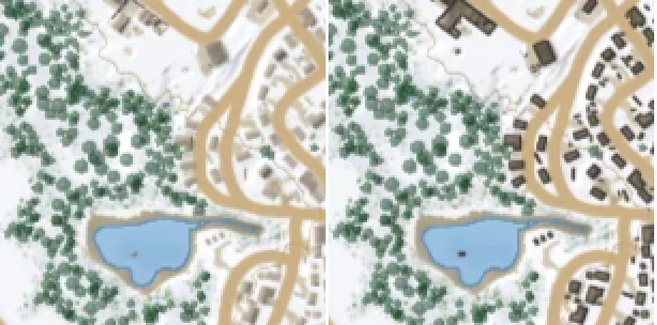
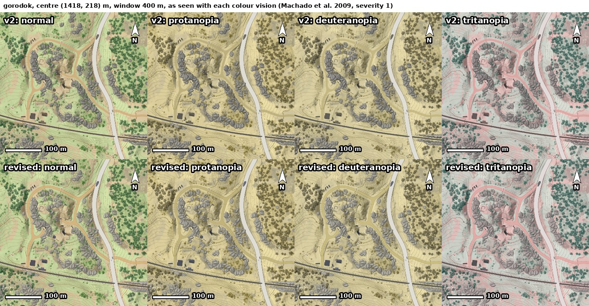
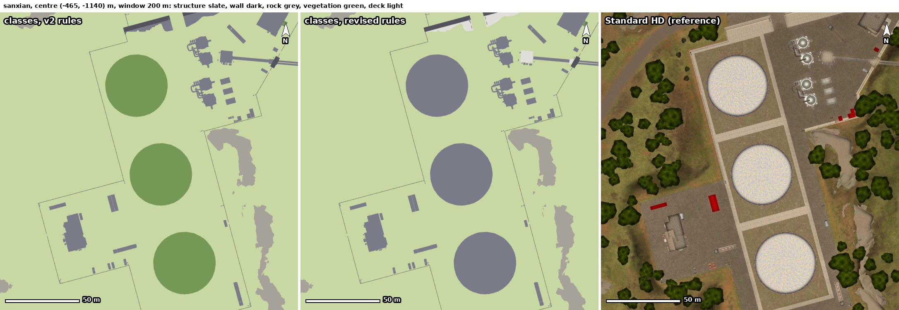

# Methods and results: ballistic calculator, terrain and object model for Squad

Report for the thesis on computational ballistics. Russian version: [`thesis-methods-and-results.ru.md`](thesis-methods-and-results.ru.md).
Written 2026-11-04 from the evidence that exists in the repositories; nothing in it was measured in a running game.
Updated 2026-11-05: the voxel figures of sections 4, 7 and 8 were measured again with the exact conservative voxelisation
(`AGL` `e34e481`, memory fix `f116a2b`, issue #23) on the final `.vcol` files; the figures of the earlier sample-lattice builder are
kept as "old" next to them.
Final state 2026-11-05: the report was read again against SquadCalc `dev` 45.33.0, Squad Ballistics 1.6.1 and the agl `dev`
branch; sections 1.5, 2.3, 9.3 and 12 to 15 are new or rewritten, the PENDING tables are filled with the evidence that exists
(only the GPU timings stay PENDING, with the owner action, section 12.4), and every issue number, file path and commit named
in the report is checked by `tools/release/check_report_refs.py` (section 13).
Updated 2026-11-09: section 16 (the Detailed tactical map: method, accuracy against an independent render, GPU against CPU,
performance, the faults found and fixed) is new; a row in section 15.
Updated 2026-11-10: section 16 was reviewed as an examiner would: every claim of the v2 text has an interval or is marked UNVERIFIED or
PENDING, five measurements on all 25 maps are new (16.3.6 to 16.3.10: roads, water, crowns, roof heights, contours), three faults of v2
were found and fixed in the pipeline (16.6), and the symbols were revised on measured contrast (16.10); the revised tiles are measured
against v2 on every map whose rebuild had finished (16.10), and the outline F1 has bootstrap intervals (16.3.3); a row in section 15.
Updated 2026-11-10: section 1.6 (the bearing and the marker distance as the game shows them, against the calculator's) is new, and
section 2.3 has the circles drawn in metres on the two maps whose corners are not square (SC 45.49.0); rows in sections 10 and 15.
Updated 2026-11-10: section 2.5 (every map picture registered on the world with the client's pixels: the layer minimaps the game
takes from each layer's data asset, Skorpo's rectangle, the basemap on the game's corners, the HQ tiles, the terrain and
topographic maps removed, the relief layer's offset settled) is new (SC 45.50.0), and the last row of section 2.3 points to it; a
row in section 15. Its registration tool is committed and rerun (`tools/maptiles/py/register_images.py`,
`tools/browser_check/hq_sharpness.mjs`), so its figures and the last row of section 2.3 are VERIFIED; a row in section 13.
Updated 2026-11-11: section 2 rests on the heightmaps on the landscape's own vertices (2.1: the corner grid against the
lattice at 283.8 M vertices; 2.2: the server-log audit on both grids; 2.4: the placement totals on the lattice), and section 3
has the detail where objects stand and its measurement on the research's 50 windows (SC 45.51.0); a row in section 15.

## 0. How to read this report

Every number carries a source and one of four labels (the fourth, ASSUMED, is used where a number is not in the server files at all).

| Label | Meaning |
|---|---|
| **VERIFIED** | Produced by a committed tool or test from the game files (Squad dedicated server build 26005357, SteamCMD app 403240), and the repository records the command and the output. A dagger (†) means the author of this report re-ran it on 2026-11-04. |
| **INFERRED** | Follows from verified data by an argument that is stated next to it. |
| **UNVERIFIED** | Recorded in a commit message, an issue or a note without a reproducible output, or not measurable from the server files, or not measured. |
| **ASSUMED** | Not in the dedicated-server files at all and used because the model needs a number: Workshop mods, the bore and zoom of handheld weapons (they come from the client's animation), the native C++ explosion defaults, SquadCalc's default lifespan; the reason is stated next to it (`DP`). |

A row marked **PENDING** is a measurement that does not exist; it names the action that produces it. After the final pass one is
left: the GPU timings (section 12.4).

**Scope.** The report covers the 25 maps that the Squad dedicated server package can play and holds the files of: `LevelRotation.cfg`
names 25 levels, one of which has no level files in the package and is not covered, and Jensen's Range, which is not in the
rotation, is, so the 25 maps are the 24 playable levels of the inventory plus Jensen's Range (`H-README`, "Map inventory: what
the server package can play", VERIFIED). Terrain, objects and weapon data are all derived from the server package; no
community-made map data is a source of any figure.

### Source key (revisions the figures were read at)

| Key | What | Revision |
|---|---|---|
| `SC` | SquadCalc fork (`deadline-squad/deadline-squadcalc`), branch `dev` | `e18519025de3`, version 45.33.0 (first draft: `2f1ae898ed90`, 45.24.0) |
| `SB` | Squad Ballistics overlay app, branch `main` (identical to `dev` `5ffcec9`) | `f702127`, version 1.6.1 (first draft: `5f11d21c837b`, 1.6.0) |
| `AGL` | deployment and tools repository, branch `dev` | `fc0500c` (first draft: `7438c08dbb76`); this report, `tools/release/` and `tools/release/check_report_refs.py` are added on top |
| `#22` | `deadline-squad/deadline-squadcalc#22`, "Completion checklist", items A1-D5 | read 2026-11-04, comments up to 2026-11-05 22:36 UTC |
| `#20` | `deadline-squad/deadline-squadcalc#20`, voxel evaluation tables | comment of 2026-11-05 (6670455739) |
| `#26`, `#27` | `deadline-squad/deadline-squadcalc#26` (thin openings), `#27` (precision margin) | open, read 2026-11-05 |
| `CL` | `SC:CHANGELOG.md`, entries 45.25.0 to 45.33.0 | |
| `SBS` | `SB:docs/sight-scales.md` | audit of 2026-11-05 |
| `V-README` | `AGL:tools/volumetric/README.md` | |
| `H-README` | `AGL:tools/heightmaps/README.md` | |
| `M-README` | `AGL:tools/maptiles/README.md` | build of 2026-11-09; the revision of 2026-11-10 (section 16.10) is in the pipeline, not yet in the served tiles |
| `E-README` | `SC:engine/README.md` | |
| `CS` | `AGL:tools/volumetric/docs/collision-semantics.md` | |
| `SDMG` | `AGL:tools/volumetric/docs/structure-damage.md` | |
| `NR` | `AGL:tools/volumetric/docs/native-rules.md` | merged into `dev` as `7438c08`, read at that revision |
| `DP` | `AGL:tools/volumetric/docs/data-provenance.md` and `data-provenance.tsv` | added on the branch `fix/provenance`; counts of 2026-11-05, SC 45.30.0, SB 1.6.1 |
| `GA` | `AGL:docs/game-data-audit.md`, the calculator's map and weapon tables against the game files; tool `AGL:tools/game_audit/README.md` | audit of 2026-11-10, SC 45.40.0, SB 1.7.2 |

Paths below are relative to the repository named in the key. The equipment: one workstation, 15 GB of RAM, no GPU measurements.

## 1. Ballistic model

### 1.1 Model

The projectile model is the game's own, read from the Linux server binary and the cooked Blueprints (`SB:ballistics.py`
module docstring; evidence in `deadline-squad/squad-ballistics#4`, UNVERIFIED here because the issue was not re-read).

| Element | Value | Source | Label |
|---|---|---|---|
| Air drag | none | `SB:ballistics.py` docstring | VERIFIED (code reading of `USQProjectileMovement`) |
| Gravity | `g = ProjectileGravityScale x 9.80 m/s^2` (`DefaultGravityZ` = -980 cm/s^2) | `SB:ballistics.py` `GRAVITY = 9.80`; commit `f22e343` | VERIFIED |
| Launch speed | `WeaponConfig.MuzzleVelocity`, along the barrel from the socket `Attach_Muzzle` | `SB:ballistics.py`, `AGL:tools/game_ballistics/README.md` | VERIFIED |
| Server step | 20 ms substeps (50 Hz `NetServerMaxTickRate`), velocity Verlet, speed cap `MaxSpeed` from the first substep | `SB:ballistics.py` docstring | VERIFIED (addresses in the docstring); the 50 Hz tick is INFERRED from the net driver setting |
| Rocket motor | constant `acceleration` for `acceleration_time` along the rotation, which follows the velocity (`bRotationFollowsVelocity`) | same | VERIFIED |

"Exact vacuum parabola" is exact for a coasting shell (mortar, grenade, a gun round below its speed cap). The report does
not claim it for all weapons: a motor along the barrel axis is two parabolas (closed form), a shell coasting at its speed
cap has a closed form for the path angle, and a motor that pushes along the path or a launch above the cap has none and
is flown with the game's 20 ms substeps (`SB:ballistics.py` docstring, VERIFIED).

### 1.2 Closed-form solver

For a target at horizontal distance `d` and height `h` above the barrel pivot, speed `v` and gravity `g`, the two
elevations are `theta = atan((v^2 -/+ sqrt(v^4 - g (g d^2 + 2 h v^2))) / (g d))` (low and high arc; `SB:README.md`,
section "How it works"). It is implemented twice, independently of the data: in JavaScript
(`SC:src/js/squadBallistics.js`, `squadFiringSolution.js`) and in Rust (`SC:engine`, `flight`, `weapon`), the latter as a
function-for-function port whose parity test runs the real JS classes (`E-README`, intro and "Building and testing").
The number of cases of the Rust parity test is not recorded in the documents: UNVERIFIED.

### 1.3 Parity of the two implementations

`AGL:tools/direct_fire/compare.py` runs SquadCalc's real `Weapon` and `SquadFiringSolution` under Node and Squad
Ballistics' `solve()` on the same grid (15 distances from 0.5 m to 8000 m x 9 target heights from -300 m to +200 m, plus
fractions 0.5-1.01 of each weapon's own maximum range at -40, 0 and +25 m) for every shell of every weapon both apps have,
low and high arc, time of flight, velocity, minimum distance and elevation limits. Tolerance 1e-6 degree / second.

| Quantity | Value | Source | Label |
|---|---|---|---|
| Weapons compared | 104 | `compare.py` output, SC `e18519025de3` + SB `f702127`, re-run 2026-11-05 | VERIFIED† |
| Cases compared | 20 178 | same (the same count at the first draft and in `CL` 45.31.0) | VERIFIED† |
| Mismatches | 0 | same; also recorded in SB commit `f22e343` | VERIFIED† |
| Max-range differences | none (`{}`) | same | VERIFIED† |

Command: `python3 tools/direct_fire/compare.py <Squad-Ballistics checkout> <SquadCalc checkout>` (7 s on one core on 2026-11-05). The run after the lifespan change (SC 45.31.0, SB 1.6.1) still has 0 mismatches, so the 4-40 s lifespans are the same in the two apps.
Scope: the two solvers agree with each other. Agreement with the real game is the next subsection.

### 1.4 Agreement with the game

| Check | Result | Source | Label |
|---|---|---|---|
| Weapon data (velocity, gravity scale, motor, cap) of every weapon of both apps against the cooked Blueprints | `diff.md` lists every difference; the long-verified mortar (110 m/s, x1) and UB-32 (300 m/s, -50 m/s^2 for 2 s, x2) are reproduced | `AGL:tools/game_ballistics/README.md`, `gamecheck.py` | VERIFIED (method); `diff.md` itself is not stored, but `DP` (`data-provenance.tsv`) stores the comparison per weapon and input |
| AGS-17 hold-time model (185 m/s, x1.8) against in-game measurements | 67 measurements, 279-1931 m on level ground, agreement 0.7 % in v^2/g; RMS 5.34 m with refitted speed and top | `AGL:tools/game_ballistics/README.md`; `SB:RELEASE_NOTES.md` (SB#13) | UNVERIFIED (the 67 measurements are the owner's in-game data, not in the repositories) |
| Simulation with the game's values (muzzle that moves with the elevation) | solutions land within 1 mm; the UB-32 had missed by up to 22 m at short range before | `SC:CHANGELOG.md`, entry 45.7.0 | UNVERIFIED (a changelog statement) |
| Every input of the firing solution (velocity, gravity, motor, cap, rotation, drag, launch point, spread, lifespan, explosion, bore, zoom, limits, minimum distance, scale offset, hold model) of all 104 SB and 135 SC weapons: value used, game value, source asset, label | 2 704 labelled rows: VERIFIED 1 762, INFERRED 367, UNVERIFIED 53, ASSUMED 522; 0 unexplained differences from the game after one fix: the projectile lifespan (`InitialLifeSpan`), which the 108 generated direct-fire weapons of SC had as the default 100 s and SB lacked, is now the game's 4-40 s in both apps (SC 45.31.0, SB 1.6.1); weapons inherited from the upstream table, fitted or from mods are named in `DP` section 6 | `DP`, `AGL:tools/game_ballistics/provenance.py` (run on the existing dump, build 26005357) | VERIFIED† for the equalities; the labels INFERRED / UNVERIFIED / ASSUMED are the point of the table |
| Launch heights of vehicle mounts | taken from the game files for AGS-17, MK19, SPG-9 on listed vehicles | `SB:RELEASE_NOTES.md` | VERIFIED (file data); not checked in game, see section 10 |

### 1.5 Sight scales of the overlay (audit of 2026-11-05)

`SBS` audits every scale the Squad Ballistics overlay draws in a sight against the server package (build 26005357); its own labels
are VERIFIED, COMPUTED (physics from verified inputs, read here as INFERRED), ASSUMED and MEASURED (owner's in-game data, not in the
repositories, read here as UNVERIFIED).

| Scale | Result | Source | Label |
|---|---|---|---|
| Mark offset `focal x tan(angle - bore)` | rectilinear projection with a horizontal FOV; matches an independent integrator pixel by pixel | `SBS`; `SB:tests/test_mark_end_to_end.py` | VERIFIED (committed test) |
| Zoom and bore of the 78 emplaced and vehicle entries | equal to the game files, no difference | `SBS`; `SB:tests/test_game_weapons.py`, `SB:tests/test_sight_data.py` | VERIFIED |
| Zoom and bore of the 26 hand-held launchers | x1 and 0 assumed; the files hold `SeparateAdsFov` (RPG-7V1 61, RPG-28 37, C90-CR 69, Carl Gustav 77, MAAWS 60, NLAW 70, RPG-29 optic 49, grenade launchers 80-90), but whether it replaces or scales the FOV setting is native code; open as `deadline-squad/squad-ballistics#17` (one in-game measurement settles it) | `SBS` "Differences found" 2 | ASSUMED (value), UNVERIFIED (meaning) |
| Range ladder, greatest distance | `LADDER_MAX_DISTANCE` was 5000 m ("no map is wider than 5000 m diagonally"); the game's play areas measure up to 7043 m (Yehorivka) and 9 of 17 maps measured are over 5000 m, so it is 8000 m now (SB 1.6.1) | `SBS`; `SB:tests/test_sight_scales.py`; `SB:tests/data/play_areas.json` | VERIFIED (data and test); the 17 maps are the ones with a play-area spline in the dump, not all 25 |
| Range ladder ticks (25-1000 m steps) | follow the mark; the step set is a display choice | `SBS` | INFERRED |
| Mil scale 6400 per circle | the game names the unit "MILLIRADIAN (mil)"; the earlier formula `x 17.78` differs by 0.012 % (0.2 mil at 1500 mil) | `SBS` | VERIFIED (unit name), UNVERIFIED (formula, its disassembly is no longer on disk) |
| Mortar firetable | 50 m steps up to 1250 m in the game; ours reaches 1236 m | `SBS` | VERIFIED |
| Mortar top elevation | 88.8 degrees (1578.7 mil) since 2026-11-10: the mount pitches the tube 0 to 43.8 degrees (`PitchInterval` of `BP_GenericDeployableMortarVehicle`) above the 45 degrees that the game's own sight adds to the tube pitch (`UMG_MortarControl`, Kismet bytecode). The upstream figure 88.875 (1580 mil), used until SB 1.7.1 and SC 45.37.0 and labelled ASSUMED here, gave a target between 51 m and 51.8 m on level ground a solution the tube cannot be laid on; the minimum distance is now the range at the mount's stop, 51.8 m | `SBS`; `GA` sections 2.2 and 2.4; `AGL:tools/game_audit/data/mount_limits.json` (read by `AGL:tools/game_audit/mounts.py`) | INFERRED (the limit is computed from the mount's pitch; the pitch range and the 45 are each VERIFIED) |
| Reticle marks (mil dots, range marks) | not drawn; the server package keeps widget layout and texture metadata but no pixels | `SBS` | UNVERIFIABLE from the server files |

### 1.6 Bearing and distance as the game shows them (2026-11-10)

The calculator's distance and bearing are the game's: a research pass of 2026-11-10 put 20 000 pairs of points on each of the 25
maps through `getDist` and `getBearing` and through the game's own formulas and found 1.4e-12 m and 2.3e-13 degree (its scripts are
not committed). What differs is what the game shows a player. It was decoded from the native code of the server build 26005357,
whose vtable symbols are exported and whose members the UHT reflection names, and from the widget Blueprints of the client build
26234431.

| Item | Value | Source | Label |
|---|---|---|---|
| Bearing on the HUD compass (`USQCompassMK2`) | clockwise from world -Y, the map's up, in (0, 360]: exactly north reads 360. The plain text cuts the bearing toward zero to a whole degree (`cvttss2si`) and pads it to three digits, so the compass shows 045 for every bearing from 45.0 to just below 46.0. In the deployable mortar's view (`bPreciseBearingMode`) it prints `%.1f` | native code at `0xa65ec50` (disassembly not committed); `SB:compassreader.py` reads the screen by the same rule; the game frames `SB:tests/data/compass_j_058.png` (mortar view, `182.0`) and `SB:tests/data/compass_a_063.png` (`119`) | INFERRED (decoded, both modes seen in frames of the game); the cut at the whole degree UNVERIFIED in game |
| Aiming error of the display until SC 45.48.0 | the calculator showed the bearing to a tenth (45.7). A player who turns until the plain compass shows that bearing rounded to a whole degree, R, stops somewhere in [R, R + 1): -0.5 to +1.5 degrees from the bearing, +0.5 degree on average if the stop is anywhere in that degree with equal chance. Sideways at 1 km: 8.7 m on average, up to 26 m | the rule above | INFERRED |
| Display since SC 45.49.0 | the three digits the plain compass shows when it points exactly at the target, then a smaller tenth within that degree. The tenth is rounded as `%.1f` rounds it but never past 9: 45.96 reads 045.9, where `%.1f` gives 46.0 and the plain compass shows 046 only from 46.0. Exactly north reads 360.0, a bearing a hair under 360 reads 359.9. The keypad panel, the calculation popups and their summary, and the target dialog show it; the help of the bearing says that the compass cuts off the tenth. A stop anywhere in the degree shown is less than 1 degree from the bearing (17.5 m at 1 km) and has no bias on average, and the tenth says where in that degree to aim | `SC:src/js/compass.js`; `SC:tests/compass.test.mjs` (7 tests), `SC:tests/targetPopup.test.mjs`; `AGL:tools/browser_check/coords_check.mjs` on the 45.49.0 build: 045.9 in the popup, its summary and the dialog for 45.96 degrees, 360.0 due north, 026.6 in the panel for 26.565 degrees | VERIFIED (display); INFERRED (error) |
| Numbers passed on | unchanged: Squad Ballistics reads the numeric bearing of `window.squadBallistics.targets()` and SquadMortarOverlay gets the text it got before | `SB:maplink.py` (`make_target`); `SC:src/js/smcConnector.js` | VERIFIED (code reading) |
| Distance to a map marker on the HUD compass (`USQCompassMarker`) | the slant distance `sqrt(dx² + dy² + dz²)`, cut toward zero to a step of the curve `CompassMarkerDistanceResolution`: 1 m under 30 m, 5 m to 100 m, 10 m to 300 m, 50 m to 1999 m, 100 m from 2000 m. A marker 1049 m away reads 1000; a height difference of 100 m adds 5.0 m at 1000 m, one of 50 m adds 4.1 m at 300 m. The calculator's distance is the horizontal one the solver needs (section 1.2); since SC 45.49.0 the help of the distance says how the two differ | native code at `0xa65e840` and the curve of `UMG_Compass_Marker` (client); `SC:public/locales/en/tooltips.json` (`markerDistance`) | INFERRED (decoded); UNVERIFIED in game |
| Map up, compass 0 and the calculator's north | the same direction: the game's map widget turns nothing (map right = world +X, map up = world -Y), and the client's minimap textures lie on the world axes within 0.05 degree on 25 of 25 maps (registration against the served heightmaps in 0.05 degree steps: 0.00 on 21 maps, -0.05 on Skorpo and Manicouagan, +0.05 on Sumari, +0.10 on Harju with a hillshade and 0.00 with the slope). On Skorpo only the landscape actor is turned (yaw -2.006 degrees, `GA` O9), which the heightmaps take in; the comment in `SC:src/data/maps.js` that guessed a 2.02 degree turn of Skorpo's image is corrected in SC 45.49.0 | registration scripts not committed; `AGL:tools/game_audit/data/landscapes.json` | INFERRED (texture alignment); VERIFIED (landscape yaw) |

Two tests on the Training server settle the UNVERIFIED rows. On foot, turn slowly toward a flag whose bearing the calculator gives and
note where the compass changes from 045 to 046. Put a map marker on a flag about 1 km away and 50 m higher or lower, and compare
the compass with `trunc(sqrt(d² + h²) / 50) x 50`.

## 2. Terrain

Source and method: the cooked Chaos heightfields of the landscape levels, placed with the landscape actor's transform
(16-bit per tile, 0.3-6.4 mm a step; vertices 0.5-1.2 m apart), fused by maximum with the collision of the placed static
meshes and, where it rises 0.5 m above the game terrain and a placement of the game explains it (section 2.4), with the SDK
surface of SquadHeight 1.3.0 (1.6 cm). 16-bit PNG and lossless WebP of the same levels whose samples are the landscape's own
vertices (heightmaps built from 2026-11-10; before, a sample every metre from the minimap's corner, 0.5 m on Chora and
Kokan, and a WebP rounded to 1 cm) (`H-README`, "Sources and fusion", "Grid", "WebP form").

### 2.1 Interpolation rule and grid

The game splits each quad into two triangles along the diagonal from (x, y) to (x+1, y+1). On points where the other
diagonal would differ by more than 5 mm, this diagonal is the closer in 79 of 89 (17 of 20 above 2 cm) (`H-README`,
"Interpolation: the game's triangles", `py/compare_interpolation.py`): VERIFIED. On a grid whose nodes are the game's
vertices, bilinear against triangle reads RMS 0.3-2.2 cm (up to 0.2-1.1 m on the steepest quads) and triangle 0.0-0.1 cm,
measured on the 12 maps whose vertices were on the corner grid: VERIFIED.

The corner grid was a resample of the vertices on 18 maps: they lie 0.4 cm (Kokan) to 49 cm (Jensen) off its samples, or at
another spacing (Anvil 0.75 m, Black Coast 1.0039 m, Logar 0.9999 m, Skorpo 1.2 m and turned by -2.006195 degrees). From
2026-11-10 the heightmap's samples are the vertices on every map (`meta.json` `origin_m`, `resolution_m`, `yaw_deg`;
`AGL:tools/heightmaps/py/lattice.py`), and SquadCalc 45.51.0 reads them along the landscape's own axes. Error of the page's
read against the game's collision on bare ground (`H-README`, "Grid"; `py/compare_native_vertices.py`: every landscape vertex
inside the bounds and up to 200 000 random points between them where both heightmaps hold the bare landscape), the served
heightmaps on the corner grid against the heightmaps on the vertices, cm:

| Map | Vertex spacing (m) | Vertices | Corner grid p99 / max (cm) | Lattice p99 / max (cm) | Points between | Corner grid p99 / max (cm) | Lattice p99 / max (cm) |
|---|---|---|---|---|---|---|---|
| Al Basrah | 1 | 10.8 M | 0.54 / 2.95 | 0.05 / 0.06 | 136 k | 0.47 / 1.03 | 0.05 / 0.05 |
| Anvil | 0.75 | 13.2 M | 17.56 / 238.30 | 0.09 / 0.10 | 159 k | 11.50 / 84.76 | 0.08 / 0.09 |
| Black Coast | 1.00394 | 11.5 M | 11.32 / 344.12 | 0.16 / 0.16 | 110 k | 6.63 / 33.48 | 0.14 / 0.16 |
| Chora | 0.5 | 19.8 M | 0.38 / 0.39 | 0.38 / 0.39 | 60 k | 0.37 / 0.38 | 0.37 / 0.39 |
| Fallujah | 1 | 7.0 M | 0.50 / 37.21 | 0.06 / 37.53 | 154 k | 0.46 / 0.51 | 0.05 / 0.06 |
| Fools Road | 1 | 2.6 M | 8.90 / 156.06 | 0.08 / 0.08 | 167 k | 5.27 / 68.02 | 0.07 / 0.08 |
| Goose Bay | 1 | 10.4 M | 8.97 / 72.82 | 0.12 / 0.13 | 129 k | 5.28 / 21.54 | 0.11 / 0.12 |
| Gorodok | 1 | 13.8 M | 0.57 / 3.75 | 0.07 / 0.08 | 167 k | 0.48 / 1.18 | 0.06 / 0.07 |
| Harju | 1 | 11.5 M | 0.58 / 6.37 | 0.09 / 0.10 | 143 k | 0.46 / 1.21 | 0.08 / 0.09 |
| Jensen | 1 | 14.4 M | 4.33 / 37.87 | 0.07 / 0.07 | 179 k | 2.60 / 11.42 | 0.07 / 0.07 |
| Kamdesh | 1 | 11.5 M | 0.50 / 0.51 | 0.15 / 0.16 | 141 k | 0.43 / 0.51 | 0.14 / 0.15 |
| Kohat | 1 | 9.2 M | 1.46 / 189.42 | 0.29 / 0.30 | 86 k | 0.92 / 153.37 | 0.27 / 0.29 |
| Kokan | 0.5 | 23.0 M | 0.49 / 1.18 | 0.07 / 0.08 | 184 k | 0.44 / 0.57 | 0.06 / 0.07 |
| Lashkar | 1 | 13.1 M | 0.50 / 0.51 | 0.13 / 0.13 | 139 k | 0.44 / 0.51 | 0.11 / 0.13 |
| Logar | 0.9999 | 2.5 M | 17.69 / 64.95 | 0.10 / 0.10 | 160 k | 10.16 / 46.12 | 0.09 / 0.10 |
| Manicouagan | 1 | 10.2 M | 7.96 / 69.74 | 0.16 / 0.16 | 126 k | 4.67 / 21.83 | 0.14 / 0.16 |
| Mestia | 1 | 3.0 M | 0.69 / 12.08 | 0.19 / 0.20 | 105 k | 0.51 / 3.13 | 0.17 / 0.19 |
| Mutaha | 1 | 6.0 M | 0.63 / 3.44 | 0.05 / 0.05 | 160 k | 0.51 / 1.74 | 0.05 / 0.05 |
| Narva | 1 | 6.1 M | 0.50 / 0.51 | 0.08 / 0.09 | 156 k | 0.45 / 0.51 | 0.07 / 0.08 |
| Pacific | 1 | 13.5 M | 0.50 / 0.51 | 0.12 / 0.13 | 166 k | 0.43 / 0.51 | 0.11 / 0.12 |
| Sanxian | 1 | 4.7 M | 0.50 / 0.51 | 0.09 / 0.10 | 45 k | 0.46 / 0.51 | 0.09 / 0.10 |
| Skorpo | 1.2 | 21.2 M | 11.31 / 131.67 | 0.80 / 0.82 | 130 k | 6.40 / 36.12 | 0.72 / 0.81 |
| Sumari | 1 | 1.0 M | 0.57 / 1.42 | 0.11 / 0.11 | 120 k | 0.48 / 0.94 | 0.10 / 0.11 |
| Tallil | 1 | 16.3 M | 4.14 / 37.09 | 0.06 / 0.07 | 149 k | 2.41 / 12.59 | 0.05 / 0.06 |
| Yehorivka | 1 | 27.4 M | 0.92 / 7.11 | 0.19 / 0.20 | 137 k | 0.62 / 2.36 | 0.17 / 0.19 |

Reading: on the vertices the page's read is within 0.82 cm of the game's collision at each of the 283.8 M landscape vertices and 3.4 M points between them on every map (Skorpo, whose 16-bit step is 1.6 cm; 0.05-0.39 cm on the others), against up to 3.44 m on the corner grid (Black Coast; Anvil 2.38 m, Kohat 1.89 m, Fools Road 1.56 m, Skorpo 1.32 m), except at one seam of Fallujah: two of its six streaming proxies disagree at 30 shared vertices along x = -510 m by up to 37.5 cm, the game's collision steps there, and a grid with one height per vertex is off on one side by up to that much (the 37.53 cm in the table; `H-README`, "Grid"). VERIFIED.

### 2.2 Accuracy against the server's own logs

Ground truth: positions the dedicated server wrote in its log (placed map markers, deployables, spawn points, explosions;
the player capsule centre minus 0.88 m), from the Training server only, anonymised by `log_points.awk` to
`<map> <kind> x y z` (`H-README`, "Audit against the game server"; `py/audit_ground_truth.py`).

| Map | bilinear within 2 cm | nearest within 2 cm | triangle within 2 cm | n | Label |
|---|---|---|---|---|---|
| Fallujah | 90 % | 79 % | 92 % (p95 5.5 cm; bilinear 10.1, nearest 8.0) | 107 points that agree with the log or differ by the grid (within 15 cm); 36 of 143 points are more than 15 cm off, each with a static mesh on or beside it, or Z = 0 in the log | VERIFIED |
| Goose Bay | 92 % | 60 % | 92 % | not recorded | VERIFIED (percentages), n UNVERIFIED |
| Yehorivka | 96 % | 63 % | 97 % | not recorded | VERIFIED (percentages), n UNVERIFIED |
| Black Coast | 89 % | 63 % | 91 % | not recorded | VERIFIED (percentages), n UNVERIFIED |

Reading: **89-97 % of the audited points are within 2 cm** for the bilinear and triangle reads (nearest: 60-79 %). The
sample is points that are ground traces in the log; it is not a random sample of the map and the log is the only
reference. The raw log lines are not in the repositories (they contain players' data). Other terrain checks (`H-README`):
game terrain against SquadHeight on open ground, median difference 0.0 mm on every map, RMS 0.5-14 cm; against the
landscape's own vertices on a 0.5 m grid RMS 0.000 (Chora) and 0.017 cm (Kokan) against 8.91 and 0.89 cm for 1 m
(VERIFIED).

The same audit on the heightmaps on the landscape's vertices (section 2.1; the 25 maps built on 2026-11-10, not yet served),
12 maps, on the points where the game's landscape itself is within 2 cm of the log and neither heightmap has an object at
the point (`grid_object` of `py/audit_ground_truth.py`), triangle read, cm:

| Map | n | Corner grid within 2 cm | p95 | max | Vertices within 2 cm | p95 | max |
|---|---|---|---|---|---|---|---|
| Fallujah | 76 | 95 % | 2.9 | 33.9 | 95 % | 2.9 | 33.9 |
| Goose Bay | 148 | 94 % | 2.1 | 10.6 | 99 % | 1.2 | 10.7 |
| Yehorivka | 152 | 99 % | 1.2 | 11.5 | 99 % | 1.3 | 11.5 |
| Black Coast | 120 | 95 % | 1.9 | 3.5 | 100 % | 0.9 | 1.9 |
| Al Basrah | 47 | 100 % | 0.5 | 1.6 | 100 % | 0.5 | 1.5 |
| Harju | 66 | 97 % | 1.0 | 6.3 | 97 % | 1.0 | 6.3 |
| Jensen | 20 | 100 % | 0.8 | 1.1 | 100 % | 0.1 | 0.3 |
| Kokan | 9 | 100 % | 0.0 | 0.0 | 100 % | 0.0 | 0.0 |
| Manicouagan | 12 | 100 % | 0.3 | 0.4 | 100 % | 0.1 | 0.1 |
| Narva | 9 | 100 % | 0.1 | 0.1 | 100 % | 0.1 | 0.1 |
| Skorpo | 13 | 92 % | 3.2 | 6.2 | 100 % | 0.5 | 0.6 |
| Tallil | 17 | 88 % | 2.4 | 3.4 | 100 % | 0.3 | 0.4 |
| 12 maps | 689 | 96.2 % | 1.7 | 33.9 | 98.7 % | 1.1 | 33.9 |

Reading: on the vertices **98.7 % of these ground points are within 2 cm** (corner grid 96.2 %), the 95th percentile is
1.1 cm (1.7 cm). The points beyond 2 cm are the same on both grids and read the same height on both: small objects between
the nodes (a kerb, a step; up to 33.9 cm on Fallujah), not the grid. On all points the audit classes as ground (`ok` and
`sub-cell`, as in the table above) the triangle read is within 2 cm on 92 % of Fallujah (107 points), 96 % of Goose Bay (162),
97 % of Yehorivka (167) and 95 % of Black Coast (165) (`H-README`, "Audit against the game server"): VERIFIED.

### 2.3 Map grid and minimap corners (audit of 2026-11-05)

The in-game grid starts (A1) at the north-west corner of the minimap. The corners are `MapTextureCornerZero` and `MapTextureCornerOne`
in the `SQWorldSettings` of each gameplay layer; `py/minimap_corners.py` reads them for the 219 layers of build 26005357 and reduces
them to metres per map (`H-README`, "Minimap corners and the grid", `py/test_minimap_corners.py`). The game's three grid levels
(scale factors 1, 3, 9 of `W_SQMapGridLines`) are SquadCalc's 300 m keypad, 100 m and 33.3 m sub-keypads, which the grid already had.

| Finding | Value | Source | Label |
|---|---|---|---|
| Image corners of SquadCalc against the game's corners, 24 maps | within 1.00 m (largest: Black Coast 1.00 m); the images' corners are the game's, rounded or truncated | `H-README` table | VERIFIED |
| Skorpo | west edge 9.5 m, east edge 10.5 m off (the image corners were fitted to the upstream image), so every Skorpo grid line was 9.5 m west of the game's, and its keypad text and entry stayed 9.5 m off until SC 45.48.0 | `H-README`; `CL` 45.30.0 | VERIFIED |
| Skirmish and Seed layers with a minimap of their own (Chora, Mutaha, Tallil, Skorpo, Goose Bay, Manicouagan, Black Coast) | their grid starts up to 1.2 km from the map's (Chora Skirmish v1: 1007 m east, 1222 m south); a few regular layers differ by 0.5-1.5 m (Manicouagan RAAS v1/v2) | `CL` 45.30.0 | VERIFIED |
| Fix of the lines (SC 45.30.0) | the drawn lines start at the game's corner of the loaded layer, else at `SDK_data.minimap.game`; the image, heightmap, volume and markers keep the image corners; tests `SC:tests/squadGrid.test.mjs` (game corners of all 25 maps within 1 m of the image except Skorpo) and the first keypad line of `AGL:tools/browser_check/grid_check.mjs` | `CL` 45.30.0 | VERIFIED for the lines only |
| What 45.30.0 left counted from the image (found 2026-11-10) | the keypad text (the box under the cursor, the markers' popups, a weapon's Move To box) and the keypad entry still counted from the map image's corner: the middle of Chora Skirmish v1 read G07-1-7 where the game's text is C3 - 3 - 7, Skorpo's text was 9.5 m off and that of eight other maps up to 1 m; the entry read the game's unpadded C3-3-7 as C33-7; the strip after the last whole keypad had no letter or number on 24 of the 25 maps; on the ten Seed and Skirmish layers with a minimap of their own the lines and labels ran over the whole map | `AGL:tools/browser_check/grid_check.mjs` on the 45.47.0 build: 21 of its 29 checks fail | VERIFIED |
| Fix of the text, entry, labels and extent (SC 45.48.0) | the keypad text and entry count from the grid's corner and give nothing outside the layer, as the game; the game's text is read with or without padding and spaces; the last, partial column and row are labelled at their middle; the grid ends at the layer's edges and its labels run along them; Mestia's labels stay over their columns, where the game's empty last slot moves them up to 279 m | `SC:tests/keypad.test.mjs` and `SC:tests/squadGrid.test.mjs` on `SC:tests/fixtures/gameKeypads.json` (eight layers: the game's text 1 m inside the corners and at the middle, labels, line counts); `AGL:tools/browser_check/grid_check.mjs`, all 29 checks pass on the 45.48.0 build | VERIFIED against the game's rule on those eight layers and, in the browser, on Skorpo, Chora Skirmish v1 and Al Basrah; INFERRED for the other layers (the same code on each layer's corners). The rule is decoded from the server binary and Blueprint bytecode (`USQMapConversions::MapLocationToGridCoordinateString`, `W_SQMapHorizontalBar`/`VerticalBar`) by tools that are not committed; UNVERIFIED in game |
| Maps whose corners are not square | Skorpo 6849 m by 6869 m (north to south 0.292 % longer), Black Coast 4598 m by 4599 m (0.022 %); the other 23 maps are square. The calculator's map is a square of 256 units, so on these two maps a metre east and a metre north are different numbers of units; points (`toMeters`, `fromMeters`, distance, bearing) are converted with a scale per axis and agree with the game within 1.5e-12 m (section 1.6) | `SC:src/data/maps.js` | VERIFIED |
| Circles until SC 45.48.0 | drawn with one Leaflet radius, R times the east scale: R m east to west but R x 6869 / 6849 m north to south on Skorpo. In the browser on the 45.48.0 build the mortar's 1236.9 m range ring was 1240.56 m north to south (+3.6 m), the UB-32's 2184.3 m ring 2190.58 m (+6.3 m at whole pixels, +6.38 m exactly) and the FOB's 400 m exclusion circle 401.22 m (+1.2 m); a 250 m capture zone was 0.7 m longer. On Black Coast the excess was 0.02 % (0.5 m at 2184 m). Distances, bearings and elevations were not affected | `AGL:tools/browser_check/coords_check.mjs` on the 45.48.0 build: 14 checks fail; `SC:tests/groundShapes.test.mjs` | VERIFIED |
| Fix of the circles (SC 45.49.0) | every circle and ellipse sized in metres is drawn with the map's east and north scales (`SC:src/js/groundShapes.js`, through `squadMinimap.fromMeters`): the range rings, the circles of FOB, mortar, Hell Cannon and UAV markers, the spread and damage ellipses, the target grid, the capture zones and the protection zones; turned capture boxes and capsules are turned in metres. On Skorpo the rings measure 1236.9364 m and 2184.3259 m both ways (the geometry within 3e-10 m, the SVG path within half a pixel, 0.21 m at zoom 6), the FOB circles 150 m and 400 m and the damage radii 6.5056 m and 12.5381 m. The unit tests hold the circles of all 25 maps within 1 cm at 400, 1236.9 and 2184.3 m, and the drawn ellipses on Skorpo, Black Coast and Al Basrah to 1e-9 of the ellipse in metres. A circle drawn by hand stays a circle in map units, through the point it is dragged to; the lengths along a flag path are measured with both scales too (`SC:src/js/libs/leaflet-measure-path.js` `segmentMetres`; with the east scale only they read a north-south segment of Skorpo 0.29 % short) | `SC:tests/groundShapes.test.mjs`; `SC:tests/measurePath.test.mjs`; `AGL:tools/browser_check/coords_check.mjs`, all 16 checks pass on the 45.49.0 build | VERIFIED |
| Extent of the upstream map images, and image orientation where `Corner0` is not the north-west one (Fools Road, Gorodok, Jensen, Kokan, Lashkar, Logar, Mestia, Mutaha, Narva, Skorpo, Yehorivka list it swapped on some layers) | measured with the client's pixels (section 2.5): every upstream basemap is the game's texture, neither flipped nor turned (best of the 8 orientations, correlation 0.99 to 1.00 on the 25 maps), and lies where section 2.5 says | section 2.5; `register orientation` (`M-README`, "Where each map picture lies on the world") | VERIFIED |

### 2.4 Objects that only the SDK's map has (2026-11-10)

SquadHeight was traced in the Squad SDK, whose version of a map is not the installed build's, so its surface above the terrain is a
height of the game only where the game has something there. A grid point keeps SquadHeight's surface when it lies under the collision
box of a static mesh placement of the server, or under the box of a mesh placement that the client scene shows (client build 26234431:
static, instanced, foliage and spline meshes, Blueprint components, water planes; spline meshes bent with their roll), 1 m around the
box and between its bottom and top included, or when a client mesh wider and longer than 800 m (background mountains, the ocean and
lake planes) passes within 1 m of it. Elsewhere the game's own surfaces stand: its terrain, its static collision, and the terrain or
water of such a vast mesh under SquadHeight's surface (`H-README`, "Which of SquadHeight's objects are taken";
`AGL:tools/heightmaps/py/evidence.py`, `build_heightmap.fuse`).

| Finding | Value | Source | Label |
|---|---|---|---|
| Points where SquadHeight stands 0.5 m and more above the terrain, 25 maps | 28 515 530 on the corner grid; a placement explains 27 949 202 (20 946 035 only one of the client: 18 713 366 the water and mountains of a mesh wider than 800 m, the rest foliage and Blueprint components; 25 566 only one of the server). On the landscape's vertices (section 2.1) 28 621 312, of which 28 052 108 are explained | `H-README` | VERIFIED |
| Points that no placement explains | 566 328 on the corner grid (569 204 on the vertices); 554 201 of them lie on the server's own static collision at the same height and do not change (Gorodok 405 962, Narva 148 238) | `H-README` | VERIFIED |
| Points lowered | 12 127 points, 11 480 m², on 6 maps: Al Basrah 11 226 (up to 22.48 m, median 6.17 m: the background city of the `_Vista` level along the map's edge and walls in open sand), Chora 792 on its 0.5 m grid (198 m², up to 8.44 m), Kokan 71 (17.8 m², up to 9.41 m), Skorpo 16 (a tree crown 30.7 m above the terrain that no tree of the game reaches), Anvil 17 (up to 0.72 m), Gorodok 5 (up to 1.84 m); the other 19 maps do not change | `H-README` | VERIFIED |
| The client's landscape at those points | equal to the server's (largest difference 0.00 m) and nowhere within 0.5 m of SquadHeight's surface: none of it is terrain of the game | `H-README` | VERIFIED |
| `build` of the six maps against the served heightmaps | differs exactly at the points above, by the measured lowering to 1 cm, and elsewhere only at 12 764 points of Gorodok, one 16-bit level (1.4 mm) lower, where the server's collision holds SquadHeight's surface to the millimetre | `H-README` | VERIFIED |
| Served heightmaps | generated 2026-10-30 and 2026-10-31, with every object of SquadHeight and on the corner grid; the 25 maps were rebuilt on 2026-11-10 with the placement rule and on the landscape's vertices (section 2.1) into `~/data/squad-heightmaps-final`, not yet deployed (`heightmaps.sh deploy` keeps each map's volume layer; the rebuilt `terrain.bin` goes with it) | `H-README` | PENDING (deploy, owner) |

### 2.5 Map pictures on the world (2026-11-10)

Every picture the calculator shows was registered on the world with the pixels of the Squad client (build 26234431, whose
paks open without a key). Method 1: the picture's edges against the level's own features (static meshes, tree crowns and
roads drawn in the same frame), normalised cross-correlation in 8 x 8 windows over the map, an affine fit, the displacement
at the four corners and the middle of each edge (+ = drawn east or south of the feature); a figure on fewer than 20 windows
is not counted. Method 2, independent of the objects: the terrain shading the picture carries (band-pass of its log
luminance) against the game's ground lit from the direction fitted over the map. Both are
`AGL:tools/maptiles/py/register_images.py` (`maptiles.sh register`, `M-README`, "Where each map picture lies on the world";
30 tests in `AGL:tools/maptiles/py/test_register_images.py` recover synthetic shifts, scales, turns and rectangles), and
every figure of the table is its output, rerun on 2026-11-10 (commands in section 13); displacements under about 0.4 m are
below the method (the Detailed layer, drawn from the same level data, reads 0.08 to 0.40 m on 23 maps, Tallil 0.80 m and
Pacific 1.07 m on 6 windows). Where the calculator draws
each picture is VERIFIED by committed tests (`SC:tests/mapImages.test.mjs`, 11 tests: on 45.49.0 the file
does not load, as `mapImages.js` is missing, and with that module over 45.49.0's map table the two Skorpo tests fail) and in
Chromium (`AGL:tools/browser_check/layer_minimap_check.mjs`, 13 checks, all pass on the 45.50.0 build with the pictures of
`layer-minimaps`).

| Finding | Value | Source | Label |
|---|---|---|---|
| Which minimap a layer shows | the game takes the texture and its corners from the layer's data asset (`Gameplay_Layer_Data/<layer>`, class `BP_SQLayer`: `OveriddenMinimapTexture`, and `MinimapCornersPosition` when `bIsValid`) over its level (`SQWorldSettings`: `MapTexture`, `MapTextureCornerZero`/`One`); the layer API gives the level's. Build 26234431: 219 levels, 221 data assets (83 set a texture, 204 valid corners); 21 layers show a texture other than their map's, in 18 textures | `M-README`, "Layer minimaps"; `AGL:tools/maptiles/py/layer_minimaps.py`, 29 tests in `AGL:tools/maptiles/py/test_layer_minimaps.py` | VERIFIED from the client's files; that the game draws the data asset's texture is INFERRED from the textures lining up with the world only so (Black Coast Seed v1, Narva and Yehorivka Skirmish); UNVERIFIED in game |
| Layer minimaps before SC 45.50.0 | drawn from the layer API's texture and corners: Black Coast Seed v1 showed `Black_Coast_Minimap_Seed_v1`, which shows another part of the island, 490.5 to 862 m from its features; Narva Skirmish v1, Yehorivka Skirmish v1, v1 WP and v2 and Fallujah Skirmish v1 showed the whole-map picture, where the game shows one 2.3 to 2.9 times finer (Narva, Yehorivka) or another drawing (Fallujah) | `M-README`, "Where each map picture lies on the world": `register locate` (Black Coast), `register layer-minimaps` (`finer`) | VERIFIED |
| The 21 layer minimaps of SC 45.50.0 against the world, worst corner (windows) | Goose Bay Seed 0.12 (41), Black Coast Seed 0.24 (25), Mutaha Seed 0.32 (59), Skorpo Skirmish 0.32 (35), Narva Skirmish 0.33 (56), Tallil Seed and Skirmish v1 0.42 (42), Chora Skirmish 0.44 (38), Mutaha Skirmish 0.59 (51), Yehorivka Skirmish v1 and v1 WP 0.79 (33), Fallujah Seed and Skirmish 0.88 (42), Al Basrah Seed v1, v2 and Skirmish v1, v2 0.97 to 1.00 (45 to 47), Manicouagan Seed 1.12 (23), Tallil Skirmish v2 1.15 (31), Gorodok Skirmish 1.54 m (25); Yehorivka Skirmish v2 0.53 m on 13 windows. The game draws them there too: the error is the texture's own | `M-README`, "Where each map picture lies on the world": `register layer-minimaps` on the manifest `layer-minimaps.json` of `layer-minimaps` | VERIFIED; the placement over the manifest's corners VERIFIED (`SC:tests/mapImages.test.mjs`; in Chromium Mutaha Seed v1, Black Coast Seed v1 and Narva Skirmish v1 within 0.1 m) |
| The upstream basemap on the 11 maps whose image corners are rounded | drawn over the image corners it lay up to 1.00 m (Black Coast) from where the game draws it; SC 45.50.0 draws it over the game's corners (`minimap.game`). Against the world, worst corner (windows) over the image corners / over the game's: Black Coast 2.38 (49) / 1.40 (50), Goose Bay 0.97 (55) / 0.21 (55), Logar 0.76 (30) / 0.33 (30), Sumari 0.77 (29) / 0.67 (28), Narva 0.49 (60) / 0.50 (60), Manicouagan 0.65 (58) / 0.66 (61), Gorodok 1.55 (25) / 1.61 (25), Kokan 0.47 (43) / 0.77 (43), Yehorivka 4.59 (62) / 4.60 m (62); Chora 2.09 / 2.36 m (16) and Fools Road 0.42 (6) / 0.41 m (7) on too few windows. Where the game draws it the texture is within 1 m of the world on 6 of the 9 maps with 20 windows or more; Yehorivka's is its own trees, drawn 0.1 % too large | `M-README`, "Where each map picture lies on the world": `register basemaps` (`image`, `basemap_game`) | VERIFIED; the placement VERIFIED (`SC:tests/mapImages.test.mjs`: Black Coast 1.0 m west and 0.47 m north of the rounded corner, 0.98 m east and 0.51 m south of the other) |
| Skorpo's basemap and HQ tiles (`Skorpo_Minimap_RAAS_v3_fix`) | the texture shows (-3611.1, -3291.8) to (3257.7, 3575.8) m: 6868.8 m where the image corners span 6849 m and the game's 6850 m. Over the image corners it lay 0.14 m off at the west edge and 19.54 m at the east (features, 31 windows; shading 19.68 m), over the game's 9.39 and 9.04 m. Over the measured rectangle: within 0.08 m at the edges and 0.24 m at the worst corner (33 windows); by its shading 0.44 and 0.57 m west at the two edges (34 windows), so no scale is left. SC 45.50.0 draws the basemap there (`minimap.image` in `SC:src/data/maps.js`) and the HQ tiles with an offset and a scale per axis in the transform of each tile level (`SC:src/js/stretchedTileLayer.js`): in Chromium the corner tiles of zoom 4 end within 0.3 px (0.5 m) of the rectangle, 12 px past the image corner in the east | `M-README`, "Where each map picture lies on the world": `register basemaps skorpo` (`game`, `image`), `register rect` | VERIFIED; the placement VERIFIED (`SC:tests/mapImages.test.mjs`, `AGL:tools/browser_check/layer_minimap_check.mjs`); that the game draws the texture 9 m off is INFERRED from its corners, UNVERIFIED in game |
| Upstream HQ tiles (8192 px, zoom 0 to 5) against the 4096 px basemap | sharper wherever the page zooms past the image's pixel: mean gradient of the same view 1.03 (zoom 2), 1.09 (3), 1.25 (4), 1.80 (5), 1.90 (6), 2.05 (7), 2.12 (8) times the image's (Skorpo, Chromium screenshots of SC 45.48.0, before both were drawn on the rectangle the texture shows; on 45.50.0 0.95, 1.01, 1.27, 1.67, 1.92, 2.03, 2.19); so the tiles are kept and stretched onto the rectangle their picture shows (identity on the 13 maps whose image corners are the game's), not re-cut from the 4096 px texture | `AGL:tools/browser_check/hq_sharpness.mjs` (`AGL:tools/browser_check/README.md`) | VERIFIED; the transform VERIFIED (`SC:tests/mapImages.test.mjs`: the grid's corners at the rectangle's to 0.005 m on every map, Leaflet's own placement under the identity) |
| Terrain and topographic maps of upstream | colour where the basemap lies, but their baked hillshade (from upstream's 8-bit heightmap, which itself lies within 0.31 m on 22 maps and 0.89 m on Sanxian; Mestia and Narva on too few windows) is scaled against the world on 9 maps: Skorpo 43.1 m (also turned about 0.24 degrees), Jensen 23.7, Narva 10.3, Tallil 7.5, Black Coast 6.3, Chora 5.8, Kokan 5.6, Harju 3.7, Mutaha 3.6 m. No placement fixes colour and shading together; removed in SC 45.50.0: the relief layer below shows the terrain, the Detailed layer has the contour lines | `M-README`, "Where each map picture lies on the world": `register upstream-relief` | VERIFIED |
| The calculator's relief layer (`AGL:tools/maptiles/py/relief.py`), which the review read 0.2 to 1.9 m south-east of the ground and left undecided | registered at zoom 4 against a plain multi-directional hillshade it reads 0.2 to 1.8 m south-east at the centre of every map but Skorpo and Sanxian (Jensen +1.80 m east, +0.52 m south; Sanxian +2.28 and +1.03 m against its bare ground, which is not the heightmap the layer shades, and +0.21 and +0.27 m against that heightmap); against the same heights shaded with the layer's own formula (`relief.shade_map`, `relief.blend`, run in the layer's image `Dockerfile.relief`) within 0.01 to 0.03 m on eight served heightmaps, 0.11 m on Sanxian and 0.25 m on Skorpo, and within 0.19 m of the bare ground on the other 15 maps (towns read 0.30 to 0.66 m off the bare ground: the heightmap's buildings shade too). The offset is the drawing: the anisotropic sky-view term darkens the slopes facing away from 315 degrees; the frame is right and nothing changes | `M-README`, "Relief layer (PMTiles)": `register relief`, `register relief --reference heightmap` | VERIFIED; the frame VERIFIED (`relief.build` refuses a heightmap whose frame differs from the tiles') |

## 3. Objects

Collision of every placed static mesh (complex triangle meshes from the cooked Chaos data, else boxes, spheres,
capsules, convex hulls) sampled at each grid point (`H-README`, "Sources and fusion").

| Check | Result | Source | Label |
|---|---|---|---|
| Game objects against SquadHeight on Skorpo | recall 98.9 %, precision 99.5 %, heights within 0.5 m on 99.75 % of shared object cells (median 5 mm); 99.99 % of all cells within 0.5 m | `H-README`, `py/compare_objects.py` | VERIFIED |
| Error of the 1 m grid on object cells, dense 1 km window of Fallujah, against the 0.25 m grid as reference | RMS 0.931 m (bilinear read), 0.951 m (triangle read, 2 % worse); equal on terrain | `H-README`, `py/compare_resolution.py` | VERIFIED |
| Target height on objects, the accuracy research's 50 dense windows (two 200 m windows per map; truth every 0.25 m: the landscape and the server's collision), 7 489 877 points on objects | more than 0.5 m off: served heightmaps (corner grid) 12.01 %, on the vertices 11.93 %, with the detail where objects stand 8.40 % (more than 2 m: 4.20, 4.09 and 3.00 %; RMS 117.9, 117.1 and 112.5 cm); lower in 49 of the 50 windows; the other 24 509 714 points of the windows 4.10 and 4.02 % (more than 2 m: 2.48 and 2.64 %; RMS 83.9 and 88.5 cm) | `H-README`, "Detail where objects stand"; the research's window tools (not committed) | VERIFIED |
| The volume layer's surfaces on the same points | the roof choice (top of the voxel column) 12.56 % more than 0.5 m off; the heightmap clamped into the column's top voxel 7.77 % (7.78 % with the detail, RMS 151.7 cm against 112.5), and on the ground beside the objects 11.05 % against 4.02 % without the clamp | same | VERIFIED |
| Detail where objects stand (SC 45.51.0) | `heightmap.detail.bin`: the lattice subdivided by 2 on 1.20 % of the quads, threshold 0.25 m (Fallujah 0.5 m, Sanxian 1 m), 18.2 MB for the 25 maps; WebP and detail 280.8 MB within the 336.9 MB of the PNG. A 0.25 m sub-grid would leave 4.75 % of the object points more than 0.5 m off against 7.42 % at 0.5 m (estimate on the server-only fusion) but take 126.9 against 29.5 MB at the heightmap's step | `H-README`; `SC:src/js/heightmapDetail.js`, `SC:tests/squadHeightmaps.test.mjs`; `AGL:tools/heightmaps/py/test_heightmap_detail.py` | VERIFIED |
| SquadCalc's old 8-bit heightmap of Skorpo against SquadHeight | error up to 1.05 m (2.09 m steps) | `H-README`, `py/compare_squadcalc.py` | VERIFIED |

**Reading of the RMS 0.93-0.95 m:** it is the resolution error of the 1 m grid on object cells (roofs, walls, trees) with
the 0.25 m grid as reference, not an error against the game. It is the reason for the voxel layer. A reference of 0.25 m
is itself a sample of the same triangles: INFERRED to be adequate because the exact tracer (section 6) is independent of it.

**Reading of the detail:** on the points on objects of the 50 windows it takes the share more than 0.5 m off from 12.01 to
8.40 % within the size the PNG had (section 2.1 keeps bare ground exact), while on the ground beside the objects the share
more than 2 m off rises from 2.48 to 2.64 %; the rest is what half the spacing cannot hold and the objects SquadHeight has
where the server's collision has none. The voxel surfaces are no better default: clamped into the voxel column, the ground
beside the objects goes wrong. They stay the target dialog's choice.

## 4. Voxel layer (`VCOL1`)

A top-surface heightmap cannot represent what is under a bridge deck or behind a wall thinner than a cell. The layer
stores, per occupied column, the z-runs of voxels that a Visibility-blocking collision triangle intersects
(`V-README`, "Representation").

| Property | Value | Source | Label |
|---|---|---|---|
| Format | `VCOL1`: per occupied column the z-runs, varint-packed, gzip; decoder in Rust/wasm (`SC:engine/src/voxel.rs`), JavaScript (`AGL:tools/volumetric/js/vcol.mjs`), WGSL (`SC:engine/wgsl/voxel.wgsl`); writer `py/codec.py` | `V-README` | VERIFIED |
| Voxel | 0.5 m horizontal x 0.25 m vertical for the evaluated files (1.0 m x 0.25 m also built) | `V-README` | VERIFIED |
| A voxel is marked | when a blocking triangle intersects it (exact conservative voxelisation: per row, column and cell the triangle is cut by the slab or rectangle and its z-range marked; half-open voxel boxes); voxels at or under landscape + 0.1 m are dropped; the facing of each triangle (up, down) is kept as separate sets | `V-README`, `py/columns.py` | VERIFIED |
| Fallujah statics, size (gzip) | exact voxeliser, 2026-11-05 (old in brackets): 1.0 x 0.25 m: 1.28 MB, 10.4 M voxels (1.57 MB, 8.4 M); 1.0 x 0.5: 1.01 MB (1.16); 2.0 x 0.5: 0.37 MB (0.40); 0.5 x 0.25: 3.37 MB, 25.4 M voxels (4.73 MB, 20.1 M); 0.5 x 0.5: 2.60 MB (3.44); trees add 0.44 M voxels at 1.0 m (unchanged). More voxels, smaller files, probably because a filled surface is one long run (not checked) | `V-README` | VERIFIED |
| Fallujah whole-map comparison | 7.5 MB PNG heightmap, 1.3 MB voxel 1.0 m (1.6), 3.4 MB voxel 0.5 m statics (4.7); the published-format file with statics and foliage at 0.5 m is 3.72 MB (old 5.07 MB, which held statics and trees) | `V-README` | VERIFIED |
| Decode / one 40 m segment test (Fallujah 0.5 m statics + foliage, Node 26) | 380 ms / 28 us (old 322 ms / 28 us; the old file decoded again now: 337 ms / 26 us) | `V-README`, `js/bench.mjs` | VERIFIED (one run each, shared machine) |
| Memory in the browser (Fallujah 0.5 m) | 101 MB of typed arrays (ids, run starts, runs; old file 99 MB) | `js/bench.mjs` | VERIFIED (the arrays' `byteLength`; not the page's total) |

Files built and published (the exact conservative builder, agl dev `e34e481` + `f116a2b`, issue #22 items B2 and B5; sizes are the gzip
files as served, 2026-11-05, MB = 10^6 bytes): **all 25 maps**.

| map | voxels | columns | volume.vcol MB | terrain.bin MB | total MB |
|---|---:|---:|---:|---:|---:|
| Al Basrah | 30 451 611 | 6 651 616 | 6.7 | 4.0 | 10.6 |
| Anvil | 10 967 659 | 3 799 365 | 3.8 | 3.3 | 7.1 |
| Black Coast | 56 465 424 | 11 436 477 | 29.8 | 5.0 | 34.9 |
| Chora | 91 931 376 | 46 320 086 | 36.9 | 5.1 | 42.0 |
| Fallujah | 26 207 218 | 4 293 607 | 3.7 | 2.2 | 5.9 |
| Fool's Road | 11 313 484 | 1 954 982 | 6.2 | 1.0 | 7.1 |
| Goose Bay | 31 546 317 | 8 328 396 | 15.0 | 3.6 | 18.6 |
| Gorodok | 84 623 955 | 16 190 947 | 39.3 | 5.8 | 45.1 |
| Harju | 83 968 689 | 14 156 430 | 41.2 | 3.9 | 45.1 |
| Jensen | 723 221 | 113 863 | 0.1 | 3.6 | 3.7 |
| Kamdesh | 26 351 783 | 5 611 970 | 14.4 | 5.4 | 19.7 |
| Kohat | 5 294 803 | 2 140 481 | 2.0 | 6.5 | 8.5 |
| Kokan | 2 198 643 | 536 181 | 0.7 | 4.0 | 4.7 |
| Lashkar | 32 899 158 | 12 971 740 | 13.3 | 9.9 | 23.2 |
| Logar | 3 044 202 | 789 524 | 1.3 | 1.1 | 2.4 |
| Manicouagan | 63 760 981 | 9 631 372 | 17.6 | 5.2 | 22.7 |
| Mestia | 13 341 383 | 3 114 491 | 7.6 | 1.2 | 8.8 |
| Mutaha | 4 367 244 | 755 369 | 1.0 | 1.7 | 2.7 |
| Narva | 22 401 380 | 4 478 752 | 6.0 | 1.8 | 7.8 |
| Pacific | 6 432 244 | 1 597 851 | 2.8 | 5.2 | 8.0 |
| Sanxian | 53 268 036 | 7 028 913 | 16.4 | 3.8 | 20.2 |
| Skorpo | 35 144 900 | 10 512 339 | 24.8 | 8.9 | 33.7 |
| Sumari | 5 052 864 | 1 903 765 | 1.0 | 0.4 | 1.3 |
| Tallil | 25 877 723 | 16 031 048 | 5.2 | 4.6 | 9.8 |
| Yehorivka | 122 097 455 | 18 617 851 | 48.6 | 13.0 | 61.6 |

`volume.vcol` 0.1 to 48.6 MB, `terrain.bin` 0.4 to 13.0 MB, 1.3 to 61.6 MB per map, 455 MB in all. In headless Chromium the biggest
map (Yehorivka, 48.6 + 13.0 MB) is ready 3.3 to 3.7 s after the setting is turned on and Chora (46 million columns) 4.2 to 4.4 s; the resident
memory of the browser's whole process tree goes from 1.4 GB (page alone) to 2.8 GB (Yehorivka) and 3.3 GB (Chora), 2.1 to 2.3 GB for Skorpo, Black Coast,
Harju and Gorodok; nothing failed on a 15 GB host (`volume_check.mjs`, `E-README` "Files served for each map"; VERIFIED, one run each). Build times: section 12.2.

### 4.1 What the game files contain (Fallujah)

44 452 static placements (13 856 components), 72.1 M collision triangles, 99.98 % complex (`CTF_UseComplexAsSimple`);
3 012 placements block nothing, 36 do not block Projectile; 274 708 foliage instances of which 11 616 block (VERIFIED,
`V-README`, `extractor inventory`). The collision-profile table of the engine (`DefaultEngine.ini`) is in an encrypted
pak index which was not circumvented; the effective Projectile response of each placed object is read from its own
serialised `BodyInstance` (`CS` section 3). Windows: the glass sections of 97 meshes (65 buildings) have collision enabled
in the cooked complex mesh (628 628 + 191 036 triangles, 0 disabled) (`CS` section 4, VERIFIED).

## 5. Collision primitives

Primitives of every `BodySetup` `AggGeom` multiplied by mesh placements (`AGL:tools/volumetric/semantics/primitive_counts.py`,
`CS` section 7, totals in `AGL:tools/volumetric/data/primitives.json`; VERIFIED, all 25 maps). Convex hulls dominate and
spheres are almost absent.

| map | box | sphere | capsule | convex | meshes with shapes |
|---|---:|---:|---:|---:|---:|
| albasrah | 166 445 | 2 | 370 | 1 392 624 | 11 989 |
| anvil | 16 536 | 6 | 1 359 | 76 939 | 3 395 |
| blackcoast | 18 161 | 2 | 105 | 145 315 | 2 663 |
| chora | 5 507 | 0 | 396 | 64 719 | 6 301 |
| fallujah | 69 546 | 2 | 59 | 250 916 | 3 415 |
| foolsroad | 2 521 | 0 | 15 | 10 123 | 623 |
| goosebay | 11 243 | 0 | 32 | 60 865 | 1 401 |
| gorodok | 8 288 | 0 | 547 | 108 795 | 1 687 |
| harju | 48 538 | 2 | 59 | 166 611 | 4 413 |
| jensen | 2 424 | 0 | 39 | 7 536 | 519 |
| kamdesh | 1 662 | 0 | 2 | 59 655 | 3 992 |
| kohat | 2 442 | 0 | 817 | 28 025 | 2 210 |
| kokan | 7 037 | 0 | 374 | 10 805 | 738 |
| lashkar | 4 049 | 5 | 1 210 | 70 959 | 3 083 |
| logar | 1 883 | 5 | 111 | 24 572 | 957 |
| manicouagan | 17 902 | 0 | 33 | 122 328 | 3 583 |
| mestia | 1 515 | 0 | 109 | 27 125 | 787 |
| mutaha | 8 562 | 0 | 1 109 | 59 790 | 4 871 |
| narva | 48 393 | 0 | 79 | 98 148 | 4 164 |
| pacific | 366 | 2 | 0 | 1 529 | 42 |
| sanxian | 24 701 | 0 | 89 | 731 115 | 2 918 |
| skorpo | 8 152 | 0 | 87 | 111 154 | 7 348 |
| sumari | 15 300 | 2 | 973 | 32 691 | 3 302 |
| tallil | 15 864 | 0 | 665 | 64 624 | 1 172 |
| yehorivka | 14 498 | 0 | 83 | 340 220 | 3 642 |

Which of the two representations (complex triangles or these simple shapes) a projectile trace uses is **UNVERIFIED**
(`CS` section 1, test T6); the owner cancelled the in-game tests (#22, decision 1), so the model uses the complex mesh
as the upper bound and `CS` section 4 gives both bounds.

## 6. Exact reference tracer and its fixed bug

`AGL:tools/volumetric/py/reference.py` is the reference: float64 Moller-Trumbore segment-triangle tests against every
Visibility-blocking triangle of the map, no voxels, no sampling of the geometry. It is independent of the voxel builder,
and a Rust BVH (`SC:engine/src/bvh.rs`, `trace.rs`) is checked against it.

**The bug.** `TriangleIndex.tiles_on` sampled a segment every 2 m over 8 m tiles and skipped tiles that a segment only
clips at a corner, so triangles in those tiles were never tested. Fixed in `AGL` commit `d0ac55a` (merged as `9852b75`,
2026-11-04). Effect, measured by rerunning with the same inputs and seeds:

| Where | Effect | Source | Label |
|---|---|---|---|
| 20 000 Fallujah segments | 22 affected | commit message `d0ac55a` | VERIFIED (commit message; the regression test is in `tests/test_volumetric.py`) |
| Fallujah, 3 000 LOS pairs | five counts moved by one pair each (exact blocks 2 217 instead of 2 216, heightmap false BLOCKED 141 -> 140, voxels 0.5 m false BLOCKED 169 -> 168; 6.17 % -> 6.13 % wrong); the 1.0 m run: heightmap false CLEAR 134 -> 135, voxels false BLOCKED 251 -> 250 | `V-README` | VERIFIED |
| Kohat, Fallujah (window evaluation) | none: `cases.csv` identical before and after | `V-README` | VERIFIED |
| Logar | one pair flips its grazing flag (grazing-free 4.23 % -> 4.20 % heightmap, 2.00 % -> 1.97 % voxels) | `V-README` | VERIFIED |
| Rust BVH against the reference on Fallujah, 100 000 segments | with the stock sampler 21 disagreed (6 reference no-hit, 15 reference later hit); all 21 recomputed against every triangle whose box meets the segment equal the BVH to 1e-15; 0 disagreements afterwards, worst hit-point difference 3.9e-13 m, 29 947 hits | `E-README`, "BVH against the exact tracer on Fallujah" | VERIFIED |

The conclusions of the earlier evaluation did not change. The data set of the BVH test was repaired by the recheck tool
(`SC:engine/tools/recheck_expected.py`) rather than regenerated; the README says so, and this is the only difference
from a regeneration.

## 7. Evaluation of the models against the exact tracer

### 7.1 Line-of-sight pairs (Fallujah, Kohat, Logar)

3 000 eye-level pairs, 10-60 m apart, inside a 600 m window around the densest columns, decided by the exact tracer
(reference.py, fixed). "Grazing" = the exact answer flips when the segment moves 0.25 m. Statics columns 0.5 x 0.25 m for
the voxels; `terrain` from the extracted landscape for Kohat and Logar (`V-README`, "Result on Fallujah"). **Re-measured on
2026-11-05 with the exact voxeliser's columns**, "old" being the sample-lattice builder. The pair draw puts 80 % of its points
near object columns, so new columns change the draw; to compare like with like, the old columns chose the pairs and the new ones
were scored (scratch variants of `eval_los.py`; the heightmap column reproduces the old figures to the pair, which shows the
pairs are the same). All figures VERIFIED.

| Fallujah, 3 000 pairs | 1 m heightmap | voxels 1.0 x 0.25 m, old -> new | voxels 0.5 x 0.25 m, old -> new |
|---|---|---|---|
| judged wrong | 9.5 % | 8.4 % -> 8.4 % | 6.1 % -> **5.8 %** |
| wrong, ignoring grazing | 5.1 % | 4.0 % -> 4.0 % | 1.9 % -> **1.5 %** |
| false CLEAR | 144 | 2 -> **0** | 16 -> **0** |
| false BLOCKED | 140 | 250 -> 252 | 168 -> 174 |

(The 1.0 m and 0.5 m columns are separate runs on different random pairs. Heightmap in the 1.0 m run: 8.7 % / 5.2 %,
135 false clear, 127 false blocked. With the landscape sampled from the extracted heights, the 0.5 m run gives heightmap
9.6 % / 5.7 %, voxels 5.6 % / 1.5 % -> 5.4 % / 1.3 %, false clear 147 / 12 -> 147 / 0, false blocked 156 -> 161. A fresh
draw from the new columns gives other pairs: 0.5 m heightmap 8.3 % / 4.6 %, voxels 5.9 % / 1.8 % (0 false clear, 178 false
blocked); 1.0 m heightmap 9.8 % / 5.6 %, voxels 9.1 % / 4.1 % (0, 272).)

| 3 000 pairs | Kohat heightmap | Kohat voxels, old -> new | Logar heightmap | Logar voxels, old -> new |
|---|---|---|---|---|
| wrong | 2.3 % | 2.2 % -> 2.1 % | 7.9 % | 6.4 % -> **6.8 %** |
| wrong, ignoring grazing | 0.7 % | 0.5 % -> 0.4 % | 4.2 % | 2.0 % -> **2.2 %** |
| false CLEAR | 40 | 3 -> 0 | 76 | 2 -> 0 |
| false BLOCKED | 28 | 63 -> 64 | 162 | 190 -> **204** |

Kohat is dense (8 792 statics placements, 4.3 M triangles), Logar open rural terrain (4 098 placements, 2.6 M triangles); the
old columns of the two maps were rebuilt from the commit before the exact voxeliser and reproduce the old voxel counts
(2 852 236, 1 592 422), which is why the pairs are the same. **Logar got worse** (+14 false blocked, +0.4 points wrong; still 1.1
points better than the heightmap), Kohat and Fallujah got better; the false clear is gone on all three and the cause of the extra
false blocked on Logar was not isolated (its voxel count grew least, +14 % against +22 % and +27 %).
Pattern: the heightmap fails by letting shots through walls, decks and buildings (false CLEAR); the voxels remove that and pay
with blocking up to a voxel diagonal from real geometry (the first builder's 25 checked false blocks lay 0.05-0.55 m from geometry;
with the exact voxeliser every not-grazing false block of the 100 000-segment runs was checked to meet a triangle of the voxel it
names, `V-README`). The gain is largest where objects are dense (Fallujah) and smallest on Kohat, where the terrain
dominates (INFERRED from the three maps; three maps are not a sample of 25).

### 7.2 Windows, doorways and interiors (`py/eval_openings.py`)

Share of cases where the model gives the reference answer (up to 120 cases per category, seed 11, 600 m window, full
`.vcol`; n in brackets) (`V-README`). The voxel column is old -> new on **the same cases** (a scratch variant draws the
points from the old `.vcol` and scores the new one); VERIFIED:

| category (truth) | Fallujah heightmap / voxels | Kohat heightmap / voxels | Logar heightmap / voxels |
|---|---|---|---|
| opening: inside -> outside, clear | 0 % / 49 % -> 49 % (105) | 0 % / 35 % -> **29 %** (51) | 0 % / 12 % -> 12 % (101) |
| room_clear: same roof, clear | 0 % / 73 % -> 71 % (78) | 0 % / 84 % -> **81 %** (120) | 0 % / 65 % -> **62 %** (120) |
| wall: inside -> outside, blocked | 100 % / 100 % -> 100 % (120) | 100 % / 99 % -> 100 % (120) | 100 % / 100 % -> 100 % (120) |
| room_partition: same storey, blocked | 100 % / 99 % -> 100 % (120) | 100 % / 98 % -> 100 % (120) | 100 % / 99 % -> 100 % (120) |
| room_floor: other storey, blocked | 100 % / 100 % -> 100 % (120) | 100 % / 100 % -> 100 % (120) | 100 % / 100 % -> 100 % (120) |

The heightmap treats every roofed space as solid and never sees an opening; the voxels find about half of the openings on
Fallujah and fewer on Kohat and Logar. This is a weakness of the voxel layer and is reported as such. The exact voxeliser finds
the same share on Fallujah and Logar, 6 points fewer on Kohat, and 2-3 points fewer of the open room interiors on all three maps,
and blocks walls and partitions every time (99, 98, 99 % -> 100 %): thin openings are closed (on Jensen a 0.5 m wide gap in a
window wall is filled and the target dialog no longer offers the windows of that building, VERIFIED by decoding both files). A
fresh draw gives openings 39 % / 43 % / 15 % and room_clear 65 % / 58 % / 70 % on other cases.

**Limitation: thin openings (`#26`, open).** A window or doorway about a voxel wide is filled by the conservative voxels of its own frame
(hypothesis, not verified: a gap narrower than about 1.5 voxels on the 0.5 x 0.25 m grid; no run varied the grid). Verified on Jensen by
decoding both files: the wall at y = -205 to -204.5 had a 0.5 m gap at x = 127.0 to 127.5 and is solid across x = 124 to 128 now, so
the target dialog offers `roof +6.30` only at (127, -205), where the old file offered `window +1.57` and `window +4.45`; the exact tracer
still has the opening (1 081 clear positions at the window height). The window of the building at Jensen (131, -199), 1.6 m over the
landscape, is still offered (`window:0`), which is why the browser checks use it. The error is in the blocking direction (a shot
that the game lets through is refused), the opposite of the heightmap's. Options ranked in `#26`: (1) rely on the precision regions, which
recover the windows of a target from the exact triangles (only Jensen has one published); (2) add a sparse "hole" layer for target
heights derived from the exact triangles; (3) a 0.25 m grid near buildings. Recommended there: (1) now, measure (2) before building it.

## 8. Voxel DDA parity, precision pass

### 8.1 Exact voxel-column DDA (Jensen, Kokan)

100 000 random segments per map (70 % start within 3 m of an occupied voxel, 3-500 m long, inside the densest 1 km
window, at least 0.25 m above the landscape); the exact answer is the BVH of `SC:engine` over the Visibility triangles of the same layers; the
voxel file and the triangles agree (0 file voxels missing from a rebuild, 0 above-ground rebuilt voxels missing from the
file). The engine's DDA is a two-dimensional Amanatides-Woo walk over the columns, with a jump to the first run in the
segment's height range (`E-README`, "Voxel DDA against the python model and the exact triangles"; `V-README`):

| 100 000 segments | Jensen old | Jensen (statics, 85 KB) | Kokan old | Kokan (statics + foliage, 697 KB) | Label |
|---|---|---|---|---|---|
| DDA clear, sampled model blocked | 0 | 0 | 0 | 0 | VERIFIED |
| DDA blocked, sampled model clear | 101 | 77 | 193 | 179 | VERIFIED |
| exact blocked / clear | 29 732 / 70 268 | 30 071 / 69 929 | 12 709 / 87 291 | 13 214 / 86 786 | VERIFIED |
| false CLEAR (of them grazing) | 129 (14) | **0** | 83 (9) | **0** | VERIFIED |
| false BLOCKED (of them grazing) | 3 948 (2 637) | 3 922 (2 607) | 8 331 (3 840) | 8 499 (4 055) | VERIFIED |
| wrong, all / without grazing | 4.08 % / 1.43 % | 3.92 % / 1.31 % | 8.41 % / 4.57 % | 8.50 % / 4.44 % | VERIFIED |
| WGSL f32 (SwiftShader, a CPU) wrong, all / without grazing | 4.08 % / 1.43 % | 3.92 % / 1.31 % | 8.41 % / 4.56 % | 8.50 % / 4.44 % | VERIFIED |
| WGSL against native DDA: blocked/clear flips, other first voxel | 1, 9 | 0, 9 | 1, 1 | 0, 0 | VERIFIED |
| wasm against native DDA | equal on all 200 000 | equal on all 200 000 | | | VERIFIED |
| DDA speed (shared machine, load 11 to 13, all threads) | 416 000 seg/s | 518 700 seg/s | 167 000 seg/s | 570 500 seg/s | VERIFIED, not comparable across the two runs (different load) |

"Old" is the first, sample-lattice builder with its own segments; the other columns are the exact conservative voxelisation
(`py/columns.py`, issue #23, `AGL` `e34e481`) on the final `.vcol` files, measured on 2026-11-05 with 100 000 segments drawn again
from those files, so the exact answers differ as well. On the same old segments the new files give 4.04 % (Jensen) and 8.51 %
(Kokan) wrong, false blocked 4 039 and 8 508: the total is slightly better on Jensen and **0.10 points worse on Kokan**, because
the 83 false clear that disappear are fewer than the 177 false blocked that appear.

Explained, per `E-README`: all not-grazing false blocks (1 315 + 4 444) were checked and the reported voxel overlaps a triangle.
There is no false clear to explain: the old builder lost the voxel holding the exact hit in all 115 + 74 not-grazing cases (its
sample lattice missed a clipped corner), the exact voxelisation marks every voxel a triangle meets. The conservative file has more
voxels (673 122 -> 723 221 on Jensen, 2 007 949 -> 2 198 643 on Kokan) but a smaller `.vcol` (112 531 -> 85 476 B, 789 376 ->
696 798 B). Fallujah (statics + foliage, window with 45.3 M triangles, 26.2 M voxels): false clear 0 (old 494), false blocked 5 682,
wrong 5.68 % / 2.29 % without grazing (old 6.10 % / 2.60 %) (VERIFIED).

### 8.2 Precision pass (`RTRI1`)

Around one target, the voxels decide what is far from geometry, and the exact triangles of the 150 m square around the
target decide what comes within 0.6 m of an occupied voxel. Same segments; 16 regions per map; target = end of the segment
(`E-README`, "Precision pass", `SC:engine/tests/last-run-precision.txt`):

| 100 000 segments | Jensen voxel -> precision | Kokan voxel -> precision | Fallujah voxel -> precision | Label |
|---|---|---|---|---|
| false CLEAR | 0 -> 0 (old 129 -> 8) | 0 -> 1 (old 83 -> 4) | 0 -> 0 (old 494 -> 35) | VERIFIED |
| false BLOCKED | 3 922 -> 301 (old 3 948 -> 279) | 8 499 -> 866 (old 8 331 -> 858) | 5 682 -> 428 (old 5 609 -> 409) | VERIFIED |
| wrong, all / without grazing | 3.92 % / 1.31 % -> **0.30 % / 0.11 %** (old 4.08 % / 1.43 % -> 0.29 % / 0.10 %) | 8.50 % / 4.44 % -> **0.87 % / 0.45 %** (old 8.41 % / 4.57 % -> 0.86 % / 0.47 %) | 5.68 % / 2.29 % -> **0.43 % / 0.17 %** (old 6.10 % / 2.60 % -> 0.44 % / 0.17 %) | VERIFIED |
| sent to the exact pass | 42.4 % (old 42.0 %) | 37.4 % (old 37.0 %) | 60.4 % (old 60.1 %) | VERIFIED (not typical: the segments were chosen near geometry) |
| region file min / median / max | 57 B / 100 KB / 5.0 MB | 1.04 / 2.48 / 3.52 MB | 6.48 / 15.9 / 26.0 MB | VERIFIED |
| time per segment, one thread | 3.8 -> 6.2 us | 7.8 -> 10.6 us | 11.0 -> 40.2 us | VERIFIED, shared machine; Fallujah regions answered one at a time, not comparable with the other two (old run: load ~20, 69.8 -> 50.0 us) |
| target at the segment start: wrong / without grazing | 0.01 % / 0.00 % (old 0.00 % / 0.00 %) | 0.11 % / 0.05 % (old 0.10 % / 0.05 %) | 0.03 % / 0.01 % (old 0.04 % / 0.02 %) | VERIFIED |

Fallujah: statics + foliage (the voxel file holds both), densest 1 km window with 45.3 M triangles, 16 regions of 1.8 - 7.3 M
triangles, python under 4 GB and the Rust test under 5 GB (`E-README`, "Precision pass"). The regions were rebuilt from the final
`.vcol`; the Jensen region published on the site is identical to the rebuilt one after gunzip, so it was left as it is.

**Honest reading.** The exact voxelisation removes the false clear (129 / 83 / 494 -> 0) and with it the precision pass's
inherited false clear, but after the pass the wrong share is **0.01 points worse on Jensen and Kokan and 0.01 better on Fallujah**,
and the voxel walk alone is 0.09 points worse on Kokan: what is left is the voxel walk outside the 150 m square, which the
conservative file blocks slightly more often. The one Kokan false clear is a ray 0.04 mm from the shared edge of two 5 cm foliage
triangles; the region file's vertex lattice is 0.1 mm, so it is the file's stated precision (VERIFIED by querying the region:
shifting the segment 1 mm up hits).

With the exact triangles of the whole window available the pass has 0 wrong answers at **every** margin tested (0, 0.25, 0.3, 0.5,
0.6, 1.0 m) on Jensen and Kokan; with the old files margin 0 left 129 / 83 false clear and 0.3 m left one on Kokan, which is why 0.6 m
was chosen. The share sent to the exact pass is 34 % / 22 % at margin 0 against 45 % / 41 % at 0.6 m. 0.6 m is kept because
the published region and the file served today use it (`#27`, open, proposes dropping the margin: about a quarter fewer re-checks); a margin of 0 with 150 m regions was not run (not run on Fallujah either: 45.3 M
triangles do not fit the cap) (VERIFIED for the sweep, not run for the change).

## 9. Structure damage for FOB and HAB

Question: damage of shells to player-built structures (FOB radio, HAB, HESCO, sandbags, bunkers). Owner decision
2026-11-04: no penetration or through-obstacle calculation; armour-piercing rounds do not damage structures; HE and HEAT
explode on them (`#22`, decision 1). Source `SDMG`, data `AGL:tools/volumetric/data/structure_damage.json`, code
`SC:src/js/structureDamage.js`.

### 9.1 Data (VERIFIED, read from the cooked Blueprints)

| Fact | Value |
|---|---|
| Deployable Blueprints with a health | 227 of 235, in 49 groups of (health, damage-type table), 45 with a table |
| FOB radio (`BP_FOBRadio_AFU`) | 300 HP; Frag 0.1, HEAT 0.05, HAT 0.1, Explosives 0.5, Kinetic 0.01 (insurgent radio: HAT 1.0) |
| HAB (`ADF_Hab_Desert`) | 500 HP; Frag 0.01, HEAT 0.031579, HAT 0.008, Explosives 0.1, Kinetic 0.003125 (`BP_Deployable_Hab`: 100 HP; `IMF_hab`: 400; `MEI_Hab`: 300) |
| HESCO barrier (`BP_Hesco_ADF_Forest`) | 200 HP; Frag 0.01, HEAT 0.01, HAT 0.05, Explosives 0.25, Kinetic 0.005 |
| Mortar round (`BP_Mortarround4`) | impact 10 (Fragmentation); explosion 350, 0-40 m, falloff 7; secondary 250, 1-6 m, falloff 3.5 (Explosives) |
| Physical-material fields (`damage_absorbed`, `armor_thickness_mm`, `allow_penetration`) | not connected to explosion damage on structures; they belong to bullet penetration |

Multipliers were authored per structure, not per material. `lethality_modifier` and `splash_radius_modifier` do not exist
in the game data (`CS` section 6).

### 9.2 Calculation

First version (`SDMG` section 4, INFERRED): direct hit `impact x Modifier x direct + R(d) x Modifier x directRadial`, near
miss `R(d) x Modifier x indirect`, plus the secondary explosion, with `R(d) = damage x (1 - (d - inner)/(outer - inner))^falloff`.
Worked result (direct hit, full health; INFERRED because the combination is native code): mortar round on the FOB radio
161 per round, **2 rounds**; on a HAB (500 HP) 28.6 per round, **18 rounds**; on a HESCO barrier 66.1 per round,
**4 rounds**; a 125 mm HEAT round on a HAB 8 rounds, on a HESCO barrier 10 (`SDMG` section 4).

Static disassembly of the server binary (`NR`, VERIFIED by instruction bytes pinned in `tests/test_native_rules.py`)
resolves the combination for `ASQDeployable::TakeDamage` and changes four points of the first version:
the table is matched by exact class and an unlisted damage type does no damage; radial damage on a direct hit uses
`DirectHitDamageMultiplier`, while `DirectHitRadialDamageMultiplier` is read only by vehicles and emplacements; point
damage is `amount x Modifier` without the direct multiplier; and `ExplosiveMinimumDamage` is a floor added after the modifier
(`Lerp(Min, Base x Modifier x m, scale)`), non-zero for ten of the app's projectiles. Where the multiplier is 1 and
`Min` is 0, which includes the mortar examples above, the numbers are unchanged (`NR` section 4). The distance that scales
radial damage is from the explosion origin (impact point + 20 cm along the normal, asset-overridable) to the point where a
ray to the component's bounding-box centre first hits the structure on the Visibility channel (`NR` section 3).

What stays UNVERIFIED: how the Blueprint passes `ImpactDamageToApply` and the secondary explosion to `TakeDamage`
(cooked Kismet bytecode, `NR` 1.4); whether a hit shell is a deployable or an emplaced-vehicle actor for tripod items;
every figure in the shells-to-destroy tables, since none was measured in game (the tests were cancelled, `#22` decision 1;
`NR` section 6 lists the smallest measurements).

### 9.3 Native rules in the app, review fixes and the known deviation

`CL` 45.25.0 moved the app from the first, guessed combination to the rules read from the server (`NR`): the radial part of a direct
hit uses the direct-hit multiplier, the impact has no hit multiplier, `ExplosiveMinimumDamage` is a floor the modifier does not scale (ten
projectiles; 125 mm HEAT 35), a type that passes damage only on a direct hit does nothing to a near miss, the burst is measured from the
impact point moved along the normal (1 m for the mortar round, 0.15 m for tank HEAT), damage types are matched by exact class and health is
clamped to 0..max. The code is `SC:src/js/structureDamage.js`, the data are regenerated by `AGL:tools/volumetric/semantics/structure_damage.py export`,
and `SC:tests/structureDamage.test.mjs` encodes the native-rules cases (all failing against the previous implementation). Shells to destroy at full health,
one shell each, old guess / game rules, for a direct hit and a burst 3, 5 and 10 m away (`CL` 45.25.0; INFERRED, computed from verified
tables and the native rules, none measured in game):

| Shell on structure | direct hit | 3 m | 5 m | 10 m |
|---|---|---|---|---|
| mortar on the FOB radio | 2 / 2 | 8 / 8 | 22 / 22 | 65 / 65 |
| mortar on a HAB | 18 / 18 | 81 / 85 | 342 / 350 | 1071 / 1083 |
| mortar on a HESCO barrier | 4 / 4 | 17 / 17 | 126 / 129 | 429 / 434 |
| 125 mm HEAT on the FOB radio | 3 / 3 | 30 / 30 | 39 / 20 | 131 / 11 |
| 125 mm HEAT on a HAB | 8 / 8 | 80 / 80 | 103 / 40 | 344 / 18 |
| 125 mm HEAT on a HESCO barrier | 10 / 10 | 100 / 100 | 130 / 22 | 435 / 8 |

The 12 x 14 direct-hit table of `SDMG` changed in three cells (mortar on sandbags 9 to 10, BM-21 on the observation tower 51 to 50 and on the
mortar emplacement 10 to 11). The independent review of 45.22 to 45.26 (`CL` 45.27.0) found and fixed, with tests that fail without the fixes:
a *Landscape* target counted as behind an obstacle about half the time (the solver lands the shell up to 2e-6 m under the ground), a doubled
volume-worker load, a buried voxel that hid the ground in front of it, malformed volume and region files accepted (run lengths that wrap
in 64-bit arithmetic, non-finite header values), a skipped or case-sensitive sha256 check of the volume files, the heatmap not recomputed
when the range, elevation limits or gravity scale changed, and a contradiction in the README about open windows and doorways.

**Known deviation, left as it is (`CL` 45.27.0, `SDMG`).** For a structure whose collision box is inside the outer radius but whose ray hit
point is beyond it, the engine's `InternalTakeRadialDamage` returns `Min` (`Lerp(Min, Damage, 0)`), while the app, which has neither collision
nor ray, returns 0 beyond the outer radius. For the ten projectiles with `Min > 0` the game can deal up to `Min` (125 mm HEAT: 35) where the
app shows nothing, at the edge of the radius. The case needs the structure's collision shape, which the data does not hold; the structure
tooltip (six languages) and the source say so. UNVERIFIED in game.

## 10. Limitations and owner decisions

| Item | Status | Source |
|---|---|---|
| No penetration or through-obstacle calculation, by design | owner decision 2026-11-04 | `#22`, "Owner decisions" 1 |
| Windows: open (no glass, where players can enter) are holes in the geometry and stay holes; closed ones belong to non-playable apartments and are solid; no special glass logic | owner decision | `#22`, decision 2; `CS` section 1 |
| Doors: fully open or absent, so a doorway is always a hole; door leaves not modelled | owner decision | `#22`, decision 2 |
| In-game collision tests T1-T9 | cancelled (O1) | `#22` |
| Which trace (complex or simple) projectiles use; water; foliage vs mortar | UNVERIFIED | `CS` sections 3, 7 |
| Launch heights of the vehicle mounts without data (MK19 M1117, RHIB; AGS-17 on Kozak-2M1 and RHIB) | not measured in game; Squad Ballistics SB#12 | `SB:RELEASE_NOTES.md`; `#22` O2 |
| Launch height of the stationary AGS-17, MK19, SPG-9 (SB#13): files say 0.347 / 0.368 / 0.637 m, entries use 1 m | unchanged; the 67 measurements cannot tell 0.347 from 1 m (RMS 5.34 m both) | `SB:RELEASE_NOTES.md` |
| C90-CR, DZJ-08, RPG-28: values from the game files, no in-game shots | not measured | `#22` O2; `SB:RELEASE_NOTES.md` (SB#9) |
| QLZ87 beyond 400 m | not measured | `#22` O2 |
| GPU timings | none: the WGSL kernel was timed on SwiftShader (a CPU emulation, 7 200 and 11 400 segments/s on a loaded host on 2026-11-05, about 19 000 on an idle one before); item C9 is open and needs a machine with a GPU (section 12.4) | `E-README`; `#22` C9 |
| Thin openings (a window or doorway about a voxel wide) are closed by the conservative voxels | open, `#26`; recommended: precision regions now | section 7.2 |
| Hand-held launchers use zoom x1 and bore 0; the game's `SeparateAdsFov` is ignored | open, `deadline-squad/squad-ballistics#17`; needs one in-game measurement | `SBS` |
| Grid of Skirmish and Seed layers and of Skorpo started elsewhere than the game's | the lines fixed in SC 45.30.0, the keypad text, entry, labels and extent in SC 45.48.0; the image orientation for a swapped `Corner0` cannot be checked without pixels, and the keypad rule was not checked in game | section 2.3 |
| The HUD compass's cut to a whole degree and the slant, stepped distance to a map marker | decoded from the native code, not measured in game; one test on Training settles each | section 1.6 |
| Structure damage at the edge of the outer radius for the ten projectiles with a minimum damage | the app returns 0, the engine up to `Min` (35 for 125 mm HEAT) | section 9.3 |
| Dynamic spread of grenade machine guns (AGS-17, MK19, QLZ87) | the input of the game's curve is not recovered from the binary; the app uses a constant | section 11 |
| The voxel layer finds about half of the openings on Fallujah (49 %), 29 % on Kohat, 12 % on Logar | measured, section 7.2 | `V-README` |
| Voxel layer is conservative by up to a voxel diagonal; false blocked grows with density | measured | `V-README`, `E-README` |
| Screens other than 16:9 | out of scope (owner decision); the program warns once | `SB:RELEASE_NOTES.md` (SB#10) |
| Ground truth for terrain: Training server logs, ground traces only | single reference | `H-README` |
| No client pak used; no decryption of the encrypted pak index | scope and licence decision | `CS` section 8 |
| Repositories are private; public release allowed from 2027 | owner decision | task statement |

## 11. Native rules (status)

`NR` (static disassembly of the server binary, owner's installed copy, nothing run; merged into `dev` as `7438c08`)
exists and the figures of section 9.2 that depend on it are cited to it. Its own labels: deployable damage rule, engine radial law, event construction, explosion-to-structure distance, vehicle table:
VERIFIED; `ImpactDamageToApply` path and secondary explosion: INFERRED / NOT RECOVERED; dynamic MOA (AGS-17, MK19,
QLZ87): PARTLY RECOVERED. The static data are verified (curve `FC_MOACurve_GenericGMG`, 15 MOA at 0 s to 50 MOA at
0.75 s, cycle times 0.15 / 0.171 / 0.125 s) and so is the way the spread is composed from the current MOA, but the rule that makes the curve's
input grow and decay is **not recoverable from the binary**: no code of `ASQWeapon` writes it (62 instruction sites with that offset checked, the
writes belong to an unrelated class), so it is in Blueprint bytecode that was not decoded or acts by property name (`NR` section 2). The app therefore keeps a constant
spread for these weapons (the resting 15 / 3 / 7 MOA for the generated weapons, the sustained 50 for the AGS-17, `DP`), INFERRED. The smallest measurement that settles it is the
AGS-17 group-size test (ten bursts of ten rounds at a wall 100 m away, the radius of the group at shots 1, 5 and 10; Training only, with the owner's go-ahead).
The deviation of section 9.3 is the other finding of the native-rules work that the app does not model.

## 12. Evidence tables that were PENDING (filled 2026-11-05)

### 12.1 Reverse-position heatmap against the exact tracer (`#22` item C5)

For a target at its chosen height, the ground positions up to the weapon's range (at most 2000 m) with a clear line of fire to it
(`SC:src/js/positionHeatmap.js`; method in `E-README`, "Position heatmap"; shipped in SC 45.26.0, `CL`). The check is
`SC:engine/tools/js/heatmap_validate.mjs`: the same classifier with the voxels, with the voxels plus the target's precision region, and in
Node with every line of fire traced against the BVH of the exact collision triangles of the 1 km window; same landscape file in the three, so the
positions differ only by what the objects do. "Wrong" is false CLEAR plus false BLOCKED over the positions; the share is that sum divided by the positions
(INFERRED, arithmetic on the cells). DF_M2A1_50 (3 MOA), range 200 m, cell 2 m, 360 rays.

| Target (Jensen) and height | positions | voxels only: false CLEAR / false BLOCKED (wrong) | with region: false CLEAR / false BLOCKED | Source | Label |
|---|---:|---|---|---|---|
| (127, -205) window +1.57 m, first lattice file | 31 560 | 1 / 275 (0.87 %) | 0 / 0 | `E-README` "Against the exact triangles"; `#22` comment 6643831594 | VERIFIED (file since replaced) |
| (127, -205) window +4.45 m, first lattice file | 31 560 | 1 / 1 337 (4.24 %) | 0 / 0 | same | VERIFIED (file since replaced) |
| (127, -205) roof +6.30 m, exact file | 31 560 | 0 / 2 355 (7.46 %) | 0 / 8 (0.03 %, all beyond 100 m from the target) | `E-README` | VERIFIED |
| (127, -205) landscape, exact file | 31 560 | 0 / 717 (2.27 %) | 0 / 0 | `E-README` | VERIFIED |
| (131, -195) three-storey building, four heights, exact file | not tabulated here | 0 false CLEAR; false BLOCKED 0, 139, 0, 571 (floor +3.30, floor +0.30, roof, landscape) | 0 / 0 at all four | `E-README` | VERIFIED |
| (131, -199) window:0 (1.6 m), exact file, the target of the browser check | 31 089 | 0 / 182 (0.59 %) | 0 / 0 | `#22` comment 6670882449; `#26` update; raw output `~/work/ui-shots/heat-val-volumes2/` on the build host, not in the repositories | UNVERIFIED (issue comment only) |

The page's own run equals the Node run on all but 5 of 36 360 positions (last-bit flips of a line against a voxel face; scores differ by at most 1)
(`#22` comment 6643831594, UNVERIFIED as a count). Reading: with the region of the target the heatmap has no error but eight positions on the
roof; without it the error is false BLOCKED only, lines that graze a voxel corner or a frame, and a window target loses its beams (section 7.2, `#26`). The first lattice
file also had one false CLEAR; the exact file has none. Time per heatmap: section 12.4.

### 12.2 Map coverage: 25 of 25 maps, sizes and build times (`#22` items B2, B5)

All 25 `volume.vcol` + `terrain.bin` are built with the exact conservative builder (agl `e34e481`, memory fix `f116a2b`) and published
(`#22` comment 6670882449, SC 45.32.0); sizes and counts are in the table of section 4 (VERIFIED: sha256 and bytes in `meta.json` equal the
served files, header `VCOL1`, cell 0.5, per map). The 25 per-map `build.log` files of the final builds are empty (0 bytes) and contain no
FAILED; the old `~/data/volumetric/build_all.log` (2026-10-31) still lists FAILED for maps rebuilt since. Build times are not in any
repository: the systemd user journal of the build host (units `volr-a`, `volr-b`, `volr-c`, `volr-d`, `volr-final`, `volr-fix`) has a start and an
end line per map from `build_all.sh`, and the table gives the wall-clock time of the run that ended without FAILED and wrote the file (the time of the file agrees to a minute).
It is wall-clock on a shared host with up to four builds running at once (statics, foliage, columns and encoding together), so it is an
indication of cost, not a benchmark. UNVERIFIED (journal, not reproducible from the repositories).

| map | wall-clock | map | wall-clock | map | wall-clock |
|---|---|---|---|---|---|
| Al Basrah | 1 h 51 min | Kamdesh | 1 h 05 min | Narva | 18 min |
| Anvil | 30 min | Kohat | 9 min | Pacific | 14 min |
| Black Coast | 1 h 07 min | Kokan | 3 min | Sanxian | 1 h 22 min |
| Chora | 15 min (`volr-fix`; two earlier attempts FAILED) | Lashkar | 1 h 02 min | Skorpo (0.5 x 0.5 m) | 58 min |
| Fallujah | 34 min | Logar | 4 min | Sumari | 3 min |
| Fool's Road | 42 min | Manicouagan | 41 min (`volr-final`) | Tallil | 17 min |
| Goose Bay | 49 min | Mestia | 13 min | Yehorivka | about 1 h 44 min (INFERRED) |
| Gorodok | 1 h 55 min (`volr-final`) | Mutaha | 11 min | Jensen | 33 s |
| Harju | 30 min (`volr-final`) | | | | |

Yehorivka has no end line: the unit `volr-fix` was stopped at 20:30 UTC and the build continued outside it; the figure is the time from the unit's start (19:43)
to the `.vcol` file (21:27). Chora, Yehorivka, Harju, Manicouagan and Gorodok each have earlier FAILED attempts in the journal (their cause is not examined here); only the
run that finished is timed. Load times of the biggest files in the browser: section 4.

### 12.3 Damage footprint with voxel cover on the live site (`#22` item C6)

`squadDamage.damageField(heightAt, explosion, cell, progress, objects)`: with the volume layer a soldier is also covered when the voxel
walk finds a voxel between the explosion and him; the round lands at the height chosen for the target (SC 45.26.0, `CL`). Tests that fail on the previous commit and
pass now: `SC:tests/squadDamage.test.mjs`, and `SC:tests/volumeLayer.test.mjs` "cover" through the real wasm engine on a wall with a doorway
(the soldier behind the wall is covered, damage 0; the one in line with the doorway is not; an explosion 6 m up sees over the wall; an impact off the
landscape answers size 0) (VERIFIED, committed tests). Live measurement by `AGL:tools/browser_check/heatmap_check.mjs` on the Jensen window target (2026-11-04, `#22` comment 6643831594):

| Zone of the Jensen window target (pixels) | kill | wound | covered |
|---|---:|---:|---:|
| heightmap cover | 37 | 391 | 1 086 |
| voxel cover | 59 | 214 | 1 516 |

Reading: with the voxels the blast reaches through the openings (more kill, fewer wound pixels) and the rest is covered. UNVERIFIED: the counts are in the
issue comment only, were measured with the first lattice file (the windows of that building at (127, -205) are closed in the exact file, `#26`), and were not
measured again. The hit-probability line (rounds to kill) still reads the heightmap.

### 12.4 Timings: CPU measured, GPU PENDING (`#22` item C9)

| Measurement | Result | Source | Label |
|---|---|---|---|
| Heatmap, all 25 maps, wasm engine in a worker of headless Chromium 153, idle host (load 1.8), 80 480 positions at 600 m and 2000 m | 0.7 to 8.7 s per heatmap (median 2.0 s), 8 to 108 us per position (median 25 us); the earlier 2 to 26 s were measured at load average 22 | `E-README` "Time"; `AGL:tools/browser_check/heatmap_timing.mjs`; raw JSON `~/work/ui-shots/heatmap-timings-volumes2.json` on the build host | VERIFIED (one run, table in the README) |
| With a precision region (Jensen, 36 000 positions at 200 m) | region load 7.1 to 7.7 s (1.93 MB, quiet host), then 1.9 to 2.2 s for the trace against 1.0 to 1.5 s voxel only (Node, wasm) | `E-README` "Time" | VERIFIED (one run each) |
| WGSL voxel kernel on SwiftShader (a **CPU emulation** of a GPU) | 7 200 and 11 400 segments/s on a loaded host, about 19 000 on an idle one before; says nothing about a GPU | `SC:engine/wgsl/test/last-run-voxel.txt`; `E-README` | VERIFIED (CPU emulation only) |
| **WGSL kernels (`trace_segments`, `trace_trajectories`, `heatmap`, `voxel_segments`) and heatmap on a real GPU** | **PENDING** (the build host has no GPU: no `/dev/dri`, no `nvidia-smi`; Chromium's only device is SwiftShader) | | PENDING |

**Owner action for the GPU row.** On a machine with a real GPU (Chrome or Edge 113+; on Linux start Chrome with `--enable-unsafe-webgpu --enable-features=Vulkan`),
run `cd engine/wgsl && python3 -m http.server 8000` in a SquadCalc checkout, open `http://localhost:8000/bench/bench.html` (`SC:engine/wgsl/bench/bench.html`,
instructions in `SC:engine/wgsl/bench/README.md`), keep the tab in front, press **Run** (10-60 s on a discrete GPU) and paste the JSON it prints into
`deadline-squad/deadline-squadcalc#22`. No agent can do this: it needs hardware the build host does not have. Until then the report states no GPU figure.

## 13. Reproducibility

**What is needed.** The dedicated server package (SteamCMD app 403240, build 26005357), the three repositories at the revisions of the key table, the
`squadcalc-heightmaps-py` image (`docker build tools/heightmaps/py`), the .NET SDK image for the extractor, Node 22+ and a Rust toolchain for the engine.
**Rebuild the voxel layer** (the recipes are in `V-README`, "Reproduce" and "Publishing to the site and the browser check"): `tools/heightmaps/heightmaps.sh extract`, then
`tools/volumetric/build_all.sh 0.5 0.25` (Skorpo: `build_all.sh 0.5 0.5 skorpo`), then `python py/publish_volume.py` for the site; a dense map takes about an hour (section 12.2).
**Re-run the evaluations**: `eval_los.py` and `eval_openings.py` (sections 7.1 and 7.2), the `voxel_parity` and `precision_parity` cargo tests (section 8), `heatmap_validate.mjs`
(section 12.1), the rows below. **The release bundle** (`tools/release/build_release.sh`, `tools/release/README.md`) archives the three repositories at one commit each, the built page, the
documents and the evaluation tables, scans for secrets (`tools/release/test_scan.sh` tests the scan) and writes `MANIFEST.json` with commits, versions and SHA-256.
**This report**: `python3 tools/release/check_report_refs.py` checks that every file path, commit and issue number it names resolves (needs `gh`; `--no-issues` skips the issues).

Python runs in the `squadcalc-heightmaps-py` image, the extractor in the .NET SDK image, as in `tools/heightmaps/heightmaps.sh`.

Python runs in the `squadcalc-heightmaps-py` image (`docker build tools/heightmaps/py`), the extractor in the .NET SDK
image, as in `tools/heightmaps/heightmaps.sh`. Game data: the dedicated server, SteamCMD app 403240, build 26005357.

| Result | Command (from the repository root named) |
|---|---|
| Parity SB / SC, 104 weapons | `AGL`: `python3 tools/direct_fire/compare.py <SB checkout> <SC checkout>` |
| Weapon data against the paks | `AGL:tools/game_ballistics/README.md`: `extractor dumpall ...`, `collect.py`, `gamecheck.py` |
| Data provenance of every input per weapon | `AGL`: `python3 tools/game_ballistics/provenance.py --resolved <resolved.json> --dump <dump> --sb <SB> --sc <SC> --check tools/volumetric/docs` (`DP` section 9); test: `tools/volumetric/tests/test_data_provenance.py` |
| Heightmaps | `AGL`: `tools/heightmaps/heightmaps.sh setup / extract / build` (`build` reads the client scenes of `tools/maprender` for section 2.4), `deploy`; tests: `python -m unittest discover -p 'test_*.py'` in `tools/heightmaps/py` |
| Terrain audit against logs | `cat SquadGame*.log \| awk -f tools/heightmaps/log_points.awk \| sort -u > points.txt`; `py/audit_ground_truth.py <heightmaps> <map> points.txt --extract <root>` |
| Interpolation, resolution, objects | `py/compare_interpolation.py`, `py/compare_resolution.py`, `py/compare_objects.py` |
| One voxel map | `AGL`: `tools/volumetric/build_map.sh fallujah 0.5 0.25` (about 1 h for a dense map); all: `build_all.sh 0.5 0.25`; status: `python py/status_table.py` |
| LOS evaluation and openings | `AGL:tools/volumetric/py`: `eval_los.py`, `eval_openings.py` (see `V-README`, "Reproduce") |
| Exact BVH against the reference | `SC:engine`: `cargo test --release --features threads --test fallujah -- --ignored --nocapture` (needs `ENGINE_FALLUJAH_DIR`) |
| Voxel DDA parity | `SC:engine`: `ENGINE_VOXEL_DIR=out ENGINE_VOXEL_MAPS=jensen,kokan cargo test --release --features threads --test voxel_parity -- --ignored --nocapture` |
| Precision pass | `py/build_region.py <map>.vcol out/regions --centre X Y --radius 150 --margin 0.6 <tris.npz>`; `cargo test ... --test precision_parity -- --ignored --nocapture` |
| Collision semantics, primitives | `AGL:tools/volumetric/semantics`: `primitive_counts.py`, `static_semantics.py`, ... (`CS` section 8) |
| Structure damage | `SC`: `npm test` (`tests/structureDamage.test.mjs`); data: `AGL:tools/volumetric/data/structure_damage.json` |
| Native rules | `NR` section 7: `nm -D -C`, `objdump -d`, `python3 -m unittest tests.test_native_rules` |
| Publish the voxel files of a map | `AGL:tools/volumetric/py`: `publish_volume.py`, `publish_regions.py` (`V-README`, "Publishing to the site and the browser check") |
| Heatmap against the exact triangles | `SC`: `node --import ./engine/tools/js/hooks.mjs engine/tools/js/heatmap_validate.mjs --served <heightmaps/jensen> --region region_221_-229.rtri --tris jensen.tris.bin --window=-404,-1104,1000 --target=127,-205 --weapon DF_M2A1_50 --height window:1,window:0 --range 200 --out <dir>` (`E-README`) |
| Heatmap time per map; browser checks | `AGL:tools/browser_check/heatmap_timing.mjs`, `heatmap_check.mjs`, `volume_check.mjs`, `targets_check.mjs`, `grid_check.mjs` (`AGL:tools/browser_check/README.md`) |
| GPU benchmark | `SC:engine/wgsl/bench/bench.html` (section 12.4) |
| Minimap corners and grid audit | `AGL:tools/heightmaps/py`: `minimap_corners.py dump`, `table`; `SC`: `npm test` (`tests/squadGrid.test.mjs`, `tests/keypad.test.mjs`) |
| Compass reading and circles in metres (sections 1.6, 2.3) | `SC`: `npm test` (`tests/compass.test.mjs`, `tests/targetPopup.test.mjs`, `tests/groundShapes.test.mjs`); `AGL`: `node tools/browser_check/coords_check.mjs <site URL> --shots <dir>` |
| Map pictures on the world (sections 2.3, 2.5) | `AGL`: `tools/maptiles/maptiles.sh layer-minimaps`, `register-setup`, then `register layer-minimaps`, `register locate blackcoast Black_Coast_Minimap_Seed_v1 -950 -1200 50 -200 650:800:25 --crop 0.3 0.85 0.2 0.7`, `register basemaps`, `register rect skorpo basemap -3611 -3293 3238 3576`, then over its `fitted` `-3610.82 -3292.07 3257.53 3575.89`, then over that run's `fitted` rounded to 0.1 m, `-3611.1 -3291.8 3257.7 3575.8` (the first and the last also with `--reference shade`), `register orientation`, `register upstream-relief`, `register relief` and `register relief --reference heightmap` (`M-README`, "Where each map picture lies on the world"); tests: `python -m unittest test_register_images` in `tools/maptiles/py` (relief image); HQ tiles: `node tools/browser_check/hq_sharpness.mjs <site URL>` on builds 45.48.0 and 45.50.0 |
| Game-data audit of the calculator's tables: mount limits, minimum distances, landscapes, minimap corners, FOB radius, protection zones, API layers | `AGL`: `tools/game_audit/game_audit.sh` with `extract-mounts`, `extract-layer-data`, `extract-landscapes`, `extract-layers`, `derive`, `check`, `api` (`AGL:tools/game_audit/README.md`); report `GA`; tests: `python3 -m unittest discover -s tools/game_audit`, `node --test tools/game_audit/` |
| Sight-scale audit | `SB`: `python -m pytest` (`tests/test_sight_scales.py`, `test_game_weapons.py`, `test_sight_data.py`, `test_mark_end_to_end.py`) |
| Provenance counts | `AGL:tools/volumetric/tests/test_data_provenance.py` |
| Reference check of this report | `AGL`: `python3 tools/release/check_report_refs.py` |
| Whole release bundle | `AGL`: `tools/release/build_release.sh` (manifest with commits, versions and SHA-256); scan test: `tools/release/test_scan.sh` |

## 14. Threats to validity

| Threat | What it means for the figures | Source |
|---|---|---|
| **No in-game validation of the whole chain.** The tests T1-T9 were cancelled; agreement is with the game files, with the server's own logs (terrain) and with an exact tracer on the game's own triangles | a projectile may meet other geometry than the complex mesh the model uses as the upper bound; the only in-game data are the owner's 67 AGS-17 measurements, which are not in the repositories | `#22` decision 1, O1; section 1.4, 5 |
| **Open windows and doors are holes, closed windows are solid, no glass logic** (owner decision) | a closed door or a window opened by players in game is not modelled; real glass is ignored | `#22` decision 2; `CS` section 1 |
| **Thin openings are closed by the voxels** | the opposite error: a shot the game allows is refused; 29 % of the openings are found on Kohat, 12 % on Logar | section 7.2; `#26` |
| **The grid origin depends on the layer** | fixed from the layers' own corners in SC 45.30.0 for the lines and in SC 45.48.0 for the keypad text, entry, labels and extent; the image orientation where `Corner0` is swapped and the extent of the upstream images cannot be checked without client pixels | section 2.3 |
| **Native-rules deviation at the outer radius** | structure damage at the edge of the radius is 0 in the app and up to `Min` in the engine for ten projectiles; the impact-damage path and the secondary explosion are INFERRED | section 9.3; `NR` |
| **Dynamic MOA rule not recovered** | the spread of grenade machine guns is a constant in the app, the game's grows with sustained fire (15 to 50 MOA over 0.75 s on the curve) | section 11; `NR` section 2 |
| **No community data as source** | all figures come from the server package; the only external dataset in the terrain fusion is the SDK surface of SquadHeight 1.3.0, used where it lies 0.5 m above the game terrain and a placement of the server or of the client scene explains it (section 2.4, `H-README`); the client package (build 26234431, read without a key) gives the scenes of the Detailed and Standard HD layers (section 16) and, in the terrain fusion, only the test of section 2.4; the encrypted pak index is not circumvented, so client-only content (minimap pixels, reticles) is out of reach | `H-README`; `CS` section 8 |
| **Small and non-random samples** | LOS pairs on three maps (Fallujah, Kohat, Logar), DDA segments on three (Jensen, Kokan, Fallujah), segments chosen near geometry; terrain ground truth from the Training server's logs, n unrecorded for three maps; three maps are not a sample of 25 | sections 2.2, 7, 8 |
| **Paired comparisons** | the old-to-new figures use the same pairs or cases on purpose; a fresh draw gives other figures (listed beside them), so only differences within a pairing are meaningful | sections 7.1, 7.2, 8.1 |
| **The reference tracer is software too** | it had a bug (section 6); it is independent of the voxel builder and agrees with the Rust BVH to 3.9e-13 m on 100 000 segments, but a bug common to both would not show | section 6 |
| **Timings come from one shared machine, one run each**; no GPU figure | cost indications, not benchmarks | sections 4, 8, 12.4 |
| **Provenance: 522 inputs are ASSUMED and 53 UNVERIFIED** of 2 704 | Workshop mods, hand-held bore and zoom, native explosion defaults, launch heights without data | `DP` |
| **Scope limits by owner decision** | Linux only, 16:9 screens only, no penetration calculation | `SB:RELEASE_NOTES.md` (SB#10); `#22` decision 1 |

## 15. Changelog of the evidence (first draft 2026-11-04 to final 2026-11-05)

| What changed | Why | Source |
|---|---|---|
| Reference tracer fixed (tiles that a segment only clips at a corner were never tested) | 22 of 20 000 Fallujah segments affected, the conclusions of the evaluation did not change | section 6; AGL `d0ac55a` |
| Voxel builder replaced by an exact conservative voxelisation; the sample lattice bug found | the Tallil investigation (the statics step never finished: 99.4 % of the sample points belonged to triangles outside the grid; fixed in `columns.py`, AGL `85c93df`) showed that the lattice also skipped half of each triangle (`triu_indices`, about 11 % of voxels missing) and could not prove a voxel hit by a clipped corner (`#23`); the exact builder is AGL `e34e481`, memory `f116a2b`. False CLEAR went to 0 on every evaluated map | section 7, 8; `#22` comments of 2026-11-05 |
| All evaluation tables measured again (old -> new) | the first tables were of the lattice builder; Logar and Kokan came out slightly worse (Logar +14 false blocked, Kokan +0.10 points), the precision pass 0.30 / 0.87 / 0.43 % wrong | sections 7, 8; `#20` comment 6670455739 |
| Thin openings (window thinning) documented as a limitation | the conservative voxels fill gaps of about a voxel: Jensen's windows at (127, -205) are gone, openings found on Kohat 35 -> 29 % | section 7.2; `#26` |
| Voxel files published for all 25 maps (11 before) | `#22` B2, B5: 0.1 to 48.6 MB per map; `terrain_raster.py` made memory-safe for Chora | section 4, 12.2; SC 45.32.0 |
| Projectile lifespan | the provenance table found 108 generated weapons with SC's default 100 s against the game's 4-40 s; both apps carry the game's value and refuse a shot that takes longer | section 1.4; SC 45.31.0, SB 1.6.1; `DP` |
| Provenance table with labels (VERIFIED 1 762, INFERRED 367, UNVERIFIED 53, ASSUMED 522) | every input of the firing solution per weapon with its source | section 1.4; `DP` |
| Ladder limit 5000 -> 8000 m | the sight-scale audit: the game's play areas measure up to 7043 m; the hand-held ADS FOV opened as `deadline-squad/squad-ballistics#17` | section 1.5; SB 1.6.1 |
| Mortar top elevation 88.875 -> 88.8 degrees, minimum distances from the mounts (2026-11-10) | the game-data audit read the pitch range of every artillery mount and what its sight adds (mortar 0..43.8 + 45); the minimum distance of the five weapons their mount stops is the range at that stop (51.8, 51.8, 358, 985.1 and 147.1 m); the same audit corrected, in the calculator, the display range of the BTR-4 AGS, the range circle of the hell cannon (923 -> 924 m), the landscape fields of seven maps, the FOB exclusion radius of 38 layers and the protection zone of two Goose Bay layers | section 1.5; `GA`; SC 45.38.0 (`35e56973b`, `69bd47058`, `cede4aa71`, `d67f8d190`), SB 1.7.2 (`8c3b7cd`) |
| Grid origin | the grid audit against the minimap corners of 219 layers: Skorpo 9.5 m west, Skirmish and Seed layers up to 1.2 km; on 2026-11-10 the keypad text, entry, labels and extent were found still counted from the image or drawn over the whole map | section 2.3; SC 45.30.0, SC 45.48.0 |
| Bearing and distance as the game shows them, circles in metres (2026-11-10) | the compass cuts the bearing to a whole degree, so a player who turned to the calculator's bearing rounded to a whole degree was +0.5 degree off on average and up to 1.5; the compass's marker distance is slant and cut to 50 m steps; every circle was 0.29 % long north to south on Skorpo. SC 45.49.0 shows the compass's three digits with the tenth after them, explains both in its help and draws each circle with a scale per axis | sections 1.6, 2.3; `CL` 45.49.0 |
| Structure damage on the native rules; review fixes; the deviation at the outer radius documented | static disassembly of `ASQDeployable::TakeDamage` replaced the guessed combination; the independent review of 45.22 to 45.26 found the defects listed in `CL` 45.27.0 | section 9.3; SC 45.25.0, 45.27.0; `NR` |
| Native rules: dynamic MOA reported as not recoverable | 62 instruction sites searched, none writes the input | section 11; `NR` section 2 |
| Heatmap and damage-footprint tables filled; exact-file re-measure | `#22` C5, C6; (131, -199) replaces the window target the exact file closed | section 12.1, 12.3 |
| Map count: 25 server-derived maps | the inventory of the server package; the scope sentence of section 0 | `H-README`; SC 45.29.0 |
| Browser-check fixes | `targets_check` failure was a stale hover timer, not the data (`deadline-squad/deadline-squadcalc#28`, SC 45.33.0) | `CL` 45.33.0 |
| Detailed tactical map v2 (section 16, 2026-11-09) | the build of 2026-11-09 replaces that of 2026-10-29; the evaluation found Manicouagan's land drawn as sea, the lakes missing, engine placeholder textures in Standard HD and three faults of the outline evaluator, all fixed before the figures were measured | section 16; `M-README` |
| Review and revision of the Detailed map (section 16, 2026-11-10) | intervals and pooled statistics for the placement gate (188 windows); roads, water, crowns, roof heights and contours measured on all 25 maps; false water along streams, rivers drawn dry and two wrong class rules found in v2 and fixed in the pipeline (PENDING in the served tiles); symbols revised on colour differences computed for normal and colour-deficient vision; the size table of 16.4 corrected; the outline F1 of v1, v2, the revision and HD with block-bootstrap intervals; the revised tiles measured against v2 map by map | section 16.3.3, 16.3.6 to 16.3.10, 16.6, 16.10; `M-README` |
| SquadHeight's objects only where the game has them (2026-11-10) | SquadHeight was traced on the SDK's version of each map: 12 127 points of 6 maps held objects that neither the server nor the client scene has (Al Basrah's background city up to 22.5 m); `build` takes the game's surfaces there, PENDING in the served heightmaps | section 2.4; `H-README` |
| Spline roll in Standard HD, road sides and collision without a mesh in the Detailed tiles (2026-11-10) | Standard HD drew rolled spline meshes on their side (20 maps); road widths took the unrolled side axis (no tile changes); the old raster kept collision that the scene does not show (4 531 m² on 13 maps: Manicouagan's dam over the reservoir, Kamdesh's background mountains) | section 16.6 |
| Map pictures on the world (2026-11-10) | the client's pixels registered every picture on the world: Black Coast Seed v1 showed another part of the island (490.5 to 862 m), five Skirmish layers the whole-map picture where the game shows its own, Skorpo's basemap lay 19.5 m short in the east, the terrain and topographic maps' relief up to 43 m off; the relief layer's south-east offset is its shading, not its frame | section 2.5; SC 45.50.0 |
| Heights on the landscape's vertices, the WebP at the PNG's step, the detail where objects stand, no 8-bit fallback (2026-11-11) | the accuracy research found the heightmap's grid off the vertices on 18 maps (Skorpo turned, Anvil 0.75 m), the WebP rounded to 1 cm, the 1 m grid metres off next to objects and Black Coast's 8-bit fallback 5.7 m off at the median; the 25 maps are rebuilt on the vertices with a detail of half the spacing where objects stand, and SquadCalc 45.51.0 reads them without a fallback | sections 2.1, 2.2, 2.4 and 3; `H-README`, "Grid", "Detail where objects stand"; SC 45.51.0 |

## 16. Detailed tactical map (the "Detailed" layer, build of 2026-11-09, reviewed 2026-11-10)

The Detailed layer of SquadCalc is a topographic map of every map drawn from the game files: ground cover, relief, contours,
water, roads, tracks, crop fields, buildings, walls, rocks, trees and roof heights, served as 256 px WebP tiles
(`M-README`). This section records how the build of 2026-11-09 (v2) is made, how close it is to the game, and what it costs,
against the build that was live until then (v1, 2026-10-29). Sources: Squad dedicated server build 26005357 (ground, physical
materials, collision, splines, ocean actors) and Squad game client build 26234431 (the visible LOD 0 meshes, materials, foliage,
landscape weightmaps, lakes). Every figure below was produced by the commands of section 16.9 on the tiles that are served; the
label is VERIFIED unless stated otherwise.

### 16.1 What changed from v1 to v2

| Element | v1 (live 2026-10-29 to 2026-11-09) | v2 | Source |
|---|---|---|---|
| Buildings, walls, rocks, props | server collision on a 0.25 m grid | the client's visible LOD 0 meshes, highest surface on a 0.1 m grid, 2 x 2 samples per cell, drawn on the GPU | `M-README`, objects row |
| Trees and bushes | a disc per instance from the collision radius | the top-down outline of the mesh's LOD 0, turned and scaled with the instance | `M-README` |
| Relief | one light from the north-west | multi-directional oblique-weighted hillshade (Mark 1992), contrast matched to the single light | `M-README` |
| Tracks painted into the landscape | not drawn | the landscape's path layers from the client's weightmaps | `M-README` |
| Crop fields | crops drawn as trees (Yehorivka's wheat as forest) | crop plants as fields: cover and height on the 1 m grid, tinted from low to tall crops, hatched | `M-README` |
| Roof relief | shaded from the height above the ground under the roof | shaded from the roof's own top; coloured by height over the ground smoothed by 6 m | `M-README` |
| Road width | the width the road meshes are laid with | the width their material shows from above | `AGL:tools/maptiles/py/road_width.py` |
| Buildings at the overview zooms | light roofs vanish on snow and sand, no outline coarser than 1.5 m/px, a car in a 10 m pixel at a tenth of its colour | roofs held 90 grey levels below the ground around them, a 1 px outline at every zoom, coverage raised at pixels wider than 1 m | `M-README`, the three rules after the table of what is drawn |
| Sea level | the median Z of every actor with "ocean" in its name (Manicouagan: 42 m above its ocean, the land drawn as sea) | the ocean blueprints (`BP_Ocean*`) only | `AGL:tools/maptiles/py/features.py` `sea_level` |
| Lakes and reservoirs | not drawn (Manicouagan's reservoir dry) | the `BP_Lake*` planes of the weather layers | `AGL:tools/maptiles/py/scene_objects.py` `water_planes` |
| Finest zoom | 0.17 to 0.32 m/px | 0.066 to 0.124 m/px (table 16.3.1) | `meta.json` of the tiles |

### 16.2 Method

**Object raster.** For every 0.1 m cell the highest visible surface over its four sample points, its class (structure, wall,
rock, vegetation, bridge) and its height above the ground. The surface is found by an orthographic camera looking straight down
with a "greater" depth test: each mesh is one instanced draw of its triangles, its placements the instances, the fragment writes
height and class (`AGL:tools/maptiles/py/scene_raster_gpu.py`). Meshes are drawn in ascending class order with a strict test, so a
tie goes to the lower class index, as in the numpy reference rasteriser (`SCENE_RASTER=cpu`). The two share everything but the
sampling (ground, coverage, thin objects: `scene_objects.raster_block`); section 16.3.2 compares them cell by cell.

**Crowns.** Each foliage instance is the top-down outline of its mesh's LOD 0, stamped once per mesh (`AGL:tools/maptiles/py/crowns.py`),
turned and scaled with the instance and lit from the map's light; a crown up to 8 px across is taken from a cache of stamps at 7.5°
and quarter-pixel steps (its edge moves by at most a quarter pixel).

**Relief.** MDOW after Mark (1992, USGS Open-File Report 92-422, doi:10.3133/ofr92422): four lights from the azimuths 360°, 315°, 270° and
225°, each weighted by sin²(aspect − azimuth) (the weights sum to 2). Two things differ from the report and are choices of this layer, not
of its source: the lights stand 45° above the horizon (the report's 30°), and the spread is multiplied by 2.5, a typical value of the ratio
of the single light's spread to the four lights' (1.8 to 2.7 over 21 maps with 2 m gradients: Sanxian 1.83, Al Basrah 2.65, Kamdesh 2.70;
on a map at either end the relief is up to a quarter weaker or stronger than one light gave).

**Roof relief.** A roof or deck is shaded by the slope of its own top (ground plus height above ground), with the ground added back
bilinearly as the heights were measured, and coloured by its height over the ground smoothed by a 6 m Gaussian. Shading the height
above the local ground drew the ground's relief on flat roofs: a 1.5 m step of the ground under a deck gave a 44 grey-level line
on it, 3 levels now (`test_scene.RoofRelief`); adding back a cubic ground left a 16-level ridge along a jetty's edge.

**Crop fields.** Crop plants (wheat, maize, poppies, cannabis, potatoes by mesh name; wild flowers and field grass are not crops)
are no crowns: each covers the disc of its mesh's reach on the 1 m grid, smoothed by 1.5 m so that a field's rows close; the field
is tinted from the low crops' colour (0.6 m) to the tall crops' (2 m, what hides a soldier) and hatched at the finer zooms.

**Road width.** A landscape spline's segment has the width its meshes are laid with; what the game shows of it is the part of the
mesh whose material is opaque from above. Each server segment takes the (mesh, materials) variant of the client's spline mesh
components along it (the components override the mesh's own material slots: on Gorodok 2007 of the dirt road's components carry
`M_GoroDirtRoad`); the opacity across the mesh comes from the colour texture's alpha above the masked clip of 1/3, from the `Masks`
texture's green channel for road layers, or from a ramp over a fifth of the width at each side for roads painted into the virtual
texture, read through the mesh's UV as a function of the side coordinate. The `Dirt_Road_Long` family shows 0.861 of its width,
`MI_Dirtroad_LandscapeBlend` 0.574, asphalt 0.85 to 0.96, 81 opaque variants all of it.

**Buildings at the overview zooms.** Three rules, each from a measured cause. The structure ramp's light roofs (luma 170-196 for
2-5 m) stood 50-76 grey levels below Goose Bay's snow (246), where the game's own minimap has a median step of 125 at roof edges:
the ramp is squeezed towards its darkest stop until its lightest roof is 90 levels below the ground around it (the ground's luma on
3.2 m cells, a function of the map alone so a roof looks the same in every block), keeping the order of heights. The outline
stopped at 1.5 m per pixel; it is now 1 px at every zoom, the inner height steps still only at 1.5 m and finer. The pyramid's
coverage is a mean, so a 2 x 5 m car in a 10 m pixel was drawn at a tenth of its colour; at pixels wider than 1 m the coverage c is
drawn as 1 − (1 − c)^(px / 1 m).

**Water.** The sea is the Z of the ocean blueprints (`BP_Ocean*`) of the weather layers. A lake is a `BP_Lake*` actor: a flat
30 x 30 m plane (`SM_env_river`) scaled and turned to the lake, which the game draws over the landscape, so there is water where the
ground lies below the plane inside its rectangle; a dam or bank that rises above the plane ends the lake. The server holds no
collision body for these planes, and the client scene's lake material is a dynamic instance named after its weather-layer level
(`WL_<map>_Water`), which the object filter had taken for a hidden water surface.

**Objects only the server has.** What the scene raster does not draw but the server's static collision holds (the frames of
unfinished tents, fences, signs and stands thinner than 0.3 m, which the raster drops as thin) stays from the old 0.25 m raster where
no scene object lies within 2 m and the scene shows it: at least half of a run's metres hold, in them or beside them, an object of the
scene 0.3 m and more above the ground, however thin (a cell of the scene raster before its thin objects are taken out, or an edge of a
shown mesh: `scene_prep.shown_runs`). A run of which the scene shows nothing is collision without a mesh over it and is left out
(16.6). The staircase outline of the runs kept is smoothed: the cell's coverage is the bilinear
interpolation of the 0.25 m mask, stretched so the half level (the outline) stays in place; height and class come from the
nearest old cell.

**Open sea.** A 4 x 4 tile block with nothing but sea 13 m and deeper within its reach is not drawn: its tiles are hard links to one
tile of the deep water's colour (the same bytes the drawing gives).

### 16.3 Accuracy

#### 16.3.1 Placement against an independent render of the game's meshes

The gate of every build compares the finest tiles with the Standard HD layer (`AGL:tools/maprender/README.md`), a camera render of the
same client meshes that shares no code with the rasteriser (both read one extraction of the scene, so the gate checks the rasteriser and
the tile frame, not the extraction): eight 76.8 m windows around the largest roofs, each wholly inside the map, both layers resampled to
0.1 m, the sub-pixel peak of the cross-correlation of their edge images; pass when the median over at least four measured windows is
under 0.1 m on both axes (`AGL:tools/maptiles/py/check_alignment.py`). A positive offset means the tiles lie east (x) or south (y) of HD.

| Map | Finest zoom, m/px (v1 → v2) | Median offset x, y (m) | Windows measured / within 0.1 m | Largest deviation from the median (m) |
|---|---|---|---|---|
| skorpo | 7 (0.2090) → 8 (0.1045) | 0.002, -0.032 | 8 / 8 | 0.055 |
| yehorivka | 7 (0.1938) → 8 (0.0969) | 0.011, -0.014 | 8 / 8 | 0.096 |
| tallil | 6 (0.2856) → 8 (0.0714) | -0.034, -0.010 | 8 / 6 | 0.168 |
| kohat | 6 (0.2818) → 8 (0.0704) | -0.017, -0.033 | 8 / 7 | 0.122 |
| sanxian | 6 (0.2808) → 8 (0.0702) | 0.019, 0.012 | 7 / 7 | 0.056 |
| blackcoast | 6 (0.2806) → 8 (0.0702) | 0.012, -0.031 | 7 / 6 | 0.086 |
| lashkar | 6 (0.2645) → 8 (0.0661) | 0.008, -0.067 | 6 / 5 | 0.134 |
| gorodok | 6 (0.2480) → 7 (0.1240) | 0.001, -0.008 | 7 / 7 | 0.039 |
| chora | 6 (0.2480) → 7 (0.1240) | -0.037, -0.020 | 8 / 8 | 0.051 |
| pacific | 6 (0.2461) → 7 (0.1230) | 0.007, 0.015 | 6 / 6 | 0.071 |
| harju | 6 (0.2461) → 7 (0.1230) | -0.013, -0.027 | 8 / 8 | 0.075 |
| manicouagan | 6 (0.2460) → 7 (0.1230) | -0.014, -0.039 | 8 / 8 | 0.054 |
| goosebay | 6 (0.2460) → 7 (0.1230) | -0.007, -0.020 | 8 / 7 | 0.116 |
| jensen | 6 (0.2446) → 7 (0.1223) | -0.016, -0.017 | 6 / 4 | 0.120 |
| albasrah | 6 (0.2441) → 7 (0.1221) | -0.013, 0.016 | 8 / 6 | 0.098 |
| kamdesh | 6 (0.2461) → 7 (0.1230) | 0.016, -0.003 | 8 / 8 | 0.047 |
| anvil | 6 (0.1868) → 7 (0.0934) | -0.012, 0.017 | 8 / 8 | 0.083 |
| fallujah | 6 (0.1834) → 7 (0.0917) | -0.003, 0.011 | 8 / 7 | 0.120 |
| narva | 6 (0.1709) → 7 (0.0854) | -0.022, -0.005 | 8 / 6 | 0.085 |
| mutaha | 6 (0.1682) → 7 (0.0841) | -0.003, -0.037 | 8 / 8 | 0.043 |
| kokan | 5 (0.3047) → 7 (0.0762) | 0.005, 0.002 | 8 / 8 | 0.039 |
| mestia | 5 (0.2930) → 7 (0.0732) | 0.006, -0.003 | 8 / 7 | 0.145 |
| foolsroad | 5 (0.2166) → 6 (0.1083) | -0.006, -0.007 | 7 / 7 | 0.073 |
| logar | 5 (0.2150) → 6 (0.1075) | -0.056, -0.052 | 8 / 4 | 0.187 |
| sumari | 4 (0.3174) → 6 (0.0793) | -0.001, 0.002 | 6 / 6 | 0.079 |

All 25 maps pass: the largest median offset is 0.067 m, the largest deviation of one window from its map's median 0.187 m; 188 windows measured, 170 of them within 0.1 m.

Uncertainty. Over the 188 measured windows of the 25 maps the offset is -0.005 m in x (95 % interval of the mean -0.011 to 0.002) and -0.012 m in y (-0.018 to -0.005), with standard deviations of 0.045 and 0.047 m: the tiles lie 12 mm north of HD on average, a bias the interval separates from zero and that is a tenth of a cell of the scene raster. The radial offset of a window has a median of 0.047 m (interval 0.043 to 0.053), a 95th percentile of 0.126 m and a root mean square of 0.066 m. The medians of the table rest on 6 to 8 windows each; their bootstrap intervals are at most 0.153 m wide (logar), and every map's interval lies inside ±0.1 m.

The height reference (the contoured ground against the served precise heightmap on open ground) agrees to 0.0009 m (the largest median difference over the 25 maps; open ground 0.50-1.00 of the samples). Both are
the server's landscape collision, so this is a check that the renderer reads the same ground as the calculator, not an accuracy of
the ground; the lines drawn from it are measured in 16.3.10.
The heightmap gate (the outlines of buildings against the heightmap's bumps) is reported but resolves decimetres, not centimetres:
its windows are 1 m samples taken at the nearest node and scatter by up to several pixels (Kokan −5.24 to −0.04 px).

#### 16.3.2 GPU raster against the CPU reference

Narva, level 0 (28 000 x 28 000 cells of 0.1 m), the GPU raster against the numpy reference of the same code
(`SCENE_RASTER=cpu`), cell by cell:

| Cells | Covered, GPU | Covered, CPU | Covered by one only | Height equal | Within 1 cm | Within 10 cm | Class differs |
|---|---|---|---|---|---|---|---|
| 784 000 000 | 26 591 018 | 26 590 909 | 1 161 (0.0044 %) | 99.83 % | 99.99 % | 99.998 % | 95 |

Of the 1 161 cells covered by one only, 1 004 have one to three of their four samples covered: they lie on a triangle's edge, where
the GPU's rasterisation rule and the reference's point-in-triangle test decide a sample on the edge differently. The other 157 are
fully covered in one and empty in the other; the thin-object filter, which keeps a cell by the footprint of its half-covered
neighbours, turns an edge difference into a whole cell (INFERRED). Time: GPU 244 s (raster 326 s with the cell work of four worker processes) against 1990 s
on four CPU processes.

#### 16.3.3 Building outlines against the game's own minimap textures

Seed and Skirmish layers ship a minimap texture of their own that shows the buildings as the game draws them. The edges of the
tiles, of HD and of v1 are compared with the texture's around the buildings (structures 3 m and taller, grown by 4 m, inside the play
area; `AGL:tools/maptiles/py/outline_accuracy.py`): F1 at 1, 2 and 3 px tolerance. A picture's edges are its strongest pixels in the
number the texture has around the buildings, so a picture is not scored on how many lines it draws (contours, forest texture) but on
where its strongest ones lie. The texture's offset from the map frame is one per layer, kept only when its correlation peak is clear
(5 standard deviations above the search window and not at its border).

| Layer texture | Pixel (m) | F1 at 1 / 2 / 3 px: v1 | v2 | Standard HD | Shift |
|---|---|---|---|---|---|
| skorpo_skirmish | 0.84 | 0.829 / 0.926 / 0.967 | 0.846 / 0.925 / 0.963 | 0.852 / 0.932 / 0.967 | measured |
| tallil_seed | 0.57 | 0.827 / 0.916 / 0.955 | 0.842 / 0.925 / 0.960 | 0.818 / 0.903 / 0.944 | measured |
| blackcoast_seed | 0.56 | 0.385 / 0.555 / 0.689 | 0.368 / 0.531 / 0.672 | 0.357 / 0.508 / 0.632 | not measured (peak 2.5 σ) |
| manicouagan_seed | 0.49 | 0.591 / 0.692 / 0.761 | 0.609 / 0.710 / 0.781 | 0.687 / 0.779 / 0.837 | measured |
| goosebay_seed | 0.49 | 0.724 / 0.809 / 0.859 | 0.751 / 0.824 / 0.870 | 0.816 / 0.876 / 0.911 | measured |
| mutaha_seed | 0.34 | 0.551 / 0.684 / 0.769 | 0.635 / 0.739 / 0.803 | 0.627 / 0.750 / 0.830 | measured |

v2's F1 at 1 px is above v1's on five of the six layers (by 0.015 to 0.084) and above HD's on Tallil and Mutaha. The Black Coast
layer's texture cannot be placed: its correlation peak is 2.5 standard deviations high (the pair builder's own registration correlation
is 0.027), so its F1 is at an unmeasured shift and says nothing.

**Intervals.** The table above has none: its zone comes from the scene raster, which a build deletes once the tiles are drawn. The same
evaluator was therefore run again on a zone taken from the old collision raster alone, which the prepared data keep (structures 3 m and
taller in `obj_h2`, grown by 4 m; `outline_revised.py`, kept with the report's generators), scoring v1, v2, the revision and HD on one
zone with a bootstrap over squares of 64 texture pixels (2 000 draws, seed 0, the same squares for every picture, so the differences
are paired; the edges are chosen once on the whole zone, as the evaluator does). A shift marked * is not measured and its F1 says nothing.

| Minimap pair | Zone px / squares | Shift (m) | F1 at 1 px (95 % interval): v1 | v2 | revised | Standard HD | v2 − v1 | revised − v2 |
|---|---|---|---|---|---|---|---|---|
| blackcoast_seed | 69873 / 81 | 0.00, 0.00 * | 0.388 (0.357 … 0.419) | 0.372 (0.344 … 0.402) | 0.372 (0.343 … 0.402) | 0.360 (0.316 … 0.399) | -0.016 (-0.035 … 0.003) | 0.000 (-0.008 … 0.007) |
| goosebay_seed | 162617 / 132 | 0.00, 0.00 | 0.726 (0.704 … 0.747) | 0.754 (0.730 … 0.776) | 0.769 (0.746 … 0.791) | 0.819 (0.802 … 0.833) | 0.028 (0.017 … 0.038) | 0.015 (0.010 … 0.022) |
| manicouagan_seed | 155618 / 172 | 0.00, 0.00 | 0.592 (0.562 … 0.619) | 0.611 (0.578 … 0.642) | 0.611 (0.579 … 0.639) | 0.685 (0.650 … 0.720) | 0.019 (0.001 … 0.037) | 0.000 (-0.003 … 0.003) |
| mutaha_seed | 490125 / 279 | 0.00, 0.00 | 0.546 (0.533 … 0.557) | 0.632 (0.620 … 0.644) | 0.636 (0.625 … 0.648) | 0.622 (0.607 … 0.637) | 0.086 (0.074 … 0.097) | 0.004 (0.003 … 0.006) |
| skorpo_skirmish | 75213 / 149 | 0.00, 0.00 | 0.833 (0.820 … 0.845) | 0.850 (0.836 … 0.863) | PENDING (rebuild running) | 0.854 (0.836 … 0.868) | 0.017 (0.007 … 0.027) | – |
| tallil_seed | 221171 / 156 | 0.00, 0.00 | 0.836 (0.825 … 0.846) | 0.852 (0.843 … 0.860) | PENDING (rebuild running) | 0.825 (0.815 … 0.834) | 0.016 (0.005 … 0.027) | – |

Over the 5 pairs whose shift is measured, v2's F1 at 1 px on the collision zone differs from its F1 on the scene's zone of 16.3.3 by at most 0.010 (the same tiles, the zone alone), and the two zones put v1, v2 and HD in the same order on 5 of 5. v2 is above v1 with an interval of the difference above zero on 5 of 5 (goosebay_seed, manicouagan_seed, mutaha_seed, skorpo_skirmish, tallil_seed). The revision is above v2 with an interval above zero on 2 of 3 pairs measured so far (goosebay_seed 0.015 (0.010 … 0.022); manicouagan_seed 0.000 (-0.003 … 0.003); mutaha_seed 0.004 (0.003 … 0.006)). HD is above v2 on 3 of 5; v2 is above HD on mutaha_seed, tallil_seed, as in 16.3.3. Black Coast's shift is not measured (*), so its row says nothing; the pairs of maps still being rebuilt are PENDING.

#### 16.3.4 Road width against Standard HD (two maps, first measurement)

Edges measured on straight, isolated stretches of the finest HD tiles (0.25 m/px; 50 % crossing from the ground's colour to the
road's): Gorodok's 7 m dirt roads 0.826 of their laid width (n = 632) against the predicted 0.861, 0.23 m narrower, under one HD
pixel; Goose Bay's 10 m dirt roads 0.871 (n = 90) where the landscape under them is not painted, the full width where it is (the
road-coloured ground layer under the spline, drawn by the tiles' ground cover). The edge detector resolves about 3 px; UNVERIFIED
beyond that. Section 16.3.6 repeats the measurement on all 25 maps with intervals.

#### 16.3.5 Water against Standard HD

The water mask of the renderer against HD's water (colour classes of the HD tiles, IoU): Manicouagan, whole map at zoom 4,
0.149 before the sea and lake fixes, 0.870 after (HD water covered 0.155 → 0.973); the reservoir window at the dam 0.061 → 0.929.
Lakes added: Manicouagan 1 263 678 m², Gorodok 21 778 m², Kokan 16 943 m² (rice paddies), Mutaha 13 514 m², Sanxian 3 214 m²; no
water removed on any map. The HD colour classifier is approximate (a few percent of "outside" is classifier noise); the figures (16.7) are the stronger evidence.
This paragraph measured one map. Section 16.3.7 measures all 25 and finds two faults of v2 that this one map could not show.

#### 16.3.6 Roads against Standard HD, all maps

`AGL:tools/maptiles/py/measure_accuracy.py` (`maptiles.sh measure`). At up to 240 stations per map on straight stretches of the road
splines (the road within 6 m of the station turns by less than 4°, no other spline within the half width plus 10 m), the colour profile
across the road, averaged along 6 m of it, is taken from the finest tiles and from HD at 0.05 m. Centreline: the peak of the
cross-correlation of the two profiles' edge strengths, turned into a world offset with the sign of 16.3.1. Width: in each picture the
distance between the points where the profile is halfway from the ground's colour to the road's. Intervals are 95 % percentile bootstrap
intervals of the median over the stations (2 000 draws, seed 0).

| Map | Stations (centre / width measured) | Centre offset x, y: median (m) | 95 % interval x; y (m) | Width, tiles / HD: median (interval) | Width, tiles / laid |
|---|---|---|---|---|---|
| skorpo | 240 (169 / 191) | 0.015, 0.001 | 0.005 … 0.024; -0.010 … 0.010 | 0.80 (0.71 … 0.91) | 0.99 |
| yehorivka | 240 (167 / 164) | 0.000, 0.001 | -0.000 … 0.001; 0.000 … 0.002 | 1.16 (1.12 … 1.25) | 1.00 |
| tallil | 240 (182 / 227) | -0.000, 0.000 | -0.002 … 0.003; -0.006 … 0.004 | 1.05 (1.03 … 1.07) | 1.00 |
| kohat | 240 (187 / 215) | 0.002, -0.002 | -0.001 … 0.012; -0.009 … 0.004 | 1.20 (1.13 … 1.24) | 1.00 |
| sanxian | 240 (156 / 187) | 0.002, -0.004 | -0.007 … 0.025; -0.045 … 0.000 | 0.84 (0.81 … 0.88) | 1.00 |
| blackcoast | 240 (171 / 224) | 0.000, -0.092 | -0.017 … 0.022; -0.201 … -0.029 | 1.32 (1.14 … 1.52) | 1.01 |
| lashkar | 240 (56 / 226) | -0.006, -0.068 | -0.146 … 0.225; -0.483 … 0.031 | 2.12 (2.07 … 2.14) | 2.06 |
| gorodok | 240 (216 / 229) | -0.002, 0.000 | -0.006 … -0.000; -0.003 … 0.002 | 1.06 (1.05 … 1.07) | 1.00 |
| chora | 197 (182 / 181) | 0.001, 0.002 | -0.000 … 0.004; 0.000 … 0.004 | 1.04 (1.02 … 1.12) | 1.01 |
| pacific | 66 (61 / 63) | 0.004, 0.000 | 0.000 … 0.008; -0.001 … 0.001 | 1.05 (1.04 … 1.06) | 1.03 |
| harju | 240 (191 / 194) | 0.017, 0.009 | 0.000 … 0.048; -0.011 … 0.047 | 0.78 (0.75 … 0.80) | 1.00 |
| manicouagan | 240 (148 / 221) | 0.003, -0.003 | -0.016 … 0.026; -0.019 … 0.021 | 0.76 (0.74 … 0.78) | 1.00 |
| goosebay | 240 (141 / 221) | 0.017, 0.100 | -0.013 … 0.087; 0.024 … 0.319 | 0.86 (0.85 … 0.87) | 1.19 |
| jensen | 212 (124 / 72) | 0.000, 0.029 | -0.008 … 0.007; 0.000 … 0.079 | 1.20 (1.14 … 1.34) | 1.10 |
| albasrah | 240 (201 / 220) | -0.000, -0.000 | -0.004 … 0.001; -0.004 … 0.001 | 0.99 (0.94 … 1.04) | 0.99 |
| kamdesh | 240 (57 / 226) | -0.010, 0.045 | -0.287 … 0.070; 0.001 … 0.157 | 0.48 (0.48 … 0.49) | 0.99 |
| anvil | 240 (169 / 177) | 0.000, 0.000 | -0.002 … 0.002; -0.000 … 0.001 | 1.00 (0.99 … 1.01) | 1.01 |
| fallujah | 240 (146 / 164) | -0.007, 0.006 | -0.022 … 0.000; -0.001 … 0.041 | 2.22 (2.03 … 2.38) | 1.00 |
| narva | 240 (214 / 216) | 0.002, -0.001 | 0.000 … 0.005; -0.005 … 0.000 | 0.82 (0.76 … 0.85) | 1.00 |
| mutaha | 240 (210 / 220) | 0.000, -0.000 | -0.000 … 0.002; -0.005 … 0.000 | 0.92 (0.86 … 0.99) | 0.99 |
| kokan | 240 (103 / 220) | 0.001, 0.006 | -0.021 … 0.021; -0.013 … 0.050 | 1.26 (1.22 … 1.28) | 1.00 |
| mestia | 215 (180 / 181) | -0.000, 0.000 | -0.002 … 0.001; -0.002 … 0.002 | 1.68 (1.13 … 1.93) | 1.60 |
| foolsroad | 240 (170 / 222) | -0.043, -0.013 | -0.081 … -0.019; -0.045 … 0.000 | 0.89 (0.85 … 0.92) | 1.00 |
| logar | 148 (64 / 141) | 0.002, -0.002 | -0.046 … 0.019; -0.148 … 0.016 | 1.41 (1.34 … 1.48) | 1.01 |
| sumari | 71 (18 / 41) | 0.043, 0.041 | 0.005 … 0.157; 0.001 … 0.084 | 1.68 (1.52 … 2.12) | 1.19 |

Over the 25 maps the median centreline offset is 0.000 m in x (interval over the maps 0.000 to 0.002) and 0.000 m in y (-0.001 to 0.002); the largest median of one map is 0.100 m (goosebay). The roads lie on HD's to within a pixel of the finest tiles on every map. The width ratio has a median of 1.05 over the maps but ranges from 0.48 to 2.22: where HD's road has no edge of its own (a road painted into the ground, a track under trees) the half-contrast points measure the texture, so the ratio is VERIFIED as agreement only on the maps whose interval is narrower than 0.1 (13 of 25).

#### 16.3.7 Water against Standard HD, all maps

Water against HD's on the whole map at a pixel of 0.4 to 1.7 m (zoom 4). HD's water colours are
learned from the map itself: a colour bin is water when at least 200 of its pixels lie in the core of the tiles' water and at least half
of all its pixels lie in the tiles' water. The measure is therefore of the outline; a lake that HD has in a colour the tiles' water never
meets is not found (INFERRED limitation). The shoreline distance is from each shore pixel of HD's water to the nearest shore pixel of
the tiles'.

| Map | Pixel (m) | Water of v2 (ha) | IoU, v2 | IoU, revised | HD water in v2 / revised | Shore distance, median / 90th pct (m): v2 | revised |
|---|---|---|---|---|---|---|---|
| skorpo | 1.67 | – | – | – | – / – | – / – | – / – |
| yehorivka | 1.55 | – | – | – | – / – | – / – | – / – |
| tallil | 1.14 | – | – | – | – / – | – / – | – / – |
| kohat | 1.13 | 14.6 | 0.610 | 0.615 | 0.906 / 0.978 | 1.1 / 5.6 | 1.1 / 6.1 |
| sanxian | 1.12 | 983.5 | 0.994 | 0.982 | 0.997 / 1.000 | 1.1 / 4.6 | 2.2 / 15.6 |
| blackcoast | 1.12 | 453.9 | 0.682 | 0.924 | 0.691 / 0.965 | 145.3 / 835.8 | 19.1 / 236.0 |
| lashkar | 1.06 | 23.8 | 0.859 | 0.758 | 0.974 / 0.997 | 1.1 / 2.4 | 1.1 / 3.4 |
| gorodok | 0.99 | 61.6 | 0.872 | 0.882 | 0.923 / 0.964 | 1.4 / 7.8 | 1.0 / 8.9 |
| chora | 0.99 | 16.5 | 0.650 | 0.717 | 0.834 / 0.973 | 1.0 / 5.3 | 1.0 / 5.0 |
| pacific | 0.98 | 1471.2 | 0.989 | 0.989 | 0.997 / 0.998 | 59.2 / 227.6 | 60.3 / 228.5 |
| harju | 0.98 | 555.4 | 0.987 | 0.978 | 0.995 / 1.000 | 1.0 / 5.7 | 1.4 / 9.3 |
| manicouagan | 0.98 | 141.7 | 0.936 | 0.916 | 0.969 / 0.999 | 1.0 / 9.3 | 2.8 / 21.8 |
| goosebay | 0.98 | 251.4 | 0.960 | 0.939 | 0.976 / 1.000 | 1.4 / 7.0 | 6.3 / 24.4 |
| albasrah | 0.98 | 168.3 | 0.915 | 0.881 | 0.974 / 0.994 | 1.0 / 27.3 | 1.4 / 28.9 |
| kamdesh | 0.98 | 1.6 | 0.225 | 0.160 | 0.971 / 0.996 | 1.0 / 3.0 | 2.0 / 4.2 |
| anvil | 0.75 | 1.2 | 0.098 | 0.786 | 0.099 / 0.982 | 63.1 / 415.8 | 2.1 / 6.9 |
| fallujah | 0.73 | 35.4 | 0.773 | 0.768 | 0.944 / 0.978 | 2.2 / 16.2 | 3.0 / 18.9 |
| narva | 0.68 | 71.6 | 0.963 | 0.928 | 0.997 / 0.999 | 0.7 / 3.4 | 1.4 / 5.0 |
| mutaha | 0.67 | 15.4 | 0.932 | 0.862 | 0.982 / 1.000 | 0.7 / 1.4 | 0.7 / 2.4 |
| kokan | 0.61 | 49.7 | 0.421 | 0.706 | 0.482 / 0.847 | 6.1 / 150.1 | 6.8 / 140.9 |
| mestia | 0.59 | 1.3 | 0.037 | 0.134 | 0.991 / 0.998 | 5.5 / 7.6 | 1.2 / 1.7 |
| foolsroad | 0.43 | 3.8 | 0.572 | 0.551 | 0.901 / 0.920 | 2.2 / 6.5 | 2.5 / 7.0 |
| logar | 0.43 | 0.2 | 0.358 | 0.328 | 0.995 / 0.995 | 1.0 / 2.5 | 0.9 / 1.8 |
| sumari | 0.64 | – | – | – | – / – | – / – | – / – |

23 maps have water to compare; for v2's tiles, each against its own HD reference, the median IoU is 0.84 (range 0.03 to 0.99). The columns of the table score v2's tiles and the revision against one HD reference per map (learned from the union of the two). "Revised" is the water the renderer draws with the two fixes of 16.6, taken as a mask at zoom 4: it has no bridges, piers, boats or crowns over the water, which HD and the tiles have, so its IoU is not like for like with the tiles'. The share of HD's water that is covered is: it rises on 20 of 20 maps (median 0.974 → 0.996; lowest after the fixes 0.847, kokan). IoU rises by more than 0.02 on 5 maps, most on anvil 0.10 → 0.79, kokan 0.42 → 0.71, blackcoast 0.68 → 0.92, mestia 0.04 → 0.13, chora 0.65 → 0.72. It falls by more than 0.02 on lashkar 0.86 → 0.76, mutaha 0.93 → 0.86, kamdesh 0.22 → 0.16, narva 0.96 → 0.93, albasrah 0.91 → 0.88, logar 0.36 → 0.33, goosebay 0.96 → 0.94, foolsroad 0.57 → 0.55, manicouagan 0.94 → 0.92: maps with objects on open water, or with so little water that the learned reference is unstable. The like-for-like figures, tiles against tiles, are those of the rendered maps in 16.10.

#### 16.3.8 Tree crowns

At up to 300 trees per map with no other crown within the two radii plus 1 m (conifers, deciduous trees and palms of a crown radius of
1.5 m and more), on the picture of the crown at 0.1 m (the colour distance from the ground around it). Against the scene's foliage
instances: whether a crown is drawn there, and the mean offset of its centroid from the instance's pivot (a mesh is not symmetric about
its pivot, but the yaws are, so a mean away from zero is a misplacement). Against HD: the cross-correlation peak of the two layers'
pictures, split into the component across the light, which is the placement, and along it: HD darkens the ground south-east of a crown
and the tiles cast no crown shadow, so the peak along that axis measures the shadow (median −0.7 m on Gorodok), not the crown.

| Map | Lone trees / drawn | Centroid from the pivot, mean x; y (m) | 95 % interval x; y (m) | Against HD, across the light: median (interval), m | n |
|---|---|---|---|---|---|
| skorpo | 300 / 300 | 0.002; 0.005 | -0.018 … 0.022; -0.015 … 0.025 | -0.005 (-0.036 … 0.024) | 205 |
| yehorivka | 300 / 300 | 0.006; -0.004 | -0.019 … 0.032; -0.028 … 0.020 | 0.007 (-0.006 … 0.031) | 298 |
| tallil | 300 / 300 | 0.018; -0.025 | -0.016 … 0.050; -0.056 … 0.005 | 0.013 (0.003 … 0.024) | 277 |
| kohat | 300 / 300 | -0.002; 0.025 | -0.031 … 0.022; 0.003 … 0.048 | -0.001 (-0.015 … 0.011) | 201 |
| sanxian | 300 / 300 | -0.016; 0.063 | -0.060 … 0.030; 0.018 … 0.110 | -0.005 (-0.033 … 0.016) | 222 |
| blackcoast | 300 / 300 | 0.008; 0.027 | -0.015 … 0.030; 0.007 … 0.049 | -0.016 (-0.051 … 0.014) | 162 |
| lashkar | 300 / 300 | 0.004; -0.001 | -0.014 … 0.022; -0.022 … 0.019 | 0.010 (-0.011 … 0.031) | 225 |
| gorodok | 300 / 300 | -0.022; 0.010 | -0.045 … 0.002; -0.013 … 0.031 | 0.021 (0.003 … 0.046) | 182 |
| chora | 300 / 298 | 0.013; -0.003 | -0.006 … 0.032; -0.022 … 0.018 | 0.006 (-0.000 … 0.012) | 289 |
| pacific | 167 / 167 | -0.021; -0.005 | -0.053 … 0.009; -0.040 … 0.029 | 0.019 (0.007 … 0.041) | 137 |
| harju | 300 / 300 | -0.011; 0.002 | -0.038 … 0.015; -0.022 … 0.026 | -0.004 (-0.017 … 0.010) | 289 |
| manicouagan | 300 / 300 | 0.008; -0.015 | -0.013 … 0.030; -0.037 … 0.009 | 0.013 (-0.017 … 0.055) | 153 |
| goosebay | 300 / 300 | 0.015; -0.001 | -0.007 … 0.037; -0.024 … 0.023 | -0.009 (-0.044 … 0.038) | 224 |
| albasrah | 235 / 235 | -0.004; 0.006 | -0.025 … 0.019; -0.015 … 0.030 | -0.003 (-0.020 … 0.013) | 226 |
| kamdesh | 300 / 300 | -0.005; -0.007 | -0.024 … 0.014; -0.026 … 0.012 | -0.013 (-0.029 … 0.006) | 266 |
| anvil | 300 / 300 | 0.012; 0.006 | -0.010 … 0.035; -0.018 … 0.029 | -0.016 (-0.043 … -0.003) | 235 |
| fallujah | 300 / 300 | 0.001; 0.019 | -0.022 … 0.028; -0.010 … 0.044 | 0.009 (-0.009 … 0.026) | 190 |
| narva | 300 / 300 | 0.009; -0.010 | -0.015 … 0.032; -0.034 … 0.014 | -0.005 (-0.011 … 0.002) | 274 |
| mutaha | 300 / 300 | 0.007; 0.028 | -0.026 … 0.039; -0.006 … 0.062 | 0.005 (-0.012 … 0.020) | 269 |
| kokan | 300 / 300 | 0.002; 0.004 | -0.021 … 0.025; -0.018 … 0.026 | -0.005 (-0.011 … -0.000) | 291 |
| mestia | 300 / 300 | 0.006; -0.012 | -0.012 … 0.025; -0.028 … 0.006 | 0.016 (-0.005 … 0.043) | 198 |
| foolsroad | 300 / 300 | 0.020; -0.001 | -0.000 … 0.043; -0.023 … 0.022 | 0.018 (-0.002 … 0.041) | 259 |
| logar | 300 / 300 | 0.007; -0.003 | -0.015 … 0.029; -0.024 … 0.017 | 0.021 (-0.018 … 0.052) | 238 |
| sumari | 101 / 101 | 0.002; -0.006 | -0.031 … 0.034; -0.038 … 0.027 | 0.011 (-0.037 … 0.054) | 64 |

Every lone tree is drawn on 23 of 24 maps (the lowest share is 0.993). The mean offset of a crown's centroid from its instance is within 0.063 m on every map, and the offset against HD across the light has a median of 0.005 m over the maps (largest 0.021 m).

#### 16.3.9 Roof heights against the served heightmap

The roof labels are the 98th percentile of the client meshes' height over the ground in a building. The served heightmap is the
server's collision of another game build, made by another rasteriser (`H-README`). For every label on a roof at least 3 m deep that
lies on an object of the heightmap (a rise of 2 m and more over the bare ground) holding no other label, the same percentile of the
heightmap's rise in that object:

| Map | Labels / compared | Label − heightmap: median (interval), m | MAD (m) | Within 0.5 m | Within 1 m |
|---|---|---|---|---|---|
| skorpo | 292 / 270 | 0.24 (0.22 … 0.28) | 0.18 | 0.69 | 0.86 |
| yehorivka | 436 / 397 | 0.20 (0.19 … 0.21) | 0.11 | 0.77 | 0.82 |
| tallil | 381 / 340 | 0.05 (0.04 … 0.07) | 0.05 | 0.86 | 0.94 |
| kohat | 153 / 133 | 0.07 (0.06 … 0.08) | 0.05 | 0.98 | 1.00 |
| sanxian | 617 / 516 | 0.08 (0.07 … 0.09) | 0.06 | 0.87 | 0.95 |
| blackcoast | 361 / 320 | 0.19 (0.17 … 0.21) | 0.12 | 0.82 | 0.91 |
| lashkar | 492 / 476 | 0.03 (0.03 … 0.04) | 0.04 | 0.98 | 0.99 |
| gorodok | 201 / 171 | 0.18 (0.15 … 0.20) | 0.09 | 0.75 | 0.82 |
| chora | 112 / 90 | 0.11 (0.07 … 0.16) | 0.09 | 0.94 | 0.98 |
| pacific | 13 / 13 | 0.11 (0.02 … 0.22) | 0.10 | 0.92 | 0.92 |
| harju | 462 / 415 | 0.14 (0.12 … 0.16) | 0.10 | 0.84 | 0.91 |
| manicouagan | 452 / 358 | 0.08 (0.07 … 0.09) | 0.07 | 0.92 | 0.96 |
| goosebay | 486 / 443 | 0.12 (0.10 … 0.13) | 0.08 | 0.90 | 0.96 |
| jensen | 62 / 39 | 0.08 (0.04 … 0.18) | 0.08 | 0.90 | 0.90 |
| albasrah | 1248 / 1070 | 0.12 (0.10 … 0.15) | 0.15 | 0.64 | 0.78 |
| kamdesh | 312 / 312 | 0.01 (0.00 … 0.01) | 0.03 | 1.00 | 1.00 |
| anvil | 354 / 305 | 0.08 (0.07 … 0.09) | 0.06 | 0.91 | 0.98 |
| fallujah | 831 / 729 | 0.08 (0.06 … 0.09) | 0.08 | 0.76 | 0.85 |
| narva | 489 / 431 | 0.17 (0.15 … 0.20) | 0.12 | 0.76 | 0.88 |
| mutaha | 679 / 568 | 0.05 (0.04 … 0.06) | 0.06 | 0.79 | 0.90 |
| kokan | 219 / 183 | 0.07 (0.06 … 0.08) | 0.04 | 0.99 | 1.00 |
| mestia | 32 / 23 | 0.15 (0.08 … 0.18) | 0.06 | 0.96 | 0.96 |
| foolsroad | 45 / 42 | 0.21 (0.16 … 0.33) | 0.12 | 0.76 | 0.86 |
| logar | 167 / 142 | 0.07 (0.06 … 0.08) | 0.05 | 0.92 | 0.99 |
| sumari | 278 / 249 | 0.06 (0.05 … 0.07) | 0.05 | 0.96 | 1.00 |

Over the maps the median difference is 0.08 m (interval over the maps 0.07 to 0.14; per map 0.01 to 0.24): the labels read 8 cm higher than the server's collision, with 90% of 8035 roofs within 1 m. The two builds and rasterisers agree on roof heights to well under the 1 m the labels are rounded to; the tail beyond 1 m is roofs whose collision is a simpler body than the mesh (INFERRED from the worst cases, not classified).

#### 16.3.10 Contour lines against the heightmap

The pixels of the contour lines are found by colour on plain ground (the contour colour blended over the ground's, the centre pixel of
a line), in 48 windows of 512 px at three zooms of each map. The heightmap, interpolated as the renderer does (a cubic B-spline through
the 1 m samples), gives the height under each pixel. The interval is the one of the ladder 1, 2, 5, 10, 20, 50, 100, 200 m whose
multiples the heights lie closest to, against the error of a pixel placed at random (a quarter of the line spacing); the error of a
pixel is its distance to the nearest true level line, |height − level| / slope.

| Map | Zoom (m/px) | Interval by rule / fitted (m) | Distance to the level line: median (interval), m | in px | Within 1 px | Line pixels |
|---|---|---|---|---|---|---|
| skorpo | 4 (1.672) | 5 / 50 | 0.765 (0.733 … 0.800) | 0.46 | 0.663 | 3841 |
| skorpo | 7 (0.209) | 2 / 10 | 0.087 (0.085 … 0.089) | 0.41 | 0.723 | 9858 |
| skorpo | 8 (0.104) | 2 / 2 | 0.025 (0.025 … 0.025) | 0.24 | 0.995 | 16598 |
| yehorivka | 4 (1.550) | 2 / 2 | 0.141 (0.139 … 0.144) | 0.09 | 1.000 | 18319 |
| yehorivka | 7 (0.194) | 2 / 2 | 0.028 (0.027 … 0.029) | 0.14 | 0.999 | 4985 |
| yehorivka | 8 (0.097) | 2 / 2 | 0.022 (0.021 … 0.022) | 0.22 | 0.993 | 8109 |
| tallil | 4 (1.143) | 1 / 1 | 0.100 (0.100 … 0.101) | 0.09 | 1.000 | 89216 |
| tallil | 6 (0.286) | 1 / 1 | 0.032 (0.031 … 0.032) | 0.11 | 0.999 | 25145 |
| tallil | 8 (0.071) | 1 / 1 | 0.048 (0.047 … 0.049) | 0.67 | 0.749 | 8251 |
| kohat | 4 (1.127) | 5 / 5 | 0.109 (0.105 … 0.112) | 0.10 | 0.990 | 3972 |
| kohat | 6 (0.282) | 2 / 2 | 0.033 (0.033 … 0.034) | 0.12 | 0.996 | 11042 |
| kohat | 8 (0.070) | 2 / 2 | 0.028 (0.028 … 0.029) | 0.40 | 0.880 | 11535 |
| sanxian | 4 (1.123) | 1 / 1 | 0.107 (0.089 … 0.115) | 0.10 | 1.000 | 330 |
| sanxian | 6 (0.281) | 1 / 1 | 0.036 (0.035 … 0.037) | 0.13 | 1.000 | 1247 |
| sanxian | 8 (0.070) | 1 / 1 | 0.044 (0.042 … 0.046) | 0.62 | 0.763 | 3280 |
| blackcoast | 4 (1.123) | 5 / 5 | 0.107 (0.103 … 0.114) | 0.10 | 0.999 | 900 |
| blackcoast | 6 (0.281) | 2 / 2 | 0.036 (0.035 … 0.037) | 0.13 | 0.998 | 3529 |
| blackcoast | 8 (0.070) | 2 / 2 | 0.038 (0.036 … 0.039) | 0.54 | 0.829 | 4634 |
| lashkar | 4 (1.058) | 5 / 5 | 0.107 (0.094 … 0.111) | 0.10 | 0.951 | 1076 |
| lashkar | 6 (0.265) | 2 / 2 | 0.030 (0.029 … 0.031) | 0.11 | 0.992 | 4332 |
| lashkar | 8 (0.066) | 2 / 2 | 0.029 (0.027 … 0.030) | 0.44 | 0.851 | 2180 |
| gorodok | 3 (1.984) | 5 / 5 | 0.162 (0.155 … 0.172) | 0.08 | 0.968 | 3781 |
| gorodok | 6 (0.248) | 1 / 1 | 0.033 (0.032 … 0.033) | 0.13 | 0.999 | 12797 |
| gorodok | 7 (0.124) | 1 / 1 | 0.026 (0.026 … 0.027) | 0.21 | 0.993 | 14925 |
| chora | 3 (1.984) | 5 / 5 | 0.192 (0.190 … 0.194) | 0.10 | 1.000 | 17254 |
| chora | 6 (0.248) | 2 / 2 | 0.038 (0.038 … 0.039) | 0.15 | 0.998 | 16662 |
| chora | 7 (0.124) | 2 / 2 | 0.028 (0.027 … 0.028) | 0.22 | 0.999 | 35514 |
| pacific | 3 (1.969) | 5 / – | – | – | – | 158 |
| pacific | 6 (0.246) | 2 / 2 | 0.032 (0.030 … 0.034) | 0.13 | 1.000 | 765 |
| pacific | 7 (0.123) | 2 / 2 | 0.026 (0.025 … 0.027) | 0.21 | 0.998 | 1549 |
| harju | 3 (1.969) | 5 / – | – | – | – | 47 |
| harju | 6 (0.246) | 2 / 2 | 0.035 (0.034 … 0.037) | 0.14 | 0.999 | 882 |
| harju | 7 (0.123) | 2 / 2 | 0.026 (0.025 … 0.026) | 0.21 | 0.998 | 3289 |
| manicouagan | 3 (1.968) | 5 / 5 | 0.205 (0.187 … 0.217) | 0.10 | 0.999 | 868 |
| manicouagan | 6 (0.246) | 2 / 2 | 0.035 (0.034 … 0.036) | 0.14 | 1.000 | 3054 |
| manicouagan | 7 (0.123) | 2 / 2 | 0.026 (0.026 … 0.027) | 0.21 | 0.996 | 7048 |
| goosebay | 3 (1.968) | 5 / – | – | – | – | 178 |
| goosebay | 6 (0.246) | 2 / 2 | 0.046 (0.043 … 0.048) | 0.19 | 1.000 | 422 |
| goosebay | 7 (0.123) | 2 / 2 | 0.032 (0.031 … 0.033) | 0.26 | 0.999 | 2286 |
| jensen | 3 (1.957) | 5 / 5 | 0.172 (0.171 … 0.174) | 0.09 | 1.000 | 56202 |
| jensen | 6 (0.245) | 2 / 2 | 0.026 (0.026 … 0.026) | 0.11 | 1.000 | 23913 |
| jensen | 7 (0.122) | 2 / 2 | 0.027 (0.027 … 0.028) | 0.22 | 0.997 | 21628 |
| albasrah | 3 (1.953) | 2 / 2 | 0.143 (0.141 … 0.146) | 0.07 | 0.999 | 22321 |
| albasrah | 6 (0.244) | 1 / 1 | 0.026 (0.025 … 0.026) | 0.11 | 0.999 | 18897 |
| albasrah | 7 (0.122) | 1 / 1 | 0.025 (0.024 … 0.025) | 0.20 | 0.997 | 21637 |
| kamdesh | 3 (1.969) | 5 / 5 | 0.164 (0.159 … 0.172) | 0.08 | 1.000 | 3308 |
| kamdesh | 6 (0.246) | 2 / 2 | 0.029 (0.029 … 0.030) | 0.12 | 0.998 | 8114 |
| kamdesh | 7 (0.123) | 2 / 2 | 0.026 (0.025 … 0.026) | 0.21 | 0.996 | 13589 |
| anvil | 3 (1.494) | 2 / 2 | 0.120 (0.117 … 0.122) | 0.08 | 0.999 | 11534 |
| anvil | 6 (0.187) | 2 / 2 | 0.021 (0.021 … 0.022) | 0.11 | 0.999 | 6493 |
| anvil | 7 (0.093) | 2 / 2 | 0.020 (0.019 … 0.020) | 0.21 | 0.992 | 11949 |
| fallujah | 3 (1.467) | 2 / 2 | 0.129 (0.127 … 0.131) | 0.09 | 0.999 | 27158 |
| fallujah | 6 (0.183) | 1 / 1 | 0.019 (0.019 … 0.020) | 0.11 | 0.997 | 15933 |
| fallujah | 7 (0.092) | 1 / 1 | 0.019 (0.018 … 0.019) | 0.20 | 0.990 | 19660 |
| narva | 3 (1.367) | 2 / 2 | 0.141 (0.138 … 0.143) | 0.10 | 1.000 | 8007 |
| narva | 6 (0.171) | 2 / 2 | 0.024 (0.024 … 0.025) | 0.14 | 0.997 | 3787 |
| narva | 7 (0.085) | 2 / 2 | 0.020 (0.019 … 0.020) | 0.23 | 0.990 | 6880 |
| mutaha | 3 (1.345) | 1 / 1 | 0.109 (0.107 … 0.111) | 0.08 | 1.000 | 22914 |
| mutaha | 6 (0.168) | 1 / 1 | 0.019 (0.019 … 0.020) | 0.12 | 0.995 | 12896 |
| mutaha | 7 (0.084) | 1 / 1 | 0.019 (0.018 … 0.019) | 0.22 | 0.957 | 13862 |
| kokan | 3 (1.219) | 5 / 5 | 0.100 (0.098 … 0.102) | 0.08 | 1.000 | 10497 |
| kokan | 5 (0.305) | 2 / 2 | 0.034 (0.034 … 0.035) | 0.11 | 1.000 | 21070 |
| kokan | 7 (0.076) | 2 / 2 | 0.039 (0.038 … 0.040) | 0.51 | 0.852 | 9757 |
| mestia | 3 (1.172) | 5 / 5 | 0.121 (0.117 … 0.128) | 0.10 | 1.000 | 2271 |
| mestia | 5 (0.293) | 2 / 2 | 0.041 (0.040 … 0.042) | 0.14 | 0.996 | 7263 |
| mestia | 7 (0.073) | 2 / 2 | 0.033 (0.032 … 0.034) | 0.45 | 0.860 | 15639 |
| foolsroad | 2 (1.732) | 10 / – | – | – | – | 136 |
| foolsroad | 5 (0.217) | 2 / 2 | 0.032 (0.031 … 0.033) | 0.15 | 0.998 | 8005 |
| foolsroad | 6 (0.108) | 2 / 2 | 0.023 (0.023 … 0.024) | 0.21 | 0.995 | 23021 |
| logar | 2 (1.720) | 10 / 10 | 0.149 (0.146 … 0.155) | 0.09 | 0.992 | 4654 |
| logar | 5 (0.215) | 2 / 2 | 0.024 (0.024 … 0.024) | 0.11 | 0.996 | 23901 |
| logar | 6 (0.107) | 2 / 2 | 0.023 (0.023 … 0.023) | 0.21 | 0.995 | 36460 |
| sumari | 2 (1.270) | 5 / 5 | 0.104 (0.103 … 0.106) | 0.08 | 0.995 | 22313 |
| sumari | 4 (0.317) | 2 / 2 | 0.033 (0.033 … 0.034) | 0.11 | 0.987 | 29436 |
| sumari | 6 (0.079) | 2 / 2 | 0.053 (0.052 … 0.054) | 0.66 | 0.763 | 10597 |

The fitted interval equals the rule's at 69 of 71 map-zooms measured; the others are skorpo z4 (5 / 50 m), skorpo z7 (2 / 10 m). The median distance of a drawn contour pixel to the true level line is 0.13 px over all map-zooms (largest 0.67 px), and 98.0% of the line pixels lie within one pixel.

### 16.4 Performance

Workstation tk104: 15 GB RAM, GTX 1650 (4 GB). The scene lane (GPU raster, then `scene_prep.py` with 4 workers) of one map runs while
the previous map renders (6 workers, 9 GB), so the wall time of the 25 maps is about the render time.

| Map | Tiles | MB (v1 → v2) | Covered 0.1 m cells | GPU raster (s) | scene_prep (s) | Render (s) |
|---|---|---|---|---|---|---|
| skorpo | 87 381 | 179.1 → 590.6 | 19 383 995 | 589 | 1183 | 2295 |
| yehorivka | 87 381 | 202.8 → 705.0 | 12 571 775 | 411 | 631 | 4384 |
| tallil | 87 381 | 38.3 → 431.3 | 35 313 930 | 801 | 767 | 3045 |
| kohat | 87 381 | 62.5 → 673.5 | 6 844 452 | 357 | 669 | 3519 |
| sanxian | 87 381 | 44.2 → 509.1 | 80 807 710 | 256 | 188 | 3299 |
| blackcoast | 87 381 | 61.0 → 635.9 | 22 318 065 | 267 | 310 | 3223 |
| lashkar | 87 381 | 94.7 → 991.4 | 18 311 907 | 381 | 562 | 4616 |
| gorodok | 21 845 | 70.4 → 251.7 | 11 094 512 | 350 | 290 | 2143 |
| chora | 21 845 | 45.1 → 155.2 | 9 009 368 | 265 | 516 | 943 |
| pacific | 21 845 | 25.5 → 64.6 | 504 985 | 37 | 382 | 815 |
| harju | 21 845 | 64.1 → 216.9 | 39 331 963 | 616 | 408 | 1556 |
| manicouagan | 21 845 | 36.5 → 256.0 | 38 538 050 | 332 | 217 | 1547 |
| goosebay | 21 845 | 63.4 → 207.6 | 70 135 121 | 793 | 542 | 1051 |
| jensen | 21 845 | 30.1 → 109.3 | 4 948 333 | 52 | 339 | 638 |
| albasrah | 21 845 | 49.6 → 190.9 | 67 360 494 | 718 | 274 | 1359 |
| kamdesh | 21 845 | 66.2 → 219.4 | 28 910 627 | 467 | 397 | 1087 |
| anvil | 21 845 | 61.0 → 203.8 | 18 022 333 | 348 | 308 | 1243 |
| fallujah | 21 845 | 45.5 → 162.9 | 57 228 393 | 348 | 289 | 1144 |
| narva | 21 845 | 37.1 → 127.5 | 26 591 018 | 291 | 214 | 1156 |
| mutaha | 21 845 | 44.6 → 154.6 | 28 596 176 | 125 | 69 | 800 |
| kokan | 21 845 | 15.9 → 153.1 | 5 699 344 | 82 | 175 | 759 |
| mestia | 21 845 | 16.4 → 158.9 | 37 803 519 | 236 | 134 | 1249 |
| foolsroad | 5 461 | 18.7 → 58.9 | 2 512 426 | 116 | 72 | 288 |
| logar | 5 461 | 18.0 → 60.6 | 8 656 009 | 94 | 87 | 245 |
| sumari | 5 461 | 4.1 → 40.6 | 7 658 743 | 65 | 71 | 212 |
| **25 maps** | 955 725 | 1395 → 7329 |  | 8400 (2.3 h) | 9094 (2.5 h) | 42616 (11.8 h) |

The tiles grow 5.3 times: the finest zoom is one to two levels deeper (0.066-0.124 m/px against 0.17-0.32). Open-sea blocks are hard
links to one tile (Skorpo 20 400 tiles, Sanxian 13 072, Pacific 11 360, Black Coast 10 176, Harju 2 160).

### 16.5 Decisions taken on evidence

| Question | Evidence | Decision |
|---|---|---|
| Ground cover from the client's landscape layers instead of the server's physical materials? | the dominant client layer's physical material equals the server's cover in 100 % of the landscape quads of Kamdesh and 89 % of Al Basrah | keep the server's physical materials: they are what the game's physics uses, and the client adds no class the server lacks |
| Tint outside the play area in the tiles? | the play area depends on the gameplay layer (up to 1.2 km apart on one map, section 2.3); SquadCalc draws the layer's borders | not baked into the tiles |
| Roof colour at the overview zooms | the three rules of 16.2 raise the outline F1 of 16.3.3: Goose Bay 0.750 → 0.762, Manicouagan 0.595 → 0.625, Mutaha 0.563 → 0.635 (same scene, tiles rendered without and with them); the roofs of Mutaha are light in the game and now dark grey-brown | keep the contrast: a map is read by its building edges; the colour is a map symbol, not the game's paint |
| Outline evaluator | the first version used the x scale for y (Skorpo's 7.53 m "shift"), took a noise peak as the shift (Black Coast) and scored line density (Manicouagan's tiles 73 % edge pixels against the texture's 24.5 %) | rewritten as in 16.3.3; v1/v2/HD all re-scored |

### 16.6 Faults found and fixed during the evaluation

| Fault | How it showed | Cause | Fix |
|---|---|---|---|
| Manicouagan's land drawn as sea (v1 and v2) | the map centre blue, the reservoir dry | the sea level was the median Z of 38 actors named "ocean", 33 of them ambient sound splines along the river up to 117 m | sea level from `BP_Ocean*` only (`features.sea_level`, `test_scene.SeaLevel`); Sanxian moved 0.20 m and Black Coast 0.04 m too |
| Lakes and reservoirs missing | Manicouagan's reservoir dry after the sea fix | the lake material's path names its level `WL_<map>_Water`, read as a hidden water surface; the server has no body for the planes | lakes as water planes (`scene_objects.water_planes`) |
| Engine placeholder textures in Standard HD | the grid and cross patterns of `BlendFunc_DefBase` and `BlendFunc_DefBlend` on 20 landscape layers of 8 maps; the HD gate could not measure Kokan, Fools Road and Sumari | a layer without a texture of its own took the texture nearest its colour, engine ones included | engine textures never a layer's texture (`maprender` `ground_fit.layer_details`, AGL `1027d79`); the 8 maps re-rendered, all pass the gate |
| HD gate windows over the map's edge | Gorodok passed on its median, but 5 of its 8 windows were centred 0.5 m from the edge (the walls along the border are its largest "roofs"), half of each beyond the map, off by up to 1.8 m | the windows were chosen by roof size alone | only windows wholly inside the map (`check_alignment.hd_window_centres`, `test_scene.HdWindows`); all 25 maps checked again |
| False water along streams (v1 and v2; found 2026-11-10 by 16.3.7) | Goose Bay's 3 m streams 35 to 45 m wide, a pond 60 m wide on Mestia's 6 m stream | the "static water planes" of the server were water meshes laid along splines (`SplineMeshComponent`), taken at the bounds of the undeformed mesh, 30 x 30 m: all 381 planes of Goose Bay, 818 of Chora, 670 of Skorpo | spline meshes are no planes (`features.water_planes`, `test_cartography.WaterPlanes`); FIXED in the pipeline, PENDING in the served tiles until the rebuild |
| Rivers drawn dry (v1 and v2; found 2026-11-10 by 16.3.7) | Anvil's river, 131 000 m² in HD, 12 000 m² of water in the tiles | the water of a river spline was drawn below the height of the spline's centre line; the river's surface is its mesh's, which lies up to 0.5 m above that line (median 0.16 m on Anvil) | the top of the scene's river and pond meshes on the 1 m grid is the surface (`scene_prep.river_surface`, `test_cartography.RiverMeshes`); FIXED in the pipeline, PENDING in the served tiles |
| Power plant drawn as vegetation, decks as buildings (v2; found 2026-11-10 by the audit) | Sanxian's silos and cooling towers green; Black Coast's road bridge a dark bar, Sanxian's quay a house 18 m tall | the class rule matched "plant" in "PowerPlant" (73 mesh names of the 5 143 in the 25 scenes); pavement, road line and dock meshes had no class and were structures (164 names) | `features.object_class` (`test_cartography.ObjectClasses`, every changed name listed by the test's source); FIXED in the pipeline, PENDING in the served tiles (the class is written by the scene step) |
| The table of 16.4 gave v2's size as v1's | "590.3 → 590.6 MB" beside "the tiles grow 5.3 times" | the collector read v1's size from the folder that by then held v2 | the size of the kept v1 tiles (`collect_v3.py`); table and sentence agree |
| A claim of "under 1 cm" for the heightmap gate | the windows scatter by pixels | 1 m samples at the nearest node | the README states decimetres |
| Spline meshes on their side in Standard HD (found 2026-11-10) | Manicouagan's double pipeline, crash barriers, railway tracks and fences drawn as thin lines beside their splines; with the roll, 20 maps draw spline meshes more than 0.3 m differently (Jensen, Kohat, Kokan, Lashkar and Pacific do not) | `maprender` bent a spline mesh without the component's roll: a mesh that runs along its Y axis, which the landscape splines stand up by a roll of −90°, lay on its side and off its line | one deformation for both layers, `AGL:tools/heightmaps/py/spline_mesh.py` (`test_spline_mesh`, `test_maprender.SplineBendTest`): with the roll, 9 943 of the 10 419 rolled components of the 25 maps lie within 2 cm of the server's cooked collision box on the median of their mesh, without it up to 103 m off; fixed in the renderer, PENDING in the served HD tiles, which 16.3 measured against |
| Road width across the wrong axis of a rolled mesh (found 2026-11-10) | none in the tiles | `road_width.py` took the side axis of the unrolled bend, which for a mesh rolled by −90° is its height | the axis the roll lays level and the side it turns it to (`spline_mesh.axis_across`, `test_scene.RoadWidth`); 474 of the 102 115 road components of the 25 maps (10 maps) are such meshes, all opaque over their whole width, so no segment changes (0 segments, 0.0 m) |
| Collision without a mesh kept from the old raster (found 2026-11-10) | Manicouagan's dam a block 2 to 3 m above the reservoir where the game shows water (275 m²); Kamdesh's background mountains as blocks along the map's edge | the old-raster rule of 16.2 kept every run of the server's collision 2 m from the scene's objects, the collision of meshes the game shows as something else or not at all (river and lake planes, terrain meshes, road meshes, the gap of a ruined wall) included | a run stays only where the scene shows an object in at least half of its metres (`scene_prep.shown_runs`, `test_scene.OldRasterMerge`); on the 25 maps, of 1 542 runs (29 690 m²) the 1 423 that stay (25 159 m²) are shown in 75 % or more of their metres, the 119 that go (4 531 m² on 13 maps: Kamdesh 1 905, Anvil 1 143, Chora 510, Manicouagan 507 m²) in 10 % or less; fixed in the pipeline, PENDING in the served tiles |

### 16.7 Figures

Every panel carries a scale bar and a north arrow (north is up: the tile frame's y axis points south); the header of a figure made for the revision (16.9 on) names the window's centre in metres and its width.

*Figure 16.1.* Goose Bay, 900 m: v1, v2, Standard HD. The lake is water, the houses on snow read at this zoom, trees are their meshes' outlines.

*Figure 16.2.* Yehorivka, 900 m: the wheat fields are fields (v1 drew them as forest), the tree rows along them as in HD.

*Figure 16.3.* Manicouagan, 900 m at the dam: v1 drew the land as sea (the sea level of the sound splines); v2 has the reservoir up to the dam.

*Figure 16.4.* Gorodok, 160 m: building outlines from the client's meshes (v1: the server's 0.25 m collision).

*Figure 16.5.* Tallil, 160 m: 0.071 m/px against 0.286; the roof panels and skylights as in HD.

*Figure 16.6.* Kokan, zoom 7: dirt roads at their laid width (left) and at the width their material shows (right).

*Figure 16.7.* Goose Bay, zoom 3 (1.97 m/px): before and after the three legibility rules.

*Figure 16.8.* Manicouagan, 600 m at the dam: water before the fixes, water after (the lake plane ends at the dam), Standard HD.

*Figure 16.9.* Gorodok, 800 m at the railway junction (1418, 218): v2, the revision, Standard HD. Slate buildings, a railway with ties, cased dirt roads, summits with their height, lighter rocks.

*Figure 16.10.* Mestia, 800 m (-700, 60): the 60 m pond and the wide streams of v2 are the spline meshes' bounds; the revision draws the streams at their meshes' width; the ground beyond the landscape is quiet.

*Figure 16.11.* Al Basrah, 800 m at the refinery (490, -84): structures against sand and the river's depth.

*Figure 16.12.* Manicouagan, 800 m at the dam (-352, -1240): no contour labels on the reservoir, summits on the land.

*Figure 16.13.* Gorodok, 400 m, v2 (top) and the revision (bottom) under normal vision, protanopia, deuteranopia and tritanopia (Machado et al. 2009): the buildings stay apart from the crowns, the dirt roads keep their casing.

*Figure 16.14.* Anvil, 700 m of the river (660, -390): v2, the revision (tiles of the rebuild of the other maps), Standard HD. v2 draws the river dry; the revision draws it up to its mesh's surface.

*Figure 16.15.* Sanxian, 200 m at the power plant (-465, -1140): object classes by v2's rules (the silos vegetation) and by the revised rules, Standard HD.

*Figure 16.16.* The legend the revised tiles carry in their meta.json, as the page shows it.

### 16.8 Limitations

* The ground cover is the server's physical material, not the client's painted layers: where a map's art differs from its physics
  (Lashkar's dirt that the game paints green), the tiles follow the physics.
* Roofs are drawn in the map's ramp, darker than many roofs in the game (section 16.5).
* Kohat's low-poly scenery beyond the landscape is drawn as ground relief.
* The raster measures heights over `ground.npy` and the renderer adds back `top_ground.npy`, which differs where scenery fills a void
  beyond the landscape (Skorpo 7.1 km², Kohat 4.6 km²); no object cell lies on such a fill on the maps checked (Kokan 0 of 253 680,
  Mutaha 0), so no drawn roof is affected; INFERRED for the other maps.
* Standard HD, the reference of 16.3.1, renders the same client meshes: it checks the rasteriser and the frame, not the game's
  content.
* The outline F1 depends on the minimap textures that ship with a layer: six layers of five maps can be scored, and Black Coast's
  cannot be placed.
* GPU against CPU (16.3.2) was compared on one map, Narva; INFERRED for the others from the shared code.
* The measures of 16.3.6 to 16.3.8 and the gate take Standard HD as the truth. HD is drawn from the same extraction of the client scene,
  so an object the extraction lacks or misplaces is wrong in both and found by neither; only 16.3.9 and 16.3.10 compare with data of
  another build and another tool (the served heightmap).
* Legibility is argued from an audit by eye of 336 comparison pictures and from colour differences computed for simulated colour vision
  (16.10); no reader with a colour vision deficiency and no player was tested. UNVERIFIED as a usability result.
* The revision of 16.10 is rendered and measured on 17 of the 25 maps in this text; the rows marked PENDING are the maps whose
  rebuild had not finished. The served tiles are still v2 and keep the faults of 16.6 marked PENDING until the rebuilt tiles are deployed;
  the figures of 16.3 describe v2 unless they say "revised".
* The intervals of the outline F1 (16.3.3) are on the collision raster's zone; the scene's zone of the table of 16.3.3 would need the scene
  rasters kept after a build.
* A class is the mesh's, not its use: a retaining wall laid as a jetty (Manicouagan, `SM_Foundations_RetainingWall_01` at about
  (−300, −1547) m) is drawn as a wall, where HD shows a light quay.
* Scattered scrub is a carpet of crown dots at 3 m/px and coarser (Kamdesh, Logar). Drawing crowns under 1.5 px as their summed cover was
  tried and taken back: it calmed the scrub but made forests paler and their edges softer than v2's, and a forest edge is what a player reads.
* Crowns take one colour per class and species: a desert shrub is as green as a temperate bush (Logar, Kamdesh), where the game's is dry.

### 16.9 Reproducibility

Game builds: Squad dedicated server 26005357 and Squad client 26234431 (SteamCMD apps 403240 and 393380). One workstation (16.4). Every
random choice (stations, trees, windows, bootstrap draws) uses a fixed seed, so a rerun gives the same numbers.

| Result | Command (`AGL` repository root) |
|---|---|
| All tiles | `tools/maptiles/maptiles.sh extract`, `prep`, `scene`, `render` (per map or all; `WORKERS`, `MEMORY`; GPU raster on the host with `$PYTHON`) |
| Placement gate, height reference | `tools/maptiles/maptiles.sh check <map>` → `$WORK/check/<map>.json` |
| Outline F1 | `OUTLINE_BEFORE=<v1 tiles> tools/maptiles/maptiles.sh outline <map>` → `$WORK/check/<map>_outline_<pair>.json` |
| GPU against CPU | `SCENE_RASTER=cpu tools/maptiles/maptiles.sh scene narva` into a second work directory, then the cell comparison of `top_h0`, `top_c0`, `top_v0` |
| Tests | `docker run ... squadcalc-maptiles-py python -m unittest discover -p 'test_*.py'` in `tools/maptiles/py` (`M-README`, the list of files); `test_scene_gpu.py` on the host |
| Standard HD | `tools/maprender` (`AGL:tools/maprender/README.md`) |

### 16.10 Revision of the symbols (2026-11-10)

**Audit.** Every map was looked at in 336 pictures: the whole map, and windows of 800 m, 120 m and 36 m at its buildings, a
shore, its strongest relief, its roads and a forest edge, each beside Standard HD and the game's own minimap. The audit recorded 399 defects, 44 of them of the kind that misleads a player or hides something a player needs; the complete table is with the report's sources. The ones the revision answers are in the table of changes; the ones it does not are in 16.8.

**Conventions the revision follows.** Imhof's rules for relief (a main light from the upper left, flat ground in a middle tone: *Cartographic
Relief Presentation*, 1965, English edition 2007) and the multidirectional variant of Mark (1992) were already the layer's. From the Swiss
national map's key (swisstopo, *Conventional signs*, 2022: roads by width class, railways with ties, spot heights, lake depth) and the
colour convention of military topographic maps (black for man-made features, blue for water, green for vegetation, brown for relief:
TC 3-25.26, *Map Reading and Land Navigation*) come the dark neutral buildings, the cased roads, the railway ties and the spot heights.
Class colours are chosen by measured difference, after Harrower & Brewer (2003, *The Cartographic Journal* 40(1)): CIEDE2000 of the colours
as drawn, under normal vision and the three dichromacies simulated with the matrices of Machado, Oliveira & Fernandes (2009, *IEEE TVCG*
15(6)); map colours are told apart reliably from a difference of about 10 (Brychtová & Çöltekin 2017, *CaGIS* 44(3)).

**Changes.** Each has a cause that was measured or seen in the audit, a rule, and a test that fails when the rule is taken back
(`AGL:tools/maptiles/py/test_cartography.py`; all 18 take-backs were caught).

| Symbol | Before (v2) | Cause | Revised |
|---|---|---|---|
| Structures | a grey-brown ramp by height | 8.5 from a conifer under deuteranopia (21.2 normal), 9.4 from a shadow; buildings lost among crowns and rocks at 1.5 m/px | a slate ramp (CIELAB hue 285°, L* 74 to 25 in even steps): 25.7 (29.8) and 19.4 |
| Rocks | grey with the buildings' dark rim | louder than the buildings (Gorodok, Fallujah, Yehorivka) | lighter, with a grey rim |
| Dirt roads | a fill without casing | the fill is 2.6 from forest floor under deuteranopia and 3.5 under protanopia | a casing at half an asphalt road's strength: 10 and more on every ground but dirt and mud |
| Railways | a dark line | 2.7 from a wall | cross ties every 4 m at 1 m/px and finer |
| Water colour | linear from shallow to deep over 12 m | a ford and a 2 m channel 4 grey levels apart | the square root of the depth: half the range in the first 3 m |
| Shore | the rim of the water's cover | a faint band at the finest zooms | the level line of half cover, 1.2 px at every zoom |
| Rivers | below the spline's centre line | 16.6: Anvil dry | below the top of the river's mesh |
| Static water planes | every water mesh's bounds | 16.6: streams 40 m wide | not the meshes laid along splines |
| Summits | none | hilltops could not be read (Lashkar, Pacific, Kohat) | the tops 4 m and more above the ground 60 m around them, as a dot with the height |
| Ground beyond the game's landscape | shaded and contoured like ground | the loudest surface of Kohat, Skorpo, Chora, Mestia, Sumari | towards a grey, a third of the relief, no contours, labels or summits |
| Contour labels | anywhere on a major contour | labels on lakes (Manicouagan's reservoir) | none under water or beyond the landscape |
| Decks, pavements | structures | 16.6: bridge a dark bar | one class, light with a dark rim; lower than 1 m over the ground drawn flat as pavement |
| Low crops | a tint 3.7 from tall grass (0.2 under protanopia) | fields invisible without their hatch | a wheat colour |
| Legend | none | a reader had no key to the symbols | `legend` in the tiles' `meta.json`, shown by the page (`SC:src/js/detailedLegend.js`) |

**Contrast of the palette** (`AGL:tools/maptiles/py/palette_contrast.py`, `maptiles.sh palette`): the lowest CIEDE2000 over the ten ground
covers, of the pairs of classes that meet on the map and of each class against its ground.

| Classes | v2: normal / protan / deutan / tritan | revised: normal / protan / deutan / tritan |
|---|---|---|
| building 5 m – conifer | 21.2 / 10.9 / 8.5 / 28.4 | 29.8 / 27.7 / 25.7 / 18.7 |
| building 5 m – deciduous | 27.5 / 22.2 / 20.0 / 31.6 | 35.8 / 33.9 / 32.4 / 27.5 |
| building 5 m – rock | 12.7 / 13.0 / 12.4 / 13.0 | 23.7 / 23.2 / 24.0 / 22.4 |
| building 5 m – shadow | 9.4 / 9.0 / 8.9 / 9.0 | 19.4 / 19.0 / 19.5 / 17.8 |
| wall – conifer | 21.2 / 13.5 / 10.6 / 23.7 | 27.3 / 24.3 / 21.8 / 18.3 |
| dirt road – contour major | 21.7 / 22.0 / 19.3 / 21.2 | 22.9 / 23.1 / 20.4 / 22.2 |
| crop low – crop tall | 7.5 / 5.3 / 5.6 / 10.0 | 9.6 / 6.0 / 7.3 / 17.8 |
| conifer – deciduous | 11.1 / 11.0 / 11.6 / 10.2 | 11.1 / 11.0 / 11.6 / 10.2 |
| against its ground: building 2 m | 23.0 / 23.1 / 22.9 / 22.7 | 31.1 / 30.9 / 31.1 / 30.7 |
| against its ground: wall | 28.4 / 28.6 / 28.1 / 28.5 | 34.1 / 33.8 / 34.0 / 33.1 |
| against its ground: conifer | 21.8 / 14.7 / 16.6 / 29.1 | 21.8 / 14.7 / 16.6 / 29.1 |
| against its ground: deciduous | 14.9 / 7.8 / 7.2 / 21.2 | 14.9 / 7.8 / 7.2 / 21.2 |
| against its ground: bush | 12.0 / 6.8 / 5.7 / 13.8 | 12.0 / 6.8 / 5.7 / 13.8 |
| against its ground: dirt road | 12.8 / 3.5 / 2.6 / 23.7 | 12.8 / 2.8 / 3.3 / 24.4 |
| against its ground: dirt road casing | – | 10.4 / 10.2 / 9.5 / 10.5 |
| against its ground: water shallow | 35.2 / 34.0 / 34.4 / 14.5 | 35.2 / 34.0 / 34.4 / 14.5 |
| against its ground: contour major | 23.0 / 22.3 / 19.2 / 23.0 | 23.0 / 22.3 / 19.2 / 23.0 |
| against its ground: crop low | 3.7 / 0.2 / 0.8 / 8.6 | 6.4 / 6.6 / 6.1 / 3.2 |

The fills of ground-like classes (rock on asphalt, a paved road on gravel, a bridge deck) stay under 10 by design: their rim or casing
carries them. Every label is above the WCAG 2.1 text contrast of 4.5 on its halo (contour 6.8, roof 14.3, summit 9.8).

**Revised tiles.** Complete tiles were rebuilt with the revised pipeline, merged with the fix of the spline meshes' roll and of the kept legacy objects: the scene raster on the GPU, the scene step and the render, from the prepared data of prep.py with the corrected water planes. Six maps were rendered by this revision; the other 19 by a rebuild with a frozen copy of the same tools, of which 11 had finished when this text was built. 17 of 25 maps are measured; 17 of them pass the placement gate, the largest median offset is 0.067 m. The rows marked PENDING are filled by rerunning the generators once the rebuild has finished (16.11).

| Map | Gate, v2: median x, y (m) | Gate, revised: median x, y (m); windows / within 0.1 m | Tiles MB, v2 → revised | Render (s) | Rendered by |
|---|---|---|---|---|---|
| skorpo | 0.002, -0.032 | PENDING (rebuild running) | – | – | – |
| yehorivka | 0.011, -0.014 | PENDING (rebuild running) | – | – | – |
| tallil | -0.034, -0.010 | PENDING (rebuild running) | – | – | – |
| kohat | -0.017, -0.033 | -0.027, -0.037; 8 / 7 | 673.5 → 653.5 | 4145 | the rebuild of the other maps |
| sanxian | 0.019, 0.012 | PENDING (rebuild running) | – | – | – |
| blackcoast | 0.012, -0.031 | -0.007, -0.046; 6 / 4 | 635.9 → 625.5 | 4876 | the rebuild of the other maps |
| lashkar | 0.008, -0.067 | PENDING (rebuild running) | – | – | – |
| gorodok | 0.001, -0.008 | 0.000, -0.004; 7 / 7 | 251.7 → 251.8 | 3430 | this revision |
| chora | -0.037, -0.020 | -0.036, -0.018; 8 / 8 | 155.2 → 127.3 | 1163 | the rebuild of the other maps |
| pacific | 0.007, 0.015 | PENDING (rebuild running) | – | – | – |
| harju | -0.013, -0.027 | -0.017, -0.021; 8 / 8 | 216.9 → 218.9 | 1762 | this revision |
| manicouagan | -0.014, -0.039 | -0.021, -0.045; 8 / 7 | 256.0 → 257.9 | 1662 | this revision |
| goosebay | -0.007, -0.020 | -0.007, -0.021; 8 / 7 | 207.6 → 207.9 | 2258 | this revision |
| jensen | -0.016, -0.017 | -0.013, -0.022; 6 / 4 | 109.3 → 109.8 | 645 | the rebuild of the other maps |
| albasrah | -0.013, 0.016 | -0.040, 0.002; 8 / 6 | 190.9 → 192.7 | 2095 | this revision |
| kamdesh | 0.016, -0.003 | 0.012, -0.002; 8 / 8 | 219.4 → 217.4 | 1087 | the rebuild of the other maps |
| anvil | -0.012, 0.017 | -0.021, 0.017; 8 / 8 | 203.8 → 204.3 | 1761 | the rebuild of the other maps |
| fallujah | -0.003, 0.011 | -0.002, 0.001; 8 / 8 | 162.9 → 165.0 | 1528 | the rebuild of the other maps |
| narva | -0.022, -0.005 | PENDING (rebuild running) | – | – | – |
| mutaha | -0.003, -0.037 | -0.006, -0.038; 8 / 8 | 154.6 → 154.8 | 1942 | the rebuild of the other maps |
| kokan | 0.005, 0.002 | 0.005, 0.004; 8 / 8 | 153.1 → 153.6 | 1311 | the rebuild of the other maps |
| mestia | 0.006, -0.003 | 0.002, -0.000; 8 / 7 | 158.9 → 153.6 | 2114 | this revision |
| foolsroad | -0.006, -0.007 | -0.005, -0.006; 7 / 7 | 58.9 → 59.2 | 397 | the rebuild of the other maps |
| logar | -0.056, -0.052 | -0.067, -0.047; 8 / 4 | 60.6 → 60.8 | 404 | the rebuild of the other maps |
| sumari | -0.001, 0.002 | PENDING (rebuild running) | – | – | – |

**Measures on the revised tiles.** Each cell is v2 → revised, both measured by 16.3.6 to 16.3.10 against the same references. Over the 17 measured maps the largest median offset of the revision's road centreline from HD's is 0.081 m (blackcoast); the median difference of the roof labels is unchanged on 17 of 17 maps and the median distance of the contours on 10 of 17 (the largest change is 0.05 px); every lone tree is drawn on 16 of 16 maps with trees. Water IoU rises by more than 0.02 on 3 of 14 maps with water in both builds (anvil 0.06 → 0.79, chora 0.61 → 0.67, kamdesh 0.05 → 0.10). On mestia (0.03) the water of v2 was mostly false (the share of v2's water that is water in HD in brackets) and the revision's is under the 0.05 % of the map the measure needs.

| Map | Road centre, larger axis (m) | Road width, tiles / HD | Water IoU | Water, share of the map (%) | Roof label − heightmap (m) | Contours, finest zoom (px) | Lone trees drawn |
|---|---|---|---|---|---|---|---|
| skorpo | PENDING (rebuild running) | – | – | – | – | – | – |
| yehorivka | PENDING (rebuild running) | – | – | – | – | – | – |
| tallil | PENDING (rebuild running) | – | – | – | – | – | – |
| kohat | 0.002 → 0.001 | 1.20 → 1.24 | 0.545 → 0.557 | 0.684 → 0.678 | 0.07 → 0.07 | 0.40 → 0.43 | 300 → 300 / 300 |
| sanxian | PENDING (rebuild running) | – | – | – | – | – | – |
| blackcoast | 0.092 → 0.081 | 1.32 → 1.22 | 0.964 → 0.960 | 21.468 → 21.605 | 0.19 → 0.19 | 0.54 → 0.55 | 300 → 300 / 300 |
| lashkar | PENDING (rebuild running) | – | – | – | – | – | – |
| gorodok | 0.002 → 0.006 | 1.06 → 1.11 | 0.865 → 0.871 | 3.729 → 3.857 | 0.18 → 0.18 | 0.21 → 0.21 | 300 → 300 / 300 |
| chora | 0.002 → 0.002 | 1.04 → 1.10 | 0.614 → 0.670 | 0.998 → 0.970 | 0.11 → 0.11 | 0.22 → 0.26 | 298 → 300 / 300 |
| pacific | PENDING (rebuild running) | – | – | – | – | – | – |
| harju | 0.017 → 0.017 | 0.78 → 0.75 | 0.984 → 0.981 | 34.164 → 34.311 | 0.14 → 0.14 | 0.21 → 0.21 | 300 → 300 / 300 |
| manicouagan | 0.003 → 0.003 | 0.76 → 0.76 | 0.934 → 0.947 | 8.722 → 8.907 | 0.08 → 0.08 | 0.21 → 0.21 | 300 → 300 / 300 |
| goosebay | 0.100 → 0.043 | 0.86 → 0.87 | 0.964 → 0.972 | 15.472 → 15.349 | 0.12 → 0.12 | 0.26 → 0.26 | 300 → 300 / 300 |
| jensen | 0.029 → 0.021 | 1.20 → 1.51 | – → – | 0.000 → 0.000 | 0.08 → 0.08 | 0.22 → 0.22 | 0 → 0 / 0 |
| albasrah | 0.000 → 0.000 | 0.99 → 1.00 | 0.907 → 0.901 | 10.516 → 10.830 | 0.12 → 0.12 | 0.20 → 0.20 | 235 → 235 / 235 |
| kamdesh | 0.045 → 0.045 | 0.48 → 0.48 | 0.053 → 0.101 | 0.101 → 0.120 | 0.01 → 0.01 | 0.21 → 0.21 | 300 → 300 / 300 |
| anvil | 0.000 → 0.001 | 1.00 → 1.03 | 0.062 → 0.791 | 0.124 → 1.245 | 0.08 → 0.08 | 0.21 → 0.22 | 300 → 300 / 300 |
| fallujah | 0.007 → 0.006 | 2.22 → 2.22 | 0.762 → 0.772 | 3.917 → 4.009 | 0.08 → 0.08 | 0.20 → 0.20 | 300 → 300 / 300 |
| narva | PENDING (rebuild running) | – | – | – | – | – | – |
| mutaha | 0.000 → 0.000 | 0.92 → 0.95 | 0.921 → 0.910 | 2.029 → 2.119 | 0.05 → 0.05 | 0.22 → 0.27 | 300 → 300 / 300 |
| kokan | 0.006 → 0.021 | 1.26 → 1.22 | 0.289 → 0.287 | 7.970 → 8.087 | 0.07 → 0.07 | 0.51 → 0.52 | 300 → 300 / 300 |
| mestia | 0.000 → 0.002 | 1.68 → 1.07 | 0.032 → – | 0.229 → 0.034 | 0.15 → 0.15 | 0.45 → 0.45 | 300 → 300 / 300 |
| foolsroad | 0.043 → 0.047 | 0.89 → 0.87 | 0.329 → 0.342 | 1.133 → 1.205 | 0.21 → 0.21 | 0.21 → 0.21 | 300 → 300 / 300 |
| logar | 0.002 → 0.044 | 1.41 → 1.39 | – → – | 0.050 → 0.042 | 0.07 → 0.07 | 0.21 → 0.22 | 300 → 300 / 300 |
| sumari | PENDING (rebuild running) | – | – | – | – | – | – |

### 16.11 Reproducibility of the revision

| Result | Command |
|---|---|
| Measures of 16.3.6 to 16.3.10 | `tools/maptiles/maptiles.sh measure [map ...]` → `$WORK/check/<map>_{roads,water,crowns,heights,contours}.json`; the Python image of `maptiles.sh setup` (numpy 2.5.4, scipy 1.18.1, Pillow 13.0.0), bootstrap seed 0 |
| Pooled statistics of the gate, tables of 16.3 and 16.10 | `collect_v3.py <work dir>` then `assemble16.py <parity json> <out dir>` (the generators kept with the report's sources) |
| Palette contrast | `tools/maptiles/maptiles.sh palette` |
| Water of v2 and of the revision against HD | `water_eval.py` (with the report's generators): `render.draw_water` on the prepared ground, zoom 4 |
| Tests and take-backs | `python -m unittest test_scene test_cartography test_layer_minimaps` in the Python image; `mutation_check.py` |
| Legend in the page | `SC`: `npm test` (`tests/detailedLegend.test.mjs`), `detailed_legend_check.mjs <site URL>` |
| Outline F1 with intervals (16.3.3) | `outline_revised.sh` (with the report's generators): `outline_revised.py <map> <pair> <out json> v1=<tiles> v2=<tiles> revised=<tiles> hd=<tiles>` → `check_new/outline/<pair>.json` |
| Rows marked PENDING | once the rebuild of the other maps has finished: `outline_revised.sh`, `collect_v3.py`, `assemble16.py`, `insert16.py`; the collector takes every map whose rebuild has written its gate and measures |
