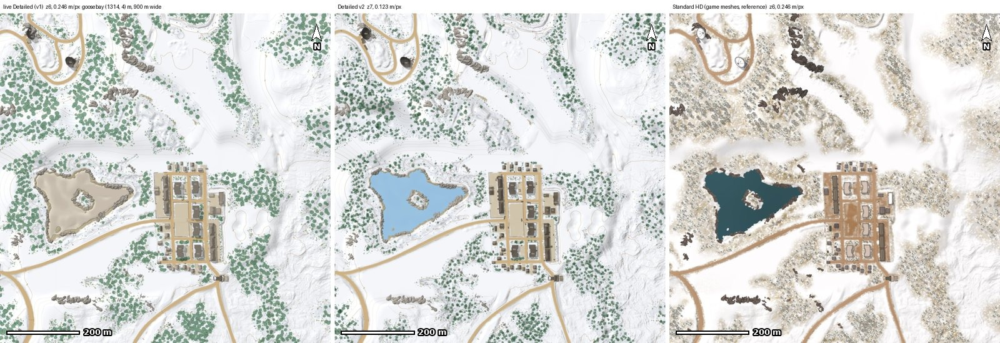
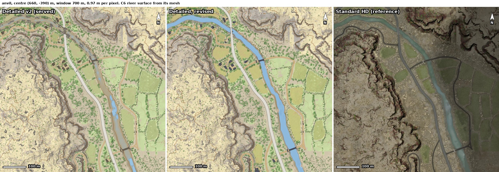
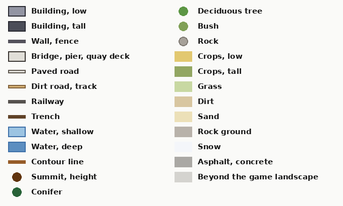

# Методы и результаты: баллистический калькулятор, модель рельефа и объектов для Squad

Отчёт к диссертации по вычислительной баллистике. English version: [`thesis-methods-and-results.md`](thesis-methods-and-results.md).
Составлен 2026-11-04 по доказательствам, которые есть в репозиториях; ничего из этого не измерялось в запущенной игре.
Обновлён 2026-11-05: цифры вокселей в разделах 4, 7 и 8 измерены заново с точной консервативной вокселизацией (`AGL` `e34e481`,
исправление памяти `f116a2b`, задача #23) на итоговых файлах `.vcol`; цифры прежнего построителя по решётке выборки оставлены
рядом как «старые».
Итоговое состояние 2026-11-05: отчёт заново прочитан против SquadCalc `dev` 45.33.0, Squad Ballistics 1.6.1 и ветки `dev` репозитория
agl; разделы 1.5, 2.3, 9.3 и 12-15 новые или переписаны, PENDING-таблицы заполнены имеющимися доказательствами (замеры на GPU
добавлены 2026-11-12, раздел 12.4), а каждый номер задачи, путь к файлу и коммит, названные в отчёте, проверяет
`tools/release/check_report_refs.py` (раздел 13).
Обновлён 2026-11-09: раздел 16 (детальная тактическая карта: метод, точность против независимого рендера, GPU против CPU,
производительность, найденные и исправленные ошибки) новый; строка в разделе 15.
Обновлён 2026-11-10: раздел 16 проверен так, как его проверил бы оппонент: у каждого утверждения текста v2 есть интервал либо пометка
UNVERIFIED или PENDING, добавлены пять измерений на всех 25 картах (16.3.6-16.3.10: дороги, вода, кроны, высоты крыш, горизонтали), в v2
найдены и исправлены в конвейере три ошибки (16.6), условные знаки пересмотрены по измеренному контрасту (16.10); тайлы ревизии измерены
против v2 на каждой карте, чья пересборка закончилась (16.10), а у F1 контуров есть бутстреп-интервалы (16.3.3); строка в разделе 15.
Обновлён 2026-11-10: раздел 1.6 (азимут и расстояние до метки так, как их показывает игра, против калькулятора) новый, а в разделе 2.3
есть круги, нарисованные в метрах на двух картах с неквадратными углами (SC 45.49.0); строки в разделах 10 и 15.
Обновлён 2026-11-10: раздел 2.5 (каждое изображение карты привязано к местности по пикселям клиента: миникарты слоёв, которые игра
берёт из ассета данных каждого слоя, прямоугольник Skorpo, базовая карта по углам игры, HQ-тайлы, удалённые карты terrain и
topographic, решённое смещение слоя relief) новый (SC 45.50.0), а последняя строка раздела 2.3 ссылается на него; строка в
разделе 15. Его инструмент привязки закоммичен и пересчитан (`tools/maptiles/py/register_images.py`,
`tools/browser_check/hq_sharpness.mjs`), поэтому его величины и последняя строка раздела 2.3 — VERIFIED; строка в разделе 13.
Обновлён 2026-11-11: раздел 2 опирается на карты высот на собственных вершинах ландшафта (2.1: сетка от угла против
решётки на 283,8 млн вершин; 2.2: аудит по логам сервера на обеих сетках; 2.4: итоги размещений на решётке), в разделе 3 —
деталь там, где стоят объекты, и её измерение на 50 окнах исследования (SC 45.51.0); строка в разделе 15.
Обновлён 2026-11-12: одна финальная сборка всех слоёв карт (agl `d0ae886`; Standard HD для Black Coast и Yehorivka — с `f9f8382`)
отдаётся как SquadCalc 45.51.0: раздел 16.10 измеряет её против v2 на всех 25 картах (ворота, пять мер против одного эталона, F1
контуров с интервалами), в 16.6 — две ошибки, которые она показала (небесный купол над Standard HD; земля Skorpo за
пределами ландшафта нарисована морем, `deadline-squad/mapping-squad#2`; обе исправлены, Skorpo — в отдаваемых тайлах с 2026-11-12
21:23 UTC, agl `efb521b`, влит как `9c2920f`), а карты высот на вершинах ландшафта из раздела 2 теперь
отдаются (2.4); строка в разделе 15.
Обновлён 2026-11-13: раздел 1.2 говорит, какие выстрелы решает замкнутая форма и какие численный поиск, с константами поиска, и
больше не называет решатель на Rust переносом функция в функцию (в нём нет фильтра JavaScript из 45.40.0, тёплого старта и
`trajectory().above`); тест совпадения на Rust описан с его сеткой и результатом (SC 45.51.0); строка в разделе 15.
Обновлён 2026-11-15: раздел 17 (каждое вычисление калькулятора как пронумерованная формула в математической записи: 143 формул с обозначениями, единицами,
областями определения, допусками и границами ошибки, каждая независимо вычислена и сверена с кодом; смежные работы; 68 известных отклонений кода от формул;
соответствие реестра вычислений формулам) новый; строка в разделе 13 и одна в разделе 15.
Обновлён 2026-11-16: разделы 1.1, 1.2, 1.3 и 17 перечитаны по SquadCalc `dev` `ef176dde6` (45.52.0) и Squad Ballistics `dev` `7a8753b`
(1.7.4). Оба калькулятора теперь летят кадрами сервера 1/49,87 с с двигателем на `ceil(T/dt) - 1` кадрах; страница читает высоты через движок
на Rust, поверхность которого не имеет скачка на краю детализации; решатель на Rust получил фильтр дульного среза, тёплый старт и проверку пути
решателя на JavaScript; `getBearing` возвращает 0 для севера. Из 68 отклонений 17.12 семь убраны версией 45.52.0 и одно убрано частично; они помечены как исправленные, с коммитом;
остальные перечитаны и сохранили свои числа или получили новые; в 17.13 сказано, какие скрипты перезапущены на новой ревизии, а какие нет;
строка в разделе 15.

## 0. Как читать отчёт

У каждого числа есть источник и одна из четырёх меток (четвёртая, ASSUMED, — там, где числа нет в серверных файлах вовсе).

| Метка | Значение |
|---|---|
| **VERIFIED** | Получено закоммиченным инструментом или тестом из файлов игры (выделенный сервер Squad, сборка 26005357, SteamCMD app 403240), команда и вывод записаны в репозитории. Кинжал (†) означает, что автор отчёта перезапустил это 2026-11-04. |
| **INFERRED** | Следует из проверенных данных рассуждением, которое приведено рядом. |
| **UNVERIFIED** | Записано в сообщении коммита, в задаче или заметке без воспроизводимого вывода, либо не определяется по серверным файлам, либо не измерялось. |
| **ASSUMED** | Нет в файлах выделенного сервера совсем, число принято, потому что модели оно нужно: моды из Workshop, bore и zoom ручного оружия (они берутся из анимации клиента), нативные значения взрыва в C++, время жизни по умолчанию в SquadCalc; причина указана рядом (`DP`). |

Строка **PENDING** — это замер, которого не существует; в ней названо действие, которое его даст. После итогового прохода не осталось ни одной:
последние, замеры на GPU, сделаны 2026-11-12 (раздел 12.4).

**Область.** Отчёт охватывает 25 карт, которые пакет выделенного сервера Squad может запускать и файлы которых в нём есть:
`LevelRotation.cfg` называет 25 уровней, у одного из которых нет файлов уровня в пакете, и он не охвачен, а Jensen's Range, которого в
ротации нет, охвачен, так что 25 карт — это 24 играбельных уровня из инвентаря плюс Jensen's Range (`H-README`, «Map inventory: what
the server package can play», VERIFIED). Рельеф, объекты и данные оружия выводятся из пакета сервера; ни одна цифра не опирается на
карты, сделанные сообществом.

### Ключ источников (ревизии, по которым читались цифры)

| Ключ | Что | Ревизия |
|---|---|---|
| `SC` | форк SquadCalc (`deadline-squad/deadline-squadcalc`), ветка `dev` | `e18519025de3`, версия 45.33.0 (первый черновик: `2f1ae898ed90`, 45.24.0); разделы 1.1, 1.2, 1.3 и 17: `ef176dde6`, версия 45.52.0 |
| `SB` | оверлей Squad Ballistics, ветка `main` (совпадает с `dev` `5ffcec9`) | `f702127`, версия 1.6.1 (первый черновик: `5f11d21c837b`, 1.6.0); разделы 1.1, 1.2, 1.3 и 17: `7a8753b`, версия 1.7.4 |
| `AGL` | репозиторий развёртывания и инструментов, ветка `dev` | `fc0500c` (первый черновик: `7438c08dbb76`); отчёт, `tools/release/` и `tools/release/check_report_refs.py` добавлены сверху |
| `#22` | `deadline-squad/deadline-squadcalc#22`, «Completion checklist», пункты A1-D5 | прочитано 2026-11-04, комментарии до 2026-11-05 22:36 UTC |
| `#20` | `deadline-squad/deadline-squadcalc#20`, таблицы оценки вокселей | комментарий от 2026-11-05 (6670455739) |
| `#26`, `#27` | `deadline-squad/deadline-squadcalc#26` (тонкие проёмы), `#27` (запас прохода точности) | открыты, прочитаны 2026-11-05 |
| `CL` | `SC:CHANGELOG.md`, записи 45.25.0-45.33.0 | |
| `SBS` | `SB:docs/sight-scales.ru.md` | аудит 2026-11-05 |
| `V-README` | `AGL:tools/volumetric/README.md` | |
| `H-README` | `AGL:tools/heightmaps/README.md` | |
| `M-README` | `AGL:tools/maptiles/README.md` | сборка 2026-11-09; ревизия 2026-11-10 (раздел 16.10) отдаётся с финальной сборки 2026-11-12 (SquadCalc 45.51.0) |
| `E-README` | `SC:engine/README.md` | |
| `CS` | `AGL:tools/volumetric/docs/collision-semantics.md` | |
| `SDMG` | `AGL:tools/volumetric/docs/structure-damage.md` | |
| `NR` | `AGL:tools/volumetric/docs/native-rules.md` | влит в `dev` как `7438c08`, прочитан в этой ревизии |
| `DP` | `AGL:tools/volumetric/docs/data-provenance.ru.md` и `data-provenance.tsv` | добавлен в ветке `fix/provenance`; счёт на 2026-11-05, SC 45.30.0, SB 1.6.1 |
| `GA` | `AGL:docs/game-data-audit.md` (на английском), таблицы карт и оружия калькулятора против файлов игры; инструмент `AGL:tools/game_audit/README.md` | аудит 2026-11-10, SC 45.40.0, SB 1.7.2 |

Пути ниже даны относительно репозитория из ключа. Оборудование: одна рабочая станция, 15 ГБ ОЗУ, GTX 1650 (4 ГБ) для замеров на GPU из раздела 12.4.

## 1. Баллистическая модель

### 1.1 Модель

Модель снаряда — собственная модель игры, прочитанная из серверного бинарника для Linux и из собранных Blueprint
(docstring модуля `SB:ballistics.py`; доказательства в `deadline-squad/squad-ballistics#4`, здесь UNVERIFIED, так как
задача заново не читалась).

| Элемент | Значение | Источник | Метка |
|---|---|---|---|
| Сопротивление воздуха | нет | docstring `SB:ballistics.py` | VERIFIED (разбор кода `USQProjectileMovement`) |
| Гравитация | `g = ProjectileGravityScale x 9,80 м/с^2` (`DefaultGravityZ` = -980 см/с^2) | `SB:ballistics.py` `GRAVITY = 9.80`; коммит `f22e343` | VERIFIED |
| Начальная скорость | `WeaponConfig.MuzzleVelocity` вдоль ствола от гнезда `Attach_Muzzle` | `SB:ballistics.py`, `AGL:tools/game_ballistics/README.md` | VERIFIED |
| Шаг сервера | один шаг скоростного Верле на кадр сервера, ограничение скорости `MaxSpeed` с первого шага. Измеренный кадр: 20,052 мс (медиана 49,87 Гц по 48 055 десятисекундным записям журнала боевого сервера, 99,51 % из них не ниже 49,5 Гц). Правило сервера для двигателя: `ceil(T / dt) - 1` кадров. Оба калькулятора летят этим кадром и применяют это правило: Squad Ballistics 1.7.4 (`SB:ballistics.py`, `FRAME_TIME`, `boost_steps`) и SquadCalc 45.52.0 (`SC:src/js/squadBallistics.js:95`, `boostSteps` строки 140-143; Rust `SC:engine/src/flight.rs:61`). Раньше они шагали по 20,000 мс и `ceil(T / dt)` кадров; сдвиг против модели в пределах ограничений оружия был: УБ-32 до 9,90 м, остальные ракеты с двигателем до 1,18 м, снаряды без двигателя меньше 1 мм | docstring `SB:ballistics.py`; `AGL:docs/research-native-core.ru.md`, раздел 2.4; `#49` | VERIFIED: схема (адреса в docstring), длительность кадра (журналы сервера), условие двигателя и создание снаряда внутри сетевого вызова (двоичный файл сервера). INFERRED из стандартного поведения движка: первый такт снаряда происходит в кадре его создания. Применено в калькуляторах с SquadCalc 45.52.0 (`4dddc7dcc`, `69e451776`) и Squad Ballistics 1.7.4 (`b29fbba`); `#49` закрыт 2026-11-16 |
| Ракетный двигатель | постоянное `acceleration` в течение `acceleration_time` вдоль поворота, который следует за скоростью (`bRotationFollowsVelocity`) | там же | VERIFIED |

«Точная парабола в вакууме» точна для летящего по инерции снаряда (миномёт, граната, орудийный снаряд ниже предела
скорости). Отчёт не утверждает этого для всех видов оружия: двигатель вдоль оси ствола — это две параболы (замкнутая
форма), снаряд, идущий на пределе скорости, имеет замкнутую форму для угла траектории, а двигатель, толкающий вдоль
траектории, и старт выше предела замкнутой формы не имеют и считаются кадрами игры по 20,052 мс (docstring
`SB:ballistics.py`, VERIFIED).

### 1.2 Решатель

Прочитано в SquadCalc `dev` `ef176dde6`, версия 45.52.0 (не в ревизии ключа источников). Для цели на горизонтальной дистанции
`d` и высоте `h` над осью ствола, скорости `v` и гравитации `g` два угла возвышения простой параболы (низкая и высокая
траектории) равны `theta = atan((v^2 -/+ sqrt(v^4 - g (g d^2 + 2 h v^2))) / (g d))` (`SB:README.md`, раздел «How it works»).
SquadCalc берёт эту замкнутую форму только для простой параболы, которую предел скорости не зажимает: `isParabola(shot) &&
g > 0 && !clampsBefore(shot, height)`, то есть без двигателя, без смещения дульного среза, которое движется с возвышением,
без старта выше предела и без падения быстрее предела до цели (`SC:src/js/squadBallistics.js`, `solveElevation`, строки
1083-1092, `isParabola` строка 214, `clampsBefore` строка 227; Rust `SC:engine/src/flight.rs`, `solve_elevation_with`, строки
1009-1021). Низкая траектория берётся из произведения двух корней, а не из `(v^2 - sqrt(...)) / (g d)`, которое на малой дистанции
вычитает почти равные числа (F9 раздела 17.3). VERIFIED (чтение кода). Миномёт, у которого дульный срез движется с возвышением,
выстрел с ракетным двигателем, старт или полёт по инерции на пределе скорости по формуле не решаются.

Любой другой выстрел решается численно (`solveElevation` строки 1094-1105; `solve_elevation_with` строки 1023-1060) в два шага:

1. Возвышение, при котором снаряд поднимается выше всего на этой дистанции, `peakAngle` (строка 964): поиск золотого сечения
   на плюс-минус `ELEVATION_LIMIT` (pi/2 - 1e-6 рад, строка 74); останов, когда отрезок уже `ANGLE_TOLERANCE` = 1e-10 рад
   (строка 77, цикл на строке 972) или после `MAX_ITERATIONS` = 200 (строка 90). Цель выше высоты снаряда при этом возвышении
   вне дальности: обе траектории NaN.
2. Каждая траектория, `findRoot` (строка 1002): отрезок от вершины, открываемый шагом `BRACKET_STEP` = 0,02 рад (строка 83) и
   удваиваемый, пока в нём нет корня, затем сужаемый вариантом Иллинойса метода ложного положения для
   `heightAt(shot, angle, distance) - height`; останов при ошибке по высоте не более `HEIGHT_TOLERANCE` = 1e-9 м (строка 80)
   или при отрезке уже `ANGLE_TOLERANCE` (цикл на строке 1043), не более `MAX_ITERATIONS` итераций. Если отрезок дошёл до предела
   возвышения, а высота всё ещё не ниже цели, корня внутри предела нет и траектория NaN.

В решателе на Rust те же константы (`flight.rs`, строки 46-57) и те же два шага (`peak_angle` строка 864, `find_root`
строка 896). Функция, которую вычисляют поиски, `heightAt` (строка 567), имеет замкнутую форму для снаряда по инерции и для
снаряда, идущего на пределе скорости (`coastHeight`, строка 487, вызов на строке 625), и для двигателя вдоль оси ствола
(строка 605), а первый шаг старта выше предела она проходит точно и затем идёт по инерции (строка 619). Только двигатель,
толкающий вдоль траектории, и осевой двигатель, который предел может зажать, берутся из таблицы полётов кадрами игры
по возвышению (`fliesBoostInSteps`, строка 176; `BoostTable`, строка 323: узлы через `BOOST_NODE_SPACING` = 1 градус,
строка 100, интерполяция Лагранжа по четырём узлам, строка 576). Это то же деление, что в последнем абзаце раздела 1.1, кроме
того, что старт выше предела — это один точный шаг и затем замкнутая форма полёта по инерции. VERIFIED (чтение кода).

Решатель в SquadCalc есть дважды: на JavaScript (`SC:src/js/squadBallistics.js`, `squadFiringSolution.js`) и на Rust
(`SC:engine`, `flight`, `weapon`). Решатель на Rust следует решателю на JavaScript — та же модель, те же константы и поиск.
В `9664362c9` (45.51.0) они различались в трёх местах; коммит `4dddc7dcc` версии 45.52.0 («Fly the server frame, and bring the Rust
solver level with the JS one») убрал все три (VERIFIED, чтение кода, в `ef176dde6`):

* `solveElevation` на JavaScript возвращает NaN для корня, у которого точка старта не стоит перед целью (`pastMuzzle`, строка 1101;
  с SquadCalc 45.40.0, `04cf787e1`, `SC:CHANGELOG.md`); в `solve_elevation_with` теперь тот же фильтр (`past_muzzle`,
  строка 1032). Пример прежнего чтения (Mortar, снаряд default: `velocity` 110 м/с, `gravity` 9,8 м/с^2, `pivotHeight` 0,0245 м,
  `muzzleForward` 1,569 м, `muzzleUp` 0,002 м; `SC:src/data/weapons.js`; цель в 0,5 м и на 1 м выше) в обоих даёт один ответ:
  низкая NaN и высокая 89,988 градуса (`solveElevation(shot, 0.5, 1)` и `Flight::new(shot).solve_elevation(0.5, 1.0)`, запуск 2026-11-16
  на `ef176dde6`; раньше Rust давал для низкой 62,760 градуса). Собственная минимальная дистанция Mortar — 51,8 м (`SC:src/data/weapons.js:47`).
* Решатель на JavaScript принимает тёплый старт (`guess`, `WARM_STEP` строка 87, `findRoot` строка 1002) и заранее найденную вершину (`peak`);
  решатель на Rust принимает и то и другое в `SolveHints` (`solve_elevation_with`; `solve_elevation(distance, height)` — вызов без подсказок), с тем же
  `WARM_STEP` (`flight.rs:57`). Заголовок файла на JavaScript говорит, что тёплый старт даёт тот же корень в пределах допусков поиска (строки 66-68).
* У проверки профиля `trajectory().above`, которой пользуется покрытие огня (строки 631 и 686), теперь есть аналог на Rust `Flight::above` (строка 1073) с таблицей
  `RangeMax` профиля. Объект `trajectory` на JavaScript как таковой не перенесён: его `height`, `at` и `above` — это `height_at`, `path_at` и `above`
  (`SC:engine/README.md`); `weapon.rs` о себе говорит «without the UI and spread parts» (документация модуля, первые строки).

Документация модуля `flight.rs` называет решатель на Rust «a port, function for function» решателя на JavaScript, а `E-README` говорит, что тест совпадения
держит его к нему. Этот отчёт говорит о том, что показывает тест, и ни о чём шире.

Тест совпадения решателя на Rust, `SC:engine/tests/parity.rs`, запускает `engine/tools/js/reference.mjs` под Node (настоящие
`Weapon` и `SquadFiringSolution`) для каждого снаряда с именем `ballistics`: 19 дистанций (0,5, 1, 2, 3, 4, 5, 15, 51, 150, 340,
450, 700, 1000, 1236, 1500, 2060, 2500, 5000 и 8000 м) x 9 высот цели (-300, -100, -40, -10, 0, 10, 25, 100 и 200 м);
8 близких дистанций (0,1, 0,25, 0,5, 1, 2, 3, 4 и 5 м) x 7 высот (-2, -1, 0,5, 1, 2, 3 и 5 м), где дульный срез уже прошёл часть целей, а линия ствола
проходит через другие; и, для оружия с гравитацией, 18 случаев около максимальной дальности (0,5, 0,9, 0,99, 0,999, 1,001 и 1,01 от неё, при -40, 0 и
+25 м). Сравниваются обе траектории, угол прицела, оба времени полёта, время удержания и максимальная дальность, с точностью 1e-9
градуса и 1e-9 с (1e-9 относительно выше 10 с). Проверяются и пути над профилями рельефа: `Flight::above` с `RangeMax` и без него против
`trajectory().above`. В `ef176dde6`: 155 снарядов, 37 957 случаев, 227 897 значений, 924 пути (308 свободных), 0 расхождений, худшее 3,0e-10 градуса и 1,2e-8 с
(`cargo test --release --test parity -- --nocapture` в `SC:engine` на выгрузке `ef176dde6`, запуск 2026-11-16; VERIFIED†).
В отличие от сетки 45.51.0, эта доходит до области, где два решателя различались (цели от 10 см, дульный срез за целью).

### 1.3 Совпадение двух реализаций

`AGL:tools/direct_fire/compare.py` запускает настоящие `Weapon` и `SquadFiringSolution` SquadCalc под Node и `solve()`
Squad Ballistics на одной сетке (15 дистанций от 0,5 до 8000 м x 9 высот цели от -300 до +200 м, плюс доли 0,5-1,01
собственной максимальной дальности оружия при -40, 0 и +25 м) для каждого снаряда каждого оружия, которое есть в обоих
приложениях: обе траектории, время полёта, скорость, минимальная дистанция и пределы возвышения. Допуск 1e-6 градуса /
секунды.

| Величина | Значение | Источник | Метка |
|---|---|---|---|
| Сравнено оружий | 167 | вывод `compare.py`, SC `ef176dde6` + SB `7a8753b`, запуск 2026-11-16 (первый запуск, 2026-11-05, SC `e18519025de3` + SB `f702127`: 104 оружия) | VERIFIED† |
| Сравнено случаев | 32 652 | то же (первый запуск: 20 178 случаев, то же число в первом черновике и в `CL` 45.31.0; список оружия и сетка с тех пор выросли) | VERIFIED† |
| Расхождений | 0 | то же (в обоих запусках); записано и в коммите SB `f22e343` | VERIFIED† |
| Расхождения максимальной дальности | нет (`{}`) | то же | VERIFIED† |

Команда: `python3 tools/direct_fire/compare.py <копия Squad-Ballistics> <копия SquadCalc>` (7 с на одном ядре 2026-11-05, 11 с 2026-11-16). Запуск после смены времени жизни (SC 45.31.0, SB 1.6.1) по-прежнему даёт 0 расхождений, так что времена жизни 4-40 с в двух приложениях одинаковы.
Область: два решателя согласуются друг с другом. Согласие с настоящей игрой — в следующем подразделе.

### 1.4 Согласие с игрой

| Проверка | Результат | Источник | Метка |
|---|---|---|---|
| Данные оружия (скорость, масштаб гравитации, двигатель, предел) каждого оружия обоих приложений против собранных Blueprint | `diff.md` перечисляет каждое отличие; многократно проверенные миномёт (110 м/с, x1) и УБ-32 (300 м/с, -50 м/с^2 в течение 2 с, x2) воспроизводятся | `AGL:tools/game_ballistics/README.md`, `gamecheck.py` | VERIFIED (метод); сам `diff.md` не хранится, но `DP` (`data-provenance.tsv`) хранит сравнение по каждому оружию и входу |
| Модель времени удержания АГС-17 (185 м/с, x1,8) против замеров в игре | 67 замеров, 279-1931 м по ровной земле, согласие 0,7 % по v^2/g; СКО 5,34 м при пересчитанных скорости и верхе | `AGL:tools/game_ballistics/README.md`; `SB:RELEASE_NOTES.md` (SB#13) | UNVERIFIED здесь: 67 замеров — игровые данные владельца, они лежат в `SB:tests/test_ballistics.py` как `AGS17_HOLD_TABLE` и проверяются там тестом `test_ags17_hold_time_matches_in_game_measurements` (проходит 2026-11-14); числа этой строки не пересчитывались |
| Симуляция со значениями игры (дульный срез движется с возвышением) | решения ложатся в пределах 1 мм; УБ-32 до этого промахивался до 22 м на малой дальности | `SC:CHANGELOG.md`, запись 45.7.0 | UNVERIFIED (утверждение журнала изменений) |
| Каждый вход расчёта наводки (скорость, гравитация, двигатель, предел, вращение, сопротивление воздуха, точка запуска, разброс, время жизни, взрыв, bore, zoom, пределы, минимальная дистанция, сдвиг шкалы, модель удержания) всех 104 оружий SB и 135 SC: значение приложения, значение игры, ассет-источник, метка | 2 704 размеченные строки: VERIFIED 1 762, INFERRED 367, UNVERIFIED 53, ASSUMED 522; 0 необъяснённых расхождений с игрой после одного исправления: время жизни снаряда (`InitialLifeSpan`), которое у 108 сгенерированных оружий прямой наводки SC было по умолчанию 100 с, а в SB отсутствовало, теперь в обоих приложениях равно игровым 4–40 с (SC 45.31.0, SB 1.6.1); оружие, унаследованное от таблицы апстрима, подогнанное или из модов, названо в `DP` раздел 6 | `DP`, `AGL:tools/game_ballistics/provenance.py` (на имеющемся дампе, сборка 26005357) | VERIFIED† для равенств; метки INFERRED / UNVERIFIED / ASSUMED — суть таблицы |
| Высоты запуска установок на технике | взяты из файлов игры для АГС-17, MK19, СПГ-9 на перечисленных машинах | `SB:RELEASE_NOTES.md` | VERIFIED (данные файлов); в игре не проверены, см. раздел 10 |

### 1.5 Шкалы прицелов оверлея (аудит 2026-11-05)

`SBS` сверяет каждую шкалу, которую оверлей Squad Ballistics рисует в прицеле, с пакетом сервера (сборка 26005357); его метки —
VERIFIED, COMPUTED (физика из проверенных входов, здесь читается как INFERRED), ASSUMED и MEASURED (внутриигровые данные владельца, в
репозиториях их нет, здесь читаются как UNVERIFIED).

| Шкала | Результат | Источник | Метка |
|---|---|---|---|
| Смещение метки `focal x tan(angle - bore)` | прямолинейная проекция с горизонтальным FOV; совпадает с независимым интегратором попиксельно | `SBS`; `SB:tests/test_mark_end_to_end.py` | VERIFIED (закоммиченный тест) |
| Zoom и bore 78 записей установленного оружия и техники | равны файлам игры, расхождений нет | `SBS`; `SB:tests/test_game_weapons.py`, `SB:tests/test_sight_data.py` | VERIFIED |
| Zoom и bore 26 ручных гранатомётов | приняты x1 и 0; в файлах есть `SeparateAdsFov` (РПГ-7В1 61, РПГ-28 37, C90-CR 69, Carl Gustav 77, MAAWS 60, NLAW 70, оптика РПГ-29 49, подствольники 80-90), но заменяет ли он настройку FOV или масштабирует её, решает нативный код; открыто как `deadline-squad/squad-ballistics#17` (решает один замер в игре) | `SBS`, «Differences found» 2 | ASSUMED (значение), UNVERIFIED (смысл) |
| Лесенка дальности, наибольшая дистанция | `LADDER_MAX_DISTANCE` был 5000 м («ни одна карта не шире 5000 м по диагонали»); зоны игры измеряются до 7043 м (Yehorivka), и 9 из 17 измеренных карт больше 5000 м, поэтому теперь 8000 м (SB 1.6.1) | `SBS`; `SB:tests/test_sight_scales.py`; `SB:tests/data/play_areas.json` | VERIFIED (данные и тест); 17 карт — те, у которых в дампе есть сплайн зоны игры, а не все 25 |
| Деления лесенки (шаги 25-1000 м) | следуют за меткой; набор шагов — выбор отображения | `SBS` | INFERRED |
| Шкала милов, 6400 на круг | игра называет единицу «MILLIRADIAN (mil)»; прежняя формула `x 17,78` отличается на 0,012 % (0,2 мила на 1500 милах) | `SBS` | VERIFIED (название единицы), UNVERIFIED (формула, её дизассемблер на диске больше не лежит) |
| Таблица стрельбы миномёта | в игре шаги 50 м до 1250 м; наш достаёт 1236 м | `SBS` | VERIFIED |
| Верхнее возвышение миномёта | 88,8 градуса (1578,7 мила) с 2026-11-10: установка наклоняет ствол на 0–43,8 градуса (`PitchInterval` у `BP_GenericDeployableMortarVehicle`) сверх 45 градусов, которые прицел самой игры прибавляет к наклону ствола (`UMG_MortarControl`, байт-код Kismet). Цифра апстрима 88,875 (1580 мил), стоявшая до SB 1.7.1 и SC 45.37.0 и помеченная здесь ASSUMED, давала цели между 51 и 51,8 м на ровной местности решение, на которое ствол не навести; минимальная дистанция теперь — дальность на упоре установки, 51,8 м | `SBS`; `GA`, разделы 2.2 и 2.4; `AGL:tools/game_audit/data/mount_limits.json` (читает `AGL:tools/game_audit/mounts.py`) | INFERRED (предел вычислен из наклона установки; диапазон наклона и 45 — каждое VERIFIED) |
| Метки сеток (мил-точки, метки дальности) | не рисуются; пакет сервера хранит раскладку виджетов и метаданные текстур, но не пиксели | `SBS` | UNVERIFIABLE по файлам сервера |

### 1.6 Азимут и расстояние так, как их показывает игра (2026-11-10)

Расстояние и азимут калькулятора — игровые: исследование 2026-11-10 пропустило по 20 000 пар точек на каждой из 25 карт через
`getDist` и `getBearing` и через собственные формулы игры и нашло 1,4e-12 м и 2,3e-13 градуса (его скрипты не закоммичены). Отличается
то, что игра показывает игроку. Это декодировано из нативного кода сборки сервера 26005357, чьи символы vtable экспортированы, а члены
называет рефлексия UHT, и из Blueprint виджетов клиентской сборки 26234431.

| Пункт | Значение | Источник | Метка |
|---|---|---|---|
| Азимут на компасе HUD (`USQCompassMK2`) | по часовой стрелке от мирового -Y, верха карты, в (0, 360]: точно север читается как 360. Обычный текст отсекает азимут к нулю до целого градуса (`cvttss2si`) и дополняет нулями до трёх цифр, так что компас показывает 045 для любого азимута от 45,0 до чуть меньше 46,0. В виде установленного миномёта (`bPreciseBearingMode`) он печатает `%.1f` | нативный код по `0xa65ec50` (дизассемблер не закоммичен); `SB:compassreader.py` читает экран по тому же правилу; кадры игры `SB:tests/data/compass_j_058.png` (вид миномёта, `182.0`) и `SB:tests/data/compass_a_063.png` (`119`) | INFERRED (декодировано, оба режима видны на кадрах игры); отсечение до целого градуса в игре UNVERIFIED |
| Ошибка наведения при отображении до SC 45.48.0 | калькулятор показывал азимут с десятыми (45,7). Игрок, который поворачивается, пока обычный компас не покажет этот азимут, округлённый до целого градуса, R, останавливается где-то в [R, R + 1): от -0,5 до +1,5 градуса от азимута, в среднем +0,5 градуса, если остановка с равной вероятностью приходится на любое место этого градуса. Вбок на 1 км: в среднем 8,7 м, до 26 м | правило выше | INFERRED |
| Отображение с SC 45.49.0 | три цифры, которые обычный компас показывает, когда смотрит точно на цель, затем меньшая десятая внутри этого градуса. Десятая округляется так, как её округляет `%.1f`, но не дальше 9: 45,96 читается как 045.9, где `%.1f` даёт 46.0, а обычный компас показывает 046 только с 46,0. Точно север читается как 360.0, азимут на волос меньше 360 — как 359.9. Так показывают панель кейпада, всплывающие окна расчёта и их сводка, окно цели; подсказка азимута говорит, что компас отсекает десятую. Остановка в любом месте показанного градуса меньше чем в 1 градусе от азимута (17,5 м на 1 км) и в среднем без смещения, а десятая говорит, куда в этом градусе целиться | `SC:src/js/compass.js`; `SC:tests/compass.test.mjs` (7 тестов), `SC:tests/targetPopup.test.mjs`; `AGL:tools/browser_check/coords_check.mjs` на сборке 45.49.0: 045.9 во всплывающем окне, его сводке и окне цели для 45,96 градуса, 360.0 точно на север, 026.6 в панели для 26,565 градуса | VERIFIED (отображение); INFERRED (ошибка) |
| Передаваемые числа | не изменились: Squad Ballistics читает числовой азимут из `window.squadBallistics.targets()`, а SquadMortarOverlay получает тот же текст, что и раньше | `SB:maplink.py` (`make_target`); `SC:src/js/smcConnector.js` | VERIFIED (чтение кода) |
| Расстояние до метки карты на компасе HUD (`USQCompassMarker`) | наклонное расстояние `sqrt(dx² + dy² + dz²)`, отсечённое к нулю до шага кривой `CompassMarkerDistanceResolution`: 1 м до 30 м, 5 м до 100 м, 10 м до 300 м, 50 м до 1999 м, 100 м с 2000 м. Метка в 1049 м читается как 1000; разница высот 100 м прибавляет 5,0 м на 1000 м, 50 м — 4,1 м на 300 м. Расстояние калькулятора — горизонтальное, которое нужно решателю (раздел 1.2); с SC 45.49.0 подсказка расстояния говорит, чем они различаются | нативный код по `0xa65e840` и кривая `UMG_Compass_Marker` (клиент); `SC:public/locales/en/tooltips.json` (`markerDistance`) | INFERRED (декодировано); в игре UNVERIFIED |
| Верх карты, 0 компаса и север калькулятора | одно и то же направление: виджет карты игры ничего не поворачивает (вправо по карте = мировой +X, вверх = мировой -Y), а текстуры миникарт клиента лежат по мировым осям в пределах 0,05 градуса на 25 картах из 25 (совмещение с раздаваемыми картами высот шагами 0,05 градуса: 0,00 на 21 карте, -0,05 на Skorpo и Manicouagan, +0,05 на Sumari, +0,10 на Harju по отмывке и 0,00 по уклону). На Skorpo повёрнут только актор ландшафта (рыскание -2,006 градуса, `GA` O9), что карты высот учитывают; комментарий в `SC:src/data/maps.js`, предполагавший поворот изображения Skorpo на 2,02 градуса, исправлен в SC 45.49.0 | скрипты совмещения не закоммичены; `AGL:tools/game_audit/data/landscapes.json` | INFERRED (совмещение текстур); VERIFIED (рыскание ландшафта) |

Строки UNVERIFIED решают два теста на сервере Training. Пешком медленно поворачиваться к флагу, азимут на который даёт калькулятор, и
отметить, где компас меняет 045 на 046. Поставить метку карты на флаг примерно в 1 км, на 50 м выше или ниже, и сравнить компас с
`trunc(sqrt(d² + h²) / 50) x 50`.

## 2. Рельеф


Источник и метод: собранные поля высот Chaos уровней ландшафта, поставленные по трансформации актора ландшафта (16 бит
на тайл, шаг 0,3-6,4 мм; вершины через 0,5-1,2 м), объединённые по максимуму с коллизией размещённых статических мешей и,
где она выше игрового рельефа на 0,5 м и её объясняет размещение объекта игры (раздел 2.4), с поверхностью SDK из
SquadHeight 1.3.0 (1,6 см). 16-битный PNG и WebP без потерь с теми же уровнями, отсчёты которых — собственные вершины
ландшафта (карты высот, собранные с 2026-11-10; до этого отсчёт через каждый метр от угла миникарты, 0,5 м на Chora и
Kokan, и WebP, округлённый до 1 см) (`H-README`, «Sources and fusion», «Grid», «WebP form»).

### 2.1 Правило интерполяции и сетка

Игра делит каждую ячейку на два треугольника по диагонали от (x, y) к (x+1, y+1). В точках, где другая диагональ дала
бы разницу больше 5 мм, эта диагональ ближе в 79 из 89 (17 из 20 выше 2 см) (`H-README`, «Interpolation: the game's
triangles», `py/compare_interpolation.py`): VERIFIED. На сетке, чьи узлы — вершины игры, билинейное чтение против
треугольного даёт СКО 0,3-2,2 см (до 0,2-1,1 м на самых крутых ячейках), треугольное — 0,0-0,1 см; измерено на 12 картах,
чьи вершины лежали на сетке от угла: VERIFIED.

Сетка от угла была пересэмплированием вершин на 18 картах: они лежат от её отсчётов на 0,4 см (Kokan) — 49 см (Jensen) или
идут с другим шагом (Anvil 0,75 м, Black Coast 1,0039 м, Logar 0,9999 м, Skorpo 1,2 м с поворотом на -2,006195 градуса).
С 2026-11-10 отсчёты карты высот — вершины на каждой карте (`meta.json` `origin_m`, `resolution_m`, `yaw_deg`;
`AGL:tools/heightmaps/py/lattice.py`), и SquadCalc 45.51.0 читает их вдоль собственных осей ландшафта. Ошибка чтения
страницы против коллизии игры на голой земле (`H-README`, «Grid»; `py/compare_native_vertices.py`: каждая вершина ландшафта
в границах и до 200 000 случайных точек между ними, где обе карты высот держат голый ландшафт), отданные карты высот на сетке
от угла против карт высот на вершинах, см:

| Карта | Шаг вершин (м) | Вершин | Сетка от угла p99 / max (см) | Решётка p99 / max (см) | Точек между | Сетка от угла p99 / max (см) | Решётка p99 / max (см) |
|---|---|---|---|---|---|---|---|
| Al Basrah | 1 | 10,8 млн | 0,54 / 2,95 | 0,05 / 0,06 | 136 тыс. | 0,47 / 1,03 | 0,05 / 0,05 |
| Anvil | 0,75 | 13,2 млн | 17,56 / 238,30 | 0,09 / 0,10 | 159 тыс. | 11,50 / 84,76 | 0,08 / 0,09 |
| Black Coast | 1,00394 | 11,5 млн | 11,32 / 344,12 | 0,16 / 0,16 | 110 тыс. | 6,63 / 33,48 | 0,14 / 0,16 |
| Chora | 0,5 | 19,8 млн | 0,38 / 0,39 | 0,38 / 0,39 | 60 тыс. | 0,37 / 0,38 | 0,37 / 0,39 |
| Fallujah | 1 | 7,0 млн | 0,50 / 37,21 | 0,06 / 37,53 | 154 тыс. | 0,46 / 0,51 | 0,05 / 0,06 |
| Fools Road | 1 | 2,6 млн | 8,90 / 156,06 | 0,08 / 0,08 | 167 тыс. | 5,27 / 68,02 | 0,07 / 0,08 |
| Goose Bay | 1 | 10,4 млн | 8,97 / 72,82 | 0,12 / 0,13 | 129 тыс. | 5,28 / 21,54 | 0,11 / 0,12 |
| Gorodok | 1 | 13,8 млн | 0,57 / 3,75 | 0,07 / 0,08 | 167 тыс. | 0,48 / 1,18 | 0,06 / 0,07 |
| Harju | 1 | 11,5 млн | 0,58 / 6,37 | 0,09 / 0,10 | 143 тыс. | 0,46 / 1,21 | 0,08 / 0,09 |
| Jensen | 1 | 14,4 млн | 4,33 / 37,87 | 0,07 / 0,07 | 179 тыс. | 2,60 / 11,42 | 0,07 / 0,07 |
| Kamdesh | 1 | 11,5 млн | 0,50 / 0,51 | 0,15 / 0,16 | 141 тыс. | 0,43 / 0,51 | 0,14 / 0,15 |
| Kohat | 1 | 9,2 млн | 1,46 / 189,42 | 0,29 / 0,30 | 86 тыс. | 0,92 / 153,37 | 0,27 / 0,29 |
| Kokan | 0,5 | 23,0 млн | 0,49 / 1,18 | 0,07 / 0,08 | 184 тыс. | 0,44 / 0,57 | 0,06 / 0,07 |
| Lashkar | 1 | 13,1 млн | 0,50 / 0,51 | 0,13 / 0,13 | 139 тыс. | 0,44 / 0,51 | 0,11 / 0,13 |
| Logar | 0,9999 | 2,5 млн | 17,69 / 64,95 | 0,10 / 0,10 | 160 тыс. | 10,16 / 46,12 | 0,09 / 0,10 |
| Manicouagan | 1 | 10,2 млн | 7,96 / 69,74 | 0,16 / 0,16 | 126 тыс. | 4,67 / 21,83 | 0,14 / 0,16 |
| Mestia | 1 | 3,0 млн | 0,69 / 12,08 | 0,19 / 0,20 | 105 тыс. | 0,51 / 3,13 | 0,17 / 0,19 |
| Mutaha | 1 | 6,0 млн | 0,63 / 3,44 | 0,05 / 0,05 | 160 тыс. | 0,51 / 1,74 | 0,05 / 0,05 |
| Narva | 1 | 6,1 млн | 0,50 / 0,51 | 0,08 / 0,09 | 156 тыс. | 0,45 / 0,51 | 0,07 / 0,08 |
| Pacific | 1 | 13,5 млн | 0,50 / 0,51 | 0,12 / 0,13 | 166 тыс. | 0,43 / 0,51 | 0,11 / 0,12 |
| Sanxian | 1 | 4,7 млн | 0,50 / 0,51 | 0,09 / 0,10 | 45 тыс. | 0,46 / 0,51 | 0,09 / 0,10 |
| Skorpo | 1,2 | 21,2 млн | 11,31 / 131,67 | 0,80 / 0,82 | 130 тыс. | 6,40 / 36,12 | 0,72 / 0,81 |
| Sumari | 1 | 1,0 млн | 0,57 / 1,42 | 0,11 / 0,11 | 120 тыс. | 0,48 / 0,94 | 0,10 / 0,11 |
| Tallil | 1 | 16,3 млн | 4,14 / 37,09 | 0,06 / 0,07 | 149 тыс. | 2,41 / 12,59 | 0,05 / 0,06 |
| Yehorivka | 1 | 27,4 млн | 0,92 / 7,11 | 0,19 / 0,20 | 137 тыс. | 0,62 / 2,36 | 0,17 / 0,19 |

Вывод: на вершинах чтение страницы в пределах 0,82 см от коллизии игры в каждой из 283,8 млн вершин ландшафта и 3,4 млн точек между ними на каждой карте (Skorpo, чей 16-битный шаг 1,6 см; 0,05-0,39 см на остальных), против до 3,44 м на сетке от угла (Black Coast; Anvil 2,38 м, Kohat 1,89 м, Fools Road 1,56 м, Skorpo 1,32 м), кроме одного шва Fallujah: два из шести её streaming proxy расходятся в 30 общих вершинах вдоль x = -510 м до 37,5 см, коллизия игры там ступенькой, и сетка с одной высотой на вершину ошибается с одной стороны на столько же (37,53 см в таблице; `H-README`, «Grid»). VERIFIED..

### 2.2 Точность против логов сервера

Эталон: позиции, которые выделенный сервер записал в лог (поставленные метки карты, деплоймент, точки появления, взрывы;
центр капсулы игрока минус 0,88 м), только с сервера Training, обезличенные `log_points.awk` до `<карта> <вид> x y z`
(`H-README`, «Audit against the game server»; `py/audit_ground_truth.py`).

| Карта | билинейно в пределах 2 см | ближайшая в пределах 2 см | треугольник в пределах 2 см | n | Метка |
|---|---|---|---|---|---|
| Fallujah | 90 % | 79 % | 92 % (p95 5,5 см; билинейно 10,1, ближайшая 8,0) | 107 точек, согласных с логом или отличающихся сеткой (в пределах 15 см); 36 из 143 точек дальше 15 см, у каждой на точке или рядом статический меш, либо Z = 0 в логе | VERIFIED |
| Goose Bay | 92 % | 60 % | 92 % | не записано | VERIFIED (проценты), n UNVERIFIED |
| Yehorivka | 96 % | 63 % | 97 % | не записано | VERIFIED (проценты), n UNVERIFIED |
| Black Coast | 89 % | 63 % | 91 % | не записано | VERIFIED (проценты), n UNVERIFIED |

Вывод: **89-97 % проверенных точек в пределах 2 см** при билинейном и треугольном чтении (ближайшая: 60-79 %). Выборка —
точки, которые в логе являются трассировками по земле; это не случайная выборка карты, а лог — единственный эталон.
Исходные строки логов в репозиториях не лежат (в них данные игроков). Прочие проверки рельефа (`H-README`): игровой рельеф
против SquadHeight на открытой земле, медиана разности 0,0 мм на каждой карте, СКО 0,5-14 см; против собственных вершин
ландшафта на сетке 0,5 м СКО 0,000 (Chora) и 0,017 см (Kokan) против 8,91 и 0,89 см на 1 м (VERIFIED).

Тот же аудит на картах высот на вершинах ландшафта (раздел 2.1; 25 карт, собранных 2026-11-10, чьи `heightmap.png`
отдаваемые карты финальной сборки повторяют байт в байт на всех 25 картах, 2.4), 12 карт, в
точках, где сам ландшафт игры в пределах 2 см от лога и ни у одной из карт высот нет объекта в точке (`grid_object` в
`py/audit_ground_truth.py`), треугольное чтение, см:

| Карта | n | Сетка от угла в пределах 2 см | p95 | max | Вершины в пределах 2 см | p95 | max |
|---|---|---|---|---|---|---|---|
| Fallujah | 76 | 95 % | 2,9 | 33,9 | 95 % | 2,9 | 33,9 |
| Goose Bay | 148 | 94 % | 2,1 | 10,6 | 99 % | 1,2 | 10,7 |
| Yehorivka | 152 | 99 % | 1,2 | 11,5 | 99 % | 1,3 | 11,5 |
| Black Coast | 120 | 95 % | 1,9 | 3,5 | 100 % | 0,9 | 1,9 |
| Al Basrah | 47 | 100 % | 0,5 | 1,6 | 100 % | 0,5 | 1,5 |
| Harju | 66 | 97 % | 1,0 | 6,3 | 97 % | 1,0 | 6,3 |
| Jensen | 20 | 100 % | 0,8 | 1,1 | 100 % | 0,1 | 0,3 |
| Kokan | 9 | 100 % | 0,0 | 0,0 | 100 % | 0,0 | 0,0 |
| Manicouagan | 12 | 100 % | 0,3 | 0,4 | 100 % | 0,1 | 0,1 |
| Narva | 9 | 100 % | 0,1 | 0,1 | 100 % | 0,1 | 0,1 |
| Skorpo | 13 | 92 % | 3,2 | 6,2 | 100 % | 0,5 | 0,6 |
| Tallil | 17 | 88 % | 2,4 | 3,4 | 100 % | 0,3 | 0,4 |
| 12 карт | 689 | 96,2 % | 1,7 | 33,9 | 98,7 % | 1,1 | 33,9 |

Вывод: на вершинах **98,7 % этих точек земли в пределах 2 см** (сетка от угла 96,2 %), 95-й процентиль 1,1 см (1,7 см).
Точки дальше 2 см одни и те же на обеих сетках и читаются на обеих одинаково: мелкие объекты между узлами (бордюр, ступень;
до 33,9 см на Fallujah), а не сетка. На всех точках, которые аудит относит к земле (`ok` и `sub-cell`, как в таблице выше),
треугольное чтение в пределах 2 см на 92 % Fallujah (107 точек), 96 % Goose Bay (162), 97 % Yehorivka (167) и 95 % Black
Coast (165) (`H-README`, «Audit against the game server»): VERIFIED.

### 2.3 Сетка карты и углы миникарты (аудит 2026-11-05)

Внутриигровая сетка начинается (A1) в северо-западном углу миникарты. Углы — это `MapTextureCornerZero` и `MapTextureCornerOne`
в `SQWorldSettings` каждого игрового слоя; `py/minimap_corners.py` читает их для 219 слоёв сборки 26005357 и сводит к метрам по
картам (`H-README`, «Minimap corners and the grid», `py/test_minimap_corners.py`). Три уровня сетки игры (масштабы 1, 3, 9 в
`W_SQMapGridLines`) — это 300-метровый кейпад SquadCalc и подкейпады 100 м и 33,3 м, которые в сетке уже были.

| Находка | Значение | Источник | Метка |
|---|---|---|---|
| Углы изображений SquadCalc против углов игры, 24 карты | в пределах 1,00 м (наибольшее: Black Coast 1,00 м); углы изображений — игровые, округлённые или усечённые | таблица `H-README` | VERIFIED |
| Skorpo | западный край на 9,5 м, восточный на 10,5 м мимо (углы изображения подогнаны под изображение апстрима), так что каждая линия сетки Skorpo была на 9,5 м западнее игровой, а текст и ввод кейпада оставались на 9,5 м мимо до SC 45.48.0 | `H-README`; `CL` 45.30.0 | VERIFIED |
| Слои Skirmish и Seed с собственной миникартой (Chora, Mutaha, Tallil, Skorpo, Goose Bay, Manicouagan, Black Coast) | их сетка начинается до 1,2 км от сетки карты (Chora Skirmish v1: 1007 м на восток, 1222 м на юг); несколько обычных слоёв отличаются на 0,5-1,5 м (Manicouagan RAAS v1/v2) | `CL` 45.30.0 | VERIFIED |
| Исправление линий (SC 45.30.0) | нарисованные линии начинаются в игровом углу загруженного слоя, иначе в `SDK_data.minimap.game`; изображение, карта высот, воксели и метки остаются на углах изображения; тесты `SC:tests/squadGrid.test.mjs` (игровые углы всех 25 карт в пределах 1 м от изображения, кроме Skorpo) и первая линия кейпада в `AGL:tools/browser_check/grid_check.mjs` | `CL` 45.30.0 | VERIFIED только для линий |
| Что 45.30.0 оставил отсчитанным от изображения (найдено 2026-11-10) | текст кейпада (окошко под курсором, всплывающие окна меток, поле «Переместить в» орудия) и ввод кейпада всё ещё отсчитывались от угла изображения карты: середина Chora Skirmish v1 давала G07-1-7, где игра пишет C3 - 3 - 7, текст Skorpo был на 9,5 м мимо, ещё восьми карт — до 1 м; ввод читал игровой C3-3-7 без нуля как C33-7; у полосы после последнего целого кейпада не было буквы и цифры на 24 картах из 25; на десяти слоях Seed и Skirmish с собственной миникартой линии и подписи шли по всей карте | `AGL:tools/browser_check/grid_check.mjs` на сборке 45.47.0: не проходят 21 из 29 проверок | VERIFIED |
| Исправление текста, ввода, подписей и границ (SC 45.48.0) | текст и ввод кейпада отсчитываются от угла сетки и вне слоя ничего не дают, как в игре; игровой текст читается с нулём и без, с пробелами и без; последний неполный столбец и ряд подписаны посередине; сетка кончается на краях слоя, подписи идут вдоль них; подписи Mestia остаются над своими столбцами, а у игры пустой последний слот сдвигает их до 279 м | `SC:tests/keypad.test.mjs` и `SC:tests/squadGrid.test.mjs` на `SC:tests/fixtures/gameKeypads.json` (восемь слоёв: игровой текст в 1 м внутри углов и в середине, подписи, число линий); `AGL:tools/browser_check/grid_check.mjs`, все 29 проверок проходят на сборке 45.48.0 | VERIFIED по правилу игры на этих восьми слоях и в браузере на Skorpo, Chora Skirmish v1 и Al Basrah; INFERRED для остальных слоёв (тот же код на углах каждого слоя). Правило декодировано из бинарника сервера и байткода Blueprint (`USQMapConversions::MapLocationToGridCoordinateString`, `W_SQMapHorizontalBar`/`VerticalBar`) инструментами, которых нет в репозиториях; в игре UNVERIFIED |
| Карты с неквадратными углами | Skorpo 6849 м на 6869 м (с севера на юг на 0,292 % длиннее), Black Coast 4598 м на 4599 м (0,022 %); остальные 23 карты квадратные. Карта калькулятора — квадрат в 256 единиц, поэтому на этих двух картах метр на восток и метр на север — разное число единиц; точки (`toMeters`, `fromMeters`, расстояние, азимут) пересчитываются со своим масштабом по каждой оси и совпадают с игрой в пределах 1,5e-12 м (раздел 1.6) | `SC:src/data/maps.js` | VERIFIED |
| Круги до SC 45.48.0 | рисовались с одним радиусом Leaflet: R, умноженным на масштаб по востоку. Это R м с востока на запад, но R x 6869 / 6849 м с севера на юг на Skorpo. В браузере на сборке 45.48.0 кольцо дальности миномёта 1236,9 м было 1240,56 м с севера на юг (+3,6 м), кольцо UB-32 2184,3 м — 2190,58 м (+6,3 м по целым пикселям, ровно +6,38 м), круг запрета FOB 400 м — 401,22 м (+1,2 м); зона захвата 250 м была длиннее на 0,7 м. На Black Coast лишнее — 0,02 % (0,5 м на 2184 м). Расстояния, азимуты и возвышения это не затрагивало | `AGL:tools/browser_check/coords_check.mjs` на сборке 45.48.0: не проходят 14 проверок; `SC:tests/groundShapes.test.mjs` | VERIFIED |
| Исправление кругов (SC 45.49.0) | каждый круг и эллипс, заданный в метрах, рисуется с масштабами карты по востоку и по северу (`SC:src/js/groundShapes.js`, через `squadMinimap.fromMeters`): кольца дальности, круги меток FOB, миномёта, Hell Cannon и БПЛА, эллипсы разброса и урона, сетка цели, зоны захвата и зоны защиты; повёрнутые прямоугольники и капсулы зон захвата поворачиваются в метрах. На Skorpo кольца измеряются 1236,9364 м и 2184,3259 м в обе стороны (геометрия в пределах 3e-10 м, путь SVG в пределах половины пикселя, 0,21 м на зуме 6), круги FOB — 150 м и 400 м, радиусы урона — 6,5056 м и 12,5381 м. Юнит-тесты держат круги всех 25 карт в пределах 1 см на 400, 1236,9 и 2184,3 м, а нарисованные эллипсы на Skorpo, Black Coast и Al Basrah — в пределах 1e-9 от эллипса в метрах. Круг, нарисованный от руки, остаётся кругом в единицах карты, через точку, до которой его тянут; длины вдоль пути флагов тоже считаются по обоим масштабам (`SC:src/js/libs/leaflet-measure-path.js` `segmentMetres`; по одному масштабу востока отрезок с севера на юг на Skorpo читался на 0,29 % короче) | `SC:tests/groundShapes.test.mjs`; `SC:tests/measurePath.test.mjs`; `AGL:tools/browser_check/coords_check.mjs`, все 16 проверок проходят на сборке 45.49.0 | VERIFIED |
| Размер изображений карт апстрима и ориентация изображения там, где `Corner0` не северо-западный (Fools Road, Gorodok, Jensen, Kokan, Lashkar, Logar, Mestia, Mutaha, Narva, Skorpo, Yehorivka указывают его переставленным на части слоёв) | измерено по пикселям клиента (раздел 2.5): каждая базовая карта апстрима — это текстура игры, не отражённая и не повёрнутая (лучшая из 8 ориентаций, корреляция 0,99–1,00 на 25 картах), и лежит там, где говорит раздел 2.5 | раздел 2.5; `register orientation` (`M-README`, «Where each map picture lies on the world») | VERIFIED |

### 2.4 Объекты, которые есть только в карте SDK (2026-11-10)

SquadHeight снят трассировкой в Squad SDK, где версия карты не та, что в установленной сборке, поэтому его поверхность над рельефом —
высота игры только там, где в игре что-то есть. Точка сетки сохраняет поверхность SquadHeight, если она лежит под коробкой коллизии
размещения статического меша сервера или под коробкой размещения меша, которое показывает сцена клиента (сборка клиента 26234431:
статические, инстансные, растительные меши и меши на сплайнах, компоненты блюпринтов, плоскости воды; меши на сплайнах изогнуты с их
креном), включая 1 м вокруг коробки и между её низом и верхом, или если в 1 м от неё проходит меш клиента шире и длиннее 800 м (горы
фона, плоскости океана и озёр). В остальных местах стоят собственные поверхности игры: её рельеф, её статическая коллизия и рельеф или
вода такого огромного меша под поверхностью SquadHeight (`H-README`, «Which of SquadHeight's objects are taken»;
`AGL:tools/heightmaps/py/evidence.py`, `build_heightmap.fuse`).

| Находка | Значение | Источник | Метка |
|---|---|---|---|
| Точки, где SquadHeight выше рельефа на 0,5 м и более, 25 карт | 28 515 530 на сетке от угла; размещение объясняет 27 949 202 (20 946 035 — только размещение клиента: 18 713 366 — вода и горы меша шире 800 м, остальное — растительность и компоненты блюпринтов; 25 566 — только размещение сервера). На вершинах ландшафта (раздел 2.1) 28 621 312, из них объяснены 28 052 108 | `H-README` | VERIFIED |
| Точки, которые не объясняет ни одно размещение | 566 328 на сетке от угла (569 204 на вершинах); из них 554 201 лежат на собственной статической коллизии сервера на той же высоте и не меняются (Gorodok 405 962, Narva 148 238) | `H-README` | VERIFIED |
| Опущенные точки | 12 127 точек, 11 480 м², на 6 картах: Al Basrah 11 226 (до 22,48 м, медиана 6,17 м: город фона уровня `_Vista` вдоль края карты и стены на открытом песке), Chora 792 на её сетке 0,5 м (198 м², до 8,44 м), Kokan 71 (17,8 м², до 9,41 м), Skorpo 16 (крона дерева на 30,7 м над рельефом, до которой не достаёт ни одно дерево игры), Anvil 17 (до 0,72 м), Gorodok 5 (до 1,84 м); остальные 19 карт не меняются | `H-README` | VERIFIED |
| Ландшафт клиента в этих точках | равен серверному (наибольшая разница 0,00 м) и нигде не подходит к поверхности SquadHeight ближе 0,5 м: ничего из этого не рельеф игры | `H-README` | VERIFIED |
| `build` шести карт против отдаваемых карт высот | отличается ровно в точках выше, на измеренное опускание с точностью до 1 см, а в остальном только в 12 764 точках Gorodok, на один 16-битный уровень (1,4 мм) ниже, где коллизия сервера держит поверхность SquadHeight с точностью до миллиметра | `H-README` | VERIFIED |
| Отдаваемые карты высот | собраны 2026-10-30 и 2026-10-31, со всеми объектами SquadHeight и на сетке от угла, отдавались до 2026-11-12; с тех пор (SquadCalc 45.51.0) отдаются карты финальной сборки: `heightmaps.sh build` agl `d0ae886` 2026-11-11, с правилом размещений и на вершинах ландшафта (раздел 2.1), с растром рельефа и объёмным слоем, выложенными на этой сетке; отдаваемая папка содержит файлы сборки байт в байт | `H-README`; раздел 16.10 | VERIFIED |

### 2.5 Изображения карт на местности (2026-11-10)

Каждое изображение, которое показывает калькулятор, привязано к местности по пикселям клиента Squad (сборка 26234431, паки
которой открываются без ключа). Метод 1: края изображения против объектов самого уровня (статические меши, кроны деревьев и
дороги, нарисованные в той же рамке), нормированная взаимная корреляция в окнах 8 x 8 по карте, аффинная подгонка, смещение в
четырёх углах и в середине каждого края (+ — нарисовано восточнее или южнее объекта); величина по менее чем 20 окнам не
учитывается. Метод 2, независимый от объектов: отмывка рельефа, которую несёт само изображение (полосовой фильтр логарифма
яркости), против рельефа игры, освещённого с направления, подобранного по всей карте. Оба метода — это
`AGL:tools/maptiles/py/register_images.py` (`maptiles.sh register`, `M-README`, «Where each map picture lies on the world»;
30 тестов в `AGL:tools/maptiles/py/test_register_images.py` восстанавливают синтетические сдвиги, масштабы, повороты и
прямоугольники), и каждая величина таблицы — его вывод, пересчитанный 2026-11-10 (команды в разделе 13); смещения меньше
примерно 0,4 м лежат ниже предела метода (слой Detailed, нарисованный по тем же данным уровня, читается в 0,08–0,40 м на
23 картах, Tallil 0,80 м и Pacific 1,07 м по 6 окнам). Где
калькулятор рисует каждое изображение, проверено закоммиченными тестами (`SC:tests/mapImages.test.mjs`, 11 тестов: на
45.49.0 файл не загружается, так как нет `mapImages.js`, а с этим модулем поверх таблицы карт 45.49.0 падают два теста
Skorpo) и в Chromium
(`AGL:tools/browser_check/layer_minimap_check.mjs`, 13 проверок, все проходят на сборке 45.50.0 с изображениями шага
`layer-minimaps`).

| Находка | Значение | Источник | Метка |
|---|---|---|---|
| Какую миникарту показывает слой | игра берёт текстуру и её углы из ассета данных слоя (`Gameplay_Layer_Data/<layer>`, класс `BP_SQLayer`: `OveriddenMinimapTexture` и `MinimapCornersPosition` при `bIsValid`) поверх его уровня (`SQWorldSettings`: `MapTexture`, `MapTextureCornerZero`/`One`); API слоёв даёт уровневые. Сборка 26234431: 219 уровней, 221 ассет данных (83 задают текстуру, 204 — действительные углы); 21 слой показывает текстуру, отличную от текстуры своей карты, всего 18 текстур | `M-README`, «Layer minimaps»; `AGL:tools/maptiles/py/layer_minimaps.py`, 29 тестов в `AGL:tools/maptiles/py/test_layer_minimaps.py` | VERIFIED по файлам клиента; что игра рисует текстуру ассета данных, — INFERRED из того, что текстуры ложатся на местность только так (Black Coast Seed v1, Narva и Yehorivka Skirmish); UNVERIFIED в игре |
| Миникарты слоёв до SC 45.50.0 | брались текстура и углы из API слоёв: Black Coast Seed v1 показывал `Black_Coast_Minimap_Seed_v1`, на которой другая часть острова, в 490,5–862 м от её объектов; Narva Skirmish v1, Yehorivka Skirmish v1, v1 WP и v2 и Fallujah Skirmish v1 показывали изображение всей карты, где игра показывает своё, в 2,3–2,9 раза детальнее (Narva, Yehorivka) или другой рисунок (Fallujah) | `M-README`, «Where each map picture lies on the world»: `register locate` (Black Coast), `register layer-minimaps` (`finer`) | VERIFIED |
| 21 миникарта слоёв SC 45.50.0 против местности, худший угол (окна) | Goose Bay Seed 0,12 (41), Black Coast Seed 0,24 (25), Mutaha Seed 0,32 (59), Skorpo Skirmish 0,32 (35), Narva Skirmish 0,33 (56), Tallil Seed и Skirmish v1 0,42 (42), Chora Skirmish 0,44 (38), Mutaha Skirmish 0,59 (51), Yehorivka Skirmish v1 и v1 WP 0,79 (33), Fallujah Seed и Skirmish 0,88 (42), Al Basrah Seed v1, v2 и Skirmish v1, v2 0,97–1,00 (45–47), Manicouagan Seed 1,12 (23), Tallil Skirmish v2 1,15 (31), Gorodok Skirmish 1,54 м (25); Yehorivka Skirmish v2 0,53 м по 13 окнам. Игра рисует их там же: это ошибка самой текстуры | `M-README`, «Where each map picture lies on the world»: `register layer-minimaps` по манифесту `layer-minimaps.json` шага `layer-minimaps` | VERIFIED; положение по углам манифеста VERIFIED (`SC:tests/mapImages.test.mjs`; в Chromium Mutaha Seed v1, Black Coast Seed v1 и Narva Skirmish v1 в пределах 0,1 м) |
| Базовая карта апстрима на 11 картах, где углы изображения округлены | по углам изображения она лежала до 1,00 м (Black Coast) от места, где её рисует игра; SC 45.50.0 рисует её по углам игры (`minimap.game`). Против местности, худший угол (окна) по углам изображения / по углам игры: Black Coast 2,38 (49) / 1,40 (50), Goose Bay 0,97 (55) / 0,21 (55), Logar 0,76 (30) / 0,33 (30), Sumari 0,77 (29) / 0,67 (28), Narva 0,49 (60) / 0,50 (60), Manicouagan 0,65 (58) / 0,66 (61), Gorodok 1,55 (25) / 1,61 (25), Kokan 0,47 (43) / 0,77 (43), Yehorivka 4,59 (62) / 4,60 м (62); Chora 2,09 / 2,36 м (16) и Fools Road 0,42 (6) / 0,41 м (7) — по слишком малому числу окон. Там, где её рисует игра, текстура лежит в пределах 1 м от местности на 6 из 9 карт с 20 и более окнами; у Yehorivka это её собственные деревья, нарисованные на 0,1 % крупнее | `M-README`, «Where each map picture lies on the world»: `register basemaps` (`image`, `basemap_game`) | VERIFIED; положение VERIFIED (`SC:tests/mapImages.test.mjs`: Black Coast на 1,0 м западнее и 0,47 м севернее округлённого угла, на 0,98 м восточнее и 0,51 м южнее другого) |
| Базовая карта и HQ-тайлы Skorpo (`Skorpo_Minimap_RAAS_v3_fix`) | текстура показывает от (-3611,1, -3291,8) до (3257,7, 3575,8) м: 6868,8 м там, где углы изображения охватывают 6849 м, а углы игры — 6850 м. По углам изображения она лежала в 0,14 м у западного края и в 19,54 м у восточного (объекты, 31 окно; отмывка 19,68 м), по углам игры — в 9,39 и 9,04 м. По измеренному прямоугольнику: в пределах 0,08 м у краёв и 0,24 м в худшем углу (33 окна); по её отмывке на 0,44 и 0,57 м западнее у обоих краёв (34 окна), так что масштаба не осталось. SC 45.50.0 рисует базовую карту там (`minimap.image` в `SC:src/data/maps.js`), а HQ-тайлы — со сдвигом и масштабом по каждой оси в преобразовании каждого уровня тайлов (`SC:src/js/stretchedTileLayer.js`): в Chromium угловые тайлы зума 4 кончаются в пределах 0,3 px (0,5 м) от прямоугольника, на 12 px дальше угла изображения на востоке | `M-README`, «Where each map picture lies on the world»: `register basemaps skorpo` (`game`, `image`), `register rect` | VERIFIED; положение VERIFIED (`SC:tests/mapImages.test.mjs`, `AGL:tools/browser_check/layer_minimap_check.mjs`); что игра рисует текстуру в 9 м от места, — INFERRED из её углов, UNVERIFIED в игре |
| HQ-тайлы апстрима (8192 px, зумы 0–5) против базовой карты 4096 px | резче везде, где страница приближает дальше пикселя изображения: средний градиент того же вида в 1,03 (зум 2), 1,09 (3), 1,25 (4), 1,80 (5), 1,90 (6), 2,05 (7), 2,12 (8) раза больше, чем у изображения (Skorpo, снимки Chromium сборки SC 45.48.0, пока оба не рисовались на прямоугольнике, который показывает текстура; на 45.50.0 — 0,95, 1,01, 1,27, 1,67, 1,92, 2,03, 2,19); поэтому тайлы оставлены и растянуты на прямоугольник, который показывает их рисунок (тождественно на 13 картах, где углы изображения — игровые), а не нарезаны заново из текстуры 4096 px | `AGL:tools/browser_check/hq_sharpness.mjs` (`AGL:tools/browser_check/README.md`) | VERIFIED; преобразование VERIFIED (`SC:tests/mapImages.test.mjs`: углы сетки в углах прямоугольника с точностью 0,005 м на каждой карте, при тождественном преобразовании — размещение самого Leaflet) |
| Карты terrain и topographic апстрима | цвет лежит там же, где базовая карта, но запечённая в них отмывка (из 8-битной карты высот апстрима, которая сама лежит в пределах 0,31 м на 22 картах и в 0,89 м на Sanxian; Mestia и Narva — по слишком малому числу окон) растянута относительно местности на 9 картах: Skorpo 43,1 м (и повёрнута примерно на 0,24 градуса), Jensen 23,7, Narva 10,3, Tallil 7,5, Black Coast 6,3, Chora 5,8, Kokan 5,6, Harju 3,7, Mutaha 3,6 м. Никакое размещение не исправит цвет и отмывку сразу; удалены в SC 45.50.0: рельеф показывает слой relief ниже, изолинии — слой Detailed | `M-README`, «Where each map picture lies on the world»: `register upstream-relief` | VERIFIED |
| Слой relief калькулятора (`AGL:tools/maptiles/py/relief.py`), который проверка прочла на 0,2–1,9 м юго-восточнее рельефа и оставила нерешённым | при привязке на зуме 4 против простой многонаправленной отмывки он читается на 0,2–1,8 м юго-восточнее в центре каждой карты, кроме Skorpo и Sanxian (Jensen +1,80 м к востоку, +0,52 м к югу; Sanxian +2,28 и +1,03 м против своего голого рельефа, который не совпадает с картой высот, отмытой в слое, и +0,21 и +0,27 м против этой карты высот); против тех же высот, отмытых собственной формулой слоя (`relief.shade_map`, `relief.blend`, в образе слоя `Dockerfile.relief`), — в пределах 0,01–0,03 м на восьми выложенных картах высот, 0,11 м на Sanxian и 0,25 м на Skorpo и в пределах 0,19 м от голого рельефа на остальных 15 картах (города читаются в 0,30–0,66 м от голого рельефа: здания карты высот тоже дают отмывку). Смещение — это рисунок: анизотропный фактор видимости неба затемняет склоны, обращённые от 315 градусов; рамка верна, ничего не меняется | `M-README`, «Relief layer (PMTiles)»: `register relief`, `register relief --reference heightmap` | VERIFIED; рамка VERIFIED (`relief.build` отказывается от карты высот, рамка которой отличается от рамки тайлов) |

## 3. Объекты


Коллизия каждого поставленного статического меша (сложные треугольные меши из собранных данных Chaos, иначе боксы,
сферы, капсулы, выпуклые оболочки), взятая в каждой точке сетки (`H-README`, «Sources and fusion»).

| Проверка | Результат | Источник | Метка |
|---|---|---|---|
| Игровые объекты против SquadHeight на Skorpo | полнота 98,9 %, точность 99,5 %, высоты в пределах 0,5 м на 99,75 % общих ячеек объектов (медиана 5 мм); 99,99 % всех ячеек в пределах 0,5 м | `H-README`, `py/compare_objects.py` | VERIFIED |
| Ошибка сетки 1 м на ячейках объектов, плотное окно 1 км на Fallujah, эталон — сетка 0,25 м | СКО 0,931 м (билинейное чтение), 0,951 м (треугольное, на 2 % хуже); на рельефе одинаково | `H-README`, `py/compare_resolution.py` | VERIFIED |
| Высота цели на объектах, 50 плотных окон исследования точности (два окна 200 м на карту; эталон через 0,25 м: ландшафт и коллизия сервера), 7 489 877 точек на объектах | дальше 0,5 м: отдаваемые карты высот (сетка от угла) 12,01 %, на вершинах 11,93 %, с деталью там, где стоят объекты, 8,40 % (дальше 2 м: 4,20, 4,09 и 3,00 %; СКО 117,9, 117,1 и 112,5 см); ниже в 49 из 50 окон; остальные 24 509 714 точек окон 4,10 и 4,02 % (дальше 2 м: 2,48 и 2,64 %; СКО 83,9 и 88,5 см) | `H-README`, «Detail where objects stand»; инструменты окон исследования (не закоммичены) | VERIFIED |
| Поверхности слоя вокселей в тех же точках | выбор крыши (верх столбца вокселей) дальше 0,5 м в 12,56 %; высота карты, зажатая в верхний воксель столбца, 7,77 % (7,78 % с деталью, СКО 151,7 см против 112,5), а на земле рядом с объектами 11,05 % против 4,02 % без зажима | там же | VERIFIED |
| Деталь там, где стоят объекты (SC 45.51.0) | `heightmap.detail.bin`: решётка, поделённая на 2, на 1,20 % ячеек, порог 0,25 м (Fallujah 0,5 m, Sanxian 1 m), 18,2 МБ на 25 карт; WebP и деталь 280,8 МБ в пределах 336,9 МБ PNG. Подсетка 0,25 м оставила бы дальше 0,5 м 4,75 % точек на объектах против 7,42 % при 0,5 м (оценка на объединении только сервера), но заняла бы 126,9 против 29,5 МБ при шаге карты высот | `H-README`; `SC:engine/src/heightmap/detail.rs` (декодер 45.52.0; цифры измерены его предшественником на JavaScript), `SC:tests/squadHeightmaps.test.mjs`; `AGL:tools/heightmaps/py/test_heightmap_detail.py` | VERIFIED |
| Старая 8-битная карта высот SquadCalc для Skorpo против SquadHeight | ошибка до 1,05 м (шаги 2,09 м) | `H-README`, `py/compare_squadcalc.py` | VERIFIED |

**Как читать СКО 0,93-0,95 м:** это ошибка разрешения сетки 1 м на ячейках объектов (крыши, стены, деревья) при эталоне
в сетке 0,25 м, а не ошибка относительно игры. Именно она — причина слоя вокселей. Что эталон 0,25 м сам является
выборкой тех же треугольников, не мешает: INFERRED, потому что точный трассировщик (раздел 6) от него не зависит.

**Как читать деталь:** на точках объектов 50 окон она снижает долю ошибок больше 0,5 м с 12,01 до 8,40 % в пределах размера,
который был у PNG (раздел 2.1 сохраняет голую землю точной), а на земле рядом с объектами доля ошибок больше 2 м растёт с
2,48 до 2,64 %; остаток — то, чего не держит половина шага, и объекты SquadHeight там, где у коллизии сервера их нет.
Поверхности вокселей — не лучшая высота по умолчанию: при зажиме в столбец вокселей земля рядом с объектами портится. Они
остаются выбором в диалоге цели.

## 4. Слой вокселей (`VCOL1`)

Карта высот по верхней поверхности не представляет то, что под мостом или за стеной тоньше ячейки. Слой хранит для
каждой занятой колонки серии вокселей по z, которые пересекает блокирующий Visibility коллизионный
треугольник (`V-README`, «Representation»).

| Свойство | Значение | Источник | Метка |
|---|---|---|---|
| Формат | `VCOL1`: для каждой занятой колонки серии по z, varint, gzip; декодеры на Rust/wasm (`SC:engine/src/voxel.rs`), JavaScript (`AGL:tools/volumetric/js/vcol.mjs`), WGSL (`SC:engine/wgsl/voxel.wgsl`); запись `py/codec.py` | `V-README` | VERIFIED |
| Воксель | 0,5 м по горизонтали x 0,25 м по вертикали для оцениваемых файлов (собран и 1,0 x 0,25 м) | `V-README` | VERIFIED |
| Воксель помечен | когда его пересекает блокирующий треугольник (точная консервативная вокселизация: для каждой строки, столбца и ячейки треугольник обрезается полосой или прямоугольником и помечается диапазон z; воксели — полуоткрытые ящики); воксели на уровне ландшафта + 0,1 м и ниже отбрасываются; ориентация треугольника (вверх, вниз) хранится отдельными наборами | `V-README`, `py/columns.py` | VERIFIED |
| Fallujah, только статика, размер (gzip) | точный вокселизатор, 2026-11-05 (старое в скобках): 1,0 x 0,25 м: 1,28 МБ, 10,4 млн вокселей (1,57 МБ, 8,4 млн); 1,0 x 0,5: 1,01 МБ (1,16); 2,0 x 0,5: 0,37 МБ (0,40); 0,5 x 0,25: 3,37 МБ, 25,4 млн вокселей (4,73 МБ, 20,1 млн); 0,5 x 0,5: 2,60 МБ (3,44); деревья добавляют 0,44 млн вокселей при 1,0 м (без изменений). Вокселей больше, файлы меньше, вероятно потому, что залитая поверхность - одна длинная серия (не проверялось) | `V-README` | VERIFIED |
| Fallujah, вся карта для сравнения | 7,5 МБ PNG карты высот, 1,3 МБ вокселей 1,0 м (1,6), 3,4 МБ вокселей 0,5 м, статика (4,7); файл публикуемого формата со статикой и листвой 0,5 м - 3,72 МБ (старый 5,07 МБ, в нём были статика и деревья) | `V-README` | VERIFIED |
| Декодирование / проверка одного отрезка 40 м (Fallujah 0,5 м статика + листва, Node 26) | 380 мс / 28 мкс (старое 322 мс / 28 мкс; старый файл сейчас декодируется за 337 мс / 26 мкс) | `V-README`, `js/bench.mjs` | VERIFIED (по одному запуску, общая машина) |
| Память в браузере (Fallujah 0,5 м) | 101 МБ типизированных массивов (id, начала серий, серии; старый файл 99 МБ) | `js/bench.mjs` | VERIFIED (`byteLength` массивов; не весь расход страницы) |

Собранные и опубликованные файлы (точный консервативный построитель, agl dev `e34e481` + `f116a2b`, пункты #22 B2 и B5; размеры это
gzip-файлы как они отдаются, 2026-11-05, МБ = 10^6 байт): **все 25 карт**.

| карта | вокселей | колонок | volume.vcol, МБ | terrain.bin, МБ | всего, МБ |
|---|---:|---:|---:|---:|---:|
| Al Basrah | 30 451 611 | 6 651 616 | 6.7 | 4.0 | 10.6 |
| Anvil | 10 967 659 | 3 799 365 | 3.8 | 3.3 | 7.1 |
| Black Coast | 56 465 424 | 11 436 477 | 29.8 | 5.0 | 34.9 |
| Chora | 91 931 376 | 46 320 086 | 36.9 | 5.1 | 42.0 |
| Fallujah | 26 207 218 | 4 293 607 | 3.7 | 2.2 | 5.9 |
| Fool's Road | 11 313 484 | 1 954 982 | 6.2 | 1.0 | 7.1 |
| Goose Bay | 31 546 317 | 8 328 396 | 15.0 | 3.6 | 18.6 |
| Gorodok | 84 623 955 | 16 190 947 | 39.3 | 5.8 | 45.1 |
| Harju | 83 968 689 | 14 156 430 | 41.2 | 3.9 | 45.1 |
| Jensen | 723 221 | 113 863 | 0.1 | 3.6 | 3.7 |
| Kamdesh | 26 351 783 | 5 611 970 | 14.4 | 5.4 | 19.7 |
| Kohat | 5 294 803 | 2 140 481 | 2.0 | 6.5 | 8.5 |
| Kokan | 2 198 643 | 536 181 | 0.7 | 4.0 | 4.7 |
| Lashkar | 32 899 158 | 12 971 740 | 13.3 | 9.9 | 23.2 |
| Logar | 3 044 202 | 789 524 | 1.3 | 1.1 | 2.4 |
| Manicouagan | 63 760 981 | 9 631 372 | 17.6 | 5.2 | 22.7 |
| Mestia | 13 341 383 | 3 114 491 | 7.6 | 1.2 | 8.8 |
| Mutaha | 4 367 244 | 755 369 | 1.0 | 1.7 | 2.7 |
| Narva | 22 401 380 | 4 478 752 | 6.0 | 1.8 | 7.8 |
| Pacific | 6 432 244 | 1 597 851 | 2.8 | 5.2 | 8.0 |
| Sanxian | 53 268 036 | 7 028 913 | 16.4 | 3.8 | 20.2 |
| Skorpo | 35 144 900 | 10 512 339 | 24.8 | 8.9 | 33.7 |
| Sumari | 5 052 864 | 1 903 765 | 1.0 | 0.4 | 1.3 |
| Tallil | 25 877 723 | 16 031 048 | 5.2 | 4.6 | 9.8 |
| Yehorivka | 122 097 455 | 18 617 851 | 48.6 | 13.0 | 61.6 |

`volume.vcol` от 0,1 до 48,6 МБ, `terrain.bin` от 0,4 до 13,0 МБ, от 1,3 до 61,6 МБ на карту, 455 МБ всего. В headless Chromium самая
большая карта (Yehorivka, 48,6 + 13,0 МБ) готова через 3,3-3,7 с после включения настройки, Chora (46 миллионов колонок) через 4,2-4,4 с; резидентная
память всего дерева процессов браузера растёт с 1,4 ГБ (одна страница) до 2,8 ГБ (Yehorivka) и 3,3 ГБ (Chora), до 2,1-2,3 ГБ у Skorpo, Black Coast,
Harju и Gorodok; на машине с 15 ГБ ничего не упало (`volume_check.mjs`, `E-README` «Файлы, которые отдаёт сайт»; VERIFIED, по одному запуску). Время сборки: раздел 12.2.

### 4.1 Что есть в файлах игры (Fallujah)

44 452 размещения статики (13 856 компонентов), 72,1 млн коллизионных треугольников, 99,98 % сложных
(`CTF_UseComplexAsSimple`); 3 012 размещений ничего не блокируют, 36 не блокируют Projectile; 274 708 экземпляров
растительности, из них 11 616 блокируют (VERIFIED, `V-README`, `extractor inventory`). Таблица профилей коллизии движка
(`DefaultEngine.ini`) лежит в зашифрованном индексе пака, его не обходили; эффективный отклик Projectile каждого
размещённого объекта читается из его собственного `BodyInstance` (`CS`, раздел 3). Окна: секции стекла у 97 мешей (65
зданий) имеют включённую коллизию в собранном сложном меше (628 628 + 191 036 треугольников, 0 выключенных) (`CS`,
раздел 4, VERIFIED).

## 5. Примитивы коллизии

Примитивы `AggGeom` каждого `BodySetup`, умноженные на число размещений меша
(`AGL:tools/volumetric/semantics/primitive_counts.py`, `CS`, раздел 7, итоги в `AGL:tools/volumetric/data/primitives.json`;
VERIFIED, все 25 карт). Преобладают выпуклые оболочки, сфер почти нет.

| карта | box | sphere | capsule | convex | мешей с формами |
|---|---:|---:|---:|---:|---:|
| albasrah | 166 445 | 2 | 370 | 1 392 624 | 11 989 |
| anvil | 16 536 | 6 | 1 359 | 76 939 | 3 395 |
| blackcoast | 18 161 | 2 | 105 | 145 315 | 2 663 |
| chora | 5 507 | 0 | 396 | 64 719 | 6 301 |
| fallujah | 69 546 | 2 | 59 | 250 916 | 3 415 |
| foolsroad | 2 521 | 0 | 15 | 10 123 | 623 |
| goosebay | 11 243 | 0 | 32 | 60 865 | 1 401 |
| gorodok | 8 288 | 0 | 547 | 108 795 | 1 687 |
| harju | 48 538 | 2 | 59 | 166 611 | 4 413 |
| jensen | 2 424 | 0 | 39 | 7 536 | 519 |
| kamdesh | 1 662 | 0 | 2 | 59 655 | 3 992 |
| kohat | 2 442 | 0 | 817 | 28 025 | 2 210 |
| kokan | 7 037 | 0 | 374 | 10 805 | 738 |
| lashkar | 4 049 | 5 | 1 210 | 70 959 | 3 083 |
| logar | 1 883 | 5 | 111 | 24 572 | 957 |
| manicouagan | 17 902 | 0 | 33 | 122 328 | 3 583 |
| mestia | 1 515 | 0 | 109 | 27 125 | 787 |
| mutaha | 8 562 | 0 | 1 109 | 59 790 | 4 871 |
| narva | 48 393 | 0 | 79 | 98 148 | 4 164 |
| pacific | 366 | 2 | 0 | 1 529 | 42 |
| sanxian | 24 701 | 0 | 89 | 731 115 | 2 918 |
| skorpo | 8 152 | 0 | 87 | 111 154 | 7 348 |
| sumari | 15 300 | 2 | 973 | 32 691 | 3 302 |
| tallil | 15 864 | 0 | 665 | 64 624 | 1 172 |
| yehorivka | 14 498 | 0 | 83 | 340 220 | 3 642 |

Какое из двух представлений (сложные треугольники или эти простые формы) использует трассировка снаряда, — **UNVERIFIED**
(`CS`, раздел 1, тест T6); владелец отменил тесты в игре (#22, решение 1), поэтому модель берёт сложный меш как верхнюю
границу, а `CS`, раздел 4, даёт обе границы.

## 6. Точный эталонный трассировщик и его исправленная ошибка

`AGL:tools/volumetric/py/reference.py` — эталон: тесты отрезок-треугольник Мёллера-Трумбора в float64 по каждому
блокирующему Visibility треугольнику карты, без вокселей, без выборки геометрии. Он не зависит от построителя вокселей,
и Rust BVH (`SC:engine/src/bvh.rs`, `trace.rs`) сверяется с ним.

**Ошибка.** `TriangleIndex.tiles_on` брал отрезок с шагом 2 м по тайлам 8 м и пропускал тайлы, которые отрезок лишь
задевает углом, так что треугольники в них не проверялись. Исправлено в `AGL`, коммит `d0ac55a` (влит как `9852b75`,
2026-11-04). Влияние, измеренное повторным запуском с теми же входами и зёрнами:

| Где | Влияние | Источник | Метка |
|---|---|---|---|
| 20 000 отрезков Fallujah | затронуто 22 | сообщение коммита `d0ac55a` | VERIFIED (сообщение коммита; регрессионный тест в `tests/test_volumetric.py`) |
| Fallujah, 3 000 пар LOS | пять счётчиков сдвинулись на одну пару (точный трассировщик блокирует 2 217 вместо 2 216, ложно ЗАКРЫТО у карты высот 141 -> 140, у вокселей 0,5 м 169 -> 168; 6,17 % -> 6,13 % ошибок); прогон 1,0 м: ложно ОТКРЫТО у карты высот 134 -> 135, ложно ЗАКРЫТО у вокселей 251 -> 250 | `V-README` | VERIFIED |
| Kohat, Fallujah (оценка по окну) | нет: `cases.csv` идентичен до и после | `V-README` | VERIFIED |
| Logar | у одной пары меняется признак касания (без касательных 4,23 % -> 4,20 % у карты высот, 2,00 % -> 1,97 % у вокселей) | `V-README` | VERIFIED |
| Rust BVH против эталона на Fallujah, 100 000 отрезков | со старой выборкой расходились 21 (6 — эталон без попадания, 15 — эталон с более поздним попаданием); все 21, пересчитанные по каждому треугольнику, чей бокс задевает отрезок, равны BVH до 1e-15; после этого 0 расхождений, наибольшая разность точек попадания 3,9e-13 м, 29 947 попаданий | `E-README`, «BVH against the exact tracer on Fallujah» | VERIFIED |

Выводы прежней оценки не изменились. Набор данных теста BVH исправлен инструментом перепроверки
(`SC:engine/tools/recheck_expected.py`), а не сгенерирован заново; README это говорит, и это единственное отличие от
новой генерации.

## 7. Оценка моделей против точного трассировщика

### 7.1 Пары линии видимости (Fallujah, Kohat, Logar)

3 000 пар на уровне глаз, на расстоянии 10-60 м, в окне 600 м вокруг самых плотных колонок, решение — точный
трассировщик (reference.py, исправленный). «Касательные» — пары, у которых точный ответ меняется при сдвиге отрезка на
0,25 м. Колонки статики 0,5 x 0,25 м; `terrain` из извлечённого ландшафта для Kohat и Logar (`V-README`, «Result on
Fallujah»). **Измерено заново 2026-11-05 на колонках точного вокселизатора**, «старое» — построитель по решётке выборки.
Выбор пар на 80 % берёт точки возле колонок объектов, поэтому новые колонки меняют сам выбор; чтобы сравнивать одинаковое,
пары выбирали старые колонки, а оценивали новые (временные варианты `eval_los.py`; столбец карты высот воспроизводит старые
цифры до пары, то есть пары те же). Все цифры VERIFIED.

| Fallujah, 3 000 пар | карта высот 1 м | воксели 1,0 x 0,25 м, старое -> новое | воксели 0,5 x 0,25 м, старое -> новое |
|---|---|---|---|
| оценено неверно | 9,5 % | 8,4 % -> 8,4 % | 6,1 % -> **5,8 %** |
| неверно, без касательных | 5,1 % | 4,0 % -> 4,0 % | 1,9 % -> **1,5 %** |
| ложно ОТКРЫТО | 144 | 2 -> **0** | 16 -> **0** |
| ложно ЗАКРЫТО | 140 | 250 -> 252 | 168 -> 174 |

(Столбцы 1,0 и 0,5 м — отдельные прогоны на разных случайных парах. Карта высот в прогоне 1,0 м: 8,7 % / 5,2 %, 135
ложно открыто, 127 ложно закрыто. Если ландшафт брать из извлечённых высот, прогон 0,5 м даёт у карты высот 9,6 % /
5,7 %, у вокселей 5,6 % / 1,5 % -> 5,4 % / 1,3 %, ложно открыто 147 / 12 -> 147 / 0, ложно закрыто 156 -> 161. Новый выбор
пар из новых колонок даёт другие пары: 0,5 м карта высот 8,3 % / 4,6 %, воксели 5,9 % / 1,8 % (0 ложно открыто, 178 ложно
закрыто); 1,0 м карта высот 9,8 % / 5,6 %, воксели 9,1 % / 4,1 % (0, 272).)

| 3 000 пар | Kohat, карта высот | Kohat, воксели, старое -> новое | Logar, карта высот | Logar, воксели, старое -> новое |
|---|---|---|---|---|
| неверно | 2,3 % | 2,2 % -> 2,1 % | 7,9 % | 6,4 % -> **6,8 %** |
| неверно, без касательных | 0,7 % | 0,5 % -> 0,4 % | 4,2 % | 2,0 % -> **2,2 %** |
| ложно ОТКРЫТО | 40 | 3 -> 0 | 76 | 2 -> 0 |
| ложно ЗАКРЫТО | 28 | 63 -> 64 | 162 | 190 -> **204** |

Kohat плотная (8 792 размещения статики, 4,3 млн треугольников), Logar — открытая сельская местность (4 098 размещений,
2,6 млн треугольников); старые колонки двух карт пересобраны коммитом до точного вокселизатора и воспроизводят старые числа
вокселей (2 852 236, 1 592 422), поэтому пары те же. **Logar стал хуже** (+14 ложно закрыто, +0,4 пункта ошибок; всё ещё на
1,1 пункта лучше карты высот), Kohat и Fallujah стали лучше; ложно открыто нет ни на одной из трёх, причина лишних ложно
закрыто на Logar не выделена (число его вокселей выросло меньше всех, +14 % против +22 % и +27 %).
Закономерность: карта высот ошибается, пропуская выстрелы сквозь стены, настилы и здания (ложно ОТКРЫТО); воксели убирают
это и платят блокировкой на расстоянии до диагонали вокселя от настоящей геометрии (25 проверенных ложных блокировок первого
построителя лежали в 0,05-0,55 м от геометрии; у точного вокселизатора каждая нескользящая ложная блокировка в прогонах по
100 000 отрезков проверена: названный воксель задет треугольником, `V-README`). Выигрыш наибольший там, где объекты плотны
(Fallujah), и наименьший на Kohat, где преобладает рельеф (INFERRED по трём картам; три карты — не выборка из 25).

### 7.2 Окна, дверные проёмы и интерьеры (`py/eval_openings.py`)

Доля случаев, где модель даёт ответ эталона (до 120 случаев на категорию, зерно 11, окно 600 м, полный `.vcol`; в скобках
n) (`V-README`). Столбец вокселей — старое -> новое **на тех же случаях** (временный вариант берёт точки из старого `.vcol`
и оценивает новый); VERIFIED:

| категория (истина) | Fallujah, карта высот / воксели | Kohat, карта высот / воксели | Logar, карта высот / воксели |
|---|---|---|---|
| opening: изнутри наружу, свободно | 0 % / 49 % -> 49 % (105) | 0 % / 35 % -> **29 %** (51) | 0 % / 12 % -> 12 % (101) |
| room_clear: под той же крышей, свободно | 0 % / 73 % -> 71 % (78) | 0 % / 84 % -> **81 %** (120) | 0 % / 65 % -> **62 %** (120) |
| wall: изнутри наружу, закрыто | 100 % / 100 % -> 100 % (120) | 100 % / 99 % -> 100 % (120) | 100 % / 100 % -> 100 % (120) |
| room_partition: тот же этаж, закрыто | 100 % / 99 % -> 100 % (120) | 100 % / 98 % -> 100 % (120) | 100 % / 99 % -> 100 % (120) |
| room_floor: другой этаж, закрыто | 100 % / 100 % -> 100 % (120) | 100 % / 100 % -> 100 % (120) | 100 % / 100 % -> 100 % (120) |

Карта высот считает всякое пространство под крышей сплошным и проёмов не видит; воксели находят около половины проёмов на
Fallujah и меньше на Kohat и Logar. Это слабость слоя вокселей, и отчёт называет её. Точный вокселизатор находит ту же долю на
Fallujah и Logar, на 6 пунктов меньше на Kohat и на 2-3 пункта меньше открытых интерьеров на всех трёх картах, зато стены и
перегородки блокирует всегда (99, 98, 99 % -> 100 %): тонкие проёмы закрываются (на Jensen щель 0,5 м в стене с окнами
заполнена, и диалог цели больше не предлагает окна этого здания, VERIFIED декодированием обоих файлов). Новый выбор случаев
даёт проёмы 39 % / 43 % / 15 % и room_clear 65 % / 58 % / 70 % на других случаях.

**Ограничение: тонкие проёмы (`#26`, открыто).** Окно или дверной проём шириной около вокселя заполняется консервативными вокселями его
собственной рамы (гипотеза, не проверена: просвет уже примерно 1,5 вокселя на сетке 0,5 x 0,25 м; ни один запуск не менял сетку).
Проверено на Jensen декодированием обоих файлов: в стене при y от -205 до -204,5 был просвет 0,5 м при x от 127,0 до 127,5, теперь она
сплошная при x от 124 до 128, так что диалог цели в (127, -205) предлагает только `roof +6.30`, где старый файл предлагал `window +1.57`
и `window +4.45`; точный трассировщик проём по-прежнему видит (1 081 свободная позиция на высоте окна). Окно здания на Jensen (131, -199),
1,6 м над ландшафтом, по-прежнему предлагается (`window:0`), поэтому проверки в браузере используют его. Ошибка в сторону блокировки
(выстрел, который игра пропускает, отвергается), обратную ошибке карты высот. Варианты по порядку в `#26`: (1) опираться на области
прохода точности, которые восстанавливают окна цели по точным треугольникам (опубликована только на Jensen); (2) добавить разреженный
слой «дыр» для высот цели из точных треугольников; (3) сетка 0,25 м около зданий. Рекомендовано там: (1) сейчас, (2) измерить до
построения.


## 8. Совпадение DDA вокселей, проход точности

### 8.1 Точный DDA по колонкам вокселей (Jensen, Kokan)

100 000 случайных отрезков на карту (70 % начинаются в пределах 3 м от занятого вокселя, длина 3-500 м, внутри самого
плотного окна 1 км, не ниже 0,25 м над ландшафтом); точный ответ — BVH из `SC:engine` по Visibility-треугольникам тех же
слоёв; файл вокселей и треугольники согласованы (0 вокселей файла нет в пересборке, 0 надземных пересобранных вокселей
нет в файле). DDA движка — двумерный обход Амановидеса-Ву по колонкам с прыжком к первой серии в диапазоне высот отрезка
(`E-README`, «Voxel DDA against the python model and the exact triangles»; `V-README`):

| 100 000 отрезков | Jensen старое | Jensen (статика, 85 КБ) | Kokan старое | Kokan (статика + растительность, 697 КБ) | Метка |
|---|---|---|---|---|---|
| DDA свободно, модель с выборкой закрыто | 0 | 0 | 0 | 0 | VERIFIED |
| DDA закрыто, модель с выборкой свободно | 101 | 77 | 193 | 179 | VERIFIED |
| точно закрыто / свободно | 29 732 / 70 268 | 30 071 / 69 929 | 12 709 / 87 291 | 13 214 / 86 786 | VERIFIED |
| ложно ОТКРЫТО (из них касательных) | 129 (14) | **0** | 83 (9) | **0** | VERIFIED |
| ложно ЗАКРЫТО (из них касательных) | 3 948 (2 637) | 3 922 (2 607) | 8 331 (3 840) | 8 499 (4 055) | VERIFIED |
| неверно, все / без касательных | 4,08 % / 1,43 % | 3,92 % / 1,31 % | 8,41 % / 4,57 % | 8,50 % / 4,44 % | VERIFIED |
| WGSL f32 (SwiftShader, то есть CPU) неверно, все / без касательных | 4,08 % / 1,43 % | 3,92 % / 1,31 % | 8,41 % / 4,56 % | 8,50 % / 4,44 % | VERIFIED |
| WGSL против родного DDA: смены закрыто/свободно, другой первый воксель | 1, 9 | 0, 9 | 1, 1 | 0, 0 | VERIFIED |
| wasm против родного DDA | равны на всех 200 000 | равны на всех 200 000 | | | VERIFIED |
| Скорость DDA (общая машина, нагрузка 11-13, все потоки) | 416 000 отр/с | 518 700 отр/с | 167 000 отр/с | 570 500 отр/с | VERIFIED, наборы несравнимы (разная нагрузка) |

«Старое» — первый построитель по решётке выборки со своими отрезками; остальные столбцы — точная консервативная вокселизация
(`py/columns.py`, задача #23, `AGL` `e34e481`) на итоговых `.vcol`, измерено 2026-11-05 на 100 000 отрезков, выбранных заново из
этих файлов, так что точные ответы тоже другие. На тех же старых отрезках новые файлы дают 4,04 % (Jensen) и 8,51 % (Kokan)
неверных, ложно закрыто 4 039 и 8 508: итог чуть лучше на Jensen и **хуже на 0,10 пункта на Kokan**, потому что исчезнувшие 83
ложно открыто меньше появившихся 177 ложно закрыто.

Объяснено в `E-README`: все ложные блокировки без касания (1 315 + 4 444) проверены, и названный воксель пересекает
треугольник. Ложно открыто объяснять нечего: старый построитель терял воксель с точным попаданием во всех 115 + 74 случаях без
касания (решётка выборки пропускала задетый угол), точная вокселизация помечает каждый воксель, которого касается треугольник.
Консервативный файл содержит больше вокселей (673 122 -> 723 221 на Jensen, 2 007 949 -> 2 198 643 на Kokan), но его `.vcol`
меньше (112 531 -> 85 476 Б, 789 376 -> 696 798 Б). Fallujah (статика + листва, окно с 45,3 М треугольников, 26,2 М вокселей):
ложно открыто 0 (старое 494), ложно закрыто 5 682, неверно 5,68 % / 2,29 % без касательных (старое 6,10 % / 2,60 %) (VERIFIED).

### 8.2 Проход точности (`RTRI1`)

Вокруг одной цели воксели решают то, что далеко от геометрии, а точные треугольники квадрата 150 м вокруг цели решают то,
что ближе 0,6 м к занятому вокселю. Те же отрезки; 16 областей на карту; цель — конец отрезка (`E-README`, «Precision
pass», `SC:engine/tests/last-run-precision.txt`):

| 100 000 отрезков | Jensen: воксели -> проход точности | Kokan: воксели -> проход точности | Fallujah: воксели -> проход точности | Метка |
|---|---|---|---|---|
| ложно ОТКРЫТО | 0 -> 0 (старое 129 -> 8) | 0 -> 1 (старое 83 -> 4) | 0 -> 0 (старое 494 -> 35) | VERIFIED |
| ложно ЗАКРЫТО | 3 922 -> 301 (старое 3 948 -> 279) | 8 499 -> 866 (старое 8 331 -> 858) | 5 682 -> 428 (старое 5 609 -> 409) | VERIFIED |
| неверно, все / без касательных | 3,92 % / 1,31 % -> **0,30 % / 0,11 %** (старое 4,08 % / 1,43 % -> 0,29 % / 0,10 %) | 8,50 % / 4,44 % -> **0,87 % / 0,45 %** (старое 8,41 % / 4,57 % -> 0,86 % / 0,47 %) | 5,68 % / 2,29 % -> **0,43 % / 0,17 %** (старое 6,10 % / 2,60 % -> 0,44 % / 0,17 %) | VERIFIED |
| отправлено на точный проход | 42,4 % (старое 42,0 %) | 37,4 % (старое 37,0 %) | 60,4 % (старое 60,1 %) | VERIFIED (нетипично: отрезки выбраны возле геометрии) |
| файл области, мин / медиана / макс | 57 Б / 100 КБ / 5,0 МБ | 1,04 / 2,48 / 3,52 МБ | 6,48 / 15,9 / 26,0 МБ | VERIFIED |
| время на отрезок, один поток | 3,8 -> 6,2 мкс | 7,8 -> 10,6 мкс | 11,0 -> 40,2 мкс | VERIFIED, общая машина; у Fallujah области по одной, с двумя другими не сравнимо (старый прогон: загрузка ~20, 69,8 -> 50,0 мкс) |
| цель в начале отрезка: неверно / без касательных | 0,01 % / 0,00 % (старое 0,00 % / 0,00 %) | 0,11 % / 0,05 % (старое 0,10 % / 0,05 %) | 0,03 % / 0,01 % (старое 0,04 % / 0,02 %) | VERIFIED |

Fallujah: статика + листва (воксельный файл содержит оба слоя), самое плотное окно 1 км с 45,3 М треугольников, 16 областей
по 1,8 - 7,3 М треугольников, python под 4 ГБ и тест на Rust под 5 ГБ (`E-README`, «Precision pass»). Области пересобраны из
итоговых `.vcol`; область Jensen, опубликованная на сайте, после gunzip совпадает с пересобранной, поэтому оставлена как есть.

**Честное прочтение.** Точная вокселизация убирает ложно открыто (129 / 83 / 494 -> 0) и вместе с ним унаследованное проходом
точности ложно открыто, но после прохода доля неверных **хуже на 0,01 пункта на Jensen и Kokan и лучше на 0,01 на Fallujah**, а
один воксельный обход хуже на 0,09 пункта на Kokan: остаётся воксельный обход вне квадрата 150 м, где консервативный файл
блокирует чуть чаще. Единственное ложно открыто на Kokan - луч в 0,04 мм от общего ребра двух треугольников листвы по 5 см;
решётка вершин файла области 0,1 мм, так что это заявленная точность файла (VERIFIED запросом к области: сдвиг отрезка на 1 мм
вверх попадает).

При наличии точных треугольников всего окна проход даёт 0 ошибок при **любом** проверенном запасе (0, 0,25, 0,3, 0,5, 0,6, 1,0 м) на
Jensen и Kokan; на старых файлах запас 0 оставлял 129 / 83 ложно открыто, а 0,3 м - одно на Kokan, поэтому и выбрано 0,6 м. Доля
отправленного на точный проход 34 % / 22 % при запасе 0 против 45 % / 41 % при 0,6 м. 0,6 м оставлен, потому что опубликованная
область и файл, который отдаётся сегодня, используют его (`#27`, открыта, предлагает убрать запас: примерно на четверть меньше перепроверок); запас 0 с областями 150 м не запускался (на Fallujah тоже: 45,3 М
треугольников не помещаются в ограничение) (VERIFIED для перебора, не запускалось для смены).

## 9. Урон по постройкам: FOB и HAB

Вопрос: урон снарядов по постройкам игроков (радио FOB, HAB, HESCO, мешки с песком, бункеры). Решение владельца
2026-11-04: расчёт пробития и прохода сквозь препятствие не делается; бронебойные снаряды постройкам не вредят; HE и HEAT
взрываются на них (`#22`, решение 1). Источник `SDMG`, данные `AGL:tools/volumetric/data/structure_damage.json`, код
`SC:src/js/structureDamage.js`.

### 9.1 Данные (VERIFIED, прочитаны из собранных Blueprint)

| Факт | Значение |
|---|---|
| Blueprint деплоймента со здоровьем | 227 из 235, в 49 группах (здоровье, таблица типов урона), 45 с таблицей |
| Радио FOB (`BP_FOBRadio_AFU`) | 300 HP; Frag 0,1, HEAT 0,05, HAT 0,1, Explosives 0,5, Kinetic 0,01 (радио повстанцев: HAT 1,0) |
| HAB (`ADF_Hab_Desert`) | 500 HP; Frag 0,01, HEAT 0,031579, HAT 0,008, Explosives 0,1, Kinetic 0,003125 (`BP_Deployable_Hab`: 100 HP; `IMF_hab`: 400; `MEI_Hab`: 300) |
| Барьер HESCO (`BP_Hesco_ADF_Forest`) | 200 HP; Frag 0,01, HEAT 0,01, HAT 0,05, Explosives 0,25, Kinetic 0,005 |
| Миномётная мина (`BP_Mortarround4`) | удар 10 (Fragmentation); взрыв 350, 0-40 м, затухание 7; вторичный 250, 1-6 м, затухание 3,5 (Explosives) |
| Поля физматериала (`damage_absorbed`, `armor_thickness_mm`, `allow_penetration`) | с уроном взрыва по постройкам не связаны; они относятся к пробитию пули |

Множители заданы для каждой постройки, а не для материала. Полей `lethality_modifier` и `splash_radius_modifier` в данных
игры нет (`CS`, раздел 6).

### 9.2 Расчёт

Первая версия (`SDMG`, раздел 4, INFERRED): прямое попадание `impact x Modifier x direct + R(d) x Modifier x directRadial`,
близкий промах `R(d) x Modifier x indirect`, плюс вторичный взрыв, где `R(d) = damage x (1 - (d - inner)/(outer - inner))^falloff`.
Пример (прямое попадание, полное здоровье; INFERRED, так как сочетание — нативный код): миномётная мина по радио FOB 161
за выстрел, **2 выстрела**; по HAB (500 HP) 28,6 за выстрел, **18 выстрелов**; по барьеру HESCO 66,1 за выстрел,
**4 выстрела**; танковый HEAT 125 мм по HAB 8 выстрелов, по барьеру HESCO 10 (`SDMG`, раздел 4).

Статический дизассемблер серверного бинарника (`NR`, VERIFIED по байтам инструкций, закреплённым в
`tests/test_native_rules.py`) разрешает сочетание для `ASQDeployable::TakeDamage` и меняет четыре пункта первой версии:
таблица сопоставляется точным классом, а не перечисленный тип урона вреда не наносит; радиальный урон при прямом
попадании использует `DirectHitDamageMultiplier`, а `DirectHitRadialDamageMultiplier` читают только техника и
установленное оружие; точечный урон равен `amount x Modifier` без множителя прямого попадания; `ExplosiveMinimumDamage` —
нижняя граница, добавляемая после модификатора (`Lerp(Min, Base x Modifier x m, scale)`), и она не нулевая у десяти
снарядов приложения. Там, где множитель равен 1, а `Min` равен 0 (сюда входят примеры с миномётом выше), числа не
меняются (`NR`, раздел 4). Расстояние, масштабирующее радиальный урон, — от центра взрыва (точка удара + 20 см по нормали,
значение можно переопределить в ассете) до точки, где луч к центру ограничивающего бокса компонента первым попадает в
постройку по каналу Visibility (`NR`, раздел 3).

Остаётся UNVERIFIED: как Blueprint передаёт `ImpactDamageToApply` и вторичный взрыв в `TakeDamage` (собранный байт-код
Kismet, `NR` 1.4); является ли поражённая установка с треногой актором деплоймента или установленной техникой; все
цифры таблиц «выстрелов до разрушения», так как в игре ничего не измерялось (тесты отменены, `#22`, решение 1;
наименьшие замеры перечислены в `NR`, раздел 6).

### 9.3 Нативные правила в приложении, исправления по ревью и известное отклонение

`CL` 45.25.0 перевёл приложение с первого, угаданного сочетания на правила, прочитанные с сервера (`NR`): радиальная часть прямого
попадания использует множитель прямого попадания, у удара нет множителя попадания, `ExplosiveMinimumDamage` — нижняя граница, которую
модификатор не масштабирует (десять снарядов; HEAT 125 мм — 35), тип, передающий урон только при прямом попадании, ближнему промаху ничего
не делает, взрыв отсчитывается от точки удара, сдвинутой по нормали (1 м для миномётной мины, 0,15 м для танкового HEAT), типы урона
сопоставляются по точному классу, здоровье зажато в 0..max. Код — `SC:src/js/structureDamage.js`, данные пересоздаёт
`AGL:tools/volumetric/semantics/structure_damage.py export`, а `SC:tests/structureDamage.test.mjs` кодирует случаи нативных правил (все падали
на прежней реализации). Выстрелов до разрушения при полном здоровье, по одному снаряду, старая догадка / правила игры, для прямого
попадания и разрыва в 3, 5 и 10 м (`CL` 45.25.0; INFERRED, вычислено из проверенных таблиц и нативных правил, в игре ничего не измерялось):

| Снаряд по постройке | прямое попадание | 3 м | 5 м | 10 м |
|---|---|---|---|---|
| мина по радио FOB | 2 / 2 | 8 / 8 | 22 / 22 | 65 / 65 |
| мина по HAB | 18 / 18 | 81 / 85 | 342 / 350 | 1071 / 1083 |
| мина по барьеру HESCO | 4 / 4 | 17 / 17 | 126 / 129 | 429 / 434 |
| HEAT 125 мм по радио FOB | 3 / 3 | 30 / 30 | 39 / 20 | 131 / 11 |
| HEAT 125 мм по HAB | 8 / 8 | 80 / 80 | 103 / 40 | 344 / 18 |
| HEAT 125 мм по барьеру HESCO | 10 / 10 | 100 / 100 | 130 / 22 | 435 / 8 |

Таблица прямых попаданий 12 x 14 из `SDMG` изменилась в трёх ячейках (мина по мешкам с песком с 9 на 10, БМ-21 по наблюдательной башне
с 51 на 50 и по миномётной позиции с 10 на 11). Независимое ревью 45.22-45.26 (`CL` 45.27.0) нашло и исправило, с тестами, которые падают
без исправлений: цель на высоте *Landscape* считалась за препятствием примерно в половине случаев (решатель кладёт снаряд до 2e-6 м ниже
земли), двойную загрузку воркера объёмов, погребённый воксель, закрывавший землю перед собой, принятые повреждённые файлы объёмов и
областей (длины серий, переполняющие 64-битную арифметику, нечисловые значения заголовка), пропущенную или чувствительную к регистру
проверку sha256 файлов объёмов, тепловую карту, не пересчитывавшуюся при смене дальности, пределов возвышения или масштаба гравитации,
и противоречие в README об открытых окнах и проёмах.

**Известное отклонение, оставлено как есть (`CL` 45.27.0, `SDMG`).** Для постройки, чей коллизионный бокс лежит внутри внешнего радиуса,
а точка попадания луча — за ним, `InternalTakeRadialDamage` движка возвращает `Min` (`Lerp(Min, Damage, 0)`), тогда как приложение, у
которого нет ни коллизии, ни луча, за внешним радиусом возвращает 0. У десяти снарядов с `Min > 0` игра может нанести до `Min` (HEAT
125 мм: 35) там, где приложение показывает ноль, на краю радиуса. Случай требует формы коллизии постройки, которой в данных нет;
подсказка постройки (шесть языков) и исходный код об этом сообщают. UNVERIFIED в игре.

## 10. Ограничения и решения владельца


| Пункт | Состояние | Источник |
|---|---|---|
| Расчёта пробития и прохода сквозь препятствие нет, по замыслу | решение владельца 2026-11-04 | `#22`, «Owner decisions» 1 |
| Окна: открытые (без стекла, куда игроки могут войти) — отверстия в геометрии и остаются ими; закрытые принадлежат неигровым квартирам и сплошные; особой логики стекла нет | решение владельца | `#22`, решение 2; `CS`, раздел 1 |
| Двери: полностью открыты или отсутствуют, поэтому проём всегда отверстие; створки не моделируются | решение владельца | `#22`, решение 2 |
| Тесты коллизии в игре T1-T9 | отменены (O1) | `#22` |
| Какую трассировку (сложную или простую) используют снаряды; вода; растительность и миномёт | UNVERIFIED | `CS`, разделы 3, 7 |
| Высоты запуска установок без данных (MK19 M1117, RHIB; АГС-17 на Kozak-2M1 и RHIB) | в игре не измерены; задача Squad Ballistics SB#12 | `SB:RELEASE_NOTES.md`; `#22` O2 |
| Высота запуска станковых АГС-17, MK19, СПГ-9 (SB#13): файлы дают 0,347 / 0,368 / 0,637 м, в записях 1 м | не менялась; 67 замеров не различают 0,347 и 1 м (СКО 5,34 м в обоих случаях) | `SB:RELEASE_NOTES.md` |
| C90-CR, DZJ-08, РПГ-28: значения из файлов игры, выстрелов в игре нет | не измерено | `#22` O2; `SB:RELEASE_NOTES.md` (SB#9) |
| QLZ87 дальше 400 м | не измерено | `#22` O2 |
| Замеры на GPU | сделаны, когда на сборочной машине включили GTX 1650: 6,6 млн отрезков/с у воксельного ядра и 39,6 млн отрезков/с у `trace_segments` на GPU (1 000 000 отрезков, закоммиченный запуск `SC:engine/wgsl/bench/last-run-gtx1650.txt` от 2026-11-12, два более ранних запуска совпадают) против 7 361 и 52 591 в секунду на SwiftShader (эмуляция на CPU, 100 000 отрезков, 2026-11-04); пункт C9 из `#22` закрывает таблица раздела 12.4 | раздел 12.4; `#22` C9 |
| Тонкие проёмы (окно или дверь шириной около вокселя) закрываются консервативными вокселями | открыто, `#26`; рекомендовано: области точности сейчас | раздел 7.2 |
| Ручные гранатомёты считаются с zoom x1 и bore 0; `SeparateAdsFov` игры игнорируется | открыто, `deadline-squad/squad-ballistics#17`; нужен один замер в игре | `SBS` |
| Сетка слоёв Skirmish и Seed и Skorpo начиналась не там, где игровая | линии исправлены в SC 45.30.0, текст, ввод, подписи и границы кейпада — в SC 45.48.0; ориентацию изображения при переставленном `Corner0` без пикселей проверить нельзя, правило кейпада в игре не проверено | раздел 2.3 |
| Отсечение азимута на компасе HUD до целого градуса и наклонное расстояние до метки карты с шагами | декодировано из нативного кода, в игре не измерено; каждое решает один тест на Training | раздел 1.6 |
| Урон по постройкам на краю внешнего радиуса для десяти снарядов с минимальным уроном | приложение возвращает 0, движок до `Min` (35 у HEAT 125 мм) | раздел 9.3 |
| Динамический разброс гранатомётных пулемётов (АГС-17, MK19, QLZ87) | вход кривой игры из бинарника не восстановлен; приложение использует константу | раздел 11 |
| Слой вокселей находит около половины проёмов на Fallujah (49 %), 29 % на Kohat, 12 % на Logar | измерено, раздел 7.2 | `V-README` |
| Слой вокселей консервативен до диагонали вокселя; ложные блокировки растут с плотностью | измерено | `V-README`, `E-README` |
| Экраны не 16:9 | вне области (решение владельца); программа предупреждает один раз | `SB:RELEASE_NOTES.md` (SB#10) |
| Эталон рельефа: логи сервера Training, только трассировки по земле | единственный эталон | `H-README` |
| Пак клиента не использовался; зашифрованный индекс пака не расшифровывался | решение по области и лицензии | `CS`, раздел 8 |
| Репозитории закрытые; публичный выпуск разрешён с 2027 года | решение владельца | постановка задачи |

## 11. Нативные правила (состояние)

`NR` (статический дизассемблер серверного бинарника, установленная копия владельца, ничего не запускалось; влит в `dev`
как `7438c08`) существует, и цифры раздела 9.2, которые от него зависят, ссылаются на него. Его собственные метки: правило
урона по деплойменту, радиальный закон движка, построение события, расстояние от взрыва до постройки, таблица техники —
VERIFIED; путь `ImpactDamageToApply` и вторичный взрыв — INFERRED / NOT RECOVERED; динамический MOA (АГС-17, MK19, QLZ87)
— PARTLY RECOVERED. Статические данные проверены (кривая `FC_MOACurve_GenericGMG`, от 15 MOA при 0 с до 50 MOA при 0,75 с,
интервалы между выстрелами 0,15 / 0,171 / 0,125 с); как вход кривой растёт и спадает, NOT RECOVERED (`NR`, раздел 2);
это правило, заставляющее вход кривой расти и спадать, **из бинарника не восстанавливается**: ни один код `ASQWeapon` его не пишет
(проверено 62 места инструкций с этим смещением, записи принадлежат постороннему классу), значит, оно в байт-коде Blueprint, который не
расшифрован, или действует по имени свойства (`NR`, раздел 2). Поэтому приложение держит для этого оружия постоянный разброс (покоя
15 / 3 / 7 MOA для сгенерированного оружия, установившийся 50 для АГС-17, `DP`), INFERRED. Наименьший замер, который это решает, — тест
размера группы АГС-17 (десять очередей по десять выстрелов в стену на 100 м, радиус группы на выстрелах 1, 5 и 10; только Training и только с
разрешения владельца). Отклонение раздела 9.3 — другая находка работы над нативными правилами, которую приложение не моделирует.

## 12. Таблицы, бывшие PENDING (заполнены 2026-11-05)

### 12.1 Тепловая карта обратных позиций против точного трассировщика (`#22`, пункт C5)

Для цели на выбранной высоте: позиции на земле в пределах дальности оружия (не более 2000 м), откуда есть чистая линия огня
(`SC:src/js/positionHeatmap.js`; метод в `E-README`, «Position heatmap»; выпущено в SC 45.26.0, `CL`). Проверка — `SC:engine/tools/js/heatmap_validate.mjs`:
тот же классификатор с вокселями, с вокселями и областью точности цели и в Node с трассировкой каждой линии огня по BVH точных
коллизионных треугольников окна 1 км; ландшафт один и тот же во всех трёх, так что позиции различаются только тем, что делают объекты.
«Неверно» — ложно ОТКРЫТО плюс ложно ЗАКРЫТО; доля — эта сумма, делённая на число позиций (INFERRED, арифметика над ячейками).
DF_M2A1_50 (3 MOA), дальность 200 м, ячейка 2 м, 360 лучей.

| Цель (Jensen) и высота | позиций | только воксели: ложно ОТКРЫТО / ложно ЗАКРЫТО (неверно) | с областью: ложно ОТКРЫТО / ложно ЗАКРЫТО | Источник | Метка |
|---|---:|---|---|---|---|
| (127, -205), окно +1,57 м, первый файл по решётке | 31 560 | 1 / 275 (0,87 %) | 0 / 0 | `E-README` «Against the exact triangles»; `#22`, комментарий 6643831594 | VERIFIED (файл с тех пор заменён) |
| (127, -205), окно +4,45 м, первый файл по решётке | 31 560 | 1 / 1 337 (4,24 %) | 0 / 0 | то же | VERIFIED (файл с тех пор заменён) |
| (127, -205), крыша +6,30 м, точный файл | 31 560 | 0 / 2 355 (7,46 %) | 0 / 8 (0,03 %, все дальше 100 м от цели) | `E-README` | VERIFIED |
| (127, -205), ландшафт, точный файл | 31 560 | 0 / 717 (2,27 %) | 0 / 0 | `E-README` | VERIFIED |
| (131, -195), трёхэтажное здание, четыре высоты, точный файл | здесь не сведено | 0 ложно ОТКРЫТО; ложно ЗАКРЫТО 0, 139, 0, 571 (пол +3,30, пол +0,30, крыша, ландшафт) | 0 / 0 на всех четырёх | `E-README` | VERIFIED |
| (131, -199), window:0 (1,6 м), точный файл, цель проверки в браузере | 31 089 | 0 / 182 (0,59 %) | 0 / 0 | `#22`, комментарий 6670882449; обновление в `#26`; сырой вывод `~/work/ui-shots/heat-val-volumes2/` на сборочной машине, в репозиториях его нет | UNVERIFIED (только комментарий в задаче) |

Собственный запуск страницы совпадает с запуском в Node во всех позициях, кроме 5 из 36 360 (переключение последнего бита линии у грани
вокселя; оценки различаются не более чем на 1) (`#22`, комментарий 6643831594, UNVERIFIED как счёт). Вывод: с областью цели у тепловой карты нет ошибок,
кроме восьми позиций на крыше; без неё ошибка только ложно ЗАКРЫТО — линии, задевающие угол вокселя или раму, — а у цели в окне пропадают
лучи (раздел 7.2, `#26`). У первого файла по решётке была ещё одна ложно ОТКРЫТО; у точного файла нет. Время на карту: раздел 12.4.

### 12.2 Покрытие карт: 25 из 25, размеры и время сборки (`#22`, пункты B2, B5)

Все 25 пар `volume.vcol` + `terrain.bin` собраны точным консервативным построителем (agl `e34e481`, исправление памяти `f116a2b`) и
опубликованы (`#22`, комментарий 6670882449, SC 45.32.0); размеры и счёты — в таблице раздела 4 (VERIFIED: sha256 и байты в `meta.json`
равны отдаваемым файлам, заголовок `VCOL1`, ячейка 0,5, по каждой карте). 25 файлов `build.log` итоговых сборок пусты (0 байт) и не содержат
FAILED; старый `~/data/volumetric/build_all.log` (2026-10-31) всё ещё перечисляет FAILED для карт, пересобранных после него. Времени сборки нет ни в одном
репозитории: журнал systemd пользовательских юнитов сборочной машины (`volr-a`, `volr-b`, `volr-c`, `volr-d`, `volr-final`, `volr-fix`) хранит строки
начала и конца по каждой карте от `build_all.sh`, а таблица даёт реальное время запуска, который закончился без FAILED и записал файл (время файла
совпадает с точностью до минуты). Это реальное время на общей машине, где одновременно шло до четырёх сборок (статика, листва, колонки и кодирование вместе),
так что это оценка стоимости, а не замер производительности. UNVERIFIED (журнал, из репозиториев не воспроизводится).

| карта | время | карта | время | карта | время |
|---|---|---|---|---|---|
| Al Basrah | 1 ч 51 мин | Kamdesh | 1 ч 05 мин | Narva | 18 мин |
| Anvil | 30 мин | Kohat | 9 мин | Pacific | 14 мин |
| Black Coast | 1 ч 07 мин | Kokan | 3 мин | Sanxian | 1 ч 22 мин |
| Chora | 15 мин (`volr-fix`; две прежние попытки FAILED) | Lashkar | 1 ч 02 мин | Skorpo (0,5 x 0,5 м) | 58 мин |
| Fallujah | 34 мин | Logar | 4 мин | Sumari | 3 мин |
| Fool's Road | 42 мин | Manicouagan | 41 мин (`volr-final`) | Tallil | 17 мин |
| Goose Bay | 49 мин | Mestia | 13 мин | Yehorivka | около 1 ч 44 мин (INFERRED) |
| Gorodok | 1 ч 55 мин (`volr-final`) | Mutaha | 11 мин | Jensen | 33 с |
| Harju | 30 мин (`volr-final`) | | | | |

У Yehorivka нет строки конца: юнит `volr-fix` остановили в 20:30 UTC, и сборка продолжилась вне его; цифра — время от старта юнита (19:43)
до файла `.vcol` (21:27). У Chora, Yehorivka, Harju, Manicouagan и Gorodok в журнале есть более ранние попытки FAILED (их причина здесь
не разбиралась); учтён только завершившийся запуск. Время загрузки самых больших файлов в браузере: раздел 4.

### 12.3 След урона с укрытием по вокселям на живом сайте (`#22`, пункт C6)

`squadDamage.damageField(heightAt, explosion, cell, progress, objects)`: при включённом слое объёмов солдат также укрыт, когда проход по
вокселям находит воксель между взрывом и им; снаряд падает на высоту, выбранную для цели (SC 45.26.0, `CL`). Тесты, падающие на предыдущем коммите и
проходящие теперь: `SC:tests/squadDamage.test.mjs` и `SC:tests/volumeLayer.test.mjs` «cover» через настоящий wasm-движок на стене с дверным проёмом
(солдат за стеной укрыт, урон 0; стоящий на линии проёма — нет; взрыв на 6 м выше видит поверх стены; удар мимо ландшафта даёт размер 0) (VERIFIED,
закоммиченные тесты). Живое измерение `AGL:tools/browser_check/heatmap_check.mjs` на цели в окне Jensen (2026-11-04, `#22`, комментарий 6643831594):

| Зона цели в окне Jensen (пикселей) | поражение | ранение | укрыто |
|---|---:|---:|---:|
| укрытие по карте высот | 37 | 391 | 1 086 |
| укрытие по вокселям | 59 | 214 | 1 516 |

Вывод: с вокселями взрыв проходит сквозь проёмы (больше пикселей поражения, меньше ранения), остальное укрыто. UNVERIFIED: числа есть только
в комментарии задачи, измерены с первым файлом по решётке (окна того здания в (127, -205) в точном файле закрыты, `#26`) и заново не
измерялись. Линия вероятности попадания (выстрелов до поражения) по-прежнему читает карту высот.

### 12.4 Времена: CPU и GPU измерены (`#22`, пункт C9)

| Измерение | Результат | Источник | Метка |
|---|---|---|---|
| Тепловая карта, все 25 карт, wasm-движок в воркере headless Chromium 153, свободная машина (загрузка 1,8), 80 480 позиций на 600 и 2000 м | 0,7-8,7 с на карту (медиана 2,0 с), 8-108 мкс на позицию (медиана 25 мкс); прежние 2-26 с измерены при загрузке 22 | `E-README` «Time»; `AGL:tools/browser_check/heatmap_timing.mjs`; сырой JSON `~/work/ui-shots/heatmap-timings-volumes2.json` на сборочной машине | VERIFIED (один запуск, таблица в README) |
| С областью точности (Jensen, 36 000 позиций на 200 м) | загрузка области 7,1-7,7 с (1,93 МБ, тихая машина), затем 1,9-2,2 с на трассировку против 1,0-1,5 с только по вокселям (Node, wasm) | `E-README` «Time» | VERIFIED (по одному запуску) |
| Ядро вокселей WGSL на SwiftShader (**эмуляция GPU на CPU**) | 7 200 и 11 400 отрезков/с на загруженной машине, раньше около 19 000 на свободной; о GPU это ничего не говорит | `SC:engine/wgsl/test/last-run-voxel.txt`; `E-README` | VERIFIED (только эмуляция на CPU) |
| **Ядра WGSL (`trace_segments`, `trace_trajectories`, `heatmap`, `voxel_segments`) на настоящем GPU**: Chromium 153.0.8010.12, WebGPU поверх Vulkan, адаптер `nvidia` / `turing` (не запасной; GeForce GTX 1650 Mobile, 4 ГБ, драйвер 580.178.04, `timestamp-query` есть), GPU свободен (0 %, 9 МиБ), средняя загрузка машины 0,4, 2026-11-12 21:53 UTC, данные страницы bench (60 000 треугольников Fallujah, воксельные колонки Jensen), медиана 5 замеров по собственным меткам времени GPU, запуск, закоммиченный как `SC:engine/wgsl/bench/last-run-gtx1650.txt` | `trace_segments` 25,23 мс на 1 000 000 отрезков = 39,6 млн отрезков/с (100 000: 3,0 мс = 33,1 млн/с; 10 000: 1,1 мс). `trace_trajectories` 20,0 мс на 1 000 000 отрезков хорд = 49,9 млн/с (100 000: 1,0 мс = 96,2 млн/с; 10 000: 0,8 мс). `voxel_segments` 151,5 мс на 1 000 000 отрезков = 6,60 млн отрезков/с (100 000: 17,3 мс = 5,79 млн/с; 10 000: 2,25 мс = 4,45 млн/с). `heatmap` 13,1 мс на 100 000 кандидатов (около 130 лучей на каждого) = 7,66 млн кандидатов/с; время почти не растёт от 1 000 до 100 000 кандидатов (13-22 мс), строки на 1 000 и 10 000 кандидатов одинаково медленные (22,0 мс), поэтому скоростью считается только строка на 100 000 (причина не исследована). Все 12 строк размеров прошли проверку в float64 на своих выборках (расхождений 0 из 2 000 / 625 / 1 000 / 300 / 5 000). Два запуска с теми же флагами за четыре минуты до этого (сырой вывод не закоммичен) на 1 000 000 отрезков совпадают в пределах 0,1 % (`trace_segments`, оба 25,25 мс), 1 % (`voxel_segments`, 152,4 и 152,2 мс) и 6 % (`trace_trajectories`, 19,1 и 20,3 мс); `heatmap` на 100 000 кандидатов занял в них 12,8 и 16,6 мс. На той же странице и тех же данных SwiftShader (сервер с 8 vCPU, 2026-11-04) дал на 100 000 отрезков или кандидатов 52 591 отрезок/с у `trace_segments`, 174 209 у `trace_trajectories`, 7 361 у `voxel_segments` и 5 046 кандидатов/с у `heatmap` (`SC:engine/wgsl/bench/last-run-swiftshader.txt`), то есть GPU быстрее примерно в 630 раз на `trace_segments`, в 550 раз на `trace_trajectories`, в 790 раз на `voxel_segments` и в 1 500 раз на `heatmap` (цифра SwiftShader для `heatmap` — один замер по часам, а не медиана по меткам времени; коэффициенты сравнивают две машины и дают порядок величины, а не отношение для цитирования). Это только время ядер (без загрузки и чтения обратно) на малом BVH: они ранжируют устройства и показывают масштабирование, но не дают цифру для карты | `SC:engine/wgsl/bench/last-run-gtx1650.txt`, сделан закоммиченным скриптом `SC:engine/wgsl/bench/run_headless.mjs` (`GPU=1`; SquadCalc `dev`, изменение `584396af2`; остальное в `engine/wgsl` совпадает с `e18519025de3` из ключа) с командой ниже; описание в `SC:engine/wgsl/bench/README.md` | VERIFIED (закоммиченный запуск; два более ранних совпадают) |

**Как сделана строка GPU.** Скрипт запуска `SC:engine/wgsl/bench/run_headless.mjs` ведёт `bench.html` в Chromium через Playwright; при `GPU=1` он запускает Chromium с окном и флагами `--enable-unsafe-webgpu --enable-features=Vulkan --use-angle=vulkan` вместо адаптера SwiftShader без окна, который берётся по умолчанию. Без окна Chromium не может использовать устройство NVIDIA: его собственный экземпляр Vulkan не создаётся (`vulkan_instance.cc: vkCreateInstance() failed: -7`), и WebGPU откатывается на SwiftShader, поэтому запуск идёт с окном, на виртуальном экране (Xvfb; на машине нет экрана). Записанный запуск — `SC:engine/wgsl/bench/last-run-gtx1650.txt`; в его заголовке команда, дата и состояние машины. Команда, в копии SquadCalc:

```
GPU=1 nice xvfb-run -a node engine/wgsl/bench/run_headless.mjs 10000,100000,1000000 1000,10000,100000 5 120
```

Без `--use-angle=vulkan` одна попытка не вернула адаптера. Страница печатает строку адаптера (`vendor nvidia, architecture turing, isFallbackAdapter false`); запуск, где напечатано `swiftshader`, измеряет CPU. Сравнение воксельного ядра WGSL с DDA на Rust и точными треугольниками (`SC:engine/wgsl/test/run_voxel.mjs`, числа раздела 8.1) на GPU не запускалось: ему нужны данные `engine/tests/voxel_parity.rs`; собственная проверка того же ядра на странице bench прошла. Строка тепловой карты в первой таблице (движок wasm) — цифра для CPU; строка ядра `heatmap` выше — для GPU.

## 13. Воспроизводимость

**Что нужно.** Пакет выделенного сервера (SteamCMD app 403240, сборка 26005357), три репозитория в ревизиях из таблицы ключей, образ
`squadcalc-heightmaps-py` (`docker build tools/heightmaps/py`), образ .NET SDK для извлекателя, Node 22+ и инструментарий Rust для движка.
**Пересобрать слой вокселей** (рецепты в `V-README`, «Reproduce» и «Publishing to the site and the browser check»): `tools/heightmaps/heightmaps.sh extract`, затем
`tools/volumetric/build_all.sh 0.5 0.25` (Skorpo: `build_all.sh 0.5 0.5 skorpo`), затем `python py/publish_volume.py` для сайта; плотная карта собирается около часа (раздел 12.2).
**Перезапустить оценки**: `eval_los.py` и `eval_openings.py` (разделы 7.1 и 7.2), тесты cargo `voxel_parity` и `precision_parity` (раздел 8), `heatmap_validate.mjs`
(раздел 12.1), строки ниже. **Релизный пакет** (`tools/release/build_release.sh`, `tools/release/README.ru.md`) архивирует три репозитория по одному коммиту, собранную страницу,
документы и таблицы оценок, ищет секреты (`tools/release/test_scan.sh` проверяет поиск) и пишет `MANIFEST.json` с коммитами, версиями и SHA-256.
**Этот отчёт**: `python3 tools/release/check_report_refs.py` проверяет, что каждый путь, коммит и номер задачи в нём существуют (нужен `gh`; `--no-issues` пропускает задачи).

Python работает в образе `squadcalc-heightmaps-py`, извлекатель — в образе .NET SDK, как в `tools/heightmaps/heightmaps.sh`.


Python работает в образе `squadcalc-heightmaps-py` (`docker build tools/heightmaps/py`), извлекатель — в образе .NET SDK,
как в `tools/heightmaps/heightmaps.sh`. Данные игры: выделенный сервер, SteamCMD app 403240, сборка 26005357.

| Результат | Команда (из корня названного репозитория) |
|---|---|
| Совпадение SB / SC, 167 оружий | `AGL`: `python3 tools/direct_fire/compare.py <копия SB> <копия SC>` |
| Данные оружия против паков | `AGL:tools/game_ballistics/README.md`: `extractor dumpall ...`, `collect.py`, `gamecheck.py` |
| Происхождение данных каждого входа по оружиям | `AGL`: `python3 tools/game_ballistics/provenance.py --resolved <resolved.json> --dump <dump> --sb <SB> --sc <SC> --check tools/volumetric/docs` (`DP` раздел 9); тест: `tools/volumetric/tests/test_data_provenance.py` |
| Карты высот | `AGL`: `tools/heightmaps/heightmaps.sh setup / extract / build` (`build` читает сцены клиента из `tools/maprender` для раздела 2.4), `deploy`; тесты: `python -m unittest discover -p 'test_*.py'` в `tools/heightmaps/py` |
| Аудит рельефа по логам | `cat SquadGame*.log \| awk -f tools/heightmaps/log_points.awk \| sort -u > points.txt`; `py/audit_ground_truth.py <карты высот> <карта> points.txt --extract <корень>` |
| Интерполяция, разрешение, объекты | `py/compare_interpolation.py`, `py/compare_resolution.py`, `py/compare_objects.py` |
| Одна карта вокселей | `AGL`: `tools/volumetric/build_map.sh fallujah 0.5 0.25` (около часа для плотной карты); все: `build_all.sh 0.5 0.25`; состояние: `python py/status_table.py` |
| Оценка LOS и проёмов | `AGL:tools/volumetric/py`: `eval_los.py`, `eval_openings.py` (см. `V-README`, «Reproduce») |
| Точный BVH против эталона | `SC:engine`: `cargo test --release --features threads --test fallujah -- --ignored --nocapture` (нужен `ENGINE_FALLUJAH_DIR`) |
| Совпадение DDA вокселей | `SC:engine`: `ENGINE_VOXEL_DIR=out ENGINE_VOXEL_MAPS=jensen,kokan cargo test --release --features threads --test voxel_parity -- --ignored --nocapture` |
| Проход точности | `py/build_region.py <карта>.vcol out/regions --centre X Y --radius 150 --margin 0.6 <tris.npz>`; `cargo test ... --test precision_parity -- --ignored --nocapture` |
| Семантика коллизии, примитивы | `AGL:tools/volumetric/semantics`: `primitive_counts.py`, `static_semantics.py`, ... (`CS`, раздел 8) |
| Урон по постройкам | `SC`: `npm test` (`tests/structureDamage.test.mjs`); данные: `AGL:tools/volumetric/data/structure_damage.json` |
| Нативные правила | `NR`, раздел 7: `nm -D -C`, `objdump -d`, `python3 -m unittest tests.test_native_rules` |
| Опубликовать файлы вокселей карты | `AGL:tools/volumetric/py`: `publish_volume.py`, `publish_regions.py` (`V-README`, «Publishing to the site and the browser check») |
| Тепловая карта против точных треугольников | `SC`: `node --import ./engine/tools/js/hooks.mjs engine/tools/js/heatmap_validate.mjs --served <heightmaps/jensen> --region region_221_-229.rtri --tris jensen.tris.bin --window=-404,-1104,1000 --target=127,-205 --weapon DF_M2A1_50 --height window:1,window:0 --range 200 --out <dir>` (`E-README`) |
| Время тепловой карты по картам; проверки в браузере | `AGL:tools/browser_check/heatmap_timing.mjs`, `heatmap_check.mjs`, `volume_check.mjs`, `targets_check.mjs`, `grid_check.mjs` (`AGL:tools/browser_check/README.md`) |
| Бенчмарк GPU | `SC:engine/wgsl/bench/bench.html` (раздел 12.4) |
| Углы миникарты и аудит сетки | `AGL:tools/heightmaps/py`: `minimap_corners.py dump`, `table`; `SC`: `npm test` (`tests/squadGrid.test.mjs`, `tests/keypad.test.mjs`) |
| Показание компаса и круги в метрах (разделы 1.6, 2.3) | `SC`: `npm test` (`tests/compass.test.mjs`, `tests/targetPopup.test.mjs`, `tests/groundShapes.test.mjs`); `AGL`: `node tools/browser_check/coords_check.mjs <site URL> --shots <dir>` |
| Изображения карт на местности (разделы 2.3, 2.5) | `AGL`: `tools/maptiles/maptiles.sh layer-minimaps`, `register-setup`, затем `register layer-minimaps`, `register locate blackcoast Black_Coast_Minimap_Seed_v1 -950 -1200 50 -200 650:800:25 --crop 0.3 0.85 0.2 0.7`, `register basemaps`, `register rect skorpo basemap -3611 -3293 3238 3576`, затем по его `fitted` `-3610.82 -3292.07 3257.53 3575.89`, затем по `fitted` этого прогона, округлённому до 0,1 м, `-3611.1 -3291.8 3257.7 3575.8` (первая и последняя также с `--reference shade`), `register orientation`, `register upstream-relief`, `register relief` и `register relief --reference heightmap` (`M-README`, «Where each map picture lies on the world»); тесты: `python -m unittest test_register_images` в `tools/maptiles/py` (образ relief); HQ-тайлы: `node tools/browser_check/hq_sharpness.mjs <site URL>` на сборках 45.48.0 и 45.50.0 |
| Аудит таблиц калькулятора по файлам игры: пределы установок, минимальные дистанции, ландшафты, углы миникарты, радиус FOB, зоны защиты, слои API | `AGL`: `tools/game_audit/game_audit.sh` с `extract-mounts`, `extract-layer-data`, `extract-landscapes`, `extract-layers`, `derive`, `check`, `api` (`AGL:tools/game_audit/README.md`); отчёт `GA`; тесты: `python3 -m unittest discover -s tools/game_audit`, `node --test tools/game_audit/` |
| Аудит шкал прицелов | `SB`: `python -m pytest` (`tests/test_sight_scales.py`, `test_game_weapons.py`, `test_sight_data.py`, `test_mark_end_to_end.py`) |
| Счёт происхождения данных | `AGL:tools/volumetric/tests/test_data_provenance.py` |
| Проверка ссылок этого отчёта | `AGL`: `python3 tools/release/check_report_refs.py` |
| Формулы раздела 17 против кода | скрипты в `~/data/research/native-core-2026-11-13/formulas/`, по каталогу на группу; таблица раздела 17.13 называет скрипт, число случаев и наибольшую разность для каждой формулы. Пути кода в разделе 17 прочитаны в SC `ef176dde6` (45.52.0) и SB `7a8753b`: `SQUADCALC_REPO=<checkout of ef176dde6> python3 tools/release/check_report_refs.py` |
| Весь релизный пакет | `AGL`: `tools/release/build_release.sh` (манифест с коммитами, версиями и SHA-256); проверка поиска секретов: `tools/release/test_scan.sh` |

## 14. Угрозы валидности

| Угроза | Что она значит для цифр | Источник |
|---|---|---|
| **Нет проверки всей цепочки в игре.** Тесты T1-T9 отменены; согласие есть с файлами игры, с собственными логами сервера (рельеф) и с точным трассировщиком на собственных треугольниках игры | снаряд может встретить иную геометрию, чем сложный меш, который модель берёт верхней границей; единственные данные из игры — 67 замеров владельца по АГС-17 (`AGS17_HOLD_TABLE` в `SB:tests/test_ballistics.py`), они проверяют снаряд без двигателя и без предела скорости | `#22`, решение 1, O1; разделы 1.4, 5 |
| **Открытые окна и двери — отверстия, закрытые окна сплошные, логики стекла нет** (решение владельца) | закрытая дверь или окно, открытое игроками в игре, не моделируются; настоящее стекло игнорируется | `#22`, решение 2; `CS`, раздел 1 |
| **Тонкие проёмы закрываются вокселями** | обратная ошибка: выстрел, который игра допускает, отвергается; находится 29 % проёмов на Kohat, 12 % на Logar | раздел 7.2; `#26` |
| **Начало сетки зависит от слоя** | исправлено по собственным углам слоёв: в SC 45.30.0 для линий, в SC 45.48.0 для текста, ввода, подписей и границ кейпада; ориентацию изображения при переставленном `Corner0` и размер изображений апстрима без пикселей клиента проверить нельзя | раздел 2.3 |
| **Отклонение от нативных правил на внешнем радиусе** | урон по постройкам на краю радиуса в приложении 0, а в движке до `Min` у десяти снарядов; путь урона удара и вторичный взрыв — INFERRED | раздел 9.3; `NR` |
| **Динамическое правило MOA не восстановлено** | разброс гранатомётных пулемётов в приложении постоянный, в игре растёт при непрерывной стрельбе (от 15 до 50 MOA за 0,75 с на кривой) | раздел 11; `NR`, раздел 2 |
| **Данные сообщества не используются как источник** | все цифры из пакета сервера; единственный внешний набор в слиянии рельефа — поверхность SDK из SquadHeight 1.3.0, там, где она на 0,5 м выше игрового рельефа и её объясняет размещение сервера или сцены клиента (раздел 2.4, `H-README`); пакет клиента (сборка 26234431, читается без ключа) даёт сцены слоёв Detailed и Standard HD (раздел 16), а в слиянии рельефа — только проверку раздела 2.4; зашифрованный индекс пака не обходится, так что содержимое только клиента (пиксели миникарт, прицельные сетки) недоступно | `H-README`; `CS`, раздел 8 |
| **Малые и неслучайные выборки** | пары LOS на трёх картах (Fallujah, Kohat, Logar), отрезки DDA на трёх (Jensen, Kokan, Fallujah), отрезки выбраны около геометрии; эталон рельефа — логи сервера Training, n не записано для трёх карт; три карты — не выборка из 25 | разделы 2.2, 7, 8 |
| **Парные сравнения** | цифры «старое -> новое» намеренно берут те же пары или случаи; новый розыгрыш даёт другие цифры (они приведены рядом), поэтому осмысленны только разности внутри пары | разделы 7.1, 7.2, 8.1 |
| **Эталонный трассировщик — тоже программа** | в нём была ошибка (раздел 6); он не зависит от построителя вокселей и совпадает с BVH на Rust до 3,9e-13 м на 100 000 отрезках, но общая для обоих ошибка не обнаружилась бы | раздел 6 |
| **Времена получены на одной общей машине, по одному запуску** (времена GPU: один закоммиченный запуск на свободном GPU этой машины, два более ранних совпадают; времена ядер на малом тестовом BVH) | оценка стоимости, не бенчмарк | разделы 4, 8, 12.4 |
| **Происхождение: 522 входа ASSUMED и 53 UNVERIFIED** из 2 704 | моды Workshop, bore и zoom ручного оружия, нативные значения взрыва, высоты запуска без данных | `DP` |
| **Границы области по решению владельца** | только Linux, только экраны 16:9, без расчёта пробития | `SB:RELEASE_NOTES.md` (SB#10); `#22`, решение 1 |

## 15. Журнал изменений доказательств (первый черновик 2026-11-04, итог 2026-11-05)

| Что изменилось | Почему | Источник |
|---|---|---|
| Исправлен эталонный трассировщик (тайлы, которые отрезок лишь задевает в углу, не проверялись) | затронуты 22 из 20 000 отрезков Fallujah, выводы оценки не изменились | раздел 6; AGL `d0ac55a` |
| Построитель вокселей заменён точной консервативной вокселизацией; найдена ошибка решётки выборки | расследование Tallil (шаг статики не заканчивался: 99,4 % точек выборки принадлежали треугольникам вне сетки; исправлено в `columns.py`, AGL `85c93df`) показало, что решётка к тому же пропускала половину каждого треугольника (`triu_indices`, около 11 % вокселей отсутствовало) и не могла доказать попадание в воксель, задетый углом (`#23`); точный построитель — AGL `e34e481`, память `f116a2b`. Ложно ОТКРЫТО стало 0 на всех оценённых картах | разделы 7, 8; комментарии `#22` от 2026-11-05 |
| Все таблицы оценки измерены заново (старое -> новое) | первые таблицы были для построителя по решётке; Logar и Kokan вышли немного хуже (Logar +14 ложно ЗАКРЫТО, Kokan +0,10 пункта), проход точности даёт 0,30 / 0,87 / 0,43 % ошибок | разделы 7, 8; `#20`, комментарий 6670455739 |
| Тонкие проёмы (утончение окон) задокументированы как ограничение | консервативные воксели заполняют просветы около вокселя: окон Jensen в (127, -205) больше нет, проёмов на Kohat находится 35 -> 29 % | раздел 7.2; `#26` |
| Файлы вокселей опубликованы для всех 25 карт (раньше 11) | `#22` B2, B5: 0,1-48,6 МБ на карту; `terrain_raster.py` сделан безопасным по памяти для Chora | разделы 4, 12.2; SC 45.32.0 |
| Время жизни снаряда | таблица происхождения нашла 108 сгенерированных оружий со значением SC по умолчанию 100 с против игровых 4-40 с; оба приложения несут игровое значение и отвергают выстрел, который длится дольше | раздел 1.4; SC 45.31.0, SB 1.6.1; `DP` |
| Таблица происхождения с метками (VERIFIED 1 762, INFERRED 367, UNVERIFIED 53, ASSUMED 522) | каждый вход расчёта наводки по оружиям с источником | раздел 1.4; `DP` |
| Предел лесенки 5000 -> 8000 м | аудит шкал прицелов: зоны игры измеряются до 7043 м; ADS FOV ручных гранатомётов заведён как `deadline-squad/squad-ballistics#17` | раздел 1.5; SB 1.6.1 |
| Верхнее возвышение миномёта 88,875 -> 88,8 градуса, минимальные дистанции по установкам (2026-11-10) | аудит данных игры прочитал диапазон наклона каждой артиллерийской установки и то, что прибавляет её прицел (миномёт 0..43,8 + 45); минимальная дистанция пяти оружий, которые останавливает установка, — дальность на этом упоре (51,8, 51,8, 358, 985,1 и 147,1 м); тот же аудит исправил в калькуляторе диапазон показаний BTR-4 AGS, круг дальности Hell Cannon (923 -> 924 м), поля ландшафта семи карт, радиус запрета FOB у 38 слоёв и зону защиты двух слоёв Goose Bay | раздел 1.5; `GA`; SC 45.38.0 (`35e56973b`, `69bd47058`, `cede4aa71`, `d67f8d190`), SB 1.7.2 (`8c3b7cd`) |
| Начало сетки | аудит сетки по углам миникарт 219 слоёв: Skorpo на 9,5 м западнее, слои Skirmish и Seed до 1,2 км; 2026-11-10 найдено, что текст, ввод, подписи и границы кейпада всё ещё отсчитывались от изображения или рисовались по всей карте | раздел 2.3; SC 45.30.0, SC 45.48.0 |
| Азимут и расстояние так, как их показывает игра, круги в метрах (2026-11-10) | компас отсекает азимут до целого градуса, поэтому игрок, поворачивавшийся к азимуту калькулятора, округлённому до целого градуса, ошибался в среднем на +0,5 градуса и до 1,5; расстояние до метки на компасе наклонное и отсечено до шагов 50 м; каждый круг на Skorpo был на 0,29 % длиннее с севера на юг. SC 45.49.0 показывает три цифры компаса с десятой после них, объясняет оба расхождения в подсказках и рисует каждый круг с масштабом по каждой оси | разделы 1.6, 2.3; `CL` 45.49.0 |
| Урон по постройкам на нативных правилах; исправления по ревью; отклонение на внешнем радиусе задокументировано | статический дизассемблер `ASQDeployable::TakeDamage` заменил угаданное сочетание; независимое ревью 45.22-45.26 нашло дефекты, перечисленные в `CL` 45.27.0 | раздел 9.3; SC 45.25.0, 45.27.0; `NR` |
| Нативные правила: динамический MOA признан невосстановимым | проверено 62 места инструкций, ни одно не пишет вход | раздел 11; `NR`, раздел 2 |
| Таблицы тепловой карты и следа урона заполнены; перемер на точном файле | `#22` C5, C6; (131, -199) заменяет цель в окне, которое точный файл закрыл | разделы 12.1, 12.3 |
| Число карт: 25 карт, выведенных с сервера | инвентарь пакета сервера; предложение об области в разделе 0 | `H-README`; SC 45.29.0 |
| Исправления проверок в браузере | падение `targets_check` было из-за устаревшего таймера наведения, а не данных (`deadline-squad/deadline-squadcalc#28`, SC 45.33.0) | `CL` 45.33.0 |
| Детальная тактическая карта v2 (раздел 16, 2026-11-09) | сборка 2026-11-09 заменяет сборку 2026-10-29; при оценке найдены суша Manicouagan, нарисованная морем, отсутствующие озёра, текстуры-заглушки движка в Standard HD и три ошибки оценщика контуров, все исправлены до измерения цифр | раздел 16; `M-README` |
| Проверка и ревизия детальной карты (раздел 16, 2026-11-10) | интервалы и сводная статистика ворот положения (188 окон); дороги, вода, кроны, высоты крыш и горизонтали измерены на всех 25 картах; в v2 найдены и исправлены в конвейере ложная вода вдоль ручьёв, сухие реки и два неверных правила классов (в отдаваемых тайлах с финальной сборки, раздел 16.10); условные знаки пересмотрены по цветовым различиям, вычисленным для нормального зрения и его нарушений; исправлена таблица размеров 16.4; F1 контуров v1, v2, ревизии и HD с интервалами блочного бутстрепа; тайлы ревизии измерены против v2 по картам | разделы 16.3.3, 16.3.6-16.3.10, 16.6, 16.10; `M-README` |
| Объекты SquadHeight только там, где они есть в игре (2026-11-10) | SquadHeight снят с версии каждой карты из SDK: в 12 127 точках 6 карт стояли объекты, которых нет ни у сервера, ни в сцене клиента (город фона Al Basrah до 22,5 м); `build` берёт там поверхности игры, в отдаваемых картах высот с финальной сборки (SquadCalc 45.51.0) | раздел 2.4; `H-README` |
| Крен мешей на сплайнах в Standard HD, стороны дорог и коллизия без меша в детальных тайлах (2026-11-10) | Standard HD рисовал меши на сплайнах с креном на боку (20 карт); ширина дорог бралась по боковой оси без крена (тайлы не меняются); старый растр оставлял коллизию, которую сцена не показывает (4 531 м² на 13 картах: плотина Manicouagan над водохранилищем, горы фона Kamdesh) | раздел 16.6 |
| Изображения карт на местности (2026-11-10) | пиксели клиента позволили привязать к местности каждое изображение: Black Coast Seed v1 показывал другую часть острова (490,5–862 м), пять слоёв Skirmish — изображение всей карты там, где игра показывает своё, базовая карта Skorpo не доходила на востоке на 19,5 м, отмывка карт terrain и topographic лежала до 43 м от места; юго-восточное смещение слоя relief — это его отмывка, а не рамка | раздел 2.5; SC 45.50.0 |
| Высоты на вершинах ландшафта, WebP с шагом PNG, деталь там, где стоят объекты, без 8-битной замены (2026-11-11) | исследование точности нашло сетку карты высот вне вершин на 18 картах (Skorpo повёрнут, Anvil 0,75 м), WebP, округлённый до 1 см, сетку 1 м с ошибкой в метры у объектов и 8-битную замену Black Coast с ошибкой 5,7 м по медиане; 25 карт пересобраны на вершинах с деталью в половину шага там, где стоят объекты, и SquadCalc 45.51.0 читает их без замены | разделы 2.1, 2.2, 2.4 и 3; `H-README`, «Grid», «Detail where objects stand»; SC 45.51.0 |
| Финальная сборка всех слоёв карт (2026-11-12) | одна сборка 25 карт из agl `d0ae886` (карты высот на вершинах ландшафта, объёмный слой, Detailed, Detailed в цветах игры, Standard HD, рельеф) заменяет v2 и карты высот 2026-10-30; её ворота нашли небесный купол над Standard HD Black Coast и Yehorivka (исправлен, `f9f8382`), её меры — землю Skorpo за пределами ландшафта, нарисованную морем (исправлено в `efb521b`, влито как `9c2920f`, `deadline-squad/mapping-squad#2`; Detailed Skorpo пересобран и отдаётся с 2026-11-12 21:23 UTC); отдаётся как SquadCalc 45.51.0 | разделы 2.4, 16.6, 16.10 |
| Исправлена формулировка о решателе (2026-11-13) | аудит 2026-11-13 нашёл, что в 1.2 замкнутая форма выдана за решатель, хотя код берёт её только для простой параболы, а для любого другого выстрела ищет численно, и решатель на Rust назван переносом функция в функцию, хотя в нём нет фильтра JavaScript из 45.40.0 (корень, у которого дульный срез уже за целью), тёплого старта и `trajectory().above`; сетка теста совпадения не доходит до области, где они различаются | раздел 1.2; SC `9664362c9` (45.51.0), `04cf787e1` |
| Каждое вычисление калькулятора как пронумерованная формула (2026-11-15) | в диссертации не было формул в математической записи; Приложение A исследовательского отчёта и 19 вычислений его раздела 9.1 теперь 143 пронумерованных формул с единицами, областями определения, допусками и границами ошибки, каждая независимо вычислена и сверена с кодом (раздел 17.13); модель полёта записана как у сервера (кадр 1/49,87 с, двигатель на ceil(T/кадр) - 1 кадрах), чему код 45.51.0 не следовал; смежные работы опираются только на проверенные источники и прямо говорят, что для трёх задач первичной статьи не найдено; перечислены 68 известных отклонений кода (раздел 17.12) | раздел 17; `deadline-squad/mapping-squad#4`, `deadline-squad/deadline-squadcalc#48` и `deadline-squad/deadline-squadcalc#49` |
| Раздел 17 перечитан по SquadCalc 45.52.0 и Squad Ballistics 1.7.4 (2026-11-16) | 45.52.0 изменил то, что утверждает 17: кадр и правило двигателя модели (задача 49), устойчивый нижний корень, фильтр дульного среза и тёплый старт решателя на Rust, высоты через ядро на Rust с непрерывной поверхностью на краю детализации (задачи 41, 45, 46) и азимут севера; каждая ссылка раздела 17 перенесена на новые строки, отклонения, исправленные релизом, помечены коммитом (7 из 68 исправлены, одно частично), скрипты групп, читающих изменённый код, запущены заново (раздел 17.13) | разделы 1.1, 1.2, 1.3, 17; SC `ef176dde6` (коммиты `460f0e6c4`, `4dddc7dcc`, `69e451776`), SB `7a8753b`; `deadline-squad/deadline-squadcalc#41`, `#45`, `#46`, `#49` |

## 16. Детальная тактическая карта (слой «Detailed», сборка 2026-11-09, проверка 2026-11-10, финальная сборка 2026-11-12)

Слой Detailed в SquadCalc — топографическая карта каждой карты, нарисованная из файлов игры: покров, рельеф, горизонтали, вода,
дороги, тропы, поля, здания, стены, камни, деревья и высоты крыш, отдаётся тайлами WebP по 256 px (`M-README`). Раздел описывает, как
сделана сборка 2026-11-09 (v2), насколько она близка к игре и сколько стоит, по сравнению со сборкой, которая была на сайте до неё
(v1, 2026-10-29). Источники: выделенный сервер Squad, сборка 26005357 (рельеф, физические материалы, коллизия, сплайны, акторы
океана), и клиент игры, сборка 26234431 (видимые меши LOD 0, материалы, растительность, веса слоёв ландшафта, озёра). Разделы 16.1-16.9
описывают v2 — сборку, которая отдавалась с 2026-11-09 по 2026-11-12 и чьи тайлы сохранены, и их числа получены на ней командами
раздела 16.9; раздел 16.10 описывает ревизию знаков 2026-11-10 и финальную сборку, которая её несёт: одну сборку всех 25 карт, которая
отдаётся с 2026-11-12 как SquadCalc 45.51.0, измеренную против v2 по каждой карте. Метка — VERIFIED, если не сказано иное.

### 16.1 Что изменилось от v1 к v2

| Элемент | v1 (на сайте 2026-10-29 — 2026-11-09) | v2 | Источник |
|---|---|---|---|
| Здания, стены, камни, предметы | серверная коллизия на сетке 0,25 м | видимые меши LOD 0 клиента, верхняя поверхность на сетке 0,1 м, 2 x 2 отсчёта на ячейку, рисуется на GPU | `M-README`, строка объектов |
| Деревья и кусты | диск на экземпляр по радиусу коллизии | контур LOD 0 меша сверху, повёрнутый и масштабированный с экземпляром | `M-README` |
| Рельеф | один источник света с северо-запада | многонаправленная наклонно-взвешенная отмывка (Mark 1992), контраст подогнан к одному источнику | `M-README` |
| Тропы, нарисованные в ландшафте | не рисовались | слои троп ландшафта из весов клиента | `M-README` |
| Поля | посевы рисовались деревьями (пшеница Yehorivka как лес) | посевы как поля: покрытие и высота на сетке 1 м, тон от низких к высоким культурам, штриховка | `M-README` |
| Рельеф крыш | отмывка от высоты над землёй под крышей | отмывка от собственного верха крыши; цвет по высоте над землёй, сглаженной на 6 м | `M-README` |
| Ширина дорог | ширина, с которой уложены меши дороги | ширина, которую их материал показывает сверху | `AGL:tools/maptiles/py/road_width.py` |
| Здания на обзорных зумах | светлые крыши пропадают на снегу и песке, контура нет грубее 1,5 м/px, машина в 10-метровом пикселе — десятая доля цвета | крыши на 90 уровней серого темнее земли вокруг, контур 1 px на всех зумах, покрытие усилено на пикселях шире 1 м | `M-README`, три правила после таблицы того, что рисуется |
| Уровень моря | медиана Z всех акторов со словом «ocean» в имени (Manicouagan: на 42 м выше его океана, суша нарисована морем) | только блюпринты океана (`BP_Ocean*`) | `AGL:tools/maptiles/py/features.py` `sea_level` |
| Озёра и водохранилища | не рисовались (водохранилище Manicouagan сухое) | плоскости `BP_Lake*` погодных слоёв | `AGL:tools/maptiles/py/scene_objects.py` `water_planes` |
| Самый мелкий зум | 0,17-0,32 м/px | 0,066-0,124 м/px (таблица 16.3.1) | `meta.json` тайлов |

### 16.2 Метод

**Растр объектов.** Для каждой ячейки 0,1 м — самая высокая видимая поверхность над её четырьмя точками отсчёта, её класс (строение,
стена, камень, растительность, мост) и высота над землёй. Поверхность находит ортографическая камера, смотрящая вниз, с тестом глубины
«больше»: каждый меш — один инстансный вызов отрисовки его треугольников, размещения — экземпляры, фрагмент пишет высоту и класс
(`AGL:tools/maptiles/py/scene_raster_gpu.py`). Меши рисуются по возрастанию класса со строгим тестом, так что при равенстве побеждает
меньший индекс класса, как в эталонном растеризаторе на numpy (`SCENE_RASTER=cpu`). У двух путей общее всё, кроме выборки (земля,
покрытие, тонкие объекты: `scene_objects.raster_block`); раздел 16.3.2 сравнивает их по ячейкам.

**Кроны.** Каждый экземпляр растительности — контур LOD 0 его меша сверху, снятый один раз на меш (`AGL:tools/maptiles/py/crowns.py`),
повёрнутый и масштабированный с экземпляром и освещённый светом карты; крона до 8 px берётся из кэша штампов с шагом 7,5° и четверть
пикселя (её край сдвигается не больше чем на четверть пикселя).

**Рельеф.** MDOW по Mark (1992, USGS Open-File Report 92-422, doi:10.3133/ofr92422): четыре источника с азимутов 360°, 315°, 270° и
225°, каждый с весом sin²(экспозиция − азимут) (сумма весов 2). Два отличия от отчёта — решения этого слоя, а не его источника:
источники стоят на высоте 45° над горизонтом (в отчёте 30°), и разброс умножается на 2,5 — типичное значение отношения разброса одного
источника к разбросу четырёх (1,8-2,7 по 21 карте с градиентами на 2 м: Sanxian 1,83, Al Basrah 2,65, Kamdesh 2,70; на карте у края
этого диапазона рельеф до четверти слабее или сильнее, чем давал один источник).

**Рельеф крыш.** Крыша или настил отмывается по наклону собственного верха (земля плюс высота над землёй), причём земля добавляется
обратно билинейно, как измерялись высоты, а цвет берётся по высоте над землёй, сглаженной гауссианом 6 м. Отмывка высоты над местной
землёй рисовала на плоских крышах рельеф земли: ступенька земли 1,5 м под настилом давала на нём линию в 44 уровня серого, теперь 3
(`test_scene.RoofRelief`); кубическая земля оставляла гребень в 16 уровней вдоль края причала.

**Поля.** Посевы (пшеница, кукуруза, мак, конопля, картофель по имени меша; полевые цветы и трава — не посевы) — не кроны: каждый
покрывает диск охвата своего меша на сетке 1 м, сглаженный на 1,5 м, чтобы ряды поля смыкались; поле тонируется от цвета низких
культур (0,6 м) к цвету высоких (2 м — то, что скрывает бойца) и штрихуется на мелких зумах.

**Ширина дорог.** Сегмент сплайна ландшафта имеет ширину, с которой уложены его меши; игра показывает ту часть меша, где его
материал непрозрачен сверху. Каждый серверный сегмент берёт вариант (меш, материалы) компонент сплайн-мешей клиента вдоль него
(компоненты переопределяют слоты материалов меша: на Gorodok 2007 компонент грунтовки несут `M_GoroDirtRoad`); непрозрачность поперёк
меша — альфа текстуры цвета выше порога маски 1/3, зелёный канал текстуры `Masks` для дорожных слоёв или рампа на пятую часть ширины с
каждой стороны для дорог, нарисованных в виртуальной текстуре, прочитанная через UV меша как функция поперечной координаты. Семейство
`Dirt_Road_Long` показывает 0,861 своей ширины, `MI_Dirtroad_LandscapeBlend` 0,574, асфальт 0,85-0,96, 81 непрозрачный вариант — всю.

**Здания на обзорных зумах.** Три правила, каждое из измеренной причины. Светлые крыши шкалы строений (яркость 170-196 для 2-5 м)
стояли на 50-76 уровней серого ниже снега Goose Bay (246), а у собственной миникарты игры медианный перепад на краях крыш 125: шкала
сжимается к самому тёмному стопу, пока самая светлая крыша не станет на 90 уровней темнее земли вокруг (яркость земли на ячейках 3,2 м —
функция только карты, так что крыша выглядит одинаково в каждом блоке), порядок высот сохраняется. Контур обрывался на 1,5 м на
пиксель; теперь он 1 px на всех зумах, внутренние ступеньки высот — по-прежнему только на 1,5 м и мельче. Покрытие пирамиды — среднее,
поэтому машина 2 x 5 м в 10-метровом пикселе рисовалась десятой долей цвета; на пикселях шире 1 м покрытие c рисуется как
1 − (1 − c)^(px / 1 м).

**Вода.** Море — Z блюпринтов океана (`BP_Ocean*`) погодных слоёв. Озеро — актор `BP_Lake*`: плоская плоскость 30 x 30 м
(`SM_env_river`), масштабированная и повёрнутая под озеро, которую игра рисует поверх ландшафта; значит, вода там, где земля ниже
плоскости внутри её прямоугольника, а плотина или берег, поднимающиеся над плоскостью, заканчивают озеро. Для этих плоскостей у
сервера нет тела коллизии, а материал озера в сцене клиента — динамический экземпляр, названный по уровню погодного слоя
(`WL_<map>_Water`), который фильтр объектов принимал за скрытую водную поверхность.

**Объекты, которые есть только у сервера.** То, чего растр сцены не рисует, но что держит статическая коллизия сервера (каркасы
недостроенных палаток, заборы, вывески и стойки тоньше 0,3 м, которые растр отбрасывает как тонкие), остаётся из старого растра 0,25 м
там, где в 2 м нет объекта сцены и сцена его показывает: не меньше половины метров участка содержат, в себе или рядом, объект сцены
выше земли на 0,3 м и более, сколь угодно тонкий (ячейка растра сцены до удаления тонких объектов или ребро показанного меша:
`scene_prep.shown_runs`). Участок, от которого сцена не показывает ничего, — коллизия без меша над ней, и он не сохраняется (16.6).
Ступенчатый контур сохранённых участков сглаживается: покрытие ячейки — билинейная интерполяция
маски 0,25 м, растянутая так, чтобы половинный уровень (контур) оставался на месте; высота и класс — от ближайшей старой ячейки.

**Открытое море.** Блок 4 x 4 тайла, в охвате которого только море глубиной от 13 м, не рисуется: его тайлы — жёсткие ссылки на один
тайл цвета глубокой воды (те же байты, что даёт отрисовка).

### 16.3 Точность

#### 16.3.1 Положение против независимого рендера мешей игры

Ворота каждой сборки сравнивают самые мелкие тайлы со слоем Standard HD (`AGL:tools/maprender/README.md`) — рендером камерой тех же
мешей клиента, не имеющим общего кода с растеризатором (оба читают одно извлечение сцены, так что ворота проверяют растеризатор и кадр тайлов, а не
извлечение): восемь окон 76,8 м вокруг самых больших крыш, каждое целиком внутри карты, оба слоя пересэмплированы на
0,1 м, субпиксельный пик кросс-корреляции их изображений краёв; проход — медиана по не меньше чем четырём измеренным окнам меньше
0,1 м по обеим осям (`AGL:tools/maptiles/py/check_alignment.py`). Положительный сдвиг — тайлы восточнее (x) или южнее (y) HD.

| Карта | Самый мелкий зум, м/px (v1 → v2) | Медианный сдвиг x, y (м) | Окон измерено / в пределах 0,1 м | Наибольшее отклонение от медианы (м) |
|---|---|---|---|---|
| skorpo | 7 (0,2090) → 8 (0,1045) | 0,002, -0,032 | 8 / 8 | 0,055 |
| yehorivka | 7 (0,1938) → 8 (0,0969) | 0,011, -0,014 | 8 / 8 | 0,096 |
| tallil | 6 (0,2856) → 8 (0,0714) | -0,034, -0,010 | 8 / 6 | 0,168 |
| kohat | 6 (0,2818) → 8 (0,0704) | -0,017, -0,033 | 8 / 7 | 0,122 |
| sanxian | 6 (0,2808) → 8 (0,0702) | 0,019, 0,012 | 7 / 7 | 0,056 |
| blackcoast | 6 (0,2806) → 8 (0,0702) | 0,012, -0,031 | 7 / 6 | 0,086 |
| lashkar | 6 (0,2645) → 8 (0,0661) | 0,008, -0,067 | 6 / 5 | 0,134 |
| gorodok | 6 (0,2480) → 7 (0,1240) | 0,001, -0,008 | 7 / 7 | 0,039 |
| chora | 6 (0,2480) → 7 (0,1240) | -0,037, -0,020 | 8 / 8 | 0,051 |
| pacific | 6 (0,2461) → 7 (0,1230) | 0,007, 0,015 | 6 / 6 | 0,071 |
| harju | 6 (0,2461) → 7 (0,1230) | -0,013, -0,027 | 8 / 8 | 0,075 |
| manicouagan | 6 (0,2460) → 7 (0,1230) | -0,014, -0,039 | 8 / 8 | 0,054 |
| goosebay | 6 (0,2460) → 7 (0,1230) | -0,007, -0,020 | 8 / 7 | 0,116 |
| jensen | 6 (0,2446) → 7 (0,1223) | -0,016, -0,017 | 6 / 4 | 0,120 |
| albasrah | 6 (0,2441) → 7 (0,1221) | -0,013, 0,016 | 8 / 6 | 0,098 |
| kamdesh | 6 (0,2461) → 7 (0,1230) | 0,016, -0,003 | 8 / 8 | 0,047 |
| anvil | 6 (0,1868) → 7 (0,0934) | -0,012, 0,017 | 8 / 8 | 0,083 |
| fallujah | 6 (0,1834) → 7 (0,0917) | -0,003, 0,011 | 8 / 7 | 0,120 |
| narva | 6 (0,1709) → 7 (0,0854) | -0,022, -0,005 | 8 / 6 | 0,085 |
| mutaha | 6 (0,1682) → 7 (0,0841) | -0,003, -0,037 | 8 / 8 | 0,043 |
| kokan | 5 (0,3047) → 7 (0,0762) | 0,005, 0,002 | 8 / 8 | 0,039 |
| mestia | 5 (0,2930) → 7 (0,0732) | 0,006, -0,003 | 8 / 7 | 0,145 |
| foolsroad | 5 (0,2166) → 6 (0,1083) | -0,006, -0,007 | 7 / 7 | 0,073 |
| logar | 5 (0,2150) → 6 (0,1075) | -0,056, -0,052 | 8 / 4 | 0,187 |
| sumari | 4 (0,3174) → 6 (0,0793) | -0,001, 0,002 | 6 / 6 | 0,079 |

Проходят все 25 карт: наибольший медианный сдвиг 0,067 м, наибольшее отклонение одного окна от медианы своей карты 0,187 м; измерено 188 окон, 170 из них в пределах 0,1 м.

Неопределённость. По 188 измеренным окнам 25 карт сдвиг равен -0,005 м по x (95-процентный интервал среднего от -0,011 до 0,002) и -0,012 м по y (от -0,018 до -0,005) при стандартных отклонениях 0,045 и 0,047 м: тайлы лежат в среднем на 12 мм севернее HD — смещение, которое интервал отделяет от нуля и которое составляет десятую долю ячейки растра сцены. Радиальный сдвиг окна имеет медиану 0,047 м (интервал от 0,043 до 0,053), 95-й перцентиль 0,126 м и среднеквадратичное значение 0,066 м. Медианы таблицы опираются на 6-8 окон каждая; их бутстреп-интервалы не шире 0,153 м (logar), и интервал каждой карты лежит внутри ±0,1 м.

Высотная привязка (рельеф горизонталей против отдаваемой точной карты высот на открытой земле) совпадает до 0,0009 м (наибольшая медианная разница по 25 картам; открытая земля — 0,50-1,00 отсчётов). И то и
другое — коллизия ландшафта сервера, так что это проверка того, что рендерер читает ту же землю, что и калькулятор, а не точность
земли; нарисованные по ней линии измерены в 16.3.10.
Ворота по карте высот (контуры зданий против бугров карты высот) приводятся, но разрешают дециметры, а не сантиметры: их окна — отсчёты
1 м по ближайшему узлу, разброс до нескольких пикселей (Kokan −5,24 … −0,04 px).

#### 16.3.2 Растр на GPU против эталона на CPU

Narva, уровень 0 (28 000 x 28 000 ячеек по 0,1 м), растр на GPU против эталона на numpy того же кода (`SCENE_RASTER=cpu`), по ячейкам:

| Ячеек | Покрыто, GPU | Покрыто, CPU | Покрыто только одним | Высота равна | В пределах 1 см | В пределах 10 см | Класс различается |
|---|---|---|---|---|---|---|---|
| 784 000 000 | 26 591 018 | 26 590 909 | 1 161 (0,0044 %) | 99,83 % | 99,99 % | 99,998 % | 95 |

Из 1 161 ячейки, покрытой только одним, у 1 004 покрыты от одного до трёх из четырёх отсчётов: они лежат на ребре треугольника, где
правило растеризации GPU и тест точки в треугольнике у эталона по-разному решают отсчёт на ребре. Остальные 157 покрыты целиком в одном
и пусты в другом; фильтр тонких объектов, который оставляет ячейку по следу её наполовину покрытых соседей, превращает разницу на ребре
в целую ячейку (INFERRED). Время: GPU 244 с (растр 326 с вместе с работой по ячейкам четырёх процессов) против 1990 с на четырёх процессах CPU.

#### 16.3.3 Контуры зданий против собственных текстур миникарты игры

У слоёв Seed и Skirmish есть собственная текстура миникарты, где здания нарисованы так, как их рисует игра. Края тайлов, HD и v1
сравниваются с краями текстуры вокруг зданий (строения от 3 м, расширенные на 4 м, внутри игровой зоны;
`AGL:tools/maptiles/py/outline_accuracy.py`): F1 при допуске 1, 2 и 3 px. Края картинки — её самые сильные пиксели в том количестве,
какое у текстуры вокруг зданий, так что картинка оценивается не по тому, сколько линий она рисует (горизонтали, текстура леса), а по
тому, где лежат самые сильные. Сдвиг текстуры относительно кадра карты — один на слой и берётся только при ясном пике корреляции
(на 5 стандартных отклонений выше окна поиска и не на его границе).

| Текстура слоя | Пиксель (м) | F1 при 1 / 2 / 3 px: v1 | v2 | Standard HD | Сдвиг |
|---|---|---|---|---|---|
| skorpo_skirmish | 0,84 | 0,829 / 0,926 / 0,967 | 0,846 / 0,925 / 0,963 | 0,852 / 0,932 / 0,967 | измерен |
| tallil_seed | 0,57 | 0,827 / 0,916 / 0,955 | 0,842 / 0,925 / 0,960 | 0,818 / 0,903 / 0,944 | измерен |
| blackcoast_seed | 0,56 | 0,385 / 0,555 / 0,689 | 0,368 / 0,531 / 0,672 | 0,357 / 0,508 / 0,632 | не измерен (пик 2,5 σ) |
| manicouagan_seed | 0,49 | 0,591 / 0,692 / 0,761 | 0,609 / 0,710 / 0,781 | 0,687 / 0,779 / 0,837 | измерен |
| goosebay_seed | 0,49 | 0,724 / 0,809 / 0,859 | 0,751 / 0,824 / 0,870 | 0,816 / 0,876 / 0,911 | измерен |
| mutaha_seed | 0,34 | 0,551 / 0,684 / 0,769 | 0,635 / 0,739 / 0,803 | 0,627 / 0,750 / 0,830 | измерен |

F1 при 1 px у v2 выше, чем у v1, на пяти из шести слоёв (на 0,015-0,084) и выше, чем у HD, на Tallil и Mutaha. Текстуру слоя
Black Coast нельзя привязать: пик её корреляции — 2,5 стандартного отклонения (собственная корреляция привязки у построителя пар 0,027),
так что её F1 посчитан при неизмеренном сдвиге и ничего не говорит.

**Интервалы.** В таблице выше их нет: её зона берётся из растра сцены, который сборка удаляет, как только тайлы нарисованы. Поэтому тот
же оценщик запущен ещё раз на зоне только из старого растра коллизии (строения от 3 м в `obj_h2`, расширенные на 4 м;
`outline_revised.py`, хранится с генераторами отчёта) из подготовленных данных финальной сборки: сборка удаляет этот растр, как только
карта отрисована, поэтому `prep.py` инструментов сборки записал его заново для шести карт, с землёй сборки бит в бит. v1, v2,
финальная сборка и Standard HD, выданный вместе с v2 (эталон 16.3), оцениваются на одной зоне с бутстрепом
по квадратам в 64 пикселя текстуры (2 000 выборок, зерно 0, одни и те же квадраты для каждой картинки, так что разности парные; края
выбираются один раз по всей зоне, как это делает оценщик). Сдвиг со звёздочкой * не измерен, и его F1 ничего не говорит.

| Пара миникарты | Зона px / квадратов | Сдвиг (м) | F1 при 1 px (95 % интервал): v1 | v2 | финальная сборка | Standard HD | v2 − v1 | финальная − v2 |
|---|---|---|---|---|---|---|---|---|
| blackcoast_seed | 68677 / 79 | 0,00, 0,00 * | 0,386 (0,354 … 0,416) | 0,370 (0,339 … 0,397) | 0,372 (0,341 … 0,399) | 0,360 (0,317 … 0,398) | -0,016 (-0,035 … 0,002) | 0,002 (-0,004 … 0,008) |
| goosebay_seed | 162596 / 132 | 0,00, 0,00 | 0,726 (0,704 … 0,747) | 0,754 (0,730 … 0,776) | 0,767 (0,743 … 0,789) | 0,819 (0,802 … 0,833) | 0,028 (0,017 … 0,038) | 0,013 (0,007 … 0,020) |
| manicouagan_seed | 155618 / 172 | 0,00, 0,00 | 0,592 (0,562 … 0,619) | 0,611 (0,578 … 0,642) | 0,610 (0,579 … 0,639) | 0,685 (0,650 … 0,720) | 0,019 (0,001 … 0,037) | -0,001 (-0,004 … 0,003) |
| mutaha_seed | 490125 / 279 | 0,00, 0,00 | 0,546 (0,533 … 0,557) | 0,632 (0,620 … 0,644) | 0,636 (0,625 … 0,648) | 0,622 (0,607 … 0,637) | 0,086 (0,074 … 0,097) | 0,004 (0,003 … 0,006) |
| skorpo_skirmish | 69252 / 147 | 0,00, 0,00 | 0,828 (0,814 … 0,841) | 0,844 (0,829 … 0,857) | 0,845 (0,832 … 0,858) | 0,851 (0,833 … 0,866) | 0,016 (0,005 … 0,026) | 0,001 (-0,004 … 0,007) |
| tallil_seed | 223608 / 152 | 0,00, 0,00 | 0,831 (0,820 … 0,840) | 0,835 (0,826 … 0,845) | 0,831 (0,821 … 0,840) | 0,808 (0,797 … 0,818) | 0,004 (-0,003 … 0,012) | -0,004 (-0,007 … -0,003) |

По 5 парам с измеренным сдвигом F1 v2 при 1 px на зоне коллизии отличается от его F1 на зоне сцены из 16.3.3 не больше чем на 0,007 (те же тайлы, другая только зона), и обе зоны ставят v1, v2 и HD в одном порядке на 5 из 5. v2 выше v1 с интервалом разности выше нуля на 4 из 5 (goosebay_seed, manicouagan_seed, mutaha_seed, skorpo_skirmish). Финальная сборка против v2: goosebay_seed 0,013 (0,007 … 0,020); manicouagan_seed -0,001 (-0,004 … 0,003); mutaha_seed 0,004 (0,003 … 0,006); skorpo_skirmish 0,001 (-0,004 … 0,007); tallil_seed -0,004 (-0,007 … -0,003); выше v2 с интервалом выше нуля на 2 из 5, ниже v2 с интервалом ниже нуля на tallil_seed. HD выше v2 на 3 из 5; v2 выше HD на mutaha_seed, tallil_seed, как и в 16.3.3. Финальная сборка нарисовала Standard HD заново; его F1 против F1 HD, выданного вместе с v2: goosebay_seed 0,026 (0,019 … 0,034); manicouagan_seed 0,057 (0,045 … 0,068); mutaha_seed 0,003 (-0,005 … 0,012); skorpo_skirmish -0,004 (-0,009 … 0,003); tallil_seed -0,031 (-0,037 … -0,025). Сдвиг Black Coast не измерен (*), так что её строка ничего не говорит.

#### 16.3.4 Ширина дорог против Standard HD (две карты, первое измерение)

Края измерены на прямых, обособленных участках самых мелких тайлов HD (0,25 м/px; 50 % перехода от цвета земли к цвету дороги):
грунтовки Gorodok шириной 7 м — 0,826 от уложенной ширины (n = 632) против предсказанных 0,861, на 0,23 м уже, меньше пикселя HD;
грунтовки Goose Bay шириной 10 м — 0,871 (n = 90) там, где ландшафт под ними не прокрашен, и полная ширина там, где прокрашен (слой
земли цвета дороги под сплайном, который тайлы рисуют покровом). Детектор краёв разрешает около 3 px; дальше — UNVERIFIED.
Раздел 16.3.6 повторяет измерение на всех 25 картах с интервалами.

#### 16.3.5 Вода против Standard HD

Маска воды рендерера против воды HD (цветовые классы тайлов HD, IoU): Manicouagan, вся карта на зуме 4 — 0,149 до исправлений моря
и озёр, 0,870 после (покрытие воды HD 0,155 → 0,973); окно водохранилища у плотины 0,061 → 0,929. Добавлено озёр: Manicouagan
1 263 678 м², Gorodok 21 778 м², Kokan 16 943 м² (рисовые чеки), Mutaha 13 514 м², Sanxian 3 214 м²; ни на одной карте вода не убрана.
Цветовой классификатор HD приблизителен (несколько процентов «вне» — его шум); рисунки (16.7) — более сильное доказательство.
Этот абзац измерил одну карту. Раздел 16.3.7 измеряет все 25 и находит две ошибки v2, которых одна карта показать не могла.

#### 16.3.6 Дороги против Standard HD, все карты

`AGL:tools/maptiles/py/measure_accuracy.py` (`maptiles.sh measure`). Не более чем на 240 станциях на карту, на прямых участках сплайнов
дорог (в пределах 6 м от станции дорога поворачивает меньше чем на 4°, других сплайнов нет ближе полуширины плюс 10 м), цветовой
профиль поперёк дороги, усреднённый вдоль 6 м её длины, берётся из самых мелких тайлов и из HD с шагом 0,05 м. Ось: пик
кросс-корреляции силы краёв двух профилей, переведённый в мировой сдвиг со знаком 16.3.1. Ширина: в каждой картинке расстояние между
точками, где профиль проходит половину пути от цвета земли к цвету дороги. Интервалы — 95-процентные перцентильные бутстреп-интервалы
медианы по станциям (2 000 выборок, зерно 0).

| Карта | Станций (ось / ширина измерены) | Сдвиг оси x, y: медиана (м) | 95 % интервал x; y (м) | Ширина, тайлы / HD: медиана (интервал) | Ширина, тайлы / уложенная |
|---|---|---|---|---|---|
| skorpo | 240 (169 / 191) | 0,015, 0,001 | 0,005 … 0,024; -0,010 … 0,010 | 0,80 (0,71 … 0,91) | 0,99 |
| yehorivka | 240 (167 / 164) | 0,000, 0,001 | -0,000 … 0,001; 0,000 … 0,002 | 1,16 (1,12 … 1,25) | 1,00 |
| tallil | 240 (182 / 227) | -0,000, 0,000 | -0,002 … 0,003; -0,006 … 0,004 | 1,05 (1,03 … 1,07) | 1,00 |
| kohat | 240 (187 / 215) | 0,002, -0,002 | -0,001 … 0,012; -0,009 … 0,004 | 1,20 (1,13 … 1,24) | 1,00 |
| sanxian | 240 (156 / 187) | 0,002, -0,004 | -0,007 … 0,025; -0,045 … 0,000 | 0,84 (0,81 … 0,88) | 1,00 |
| blackcoast | 240 (171 / 224) | 0,000, -0,092 | -0,017 … 0,022; -0,201 … -0,029 | 1,32 (1,14 … 1,52) | 1,01 |
| lashkar | 240 (56 / 226) | -0,006, -0,068 | -0,146 … 0,225; -0,483 … 0,031 | 2,12 (2,07 … 2,14) | 2,06 |
| gorodok | 240 (216 / 229) | -0,002, 0,000 | -0,006 … -0,000; -0,003 … 0,002 | 1,06 (1,05 … 1,07) | 1,00 |
| chora | 197 (182 / 181) | 0,001, 0,002 | -0,000 … 0,004; 0,000 … 0,004 | 1,04 (1,02 … 1,12) | 1,01 |
| pacific | 66 (61 / 63) | 0,004, 0,000 | 0,000 … 0,008; -0,001 … 0,001 | 1,05 (1,04 … 1,06) | 1,03 |
| harju | 240 (191 / 194) | 0,017, 0,009 | 0,000 … 0,048; -0,011 … 0,047 | 0,78 (0,75 … 0,80) | 1,00 |
| manicouagan | 240 (148 / 221) | 0,003, -0,003 | -0,016 … 0,026; -0,019 … 0,021 | 0,76 (0,74 … 0,78) | 1,00 |
| goosebay | 240 (141 / 221) | 0,017, 0,100 | -0,013 … 0,087; 0,024 … 0,319 | 0,86 (0,85 … 0,87) | 1,19 |
| jensen | 212 (124 / 72) | 0,000, 0,029 | -0,008 … 0,007; 0,000 … 0,079 | 1,20 (1,14 … 1,34) | 1,10 |
| albasrah | 240 (201 / 220) | -0,000, -0,000 | -0,004 … 0,001; -0,004 … 0,001 | 0,99 (0,94 … 1,04) | 0,99 |
| kamdesh | 240 (57 / 226) | -0,010, 0,045 | -0,287 … 0,070; 0,001 … 0,157 | 0,48 (0,48 … 0,49) | 0,99 |
| anvil | 240 (169 / 177) | 0,000, 0,000 | -0,002 … 0,002; -0,000 … 0,001 | 1,00 (0,99 … 1,01) | 1,01 |
| fallujah | 240 (146 / 164) | -0,007, 0,006 | -0,022 … 0,000; -0,001 … 0,041 | 2,22 (2,03 … 2,38) | 1,00 |
| narva | 240 (214 / 216) | 0,002, -0,001 | 0,000 … 0,005; -0,005 … 0,000 | 0,82 (0,76 … 0,85) | 1,00 |
| mutaha | 240 (210 / 220) | 0,000, -0,000 | -0,000 … 0,002; -0,005 … 0,000 | 0,92 (0,86 … 0,99) | 0,99 |
| kokan | 240 (103 / 220) | 0,001, 0,006 | -0,021 … 0,021; -0,013 … 0,050 | 1,26 (1,22 … 1,28) | 1,00 |
| mestia | 215 (180 / 181) | -0,000, 0,000 | -0,002 … 0,001; -0,002 … 0,002 | 1,68 (1,13 … 1,93) | 1,60 |
| foolsroad | 240 (170 / 222) | -0,043, -0,013 | -0,081 … -0,019; -0,045 … 0,000 | 0,89 (0,85 … 0,92) | 1,00 |
| logar | 148 (64 / 141) | 0,002, -0,002 | -0,046 … 0,019; -0,148 … 0,016 | 1,41 (1,34 … 1,48) | 1,01 |
| sumari | 71 (18 / 41) | 0,043, 0,041 | 0,005 … 0,157; 0,001 … 0,084 | 1,68 (1,52 … 2,12) | 1,19 |

По 25 картам медианный сдвиг оси равен 0,000 м по x (интервал по картам от 0,000 до 0,002) и 0,000 м по y (от -0,001 до 0,002); наибольшая медиана одной карты 0,100 м (goosebay). Дороги лежат на дорогах HD с точностью до пикселя самых мелких тайлов на каждой карте. Отношение ширин имеет медиану 1,05 по картам, но меняется от 0,48 до 2,22: там, где у дороги HD нет собственного края (дорога, прокрашенная в землю, колея под деревьями), точки половинного контраста измеряют текстуру, так что отношение VERIFIED как согласие только на картах, чей интервал уже 0,1 (13 из 25).

#### 16.3.7 Вода против Standard HD, все карты

Вода против воды HD на всей карте при пикселе 0,4-1,7 м (зум 4). Цвета воды HD выучиваются по самой карте:
цветовая ячейка — вода, если не меньше 200 её пикселей лежат в ядре воды тайлов и не меньше половины всех её пикселей — в воде
тайлов. Поэтому мера оценивает контур; озеро, которое в HD имеет цвет, не встречающийся в воде тайлов, не будет найдено (ограничение,
INFERRED). Расстояние до берега — от каждого берегового пикселя воды HD до ближайшего берегового пикселя воды тайлов.

| Карта | Пиксель (м) | Вода v2 (га) | IoU, v2 | IoU, ревизия | Вода HD в v2 / в ревизии | Расстояние до берега, медиана / 90-й перц. (м): v2 | ревизия |
|---|---|---|---|---|---|---|---|
| skorpo | 1,67 | – | – | – | – / – | – / – | – / – |
| yehorivka | 1,55 | – | – | – | – / – | – / – | – / – |
| tallil | 1,14 | – | – | – | – / – | – / – | – / – |
| kohat | 1,13 | 14,6 | 0,610 | 0,615 | 0,906 / 0,978 | 1,1 / 5,6 | 1,1 / 6,1 |
| sanxian | 1,12 | 983,5 | 0,994 | 0,982 | 0,997 / 1,000 | 1,1 / 4,6 | 2,2 / 15,6 |
| blackcoast | 1,12 | 453,9 | 0,682 | 0,924 | 0,691 / 0,965 | 145,3 / 835,8 | 19,1 / 236,0 |
| lashkar | 1,06 | 23,8 | 0,859 | 0,758 | 0,974 / 0,997 | 1,1 / 2,4 | 1,1 / 3,4 |
| gorodok | 0,99 | 61,6 | 0,872 | 0,882 | 0,923 / 0,964 | 1,4 / 7,8 | 1,0 / 8,9 |
| chora | 0,99 | 16,5 | 0,650 | 0,717 | 0,834 / 0,973 | 1,0 / 5,3 | 1,0 / 5,0 |
| pacific | 0,98 | 1471,2 | 0,989 | 0,989 | 0,997 / 0,998 | 59,2 / 227,6 | 60,3 / 228,5 |
| harju | 0,98 | 555,4 | 0,987 | 0,978 | 0,995 / 1,000 | 1,0 / 5,7 | 1,4 / 9,3 |
| manicouagan | 0,98 | 141,7 | 0,936 | 0,916 | 0,969 / 0,999 | 1,0 / 9,3 | 2,8 / 21,8 |
| goosebay | 0,98 | 251,4 | 0,960 | 0,939 | 0,976 / 1,000 | 1,4 / 7,0 | 6,3 / 24,4 |
| albasrah | 0,98 | 168,3 | 0,915 | 0,881 | 0,974 / 0,994 | 1,0 / 27,3 | 1,4 / 28,9 |
| kamdesh | 0,98 | 1,6 | 0,225 | 0,160 | 0,971 / 0,996 | 1,0 / 3,0 | 2,0 / 4,2 |
| anvil | 0,75 | 1,2 | 0,098 | 0,786 | 0,099 / 0,982 | 63,1 / 415,8 | 2,1 / 6,9 |
| fallujah | 0,73 | 35,4 | 0,773 | 0,768 | 0,944 / 0,978 | 2,2 / 16,2 | 3,0 / 18,9 |
| narva | 0,68 | 71,6 | 0,963 | 0,928 | 0,997 / 0,999 | 0,7 / 3,4 | 1,4 / 5,0 |
| mutaha | 0,67 | 15,4 | 0,932 | 0,862 | 0,982 / 1,000 | 0,7 / 1,4 | 0,7 / 2,4 |
| kokan | 0,61 | 49,7 | 0,421 | 0,706 | 0,482 / 0,847 | 6,1 / 150,1 | 6,8 / 140,9 |
| mestia | 0,59 | 1,3 | 0,037 | 0,134 | 0,991 / 0,998 | 5,5 / 7,6 | 1,2 / 1,7 |
| foolsroad | 0,43 | 3,8 | 0,572 | 0,551 | 0,901 / 0,920 | 2,2 / 6,5 | 2,5 / 7,0 |
| logar | 0,43 | 0,2 | 0,358 | 0,328 | 0,995 / 0,995 | 1,0 / 2,5 | 0,9 / 1,8 |
| sumari | 0,64 | – | – | – | – / – | – / – | – / – |

Вода для сравнения есть на 23 картах; для тайлов v2, каждая против собственного эталона HD, медиана IoU равна 0,84 (от 0,03 до 0,99). Столбцы таблицы оценивают тайлы v2 и ревизию против одного эталона HD на карту (выученного по объединению двух масок). «Ревизия» — вода, которую рендерер рисует с двумя исправлениями 16.6, взятая маской на зуме 4: на ней нет мостов, пирсов, лодок и крон над водой, которые есть в HD и в тайлах, поэтому её IoU несопоставим с IoU тайлов напрямую. Сопоставима доля покрытой воды HD: она растёт на 20 из 20 карт (медиана 0,974 → 0,996; наименьшая после исправлений 0,847, kokan). IoU растёт больше чем на 0,02 на 5 картах, сильнее всего — anvil 0,10 → 0,79, kokan 0,42 → 0,71, blackcoast 0,68 → 0,92, mestia 0,04 → 0,13, chora 0,65 → 0,72. Больше чем на 0,02 он падает на lashkar 0,86 → 0,76, mutaha 0,93 → 0,86, kamdesh 0,22 → 0,16, narva 0,96 → 0,93, albasrah 0,91 → 0,88, logar 0,36 → 0,33, goosebay 0,96 → 0,94, foolsroad 0,57 → 0,55, manicouagan 0,94 → 0,92: это карты с объектами на открытой воде или с таким малым количеством воды, что выученный эталон неустойчив. Тайлы финальной сборки измерены против HD на всех 25 картах в 16.10.

#### 16.3.8 Кроны деревьев

Не более чем на 300 деревьях на карту, у которых нет другой кроны ближе суммы двух радиусов плюс 1 м (хвойные, лиственные и пальмы с
радиусом кроны 1,5 м и больше), на картинке кроны с шагом 0,1 м (цветовое расстояние от земли вокруг). Против экземпляров листвы сцены:
нарисована ли крона и каков средний сдвиг её центроида от опорной точки экземпляра (меш несимметричен относительно опорной точки, но
повороты экземпляров симметричны, так что среднее, далёкое от нуля, — ошибка положения). Против HD: пик кросс-корреляции картинок двух
слоёв, разложенный на составляющую поперёк света — это положение — и вдоль него: HD затемняет землю к юго-востоку от кроны, а тайлы
тени крон не отбрасывают, так что пик вдоль этой оси измеряет тень (медиана −0,7 м на Gorodok), а не крону.

| Карта | Одиночных деревьев / нарисовано | Центроид от опорной точки, среднее x; y (м) | 95 % интервал x; y (м) | Против HD, поперёк света: медиана (интервал), м | n |
|---|---|---|---|---|---|
| skorpo | 300 / 300 | 0,002; 0,005 | -0,018 … 0,022; -0,015 … 0,025 | -0,005 (-0,036 … 0,024) | 205 |
| yehorivka | 300 / 300 | 0,006; -0,004 | -0,019 … 0,032; -0,028 … 0,020 | 0,007 (-0,006 … 0,031) | 298 |
| tallil | 300 / 300 | 0,018; -0,025 | -0,016 … 0,050; -0,056 … 0,005 | 0,013 (0,003 … 0,024) | 277 |
| kohat | 300 / 300 | -0,002; 0,025 | -0,031 … 0,022; 0,003 … 0,048 | -0,001 (-0,015 … 0,011) | 201 |
| sanxian | 300 / 300 | -0,016; 0,063 | -0,060 … 0,030; 0,018 … 0,110 | -0,005 (-0,033 … 0,016) | 222 |
| blackcoast | 300 / 300 | 0,008; 0,027 | -0,015 … 0,030; 0,007 … 0,049 | -0,016 (-0,051 … 0,014) | 162 |
| lashkar | 300 / 300 | 0,004; -0,001 | -0,014 … 0,022; -0,022 … 0,019 | 0,010 (-0,011 … 0,031) | 225 |
| gorodok | 300 / 300 | -0,022; 0,010 | -0,045 … 0,002; -0,013 … 0,031 | 0,021 (0,003 … 0,046) | 182 |
| chora | 300 / 298 | 0,013; -0,003 | -0,006 … 0,032; -0,022 … 0,018 | 0,006 (-0,000 … 0,012) | 289 |
| pacific | 167 / 167 | -0,021; -0,005 | -0,053 … 0,009; -0,040 … 0,029 | 0,019 (0,007 … 0,041) | 137 |
| harju | 300 / 300 | -0,011; 0,002 | -0,038 … 0,015; -0,022 … 0,026 | -0,004 (-0,017 … 0,010) | 289 |
| manicouagan | 300 / 300 | 0,008; -0,015 | -0,013 … 0,030; -0,037 … 0,009 | 0,013 (-0,017 … 0,055) | 153 |
| goosebay | 300 / 300 | 0,015; -0,001 | -0,007 … 0,037; -0,024 … 0,023 | -0,009 (-0,044 … 0,038) | 224 |
| albasrah | 235 / 235 | -0,004; 0,006 | -0,025 … 0,019; -0,015 … 0,030 | -0,003 (-0,020 … 0,013) | 226 |
| kamdesh | 300 / 300 | -0,005; -0,007 | -0,024 … 0,014; -0,026 … 0,012 | -0,013 (-0,029 … 0,006) | 266 |
| anvil | 300 / 300 | 0,012; 0,006 | -0,010 … 0,035; -0,018 … 0,029 | -0,016 (-0,043 … -0,003) | 235 |
| fallujah | 300 / 300 | 0,001; 0,019 | -0,022 … 0,028; -0,010 … 0,044 | 0,009 (-0,009 … 0,026) | 190 |
| narva | 300 / 300 | 0,009; -0,010 | -0,015 … 0,032; -0,034 … 0,014 | -0,005 (-0,011 … 0,002) | 274 |
| mutaha | 300 / 300 | 0,007; 0,028 | -0,026 … 0,039; -0,006 … 0,062 | 0,005 (-0,012 … 0,020) | 269 |
| kokan | 300 / 300 | 0,002; 0,004 | -0,021 … 0,025; -0,018 … 0,026 | -0,005 (-0,011 … -0,000) | 291 |
| mestia | 300 / 300 | 0,006; -0,012 | -0,012 … 0,025; -0,028 … 0,006 | 0,016 (-0,005 … 0,043) | 198 |
| foolsroad | 300 / 300 | 0,020; -0,001 | -0,000 … 0,043; -0,023 … 0,022 | 0,018 (-0,002 … 0,041) | 259 |
| logar | 300 / 300 | 0,007; -0,003 | -0,015 … 0,029; -0,024 … 0,017 | 0,021 (-0,018 … 0,052) | 238 |
| sumari | 101 / 101 | 0,002; -0,006 | -0,031 … 0,034; -0,038 … 0,027 | 0,011 (-0,037 … 0,054) | 64 |

Каждое одиночное дерево нарисовано на 23 из 24 карт (наименьшая доля 0,993). Средний сдвиг центроида кроны от её экземпляра не больше 0,063 м на каждой карте, а сдвиг против HD поперёк света имеет медиану 0,005 м по картам (наибольший 0,021 м).

#### 16.3.9 Высоты крыш против отдаваемой карты высот

Подписи крыш — 98-й перцентиль высоты мешей клиента над землёй в здании. Отдаваемая карта высот — коллизия сервера другой сборки игры,
сделанная другим растеризатором (`H-README`). Для каждой подписи на крыше глубиной не меньше 3 м, лежащей на объекте карты высот
(подъём на 2 м и больше над голой землёй), в котором нет другой подписи, берётся тот же перцентиль подъёма карты высот в этом объекте:

| Карта | Подписей / сравнено | Подпись − карта высот: медиана (интервал), м | MAD (м) | В пределах 0,5 м | В пределах 1 м |
|---|---|---|---|---|---|
| skorpo | 292 / 270 | 0,24 (0,22 … 0,28) | 0,18 | 0,69 | 0,86 |
| yehorivka | 436 / 397 | 0,20 (0,19 … 0,21) | 0,11 | 0,77 | 0,82 |
| tallil | 381 / 340 | 0,05 (0,04 … 0,07) | 0,05 | 0,86 | 0,94 |
| kohat | 153 / 133 | 0,07 (0,06 … 0,08) | 0,05 | 0,98 | 1,00 |
| sanxian | 617 / 516 | 0,08 (0,07 … 0,09) | 0,06 | 0,87 | 0,95 |
| blackcoast | 361 / 320 | 0,19 (0,17 … 0,21) | 0,12 | 0,82 | 0,91 |
| lashkar | 492 / 476 | 0,03 (0,03 … 0,04) | 0,04 | 0,98 | 0,99 |
| gorodok | 201 / 171 | 0,18 (0,15 … 0,20) | 0,09 | 0,75 | 0,82 |
| chora | 112 / 90 | 0,11 (0,07 … 0,16) | 0,09 | 0,94 | 0,98 |
| pacific | 13 / 13 | 0,11 (0,02 … 0,22) | 0,10 | 0,92 | 0,92 |
| harju | 462 / 415 | 0,14 (0,12 … 0,16) | 0,10 | 0,84 | 0,91 |
| manicouagan | 452 / 358 | 0,08 (0,07 … 0,09) | 0,07 | 0,92 | 0,96 |
| goosebay | 486 / 443 | 0,12 (0,10 … 0,13) | 0,08 | 0,90 | 0,96 |
| jensen | 62 / 39 | 0,08 (0,04 … 0,18) | 0,08 | 0,90 | 0,90 |
| albasrah | 1248 / 1070 | 0,12 (0,10 … 0,15) | 0,15 | 0,64 | 0,78 |
| kamdesh | 312 / 312 | 0,01 (0,00 … 0,01) | 0,03 | 1,00 | 1,00 |
| anvil | 354 / 305 | 0,08 (0,07 … 0,09) | 0,06 | 0,91 | 0,98 |
| fallujah | 831 / 729 | 0,08 (0,06 … 0,09) | 0,08 | 0,76 | 0,85 |
| narva | 489 / 431 | 0,17 (0,15 … 0,20) | 0,12 | 0,76 | 0,88 |
| mutaha | 679 / 568 | 0,05 (0,04 … 0,06) | 0,06 | 0,79 | 0,90 |
| kokan | 219 / 183 | 0,07 (0,06 … 0,08) | 0,04 | 0,99 | 1,00 |
| mestia | 32 / 23 | 0,15 (0,08 … 0,18) | 0,06 | 0,96 | 0,96 |
| foolsroad | 45 / 42 | 0,21 (0,16 … 0,33) | 0,12 | 0,76 | 0,86 |
| logar | 167 / 142 | 0,07 (0,06 … 0,08) | 0,05 | 0,92 | 0,99 |
| sumari | 278 / 249 | 0,06 (0,05 … 0,07) | 0,05 | 0,96 | 1,00 |

По картам медианная разность равна 0,08 м (интервал по картам от 0,07 до 0,14; по отдельным картам от 0,01 до 0,24): подписи на 8 см выше коллизии сервера, 90% из 8035 крыш — в пределах 1 м. Две сборки и два растеризатора согласны в высотах крыш намного точнее 1 м, до которого округляются подписи; хвост за 1 м — крыши, чья коллизия — более простое тело, чем меш (INFERRED по худшим случаям, без классификации).

#### 16.3.10 Горизонтали против карты высот

Пиксели горизонталей находятся по цвету на ровной земле (цвет горизонтали, смешанный с цветом земли; центральный пиксель линии), в 48
окнах по 512 px на трёх зумах каждой карты. Карта высот, интерполированная как в рендерере (кубический B-сплайн через отсчёты 1 м),
даёт высоту под каждым пикселем. Интервал — тот из ряда 1, 2, 5, 10, 20, 50, 100, 200 м, к кратным которого высоты ближе всего
относительно ошибки случайно поставленного пикселя (четверть расстояния между линиями); ошибка пикселя — его расстояние до ближайшей
истинной линии уровня, |высота − уровень| / уклон.

| Карта | Зум (м/px) | Интервал по правилу / подобранный (м) | Расстояние до линии уровня: медиана (интервал), м | в px | В пределах 1 px | Пикселей линий |
|---|---|---|---|---|---|---|
| skorpo | 4 (1,672) | 5 / 50 | 0,765 (0,733 … 0,800) | 0,46 | 0,663 | 3841 |
| skorpo | 7 (0,209) | 2 / 10 | 0,087 (0,085 … 0,089) | 0,41 | 0,723 | 9858 |
| skorpo | 8 (0,104) | 2 / 2 | 0,025 (0,025 … 0,025) | 0,24 | 0,995 | 16598 |
| yehorivka | 4 (1,550) | 2 / 2 | 0,141 (0,139 … 0,144) | 0,09 | 1,000 | 18319 |
| yehorivka | 7 (0,194) | 2 / 2 | 0,028 (0,027 … 0,029) | 0,14 | 0,999 | 4985 |
| yehorivka | 8 (0,097) | 2 / 2 | 0,022 (0,021 … 0,022) | 0,22 | 0,993 | 8109 |
| tallil | 4 (1,143) | 1 / 1 | 0,100 (0,100 … 0,101) | 0,09 | 1,000 | 89216 |
| tallil | 6 (0,286) | 1 / 1 | 0,032 (0,031 … 0,032) | 0,11 | 0,999 | 25145 |
| tallil | 8 (0,071) | 1 / 1 | 0,048 (0,047 … 0,049) | 0,67 | 0,749 | 8251 |
| kohat | 4 (1,127) | 5 / 5 | 0,109 (0,105 … 0,112) | 0,10 | 0,990 | 3972 |
| kohat | 6 (0,282) | 2 / 2 | 0,033 (0,033 … 0,034) | 0,12 | 0,996 | 11042 |
| kohat | 8 (0,070) | 2 / 2 | 0,028 (0,028 … 0,029) | 0,40 | 0,880 | 11535 |
| sanxian | 4 (1,123) | 1 / 1 | 0,107 (0,089 … 0,115) | 0,10 | 1,000 | 330 |
| sanxian | 6 (0,281) | 1 / 1 | 0,036 (0,035 … 0,037) | 0,13 | 1,000 | 1247 |
| sanxian | 8 (0,070) | 1 / 1 | 0,044 (0,042 … 0,046) | 0,62 | 0,763 | 3280 |
| blackcoast | 4 (1,123) | 5 / 5 | 0,107 (0,103 … 0,114) | 0,10 | 0,999 | 900 |
| blackcoast | 6 (0,281) | 2 / 2 | 0,036 (0,035 … 0,037) | 0,13 | 0,998 | 3529 |
| blackcoast | 8 (0,070) | 2 / 2 | 0,038 (0,036 … 0,039) | 0,54 | 0,829 | 4634 |
| lashkar | 4 (1,058) | 5 / 5 | 0,107 (0,094 … 0,111) | 0,10 | 0,951 | 1076 |
| lashkar | 6 (0,265) | 2 / 2 | 0,030 (0,029 … 0,031) | 0,11 | 0,992 | 4332 |
| lashkar | 8 (0,066) | 2 / 2 | 0,029 (0,027 … 0,030) | 0,44 | 0,851 | 2180 |
| gorodok | 3 (1,984) | 5 / 5 | 0,162 (0,155 … 0,172) | 0,08 | 0,968 | 3781 |
| gorodok | 6 (0,248) | 1 / 1 | 0,033 (0,032 … 0,033) | 0,13 | 0,999 | 12797 |
| gorodok | 7 (0,124) | 1 / 1 | 0,026 (0,026 … 0,027) | 0,21 | 0,993 | 14925 |
| chora | 3 (1,984) | 5 / 5 | 0,192 (0,190 … 0,194) | 0,10 | 1,000 | 17254 |
| chora | 6 (0,248) | 2 / 2 | 0,038 (0,038 … 0,039) | 0,15 | 0,998 | 16662 |
| chora | 7 (0,124) | 2 / 2 | 0,028 (0,027 … 0,028) | 0,22 | 0,999 | 35514 |
| pacific | 3 (1,969) | 5 / – | – | – | – | 158 |
| pacific | 6 (0,246) | 2 / 2 | 0,032 (0,030 … 0,034) | 0,13 | 1,000 | 765 |
| pacific | 7 (0,123) | 2 / 2 | 0,026 (0,025 … 0,027) | 0,21 | 0,998 | 1549 |
| harju | 3 (1,969) | 5 / – | – | – | – | 47 |
| harju | 6 (0,246) | 2 / 2 | 0,035 (0,034 … 0,037) | 0,14 | 0,999 | 882 |
| harju | 7 (0,123) | 2 / 2 | 0,026 (0,025 … 0,026) | 0,21 | 0,998 | 3289 |
| manicouagan | 3 (1,968) | 5 / 5 | 0,205 (0,187 … 0,217) | 0,10 | 0,999 | 868 |
| manicouagan | 6 (0,246) | 2 / 2 | 0,035 (0,034 … 0,036) | 0,14 | 1,000 | 3054 |
| manicouagan | 7 (0,123) | 2 / 2 | 0,026 (0,026 … 0,027) | 0,21 | 0,996 | 7048 |
| goosebay | 3 (1,968) | 5 / – | – | – | – | 178 |
| goosebay | 6 (0,246) | 2 / 2 | 0,046 (0,043 … 0,048) | 0,19 | 1,000 | 422 |
| goosebay | 7 (0,123) | 2 / 2 | 0,032 (0,031 … 0,033) | 0,26 | 0,999 | 2286 |
| jensen | 3 (1,957) | 5 / 5 | 0,172 (0,171 … 0,174) | 0,09 | 1,000 | 56202 |
| jensen | 6 (0,245) | 2 / 2 | 0,026 (0,026 … 0,026) | 0,11 | 1,000 | 23913 |
| jensen | 7 (0,122) | 2 / 2 | 0,027 (0,027 … 0,028) | 0,22 | 0,997 | 21628 |
| albasrah | 3 (1,953) | 2 / 2 | 0,143 (0,141 … 0,146) | 0,07 | 0,999 | 22321 |
| albasrah | 6 (0,244) | 1 / 1 | 0,026 (0,025 … 0,026) | 0,11 | 0,999 | 18897 |
| albasrah | 7 (0,122) | 1 / 1 | 0,025 (0,024 … 0,025) | 0,20 | 0,997 | 21637 |
| kamdesh | 3 (1,969) | 5 / 5 | 0,164 (0,159 … 0,172) | 0,08 | 1,000 | 3308 |
| kamdesh | 6 (0,246) | 2 / 2 | 0,029 (0,029 … 0,030) | 0,12 | 0,998 | 8114 |
| kamdesh | 7 (0,123) | 2 / 2 | 0,026 (0,025 … 0,026) | 0,21 | 0,996 | 13589 |
| anvil | 3 (1,494) | 2 / 2 | 0,120 (0,117 … 0,122) | 0,08 | 0,999 | 11534 |
| anvil | 6 (0,187) | 2 / 2 | 0,021 (0,021 … 0,022) | 0,11 | 0,999 | 6493 |
| anvil | 7 (0,093) | 2 / 2 | 0,020 (0,019 … 0,020) | 0,21 | 0,992 | 11949 |
| fallujah | 3 (1,467) | 2 / 2 | 0,129 (0,127 … 0,131) | 0,09 | 0,999 | 27158 |
| fallujah | 6 (0,183) | 1 / 1 | 0,019 (0,019 … 0,020) | 0,11 | 0,997 | 15933 |
| fallujah | 7 (0,092) | 1 / 1 | 0,019 (0,018 … 0,019) | 0,20 | 0,990 | 19660 |
| narva | 3 (1,367) | 2 / 2 | 0,141 (0,138 … 0,143) | 0,10 | 1,000 | 8007 |
| narva | 6 (0,171) | 2 / 2 | 0,024 (0,024 … 0,025) | 0,14 | 0,997 | 3787 |
| narva | 7 (0,085) | 2 / 2 | 0,020 (0,019 … 0,020) | 0,23 | 0,990 | 6880 |
| mutaha | 3 (1,345) | 1 / 1 | 0,109 (0,107 … 0,111) | 0,08 | 1,000 | 22914 |
| mutaha | 6 (0,168) | 1 / 1 | 0,019 (0,019 … 0,020) | 0,12 | 0,995 | 12896 |
| mutaha | 7 (0,084) | 1 / 1 | 0,019 (0,018 … 0,019) | 0,22 | 0,957 | 13862 |
| kokan | 3 (1,219) | 5 / 5 | 0,100 (0,098 … 0,102) | 0,08 | 1,000 | 10497 |
| kokan | 5 (0,305) | 2 / 2 | 0,034 (0,034 … 0,035) | 0,11 | 1,000 | 21070 |
| kokan | 7 (0,076) | 2 / 2 | 0,039 (0,038 … 0,040) | 0,51 | 0,852 | 9757 |
| mestia | 3 (1,172) | 5 / 5 | 0,121 (0,117 … 0,128) | 0,10 | 1,000 | 2271 |
| mestia | 5 (0,293) | 2 / 2 | 0,041 (0,040 … 0,042) | 0,14 | 0,996 | 7263 |
| mestia | 7 (0,073) | 2 / 2 | 0,033 (0,032 … 0,034) | 0,45 | 0,860 | 15639 |
| foolsroad | 2 (1,732) | 10 / – | – | – | – | 136 |
| foolsroad | 5 (0,217) | 2 / 2 | 0,032 (0,031 … 0,033) | 0,15 | 0,998 | 8005 |
| foolsroad | 6 (0,108) | 2 / 2 | 0,023 (0,023 … 0,024) | 0,21 | 0,995 | 23021 |
| logar | 2 (1,720) | 10 / 10 | 0,149 (0,146 … 0,155) | 0,09 | 0,992 | 4654 |
| logar | 5 (0,215) | 2 / 2 | 0,024 (0,024 … 0,024) | 0,11 | 0,996 | 23901 |
| logar | 6 (0,107) | 2 / 2 | 0,023 (0,023 … 0,023) | 0,21 | 0,995 | 36460 |
| sumari | 2 (1,270) | 5 / 5 | 0,104 (0,103 … 0,106) | 0,08 | 0,995 | 22313 |
| sumari | 4 (0,317) | 2 / 2 | 0,033 (0,033 … 0,034) | 0,11 | 0,987 | 29436 |
| sumari | 6 (0,079) | 2 / 2 | 0,053 (0,052 … 0,054) | 0,66 | 0,763 | 10597 |

Подобранный интервал равен интервалу по правилу на 69 из 71 измеренных пар карта-зум; остальные — skorpo z4 (5 / 50 m), skorpo z7 (2 / 10 m). Медианное расстояние нарисованного пикселя горизонтали до истинной линии уровня — 0,13 px по всем парам (наибольшее 0,67 px), и 98,0% пикселей линий лежат в пределах одного пикселя.

### 16.4 Производительность

Рабочая станция tk104: 15 ГБ ОЗУ, GTX 1650 (4 ГБ). Линия сцены (растр на GPU, затем `scene_prep.py` с 4 процессами) одной карты идёт,
пока рендерится предыдущая (6 процессов, 9 ГБ), так что общее время 25 карт — примерно время рендера.

| Карта | Тайлов | МБ (v1 → v2) | Покрытых ячеек 0,1 м | Растр на GPU (с) | scene_prep (с) | Рендер (с) |
|---|---|---|---|---|---|---|
| skorpo | 87 381 | 179,1 → 590,3 | 19 383 995 | 589 | 1183 | 2295 |
| yehorivka | 87 381 | 202,8 → 704,9 | 12 571 775 | 411 | 631 | 4384 |
| tallil | 87 381 | 38,3 → 431,3 | 35 313 930 | 801 | 767 | 3045 |
| kohat | 87 381 | 62,5 → 673,5 | 6 844 452 | 357 | 669 | 3519 |
| sanxian | 87 381 | 44,2 → 509,0 | 80 807 710 | 256 | 188 | 3299 |
| blackcoast | 87 381 | 61,0 → 635,9 | 22 318 065 | 267 | 310 | 3223 |
| lashkar | 87 381 | 94,7 → 991,4 | 18 311 907 | 381 | 562 | 4616 |
| gorodok | 21 845 | 70,4 → 251,7 | 11 094 512 | 350 | 290 | 2143 |
| chora | 21 845 | 45,1 → 155,2 | 9 009 368 | 265 | 516 | 943 |
| pacific | 21 845 | 25,5 → 64,6 | 504 985 | 37 | 382 | 815 |
| harju | 21 845 | 64,1 → 216,9 | 39 331 963 | 616 | 408 | 1556 |
| manicouagan | 21 845 | 36,5 → 256,0 | 38 538 050 | 332 | 217 | 1547 |
| goosebay | 21 845 | 63,4 → 207,6 | 70 135 121 | 793 | 542 | 1051 |
| jensen | 21 845 | 30,1 → 109,3 | 4 948 333 | 52 | 339 | 638 |
| albasrah | 21 845 | 49,6 → 190,9 | 67 360 494 | 718 | 274 | 1359 |
| kamdesh | 21 845 | 66,2 → 219,4 | 28 910 627 | 467 | 397 | 1087 |
| anvil | 21 845 | 61,0 → 203,8 | 18 022 333 | 348 | 308 | 1243 |
| fallujah | 21 845 | 45,5 → 162,9 | 57 228 393 | 348 | 289 | 1144 |
| narva | 21 845 | 37,1 → 127,5 | 26 591 018 | 291 | 214 | 1156 |
| mutaha | 21 845 | 44,6 → 154,6 | 28 596 176 | 125 | 69 | 800 |
| kokan | 21 845 | 15,9 → 153,1 | 5 699 344 | 82 | 175 | 759 |
| mestia | 21 845 | 16,4 → 158,9 | 37 803 519 | 236 | 134 | 1249 |
| foolsroad | 5 461 | 18,7 → 58,9 | 2 512 426 | 116 | 72 | 288 |
| logar | 5 461 | 18,0 → 60,6 | 8 656 009 | 94 | 87 | 245 |
| sumari | 5 461 | 4,1 → 40,5 | 7 658 743 | 65 | 71 | 212 |
| **25 карт** | 955 725 | 1395 → 7329 |  | 8400 (2,3 ч) | 9094 (2,5 ч) | 42616 (11,8 ч) |

Тайлы выросли в 5,3 раза: самый мелкий зум на один-два уровня глубже (0,066-0,124 м/px против 0,17-0,32). Блоки открытого моря —
жёсткие ссылки на один тайл (Skorpo 20 400 тайлов, Sanxian 13 072, Pacific 11 360, Black Coast 10 176, Harju 2 160).

### 16.5 Решения, принятые по доказательствам

| Вопрос | Доказательство | Решение |
|---|---|---|
| Покров из слоёв ландшафта клиента вместо физических материалов сервера? | физический материал преобладающего слоя клиента совпадает с покровом сервера в 100 % квадов ландшафта Kamdesh и 89 % Al Basrah | оставить физические материалы сервера: их использует физика игры, а клиент не добавляет класса, которого нет у сервера |
| Затемнять в тайлах всё вне игровой зоны? | игровая зона зависит от слоя (до 1,2 км разницы на одной карте, раздел 2.3); SquadCalc рисует границы слоя | не запекать в тайлы |
| Цвет крыш на обзорных зумах | три правила из 16.2 поднимают F1 контуров из 16.3.3: Goose Bay 0,750 → 0,762, Manicouagan 0,595 → 0,625, Mutaha 0,563 → 0,635 (та же сцена, тайлы без них и с ними); крыши Mutaha в игре светлые, теперь тёмно-серо-коричневые | оставить контраст: карту читают по краям зданий; цвет — условный знак карты, а не краска игры |
| Оценщик контуров | первая версия брала масштаб x для y («сдвиг» Skorpo 7,53 м), принимала пик шума за сдвиг (Black Coast) и оценивала плотность линий (у тайлов Manicouagan 73 % пикселей — края, у текстуры 24,5 %) | переписан, как в 16.3.3; v1, v2 и HD пересчитаны |

### 16.6 Ошибки, найденные и исправленные при оценке

| Ошибка | Как проявилась | Причина | Исправление |
|---|---|---|---|
| Суша Manicouagan нарисована морем (v1 и v2) | центр карты синий, водохранилище сухое | уровень моря был медианой Z 38 акторов со словом «ocean», 33 из них — звуковые сплайны прибоя вдоль реки до 117 м | уровень моря только по `BP_Ocean*` (`features.sea_level`, `test_scene.SeaLevel`); Sanxian сдвинулся на 0,20 м, Black Coast на 0,04 м |
| Нет озёр и водохранилищ | водохранилище Manicouagan сухое после исправления моря | путь материала озера называет его уровень `WL_<map>_Water` и читался как скрытая водная поверхность; у сервера нет тел для плоскостей | озёра как плоскости воды (`scene_objects.water_planes`) |
| Текстуры-заглушки движка в Standard HD | сетка и крестики `BlendFunc_DefBase` и `BlendFunc_DefBlend` на 20 слоях ландшафта 8 карт; ворота HD не могли измерить Kokan, Fools Road и Sumari | слой без собственной текстуры брал текстуру, ближайшую по цвету, включая текстуры движка | текстуры движка никогда не текстура слоя (`maprender` `ground_fit.layer_details`, AGL `1027d79`); 8 карт перерисованы, все проходят ворота |
| Окна ворот HD за краем карты | Gorodok проходил по медиане, но 5 из 8 его окон стояли в 0,5 м от края (стены вдоль границы — его самые большие «крыши»), половина каждого за картой, ошибка до 1,8 м | окна выбирались только по размеру крыши | только окна целиком внутри карты (`check_alignment.hd_window_centres`, `test_scene.HdWindows`); все 25 карт проверены заново |
| Ложная вода вдоль ручьёв (v1 и v2; найдено 2026-11-10 разделом 16.3.7) | ручьи Goose Bay шириной 3 м нарисованы шириной 35-45 м, на ручье Mestia шириной 6 м — пруд 60 м | «статические плоскости воды» сервера были мешами воды, уложенными вдоль сплайнов (`SplineMeshComponent`), и брались по границам недеформированного меша, 30 x 30 м: все 381 плоскость Goose Bay, 818 у Chora, 670 у Skorpo | меши на сплайнах — не плоскости (`features.water_planes`, `test_cartography.WaterPlanes`); исправлено; в отдаваемых тайлах с финальной сборки (SquadCalc 45.51.0, 16.10) |
| Реки нарисованы сухими (v1 и v2; найдено 2026-11-10 разделом 16.3.7) | река Anvil: 131 000 м² в HD, 12 000 м² воды в тайлах | вода речного сплайна рисовалась ниже высоты его осевой линии; поверхность реки — поверхность её меша, которая лежит до 0,5 м выше этой линии (медиана 0,16 м на Anvil) | поверхность — верх мешей рек и прудов сцены на сетке 1 м (`scene_prep.river_surface`, `test_cartography.RiverMeshes`); исправлено; в отдаваемых тайлах с финальной сборки (16.10) |
| Электростанция нарисована растительностью, настилы — зданиями (v2; найдено 2026-11-10 аудитом) | силосы и градирни Sanxian зелёные; автомобильный мост Black Coast — тёмная полоса, причал Sanxian — дом высотой 18 м | правило классов находило «plant» в «PowerPlant» (73 имени мешей из 5 143 в 25 сценах); у мешей тротуаров, дорожной разметки и причалов класса не было, и они были строениями (164 имени) | `features.object_class` (`test_cartography.ObjectClasses`, все изменённые имена перечислены в исходнике теста); исправлено; в отдаваемых тайлах с финальной сборки (16.10) |
| Таблица 16.4 давала размер v2 как размер v1 | «590,3 → 590,6 МБ» рядом с «тайлы выросли в 5,3 раза» | сборщик читал размер v1 из каталога, где к тому времени лежал v2 | размер сохранённых тайлов v1 (`collect_v3.py`); таблица и фраза согласованы |
| Утверждение «меньше 1 см» для ворот по карте высот | окна разбросаны на пиксели | отсчёты 1 м по ближайшему узлу | README говорит о дециметрах |
| Меши на сплайнах лежат на боку в Standard HD (найдено 2026-11-10) | двойной трубопровод Manicouagan, отбойники, рельсовые пути и заборы нарисованы тонкими линиями рядом со своими сплайнами; с креном 20 карт рисуют меши на сплайнах иначе более чем на 0,3 м (Jensen, Kohat, Kokan, Lashkar и Pacific — нет) | `maprender` изгибал меш на сплайне без крена компонента: меш, идущий вдоль своей оси Y, который сплайны ландшафта ставят креном −90°, лежал на боку и в стороне от своей линии | одна деформация для обоих слоёв, `AGL:tools/heightmaps/py/spline_mesh.py` (`test_spline_mesh`, `test_maprender.SplineBendTest`): с креном 9 943 из 10 419 компонентов с креном на 25 картах лежат в пределах 2 см от коробки собранной коллизии сервера по медиане своего меша, без него — до 103 м в стороне; исправлено; в отдаваемых тайлах HD с финальной сборки (16.3 мерил против HD, выданного вместе с v2) |
| Ширина дороги поперёк не той оси меша с креном (найдено 2026-11-10) | в тайлах никак | `road_width.py` брал боковую ось изгиба без крена, которая у меша с креном −90° — его высота | ось, которую крен кладёт горизонтально, и сторона, в которую он её поворачивает (`spline_mesh.axis_across`, `test_scene.RoadWidth`); таких мешей 474 из 102 115 дорожных компонентов 25 карт (10 карт), все непрозрачны по всей ширине, так что ни один сегмент не меняется (0 сегментов, 0,0 м) |
| Коллизия без меша, оставленная из старого растра (найдено 2026-11-10) | плотина Manicouagan — блок на 2-3 м над водохранилищем там, где игра показывает воду (275 м²); горы фона Kamdesh — блоки вдоль края карты | правило старого растра из 16.2 оставляло каждый участок коллизии сервера в 2 м от объектов сцены, включая коллизию мешей, которые игра показывает чем-то другим или не показывает вовсе (плоскости рек и озёр, меши рельефа, меши дорог, пролом разрушенной стены) | участок остаётся, только если сцена показывает объект не меньше чем в половине его метров (`scene_prep.shown_runs`, `test_scene.OldRasterMerge`); на 25 картах из 1 542 участков (29 690 м²) 1 423 оставшихся (25 159 м²) показаны в 75 % их метров и более, 119 убранных (4 531 м² на 13 картах: Kamdesh 1 905, Anvil 1 143, Chora 510, Manicouagan 507 м²) — в 10 % и менее; исправлено; в отдаваемых тайлах с финальной сборки (16.10) |
| Небесный купол над Standard HD (финальная сборка; найдено 2026-11-12 воротами) | ворота Black Coast и Yehorivka не измерили ни одного окна: их тайлы HD были одного плоского цвета | с тех пор как диапазон глубин следует за сценой (`2cfc6ac`), небесная сфера освещения — меш сцены в километры поперечником — задавала диапазон и закрывала весь рендер сверху; калибровался один материал, и он рисовался везде | небесный купол не входит в сцену HD (`maprender` `scene_render.is_skipped`, `test_maprender.SkippedPlacementTest`; `e5541cb`, влит в `dev` как `f9f8382`); две карты, отрисованные заново с `f9f8382`, проходят ворота с 6 из 6 и 8 из 8 окон в пределах 0,1 м |
| Земля Skorpo за пределами ландшафта нарисована морем (финальная сборка; найдено 2026-11-12 разделом 16.10) | горы фона южнее игровой зоны и остров в северо-восточном углу — глубокая вода: вода 49,2 % карты против 37,4 % у v2 | `scene_prep.scenery_ground` считает пустотой землю вне ландшафта ниже абсолютных 0,01 м, полагая, что пол SquadHeight лежит на минимуме карты высот; на вершинах ландшафта минимум Skorpo на 4,06 см ниже (`z_min_m` −360,7578 против −360,7172 м), поэтому пустот не находится, пейзаж не берётся (0 м² против 7 095 495 м² в сборке v2, журналы сцены 2026-11-07 – 2026-11-09), и земля лежит на 67 м ниже уровня моря; полы остальных 24 карт лежат в пределах 0,0025 м от их минимума | заливка пейзажем измеряет пол вне ландшафта на каждой карте: пустота — земля менее чем на 0,01 м выше самой низкой земли вне ландшафта (`scene_prep.scenery_ground`, `test_scene.py`; `efb521b`, влит в `dev` как `9c2920f`, `deadline-squad/mapping-squad#2`); prep, сцена, рендер, ворота и меры Skorpo заново с `9c2920f` (журнал сцены: 7 095 495 м² земли за пределами ландшафта взято, 0 м² на нём): вода 37,4 % карты, IoU 0,980 с HD (было 0,925); исправлено; в отдаваемых тайлах с 2026-11-12 21:23 UTC |

### 16.7 Рисунки

На каждой панели есть масштабная линейка и стрелка севера (север вверху: ось y кадра тайлов направлена на юг); в шапке рисунков, сделанных для ревизии (с 16.9), указаны центр окна в метрах и его ширина.



*Рисунок 16.1.* Goose Bay, 900 м: v1, v2, Standard HD. Озеро — вода, дома на снегу читаются на этом зуме, деревья — контуры их мешей.


*Рисунок 16.2.* Yehorivka, 900 м: пшеничные поля — поля (v1 рисовала их лесом), ряды деревьев вдоль них как в HD.


*Рисунок 16.3.* Manicouagan, 900 м у плотины: v1 рисовала сушу морем (уровень моря по звуковым сплайнам); в v2 водохранилище доходит до плотины.


*Рисунок 16.4.* Gorodok, 160 м: контуры зданий по мешам клиента (v1: серверная коллизия 0,25 м).


*Рисунок 16.5.* Tallil, 160 м: 0,071 м/px против 0,286; панели крыши и световые фонари как в HD.


*Рисунок 16.6.* Kokan, зум 7: грунтовки по уложенной ширине (слева) и по ширине, которую показывает их материал (справа).


*Рисунок 16.7.* Goose Bay, зум 3 (1,97 м/px): до и после трёх правил читаемости.


*Рисунок 16.8.* Manicouagan, 600 м у плотины: вода до исправлений, вода после (плоскость озера кончается у плотины), Standard HD.


*Рисунок 16.9.* Gorodok, 800 м у железнодорожной развилки (1418, 218): v2, финальная сборка, Standard HD. Сланцевые здания, железная дорога со шпалами, грунтовки с кантом, вершины с высотой, более светлые камни.


*Рисунок 16.10.* Mestia, 800 м (-700, 60): пруд 60 м и широкие ручьи v2 — это границы мешей на сплайнах; финальная сборка рисует ручьи по ширине их мешей; земля за пределами ландшафта спокойна.


*Рисунок 16.11.* Al Basrah, 800 м у нефтезавода (490, -84): v2, финальная сборка, Standard HD; строения на песке и глубина реки.


*Рисунок 16.12.* Manicouagan, 800 м у плотины (-352, -1240): v2, финальная сборка, Standard HD; на водохранилище нет подписей горизонталей, на суше — вершины.


*Рисунок 16.13.* Gorodok, 400 м, v2 (сверху) и финальная сборка (снизу) при нормальном зрении, протанопии, дейтеранопии и тританопии (Machado и др. 2009): здания отделены от крон, грунтовки сохраняют кант.



*Рисунок 16.14.* Anvil, 700 м реки (660, -390): v2, финальная сборка, Standard HD. v2 рисует реку сухой; финальная сборка — до поверхности её меша.


*Рисунок 16.15.* Sanxian, 200 м у электростанции (-465, -1140): классы объектов по правилам v2 (силосы — растительность) и по правилам ревизии, Standard HD.



*Рисунок 16.16.* Легенда, которую тайлы финальной сборки несут в своём meta.json, как её показывает страница.


*Рисунок 16.17.* Skorpo, вся карта: v2, финальная сборка в том виде, как она отдаётся (пересобрана 2026-11-12 с исправлением из 16.6), и Standard HD. Первые тайлы финальной сборки рисовали горы южнее игровой зоны и остров в северо-восточном углу морем; пересборка рисует их землёй, как v2.

### 16.8 Ограничения

* Покров — физический материал сервера, а не нарисованные слои клиента: где арт карты расходится с её физикой (грунт Lashkar, который
  игра красит зелёным), тайлы следуют физике.
* Крыши рисуются по шкале карты и темнее многих крыш в игре (раздел 16.5).
* Низкополигональные декорации Kohat за пределами ландшафта нарисованы как рельеф.
* Растр меряет высоты над `ground.npy`, а рендерер добавляет обратно `top_ground.npy`, который отличается там, где декорации заполняют
  пустоту за ландшафтом (Skorpo 7,1 км², Kohat 4,6 км²); на проверенных картах ни одна ячейка объекта не лежит на таком заполнении
  (Kokan 0 из 253 680, Mutaha 0), значит, ни одна нарисованная крыша не затронута; для остальных карт — INFERRED.
* Standard HD, эталон 16.3.1, рендерит те же меши клиента: он проверяет растеризатор и кадр, а не содержание игры.
* F1 контуров зависит от текстур миникарты, которые поставляются со слоем: оценить можно шесть слоёв пяти карт, а Black Coast привязать нельзя.
* GPU против CPU (16.3.2) сравнены на одной карте, Narva; для остальных — INFERRED из общего кода.
* Меры 16.3.6-16.3.8 и ворота принимают Standard HD за истину. HD рисуется из того же извлечения сцены клиента, так что объект,
  которого в извлечении нет или который в нём смещён, неверен в обоих и не находится ни одним; только 16.3.9 и 16.3.10 сравнивают с
  данными другой сборки и другого инструмента (отдаваемая карта высот).
* Читаемость обоснована аудитом на глаз по 336 сравнительным картинкам и цветовыми различиями, вычисленными для смоделированного
  цветового зрения (16.10); ни один читатель с нарушением цветового зрения и ни один игрок не тестировались. Как результат об удобстве —
  UNVERIFIED.
* Числа 16.1-16.9 описывают v2, которая отдавалась с 2026-11-09 по 2026-11-12; 16.10 измеряет финальную сборку, которая отдаётся с тех
  пор (SquadCalc 45.51.0), против v2 на всех 25 картах.
* Интервалы F1 контуров (16.3.3) посчитаны на зоне растра коллизии; для зоны сцены из таблицы 16.3.3 нужно сохранять растры сцены после сборки.
* Класс — это класс меша, а не его назначение: подпорная стена, уложенная причалом (Manicouagan, `SM_Foundations_RetainingWall_01`
  около (−300, −1547) м), нарисована стеной, а HD показывает светлую пристань.
* Редкий кустарник при 3 м/px и грубее — ковёр точек крон (Kamdesh, Logar). Рисовать кроны меньше 1,5 px их суммарным покрытием
  пробовали и вернули назад: кустарник успокаивался, но леса становились бледнее, а их опушки мягче, чем в v2, а игрок читает именно опушку.
* Кроны имеют один цвет на класс и породу: пустынный куст так же зелен, как куст умеренного пояса (Logar, Kamdesh), а в игре он сухой.

### 16.9 Воспроизводимость

Сборки игры: выделенный сервер Squad 26005357 и клиент Squad 26234431 (приложения SteamCMD 403240 и 393380). Одна рабочая станция
(16.4). Каждый случайный выбор (станции, деревья, окна, выборки бутстрепа) делается с фиксированным зерном, так что повторный запуск
даёт те же числа.

| Результат | Команда (корень репозитория `AGL`) |
|---|---|
| Все тайлы | `tools/maptiles/maptiles.sh extract`, `prep`, `scene`, `render` (по карте или все; `WORKERS`, `MEMORY`; растр на GPU на хосте с `$PYTHON`) |
| Ворота положения, высотная привязка | `tools/maptiles/maptiles.sh check <map>` → `$WORK/check/<map>.json` |
| F1 контуров | `OUTLINE_BEFORE=<тайлы v1> tools/maptiles/maptiles.sh outline <map>` → `$WORK/check/<map>_outline_<pair>.json` |
| GPU против CPU | `SCENE_RASTER=cpu tools/maptiles/maptiles.sh scene narva` во второй рабочий каталог, затем сравнение `top_h0`, `top_c0`, `top_v0` по ячейкам |
| Тесты | `docker run ... squadcalc-maptiles-py python -m unittest discover -p 'test_*.py'` в `tools/maptiles/py` (`M-README`, список файлов); `test_scene_gpu.py` на хосте |
| Standard HD | `tools/maprender` (`AGL:tools/maprender/README.md`) |

### 16.10 Ревизия условных знаков (2026-11-10) и финальная сборка (2026-11-12)

**Аудит.** Каждая карта просмотрена на 336 картинках: вся карта и окна 800 м, 120 м и 36 м у её зданий, берега, самого
сильного рельефа, дорог и опушки, каждое рядом со Standard HD и собственной миникартой игры. Аудит записал 399 дефектов, из них 44 — того рода, что вводит игрока в заблуждение или прячет нужное ему; полная таблица хранится с исходниками отчёта. Те, на которые отвечает ревизия, — в таблице изменений; те, на которые не отвечает, — в 16.8.

**Конвенции, которым следует ревизия.** Правила Имхофа для рельефа (основной свет слева сверху, ровная земля в среднем тоне:
*Cartographic Relief Presentation*, 1965, английское издание 2007) и многонаправленный вариант Mark (1992) у слоя уже были. Из условных
знаков швейцарской национальной карты (swisstopo, *Conventional signs*, 2022: дороги по классам ширины, железные дороги со шпалами,
отметки высот, глубина озёр) и цветовой конвенции военных топографических карт (чёрный — рукотворные объекты, синий — вода, зелёный —
растительность, коричневый — рельеф: TC 3-25.26, *Map Reading and Land Navigation*) взяты тёмные нейтральные здания, дороги с кантом,
шпалы и отметки высот. Цвета классов выбраны по измеренному различию, вслед за Harrower & Brewer (2003, *The Cartographic Journal*
40(1)): CIEDE2000 цветов как они нарисованы, при нормальном зрении и трёх дихромазиях, смоделированных матрицами Machado, Oliveira &
Fernandes (2009, *IEEE TVCG* 15(6)); цвета карты надёжно различаются начиная с различия около 10 (Brychtová & Çöltekin 2017, *CaGIS*
44(3)).

**Изменения.** У каждого есть причина, измеренная или увиденная в аудите, правило и тест, который падает, если правило вернуть назад
(`AGL:tools/maptiles/py/test_cartography.py`; все 18 возвратов пойманы).

| Знак | Было (v2) | Причина | Ревизия |
|---|---|---|---|
| Строения | серо-коричневая шкала по высоте | 8,5 от хвойного дерева при дейтеранопии (21,2 в норме), 9,4 от тени; здания терялись среди крон и камней при 1,5 м/px | сланцевая шкала (тон CIELAB 285°, L* от 74 до 25 равными шагами): 25,7 (29,8) и 19,4 |
| Камни | серые с тёмным кантом зданий | громче зданий (Gorodok, Fallujah, Yehorivka) | светлее, с серым кантом |
| Грунтовые дороги | заливка без канта | заливка в 2,6 от лесной подстилки при дейтеранопии и в 3,5 при протанопии | кант вполовину силы канта асфальтовой дороги: 10 и больше на любой земле, кроме грунта и грязи |
| Железные дороги | тёмная линия | 2,7 от стены | шпалы через 4 м при 1 м/px и мельче |
| Цвет воды | линейно от мелкой к глубокой на 12 м | брод и русло глубиной 2 м различались на 4 уровня серого | квадратный корень из глубины: половина диапазона на первых 3 м |
| Берег | кромка покрытия воды | бледная полоса на самых мелких зумах | линия уровня половины покрытия, 1,2 px на любом зуме |
| Реки | ниже осевой линии сплайна | 16.6: Anvil сухой | ниже верха меша реки |
| Статические плоскости воды | границы любого меша воды | 16.6: ручьи шириной 40 м | без мешей, уложенных вдоль сплайнов |
| Вершины | нет | вершины холмов не читались (Lashkar, Pacific, Kohat) | вершины, стоящие на 4 м и больше над землёй в 60 м вокруг, точкой с высотой |
| Земля за пределами ландшафта игры | с отмывкой и горизонталями, как земля | самая громкая поверхность Kohat, Skorpo, Chora, Mestia, Sumari | к серому, треть рельефа, без горизонталей, подписей и вершин |
| Подписи горизонталей | где угодно на утолщённой горизонтали | подписи на озёрах (водохранилище Manicouagan) | не под водой и не за пределами ландшафта |
| Настилы, тротуары | строения | 16.6: мост — тёмная полоса | один класс, светлый с тёмным кантом; ниже 1 м над землёй рисуется плоско как тротуар |
| Низкие посевы | оттенок в 3,7 от высокой травы (0,2 при протанопии) | поля не видны без штриховки | цвет пшеницы |
| Легенда | нет | у читателя не было ключа к знакам | `legend` в `meta.json` тайлов, показывается страницей (`SC:src/js/detailedLegend.js`) |

**Контраст палитры** (`AGL:tools/maptiles/py/palette_contrast.py`, `maptiles.sh palette`): наименьшее CIEDE2000 по десяти покровам земли
для пар классов, которые встречаются на карте, и для каждого класса против его земли.

| Классы | v2: норма / протан / дейтан / тритан | ревизия: норма / протан / дейтан / тритан |
|---|---|---|
| здание 5 м – хвойное | 21,2 / 10,9 / 8,5 / 28,4 | 29,8 / 27,7 / 25,7 / 18,7 |
| здание 5 м – лиственное | 27,5 / 22,2 / 20,0 / 31,6 | 35,8 / 33,9 / 32,4 / 27,5 |
| здание 5 м – камень | 12,7 / 13,0 / 12,4 / 13,0 | 23,7 / 23,2 / 24,0 / 22,4 |
| здание 5 м – тень | 9,4 / 9,0 / 8,9 / 9,0 | 19,4 / 19,0 / 19,5 / 17,8 |
| стена – хвойное | 21,2 / 13,5 / 10,6 / 23,7 | 27,3 / 24,3 / 21,8 / 18,3 |
| грунтовка – горизонталь | 21,7 / 22,0 / 19,3 / 21,2 | 22,9 / 23,1 / 20,4 / 22,2 |
| посевы низкие – высокие | 7,5 / 5,3 / 5,6 / 10,0 | 9,6 / 6,0 / 7,3 / 17,8 |
| хвойное – лиственное | 11,1 / 11,0 / 11,6 / 10,2 | 11,1 / 11,0 / 11,6 / 10,2 |
| против своей земли: здание 2 м | 23,0 / 23,1 / 22,9 / 22,7 | 31,1 / 30,9 / 31,1 / 30,7 |
| против своей земли: стена | 28,4 / 28,6 / 28,1 / 28,5 | 34,1 / 33,8 / 34,0 / 33,1 |
| против своей земли: хвойное | 21,8 / 14,7 / 16,6 / 29,1 | 21,8 / 14,7 / 16,6 / 29,1 |
| против своей земли: лиственное | 14,9 / 7,8 / 7,2 / 21,2 | 14,9 / 7,8 / 7,2 / 21,2 |
| против своей земли: куст | 12,0 / 6,8 / 5,7 / 13,8 | 12,0 / 6,8 / 5,7 / 13,8 |
| против своей земли: грунтовка, заливка | 12,8 / 3,5 / 2,6 / 23,7 | 12,8 / 2,8 / 3,3 / 24,4 |
| против своей земли: грунтовка, кант | – | 10,4 / 10,2 / 9,5 / 10,5 |
| против своей земли: вода мелкая | 35,2 / 34,0 / 34,4 / 14,5 | 35,2 / 34,0 / 34,4 / 14,5 |
| против своей земли: горизонталь утолщённая | 23,0 / 22,3 / 19,2 / 23,0 | 23,0 / 22,3 / 19,2 / 23,0 |
| против своей земли: посевы низкие | 3,7 / 0,2 / 0,8 / 8,6 | 6,4 / 6,6 / 6,1 / 3,2 |

Заливки классов, похожих на землю (камень на асфальте, дорога с покрытием на гравии, настил моста), остаются ниже 10 намеренно: их
несёт кант. Каждая подпись выше текстового контраста WCAG 2.1, равного 4,5, на своём ореоле (горизонталь 6,8, крыша 14,3, вершина 9,8).

**Финальная сборка.** Ревизию в выдаваемые слои вносит одна сборка всех 25 карт. Она шла из agl `dev` `d0ae886` с 2026-11-11 05:18 до 2026-11-12 17:25 UTC (каждый шаг с кодом выхода — в журнале сборки): карты высот на вершинах ландшафта с их растром рельефа и объёмным слоем (разделы 2-4), тайлы Detailed (prep.py, растр сцены на GPU, шаг сцены, рендер), тайлы Detailed в цветах игры трёх карт, для которых подобран стиль (albasrah, fallujah, gorodok), Standard HD и рельеф, затем ворота и меры. Ворота не прошли на Black Coast и Yehorivka, не измерив ни одного окна: их Standard HD был одного плоского цвета — небесный купол освещения, нарисованный поверх всей карты (16.6). Их HD отрисован заново с `f9f8382`, который оставляет купол вне сцены, и заново проверен и измерен (18:57 UTC). Сборка выложена 2026-11-12 как SquadCalc 45.51.0; заменённые ею тайлы и карты высот сохранены рядом с выдаваемой папкой (`maptiles.bak.20261112-1857-final-build`, `heightmaps.bak.20261112-1857-final-build`). Её меры показали землю Skorpo за пределами ландшафта, нарисованную морем (16.6, `deadline-squad/mapping-squad#2`): Detailed Skorpo собран заново с `9c2920f` (prep, сцена, рендер, ворота и меры, `skorpo_fix.sh`; её Standard HD и карты высот не менялись) и заменил выдаваемые тайлы 2026-11-12 в 21:23 UTC; тайлы, нарисованные морем, сохранены как `maptiles-skorpo.bak.20261112-2123-sea`. Ворота, размер, время рендера и меры Skorpo ниже — пересборки. Ворота положения проходят 25 из 25 карт; наибольший медианный сдвиг 0,054 м, наибольшее отклонение окна от медианы своей карты 0,132 м. По 189 измеренным окнам (177 в пределах 0,1 м) сдвиг равен -0,006 м по x (95-процентный интервал среднего от -0,012 до 0,000) и -0,009 м по y (от -0,014 до -0,003); радиальный сдвиг имеет медиану 0,045 м (интервал от 0,041 до 0,048) и 95-й перцентиль 0,119 м. Высотная привязка проходит на 25 из 25 карт (наибольшая медианная разница 0,0025 м). Ворота по карте высот не проходят на 6 картах, на 0,13-0,38 м по большей оси (skorpo, yehorivka, tallil, sanxian, blackcoast, foolsroad; v2 не проходила их на 4: yehorivka 0,13 m, gorodok 0,04 m, manicouagan 0,21 m, foolsroad 0,12 m): они сравнивают контуры в самых мелких тайлах, 0,07-0,12 м на пиксель, с отсчётами карты высот через 1 м, взятыми в ближайшем узле, поэтому правильно лежащая карта читается со сдвигом в пиксели (здесь до 3,6 px, 16.3.1); `check_alignment.py` делает их воротами только там, где у карты нет Standard HD, а он есть у каждой. Времена рендера финальной сборки — времена шагов, деливших машину с двумя-тремя другими полосами (`build_rest.sh`: подготовка и сцена рядом с рендером, рендером в цветах игры и HD), так что о скорости рендерера против v2 они ничего не говорят. Самый медленный шаг — рендер в цветах игры: gorodok 73 847 с (20,5 ч), albasrah 16 956 с (4,7 ч), fallujah 9 542 с (2,7 ч), тогда как рендер Detailed для Gorodok занял 2 395 с (`deadline-squad/mapping-squad#1`).

| Карта | Ворота, v2: медиана x, y (м) | Ворота, финальная: медиана x, y (м); окон / в пределах 0,1 м | Ворота по карте высот, финальная: медиана x, y (м) | Тайлы МБ, v2 → финальная | Рендер, v2 → финальная (с) |
|---|---|---|---|---|---|
| skorpo | 0,002, -0,032 | -0,004, -0,019; 8 / 8 | 0,125, 0,379 (не проходит) | 590,3 → 555,2 | 2295 → 2392 |
| yehorivka | 0,011, -0,014 | 0,014, -0,009; 8 / 8 | -0,094, 0,134 (не проходит) | 704,9 → 704,5 | 4384 → 7554 |
| tallil | -0,034, -0,010 | -0,015, -0,013; 8 / 6 | 0,038, 0,132 (не проходит) | 431,3 → 435,7 | 3045 → 5885 |
| kohat | -0,017, -0,033 | -0,012, -0,026; 8 / 8 | -0,030, -0,015 | 673,5 → 653,5 | 3519 → 6340 |
| sanxian | 0,019, 0,012 | 0,010, -0,014; 7 / 6 | 0,099, 0,129 (не проходит) | 509,0 → 509,0 | 3299 → 8417 |
| blackcoast | 0,012, -0,031 | 0,003, -0,014; 6 / 6 | -0,048, -0,138 (не проходит) | 635,9 → 627,6 | 3223 → 5013 |
| lashkar | 0,008, -0,067 | 0,012, -0,054; 6 / 5 | -0,000, 0,008 | 991,4 → 973,5 | 4616 → 8261 |
| gorodok | 0,001, -0,008 | -0,012, -0,001; 8 / 8 | -0,008, -0,021 | 251,7 → 251,7 | 2143 → 2395 |
| chora | -0,037, -0,020 | -0,036, -0,018; 8 / 8 | 0,002, 0,022 | 155,2 → 127,3 | 943 → 770 |
| pacific | 0,007, 0,015 | 0,027, 0,034; 7 / 7 | -0,049, 0,022 | 64,6 → 64,8 | 815 → 970 |
| harju | -0,013, -0,027 | -0,016, -0,021; 8 / 8 | -0,001, -0,037 | 216,9 → 218,9 | 1556 → 2288 |
| manicouagan | -0,014, -0,039 | -0,017, -0,042; 8 / 8 | 0,108, -0,048 | 256,0 → 259,8 | 1547 → 2896 |
| goosebay | -0,007, -0,020 | -0,006, -0,032; 8 / 7 | -0,072, 0,100 | 207,6 → 210,1 | 1051 → 2296 |
| jensen | -0,016, -0,017 | 0,004, -0,008; 6 / 5 | -0,115, 0,078 | 109,3 → 109,7 | 638 → 1146 |
| albasrah | -0,013, 0,016 | -0,022, 0,007; 8 / 7 | -0,002, -0,044 | 190,9 → 195,7 | 1359 → 1424 |
| kamdesh | 0,016, -0,003 | 0,003, -0,008; 8 / 8 | 0,012, -0,063 | 219,4 → 217,3 | 1087 → 2098 |
| anvil | -0,012, 0,017 | -0,021, 0,015; 8 / 8 | -0,025, -0,008 | 203,8 → 205,1 | 1243 → 1701 |
| fallujah | -0,003, 0,011 | 0,004, -0,008; 8 / 7 | 0,005, 0,016 | 162,9 → 165,0 | 1144 → 1004 |
| narva | -0,022, -0,005 | -0,026, 0,002; 8 / 7 | -0,071, -0,041 | 127,5 → 129,6 | 1156 → 2134 |
| mutaha | -0,003, -0,037 | -0,010, -0,031; 8 / 8 | 0,018, -0,030 | 154,6 → 154,8 | 800 → 2442 |
| kokan | 0,005, 0,002 | 0,006, 0,004; 8 / 8 | 0,000, -0,016 | 153,1 → 153,6 | 759 → 1498 |
| mestia | 0,006, -0,003 | 0,007, -0,001; 8 / 7 | -0,047, 0,004 | 158,9 → 153,5 | 1249 → 2443 |
| foolsroad | -0,006, -0,007 | -0,004, -0,007; 7 / 6 | 0,054, 0,236 (не проходит) | 58,9 → 59,4 | 288 → 599 |
| logar | -0,056, -0,052 | -0,032, -0,024; 8 / 7 | -0,037, -0,045 | 60,6 → 61,6 | 245 → 655 |
| sumari | -0,001, 0,002 | -0,002, 0,000; 6 / 6 | -0,011, 0,008 | 40,5 → 39,4 | 212 → 519 |

**Меры на финальной сборке.** Каждая ячейка — v2 → финальная сборка. Тайлы обеих сборок измерены методами 16.3.6-16.3.10 против эталонов финальной сборки (её подготовленных данных, её Standard HD и карт высот на вершинах ландшафта), так что изменение принадлежит самим тайлам; поэтому ячейки v2 отличаются от 16.3, где v2 мерилась против эталонов, выданных вместе с ней. Два столбца дают каждую сборку против карты высот, выданной вместе с ней (у v2 — те же, что в 16.3.9 и 16.3.10): подписи крыш, которые берутся не из пикселей тайлов, и горизонтали, чьи высоты отсчитываются от самой низкой точки карты высот; карты высот финальной сборки сдвинули эту точку на величину до 6,20 м (albasrah), так что горизонтали v2, прочитанные на них, измеряют этот сдвиг, а не рисовку (albasrah: 612 px). По 25 картам наибольший медианный сдвиг оси дорог финальной сборки от оси HD — 0,094 м (blackcoast); медианная разность подписей крыш остаётся в пределах 0,05 м от v2 на 21 из 25 карт (остальные: skorpo 0,24 → 0,38, blackcoast 0,19 → 0,33, manicouagan 0,08 → 0,14, foolsroad 0,21 → 0,30); медианное расстояние горизонталей на самом мелком зуме остаётся в пределах 0,02 px на 19 из 25 карт (наибольшие изменения: sumari 0,66 → 0,88, lashkar 0,44 → 0,53, yehorivka 0,22 → 0,27, mutaha 0,22 → 0,27); каждое одиночное дерево нарисовано на 24 из 24 карт с деревьями. IoU воды растёт больше чем на 0,02 на 5 из 22 карт, где вода есть в обеих сборках (anvil 0,06 → 0,79, yehorivka 0,65 → 0,83, kamdesh 0,07 → 0,18, chora 0,61 → 0,68, kohat 0,49 → 0,51); падает больше чем на 0,02 на tallil 0,84 → 0,80, mutaha 0,91 → 0,89, sumari 0,41 → 0,39. На mestia (0,02) вода v2 была в основном ложной (в скобках — доля воды v2, которая в HD вода), а у финальной сборки её меньше 0,05 % карты, нужных мере. Тайлы, которые Detailed Skorpo получил в финальной сборке сначала, рисовали землю за пределами ландшафта морем (вода 49,2 % карты, IoU 0,925 с HD; 16.6); пересобранные тайлы, которые отдаются, дают 37,4 % (37,4 % у v2) и IoU 0,980 (у v2 0,978).

| Карта | Ось дорог, большая ось (м) | Ширина дорог, тайлы / HD | IoU воды | Вода, доля карты (%) | Подпись крыши − карта высот (м) | Горизонтали, мелкий зум (px) | Одиночных деревьев нарисовано |
|---|---|---|---|---|---|---|---|
| skorpo | 0,012 → 0,010 | 0,80 → 0,76 | 0,978 → 0,980 | 37,383 → 37,399 | 0,24 → 0,38 | 0,24 → 0,24 | 300 → 300 / 300 |
| yehorivka | 0,001 → 0,000 | 1,18 → 1,08 | 0,653 → 0,832 | 0,529 → 0,711 | 0,20 → 0,22 | 0,22 → 0,27 | 300 → 300 / 300 |
| tallil | 0,004 → 0,008 | 1,06 → 1,08 | 0,837 → 0,801 | 0,478 → 0,503 | 0,05 → 0,08 | 0,67 → 0,70 | 300 → 300 / 300 |
| kohat | 0,003 → 0,006 | 1,22 → 1,26 | 0,487 → 0,509 | 0,684 → 0,678 | 0,07 → 0,08 | 0,40 → 0,40 | 300 → 300 / 300 |
| sanxian | 0,006 → 0,004 | 0,84 → 0,84 | 0,992 → 0,989 | 46,477 → 46,676 | 0,08 → 0,08 | 0,62 → 0,61 | 300 → 300 / 300 |
| blackcoast | 0,083 → 0,094 | 1,27 → 1,22 | 0,967 → 0,962 | 21,468 → 21,605 | 0,19 → 0,33 | 0,54 → 0,54 | 300 → 300 / 300 |
| lashkar | 0,008 → 0,003 | 2,13 → 2,11 | 0,810 → 0,812 | 1,265 → 1,337 | 0,03 → 0,03 | 0,44 → 0,53 | 300 → 300 / 300 |
| gorodok | 0,003 → 0,006 | 1,06 → 1,12 | 0,864 → 0,878 | 3,729 → 3,857 | 0,18 → 0,19 | 0,21 → 0,21 | 300 → 300 / 300 |
| chora | 0,001 → 0,002 | 1,04 → 1,10 | 0,605 → 0,677 | 0,998 → 0,972 | 0,11 → 0,11 | 0,22 → 0,26 | 298 → 300 / 300 |
| pacific | 0,005 → 0,024 | 1,05 → 1,11 | 0,989 → 0,989 | 90,496 → 90,560 | 0,11 → 0,11 | 0,21 → 0,21 | 167 → 167 / 167 |
| harju | 0,016 → 0,017 | 0,78 → 0,75 | 0,984 → 0,981 | 34,164 → 34,312 | 0,14 → 0,15 | 0,21 → 0,20 | 300 → 300 / 300 |
| manicouagan | 0,007 → 0,014 | 0,75 → 0,76 | 0,931 → 0,944 | 8,722 → 8,915 | 0,08 → 0,14 | 0,21 → 0,21 | 300 → 300 / 300 |
| goosebay | 0,069 → 0,062 | 0,86 → 0,88 | 0,963 → 0,972 | 15,472 → 15,348 | 0,12 → 0,17 | 0,26 → 0,25 | 300 → 300 / 300 |
| jensen | 0,068 → 0,080 | 1,26 → 1,37 | – → – | 0,000 → 0,000 | 0,08 → 0,05 | 0,22 → 0,22 | 0 → 0 / 0 |
| albasrah | 0,000 → 0,000 | 1,01 → 1,01 | 0,909 → 0,905 | 10,516 → 10,810 | 0,12 → 0,13 | 0,20 → 0,21 | 235 → 235 / 235 |
| kamdesh | 0,061 → 0,061 | 0,48 → 0,48 | 0,069 → 0,175 | 0,101 → 0,120 | 0,01 → 0,01 | 0,21 → 0,21 | 300 → 300 / 300 |
| anvil | 0,000 → 0,000 | 1,00 → 1,03 | 0,056 → 0,787 | 0,124 → 1,246 | 0,08 → 0,08 | 0,21 → 0,22 | 300 → 300 / 300 |
| fallujah | 0,018 → 0,010 | 2,23 → 2,19 | 0,768 → 0,775 | 3,917 → 4,009 | 0,08 → 0,08 | 0,20 → 0,20 | 300 → 300 / 300 |
| narva | 0,002 → 0,001 | 0,82 → 0,81 | 0,957 → 0,946 | 9,138 → 9,278 | 0,17 → 0,17 | 0,23 → 0,23 | 300 → 300 / 300 |
| mutaha | 0,001 → 0,001 | 0,96 → 0,96 | 0,913 → 0,885 | 2,029 → 2,119 | 0,05 → 0,06 | 0,22 → 0,27 | 300 → 300 / 300 |
| kokan | 0,011 → 0,019 | 1,25 → 1,22 | 0,289 → 0,287 | 7,970 → 8,087 | 0,07 → 0,07 | 0,51 → 0,52 | 300 → 300 / 300 |
| mestia | 0,000 → 0,002 | 1,68 → 1,07 | 0,024 → – | 0,229 → 0,034 | 0,15 → 0,15 | 0,45 → 0,45 | 300 → 300 / 300 |
| foolsroad | 0,036 → 0,054 | 0,89 → 0,88 | 0,337 → 0,356 | 1,133 → 1,205 | 0,21 → 0,30 | 0,21 → 0,21 | 300 → 300 / 300 |
| logar | 0,004 → 0,001 | 1,44 → 1,39 | – → – | 0,050 → 0,041 | 0,07 → 0,10 | 0,21 → 0,22 | 300 → 300 / 300 |
| sumari | 0,040 → 0,070 | 1,70 → 1,43 | 0,406 → 0,386 | 0,905 → 0,954 | 0,06 → 0,06 | 0,66 → 0,88 | 101 → 101 / 101 |

### 16.11 Воспроизводимость ревизии и финальной сборки

| Результат | Команда |
|---|---|
| Меры 16.3.6-16.3.10 | `tools/maptiles/maptiles.sh measure [map ...]` → `$WORK/check/<map>_{roads,water,crowns,heights,contours}.json`; образ Python из `maptiles.sh setup` (numpy 2.5.4, scipy 1.18.1, Pillow 13.0.0), зерно бутстрепа 0 |
| Финальная сборка | `build_all.sh` и `build_rest.sh` (хранятся с исходниками отчёта) на agl `d0ae886`: `tools/heightmaps/heightmaps.sh build`, затем по картам `tools/maptiles/maptiles.sh prep`, `scene`, `render`, `colour-render` и `tools/maprender/maprender.sh render`, затем `maptiles.sh relief`, `check` и `measure`; `hd_fix.sh` и `check_fix.sh` — Standard HD, ворота и меры blackcoast и yehorivka на `f9f8382`; `skorpo_fix.sh` — prep, сцена, рендер, ворота и меры Skorpo на `9c2920f`; код выхода каждого шага — в журнале сборки `build.log` |
| v2 против эталонов финальной сборки (16.10) | `measure_accuracy.py` в контейнере `maptiles.sh measure`, `/tiles` — тайлы v2, `/hd`, `/heightmaps` и `/prep` — финальной сборки (`run_jobs.sh`, с генераторами отчёта); пять мер v2 для Skorpo, повторённые на эталонах пересборки (`skorpo_v2_rebuild.sh`, тот же контейнер и те же монтирования, `/prep` и `/hd` как отдаются), дают файлы, побайтно совпадающие с файлами первого прогона (`cmp`) |
| Тайлы Skorpo, нарисованные морем (16.6, 16.10) | мера воды на них: `measure_accuracy.py water skorpo` в том же контейнере, `/tiles/skorpo` — сохранённая `maptiles-skorpo.bak.20261112-2123-sea` → `skorpo_water.json` в отдельной рабочей папке, которую читает `collect_v3.py` (с генераторами отчёта) |
| Сводная статистика ворот, таблицы 16.3 и 16.10 | `collect_v3.py <каталог оценки> <каталог генераторов>`, `assemble16.py <parity json> <каталог>`, `insert16.py <каталог docs>` (генераторы хранятся с исходниками отчёта) |
| Контраст палитры | `tools/maptiles/maptiles.sh palette` |
| Вода v2 и ревизии против HD | `water_eval.py` (с генераторами отчёта): `render.draw_water` на подготовленной земле, зум 4 |
| Тесты и возвраты | `python -m unittest test_scene test_cartography test_layer_minimaps` в образе Python; `mutation_check.py` |
| Легенда на странице | `SC`: `npm test` (`tests/detailedLegend.test.mjs`), `detailed_legend_check.mjs <URL сайта>` |
| F1 контуров с интервалами (16.3.3) | `run_jobs.sh` (с генераторами отчёта): `prep.py <map>` инструментов сборки для шести карт в отдельный каталог, затем `outline_revised.sh`: `outline_revised.py <map> <pair> <out json> v1=<тайлы> v2=<тайлы> revised=<тайлы финальной сборки> hd=<HD, выданный с v2> hd_final=<HD финальной сборки>` → `check_new/outline/<pair>.json` |
| Рисунки 16.9-16.17 | `make_figures.sh` (с генераторами отчёта): `fig_v3.py triptych`, `cvd`, `legend`, `classes`, где `V2` — тайлы v2, `NEW` — финальной сборки, `HD` — её Standard HD |

## 17. Формулы: вычисления калькулятора в математической записи

Раздел задаёт каждое вычисление SquadCalc в виде пронумерованной формулы. Составлен 2026-11-15. Как спецификация он заменяет прозу и формулы в ASCII из заголовков кода: код проверяется по нему, а не наоборот. Формулы пронумерованы F1, F2, ... в порядке появления; в русской версии номера те же. Источники: исследовательский отчёт от 2026-11-13 (`AGL:docs/research-native-core.ru.md`: приложение A и раздел 9.1, перечень вычислений, у которых не было записанной формулы) и сам код.

### 17.1 Условные обозначения и как проверена каждая формула

*Единицы и обозначения.* Длины в метрах, время в секундах, скорости в м/с, углы в радианах, если не записана единица («градусы», «мил», «$^\circ$»). Азимут задан в градусах по часовой стрелке от севера.
Обозначения формулы перечислены рядом с ней. Координаты карты — $(\varphi, \lambda)$ в единицах карты ($P = 256$ единиц на сторону карты); мировые координаты: $x$ на восток и $y$ на юг, в метрах.

*Ссылки на код.* «Код» даёт файл и номера строк в SquadCalc `dev` `ef176dde6` (версия 45.52.0); файл JavaScript — тот, который выполняет страница, файл Rust — движок
(`SC:engine/src`), где есть копия. Номер строки — подсказка для чтения; проверка `AGL:tools/release/check_report_refs.py` разрешает файл, а не строку (`SQUADCALC_REPO=<копия ef176dde6> python3 tools/release/check_report_refs.py`). Первое чтение этого раздела было на `9664362c9` (версия 45.51.0); где 45.52.0 сделал утверждение ложным, текст говорит, что изменилось и каким коммитом. Пути Squad Ballistics прочитаны на `7a8753b` (версия 1.7.4; её `ballistics.py` — файл `c6dc653`, коммита первого чтения).

*Где формула — спецификация, а код отличается.* Каждое такое место называется известным отклонением и указано у формулы. Отклонения, найденные при написании этого раздела,
перечислены в разделе 17.12.

*Как проверена формула.* Для каждой пронумерованной формулы скрипт, написанный по формуле (не по коду), вычисляет её на примерах входных данных, в десятичной арифметике с 50 знаками там, где важна точность, и сравнивает с результатом настоящей функции JavaScript
или Rust. Скрипты и их сырой вывод хранятся вне репозитория, в `~/data/research/native-core-2026-11-13/formulas/` (по одной папке на группу, комментарий-заголовок в каждом скрипте задаёт его команду). Раздел 17.13 перечисляет для каждой формулы
скрипт, число случаев и наибольшую найденную разницу. Формула, которая есть определение или константа и которой нечего вычислять, проверена по названным ею данным; таблица это указывает.

*Утверждения об ошибке.* У приближения всегда есть граница или измеренная ошибка. «Выведено» означает границу, доказанную здесь; «измерено» означает число из скрипта этого раздела или из файла FINDINGS архива
(`~/data/research/native-core-2026-11-13/<group>/FINDINGS.md`, названного там, где он используется).

### 17.2 Модель полёта

Обозначения разделов 17.2 и 17.3. Все длины в метрах, время в секундах, скорости в м/с, углы в радианах, если не записана единица. Плоскость полёта — $(x, y)$: $x$ — горизонтальная дистанция от оси качания ствола к цели, $y$ — высота над землёй под оружием. $\theta$ — возвышение ствола, $\hat{\mathbf e}(\theta) = (\cos\theta, \sin\theta)$.
У выстрела параметры типа `Shot` (`SC:src/js/squadBallistics.js:108-120`): начальная скорость $v_0$, гравитация $g = k_g \cdot 9.80$
($k_g$ — масштаб гравитации снаряда), ускорение двигателя $a$ в течение времени $T$ (отрицательное: двигатель тормозит снаряд),
ограничение скорости $V$ ($V = 0$: нет), признак «поворот следует за скоростью», высота оси качания $h$, смещение дульного среза $f$ вдоль ствола и $u$ над его осью. Вектор гравитации игры $\mathbf g = (0, -g)$.

**Кадр.** Выделенный сервер двигает снаряд один раз за кадр сервера. Кадр измерен по строкам частоты кадров самого сервера (исследовательский отчёт, `AGL:docs/research-native-core.ru.md`, раздел 2.4): медиана 49,87 Гц
по 48 055 отсчётам боевого сервера и 651 отсчёту сервера Training.

$$\Delta t = \frac{1}{49.87\ \mathrm{Hz}} = 20.052\ \mathrm{ms} \tag{F1}$$

Калькулятор летит этим кадром с 45.52.0 (`FRAME_TIME`, `SC:src/js/squadBallistics.js:95`; `FRAME_TIME` в `SC:engine/src/flight.rs:61`); в `9664362c9` (45.51.0) он шагал по $\Delta t = 0.02$ с (`SUBSTEP`). Кадр и правило двигателя
ниже (F2) — предмет `deadline-squad/deadline-squadcalc#49`, а формулы ниже записаны с $\Delta t$ как параметром. У модели такие метки: кадр VERIFIED (журналы сервера), условие двигателя и создание снаряда внутри сетевого вызова VERIFIED (двоичный файл сервера, сборка 26005357), а первое
перемещение снаряда в кадре его создания INFERRED из стандартного поведения движка (исследовательский отчёт, раздел 2.4).

**Кадры двигателя.** Тяга действует на кадр, только пока выполняется $\operatorname{float}(t_0 + T) > t$, где $t_0$ — время создания, а $t$ — время мира. При $k$-м перемещении снаряда $t - t_0 = k\,\Delta t$, $k = 1, 2, \dots$. Поэтому тяга
действует на кадры $k$ с $k\,\Delta t < T$:

$$N = \left\lceil \frac{T}{\Delta t} \right\rceil - 1, \qquad \chi_n = \begin{cases} 1, & n < N,\\ 0, & n \ge N,\end{cases}
\qquad n = 0, 1, 2, \dots \tag{F2}$$

где $n$ считает кадры полёта с 0, а $\chi_n$ говорит, действует ли двигатель на кадре $n$ ($k$-е перемещение — кадр
$n = k - 1$). Калькулятор использует $\lceil T/\Delta t - 10^{-9}\rceil - 1$ кадров (`boostSteps`, `SC:src/js/squadBallistics.js:140-143`; Rust `boost_steps`, `SC:engine/src/flight.rs:100-105`); это $N$ из F2
с $10^{-9}$, которое не даёт $T$, равному целому числу кадров с точностью до округления, получить лишний кадр. Для времён двигателя из `SC:src/data/weapons.js` правило даёт $N$ = 29, 32, 39, 54, 74
и 99 кадров при $T$ = 0,6; 0,65; 0,8; 1,1; 1,5 и 2,0 с (калькулятор до 45.52.0: 30, 40, 55, 75 и 100 при $T$ = 0,6; 0,8; 1,1; 1,5 и 2,0 с). С 45.52.0 у NLAW
`accelerationTime` равно 0,65 с вместо 0,6 с, чтобы его ракета держала 250 м/с вместо 243,5 м/с (`SC:CHANGELOG.md`). Тяга длится $N\,\Delta t$
секунд: 1,9852 с для 2,0 с у UB-32, 0,6417 с для 0,65 с у NLAW.

**Шаг.** Пусть $\mathbf p_n$, $\mathbf v_n$ — положение и скорость в начале кадра $n$, а $\mathbf R_n$ — поворот
снаряда (единичный вектор). $\operatorname{clamp}_V(\mathbf w) = \mathbf w \cdot \min(1, V/\lvert\mathbf w\rvert)$ ограничивает
скорость значением $V$ (при $V = 0$ ничего не делает). Начальное состояние: $\mathbf p_0 = (x_0, y_0)$ из F5, $\mathbf v_0 = v_0\,\hat{\mathbf e}(\theta)$,
$\mathbf R_0 = \hat{\mathbf e}(\theta)$. Один кадр, скоростной Верле с отстающим поворотом, есть

$$\begin{aligned}
\mathbf u_n &= \operatorname{clamp}_V\!\big(\mathbf v_n + (\chi_n\,a\,\mathbf R_n + \mathbf g)\,\Delta t\big),\\
\mathbf p_{n+1} &= \mathbf p_n + \tfrac12\,(\mathbf v_n + \mathbf u_n)\,\Delta t,\\
\mathbf R_{n+1} &= \mathbf v_n / \lvert\mathbf v_n\rvert \ \text{(поворот следует за скоростью)},\quad \mathbf R_{n+1} = \mathbf R_n \ \text{(иначе)},\\
\mathbf v_{n+1} &= \operatorname{clamp}_V\!\big(\mathbf v_n + (\chi_n\,a\,\mathbf R_{n+1} + \mathbf g)\,\Delta t\big).
\end{aligned} \tag{F3}$$

Между двумя кадрами снаряд движется по прямой хорде от $\mathbf p_n$ к $\mathbf p_{n+1}$. Поэтому двигатель толкает вдоль
пути с опозданием на один кадр в перемещении, а снаряд, выпущенный выше своего ограничения скорости, замедляется до него в первом кадре. VERIFIED:
схема прочитана из игры (docstring модуля `SB:ballistics.py`; `SC:src/js/squadBallistics.js:1-55`; код `flyBoost`,
`SC:src/js/squadBallistics.js:257-314`, `fly_boost`, `SC:engine/src/flight.rs:202`).

**Лемма (хорда).** Без двигателя и ограничения скорости ускорение постоянно, и узлы $\mathbf p_n$ из F3 лежат точно на
непрерывной параболе $\mathbf p_0 + \mathbf v_0 t_n + \tfrac12\mathbf g t_n^2$, $t_n = n\,\Delta t$. Между узлами игра идёт
по хорде, которая лежит ниже параболы не более чем на

$$\delta_{\max} = \frac{g\,\Delta t^2}{8}, \qquad \text{для пути горизонтальной длины } L \text{ при горизонтальной скорости } v_x:\ \ \delta_{\max} = \frac{g\,L^2}{8\,v_x^2}. \tag{F4}$$

Доказательство: вертикальное расстояние хорды от $y(x) = y_0 + \mu x - \tfrac{g}{2 v_x^2}x^2$ равно $\tfrac{g}{2 v_x^2}(x - x_n)(x_{n+1} - x)$,
наибольшее в середине интервала, $\tfrac{g}{2v_x^2}\,(L/2)^2$ при $L = v_x\,\Delta t$. При $g = 9.80$: 0,493 мм при 20,052 мс
(0,490 мм при 0,02 с из 45.51.0); при $g = 19.6$ (масштаб гравитации 2): 0,985 мм (0,980 мм). Это нижний порог ошибки каждой замкнутой
формулы ниже против игры: он свойство шагов игры, а не формул.

### 17.3 Замкнутые формы полёта

**Точка старта.** Снаряд стартует с дульного среза, который движется вместе с возвышением:

$$x_0 = f\cos\theta - u\sin\theta, \qquad y_0 = h + f\sin\theta + u\cos\theta. \tag{F5}$$

Обозначения: $f$, $u$, $h$ в м (для миномёта $f = 1.569$, $u = 0.002$, $h = 0.0245$). Область определения: $\theta \in (-\pi/2, \pi/2)$.
Код: `launchPoint`, `SC:src/js/squadBallistics.js:240-247`; `launch_point`, `SC:engine/src/flight.rs:178`. Точно (два умножения и сложение).

**Простая парабола.** Снаряд без двигателя, чей старт лежит внутри его ограничения скорости, летит по инерции по параболе. На дистанции $X$ от оси качания
($\tau = (X - x_0)/(v_0\cos\theta)$ — время с момента старта):

$$y(\theta, X) = y_0 + \tau\Big(v_0\sin\theta - \frac{g}{2}\,\tau\Big), \qquad t(\theta, X) = \tau = \frac{X - x_0}{v_0\cos\theta}. \tag{F6}$$

Область определения: $X > x_0$ (дистанция позади дульного среза экстраполирует параболу назад; `pastMuzzle` в F20 не пускает такие дистанции в ответы).
Код: `coastHeight`, `SC:src/js/squadBallistics.js:487-504`, `coastAt` (время) строки 536-556. Точно для непрерывной параболы; против
шаговой схемы игры ошибка не больше хорды из F4, измерено 1,15 мм на 2 328 случаях.

**Возвышение для цели (замкнутая форма).** Для цели на горизонтальной дистанции $D$ и высоте $H$ над землёй под
оружием, при старте с оси качания ($f = u = 0$), пусть $s = H - h$ — подъём от оси качания. Условие попадания $y(\theta, D) = H$ из
F6 есть квадратное уравнение относительно $\tau_\theta = \tan\theta$, корни которого — настильная и навесная дуга:

$$\frac{g D^2}{2 v_0^2}\,\tau_\theta^2 - D\,\tau_\theta + \Big(s + \frac{g D^2}{2 v_0^2}\Big) = 0,\qquad
\Delta = v_0^4 - g\,(g D^2 + 2 s\,v_0^2),\qquad
\theta_{\mp} = \arctan\frac{v_0^2 \mp \sqrt{\Delta}}{g D}. \tag{F7}$$

Верхний знак даёт настильную дугу, нижний — навесную. Решение существует при $\Delta \ge 0$, то есть под параболой
безопасности $s \le \dfrac{v_0^2}{2g} - \dfrac{g D^2}{2 v_0^2}$. Область замкнутой формы в коде: у снаряда нет двигателя и смещения дульного среза, он не выпущен
выше своего ограничения скорости, $g > 0$, и он не падает быстрее своего ограничения скорости до цели ($v_0^2 + 2g(h - H) \le V^2$):

$$\text{замкнутая форма} \iff a\,T = 0 \ \wedge\ f = u = 0 \ \wedge\ \neg(V > 0 \wedge v_0 > V) \ \wedge\ g > 0 \ \wedge\ \neg\big(V > 0 \wedge v_0^2 + 2g(h - H) > V^2\big). \tag{F8}$$

Код: `solveElevation`, `SC:src/js/squadBallistics.js:1083-1092`, с `isParabola` (строка 214) и `clampsBefore` (строка 227); Rust
`solve_elevation`, `SC:engine/src/flight.rs:1009-1021`. Для 163 снарядов с гравитацией на высоте цели 0 F8 выполняется у 42; остальные 121 используют
поиски из раздела 17.4. Ошибка: медиана $10^{-16}$ рад против арифметики с 60 знаками (ballistics/FINDINGS.md); этот отчёт
измерил не более $1.1\cdot10^{-15}$ рад у решателя страницы на 2 353 случаях вдали от огибающей ($\Delta > 10^{-3}v_0^4$; прямая форма настильного корня дала бы $5.0\cdot10^{-15}$ рад). Около огибающей ошибка растёт,
так как задача становится плохо обусловленной: $\partial\theta/\partial\Delta \sim 1/\sqrt{\Delta}$, измерено до $3.9\cdot10^{-9}$ рад при $\Delta/v_0^4 \approx 10^{-12}$.

**Устойчивый настильный корень.** Прямая форма настильного корня вычитает два почти равных числа, когда $\sqrt{\Delta}$ близок к $v_0^2$,
то есть на коротких дистанциях и у быстрых снарядов. По соотношению Виета $\tan\theta_-\tan\theta_+ = 1 + 2 s v_0^2/(g D^2)$ настильный корень
вычисляется без вычитания:

$$\tan\theta_- = \frac{g D^2 + 2 s\,v_0^2}{D\,\big(v_0^2 + \sqrt{\Delta}\big)}. \tag{F9}$$

Код вычисляет настильный корень так с 45.52.0 (`solveElevation`, `SC:src/js/squadBallistics.js:1090`, и то же в `solve_elevation_with`, `SC:engine/src/flight.rs`; коммит `4dddc7dcc`): он делит свободный член квадратного уравнения на высокий корень, то есть F9, записанную наоборот. В `9664362c9` (45.51.0) для
настильного корня использовалась прямая форма F7, это и было отклонение из 17.12. Измеренная ошибка на худших входных данных ($v_0 = 1200$ м/с, $D = 0.5$–$5$ м; $g = 1$ и $2$): прямая форма
$1.5\cdot10^{-11}$ рад, F9 $2.8\cdot10^{-17}$ рад, настильный корень страницы $5.6\cdot10^{-17}$ рад. Исследовательский отчёт даёт до $7.4\cdot10^{-12}$ рад для каталога и $8.6\cdot10^{-10}$ рад для
$g < 3$ м/с². Источники: Boldo (2009) и Goldberg (1991), см. раздел 17.11.

**Самая дальняя цель.** Множество достижимых точек ограничено параболой безопасности; на высоте $H$ при $s = H - h$ наибольшая дистанция
и, для $h = 0$ на ровной земле, наибольшая дальность равны

$$D_{\max}(s) = \frac{v_0}{g}\sqrt{v_0^2 - 2 g\,s}, \qquad D_{\max}(0) = \frac{v_0^2}{g}. \tag{F10}$$

При $s = 0$ и возвышении $45^\circ$. Код: `maxRange`, `SC:src/js/squadBallistics.js:1115-1134`: замкнутая форма $v_0^2/g$ для простой параболы при
$h = 0$ (строка 1116); иначе наибольшее $D$ с $\max_\theta y(\theta, D) \ge 0$ удвоением, затем делением пополам, пока интервал не станет короче
$10^{-3}$ м (цикл на строке 1128, не более 200 шагов). Ошибка численной ветви: не более 1 мм деления пополам.

**Двигатель вдоль оси ствола.** Поворот остаётся $\hat{\mathbf e}$ (S-5 у UB-32), замкнутая форма верна, когда ограничение скорости не может его зажать
(`capBindsOnAxis`, строка 162: $v_0 > V$ или $\lvert v_0 + aT\rvert + gT > V$ неверно). Путь вдоль оси $L(t) = v_0 t + \tfrac12 a t^2$,
положение $\mathbf p(t) = \mathbf p_0 + \hat{\mathbf e}\,L(t) + \tfrac12\,\mathbf g\,t^2$. Время достижения длины пути $\ell$ (устойчивая форма) и
состояние, когда двигатель останавливается через время $T_m$, равны

$$t(\ell) = \frac{2\ell}{v_0 + \sqrt{v_0^2 + 2 a\,\ell}}, \qquad
\mathbf p_m = \mathbf p_0 + \hat{\mathbf e}\Big(v_0 T_m + \tfrac12 a T_m^2\Big) + \tfrac12\,\mathbf g\,T_m^2, \qquad
\mathbf v_m = (v_0 + a T_m)\,\hat{\mathbf e} + \mathbf g\,T_m. \tag{F11}$$

Полное ускорение $a\,\hat{\mathbf e} + \mathbf g$ постоянно, поэтому полёт — две параболы, сшитые в $T_m$: вторая — простая парабола
F6 (или полёт по инерции с ограничением скорости F12) из $(\mathbf p_m, \mathbf v_m)$. Время двигателя $T_m$ — время тяги модели, $T_m = N\,\Delta t$ с $N$ из F2. Калькулятор
использует его с 45.52.0: `axisBoostTime` (`SC:src/js/squadBallistics.js:198-205`) — это время горения $N\,\Delta t$ (`burnTime`, строка 151), укороченное только для полёта без гравитации, который достигает своего ограничения скорости
(NLAW достигает своих 250 м/с за 0,6 с двигателя и дальше держит их). В `9664362c9` было $T_m = T$, точное, только когда $T$
кратно $\Delta t$; для UB-32 это было $T = 2.0$ с против $T_m = 1.9852$ с, до 9,90 м на цели (исследовательский отчёт, 2.4). Код: `heightAt`,
`SC:src/js/squadBallistics.js:605-617`. Ошибка против шаговой схемы с тем же $T_m$: хорда из F4, измерено 1,37 мм на 48 случаях.

**Полёт по инерции с ограничением скорости.** Снаряд, скорость которого достигает ограничения $V$, летит по инерции с постоянной скоростью $V$; угол пути $\gamma$ (вниз положительный) поворачивается
по $\dot\gamma = g\cos\gamma / V$. При радиусе поворота $R = V^2/g$, состоянии $(x_c, y_c, t_c, \gamma_c)$ в момент выхода на ограничение скорости и $\gamma \in [\gamma_c, \pi/2)$:

$$x = x_c + R\,(\gamma - \gamma_c),\qquad y = y_c + R\ln\frac{\cos\gamma}{\cos\gamma_c},\qquad
t = t_c + \frac{V}{g}\big(\operatorname{artanh}\sin\gamma - \operatorname{artanh}\sin\gamma_c\big). \tag{F12}$$

(Приложение A.6 исследовательского отчёта записывает ту же кривую с $\gamma$, отсчитываемым вверх; знак $\gamma - \gamma_c$ здесь изменён для угла, отсчитываемого вниз, который использует код, `turn`.)
Выход на ограничение скорости для полёта по инерции, который начинается в $(x, y)$ со скоростью $(v_x, v_y)$, при $\tau$ — времени свободного падения, наступает там, где скорость $\sqrt{v_x^2 + (v_y - g t)^2}$ достигает $V$ на спуске:

$$t_c = \max\!\Big(0,\ \frac{v_y + \sqrt{V^2 - v_x^2}}{g}\Big), \qquad \cos\gamma_c = \min\!\Big(1, \frac{v_x}{V}\Big). \tag{F13}$$

Кривая существует, пока $\gamma < \pi/2$; она не достигает дистанции с $\cos\gamma \le 0$ (код возвращает очень большую отрицательную высоту). Код: `coastHeight`
(строки 487-504), `coastAt` (536-556), `coast` (514-527); Rust `coast_height`, `coast_at`, `SC:engine/src/flight.rs:532-595`. Кривая — непрерывный предел шагового
зажима; ошибка против шаговой схемы игры измерена 1,15 мм на 2 328 случаях простого полёта по инерции и полёта по инерции с ограничением скорости (исследовательский отчёт: не более 4,8 мм для 23 снарядов с ограничением скорости; худшие
для класса 0,78 м между шаговой схемой и *непрерывными* уравнениями движения — свойство игры).

**Старт выше ограничения скорости.** Снаряд без двигателя, выпущенный быстрее своего ограничения скорости ($v_0 > V$, танковый HE), замедляется в первом кадре, затем летит по инерции. После первого кадра,
относительно дульного среза:

$$\mathbf w = (v_0\cos\theta,\ v_0\sin\theta - g\,\Delta t),\quad \mathbf v_1 = \mathbf w\,\frac{V}{\lvert\mathbf w\rvert},\quad
\mathbf p_1 = \tfrac12\,\big(v_0\,\hat{\mathbf e} + \mathbf v_1\big)\,\Delta t. \tag{F14}$$

До $\mathbf p_1$ путь — хорда от дульного среза (`heightAt`, `SC:src/js/squadBallistics.js:619-623`), после него — полёт по инерции с ограничением скорости F12 из $(\mathbf p_1, \mathbf v_1)$. Код:
`clampedLaunch`, строки 469-477. Точно для шаговой схемы в $\mathbf p_1$; ошибка полёта по инерции после него как для F12.

### 17.4 Шаговые разгоны и численный поиск возвышения

**Шаговый разгон и его таблица.** У двигателя вдоль пути (и у двигателя вдоль оси, который ограничение скорости может зажать) нет замкнутой формы: первые $N$ кадров
пролетаются по F3. Поиск вычисляет полёт тысячи раз, поэтому точки подшагов табулированы по возвышению. Пусть $\mathbf q_k(\theta)$
— точка после $k$ кадров F3 относительно дульного среза ($k = 0, \dots, N$), а $\mathbf w_k(\theta)$ — скорость после $N$ кадров. Таблица хранит их в узлах
$\theta_i = -\pi/2 + i\,\varepsilon$, $\varepsilon = \pi/180$ (1 градус, `BOOST_NODE_SPACING`, `SC:src/js/squadBallistics.js:100`; 181 узел), каждый пролетается по F3 при первой необходимости. Для возвышения
$\theta$ пусть $\xi = (\theta + \pi/2)/\varepsilon$, $j = \min(\max(\lfloor\xi\rfloor - 1, 0),\, 177)$ и $u = \xi - j$. Четыре узла $j, \dots, j + 3$ интерполируют:

$$\mathbf q_k(\theta) \approx \sum_{m=0}^{3} \lambda_m(u)\,\mathbf q_k(\theta_{j+m}),\qquad
\lambda_0 = -\tfrac{(u-1)(u-2)(u-3)}{6},\ \ \lambda_1 = \tfrac{u(u-2)(u-3)}{2},\ \ \lambda_2 = -\tfrac{u(u-1)(u-3)}{2},\ \ \lambda_3 = \tfrac{u(u-1)(u-2)}{6}. \tag{F15}$$

Код: `BoostTable.stencilInto`, `SC:src/js/squadBallistics.js:366-380` (веса в строках 371-374); Rust `BoostTable::stencil`, `SC:engine/src/flight.rs:475`. Таблица строится для каждого
отдельного полёта (ключ: $v_0, g, a, T, V$, признак поворота), `boostTable`, строки 445-458.

*Ошибка.* Для функции с непрерывной четвёртой производной ошибка кубической интерполяции Лагранжа в середине интервала ($u = 3/2$ шаблона) равна
$\tfrac{1}{24}\,\lvert u(u-1)(u-2)(u-3)\rvert_{u=3/2} = \tfrac{9}{384}$, умноженному на $\varepsilon^4 \max\lvert\mathbf q^{(4)}\rvert$, а $\varepsilon^4\,\mathbf q^{(4)} \approx \Delta^4\mathbf q$ (четвёртая разность по узлам), поэтому

$$\big\lVert \mathbf q_k(\theta) - \textstyle\sum_m \lambda_m \mathbf q_k(\theta_{j+m}) \big\rVert_\infty \ \le\ \frac{9}{384}\,\max_i \big\lvert \Delta^4 \mathbf q_k(\theta_i) \big\rvert . \tag{F16}$$

Измерено на 38 шаговых разгонах: граница достигается с точностью 0,1 % (отношение измеренной ошибки в середине к границе: не более 1,001) на 36 разгонах, скорость которых остаётся ниже ограничения скорости, при
наибольшей ошибке $1.2\cdot10^{-6}$ м. Два разгона M3 MAAWS достигают ограничения скорости внутри разгона (излом $\mathbf q_k(\theta)$, четвёртая разность уже не граница): ошибка до
$1.5\cdot10^{-4}$ м. Комментарий у `BOOST_NODE_SPACING` (строки 96-98) называет $2\cdot10^{-5}$ м для разгона и $6\cdot10^{-4}$ м для полёта сразу после его конца; это измерение лежит внутри обеих.
Вместе с замкнутым полётом по инерции после разгона `heightAt` отличается от шаговой схемы, пролетаемой при точном возвышении, не более чем на 3,9 мм на 1 140 случайных случаях (исследовательский отчёт:
не более 2,5 см для всего класса, ballistics/FINDINGS.md).

**Высота внутри разгона.** Для дистанции $X$ при $a_h = X - x_0$ впереди дульного среза внутри разгона пусть $k$ — кадр, чья хорда её содержит ($\bar x_k \le a_h < \bar x_{k+1}$, найден двоичным поиском,
$\bar x_k$, $\bar y_k$ — интерполированные точки). Высота — высота хорды:

$$y(\theta, X) = y_0 + \bar y_k + (\bar y_{k+1} - \bar y_k)\,\frac{a_h - \bar x_k}{\bar x_{k+1} - \bar x_k},\qquad t = \big(k + \tfrac{a_h - \bar x_k}{\bar x_{k+1} - \bar x_k}\big)\,\Delta t. \tag{F17}$$

За концом разгона это полёт по инерции из $(\bar{\mathbf q}_N, \bar{\mathbf w})$ (F6 или F12), начатый при $t = N\,\Delta t$. Код: `heightAt`, `SC:src/js/squadBallistics.js:576-603`; `trajectory` `at`, строки 767-774.

**Возвышение наибольшей высоты (золотое сечение).** Пусть $\theta^\ast = \arg\max_\theta y(\theta, D)$ на $[-\theta_{L}, \theta_{L}]$, $\theta_L = \pi/2 - 10^{-6}$ (`ELEVATION_LIMIT`, строка 74). У высоты один максимум по возвышению
(доказано для простых парабол из F7: $y$ — вогнутый квадратный трёхчлен от $\tan\theta$; проверено на каталоге для остальных классов: 1 141 пара «снаряд — дистанция», второго максимума нет). Поиск золотого сечения
с $\phi = (\sqrt5 - 1)/2$ сужает интервал в $\phi$ раз за итерацию:

$$w_k = 2\theta_L\,\phi^k,\qquad k_{\mathrm{stop}} = \Big\lceil \frac{\ln(2\theta_L / \epsilon_\theta)}{\ln(1/\phi)} \Big\rceil = 51,\qquad \epsilon_\theta = 10^{-10}\ \mathrm{rad}; \qquad \theta^\ast = \tfrac12(\text{lo} + \text{hi}). \tag{F18}$$

Не более `MAX_ITERATIONS` = 200 итераций (строка 90); цикл (`peakAngle`, `SC:src/js/squadBallistics.js:964-988`, проверка в строке 972) останавливается на ширине $\epsilon_\theta$ после 51 итерации и 53 вычислений высоты (комментарий кода и
исследовательский отчёт говорят о 52 шагах: это 51 итерация; отклонение в документации). Rust `peak_angle`, `SC:engine/src/flight.rs:864`. Ошибка: $\theta^\ast$ нужен только чтобы найти интервал и проверить достижимость: максимум плоский, поэтому высота в $\theta^\ast$ равна
истинному максимуму с точностью до округления; сам $\lvert\theta^\ast - \theta_{\mathrm{true}}\rvert$ не ограничен $\epsilon_\theta$ и как результат не используется.

**Корень $F(\theta) = y(\theta, D) - H$ (интервал и Иллинойс).** Если $F(\theta^\ast) < 0$, цель недостижима (обе дуги NaN). Иначе каждая дуга заключается в интервал от $\theta^\ast$: $b_j = \theta^\ast \pm \delta_j$ с
$\delta_0 = 0.02$ рад (`BRACKET_STEP`, строка 83) и $\delta_{j+1} = 2\delta_j$, обрезанным до $\pm\theta_L$, пока $F(b_j) < 0$; если $b_j$ дошло до $\pm\theta_L$ при $F(b_j) \ge 0$, внутри предела у траектории нет корня, и она NaN. Затем на $[a, b]$ при $F(a) \ge 0 > F(b)$ — форма Иллинойс метода ложного положения:

$$c = \frac{a\,F(b) - b\,F(a)}{F(b) - F(a)};\quad F(c) < 0:\ b \leftarrow c,\ \ F(c) \ge 0:\ a \leftarrow c;\quad
\text{если один и тот же конец заменён дважды подряд, то у сохранённого конца } F \leftarrow F/2. \tag{F19}$$

Остановка: $\lvert F(c) \rvert \le 10^{-9}$ м (`HEIGHT_TOLERANCE`, строка 80), или $\lvert b - a\rvert \le 10^{-10}$ рад, или 200 итераций. Возвращается последнее $c$.
Код: `findRoot`, `SC:src/js/squadBallistics.js:969-1024`; Rust `find_root`, `SC:engine/src/flight.rs:695`. Вызывающий, решающий ряд соседних целей, передаёт прежний корень как начальное приближение; интервал тогда раскрывается вокруг
него от $2\cdot10^{-4}$ рад (`WARM_STEP`, строка 87), и корень тот же в пределах допусков выше.

*Ошибка.* Корень лежит внутри последнего интервала, поэтому его ошибка не больше конечной ширины, $10^{-10}$ рад ($0.2$ мм на 2 км). Ошибка высоты $\lvert F(c)\rvert$ гарантирована $\le 10^{-9}$ м, только когда цикл
останавливается по проверке высоты; когда он останавливается по ширине, она не больше $10^{-10}\max\lvert F'\rvert$. Измерено на 1 488 корнях 744 целей (снаряды со смещением дульного среза или ограничением скорости): наибольшая ошибка угла против корня с 50 знаками $9.99\cdot10^{-11}$ рад; наибольшее $\lvert F\rvert$
$1.2\cdot10^{-5}$ м для возвышений ниже $86^\circ$ и $4.9\cdot10^{-2}$ м рядом с вертикалью (цель в 10 м, возвышение $90^\circ - 0.3$ мрад, вне пределов любого оружия). Расширений интервала на корень 1–9 (среднее 4,8),
шагов Иллинойс 4–43 (среднее 15,6; комментарий в начале файла говорит около 8).

**Решатель.** Композиция сказанного выше, `solveElevation`, `SC:src/js/squadBallistics.js:1077-1106`:

$$\theta_{\mathrm{low}},\,\theta_{\mathrm{high}} = \begin{cases}
\text{F7}, & \text{F8},\\
\text{F19 по обе стороны от } \theta^\ast \text{ из F18}, & \text{иначе},
\end{cases}\qquad \text{каждый корень } \theta \text{ заменяется на NaN, если } x_0(\theta) \ge D. \tag{F20}$$

Последнее условие (`pastMuzzle`, `SC:src/js/squadBallistics.js:1101`; Rust `past_muzzle`, `SC:engine/src/flight.rs:1032`) отбрасывает корень, чья точка старта не находится до цели. С 45.52.0 оно есть в обоих решателях (коммит `4dddc7dcc`; в `9664362c9` в решателе на Rust его не было),
и пример прежнего чтения с миномётом (цель в 0,5 м и на 1 м выше) в обоих даёт низкую NaN и высокую 89,988 градуса (запуск 2026-11-16). Результат NaN для дистанции, не являющейся положительной, или высоты, не являющейся конечной, и для траектории без корня внутри $\pm\theta_L$. Совпадение JavaScript и Rust: 155 снарядов, 37 957 случаев, 227 897 значений, 924 пути над профилями рельефа,
0 расхождений до $10^{-9}$ градуса на сетке `SC:engine/tests/parity.rs` (раздел 1.2).

**Что показывает страница.** Огневое решение вычитает из корня смещение прицела оружия $\alpha$ (`angleOffset`, градусы), переводит и вычисляет время полёта при угле ствола (`getElevation`, `getSightAngle`, `getTimeOfFlight`,
`SC:src/js/squadFiringSolution.js:211-227, 238-241, 448-456`):

$$\theta_{\mathrm{shown}} = \theta - \alpha\frac{\pi}{180},\qquad \theta_{\mathrm{sight}} = \theta_{\mathrm{shown}} - \operatorname{atan2}(H - h_o,\ D),\qquad
\mathrm{mil} = \theta_{\mathrm{shown}}\,\frac{6400}{2\pi},\qquad T_{\mathrm{flight}} = t(\theta,\ D). \tag{F21}$$

$h_o$ — `heightOffset` оружия (м); $t(\theta, D)$ — время из F6, F12 или F17. Оружие без гравитации (NLAW) летит по линии визирования:
$\theta_{\mathrm{shown}} = \operatorname{atan2}(H - h_o, D) - \alpha\pi/180$ и $T_{\mathrm{flight}} = (D/\cos\theta_{\mathrm{shown}})\big/ v(D/\cos\theta_{\mathrm{shown}})$, где $v(\ell)$ — средняя скорость на пути $\ell$ (`getVelocity`). Единица —
мил НАТО, 6400 на круг (`radToMil`, `degToMil`, строки 474-496: $1^\circ = 6400/360 = 17.78$ мил). Снаряд, время полёта которого превышает время жизни снаряда, решения не имеет (строки 67-71). Возвышение NaN
вне пределов возвышения оружия (`isInElevationRange`, строки 249-252).

**Путь над профилем рельефа.** Покрытие огня спрашивает, проходит ли полёт над профилем рельефа, снятым через каждые $q$ метров от оружия (`trajectory().above`, `SC:src/js/squadBallistics.js:894-933`). Пусть $G_i$ — высота
профиля на дистанции $iq$, $z_w$ — высота земли под оружием в системе отсчёта профиля, а $y(iq)$ — высота пути над этой землёй:

$$\mathrm{clear}(i_0, i_1) \iff \forall\, i \in [i_0, i_1]:\ \ z_w + y(i\,q) \ \ge\ G_i. \tag{F22}$$

Отсчёт за точкой, где полёт по инерции с ограничением скорости поворачивает прямо вниз, лежит под любым профилем. При вычислении отсчёт за отсчётом это стоит $O(n)$ вычислений высоты. С разреженной таблицей максимумов ответ тот же за
$O(\log n)$ сравнений, когда путь не касается рельефа. Таблица над профилем $G_0, \dots, G_{n-1}$ хранит $M_{l,i} = \max(G_i, \dots, G_{i + 2^l - 1})$:

$$M_{0,i} = G_i,\qquad M_{l+1,i} = \max(M_{l,i},\ M_{l,\,i + 2^l}),\qquad \max_{[a, b]} G = \max\big(M_{l,a},\ M_{l,\,b - 2^l + 1}\big),\ \ l = \lfloor\log_2(b - a + 1)\rfloor. \tag{F23}$$

(`RangeMax`, `SC:src/js/squadBallistics.js:634-669`: построение $O(n\log n)$, запрос $O(1)$.) Путь полёта по инерции вогнут по $x$ (парабола или полёт по инерции с ограничением скорости: вогнутая функция), поэтому он поднимается к вершине и падает; отсчёты делятся в
вершине (двоичный поиск по знаку наклона) на два монотонных участка. На монотонном участке от отсчёта $a$ до $b$ высота пути лежит между его двумя концами $y_a$, $y_b$, следовательно

$$\max_{[a,b]} G \le \min(y_a, y_b)\ \Rightarrow\ \text{чисто};\qquad \max_{[a,b]} G > \max(y_a, y_b)\ \Rightarrow\ \text{закрыто}; \tag{F24}$$

иначе участок делится пополам; участок короче 8 отсчётов (`COAST_LEAF`, строка 103) проверяется отсчёт за отсчётом (`concaveAbove`, строки 846-872). Без таблицы полёт по инерции с ограничением скорости обходится поворотом угла пути на $q/R$ за
отсчёт и прибавлением $\ln\cos\gamma$, с $\ln(1 + z) = z\,(1 - z\,(\tfrac12 - z\,(\tfrac13 - \tfrac{z}{4})))$ при $\lvert z\rvert < 10^{-3}$ (ошибка усечения меньше $z^5/5 \le 2\cdot10^{-16}$; строки 922-931). Ошибка пошагового
обхода против F12: $\le 3.5\cdot10^{-11}$ м на проверенных случаях. Решения F24 точны (они используют только неравенства чисел с плавающей запятой).

### 17.5 Рельеф: карта, карта высот, проверка препятствия, точное пересечение, карта огневых позиций

**Охват.** Высота земли в точке карты читается из 16-битной решётки (карты высот) по правилу треугольников. Раздел описывает, как точка карты становится положением в решётке, как уровень становится метрами,
как интерполируется высота (в том числе на более мелкой сетке у стен), как устроены и декодируются файлы, несущие уровни, как решение для стрельбы проверяет выстрел против земли выборкой, точный тест,
который предложен, но в странице его нет, и как карта огневых позиций классифицирует ячейки. Остаётся ли весь путь над профилем (`above`), определено в F22, F23 и F24 и здесь используется, а не повторяется.
Страница читает высоты через `SquadHeightmap.getHeight` (`SC:src/js/squadHeightmaps.js:238-243`), которая передаёт точку в системе координат движка ядру на Rust (`Heightmap::height_at`, `SC:engine/src/heightmap.rs:296-352`); до 45.52.0 это делал читатель на JavaScript. Отчёт исследования называет эти формулы A.8–A.13. Каждое утверждение «проверено» ниже сравнивает формулу, вычисленную скриптом, написанным по формуле,
с настоящей функцией страницы на настоящих картах высот развёртывания (25 карт, 455 353 527 отсчётов); Python-копия проверки препятствия сравнивается тоже. Числа, помеченные как цифры архива, взяты из аудита рельефа архива исследования
(файл FINDINGS в его каталоге рельефа, цитируется как аудит рельефа) и заново не измерялись.

**Точка карты в мировые метры.** Точка карты есть $(\varphi,\lambda)$ в единицах карты: $P = 256$ единиц охватывают миникарту, $\varphi \in [-P, 0]$ (широта), $\lambda \in [0, P]$ (долгота). Миникарта есть мировой прямоугольник
$[x_{\min}, x_{\max}] \times [y_{\min}, y_{\max}]$ в метрах ($x$ на восток, $y$ на юг, система координат Unreal): `bounds_m` из `meta.json`, равный углам в `SC:src/data/maps.js` на всех 25 картах. У двух осей свой масштаб (Skorpo 6849 на 6869 м, Black Coast 4598 на 4599 м).
Смещение между двумя точками карты, на восток $e$, на север $n$ (север есть $-y$) и расстояние $D$ используют те же масштабы:

$$\begin{aligned}
x &= x_{\min} + \lambda\,\frac{x_{\max}-x_{\min}}{P}, \qquad y = y_{\min} - \varphi\,\frac{y_{\max}-y_{\min}}{P},\\
e &= \Delta\lambda\,\frac{x_{\max}-x_{\min}}{P}, \qquad n = \Delta\varphi\,\frac{y_{\max}-y_{\min}}{P}, \qquad D = \sqrt{e^2 + n^2}.
\end{aligned} \tag{F25}$$

Код: `toEngine` (те же масштабы с осью $y$, повёрнутой на север, F27), `SC:src/js/squadHeightmaps.js:167-172`; `SC:src/js/squadMinimap.js:178-182` (`mapToGameScale` = размер / `pixelSize`, `mapToGameScaleY`), строки 735-740 (`toMeters`), 750-755 (`fromMeters`).
Область определения: карта огневых позиций помечает ячейку вне $\varphi \in [-P,0]$, $\lambda \in [0,P]$ как OUT (`SC:src/js/squadCoverage.js:115-118`); `getHeight` возвращает NaN дальше чем на пол-отсчёта за пределами решётки (F26).

*Ошибка.* Нет, кроме округления float64 (измерено). *Проверка.* Углы и размеры из `maps.js` равны `bounds_m` на 25 картах из 25; смещения по F25 равны `toMeters` на 50 000 случайных пар точек (25 карт), разница 0 (меньше $10^{-12}$ м).

**Решётка: мировые метры в узел (с рысканием).** Отсчёты образуют решётку, которая может быть повёрнута на рыскание $\psi$ относительно мировых осей. Файл `meta.json` задаёт её в системе Unreal ($x$ на восток, $y$ на юг, рыскание по часовой стрелке): узел $(c, r)$ (столбец $c$, строка $r$) лежит в
$\mathbf p(c,r) = \mathbf o + c\,s\,(\cos\psi, \sin\psi) + r\,s\,(-\sin\psi, \cos\psi)$. Ядро на Rust работает в системе движка ($X$ на восток, $Y$ на север, рыскание против часовой стрелки): $Y = -y$, $\psi_E = -\psi$, $\mathbf o_E = (o_x, -o_y)$, и тот же узел лежит в
$\mathbf o_E + c\,s\,(\cos\psi_E, \sin\psi_E) + r\,s\,(\sin\psi_E, -\cos\psi_E)$. Обратное преобразование в системе движка:

$$c = \frac{(X - o_X)\cos\psi_E + (Y - o_Y)\sin\psi_E}{s}, \qquad r = \frac{(X - o_X)\sin\psi_E - (Y - o_Y)\cos\psi_E}{s}. \tag{F26}$$

*Обозначения.* $\mathbf o_E = (o_X, o_Y)$ (м) есть начало в системе движка, $s$ (м) есть `resolution_m`, $\psi_E$ есть рыскание в системе движка ($^\circ$, переводится в радианы; ядро берёт его синус и косинус один раз, `with_frame`, `SC:engine/src/heightmap.rs:98-145`); $W \times H$ есть `width` и `height`. Заголовок решётки читает `gridLattice`:
начало `meta.origin_m ?? [bounds.min_x, bounds.min_y]`, $\psi$ = `meta.yaw_deg ?? 0` (`SC:src/js/heightmapWorker.js:254-257`), а страница передаёт ядру `origin: [originX, -originY]` и `yawDeg: -yawDeg` (`SC:src/js/squadHeightmaps.js:148-150`); у всех 25 карт есть `origin_m`. Шаг равен 1 м на 19 картах, 0,75 м на Anvil, 0,5 м на Chora и Kokan, 0,9999 м на Logar,
1,003937 м на Black Coast и 1,2 м на Skorpo. Повёрнута только Skorpo: $\psi = -2.006195^\circ$ в файле (решётка 5906 на 5922). Решётка покрывает весь прямоугольник миникарты на всех 25 картах. Код: `level_at`, `SC:engine/src/heightmap.rs:314-352` (`row` и `col`, строки 317-319).

*Область определения.* Высоты нет (NaN), если не выполняются оба условия $-\tfrac12 \le c \le W - \tfrac12$ и $-\tfrac12 \le r \le H - \tfrac12$; у нечисловой координаты высоты тоже нет. Внутри $c$ и $r$ ограничиваются отрезками $[0, W-1]$ и $[0, H-1]$ (`SC:engine/src/heightmap.rs:321-325`).
`getHeight(latlng, none = NaN)` передаёт NaN дальше или отдаёт значение `none` (`SC:src/js/squadHeightmaps.js:238-243`). Решение для стрельбы читает NaN как «нет данных о высоте» (`hasHeightData`, `SC:src/js/squadFiringSolution.js:39-44`); вызывающие, которые берут землю вокруг точки, способной лежать за картой, передают `none` = 0, самый низкий уровень карты, а не высоту земли
(карта огневых позиций, `SC:src/js/squadCoverage.js:113`; поиск дальности маркера, `SC:src/js/squadMarker.js:282` и `323`; маркер цели, `SC:src/js/squadTargetMarker.js:509`). В 45.51.0 все вызывающие получали там 0.

Страница переводит точку карты в систему движка один раз на карту, с масштабами F25 и $Y = -y$:

$$X = x_{\min} + \lambda\,\frac{x_{\max}-x_{\min}}{P}, \qquad Y = -y_{\min} + \varphi\,\frac{y_{\max}-y_{\min}}{P}. \tag{F27}$$

Код: `toEngine` = `{x, xPerLng, y, yPerLat}`, `SC:src/js/squadHeightmaps.js:167-172`; `getHeight`, строки 238-243; пакетная форма `getHeights` (строка 252) и `heights(xy)` ядра (`SC:engine/src/heightmap.rs:307-311`) делают то же для многих точек.

*Ошибка.* Только округление float64. *Проверка.* F27 с последующей F26 есть прежняя композиция (F25, затем F26 в системе Unreal) при $Y = -y$ и $\psi_E = -\psi$ (выведено, точно). Весь путь от точки карты до высоты, с рысканием Skorpo, сравнивается с настоящей `getHeight` в проверке F29.
Шести коэффициентов аффинной формы из 45.51.0 (`toGrid`) больше нет; ядро вычисляет F26 напрямую.

*Исправлено в 45.52.0.* `Heightmap` на Rust в 45.51.0 был более старым портом: нет рыскания, нет начала из `meta.json`, нет `z_min`, нет мелкой сетки, поэтому он не мог представить Skorpo
(игнорирование $-2.006^\circ$ сдвигает точку в 3 000 м от начала на 105 м), а страница не вызывала его для высот. Коммит `460f0e6c4` (задача #41) даёт ему систему решётки и слой мелкой сетки с проверкой, и страница читает каждую высоту через него; читатель на JavaScript (`heightmapDetail.js` и поиск в `squadHeightmaps.js`) удалён.

**Уровень в метры.** 16-битный уровень $L$ отсчёта есть число шагов над самым низким уровнем $z_{\min}$ карты:

$$h = \Delta\,L, \qquad \Delta = \max\!\Big(\frac{z_{\max} - z_{\min}}{65535},\ 10^{-3}\Big), \qquad L = \operatorname{round}\frac{z - z_{\min}}{\Delta} \in \{0, \dots, 65535\}, \qquad |e| \le \frac{\Delta}{2}, \quad e_{\mathrm{rms}} = \frac{\Delta}{\sqrt{12}}. \tag{F28}$$

*Обозначения.* $z$ есть истинная высота поверхности в метрах, $z_{\min}$, $z_{\max}$ есть `z_min_m`, `z_max_m` из `meta.json`, $\Delta$ (м) есть `z_step_m` (равный `webp.z_step_m`), $h$ есть высота над $z_{\min}$; абсолютная высота равна $z_{\min} + h$ (слой объёма добавляет `z_min_m`,
`SC:src/js/squadVolume.js:106`). Страница только читает $\Delta$: `step = meta.webp.z_step_m` (`SC:src/js/heightmapWorker.js:191`), запасной вариант PNG `meta.z_step_m` (строка 212), и передаёт его ядру как `zStep` без `zMin` (`SC:src/js/squadHeightmaps.js:148-150`); ядро даёт $z_{\min} + L\,\Delta$ при $z_{\min} = 0$ (`SC:engine/src/heightmap.rs:296-298`).
Правило для $\Delta$ принадлежит построителю (build_heightmap.py репозитория развёртывания, его нет среди проверенных репозиториев), поэтому оно проверено по 25 файлам `meta.json`.

*Ошибка.* Выведено: $|e| \le \Delta/2$ и среднеквадратичная $\Delta/\sqrt{12}$. Измерено на 25 картах: $\Delta$ лежит между 1,00 мм и 16,24 мм, поэтому $\Delta/2$ между 0,50 мм и 8,12 мм (Skorpo, перепад высот 1 064 м; на всех остальных картах $\Delta/2$ меньше 4 мм).
Нижняя граница 1 мм действует на Al Basrah (исходное значение 0,7855 мм) и Mutaha (0,8762 мм). Правило и файлы согласуются на 25 картах из 25: наибольшая разница между $\Delta$ и `z_step_m` равна $1.35\cdot10^{-9}$ м, в пределах $1.526\cdot10^{-9}$ м, которые допускает округление $z_{\min}$, $z_{\max}$ до 4 знаков.

*Известное отклонение.* Отчёт исследования пишет round; построитель округляет до ближайшего чётного (`rint`, архив доказательств; исходный код построителя для проверки был недоступен). Они различаются только на точных половинах; оценка верна для обоих.

**Интерполяция в ячейке: правило треугольников.** Четыре соседних отсчёта образуют ячейку. Игра делит её на два треугольника по диагонали от $(i, j)$ до $(i+1, j+1)$, и страница читает высоту на треугольнике, который содержит точку:

$$\begin{aligned}
i &= \min(\lfloor r \rfloor, H - 2), \quad j = \min(\lfloor c \rfloor, W - 2), \quad v = r - i, \quad u = c - j,\\
\tilde L &= \begin{cases}
(1 - u)\,L_{00} + (u - v)\,L_{01} + v\,L_{11}, & u \ge v,\\
(1 - v)\,L_{00} + (v - u)\,L_{10} + u\,L_{11}, & u < v,
\end{cases} \qquad h = \Delta\,\tilde L.
\end{aligned} \tag{F29}$$

*Обозначения.* $L_{00} = L(i, j)$, $L_{01} = L(i, j+1)$, $L_{10} = L(i+1, j)$, $L_{11} = L(i+1, j+1)$ есть уровни (безразмерные); $u, v \in [0, 1]$ есть доли вправо и вниз по ячейке. Две плоскости совпадают на $u = v$, поэтому поверхность непрерывна.
Код (то же выражение, записанное как $L_{00} + u\,(L_{01} - L_{00}) + v\,(L_{11} - L_{01})$, и зеркальное): `level_at`, `SC:engine/src/heightmap.rs:327-351` (углы, строки 331-335; два случая, 347-351). Что игра использует именно эту диагональ, есть находка построителя (79 из 89 проверенных точек); здесь это не проверялось.

*Ошибка.* Собственной нет; остаются квантование F28 и выбор диагонали. *Проверка.* Точное рациональное вычисление F29 и формы из кода на 200 000 случайных ячеек (уровни от 0 до 65535, каждая пятая на диагонали, каждая седьмая на $u = 1$) даёт разницу 0, и скачок между ветвями на $u = v$ равен 0.
Весь путь F27, F26, F28 и F29 (и F32 для ячеек с мелкой сеткой) сравнивался с настоящей `getHeight` (класс страницы на ядре Rust) с помощью собственной реализации на float64 со своими декодерами PNG и мелкой сетки, в 33 500 точках с фиксированным начальным значением генератора на карту
(12 000 равномерно по миникарте, 9 000 внутри ячеек с мелкой сеткой, 4 000 в пределах 1,5 отсчёта от границы решётки, 4 000 в узлах, на рёбрах, диагонали и рёбрах подсетки, 1 500 вне границ, 3 000 в ячейках без мелкой сетки рядом с ячейками с ней):

| Карта | Шаг, рыскание | Ячеек с мелкой сеткой | Наибольшая разница, мелкая сетка включена | Доля шага | Точки у границы |
|---|---|---|---|---|---|
| Skorpo | 1,2 м, $-2.006^\circ$ | 160 897 | $2.3\cdot10^{-13}$ м | $1.4\cdot10^{-11}$ | $2.3\cdot10^{-13}$ м |
| Fallujah | 1 м | 310 512 | $1.4\cdot10^{-14}$ м | $1.2\cdot10^{-11}$ | $1.4\cdot10^{-14}$ м |
| Jensen | 1 м | 23 169 | $1.4\cdot10^{-14}$ м | $9.8\cdot10^{-12}$ | $7.1\cdot10^{-15}$ м |
| Anvil | 0,75 м | 266 411 | $2.8\cdot10^{-14}$ м | $1.6\cdot10^{-11}$ | $2.8\cdot10^{-14}$ м |
| Black Coast | 1,003937 м | 222 625 | $5.7\cdot10^{-14}$ м | $1.8\cdot10^{-11}$ | $2.8\cdot10^{-14}$ м |
| Chora | 0,5 м | 458 937 | $1.1\cdot10^{-13}$ м | $1.5\cdot10^{-11}$ | $1.4\cdot10^{-14}$ м |

Каждая точка за полосой в пол-отсчёта (от 2 671 до 2 723 на карту) вернула NaN, с мелкой сеткой и без неё, и ни в одной из них у собственной стороны высоты не было. Точки в пределах $10^{-9}$ единицы решётки от края мелкой сетки, в которых собственное значение сдвигается больше чем на $10^{-6}$ м, исключены из максимумов (128 на Skorpo, на остальных пяти картах нет);
округление $(c, r)$ страницей выбирает там сторону, и разница в них не больше $2.3\cdot10^{-13}$ м, хотя собственное значение сдвигается до $2.1\cdot10^{-6}$ м (наклон, умноженный на смещение $10^{-9}$ единицы решётки): скачка поверхности на краю мелкой сетки больше нет (правило после F32).
Архив доказательств сравнил читатель на JavaScript из 45.51.0 с независимой реализацией на 732 000 точек 6 карт: не больше
$2.2\cdot10^{-9}$ м (аудит рельефа, раздел 2.3).

*Исправлено в 45.52.0.* У копии на Rust в 45.51.0 не было рыскания и мелкой сетки (F27); теперь это читатель страницы, и сравнение выше сделано с ним.

**Отличие от билинейной интерполяции.** При билинейном значении $L_b = (1-u)(1-v)\,L_{00} + u(1-v)\,L_{01} + (1-u)\,v\,L_{10} + u\,v\,L_{11}$ и кручении $\tau = L_{00} - L_{01} - L_{10} + L_{11}$ значение по треугольникам из F29 отличается на

$$\tilde L - L_b = \tau\,w, \qquad w = \begin{cases} v\,(1 - u), & u \ge v,\\ u\,(1 - v), & u < v,\end{cases} \qquad 0 \le w \le \tfrac14, \qquad |\tilde L - L_b| \le \frac{|\tau|}{4}. \tag{F30}$$

Выведено. При $u \ge v$ имеем $L_{11} - L_{01} = (L_{10} - L_{00}) + \tau$, поэтому $\tilde L = L_{00} + u(L_{01} - L_{00}) + v(L_{10} - L_{00}) + v\,\tau$, а $L_b$ есть та же сумма с $u v\,\tau$ вместо $v\,\tau$; разница равна $\tau\,v\,(1-u)$. Случай $u < v$ симметричен.
Максимум $w = \tfrac14$ в центре ячейки, поэтому в метрах $|\tilde h - h_b| \le |\tau|\,\Delta / 4$. Комментарий в коде (`SC:src/js/squadHeightmaps.js:224-227`) говорит то же.

*Известное отклонение.* Отчёт исследования (A.11) даёт разницу как $\tau\,v(1-u)$ и $\tau\,u(1-v)$ без знака. В коде «треугольник минус билинейное» равно $+\tau w$, а «билинейное минус треугольник» равно $-\tau w$. Пример: $L_{00} = 0$, $L_{01} = 10$, $L_{10} = L_{11} = 0$, $u = \tfrac12$, $v = \tfrac14$:
треугольник $5/2$, билинейное $15/4$, $\tau = -10$, $\tau w = -5/4$.

*Ошибка.* Во что обошлась бы билинейная интерполяция (измерено, аудит рельефа архива доказательств, раздел 2.3, 6 карт): «билинейное минус треугольник» имеет медиану от 0 до $9.7\cdot10^{-4}$ м, 99-й процентиль от 0,011 до 0,151 м, максимум от 1,1 до 59,2 м (обрыв на Skorpo);
от 1,3 до 8,9 % точек отличаются больше чем на 1 см. «Ближайший отсчёт минус треугольник»: 99-й процентиль от 0,15 до 0,97 м, максимум от 4,5 до 404 м. *Проверка.* Против настоящей `getHeight` без мелкой сетки: утверждение выполняется с точностью $3.4\cdot10^{-13}$ м на Skorpo (30 829 точек, наибольшее $|\tilde h - h_b| = 121.9$ м)
и $2.1\cdot10^{-14}$ м на Fallujah (30 777 точек, 11,93 м); $|\tilde h - h_b| \le |\tau|\Delta/4$ выполнялось в каждой точке; у 17 816 и 19 790 точек было $\tau w \ne 0$. В точной рациональной арифметике у тождества разница 0, и $\max w = 0.249999999991 \le \tfrac14$.

**Мелкая подсетка у стен.** Ячейка с мелкой сеткой несёт решётку, поделённую на целый множитель $f$ (файл `heightmap.detail.bin`, сигнатура `HMD1`; $f = 2$ на всех 25 картах, то есть шаг $s/2$). Хранимый узел $(a, b)$ ячейки, строка $a$ и столбец $b$ при $0 \le a, b \le f$, не являющийся углом ячейки, равен

$$\begin{aligned}
S(a,b) &= \begin{cases} f\,L_{00} + b\,(L_{01} - L_{00}) + a\,(L_{11} - L_{01}), & b \ge a,\\ f\,L_{00} + a\,(L_{10} - L_{00}) + b\,(L_{11} - L_{10}), & b < a,\end{cases}\\
N(a,b) &= \Big\lfloor \frac{2\,S(a,b) + f}{2f} \Big\rfloor + \mathrm{unit}\cdot\rho, \qquad \rho = \begin{cases} z/2, & z \text{ чётное},\\ -(z+1)/2, & z \text{ нечётное},\end{cases}
\end{aligned} \tag{F31}$$

где $z \ge 0$ есть значение varint узла. $S/f$ есть значение по треугольникам из F29 в $(u, v) = (b/f, a/f)$ (точное тождество, проверено для $f = 2, 3, 4$ на 3 по 2 000 случайных ячеек); $N$ есть это значение, округлённое с половиной вверх, плюс поправка в $\rho$ единиц, поэтому файл хранит только поправки.
Углы не хранятся: $N(0,0) = L_{00}$, $N(0,f) = L_{01}$, $N(f,0) = L_{10}$, $N(f,f) = L_{11}$. Узел может лежать вне диапазона от 0 до 65535. Код: `DetailLoad::advance`, `SC:engine/src/heightmap/detail.rs:287-344` (поправка, строка 330; округлённое значение по треугольникам, `predicted_scaled`, строки 331-332 и 366-373; уровень узла, строки 333-337). С 45.52.0 файл декодирует ядро; `heightmapDetail.js` страницы удалён.

*Константы.* $f = 2$ и $m = (f+1)^2 - 4 = 5$ узлов на ячейку на всех 25 картах. $\mathrm{unit} = \max(1, \operatorname{round}(0.05\ \mathrm{m} / \Delta))$ уровней (около 5 см), наблюдалось на 25 картах из 25 (3 на Skorpo, 50 на Al Basrah и Mutaha).
Построитель оставляет ячейку, только если какой-то узел отклоняется от значения по углам больше чем на `threshold_m`: 0,25 м на 22 картах, 0,5 м на Fallujah, 1,0 м на Sanxian (страница его не использует). Проверено на 5 картах (Jensen, Fallujah, Sanxian, Skorpo, Mutaha): наименьшее по ячейкам из наибольших хранимых отклонений
равно 0,2529; 0,4984; 0,9872; 0,2436 и 0,2500 м, все в пределах $\mathrm{unit}\cdot\Delta/2$ от порога.

Раскладка файла (gzip на весь файл, little endian):

| Смещение (байты) | Размер | Поле |
|---|---|---|
| 0 | 4 | ASCII `HMD1` |
| 4 | 4 | $f$ |
| 8 | 4 | unit |
| 12 | 4 | столбцов ячеек $W - 1$ |
| 16 | 4 | строк ячеек $H - 1$ |
| 20 | 4 | $n$, число ячеек с мелкой сеткой |
| 24 | $B = \lceil (W-1)(H-1)/8 \rceil$ | битовое множество: ячейка $q = i\,(W-1) + j$ есть бит $q \bmod 8$ байта $\lfloor q/8 \rfloor$, младший бит первым |
| $24 + B$ | до конца | $n\,m$ varint: для каждой ячейки с установленным битом по возрастанию $q$ её узлы в порядке строк $(a, b)$ без четырёх углов |

Varint есть LEB128: 7 бит на байт, младшая группа первой, установленный бит 7 означает, что следует ещё байт. Ядро отвергает неверную сигнатуру, размеры, не подходящие карте высот, множитель вне диапазона от 2 до 64, установленный бит за последней ячейкой, число установленных битов, отличное от $n$, уровень с переполнением и позицию, не заканчивающуюся в конце файла (`SC:engine/src/heightmap/detail.rs:209-260`, 321-337, 351); страница тогда остаётся на грубой поверхности и выставляет `detailFailed`.

Чтение точки $(u, v)$ внутри ячейки с мелкой сеткой использует более мелкое правило треугольников на подъячейке, которая её содержит:

$$a = \min(\lfloor f\,v \rfloor,\ f - 1), \quad b = \min(\lfloor f\,u \rfloor,\ f - 1), \quad v' = f\,v - a, \quad u' = f\,u - b, \qquad \tilde L = \operatorname{tri}\big(N(a,b),\,N(a,b{+}1),\,N(a{+}1,b),\,N(a{+}1,b{+}1);\ u', v'\big), \tag{F32}$$

где $\operatorname{tri}$ есть правило из F29 с двумя случаями на четырёх подузлах в ролях $L_{00}, L_{01}, L_{10}, L_{11}$, и $h = \Delta\tilde L$. Ячейка без бита читается по F29, если только она не лежит рядом с ячейкой, у которой он есть (ниже). Код: `Detail::level`, `SC:engine/src/heightmap/detail.rs:121-189` (подъячейка и её доли, строки 174-188), вызывается из `level_at`, `SC:engine/src/heightmap.rs:336-346`.

*Ячейка без мелкой сетки рядом с ячейкой с ней.* Смотрятся четыре ячейки, делящие с данной ребро (сверху, снизу, слева, справа). Ячейка с битом использует свои узлы. Ячейка без бита берёт узлы на ребре, общем с ячейкой, у которой бит есть, у этой ячейки (строка $f$ ячейки сверху, строка 0 ячейки снизу, столбец $f$ ячейки слева, столбец 0 ячейки справа); все остальные узлы есть неокруглённое значение по треугольникам $S(a,b)/f$ из F31, а углы есть уровни углов.
Если ни у самой ячейки, ни у одной из четырёх мелкой сетки нет, поверхность есть F29. Поэтому точка на ребре между ячейкой с мелкой сеткой и ячейкой без неё читается с обеих сторон по одним и тем же узлам, и поверхность там непрерывна. Код: `SC:engine/src/heightmap/detail.rs:130-172` (коммит `460f0e6c4`, задача #46).

Какие ячейки имеют мелкую сетку и где лежат их узлы, находится рангом по битовому множеству (ядро хранит битовое множество в 64-битных словах и таблицу счётчиков перед каждым словом):

$$R(q) = \mathrm{ranks}\big[\lfloor q/64 \rfloor\big] + \operatorname{popcount}\!\big(\mathrm{word}_{\lfloor q/64 \rfloor}\ \mathrm{AND}\ (2^{\,q \bmod 64} - 1)\big), \qquad \mathrm{first}(q) = m\,R(q), \qquad \mathrm{pos}(a,b) = k - 1 - [k > f] - [k > f(f+1)], \quad k = a\,(f+1) + b. \tag{F33}$$

$R(q)$ есть число установленных битов перед ячейкой $q$; узлы ячейки начинаются с индекса $m\,R(q)$ массива узлов, и узел $(a, b)$ лежит в них по смещению $\mathrm{pos}(a, b)$. Код: `stored`, `SC:engine/src/heightmap/detail.rs:100-110` (ранг, строки 107-108); `has`, строки 113-116; `stored_index`, строки 66-70; таблица счётчиков, строки 246-251.

*Ошибка.* Узлы совпадают с узлами построителя в пределах $\mathrm{unit}\cdot\Delta/2$ (около 2,5 см). Поверхность непрерывна на ребре между ячейкой с мелкой сеткой и ячейкой без неё. В 45.51.0 это было не так: первая использовала узлы с половинным шагом, а вторая чтение по углам, и скачок, ограниченный порогом построителя,
измерен не больше 0,48 м на Fallujah, от 0,20 до 0,24 м на Anvil, Skorpo, Jensen, Yehorivka и Black Coast (архив доказательств, аудит рельефа, раздел 2.4). Мелкая решётка меняет ответ больше чем на 10 см в 72–80 % точек внутри ячеек с мелкой сеткой (раздел 2.3; цифры архива).
*Проверка.* Декодер мелкой сетки, написанный по раскладке выше (numpy), даёт поля заголовка, равные `meta.detail` (множитель, unit, ячейки), на 25 картах из 25. Теперь узлы декодирует ядро, и у страницы нет декодера, чьи узлы можно хешировать, поэтому узлы проверены через высоты F32: они входят в сравнение F29
(9 000 точек внутри ячеек с мелкой сеткой и 3 000 в ячейках без неё рядом с ними на карту, 6 карт). Индексное выражение F33 сравнено со списком по строкам для $f = 2$ до 8 (252 узла, 0 неверных), а ранг с побитовым подсчётом для всех 64 позиций бита, включая бит 63 (1 280 000 пар, 0 неверных).

**Файл PNG16: фильтры строк.** `heightmap.png` есть 16-битный серый PNG без чересстрочности (сигнатура `89 50 4E 47 0D 0A 1A 0A`; IHDR: глубина 16 бит, тип цвета 0, чересстрочность 0, иначе страница его не использует). Его склеенные чанки IDAT образуют один поток zlib из $H\,(1 + 2W)$ байт: строка $y$ есть байт фильтра $f_y \in \{0, \dots, 4\}$
и $2W$ байт, каждый отсчёт в виде двух байт big-endian. Фильтры работают над байтами с расстоянием в два байта:

$$\begin{aligned}
\mathrm{Recon}_y(x) &= \big(\mathrm{Filt}_y(x) + \pi_{f_y}\big) \bmod 256, \qquad \pi_0 = 0,\ \ \pi_1 = a,\ \ \pi_2 = b,\ \ \pi_3 = \lfloor (a + b)/2 \rfloor,\ \ \pi_4 = \mathrm{Paeth}(a, b, c),\\
a &= \mathrm{Recon}_y(x - 2), \quad b = \mathrm{Recon}_{y-1}(x), \quad c = \mathrm{Recon}_{y-1}(x - 2) \quad (\text{отсутствующий байт равен } 0),\\
\mathrm{Paeth}(a,b,c) &= \begin{cases} a, & p_a \le p_b \ \wedge\ p_a \le p_c,\\ b, & p_b \le p_c,\\ c, & \text{иначе},\end{cases} \qquad p_a = |b - c|,\ \ p_b = |a - c|,\ \ p_c = |a + b - 2c|.
\end{aligned} \tag{F34}$$

Код: `decodePng16`, `SC:src/js/heightmapWorker.js:105-172`; фильтры, строки 152-168; страница распаковывает через `DecompressionStream`. Байт фильтра больше 4, неверный размер или другой вид PNG заставляют её вернуть null.

*Ошибка.* Нет (без потерь). *Проверка.* Обратный фильтр, написанный по спецификации PNG (на C), и `decodePng16` страницы дают одни и те же уровни на 25 картах из 25 (SHA-256 равны). Реальные файлы используют в основном Paeth: по всем строкам 25 карт типы фильтров None, Sub, Up, Average, Paeth встречаются
1 050, 359, 2 105, 2 и 96 827 раз. Поскольку Average почти не встречается, синтетические 16-битные изображения были закодированы каждым фильтром (кодировщик, написанный по спецификации) и смешанным изображением: оба декодера воспроизводят исходные уровни на 6 изображениях из 6.

**Файл WebP и 16-битный уровень.** `heightmap.webp` (объявляется через `format: "webp-rg16"`) есть WebP без потерь: контейнер RIFF (`RIFF`, размер = размер файла $- 8$, `WEBP`) с чанком `VP8L`, который начинается с байта `0x2F` и 32-битного слова с 14 битами $W - 1$, 14 битами $H - 1$, одним битом alpha_is_used (0) и 3 битами версии (0),
поэтому сторона содержит не больше 16 384 отсчётов. Пиксель есть $(R, G, B, A) = (L \gg 8,\ L \bmod 256,\ 0,\ 255)$. PNG и WebP несут одни и те же уровни, и страница проверяет сумму уровней, прежде чем использовать WebP:

$$L(y, x) = 256\,R_{y,x} + G_{y,x}, \qquad \Big(\sum_{y,x} L(y, x)\Big) \bmod 2^{32} = \mathrm{levels\_sum}. \tag{F35}$$

Для PNG $R_{y,x}$ и $G_{y,x}$ есть старший и младший байт восстановленного отсчёта (F34); для WebP это красный и зелёный каналы. Код: `decodeWebp`, `SC:src/js/heightmapWorker.js:77-95` (уровень в строке 89; изображение читается обратно полосами по 256 строк),
`sumLevels` строки 64-68, `loadWebp` строки 183-195 (проверка в строке 190). При неудачном декодировании или неверной сумме страница переключается на PNG (`loadPng`, строки 206-216).

*Ошибка.* Нет (без потерь). *Проверка.* 25 карт из 25: libwebp (через ctypes, заголовок RIFF и `VP8L` разобран вручную) возвращает синий 0 везде, альфа 255 везде, верный размер RIFF, те же уровни, что и PNG, и сумму, равную `webp.levels_sum` из `meta.json`.
Путь страницы через `createImageBitmap` в браузере не запускался (браузера нет); проверка использует то же семейство библиотек, но не код страницы.

**Высоты одного ландшафта (TER2).** `terrain.bin` хранит ландшафт без объектов (землю, на которой стоит воксельный слой). Это gzip, little endian, на решётке F26 (те же $W \times H$, что у карты высот, на 25 картах из 25; те же начало, шаг и рыскание на 6 картах аудита рельефа):

| Смещение (байты) | Размер | Поле |
|---|---|---|
| 0 | 8 | `TER2` и четыре нулевых байта |
| 8, 16, 24 | 3 по 8 | float64 `origin_x`, `origin_y`, `cell` |
| 32, 36, 40 | 3 по 4 | float32 `yaw_deg`, `z_min`, `step` |
| 44, 48, 52 | 3 по 4 | uint32 $W$, $H$, число дыр $n_h$ |
| 56 | $W H$ | младшие байты остатков |
| $56 + W H$ | $W H$ | старшие байты остатков |
| $56 + 2 W H$ | до конца | $n_h$ varint (LEB128) |

Остатки кодируются относительно плоского предсказания «слева плюс сверху минус слева-сверху», а дыры как промежутки между отсортированными индексами вершин:

$$\begin{aligned}
z &= b_{\mathrm{lo}} + 256\,b_{\mathrm{hi}}, \qquad \rho = \begin{cases} z/2, & z \text{ чётное},\\ -(z+1)/2, & z \text{ нечётное},\end{cases}\\
T(y,x) &= \big(T(y, x-1) + T(y-1, x) - T(y-1, x-1) + \rho(y, x)\big) \bmod 2^{16}, \qquad T = 0 \text{ вне решётки},\\
\mathrm{idx}_k &= \sum_{k' \le k} v_{k'}, \qquad \text{вершина } \mathrm{idx}_k = y\,W + x \text{ есть дыра}, \qquad z_{\mathrm{abs}} = z_{\min} + (T - 1)\,\mathrm{step}\quad (T \ne 0).
\end{aligned} \tag{F36}$$

$T = 0$ означает, что под вершиной нет ландшафта. $T$ есть двумерная префиксная сумма $\rho$ по модулю $2^{16}$. Более старый файл `TER1` имеет заголовок в 40 байт, поля float32 и не имеет рыскания. Код: `decodeTerrain`, `SC:src/js/volumeTerrain.js:59-99` (заголовки строки 19-36, остаток 73-74, предсказание 75-78, дыры 82-97);
чтение по тому же правилу треугольников, `terrainHeight`, строки 110-136 (высота в строке 135).

*Ошибка.* Шаг 5 см (`step` 0,05 м). Относительно этого файла карта высот в узле отличается не больше чем на 5 см для большей части вершин, медиана $|{\rm diff}| \approx 1.2$ см (архив доказательств, аудит рельефа, раздел 2.5). *Проверка.* Декодер, написанный по раскладке (уровни как префиксная сумма, дыры как накопленная сумма), даёт уровни и карты дыр с тем же SHA-256,
что и `decodeTerrain` страницы, на 25 картах из 25; число дыр от 0 до 32 725 (Sanxian).

**Проверка препятствия (выборка).** Решение для стрельбы проверяет линию огня против карты высот в точках на фиксированном расстоянии друг от друга, от 3 м за оружием до 3 м перед целью, и сообщает первую точку, где путь находится под землёй:

$$q = \min(1,\ s), \qquad x_k = 3 + k\,q \ \ (x_k \le D - 3), \qquad N = \Big\lfloor \frac{D - 6}{q} \Big\rfloor + 1, \qquad \text{препятствие в } x_k \iff z_w + \zeta(x_k) < G(x_k), \qquad z_w = G(\mathbf w) + p. \tag{F37}$$

*Обозначения.* $D$ (м) есть горизонтальное расстояние от оружия до цели, $s$ (м) шаг решётки, $\mathbf w$ оружие; $\zeta(x)$ (м) есть высота пути над землёй под оружием на горизонтальном расстоянии $x$ (траектория `trajectory(shot, angle)`, от настоящего дульного среза,
или 1,5 м над землёй для оружия без модели дульного среза и `heightOffset`); $G(x)$ есть `getHeight` в точке на расстоянии $x$ метров от оружия в сторону цели (F29, F32); $p \ge 0$ (м) есть добавка высоты метки оружия.
При $D < 6$ отсчётов нет. Первый заблокированный $x_k$ сообщается как расстояние $x_k$ и высота препятствия $G(x_k) - z_w$; точки между двумя отсчётами не вычисляются, а первые и последние 3 м никогда не проверяются (`MUZZLE_CLEARANCE`, `TARGET_CLEARANCE`).
Проверяются обе дуги; проверка пропускается для дуги без решения и когда у оружия или цели нет высоты (`hasHeightData`, `SC:src/js/squadFiringSolution.js:44` и `101`); отсчёт без высоты (NaN, вне карты) никогда не блокирует.

Код: `getObstacle`, `SC:src/js/squadFiringSolution.js:100-140` (шаг в строке 129, цикл в строках 130-138, проверка в строке 135, результат в строке 136); `OBSTACLE_STEP` = 1, строка 7; $z_w$, строки 39 и 47; добавка по умолчанию 0, `SC:src/js/squadMarker.js:160`;
`MUZZLE_CLEARANCE` = `TARGET_CLEARANCE` = 3 и `SHOULDER_HEIGHT` = 1,5, `SC:src/js/squadCoverageRays.js:27-33`. Цикл каждый раз прибавляет $q$ к $x$ (с плавающей точкой), что равно $3 + k q$ для $q = 1$, 0,75 и 0,5.
Копии: оверлей на Python `first_obstacle`, `SB:ballistics.py:1428-1466` (константы в строках 1420-1425); движок на Rust `first_terrain_hit`, `SC:engine/src/io.rs:582-613` (`TERRAIN_CLEARANCE` = 3, строка 35), один отсчёт на `resolution` вдоль каждого отрезка пути, здесь не запускался.

*Известное отклонение* (отчёт исследования A.12 и строка 16 инвентаря). (1) Отчёт пишет $z_w$ как землю под оружием; код добавляет добавку высоты метки (по умолчанию 0). (2) Инвентарь говорит «шаги по 1 м»; шаг равен $\min(1, s)$: 0,5 м на Chora и Kokan, 0,75 м на Anvil, 0,9999 м на Logar, 1 м в остальных местах
(Black Coast, 1,003937 м, и Skorpo, 1,2 м, дают 1). (3) Python-копия берёт шаг из профиля, который присылает SquadCalc, и берёт отсчёты в $x = i \cdot \mathrm{step}$ начиная с $i = \lceil 3/\mathrm{step}\rceil$; это равно $x_k$ при шаге 1, который есть единственный шаг, присылаемый SquadCalc, и отличается при шаге 2
(Python 4, 6, ..., страница 3, 5, ...). Инвентарь отметил семантику Python-копии как непроверенную; теперь она проверена (ниже).

*Ошибка (выборка).* Ложных блокировок нет (каждый отсчёт лежит на поверхности). Пропуски, измерено на 54 000 случайных реальных линий (6 карт, 3 вида оружия; архив доказательств, аудит рельефа, разделы от 3.2 до 3.4): точный тест блокирует 39 649 линий, и страница пропускает 236 из них (0,60 %): Tank AP 0,35 %, ZiS-3 0,37 %, Mk19 1,32 %; Skorpo 0,43 %, Black Coast 0,31 %, Jensen 0,42 %,
Anvil 0,61 %, Yehorivka 0,67 %, Fallujah 1,08 %. Пропущенный выстрел уходит в землю на медиану 5 см (90-й процентиль 0,24 м); худший реальный равен 6,52 м (Fallujah). По шагам пропуски на 54 000 линий и наибольшая глубина пропущенной линии таковы:

| Шаг (м) | 0,25 | 0,5 | 0,75 | 1 | 1,25 | 2 | 3 | 5 |
|---|---|---|---|---|---|---|---|---|
| Пропущено линий | 64 | 130 | 192 | 247 | 313 | 477 | 704 | 1 076 |
| Наибольшая глубина пропуска (м) | 1,32 | 1,63 | 5,55 | 6,52 | 9,29 | 25,32 | 31,03 | 28,94 |

(247 при шаге 1 против 236 выше: на Anvil рабочий шаг равен 0,75 м.) Стена высотой 3 м за 2 м до цели не видна (точный тест: заблокировано на 2,98 м для танкового снаряда).

*Проверка.* Настоящая `SquadFiringSolution.getObstacle` против вычисления F37 полным перебором на случайном синтетическом рельефе (гладкий шум и пики в один узел; шаги решётки 1; 0,75; 0,5; 1,2 м; Tank AP, Mk19, Mortar; обе дуги; случайная добавка): 8 456 выстрелов с решением (4 916 заблокировано, 3 540 свободно), 0 расхождений вердикта,
наибольшая разница сообщённого расстояния 0 м и высоты $1.04\cdot10^{-12}$ м. Python `first_obstacle` против настоящей JavaScript `getObstacle` на тех же профилях при шаге решётки 1 м (Tank AP и Mortar, обе дуги, $D$ = от 60 до 1 260 м): 1 920 случаев (481 заблокирован, 479 свободно, 960 без решения), все совпадают, наибольшая разница высот $3.11\cdot10^{-12}$ м;
против собственного предиката при шагах 0,5; 0,75; 1; 2: 2 226 случайных выстрелов, 0 расхождений.

**Скрытая глубина тонкой стены.** Стена высотой $W$ шириной в один отсчёт (ряд узлов, поднятых на $W$ над ровной землёй) пересекается путём под углом $\alpha$ к стене. Вдоль пути поверхность есть шатёр $W\,(1 - |x - x_c|\sin\alpha / s)^+$ (точно для правила треугольников: ряд равных узлов делает высоту функцией только ряда).
Путь, плоский на высоте чуть ниже $W$, блокируется точно. Отсчёты стоят на расстоянии $q$ друг от друга; при наихудшей фазе два отсчёта находятся в $q/2$ от вершины, и часть стены, которую выборка не видит, равна

$$g_{\max} = W\,\min\!\Big(1,\ \frac{q\,\sin\alpha}{2\,s}\Big). \tag{F38}$$

*Обозначения.* $W$ (м) высота стены, $q$ (м) шаг отсчётов (шаг $q$ из F37), $s$ (м) шаг решётки, $\alpha$ угол пересечения; результат есть наибольшая глубина проникновения (м), которая не обнаруживается. При $q\sin\alpha \ge 2s$ выборка может пропустить всю стену ($g_{\max} = W$).
При $s = 1$ м, $\alpha = 90^\circ$, $W = 3$ м формула даёт 0,375; 0,75; 1,50; 3,00 м для $q$ = 0,25; 0,5; 1; 2 м.

*Известное отклонение.* Отчёт исследования (A.12) называет порядок $Wq/(2s)$ и значения 0,37 / 0,75 / 1,50 / 2,99 м. Измеренные максимумы равны 0,37498 / 0,74996 / 1,49993 / 2,99985 м, поэтому значения отчёта есть усечённые измерения, и формула насыщается на $W$ = 3,00 м. В выражении отчёта нет множителя $\sin\alpha$;
оно верно для перпендикулярного пересечения и слишком велико для других углов.

*Ошибка и проверка.* Измерено (собственный скрипт на настоящей `SquadHeightmap` с синтетическими стенами; $W$ = 3 м, шаг решётки $s$ = 1; 0,75; 0,5; 1,2 м, $q$ = от 0,25 до 3 м, $\alpha$ = 90; 60; 30$^\circ$, 20 000 случайных фаз на каждую из 60 комбинаций): наибольшее $|\text{измерено} - \text{формула}|$ равно $1.50\cdot10^{-4}$ м
(разрешение решётки фаз не больше $4.5\cdot10^{-4}$ м); измеренное значение всегда равно формуле или чуть ниже её. Архив доказательств измерил ту же таблицу на выстрелах над стеной в один отсчёт (аудит рельефа, раздел 3.3): при стене 3 м выстрел на 2,7 м над землёй (проникновение 0,3 м) пропускается в 7,0; 36,8; 58,3; 77,2 и 78,1 % расстановок
при шагах 0,25; 0,5; 1; 2 и 3 м.

Оценка для любого рельефа следует из константы Липшица $L_F$ просвета $F(x) = z_w + \zeta(x) - G(x)$ вдоль линии:

$$g \le \frac{q}{2}\,L_F \ \ (\text{минимум внутри диапазона отсчётов}), \qquad g \le q\,L_F \ \ (\text{минимум в пределах } q \text{ от последнего отсчёта}), \qquad L_F = \max_x |F'(x)|. \tag{F39}$$

Выведено. Минимум $F$ по отсчётам отличается от точного минимума не больше чем на $L_F$, умноженное на расстояние от точки точного минимума до ближайшего отсчёта; это расстояние не больше $q/2$ внутри диапазона и не больше $q$ на конце около $D - 3$. Стена в один узел достигает первой оценки при $L_F = W \sin\alpha / s$ (собственный наклон пути равен 0).
При шаге карты огневых позиций (F41) до 3 м та же стена может быть скрыта полностью, тогда как решение для стрельбы при 1 м скрывает не больше половины.

**Точное пересечение пути с треугольниками (предложение, в странице его нет).** Вдоль следа на земле поверхность F29 без мелкой сетки линейна на каждом участке между пересечениями трёх семейств линий решётки $c = k$, $r = k$ и $c - r = k$ ($k$ целое): один участок лежит в одном треугольнике.
На участке $G(x) = \alpha + \beta\,x$, а путь свободного полёта есть парабола $\zeta(x) = \zeta_0 + t\,x - \kappa\,x^2$, поэтому просвет есть квадратный трёхчлен. Он вогнут, поэтому на участке его минимум находится на конце участка: выстрел заблокирован точно тогда, когда просвет отрицателен на конце какого-то участка (концы окна на 3 м и $D - 3$ м включены).
На первом участке с $F(x_a) \ge 0 > F(x_b)$ вход в землю есть больший корень, записанный без потери точности при вычитании:

$$\begin{aligned}
F(x) &= C + B\,x - \kappa\,x^2, \qquad C = \zeta_0 + z_w - \alpha, \quad B = t - \beta, \quad \kappa = \frac{g}{2\,v_x^2},\\
x^\ast &= \begin{cases} \dfrac{B + \sqrt{B^2 + 4\kappa C}}{2\kappa}, & B \ge 0,\\[8pt] \dfrac{2C}{\sqrt{B^2 + 4\kappa C} - B}, & B < 0.\end{cases}
\end{aligned} \tag{F40}$$

*Обозначения.* $x$ (м) есть расстояние вдоль следа на земле от начала линии; $\alpha$ (м) и $\beta$ (м на м) свободный член и наклон поверхности на участке; $\zeta_0$ (м) и $t$ (м на м) свободный член и наклон параболы; $\kappa$ (1/м) кривизна из $g$ (м/с$^2$) и горизонтальной скорости $v_x$ (м/с);
$z_w$ (м) земля под оружием. $B^2 + 4\kappa C \ge 0$ всякий раз, когда $F(x_a) \ge 0$. Если линия начинается внутри земли ($F(x_a) < 0$ на первом участке), вход есть $x_a$ и корня нет. Стоимость есть одно вычисление на участок: в среднем по направлениям 2,2 $D/s$ участков, не больше $2\sqrt2\,D/s$ (линия длиной $D$ по диагонали решётки). Этот тест в странице не реализован; страница использует F37.
Код: в странице нет; архив доказательств хранит независимую реализацию (точный минимум по пересечениям), которая использовалась для измерений F37.

*Известное отклонение.* (1) Отчёт исследования (A.13) называет наклон запуска $\tau$, что есть кручение в F30; здесь это $t$. (2) F40 точна для поверхности F29, линейной между пересечениями линий решётки. С мелкой сеткой (F32) поверхность остаётся непрерывной и кусочно-линейной, но её участки заканчиваются ещё и на пересечениях более мелких линий с шагом $1/f$, которых этот текст не перечисляет;
предложение сформулировано для поверхности без мелкой сетки. В 45.51.0 поверхность к тому же делала скачок на ребре ячейки с мелкой сеткой до порога построителя (0,48 м на Fallujah), и путь мог войти в землю на скачке, а не в корне; эталон архива доказательств по этой причине вычисляет оба односторонних предела на каждом пересечении. В 45.52.0 скачка нет (`460f0e6c4`, F32). (3) Утверждение отчёта, что путь с двигателем или с ограничением скорости есть ломаная из хорд, каждая из которых проверяется как отрезок против треугольника, относится к баллистике; здесь оно не проверялось (только случай параболы).

*Ошибка и проверка.* Точна для поверхности (приближения нет). Собственная реализация, написанная по тексту выше, на настоящей `getHeight` без мелкой сетки, случайные параболы над настоящими картами (линия от 100 до 600 м, начинающаяся в центральных 80 % карты, начальная скорость от 60 до 300 м/с, старт от 0 до 4 м над землёй, наведение настильной дугой так, чтобы пересечь конечную точку между 1 м ниже и 5 м выше её земли):

| Карта | Параболы (заблокировано / свободно) | Участков | Наибольшее $\lvert F - F_{\text{страница}}\rvert$ (м) | Корень входа: наибольшее $\lvert F_{\text{страница}}(x^\ast)\rvert$ (м) | Плотный минимум с шагом 1 см минус точный минимум, наименьшее (м) |
|---|---|---|---|---|---|
| Fallujah | 150 (88 / 62) | 114 955 | $1.05\cdot10^{-9}$ | $1.74\cdot10^{-10}$ (78 корней, 10 линий начинаются внутри земли) | $-3.45\cdot10^{-13}$ |
| Skorpo | 100 (43 / 57) | 63 620 | $1.07\cdot10^{-8}$ | $4.70\cdot10^{-10}$ (42 корня, 1 линия начинается внутри земли) | $-1.37\cdot10^{-12}$ |

Коэффициенты сравнивались с настоящей `getHeight` в 200 случайных точках на участок (22 991 000 и 12 724 000 точек). Ни один отсчёт с шагом 1 см до $x^\ast$ не лежит под землёй (допуск $10^{-9}$ м), и ни один корень не лежал вне своего участка. Для свободных линий наименьший плотный просвет равен $+3.94\cdot10^{-3}$ и $+4.93\cdot10^{-2}$ м.
Точный минимум по концам участков равен эталону архива с точностью $2.04\cdot10^{-12}$ и $2.60\cdot10^{-13}$ м, когда две его стороны на каждом пересечении ($\pm10^{-7}$ м) читаются одинаково; без этого $1.5\cdot10^{-6}$ и $7.95\cdot10^{-8}$ м (наклон, умноженный на $10^{-7}$ м). Побочный результат: выборка F37 с шагом 1 м пропускает 0 из 88 и 1 из 43 точно заблокированных линий (глубиной 0,10 м).
Собственная проверка архива с включённой мелкой сеткой (плотная выборка с шагом 4 мм против точного минимума) не повторялась: её эталонный рельеф (`exact.mjs`) есть поверхность 45.51.0 со скачками и отличается от `getHeight` страницы до 0,30 м на Fallujah ($1.0\cdot10^{-12}$ м на Skorpo), так что они больше не описывают одну поверхность.

**Карта огневых позиций: геометрия и классификация.** Слой карты огневых позиций показывает для каждой ячейки вокруг первой метки оружия, может ли оружие в неё попасть: ячейки лежат на лучах, каждый луч есть профиль рельефа по выборке, и ячейка классифицируется по пути каждой из двух её дуг. При дальности оружия $R_{\max}$ (м, `getMaxDistance`) и миникарте по порядку:

$$\begin{aligned}
R &= \min(R_{\max},\ 4000), \quad c = \max\!\big(5,\ R/320\big), \quad n_r = \min\!\Big(1440,\ \max\!\big(360,\ \big\lceil \pi R / c \big\rceil\big)\Big), \quad q = \max\!\big(1,\ \min(3,\ c/4)\big),\\
n_t &= \lfloor R/c \rfloor, \quad d_j = j\,c\ \ (j = 1, \dots, n_t), \quad N_s = \lceil R/q \rceil + 1, \quad i_0 = \lceil 3/q \rceil, \quad i_1(j) = \Big\lfloor \frac{d_j - \max(c, 3)}{q} \Big\rfloor,\\
\mathrm{clear}(\theta, k, j) &\iff z_g + \zeta_\theta(i\,q) \ge P_k[i] \ \ \text{для всех } i \in [\,i_0,\ i_1(j)\,],\\
V_{kj} &= \begin{cases}
\mathrm{OUT}, & H_{kj}\ \text{равно NaN},\\
\mathrm{LOW}, & \mathrm{fired}(\theta_{\mathrm{lo}}, j) \wedge \mathrm{clear}(\theta_{\mathrm{lo}}, k, j),\\
\mathrm{HIGH}, & \mathrm{fired}(\theta_{\mathrm{hi}}, j) \wedge \mathrm{clear}(\theta_{\mathrm{hi}}, k, j),\\
\mathrm{BLOCKED}, & \mathrm{fired}(\theta_{\mathrm{lo}}, j) \vee \mathrm{fired}(\theta_{\mathrm{hi}}, j),\\
\mathrm{OUT}, & \text{иначе},
\end{cases} \qquad \text{применяется первая подходящая строка.}
\end{aligned} \tag{F41}$$

*Обозначения.* $R$ (м) радиус карты огневых позиций; $c$ (м) расстояние между двумя целями на луче (размер ячейки); $n_r$ число лучей; $q$ (м) шаг отсчётов профиля; $n_t$ целей на луч; $N_s$ отсчётов на луч; $k = 0, \dots, n_r - 1$ луч; $j$ цель на нём; $P_k[i]$ (м) профиль и $H_{kj}$ (м) высота цели (F42);
$z_g = G(\text{оружие}) + p$ (м) земля под оружием с добавкой метки; $\zeta_\theta(x)$ (м) путь над землёй под оружием при возвышении $\theta$ (`trajectory(shot, angle).height(x)`); $[i_0, i_1(j)]$ проверяемые отсчёты (пусто: свободно).
$\theta_{\mathrm{lo}}$, $\theta_{\mathrm{hi}}$ есть два возвышения, достигающие $(d_j,\ H_{kj} - z_g)$ (`solveElevation`, F20); для оружия без гравитации существует только $\theta_{\mathrm{lo}} = \operatorname{atan2}(H_{kj} - z_g - \text{pivot},\ d_j)$. $\mathrm{fired}(\theta, j)$ (возвышение $\theta$ можно выставить, и снаряд падает) выполняется, когда $\theta$ конечно, это не навесная дуга оружия прямой наводки (`lowOnly`),
его значение в градусах минус `angleOffset` лежит в `elevationLimits`, для навесной дуги оно также лежит в `holdElevation`, когда у оружия он есть, и время полёта до $d_j$ не больше `projectileLifespan`. Проверка `clear` есть проверка «путь выше профиля» из F22 (с F23 и F24).

*Геометрия в замкнутом виде.* $n_r = \max(360, \lceil \pi R/5 \rceil)$ при $R \le 1600$ м и $n_r = 1006$ выше; предел 1440 никогда не достигается, и 360 действует при $R \le 573$ м. Два соседних луча на краю дальности находятся не дальше $2c$ друг от друга. Не больше 321 920 ячеек (1 006 лучей, 320 целей; массивы содержат 322 926 мест, потому что индекс 0 каждого луча, само оружие, не используется).
Шаг равен $q = 1.25$ м при $c = 5$ м и растёт как $c/4$ до предела 3 м при $R \ge 3840$ м; нижняя граница 1 м никогда не действует, так как $c \ge 5$. Первый проверяемый отсчёт находится на $i_0\,q$ = от 3,0 до 3,75 м от оружия, а последние $\max(c, 3) = c$ метров (от 5 до 12,5 м) перед целью не проверяются. Слой объёма (воксельные объекты) добавляет вторую проверку, здесь не рассматриваемую.
Код: константы `CELLS_PER_RANGE` = 320, `MIN_CELL` = 5, `MAX_COVERAGE_RANGE` = 4000, `SC:src/js/squadCoverage.js:9-13`; дальность, ячейка, лучи, земля, `lowOnly`, `SC:src/js/squadCoverage.js:115-138` (строки 120, 121, 123, 128, 137); сэмплер `createRaySampler`
(страйд в строке 117, шаг в строке 118, отсчёты в строке 119), `SC:src/js/squadCoverageRays.js:114-135`; классификатор `createRayClassifier`, строки 147-253 (`clears` строки 178-183, `firedPath` строки 189-196, значение, строки 241-249); `computeCoverageRays`, строки 285-309; пакеты для двух воркеров, `SC:src/js/coverageWorker.js:22-38`.

*Известное отклонение.* (1) Сэмплер использует $q \ge 1$ м при любом шаге решётки, в отличие от F37: на Chora и Kokan (0,5 м) карта огневых позиций берёт отсчёты земли каждые 1,25–3 м, то есть через 2,5–6 шагов решётки. (2) Комментарий в начале `SC:src/js/squadCoverageRays.js:1-11` говорит «1 м на пиксель, 0,5 м на Chora и Kokan»; на Anvil шаг 0,75 м, на Logar 0,9999 м и на Skorpo 1,2 м.

*Ошибка (измерено).* При шаге $q$ действует та же скрытая глубина, что и в F38 (стена в один отсчёт при $s$ = 1 м полностью скрыта шагом 2 м и больше при прямом угле). На реальных картах рабочая классификация сравнивалась с теми же лучами и ячейками, классифицированными по профилю с выборкой в 5 или 6 раз мельче
(`above` из F22 на F23 мелкого профиля; оружие в середине карты, добавка 0, мелкая сетка включена):

| Карта, оружие | $R$ (м) | Шаг $q$, затем мелкий шаг (м) | Клетки, показанные достижимыми (LOW или HIGH) | Из них заблокировано на мелком профиле | Клетки с иным классом |
|---|---|---|---|---|---|
| Fallujah, Tank AP | 4 000 | 3, затем 0,5 | 3 200 | 511 (16,0 %) | 0,159 % |
| Fallujah, Mk19 | 4 000 | 3, затем 0,6 | 46 221 | 4 899 (10,6 %) | 1,52 % |
| Jensen, Tank AP | 4 000 | 3, затем 0,5 | 20 189 | 707 (3,5 %) | 0,220 % |
| Jensen, Mk19 | 4 000 | 3, затем 0,6 | 129 064 | 1 507 (1,17 %) | 0,468 % |
| Fallujah, RPG-7 PG-7VR | 800 | 1,25, затем 0,25 | 7 282 | 771 (10,6 %) | 0,958 % |
| Jensen, RPG-7 PG-7VR | 800 | 1,25, затем 0,25 | 26 877 | 148 (0,55 %) | 0,184 % |

Во всех шести прогонах ни одна ячейка, показанная как BLOCKED, не свободна на мелком профиле, и нет изменений, затрагивающих OUT или между LOW и HIGH: выборка лишь скрывает препятствия. Мелкий профиль сам взят по выборке (от 0,25 до 0,6 м), поэтому это нижние оценки; использовалась одна позиция оружия на карту.
*Проверка.* Настоящая `computeCoverageRays` против собственного классификатора, который просматривает отсчёт за отсчётом (F41 с `trajectory().height`): 2 211 486 ячеек, 8 случаев (AGS-17, RPG-29, M3 MAAWS, Tank AP на 1 500 м и на 4 000 м, NLAW, Mortar, Mk19; добавка высоты 0,7 м; рельеф из заплат по 3 м, часть высотой от 5 до 11 м, над гладкими холмами), 0 отличающихся ячеек;
с ячейками, объявленными вне карты (`inside` ложно к востоку от 300 м), 57 960 ячеек, 0 отличаются, и каждая ячейка вне карты есть OUT. Пик в 5 000 м на каждом индексе отсчёта луча 0 находится ровно тогда, когда $i_0 \le i \le i_1(j)$: 145 194 случая с ячейкой и шагом (5; 1,25), (12,5; 3) и (6,25; 1,5625), 0 расхождений.
Параметры, которые страница передаёт вычислению (настоящая `SquadCoverage` на поддельной карте, `computeInPage` перехвачена), равны формулам F41 для всех 145 видов оружия из `weapons.js` (0 расхождений); замкнутая форма $n_r$ прогнана по $R \in (0, 4000]$ (0 расхождений; $n_r$ лежит между 360 и 1 006 и равно 360 для одного оружия).

**Карта огневых позиций: положения отсчётов.** Луч $k$ начинается на восток и поворачивается к северу (против часовой стрелки). Профиль берётся каждые $q$ метров, цели каждые $c$ метров, карта высот читается по F29 и F32:

$$\theta_k = \frac{2\pi k}{n_r}, \qquad P_k[i] = G\big(i\,q\cos\theta_k,\ i\,q\sin\theta_k\big)\ \ (0 \le i < N_s), \qquad H_{kj} = \begin{cases} G\big(d_j\cos\theta_k,\ d_j\sin\theta_k\big), & \text{точка на миникарте},\\ \mathrm{NaN}, & \text{иначе}.\end{cases} \tag{F42}$$

$G(e, n)$ есть высота страницы при смещении $e$ на восток и $n$ на север (м) от оружия, через обратное преобразование F25. Точка находится на миникарте, когда $\varphi \in [-P, 0]$ и $\lambda \in [0, P]$; отсчёты профиля на это не проверяются и читаются как 0 за полосой в пол-отсчёта из F26 (`getHeight(·, 0)`, `SC:src/js/squadCoverage.js:113`). Код: `SC:src/js/squadCoverageRays.js:114-135` (направление в строке 125, профиль в строке 128, цели в строках 129-132);
`inside`, `SC:src/js/squadCoverage.js:115-118`. *Ошибка.* Собственной нет, кроме F29. *Проверка.* Входит в сравнение F41 (собственный классификатор берёт отсчёты так же).

**Карта огневых позиций: изображение.** Классы рисуются квадратным изображением с центром на оружии, один пиксель на ячейку, строка 0 на северном краю и столбец 0 на западном. Пиксель (строка $r_p$, столбец $q_p$) окрашивается по ближайшей к нему ячейке:

$$\begin{aligned}
R_c &= \Big\lceil \frac{R}{c} \Big\rceil, \quad S = 2R_c + 1, \quad e = (q_p - R_c)\,c, \quad n = (R_c - r_p)\,c, \quad d = \sqrt{e^2 + n^2}, \quad j = \operatorname{round}\frac{d}{c},\\
\theta &= \operatorname{atan2}(n, e) \bmod 2\pi, \qquad k = \operatorname{round}\!\Big(\frac{n_r\,\theta}{2\pi}\Big) \bmod n_r,
\end{aligned} \tag{F43}$$

и пиксель пропускается (прозрачный), когда $j < 1$, $j > n_t$ или $d > R$; иначе его RGBA определяется по $V_{kj}$: LOW (46, 204, 113, 105), HIGH (241, 196, 15, 105), BLOCKED (231, 76, 60, 85); OUT не рисуется. Изображение есть $S \times S$ пикселей по $c$ метров ($S \le 641$). Округление с половиной вверх.
Код: `rasterizeCoverage`, `SC:src/js/squadCoverageRays.js:327-354` (цвета в строках 20-24); рисуется частями, `SC:src/js/squadCoverage.js:273-282`. Страница берёт лучи частями по 8 мс и раздаёт пакеты по 16 лучей не более чем 2 воркерам (`SC:src/js/squadCoverage.js:15-23`, `SC:src/js/coverageWorker.js:22-38`).

*Ошибка.* Изображение имеет разрешение ячейки: каждый пиксель берёт ближайший луч и цель (не больше половины ячейки по дальности и половины шага луча по углу). *Проверка.* Растр страницы против собственного растра, написанного по F43, на случайных значениях классов, 4 изображения (121, 601, 641, 313 пикселей в стороне; $R$ = 300; 1 500; 4 000; 777,7 м):
884 692 пикселя, 0 байт отличаются.

### 17.6 Коллизионные ядра и форматы файлов

**Область и обозначения.** Линия видимости — это отрезок $\mathbf p(t) = \mathbf p_0 + t\,(\mathbf p_1 - \mathbf p_0)$, $t \in [0, 1]$, в метрах в системе координат карты. Нативный движок решает, перекрыт ли он, двумя ядрами: обходом вокселей по колонкам (файл `VCOL1`) и запросом ближайшего попадания по треугольникам в BVH. Проход точности (файл `RTRI1`) объединяет их для отрезков, которые проходят близко от вокселя. Код: `SC:engine/src/voxel.rs`, `SC:engine/src/trace.rs`, `SC:engine/src/bvh.rs`, `SC:engine/src/precision.rs`; копии f32 для GPU — `SC:engine/wgsl/voxel.wgsl` и `SC:engine/wgsl/bvh_common.wgsl`. Страница загружает воксельный файл в воркере через `engine.loadVcol` (`SC:src/js/volumeWorker.js:137`), это `load_vcol` (`SC:engine/src/wasm.rs:87`), и вызов заканчивается в `VoxelColumns::from_bytes`. $\varepsilon$ — единица округления, $2^{-24}$ в f32 и $2^{-53}$ в f64, а $\operatorname{clamp}(x,l,h)=\min(\max(x,l),h)$. Каждая формула этого раздела проверена независимым скриптом (определение проверяется так, как оно сформулировано, в таблице проверки); скрипты, число случаев и наибольшие расхождения приведены в этой таблице. В отчёте об исследовании для этих вычислений нет формулы (пробел в документации 17).

**Воксельная сетка.** Файл `VCOL1` хранит занятые воксели карты как серии подряд идущих высот в колонках. Сетка содержит $N_x \times N_y$ колонок с ребром $h$ (`cell`, м) и углом $(x_0, y_0)$ (`min_x`, `min_y`) и $Z = 4096$ высот по $\Delta_z$ (`dz`, м) над $z_0$ (`z_min`, `Z_COUNT` в `SC:engine/src/voxel.rs:26`). Воксель $(c, r, z)$ — это полуоткрытый бокс $[x_0 + c h,\, x_0 + (c+1)h) \times [y_0 + r h,\, y_0 + (r+1)h) \times [z_0 + z\Delta_z,\, z_0 + (z+1)\Delta_z)$. Обход работает в единицах сетки, где одна единица — ребро колонки по горизонтали и $\Delta_z$ по вертикали. Пусть $\mathbf o$ — начало, $\boldsymbol\delta$ — смещение в этих единицах, а $\mathbf E$ — размер сетки:

$$\mathbf o=\Big(\tfrac{p_{0x}-x_0}{h},\ \tfrac{p_{0y}-y_0}{h},\ \tfrac{p_{0z}-z_0}{\Delta_z}\Big),\quad \boldsymbol\delta=\Big(\tfrac{p_{1x}-p_{0x}}{h},\ \tfrac{p_{1y}-p_{0y}}{h},\ \tfrac{p_{1z}-p_{0z}}{\Delta_z}\Big),\quad \mathbf E=(N_x,\,N_y,\,Z) \tag{F44}$$

Код: `first_block`, `SC:engine/src/voxel.rs:374-455` (подготовка 357-371). Точно с точностью до округления делений.

**Отсечение.** Отрезок свободен (ничто не блокирует), когда какой-либо $\delta_a = 0$ при $o_a \notin [0, E_a)$. Иначе часть отрезка внутри бокса сетки — это $[t_s, t_e]$, по осям с $\delta_a \ne 0$:

$$t_s=\max\Big(0,\ \max_{\delta_a\neq0}\min\big(\tfrac{-o_a}{\delta_a},\tfrac{E_a-o_a}{\delta_a}\big)\Big),\qquad t_e=\min\Big(1,\ \min_{\delta_a\neq0}\max\big(\tfrac{-o_a}{\delta_a},\tfrac{E_a-o_a}{\delta_a}\big)\Big) \tag{F45}$$

и отрезок свободен при $t_s > t_e$. Код: `SC:engine/src/voxel.rs:391-406`. Вне сетки ничто не блокирует.

**Обход колонок.** Обход — это обход Amanatides и Woo по (колонка, строка) с прыжком внутри каждой колонки. Для $a \in \{x, y\}$ ($[\cdot]$ равно 1 при истине и 0 при лжи):

$$\begin{aligned}
c_a &= \operatorname{clamp}\big(\lfloor o_a + \delta_a t_s\rfloor,\ 0,\ E_a-1\big), \qquad \sigma_a = \operatorname{sgn}\delta_a,\\
T_a &= \frac{c_a + [\delta_a>0] - o_a}{\delta_a}, \qquad \Delta T_a = \frac{1}{\lvert\delta_a\rvert},\\
t_{out} &= \min(T_x,\,T_y,\,t_e), \qquad c_a \leftarrow c_a + \sigma_a,\ \ T_a \leftarrow T_a + \Delta T_a \quad\text{для каждого } a \text{ с } T_a \le t_{out}.
\end{aligned} \tag{F46}$$

$c_a$ — индекс текущей колонки, $T_a$ — параметр, при котором отрезок покидает текущую колонку по оси $a$, а $\Delta T_a$ — шаг параметра на одну колонку. При $\delta_a = 0$ и $T_a$, и $\Delta T_a$ бесконечны (`INFINITY` в Rust, `FAR` = 1e30 в WGSL, `SC:engine/wgsl/voxel.wgsl:46`). Цикл начинается с $t_{in} = t_s$ и повторяет:

1. $t_{out}$ как в F46.
2. Проверить колонку $(c_x, c_y)$ на $[t_{in}, t_{out}]$ (правило F47). Вернуть воксель, если он есть.
3. Остановиться (свободно), когда $t_{out} \ge t_e$.
4. Сделать шаг по каждой оси с $T_a \le t_{out}$ как в F46.
5. Остановиться (свободно), когда какой-либо $c_a$ выходит из $[0, E_a)$.
6. $t_{in} \leftarrow t_{out}$.

Код: инициализация `SC:engine/src/voxel.rs:408-425`, цикл `SC:engine/src/voxel.rs:427-454`; WGSL `trace_voxels`, `SC:engine/wgsl/voxel.wgsl:104-178`. При $T_x = T_y$ отрезок пересекает угол колонок. Обе оси делают шаг в одной и той же итерации, и две колонки рядом с углом не посещаются.

**Проверка колонки.** Идентификатор колонки — $\mathrm{id} = c_y N_x + c_x$. Файл хранит идентификаторы в строго возрастающем порядке, поэтому серии колонки находятся двоичным поиском, $O(\log C)$ для $C$ занятых колонок (`column_runs`, `SC:engine/src/voxel.rs:364-370`; WGSL `find_column`, `SC:engine/wgsl/voxel.wgsl:49-64`). Серия $[\alpha_j, \beta_j)$ — это диапазон занятых высот; серии колонки возрастают и не пересекаются. Высоты, которых отрезок достигает внутри колонки, — $\rho(t) = \operatorname{clamp}(\lfloor o_z + \delta_z t\rfloor,\, 0,\, Z-1)$, между $z_{lo} = \min(\rho(t_{in}), \rho(t_{out}))$ и $z_{hi} = \max(\rho(t_{in}), \rho(t_{out}))$. Ответ — воксель $(c_x, c_y, z^*)$ с параметром входа $t^*$:

$$\begin{aligned}
&\text{серия } j \text{ достигнута} \iff \beta_j > z_{lo}\ \wedge\ \alpha_j \le z_{hi},\\
&(z^*, t^*) = \begin{cases}
\Big(\max(\alpha_j, z_{lo}),\ \operatorname{clamp}\big(\tfrac{z^*-o_z}{\delta_z},\,t_{in},\,t_{out}\big)\Big), & \delta_z > 0,\ j \text{ — первая достигнутая серия},\\[4pt]
\big(\max(\alpha_j, z_{lo}),\ t_{in}\big), & \delta_z = 0,\ j \text{ — первая достигнутая серия},\\[4pt]
\Big(\min(\beta_j - 1, z_{hi}),\ \operatorname{clamp}\big(\tfrac{z^*+1-o_z}{\delta_z},\,t_{in},\,t_{out}\big)\Big), & \delta_z < 0,\ j \text{ — последняя достигнутая серия}.
\end{cases}
\end{aligned} \tag{F47}$$

$t^* = 0$ означает, что отрезок начинается внутри вокселя. Используются первая и последняя серии, потому что отрезок входит снизу, когда поднимается, и сверху, когда опускается. Код: `first_in_column`, `SC:engine/src/voxel.rs:580-601`; WGSL `SC:engine/wgsl/voxel.wgsl:68-102`.

**Область определения, константы и допуски.** В обходе на Rust нет эпсилон; все сравнения точные. Обход делает не более $N_x + N_y$ шагов по колонкам. Ограничение числа итераций, $N_x + N_y + 2$, есть только в копии на WGSL (`SC:engine/wgsl/voxel.wgsl:151`). Rust работает в f64 со значениями заголовка, расширенными из f32. WGSL работает в f32 над координатами относительно угла сетки; хост вычитает угол в f64, прежде чем сузить до f32 (заголовок файла `SC:engine/wgsl/voxel.wgsl`).

**Ошибка обхода.** У обхода нет приближения, кроме плавающей точки. Оценка первого порядка для f32 (не доказанная граница): время пересечения оси имеет ошибку около $\varepsilon\,\lvert o_a\rvert / \lvert\delta_a\rvert$, поэтому положение пересечения неверно примерно на $2\varepsilon\,\lvert\mathbf p_{rel}\rvert$ (около 1 мм на расстоянии 8 км от угла), а ошибка растёт как $1/\lvert\delta_a\rvert$, когда отрезок почти параллелен грани. Измерено (скрипты dda_check.py, dda_real_check.py, dda_f32_real.py):

- 180 000 построенных отрезков в 6 классах (общие, через воксель, параллельные оси, углы решётки, пары решётки, начало внутри или на грани), против полного перебора в точной рациональной арифметике, написанного по определению вокселя, в f64 и в верном порте f32 `SC:engine/wgsl/voxel.wgsl`. Против открытого бокса (настоящие пересечения), f64: совпали 170 321, «касание» 9 679, MISS 0, WRONG 0; f32: совпали 170 412, касание 9 588, MISS 0, WRONG 0. «Касание» — это воксель, о котором сообщено, хотя отрезок лишь задевает его границу; это консервативно и никогда не позже первого настоящего пересечения.
- Наибольшее $\lvert\Delta t\rvert$ против точного ответа: 4,44e-16 (f64) и 6,56e-6 (f32) на построенной сетке.
- 40 000 отрезков на настоящих файлах `volume.vcol` Jensen и Kokan (f64), против теста по замкнутым плитам над надмножеством вокселей: 0 MISS, 0 WRONG, наибольшее $\lvert\Delta t\rvert$ 1,32e-12 (доля отрезка).
- 200 000 отрезков длиной от 3 до 500 м на тех же двух файлах, порт f32 против f64: переключений заблокирован/свободен 0 (Jensen) и 1 (Kokan); другой первый воксель 23 и 19; наибольшее $\lvert t_{32} - t_{64}\rvert$ 7,263e-4 доли отрезка (3,3 мм на отрезке 4,6 м).
- Раздел 8.1 отчёта диссертации о методах и результатах (`AGL:docs/thesis-methods-and-results.md`) измерил обход WGSL на SwiftShader (CPU) против нативного обхода на 100 000 отрезках на карту: 0 переключений и 9 других первых вокселей на Jensen, 0 и 0 на Kokan.
- Ручные случаи: отрезок по диагонали через угол $(1, 1)$ посещает колонки $(0, 1)$ и $(1, 0)$ и никогда не посещает воксель $(1, 1, 0)$; отрезок вдоль границы строк $y = 3$ посещает только строку 3 (округление вниз).

Известное отклонение: комментарий в коде и README движка говорят, что виден каждый воксель, которого касается отрезок (`SC:engine/src/voxel.rs:13-14`, `SC:engine/README.md:320-321`). Воксель, который отрезок пересекает с положительной длиной, не пропускается никогда: 0 из 180 000 построенных и 0 из 40 000 настоящих отрезков. Воксель, которого отрезок касается лишь в угловой точке или по общему ребру, пропускается, когда обе оси делают шаг сразу. Против полуоткрытого определения вокселя построенные классы решётки пропускают 1 222 из 180 000 (f64; 1 214 угловых случаев и 8 случаев пар) и 1 237 (f32). Пример: отрезок из $(0.5, 1.5, 0.5)$ в $(1.5, 0.5, 0.5)$ посещает $(0,1)$, затем $(1,0)$ и не сообщает о $(1, 1, 0)$, угла которого он касается.

**Тест отрезок-треугольник.** У треугольника $\mathbf a, \mathbf b, \mathbf c$ рёбра $\mathbf e_1 = \mathbf b - \mathbf a$, $\mathbf e_2 = \mathbf c - \mathbf a$. Для отрезка $\mathbf o + t\mathbf d$ при $\mathbf d = \mathbf p_1 - \mathbf p_0$ и $\mathbf s = \mathbf o - \mathbf a$ точка $\mathbf o + t\mathbf d = \mathbf a + u\mathbf e_1 + w\mathbf e_2$ решает систему $[\mathbf e_1\ \mathbf e_2\ {-\mathbf d}]\,(u, w, t)^T = \mathbf s$. Правило Крамера с тождеством $\mathbf e_1\cdot(\mathbf e_2\times(-\mathbf d)) = \mathbf e_1\cdot(\mathbf d\times\mathbf e_2)$ и циклической перестановкой смешанного произведения даёт форму Möller и Trumbore, которую вычисляет движок, и решение:

$$\begin{aligned}
\mathbf h &= \mathbf d\times\mathbf e_2, \qquad \mathbf q = \mathbf s\times\mathbf e_1, \qquad \det = \mathbf e_1\cdot\mathbf h,\\
u &= \frac{\mathbf s\cdot\mathbf h}{\det}, \qquad w = \frac{\mathbf d\cdot\mathbf q}{\det}, \qquad t = \frac{\mathbf e_2\cdot\mathbf q}{\det},\\
\text{попадание} &\iff \lvert\det\rvert > 10^{-12}\ \wedge\ u \ge 0\ \wedge\ w \ge 0\ \wedge\ u + w \le 1\ \wedge\ 0 \le t \le 1.
\end{aligned} \tag{F48}$$

Обозначения: $\det$ в м³ (объём, натянутый на $\mathbf e_1, \mathbf e_2, \mathbf d$), $u$, $w$, $t$ безразмерны. Тест двусторонний, рёбра и вершины включены. Порог $10^{-12}$ — это `PARALLEL_EPSILON` (`SC:engine/src/trace.rs:13`); у него есть единица (м³), поэтому он зависит от масштаба сцены. $\det$ со значением NaN отвергается, потому что код проверяет `!(|det| > eps)`. Вычисление берёт одно обратное значение и затем умножает. Код: `segment_triangle_f64` (f64, из треугольников f32, расширенных до f64), `SC:engine/src/trace.rs:53-76`; `segment_triangle_f32_scalar` (f32, с суженным порогом), `SC:engine/src/trace.rs:123-149`; его копия на SIMD `SC:engine/src/trace.rs:86-120`; WGSL `SC:engine/wgsl/bvh_common.wgsl:66-89` (`DET_EPS`, строка 25). Эталон на Python имеет ту же форму и тот же порог (`AGL:tools/volumetric/py/reference.py:74-85`).

Тесты бокса перед тестом треугольника различаются арифметикой. f64: бокс расширен на `BOX_SLACK` = $10^{-6}$ м (`SC:engine/src/trace.rs:17`, `SC:engine/src/trace.rs:152-163`). f32 в Rust: без запаса, а дальняя дистанция расширена множителем $1 + 2\cdot2^{-23}$ (`SC:engine/src/trace.rs:166-176`). WGSL: `BOX_PAD` = $10^{-3}$ м, а компонента направления меньше `DIR_EPS` = $10^{-30}$ заменяется ею (`SC:engine/wgsl/bvh_common.wgsl:23`, `SC:engine/wgsl/bvh_common.wgsl:27`).

**Ошибка теста треугольника (выведено).** Модель — $\mathrm{fl}(x \circ y) = (x \circ y)(1 + \delta)$, $\lvert\delta\rvert \le \varepsilon$, при этом $\mathbf e_1, \mathbf e_2, \mathbf s$ тоже округлены. Пусть $H_i = \lvert d_j\rvert\lvert e_{2k}\rvert + \lvert d_k\rvert\lvert e_{2j}\rvert$ и $Q_i = \lvert s_j\rvert\lvert e_{1k}\rvert + \lvert s_k\rvert\lvert e_{1j}\rvert$ для циклических $(i, j, k)$. Числа обусловленности определителя и трёх числителей —

$$\kappa_{\det}=\frac{\sum_i\lvert e_{1i}\rvert H_i}{\lvert\det\rvert},\quad \kappa_u=\frac{\sum_i\lvert s_i\rvert H_i}{\lvert\mathbf s\cdot\mathbf h\rvert},\quad \kappa_w=\frac{\sum_i\lvert d_i\rvert Q_i}{\lvert\mathbf d\cdot\mathbf q\rvert},\quad \kappa_t=\frac{\sum_i\lvert e_{2i}\rvert Q_i}{\lvert\mathbf e_2\cdot\mathbf q\rvert}. \tag{F49}$$

С точностью до первого порядка по $\varepsilon$ вычисленные значения $\tilde u, \tilde w, \tilde t$ удовлетворяют

$$\lvert\tilde u-u\rvert\le\varepsilon(2+7\kappa_{\det}+7\kappa_u)\lvert u\rvert,\quad \lvert\tilde w-w\rvert\le\varepsilon(2+7\kappa_{\det}+7\kappa_w)\lvert w\rvert,\quad \lvert\tilde t-t\rvert\le\varepsilon(2+7\kappa_{\det}+8\kappa_t)\lvert t\rvert. \tag{F50}$$

Подсчёт такой: $\det$ и числители $u$, $w$, $t$ несут 7, 7, 7 и 8 округлений (входы 1, векторное произведение 3 или 4, произведение 1, сумма трёх членов 2); обратное значение и итоговое произведение добавляют 2. Граница верна, когда $\varepsilon(7\kappa_{\det} + 8\max\kappa) \le 0.1$. Решение о попадании заведомо верно, когда каждый запас среди $u$, $w$, $1-u-w$, $t$, $1-t$ больше своей абсолютной границы. Слитное умножение-сложение на GPU лишь уменьшило бы ошибку модели; это не измерялось. Измерено (скрипт mt_check.py; 4 класса по 10 000 случаев: общие, у ребра, скользящие, почти параллельные; в f32 и в f64):

- Эмуляция арифметики движка в numpy равна движку бит в бит на 12 000 случаях ($t$ и решение совпадают).
- Решение по Крамеру (точные дроби) против mpmath `lu_solve` при 60 знаках, 2 000 случаев: наибольшее расхождение 5,55e-17, округление дроби в f64.
- В хорошо обусловленном режиме (f32: 20 449 случаев; f64: 39 991 случай) наибольшее отношение ошибка / граница из F50 равно 0,286; 0,280; 0,277 ($u$, $w$, $t$) для f32 и 0,210; 0,234; 0,243 для f64. Неверных решений, которые граница не объясняет: 0.
- Общий класс, наибольшие ошибки: f32 $\lvert\Delta t\rvert$ 6,86e-5, f64 8,0e-14.
- Числа обусловленности: медиана $\kappa_{\det}$ в общем классе равна 2,1; в почти параллельном классе она равна $1.2\times10^{7}$.
- Ошибки решений против точного ответа на 40 000 случаях:

| | ложный HIT | ложный MISS |
|---|---|---|
| f32 | 993 | 742 |
| f64 | 0 | 0 |

- По классам, f32 ложный HIT / ложный MISS на 10 000 случаев: общие 2 / 1, у ребра 448 / 226, скользящие 169 / 213, почти параллельные 374 / 302 (25 промахов почти параллельного класса устраняет условие $\lvert\det\rvert \le 10^{-12}$). Все неверные решения приходятся на плохо обусловленные случаи (общие 3, у ребра 411, скользящие 381, почти параллельные 651; всего 1 446), и граница их покрывает.

**Герметичность.** Форма F48 не герметична по построению. Каждый треугольник вычисляет $u \ge 0$, $w \ge 0$, $u + w \le 1$ по своим $\mathbf e_1, \mathbf e_2, \mathbf s$, поэтому на ребре или вершине, общих для двух треугольников, тесты решаются независимыми округлениями, и оба могут ответить «снаружи». Пусть $F$ — треугольники, которые делят ребро или вершину, через которые проходит отрезок $\sigma$. Утечка — это отрезок, который по точной арифметике пересекает замкнутый треугольник из $F$, в то время как вычисленный тест $\widetilde{\mathrm{hit}}$ из F48 отвергает каждый треугольник из $F$; доля утечек — это доля из $N$ тестовых отрезков, которые дают утечку:

$$\operatorname{leak}(\sigma) \iff \Big(\exists\,T \in F:\ \sigma \cap T \ne \emptyset\Big) \wedge \Big(\forall\,T \in F:\ \neg\,\widetilde{\mathrm{hit}}(\sigma, T)\Big), \qquad p_{leak} = \frac{N_{leak}}{N}. \tag{F51}$$

У движка нет герметичной формулировки. Измерено, с отрезком точно через точку общего ребра (скрипт edge_pairs.py: 4 000 000 случайных пар треугольников с общим ребром, случайные роли углов):

| | попали оба | попал ровно один | LEAK (не попал ни один) |
|---|---|---|---|
| f32 | 2 205 083 | 1 430 763 | 364 154 (9,10 %) |
| f64 | 3 968 038 | 31 752 | 210 (5,25e-5) |

и на замкнутой сетке (скрипт leak_check.py: икосфера из 1 280 треугольников; на каждое семейство 100 000 отрезков, которые начинаются снаружи и кончаются внутри; точная рациональная арифметика подтверждает, что хотя бы один соседний треугольник пересекает отрезок, на первых 3 000 каждого семейства):

| вершины | семейство | утечки f32 | утечки f64 |
|---|---|---|---|
| целые координаты | точно на ребре | 1 359 (1,36 %) | 0 |
| целые координаты | точно в вершине | 0 | 0 |
| кратные $2^{-8}$ | точно на ребре | 13 486 (13,5 %) | 0 |
| кратные $2^{-8}$ | точно в вершине | 10 569 (10,6 %) | 0 |
| случайные f32 | ребро, в пределах около 1e-5 м от ребра | 11 091 (11,1 %) | 0 |

Общие отрезки (300 000, три вида вершин) не дают утечек ни в одной точности. Целые вершины почти точны в f32, поэтому это семейство — слабая проверка; кратные $2^{-8}$ и случайные вершины округляются по-настоящему. Вне ребра доля отказов равна доле ложных MISS класса «у ребра» выше (f32 2,3 %, f64 0). Точно на ребре f64 даёт утечку в 5,25e-5 случайных пар и ни в одном из 500 000 отрезков сетки.

Известное отклонение: README движка говорит, что отрезок попадает в треугольник «на его рёбрах» (`SC:engine/README.md:879-880`), а `SC:engine/src/trace.rs` проверяет с $\ge$ и $\le$. В точной арифметике так и есть. В f32 отрезок точно через общее ребро пропускают оба треугольника в 9–13 % случаев выше, а в f64 — в 5,25e-5 случайных пар.

Тест плит BVH — второй, отдельный дефект. `Bvh::first_hit_f32` теряет целые отрезки, которые находит тест треугольника f32. Все потерянные отрезки параллельны оси:

| семейство | потерянные отрезки | с направлением, параллельным оси |
|---|---|---|
| целые, точно на ребре | 823 из 100 000 | 823 |
| целые, точно в вершине | 1 544 из 100 000 | 1 544 |
| кратные $2^{-8}$, точно на ребре | 2 из 100 000 | 2 |
| кратные $2^{-8}$, точно в вершине | 6 из 100 000 | 6 |

Причина: для компоненты направления $d_a = 0$ при начале точно на грани бокса `(min - o) * inv_d` равно $0 \cdot \infty$, то есть NaN; Rust `f32::min` игнорирует NaN, и бокс отвергается. `Bvh::first_hit` (f64) не теряет ни одного из них, потому что его запас $10^{-6}$ м отодвигает грань от начала. Эмулированный тест бокса WGSL (запас $10^{-3}$ м, `DIR_EPS`) тоже не теряет ни одного; эмуляция совпадает с движком на 1 500 из 1 500 отобранных отрезков на каждое семейство. Известное отклонение: комментарий документации к `first_hit_f32` говорит, что это «арифметика обхода на GPU (боксы и треугольники)» (`SC:engine/src/trace.rs:218`). Тест треугольника тот же. Тесты бокса различаются (в Rust f32 нет запаса и нет `DIR_EPS`, в WGSL запас $10^{-3}$ м), и это даёт потерю выше.

**Построение SAH по корзинам.** Эвристика площади поверхности строит дерево сверху вниз. Пусть узел содержит $n$ треугольников с боксом $B$ (объединением боксов треугольников), и пусть центроид бокса треугольника по оси $a$ равен $c_a = \tfrac12(\min_a + \max_a)$, в f32. Бокс центроидов — $[\mu_a, \mu_a + e_a]$. Для каждой оси с $e_a > 0$ треугольник попадает в корзину $k$, а 15 кандидатов-плоскостей лежат в $x^*_{a,j}$:

$$k=\min\Big(\Big\lfloor 16\,\frac{c_a-\mu_a}{e_a}\Big\rfloor,\ 15\Big),\qquad x^{*}_{a,j}=\frac{e_a\,(j+1)}{16}+\mu_a,\qquad j=0,\dots,14 \tag{F52}$$

(всё в f32; код `bin_of`, `SC:engine/src/bvh.rs:660-663`, положение в `choose_split`, `SC:engine/src/bvh.rs:573-658`). Для плоскости $(a, j)$ левое множество — $L_j = \{k \le j\}$, правое — $R_j = \{k > j\}$, со счётчиками $n_L$, $n_R$ и боксами $B_L$, $B_R$ (объединения боксов треугольников, а не центроидов). Плоскость с пустой стороной пропускается. При рёбрах бокса $b_x, b_y, b_z$ и площади $A(B) = 2(b_xb_y + b_yb_z + b_zb_x)$ (вычисляется в f64 по углам f32, 0 для перевёрнутого бокса) стоимость плоскости равна

$$C(a,j)=c_t+\frac{A(B_L)\,n_L+A(B_R)\,n_R}{A(B)}\,c_i,\qquad c_t=c_i=1,\qquad C^{*}=\min_{a,j}C(a,j). \tag{F53}$$

$c_t$ — стоимость шага обхода, а $c_i$ — стоимость теста треугольника, в единицах одного теста треугольника. Код добавляет 1,0 к сумме двух взвешенных по площади счётчиков, делённой на площадь родителя $A(B)$, с ограничением снизу значением `f64::MIN_POSITIVE` (`SC:engine/src/bvh.rs:634-636`). Минимум берётся в порядке осей $x, y, z$ и плоскостей $0, \dots, 14$ со строгим `<`, поэтому при равенстве побеждает первая плоскость. Узел становится листом или разбивается по правилу

$$\text{узел}=\begin{cases}
\text{лист}, & n = 1,\\
\text{лист}, & \text{плоскости нет (все } e_a \le 0 \text{ или нет конечной стоимости)},\ n \le 255,\\
\text{разбиение по медиане}, & \text{плоскости нет},\ n > 255,\\
\text{лист}, & \text{плоскость есть},\ n \le N_{max}\ \wedge\ C^{*} \ge n\,c_i,\\
\text{разбиение по плоскости } C^{*}, & \text{иначе}.
\end{cases} \tag{F54}$$

Код: `build_range`, `SC:engine/src/bvh.rs:486-561`; правило листа `SC:engine/src/bvh.rs:651-653`. Стоимость листа — $n\,c_i$. При значении по умолчанию $N_{max} = 4$ (`SC:engine/src/bvh.rs:249-255`, опция ограничена диапазоном от 1 до 255) узел из более чем 4 треугольников всегда разбивается, если плоскость существует. Разбиение помещает треугольники с центроидом ниже $x^*_{a,j}$ влево (`partition`, `SC:engine/src/bvh.rs:667-676`). Когда одна сторона оказывается пустой или когда плоскости нет, разбиение по медиане помещает влево $\lfloor n/2 \rfloor$ наименьших центроидов по самой длинной оси центроидов (`median_split`, `SC:engine/src/bvh.rs:679-694`). Качество готового дерева — это стоимость, отнесённая к корневому боксу, посещения каждого узла и проверки каждого треугольника листа:

$$C(T)=\sum_{\text{внутренние узлы}}\frac{A(B)}{A(B_{root})}\,c_t\ +\ \sum_{\text{листья}}\frac{A(B)}{A(B_{root})}\,n\,c_i. \tag{F55}$$

Константы: `BINS` = 16 (`SC:engine/src/bvh.rs:43`); `MAX_LEAF_TRIANGLES` = 255 (строка 31; счётчик листа занимает 8 бит, см. F56); `MAX_TRIANGLES` = $2^{24}$ (строка 34); `PARALLEL_RANGE` = $2^{16}$ (строка 47: с feature `threads` диапазоны не менее $2^{16}$ треугольников строятся в двух потоках). SAH — эвристика, и у неё нет границы ошибки; измерено, что реализация делает то, что говорят формулы (скрипт bvh_check.py: 7 наборов треугольников построены движком, экспортированы как bvh.bin, и каждый узел проверен независимым читателем и независимой арифметикой numpy f32 / Python f64):

| набор | треугольники | узлы (листья) | $C(T)$ |
|---|---|---|---|
| равномерно случайные, $N_{max}=4$ | 6 000 | 11 077 (5 539) | 68,504 |
| то же, $N_{max}=1$ | 6 000 | 11 999 (6 000) | 68,843 |
| то же, $N_{max}=16$ | 6 000 | 11 077 (5 539), то же дерево, что при $N_{max}=4$ | 68,504 |
| кластерные | 6 000 | 10 553 (5 277) | 25,737 |
| икосфера | 5 120 | 5 949 (2 975) | 32,032 |
| 600 одинаковых + 400 случайных | 1 000 | 433 (217) | 85,390 |
| окно настоящего региона Jensen | 18 000 | 17 165 (8 583) | 5,055 |

- Решение о листе согласуется с F54 на 34 130 из 34 130 листьев.
- Разбиение движка равно плоскости argmin из F53 в 34 105 из 34 123 внутренних узлов; остальные 18 — резервные разбиения по медиане, по наборам в порядке выше 1, 1, 1, 0, 0, 3 и 12.
- Оба дочерних бокса и бокс родителя равны боксам двух сторон разбиения, бит в бит, при каждом разбиении по плоскости.
- Стоимость, пересчитанная по экспортированным дочерним боксам, равна минимизированной стоимости точно на всех синтетических наборах (разность 0).
- Наибольший лист содержит 150 треугольников (набор одинаковых треугольников; 4 листа там превышают $N_{max}$).

Известное отклонение (разбиение): комментарий к `partition` говорит, что она «использует то же правило корзин, что и перебор плоскостей» (`SC:engine/src/bvh.rs:665-666`). Она сравнивает центроид f32 с положением f32 $x^*_{a,j}$ из F52, а не индекс корзины, поэтому там, где центроид лежит на границе корзины, два множества различаются. Измерено: 1 внутренний узел из 5 538 на случайных наборах (разбиение тогда переходит к медиане) и 41 из 8 570 разбиений по плоскости (0,48 %) на настоящем регионе (вершины, выровненные по решётке). На этих узлах сделанное разбиение стоит больше минимизированной стоимости: у узла 2331 (17 треугольников) 7,041 для минимизированной плоскости и 8,771 для сделанного разбиения; наибольшая относительная разность — 73 % (0,7326; абсолютная 14,04, это же наибольшая разность между пересчитанной и минимизированной стоимостью). Известное отклонение (размер листа): README движка говорит, что листья содержат до 4 треугольников, когда разбиение не окупается (`SC:engine/README.md:86-88`). Листья из более чем 4 треугольников встречаются, когда центроиды совпадают, до 255 (измерено 150); README называет предел 255 только как принудительное разбиение выше него.

**Раскладка с указателями пропуска и обход.** Файл bvh.bin содержит число узлов $N$ в `u32`, число треугольников в `u32`, узлы и треугольники, всё в порядке little endian (`to_bytes`, `SC:engine/src/bvh.rs:315-339`; `from_bytes`, `SC:engine/src/bvh.rs:345-395`).

| часть | размер | содержимое |
|---|---|---|
| узел | 32 байта | `min.xyz` (3 × f32), `a` (u32), `max.xyz` (3 × f32), `b` (u32) |
| треугольник | 48 байт | 3 × `vec4<f32>` (углы, четвёртая компонента 0), в порядке листьев |

Узлы идут в порядке обхода в глубину, левый потомок — в $i + 1$. Для узла $i$, где $\operatorname{size}(i)$ — число узлов его поддерева, $\text{first}_i$ — индекс его первого треугольника, а $n_i$ — число его треугольников:

$$a_i = i + \operatorname{size}(i)\ \ (\text{максимальное значение u32, если это } N),\qquad b_i = \begin{cases} (\text{first}_i \ll 8)\ \vert\ n_i,\ \ 1 \le n_i \le 255, & \text{лист},\\ 0, & \text{внутренний узел};\end{cases}\qquad i + 1 < r_i = a_{i+1} < a_i,\ \ a_{r_i} = a_i \tag{F56}$$

$a_i$ — индекс выхода, узел после поддерева $i$ (для листа $i + 1$), а $r_i$ — правый потомок внутреннего узла. `validate` (`SC:engine/src/bvh.rs:405-481`) проверяет инварианты раскладки: выход корня — конец, каждый выход идёт вперёд, листья покрывают $[0, \text{число треугольников})$ по порядку, правый потомок удовлетворяет F56, а боксы содержат своих потомков и свои треугольники. Запрос обходит узлы в порядке индексов и пропускает поддеревья по индексу выхода:

$$i_0 = 0,\quad t_{max} = 1;\qquad i_{k+1}=\begin{cases} a_{i_k}, & \neg\,\mathrm{box}(i_k,\,t_{max})\ \ \text{или}\ \ b_{i_k} \ne 0,\\ i_k + 1, & \text{иначе};\end{cases}\qquad \text{остановка, когда } i \ge N;\qquad t_{max}\leftarrow\min(t_{max},\,t)\ \text{ для каждого попадания в треугольник } t \text{, найденного в листе}. \tag{F57}$$

В листе треугольники проверяются по F48, ближайший $t$ сохраняется и становится $t_{max}$, а обход переходит к $a_i$. Порядок всегда такой: сначала левый потомок, без упорядочения «ближний первым». Код: `first_hit` (f64), `SC:engine/src/trace.rs:181-216`; `first_hit_f32`, `SC:engine/src/trace.rs:219-254`; `BvhSet::first_hit` (несколько BVH для набора выше `MAX_TRIANGLES`), `SC:engine/src/trace.rs:274-293`; WGSL `trace_closest`, `SC:engine/wgsl/bvh_common.wgsl:37-93`. Тест бокса — это тест плит, с боксом, расширенным на $\varsigma$, и параметрами прямых его граней по оси $a$:

$$t_{1a}=\frac{\min_a-\varsigma-o_a}{d_a},\quad t_{2a}=\frac{\max_a+\varsigma-o_a}{d_a},\qquad \mathrm{box}(i,t_{max}) \iff \max\Big(0,\ \max_a\min(t_{1a},t_{2a})\Big)\le \min\Big(t_{max},\ \min_a\max(t_{1a},t_{2a})\Big). \tag{F58}$$

$\varsigma = 10^{-6}$ м в f64. В Rust f32 $\varsigma = 0$, а правая часть умножается на $1 + 2^{-22}$. В WGSL $\varsigma = 10^{-3}$ м (`SC:engine/wgsl/README.md:44`), 0 — это `t_min`, а $t_{max}$ — лучшее $t$ на данный момент. Rust игнорирует NaN в `min` и `max` ($0\cdot\infty$ у луча, параллельного плите, при начале на её грани): тогда ось не ограничивает. Это причина потери теста бокса f32 выше.

Известное отклонение: при равных $t$ два обхода различаются. Rust оставляет первый треугольник (`t < best`), WGSL — последний (`t <= best.t`). Принимаемый диапазон тоже различается: Rust принимает $t \in [0, 1]$, WGSL — $[t_{min}, \text{лучшее}\ t]$ (он обрезает траектории). Измерено (скрипт bvh_check.py): на 7 наборах, 10 500 отрезков в сумме (1 500 на набор, половина направлена в случайные точки треугольников, половина случайна в боксе), `first_hit` движка равен минимуму полного перебора по всем треугольникам на 10 500 из 10 500 (наибольшее $\lvert\Delta t\rvert = 0$), независимый обход без стека на Python по экспортированным узлам равен полному перебору на 10 500 из 10 500 (в среднем посещено около 20–240 узлов из 433–17 165), а `first_hit_f32` равен перебору в f32 на 10 500 из 10 500 (потерь на этих наборах нет, ни один из отрезков не параллелен оси на грани бокса). Тесты движка `first_hit_equals_brute_force_over_every_triangle` и `the_f32_traversal_agrees_with_f64_except_on_grazing_cases` (`SC:engine/tests/random_bvh.rs`) проходят; весь `cargo test --release --offline` движка даёт 91 пройденный, 0 не пройденных, 3 проигнорированных (проигнорированным тестам нужны данные карт, которых на машине нет).

**Воксельный файл.** Файл `VCOL1` — это gzip (уровень 6 в писателе) над 40-байтовым заголовком и телом, в порядке little endian:

| смещение | размер | поле |
|---|---|---|
| 0 | 8 | сигнатура `VCOL1` и три нулевых байта |
| 8, 12 | 4 + 4 | f32 `min_x`, `min_y` |
| 16, 20 | 4 + 4 | f32 `cell` ($h$), `dz` ($\Delta_z$) |
| 24 | 4 | f32 `z_min` ($z_0$) |
| 28, 32 | 4 + 4 | u32 `width` ($N_x$), `height` ($N_y$) |
| 36 | 4 | u32 `n_columns` |
| 40 | до конца | тело |

Тело содержит для каждой занятой колонки в порядке возрастания идентификатора: `varint(id delta)`, `varint(R)`, а затем $R$ раз `varint(gap)`, `varint(length - 1)`. Varint — это LEB128 (группы по 7 бит, старший бит означает «ещё», не более 64 бит). Идентификатор первой колонки — её собственная разность от 0. Пусть $\gamma_m$ — разность идентификаторов колонки $m$, а $g_{i,k}$, $\lambda_{i,k}$ — зазор и длина минус один серии $k$ колонки $i$:

$$\mathrm{id}_i=\sum_{m\le i}\gamma_m,\qquad \beta_{i,0}=0,\quad \alpha_{i,k}=\beta_{i,k-1}+g_{i,k},\quad \beta_{i,k}=\alpha_{i,k}+\lambda_{i,k}+1,\qquad c_x=\mathrm{id}\bmod N_x,\ \ c_y=\Big\lfloor\frac{\mathrm{id}}{N_x}\Big\rfloor \tag{F59}$$

Серия $k$ колонки $i$ содержит высоты $z \in [\alpha_{i,k}, \beta_{i,k})$, воксель $z$ начинается в $z_0 + z\Delta_z$, а ключ вокселя в колонке — $\mathrm{id}\cdot2^{12} + z$. Формат без потерь, поэтому ошибки нет. Декодер на Rust (`from_raw`, `SC:engine/src/voxel.rs:169-255`) отвергает файл, если не выполнено хотя бы одно из условий: сигнатура совпадает; числа с плавающей точкой в заголовке конечны при $h, \Delta_z > 0$; $0 < N_xN_y \le 2^{32} - 1$; $n_{columns} \le \text{байтов}/3$; разность идентификаторов положительна после первой колонки и $\mathrm{id} < N_xN_y$; $R \ge 1$; каждая серия непуста и заканчивается на 4096 или ниже. Он принимает gzip или уже распакованные байты. Другие реализации: писатель `AGL:tools/volumetric/py/codec.py:32-57` (заголовок `AGL:tools/volumetric/py/codec.py:19`), его декодер `AGL:tools/volumetric/py/codec.py:60-95`, декодер для GPU `parseVcol` (`SC:engine/wgsl/gpu.mjs:440-490`, константы заголовка в строках 423-424) и декодер на JavaScript `AGL:tools/volumetric/js/vcol.mjs:5-36`. Страница декодирует в Rust через wasm; проверка выполнялась на нативной сборке, а не на wasm. Измерено (скрипт formats_check.py с независимым декодером): на 4 настоящих файлах массивы `ids`, `first` и `runs` равны массивам движка на Rust, а повторное кодирование точно воспроизводит исходные байты; массивы JavaScript `parseVcol` совпадают на всех 4, а ключи Python `codec.decode` равны ключам независимого декодера на Jensen, Kokan и Logar (Fallujah им не декодировался).

| файл | колонки | воксели |
|---|---|---|
| Jensen | 113 863 | 723 221 |
| Kokan | 536 181 | 2 198 643 |
| Logar | 789 524 | 3 044 202 |
| Fallujah | 4 293 607 | 26 207 218 |

**Файл треугольников.** Файл `RTRI1` (gzip) содержит треугольники квадратного региона, которые важны для прохода точности, с запасом, с которым они были выбраны. Заголовок занимает 48 байт до gzip, в порядке little endian:

| смещение | размер | поле |
|---|---|---|
| 0 | 8 | сигнатура `RTRI1` и три нулевых байта |
| 8, 12, 16, 20 | 4 × 4 | f32 `min_x`, `min_y`, `max_x`, `max_y` квадрата |
| 24 | 4 | f32 `margin` (м) |
| 28, 32, 36 | 3 × 4 | f32 начало $o_x, o_y, o_z$ |
| 40 | 4 | u32 `n_vertices` |
| 44 | 4 | u32 `n_triangles` |

Тело — это $3 n_v$ zigzag-varint $\xi_m$, разность каждой вершины с предыдущей (по осям), в единицах $Q = 10^{-4}$ м положения относительно начала, затем $3 n_t$ zigzag-varint $\upsilon_p$, разность каждого индекса вершины с ранее записанным индексом (0 перед первым). Система координат та же, что у воксельного файла. Декодирование, с арифметикой в f64 и результатом, суженным до f32:

$$\operatorname{unzig}(z)=(z\gg1)\oplus-(z\,\&\,1),\qquad q^{(a)}_i=\sum_{m\le i}\operatorname{unzig}\big(\xi^{(a)}_m\big),\qquad x^{(a)}_i=\operatorname{f32}\big(o_a+Q\,q^{(a)}_i\big),\qquad k_r=\sum_{p\le r}\operatorname{unzig}(\upsilon_p) \tag{F60}$$

Угол $m$ треугольника $n$ — это вершина $k_{3n+m}$ с координатами $x^{(a)}_{k}$ для $a = x, y, z$. Код: `from_raw`, `SC:engine/src/precision.rs:147-210` (декодирование вершины в строке 186); константы `MAGIC` (строка 24), `HEADER_LEN` (26), `QUANT` (29); комментарий к раскладке `SC:engine/src/precision.rs:70-76`; Python `AGL:tools/volumetric/py/build_region.py:109` декодирует ту же раскладку (заголовок в строке 38, `QUANT` в строке 40). Писатель на Rust (`to_bytes`, `SC:engine/src/precision.rs:215-265`) берёт за начало центр квадрата (f32) и наименьшее $z$, объединяет вершины, равные после квантования, нумерует их по первому использованию и пишет gzip на наилучшем уровне. Писатель на Python (`AGL:tools/volumetric/py/build_region.py:70`) также отбрасывает вырожденные и повторяющиеся треугольники и пишет gzip уровня 9. Кодирование и ошибка квантования —

$$q=\operatorname{round}\Big(\frac{x-o}{Q}\Big)\ \ (\text{половина от нуля, в f64}),\qquad \lvert\tilde x - x\rvert\le\frac{Q}{2}+\frac12\operatorname{ulp}_{f32}(\lvert x\rvert) \tag{F61}$$

где $x$ — сохранённая координата f32, а $\tilde x$ — декодированная. Граница выведена: $\lvert o + Qq - x\rvert \le Q/2$ в f64, а сужение добавляет не более половины ulp. Код: округление находится в `SC:engine/src/precision.rs:231`. Известное отклонение: писатель на Rust округляет половину от нуля (`f64::round`), писатель на Python — половину к чётному (`np.rint`, `AGL:tools/volumetric/py/build_region.py:64`). Они различаются у 0,12–0,18 % вершин на одну единицу $10^{-4}$ м (75 и 105 из 60 000 в случайных тестах); ничьи возникают для координат $m\cdot2^{-13}$ при $m \equiv 256 \pmod{512}$. Оба файла декодируются верно, поэтому декодер F60 не затронут. Измерено (скрипты formats_check.py, rtri_round_check.py): на 4 настоящих файлах (регион Jensen из 1 023 812 треугольников и 3 региона Fallujah из 4 621 512, 2 972 706 и 2 157 734) треугольники бит в бит равны треугольникам движка, а повторное кодирование из декодированных треугольников точно воспроизводит исходные байты. Прогон туда и обратно через писатель на Rust для 2 × 20 000 случайных треугольников (координаты до около 2 000 м по модулю) даёт наибольшее $\lvert\tilde x - x\rvert$ 6,104e-5 м против границы 1,110e-4 м из F61, при этом общими оказываются 60 000 из 60 000 углов. Кодировщик на Python с округлением половины от нуля равен писателю на Rust байт в байт; с округлением половины к чётному он различается, как описано выше.

**Проход точности.** Проход отвечает на отрезок точно там, где он проходит близко от вокселя, а обходом вокселей — в остальных местах. Воксели около региона — это занятые воксели колонок, которых достигает горизонтальное окно, расширенное на $r_{xy}$ колонок, наращенные как бокс. При запасе $m$ файла (0,6 м в опубликованных файлах):

$$r_{xy}=\max\big(0,\lceil m/h - 10^{-9}\rceil\big),\quad r_z=\max\big(0,\lceil m/\Delta_z - 10^{-9}\rceil\big),\quad \mathcal D=\big\{(c+a,\ r+b,\ z+k)\ :\ (c,r,z)\ \text{занят в расширенном окне},\ \lvert a\rvert,\lvert b\rvert\le r_{xy},\ \lvert k\rvert\le r_z\big\}\cap\text{сетка}. \tag{F62}$$

Колонки окна — это $\lfloor (x - x_0)/h \rfloor$ границ окна по $x$, расширенные на $r_{xy}$ (и то же для строк). Запас $10^{-9}$ не даёт точному кратному ячейки вырасти ещё на один воксель. Код: `dilated`, `SC:engine/src/voxel.rs:475-544` (радиус в строке 476); конструктор региона строит $\mathcal D$ для квадрата региона (`SC:engine/src/precision.rs:329-341`). Отрезок пересекает $\mathcal D$ ровно тогда, когда он проходит в пределах увеличенного запаса от вокселя окна. Измерено (скрипт dilate_check.py): 600 случайных случаев (сетка 40 × 30 колонок, запасы от 0 до 1,5 м, точные кратные ячейки и $\Delta_z$ и значения, отличающиеся от них на $10^{-9}$), сравнено 103 921 воксель полного перебора, различающихся множеств 0. Встреченные радиусы $(r_{xy}, r_z)$: (0, 0), (1, 1), (1, 2), (1, 3), (2, 3), (2, 4), (3, 6).

Запрос отрезка к региону с квадратом $[x_0, x_1] \times [y_0, y_1]$ (`inside` и `query`, `SC:engine/src/precision.rs:367-434`) идёт в четыре шага. (1) $[t_{in}, t_{out}]$ — часть отрезка внутри квадрата (замкнутая плита по $x$ и $y$; при $\delta = 0$ точка должна лежать в $[\text{низ}, \text{верх}]$). Когда она пуста, ответом служит обход вокселей по всему отрезку. (2) При $t_{in} > 0$ обход вокселей идёт по $[0, t_{in}]$, и попадание возвращается. (3) На внутренней части $[a, b]$ отрезок перепроверяется, когда у $\mathcal D$ есть первый блок на $[a, b]$: возвращается ближайший треугольник $t_h$ из BVH региона. (4) Иначе, а также когда ни один треугольник не задет, обход вокселей идёт по $[t_{out}, 1]$ при $t_{out} < 1$, а отрезок свободен при $t_{out} = 1$. Отрезок, который остаётся дальше запаса от каждого вокселя, свободен внутри квадрата. Попадание, найденное на подчасти $[t_{from}, t_{to}]$ с параметром части $t_{hit}$, переносится на отрезок формулой

$$t = t_{from} + t_{hit}\,(t_{to} - t_{from}), \qquad (t_{from}, t_{to}) = (0, t_{in}),\ (t_{in}, t_{out})\ \text{или}\ (t_{out}, 1). \tag{F63}$$

У прохода нет собственной границы ошибки. Сквозные подсчёты против точного трассировщика есть в разделе 8.2 отчёта диссертации о методах и результатах (`AGL:docs/thesis-methods-and-results.md`), например 0,30 % неверных на Jensen. Тесты движка для прохода (`SC:engine/tests/precision.rs`, 5 тестов) проходят; `precision_parity` по умолчанию проигнорирован, потому что ему нужны данные карт, и не запускался.

### 17.7 Данные оружия, разброс, урон и тепловая карта огневых позиций

**Охват.** Огневое решение разделов 17.3 и 17.4 окружено меньшими расчётами: эквивалентная скорость ракет, время удержания клавиши, максимальная дальность оружия, приближённая дальность для угла ствола, анимация на холсте, многоугольник дальности на рельефе, сетка цели, разброс, урон взрыва, вероятность попадания и тепловая карта огневых позиций. Все они выполняются на странице
(`SC:src/js/`); если есть копия на Rust, она названа. Каждая формула заново вычислена по определению (Python с 40–50 десятичными знаками либо независимый эталон на JavaScript там, где определение — поиск) и сопоставлена
с настоящими функциями калькулятора на коммите ef176dde6 (45.52.0). Приведённые ниже числа — эти измерения; «выведено» отмечает границу, полученную расчётом.

**Эквивалентная скорость ракет.** Ракета с двигателем разгоняется с ускорением $a$ в течение $T$, затем сохраняет скорость, удерживаемую на ограничении $c$. Формулы разброса (F74, F75) и приближённая дальность (F67) требуют одной
постоянной скорости, поэтому код берёт расстояние, делённое на время, которое нужно для прямолинейного полёта вдоль ствола:

$$\begin{aligned}
s_b &= v_0T+\tfrac12aT^2, \qquad v_c=\begin{cases}\min(v_0+aT,\ c)& c>0\\ v_0+aT& c=0\end{cases}\\
t(d) &= \begin{cases}\dfrac{2d}{v_0+\sqrt{\max(0,\ v_0^2+2ad)}}& d\le s_b\\[2mm] T+\dfrac{d-s_b}{v_c}& d>s_b\end{cases}\\
v_{\rm eq}(d) &= \begin{cases}d/t(d)& d>0,\ T>0,\ a\ne0\\ v_0&\text{иначе}\end{cases}
\end{aligned} \tag{F64}$$

Обозначения: $v_0$ начальная скорость (м/с), $a$ ускорение (м/с$^2$, любого знака), $T$ время разгона (с; время работы двигателя в целых кадрах сервера, `axisBoostTime` из F11, а не `accelerationTime`, с 45.52.0), $c$ ограничение скорости (м/с, 0 означает отсутствие ограничения), $d$ расстояние до цели (м). Первая ветвь решает $v_0t+\tfrac12at^2=d$ в устойчивой форме.
Единственная защита — $\max(0,\cdot)$; $v_c\le0$ не защищено (ни одно оружие каталога до этого не доходит). Код: `getVelocity`, `hasBoost`, `getBoostVelocity`, `SC:src/js/squadWeapons.js:76-120`;
Rust `boost_velocity` и `velocity_over`, `SC:engine/src/weapon.rs:188-218`. Значение — `SquadFiringSolution.velocity` (`SC:src/js/squadFiringSolution.js:37`); его используют только замкнутая формула разброса и F67. Допусков нет.

*Ошибка.* Известное отклонение: ограничение входит только в крейсерскую скорость $v_c$, тогда как решатель ограничивает скорость на каждом подшаге, включая разгон (заголовок `SC:src/js/squadBallistics.js:15-24`). По сравнению с прямолинейным полётом с
$v(t)=\min(v_0+a\min(t,T),\,c)$ 30 из 41 пары оружие–снаряд с разгоном различаются, а 11 совпадают точно (измерено). Наибольшая разница 169,08 м/с (73,5 %) у `DF_Carl_Gustav_M2_FFV751_Tandem` на 500 м
($v_0=255$, $a=230$, $T=1.5$, $c=230$); семейство SPG-9 HEAT даёт 156,4 м/с (47 %) на 500 м, PF98 Tandem — 130,5 м/с. Вероятность попадания не использует F64 для этого оружия (она берёт траекторию, F76); нарисованный эллипс
и показанный разброс его используют.

**Время удержания.** Оружие с `elevationRate` (AGS-17) наводится удержанием клавиши: установка начинает с верха своего диапазона `holdElevation` и опускается с постоянной скоростью.

$$t_{\rm hold}(e)=\frac{e_{\rm top}-e}{\omega}\quad (e_{\rm low}\le e\le e_{\rm top}),\qquad t_{\rm hold}=\mathrm{NaN}\ \text{иначе или если }\omega=0,\qquad t_{\max}=\frac{e_{\rm top}-e_{\rm low}}{\omega} \tag{F65}$$

$e$ возвышение (градусы), $[e_{\rm low},e_{\rm top}]$ диапазон `holdElevation`, $\omega$ скорость (градусов/с). Угол NaN даёт NaN, потому что сравнения ложны. Код: `getMaxHoldTime`, `getHoldTime`, `SC:src/js/squadWeapons.js:149-170`;
Rust `hold_time`, `SC:engine/src/weapon.rs:220-228`. Приближения нет, ошибки сверх округления нет. Для AGS-17: $\omega=9.08$ градуса/с, диапазон $[47.81,\,85.85]$ градусов, наибольшее время удержания 4,1894 с (формула даёт 4,1894 с).

**Максимальная дальность оружия.** Страница рисует кольцо дальности и ограничивает ползунки расстоянием, которого оружие может достичь на ровной земле. Оно выбирается по виду оружия:

$$R_{\max}=\begin{cases}
10000 & g=0\\
R^\star(\text{выстрел с дульного среза}) & \text{у оружия есть дульный срез}\\
R^\star(\text{выстрел с земли}) & \text{разгон или }c>0 \wedge v_0>c\\
v_0^2\,\sin\!\big(2\max(45^\circ,e_{\rm low})\big)/g & \omega>0\\
v_0^2/g & \text{иначе}
\end{cases}\qquad g=9.80\,s_g \tag{F66}$$

$s_g$ — `gravityScale` оружия; $R^\star$ — наибольшая дальность точного полёта по всем возвышениям (`maxRange` из `SC:src/js/squadBallistics.js`, удвоение, затем бисекция до 1 мм; относится к баллистике разделов 17.3 и 17.4).
Для простой параболы $v_0^2/g$ — это F10 при $s=0$. Код: `getMaxDistance` (результат кэшируется по ключу `gravity|velocity`) и `computeMaxDistance`, `SC:src/js/squadWeapons.js:190-220`; константа 10000 м — `NO_GRAVITY_RANGE`, строка 6.
Rust `max_distance`, `SC:engine/src/weapon.rs:237`, константа — строка 12.

*Ошибка.* 164 снаряда каталога делятся на семь классов (измерено относительно независимой оценки):

| Класс | Снаряды | Наибольшая разница |
|---|---|---|
| простая $v_0^2/g$ | 27 | $4.9\cdot10^{-13}$ м |
| без дульного среза, ограничение не действует при пуске | 12 | $1.0\cdot10^{-11}$ м |
| оружие со скоростью возвышения (AGS-17 без дульного среза) | 3 | $2.5\cdot10^{-14}$ м |
| дульный срез, простая парабола (точный полёт, максимум по возвышению) | 49 | $9.4\cdot10^{-4}$ м (допуск поиска 1 мм), у BM-21Grad |
| разгон или ограничение, без дульного среза | 66 | 0 (тот же поиск, что в пакете баллистики; здесь заново не выводился) |
| дульный срез с ограничением | 6 | 0 (так же) |
| нет гравитации | 1 | 0 |

Известное отклонение: формула — оптимум по всем возвышениям и игнорирует окно возвышения установки, кроме ветви со скоростью возвышения. Пять вариантов AGS-17 с дульным срезом дают от 1943,2 до 1944,0 м, но дальность при наименьшем достижимом возвышении (47,81 градуса)
равна от 1933,7 до 1934,4 м, так что код даёт на 9,6 м больше. Для окон, не содержащих 45 градусов, разница больше (`M1064M121`, окно установки от 50 до 85 градусов, перебор многоугольника от 50 до 60 градусов: многоугольник F71 достигает 2032 м, `getMaxDistance` даёт 2063,261 м, разница $-31.3$ м).

**Приближённая дальность снаряда.** `getProjectileDistance(angle)` даёт дальность по земле, которую снаряд постоянной скорости достигает при заданном угле ствола, когда опускается на высоту цели. Это больший корень уравнения $\tfrac g2t^2-v\sin\alpha\,t+h=0$:

$$t^\star=\frac{v\sin\alpha+\sqrt{v^2\sin^2\alpha-2gh}}{g},\qquad
P(\alpha)=\begin{cases}v\cos\alpha\;t^\star& v^2\sin^2\alpha\ge 2gh\ \text{и}\ t^\star>0\\ 0&\text{иначе}\end{cases} \tag{F67}$$

$\alpha$ — угол ствола в градусах (в коде переводится в радианы), для оружия с именем `Tech.Mortar` добавляется 5 градусов (особый случай в коде); $v=v_{\rm eq}$ из F64; $g$ — гравитация мира, умноженная на масштаб оружия; $h$ — высота цели минус высота оружия (м).
Функция возвращает 0 при $\alpha\le0$ (у UB-32 $-1.48$ и $-0.25$ градуса на 50 и 100 м) и при отрицательном дискриминанте. При $g=0$ знаменатель равен нулю, результат бесконечен или NaN; это не защищено. В ней нет дульного среза, двигателя и ограничения.
Код: `SC:src/js/squadFiringSolution.js:284-309`; проверка `if (t < 0)` в строке 305 никогда не бывает истинной (мёртвый код). Rust: нет.

*Ошибка (измерено).* Реальное возвышение решателя для каждой дуги подано обратно в функцию; в таблице результат минус запрошенное расстояние (м), цель на плоскости. «(0)» отмечает случай, когда функция возвращает 0.

| Оружие, дуга | 100 м | 300 м | 1000 м | 2000 м |
|---|---|---|---|---|
| Mortar, навесная | $-0.13$ | $-0.38$ | $-1.43$ | |
| HellCannon, навесная | $-0.26$ | $-0.81$ | | |
| M1064M121, навесная | | | $-1.94$ | $-4.89$ |
| UB-32, настильная | $-100$ (0) | $-42.43$ | $-6.15$ | $+25.65$ |
| Tech.UB-32, настильная | | $-66.63$ | $-10.86$ | $+23.97$ |
| BM-21Grad, настильная | | | $-14.26$ | $-6.67$ |
| AGS-17, настильная | $-38.79$ | $-12.86$ | $-3.60$ | |
| Mk19, настильная | $-100$ (0) | $-300$ (0) | $-225.8$ | $-194.5$ |
| DF_MK19_PARS_III_RWS, настильная | $-100$ (0) | $-97.5$ | $-29.6$ | $-14.8$ |
| DF_SPG_9_HEAT, настильная | $-100$ (0) | $+185.0$ | $+418.5$ | $+358.1$ |
| DF_RPG_7V1_HEAT, настильная | $+20.9$ | $+77.6$ | | |

Для цели на 60 м выше или ниже оружия простые параболы (миномёты, навесные дуги) остаются в пределах от 0,4 до 4,5 м; настильные дуги ракет и оружия прямой наводки отличаются на 19–283 м для цели ниже; для цели на 60 м выше они отличаются
на 800–5300 м на расстояниях от 50 до 500 м. По 452 решениям для 12 видов оружия худшая ошибка 5271,5 м (Mk19, 50 м, цель на 60 м выше). Примеры инвентаря воспроизведены: UB-32 на 100 м даёт 0, на 300 м $-42.4$ м, на 2000 м $+25.7$ м; Mortar на 1000 м даёт $-1.43$ м.
Комментарий кода называет функцию «очень неточной при малых углах и больших перепадах высот»; таблица — измерение, на котором это основано.

**Анимация Эйлера.** Холст рисует полёт явными шагами Эйлера, по одному на кадр анимации, в пиксельных масштабах $s_x$, $s_y$ (пикселей на метр):

$$\begin{aligned}
x_{n+1}&=x_n+v_x\Delta, & y_{n+1}&=y_n+u_n\Delta, & u_{n+1}&=u_n-G\Delta,\\
v_x&=v\cos e\;s_x, & u_0&=v\sin e\;s_y, & G&=g\,s_y,\qquad \Delta=\frac{\text{время кадра в мс}}{100}
\end{aligned} \tag{F68}$$

$v=v_{\rm eq}$, $e$ — угол ствола (возвышение решателя плюс `angleOffset`, F21); без решения $e=45$ градусов (35 градусов для UB-32). Рисование останавливается после первого шага с $y_n<0$ или $x_n>x_T$; последняя вершина — $(\min(x_n,x_T),\,y_n)$ с высотой Эйлера, без интерполяции.
Код: `drawTrajectory`, `SC:src/js/squadSimulation.js:297-357`, шаг — строки 333-339. Rust: нет.

Известное отклонение: комментарий говорит «перевести в секунды», но делитель равен 100, а не 1000, поэтому время модели идёт в десять раз быстрее часов, а $\Delta$ в десять раз больше реального времени кадра (строка 333).

*Ошибка.* Замкнутая форма $n$ шагов и расстояние до точной параболы той же скорости:

$$x_n=x_0+nv_x\Delta,\qquad y_n=y_0+nu_0\Delta-\tfrac12G\Delta^2n(n-1),\qquad y_n-y_{\rm exact}(t_n)=\tfrac12G\Delta\,t_n,\quad t_n=n\Delta \tag{F69}$$

Путь Эйлера остаётся выше параболы, самое большее на $\tfrac12G\Delta T$ в конце (первый порядок по $\Delta$, выведено и подтверждено: ломаная JavaScript совпадает с замкнутой формой до $2.9\cdot10^{-11}$ м, а «Эйлер минус парабола минус $\tfrac12G\Delta t$» равно $2.9\cdot10^{-11}$ м).
Относительно реального полёта решателя ошибка содержит ещё разницу моделей F64 и F67 (двигатель UB-32 в шаге отсутствует). Измерено (максимум по пути / последняя точка минус высота цели, метры):

| Случай | 30 Гц | 60 Гц | 144 Гц | 240 Гц |
|---|---|---|---|---|
| Mortar 1000 м | 29,9 / 0,44 | 13,5 / 0,44 | 4,0 / 0,44 | 1,3 / 0,44 |
| Mortar 300 м | 32,9 / 30,7 | 15,0 / 12,5 | 4,5 / $-1.2$ | 1,4 / $-1.2$ |
| HellCannon 600 м | 24,9 / 16,9 | 10,2 / 1,95 | 1,6 / $-0.54$ | 0,89 / $-1.78$ |
| M1064M121 1500 м | 35,9 / 35,9 | 14,5 / 14,2 | 1,9 / 1,5 | 1,7 / $-2.2$ |
| UB-32 1000 м | 10,6 / 10,2 | 8,4 / 2,5 | 10,5 / $-1.26$ | 11,1 / $-1.26$ |
| BM-21Grad 1200 м | 15,7 / 14,7 | 6,1 / 4,35 | 2,4 / $-0.82$ | 2,4 / $-0.82$ |
| AGS-17 1000 м | 14,7 / 12,7 | 7,1 / 4,4 | 2,4 / 1,6 | 1,05 / 0,22 |

Плато около 10 м у UB-32 — ошибка модели, она не зависит от частоты кадров. Вывод отчёта об исследовании, что анимация заканчивается мимо цели на 0,2–32 м при 30 кадрах/с и на 0,2–6,8 м при 144 кадрах/с, согласуется: здесь 30 Гц достигает 35,9 м (другой набор случаев), а 144 Гц
даёт от $-1.26$ до $+3.70$ м (240 Гц: от $-2.2$ до $+0.22$ м).

**Многоугольник дальности на рельефе.** При настройке «реальная максимальная дальность» маркер рисует многоугольник вместо круга. Для каждого азимута $\beta=0^\circ,1^\circ,\dots,359^\circ$ код бисекцией находит наибольшее расстояние по земле, на котором оружие ещё проходит над рельефом с одним из углов перебора. Расстояние $m$ достижимо, когда
некоторый угол пуска $\theta$ из перебора проводит полёт над землёй в этой точке:

$$\mathrm{reach}(m,\beta)\iff\exists\,\theta\in\Theta:\ \ z_w+y(\theta,m)>G\big(\mathbf w+m(\sin\beta,\cos\beta)\big),\qquad
\Theta=\{\theta_0+0.2^\circ i\ :\ i\in\mathbb N,\ \theta_0+0.2^\circ i\le\theta_1\} \tag{F70}$$

$\mathbf w$ — положение оружия, $z_w$ — высота земли под ним плюс `heightPadding` (м); $G$ — карта высот; $y(\theta,m)$ — высота точного полёта над точкой поворота на расстоянии $m$ по земле (`heightAt`: F6, F12 или F17).
Окно перебора по умолчанию $(\theta_0,\theta_1)=(30^\circ,60^\circ)$; оружие навесной стрельбы, наименьшее возвышение которого $e_{\rm low}$ больше 30 градусов, использует $(e_{\rm low},\,e_{\rm low}+10^\circ)$; оружие настильной стрельбы, наибольшее возвышение которого $e_{\rm hi}$ меньше 45 градусов, использует
$(e_{\rm hi}-10^\circ,\,e_{\rm hi})$. Цикл прибавляет 0,2 градуса в числах с плавающей точкой и останавливается раньше, как только один угол попадает в рельеф, а другой проходит над ним. Бисекция начинается с оценки $\hat R$ из F66:

$$\begin{aligned}
&l\leftarrow\hat R-500,\quad r\leftarrow\hat R+500;\qquad \text{пока }r-l>1:\quad m\leftarrow\lfloor(l+r)/2\rfloor,\quad \text{если }\mathrm{reach}(m,\beta)\ \text{то } l\leftarrow m\ \text{иначе } r\leftarrow m;\\
&R_\beta=m\ \text{последнего прохода (вершина — точка земли на этом расстоянии, ограниченная прямоугольником карты)}
\end{aligned} \tag{F71}$$

Код: `updateWeaponMaxRange`, `SC:src/js/squadMarker.js:270-367`; параметры — `turnDirectionAngle=1` градус (строка 274), `turnLaunchAngle=0.2` градуса (275), `maxRangeTreshold=1` м (276); окно перебора — строки 289-309, цикл по азимутам — строка 312, бисекция — строки 313-354.
Rust: нет. С 45.52.0 бисекция заканчивается также после `MAX_RANGE_SEARCH_STEPS` = 32 проходов (строка 16, проверка в строке 318): высота, которая никогда не попадание (NaN), навсегда оставляла целую середину на месте, и ветвь `if (!foundMaxDistance)` в строках 355-362, которая раньше не могла выполниться, теперь берёт самое далёкое из проверенных расстояний. Окно в 1000 м сужается до порога примерно за 10 проходов (комментарий в коде), поэтому ветвь достигается только когда середина перестаёт двигаться, а это вызывает NaN в высоте.

*Ошибка.* Три приближения, каждое измерено относительно независимого сканирования того же определения (первая смена знака наружу от $\hat R-500$ шагами по 1 м, уточнённая до $10^{-9}$ м тем же предикатом):

- Бисекция: вершина — последнее проверенное расстояние, а интервал не шире 1 м, поэтому $|R_\beta-R^{\rm exact}_\beta|<1$ м (выведено). Измерено по 5760 вершинам (Mortar, HellCannon, M1064M121, Tech.Mortar на ровной земле, два склона по 5 % и поле с хребтом): наибольшая 1,000 м (Mortar, склон $-5$ %); на ровной земле от 0,06 до 0,85 м. В этих тестах на азимуте не было больше одной смены знака, так что бисекция была однозначной.
- Шаг перебора 0,2 градуса: вблизи оптимума простая парабола теряет не больше, чем дальность при угле на полшага в стороне, то есть при смещении на 0,2 градуса по $2\theta$:

$$\Delta R\le R_{\max}\,(1-\cos0.2^\circ)\approx6.1\cdot10^{-6}\,R_{\max} \tag{F72}$$

  (выведено; для Mortar $R_{\max}=1236.9$ м, граница равна $7.5\cdot10^{-3}$ м; измерено не больше $7.7\cdot10^{-3}$ м на поле с хребтом, 0 там, где оптимум — конец перебора).
- Интервал $[\hat R-500,\hat R+500]$ ограничивает результат этим промежутком. Известное отклонение (нет в инвентаре): когда перебор достигает меньше $\hat R-500$, вершина остаётся на $\hat R-500$ и завышает дальность.
  Измерено на ровной земле для первого снаряда каждого из 144 видов оружия с гравитацией: многоугольник в пределах 1,5 м от истинной дальности собственного перебора кода (точный полёт, 60 шагов бисекции на каждый угол перебора) для 79 видов оружия; он стоит на $\hat R-500$ для 45 видов оружия,
  в основном оружия прямой наводки, у которого окно возвышения кончается ниже 45 градусов (SPG-9, ZiS-3, танковые орудия, MK19), и тогда завышает дальность до 22 953 м (`DF_ZPL_98A_105mm_ZTD_05_AP`; 14 худших — от 6,0 до 23,0 км); 20 видов оружия достигают границы тестовой карты в 50 км (артефакт теста, не кода).
  Ни одно оружие не занижено. Многоугольник стоит от 3250 до 3600 запросов высоты на оружие.

**Сетка цели.** Сетка дуг и отрезков вокруг цели берёт радиусы по F67 и поправляет весь набор на ошибку на средней дуге:

$$\Delta=D-P(e_0),\qquad r_k=P\big(e_0+(k-3)s\big)+\Delta\ \ (k=0,\dots,6),\qquad r_{\rm in}=P\big(e_0-\tfrac W2\big)+\Delta,\ \ r_{\rm out}=P\big(e_0+\tfrac W2\big)+\Delta \tag{F73}$$

$D$ — истинное расстояние до цели (м); $e_0$ — возвышение решателя для дуги (F21), переведённое в градусы для $P$; $s=10$ мил и $W=60$ мил, или $s=1^\circ$ и $W=6^\circ$ для оружия, единица которого — градусы. Каждая дуга охватывает азимут $\pm6^\circ$ около азимута стрельбы в 64 сегментах (65 точек);
радиальные отрезки лежат на $\beta_f-6^\circ+2^\circ j$, $j=0,\dots,6$, от $r_{\rm in}$ до $r_{\rm out}$. Средняя дуга равна $D$ по построению. Код: `SC:src/js/squadTargetGrid.js:6-7` (`ANGLE_DEV=12`, `ANGLE_STEP=2`), `:19-23`, `:45-77` (`build`), `:79` (`pointAt`),
`:84` (`drawArc`), `:95` (`drawSegmentAtAngle`). Rust: нет.

*Ошибка (измерено).* Остальные дуги наследуют ошибку F67 относительно её значения в середине. Ошибка внешних дуг ($\pm30$ мил) относительно точной дальности падения при том же угле ствола:

| Оружие | Расстояние | Ошибка при $\pm30$ мил |
|---|---|---|
| Mortar | от 800 до 1000 м | $\pm0.09$ м |
| Tech.Mortar | 700 м | $\pm0.23$ м |
| HellCannon | 600 м | $\pm0.24$ м |
| M1064M121 | 1500 м | $\pm0.38$ м |
| AGS-17 | 1000 м | $\pm0.46$ м |
| BM-21Grad | 1200 м | $\pm1.7$ м |
| UB-32 | 2000 м / 1000 м | $\pm16.6$ м / $\pm47.5$ м |
| Mk19 | 1000 м | $-48$ м / $+19$ м |

**Разброс поперёк линии огня.** Снаряд вылетает внутри конуса полного угла $\sigma$; у цели конус имеет ширину поперёк линии огня:

$$w=\max\!\big(0,\ \sin\sigma\cdot v\,t\big),\qquad \sigma=\frac{\mathrm{MOA}}{60}\cdot\frac{\pi}{180} \tag{F74}$$

$\sigma$ — полный угол конуса (рад), MOA — `moa` снаряда в угловых минутах, $v=v_{\rm eq}$ (F64), $t$ — время полёта по дуге (F21); $w$ — полная ширина в метрах. Код: `getHorizontalSpread`, `SC:src/js/squadFiringSolution.js:415-419`; $\sigma$ — строка 32, $v$ — строка 37.

*Ошибка.* Это ширина конуса на длине пути $vt$, что предполагает постоянную скорость. Для простых парабол она согласуется с шириной по траектории из F76 (медиана / 90-й процентиль / наибольшая относительная разница полуширин по четырём классам простых парабол: от 0,007 до 0,025 % / от 0,09 до 0,25 % / от 0,19 до 0,90 %, измерено);
для снарядов с разгоном и ограничением эквивалентная скорость даёт расхождение 7 % / от 29 до 37 % / от 81 до 83 %. Известное отклонение (названия): код и приложение A.14 отчёта об исследовании называют $w$ и $\ell$ «полуосями» эллипса, но это полные ширины; см. F77.

**Разброс по дальности.** Вертикальный угловой разброс превращается в разброс дальности на ровной земле. Разность двух дальностей при возвышениях $\theta\pm\sigma/2$ равна

$$\ell=\Big|\frac{v^2}{g}\Big[\sin2\big(\theta+\tfrac\sigma2\big)-\sin2\big(\theta-\tfrac\sigma2\big)\Big]\Big|=\frac{2v^2}{g}\,\big|\cos2\theta\,\sin\sigma\big|,\qquad \ell=0\ \text{если MOA}=0\ \text{или}\ g=0 \tag{F75}$$

$\theta$ — возвышение дуги в радианах, $g$ — гравитация оружия (м/с$^2$), $\ell$ — полная длина в метрах. Код: `getVerticalSpread`, `SC:src/js/squadFiringSolution.js:429-437`; `getSpreadParameter`, строки 318-324, передаёт `elevation` (корень решателя, из которого уже вычтен `angleOffset`, F21).
Приложение A.14 приводит то же выражение и верно по форме.

Известные отклонения: (a) $\theta$ — возвышение, показанное на оружии, а не угол ствола, поэтому оружие с `angleOffset` $\ne0$ вычисляется при неверном угле: `Tech.Mortar` (смещение 5 градусов), 1201 м, навесная дуга, ровная земля: код даёт 2,4947 м, формула при угле ствола
8,678 м, значение по точке падения 8,744 м (ошибки 71,5 % и 0,8 %); `Mk19` 4,2 % против 0,3 %; `BTR4-AGS` 15,5 % против 10,9 %. Это также наибольшее значение за находкой Б4 отчёта об исследовании для навесной дуги (там 38 %, на этой выборке 71,5 %).
(b) Формула верна для ровной земли и используется при любой разнице высот.

*Ошибка (Б4, измерено заново).* Выборка: всё оружие с гравитацией и MOA, первый снаряд, семь расстояний от 5 до 97 % дальности, высоты 0 и $\pm100$ м, обе дуги (1930 решений). Относительная разница полуширины по дальности из F75 и
значения по точке падения $\tfrac12|X(\theta+\sigma/2)-X(\theta-\sigma/2)|$ из F76:

| Класс (дуга, высота) | Медиана | 90-й процентиль | Наибольшая |
|---|---|---|---|
| простая парабола, навесная, ровная | 0,11 % | 0,55 % | 71,5 % (`Tech.Mortar`, смещение 5 градусов) |
| простая парабола, навесная, $\lvert h\rvert=100$ м | 5,7 % | 14 % | 404 % |
| простая парабола, настильная, ровная | 0,64 % | 40,6 % | 252 % |
| простая парабола, настильная, $\lvert h\rvert=100$ м | 25,9 % | 349 % | 1013 % |
| разгон или ограничение, настильная, ровная | 17 % | 116 % | 225 % |
| разгон или ограничение, настильная, $\lvert h\rvert=100$ м | 55 % | 469 % | 2241 % |

Находка Б4 (навесная, ровная: 0,1 / 0,4 / 38 %; настильная, ровная: 1,9 / 25 / 90 %; настильная при 100 м: 30 % / 115 % / в 9,3 раза) имеет ту же форму; максимумы различаются, потому что выборка другая и из-за смещения угла, описанного выше. Утверждение Б4 о том, что боковой разброс не превышает 1 %, верно только для простых парабол (наибольшая 0,90 %).

**Разброс попаданий и его бисекция.** Вероятность попадания требует полуширин эллипса, в который ложатся снаряды. Для простой параболы это $(w/2,\ \ell/2)$ из F74 и F75. Выстрел с двигателем или ограничением скорости, либо оружие прямой наводки, вылетающее с дульного среза,
не является простой параболой, поэтому полуширины берутся из траектории: ошибка дальности для верха и низа конуса и боковая ошибка края конуса:

$$\begin{aligned}
\varepsilon&=\theta_{\rm shown}+\alpha_o\tfrac{\pi}{180},\qquad
\lambda_\perp=\frac{d\,\tan(\sigma/2)}{\cos\varepsilon},\qquad
\lambda_\parallel=\tfrac12\,\big|X(\varepsilon+\tfrac\sigma2)-X(\varepsilon-\tfrac\sigma2)\big|,\\
X(\phi)&=\tfrac12(l_{60}+r_{60}),\quad m_k=\tfrac12(l_k+r_k),\quad (l_{k+1},r_{k+1})=\begin{cases}(m_k,\ r_k)& y(\phi,m_k)>h\\ (l_k,\ m_k)&\text{иначе}\end{cases}
\end{aligned} \tag{F76}$$

$\theta_{\rm shown}$ — возвышение решателя (F21), $\alpha_o$ — `angleOffset`, так что $\varepsilon$ — угол ствола; $d$ — горизонтальное расстояние, $h$ — высота цели над оружием (м); $y(\phi,x)$ — высота точного полёта (F6, F12, F17);
$\lambda_\perp$, $\lambda_\parallel$ — полуширины поперёк и вдоль линии огня (м). Начальный интервал $l_0=r_0=d$ расширяется до 20 раз: если $y\le h$ в $l$, то $l\leftarrow\max(0,l-\text{шаг})$, если $y\ge h$ в $r$, то $r\leftarrow r+\text{шаг}$, где
шаг $=\max(1,d/100)$ умножается на 1,5 после каждого расширения. Если интервал не найден или любое из $X$ равно NaN, код возвращается к $(w/2,\ \ell/2)$. Код: `getHitSpread`, `SC:src/js/squadFiringSolution.js:343-360` (условие: разгон, ограничение или оружие прямой наводки с дульным срезом,
строка 346); `getLandingDistance`, строки 369-389; используется для вероятности попадания в `SC:src/js/squadTargetMarker.js:658`. Rust: нет. Боковая часть равна $d\tan(\sigma/2)/\cos\varepsilon$, потому что боковая составляющая края конуса равна $\sin(\sigma/2)$, а продольная — $\cos(\sigma/2)\cos\varepsilon$.

*Ошибка.* После 60 бисекций интервал равен $2^{-60}$ от начальной ширины, что ниже округления double, поэтому значима только модель полёта (выведено). Корень относительно замкнутого корня параболы от дульного среза: наибольшая $2.2\cdot10^{-12}$ м по 3610 значениям; `getHitSpread` относительно формулы
$1.2\cdot10^{-12}$ м по 1158 замкнутым и 772 случаям по траектории. Разница моделей относительно F74 и F75 дана в таблице выше. Пример (ровная земля, 400 м, настильная дуга): `DF_SPG_9_HEAT` замкнутые полуширины 0,250 м поперёк и 16,867 м вдоль, `getHitSpread` 0,175 м и 7,455 м
(`DF_SPG_9_FRAG`: 0,256 м, 10,080 м против 0,175 м, 4,428 м). Известное отклонение (комментарий): `SC:src/js/squadFiringSolution.js:331-332` цитирует «16,9 м против 8,1 м» для SPG-9 на 400 м; измерено 7,455 м.
Известное отклонение приложения A.14 отчёта об исследовании: его текст «Сейчас» даёт только замкнутые формы F74, F75, а разброс дальности по траектории лишь предлагает; код уже использует форму по траектории для вероятности попадания этого оружия. Она вычисляется на плоской высоте цели, а не на рельефе, поэтому вариант предложения для рельефа остаётся открытым.

**Радиус эллипса по азимуту.** Маркер цели расставляет цели вдоль перетаскивания с интервалом, равным диаметру эллипса разброса в направлении перетаскивания:

$$r(\beta)=\frac{ab}{\sqrt{(a\cos\vartheta)^2+(b\sin\vartheta)^2}},\qquad \vartheta=(\beta-\beta_f)\frac{\pi}{180},\qquad a=w,\ \ b=\ell \tag{F77}$$

$\beta$ — компасное направление (градусы), $\beta_f$ — азимут стрельбы, $a$ и $b$ — полные ширины из F74 и F75 (ширина NaN заменяется на 50 м; результат NaN — на 0). При $\vartheta=0$ (вдоль огня) $r=b$. Код: `getSpreadRadiusAtBearing`, `SC:src/js/squadFiringSolution.js:399-407`;
используется в `SC:src/js/squadTargetMarker.js:1364`. Известное отклонение (названия): аргументы — полные ширины, которые код называет полуосями; нарисованный эллипс берёт половины, `setRadius` с двумя вдвое уменьшенными ширинами в `SC:src/js/squadTargetMarker.js:373`, поэтому $r(\beta)$ — диаметр
нарисованного эллипса, что и нужно для интервала. Комментарий в `SC:src/js/squadFiringSolution.js:329` («нарисованный эллипс вдвое больше этих») противоречит `SC:src/js/squadTargetMarker.js:373`. Приложение A.14 называет $w$ и $\ell$ ширинами и верно; названия в коде — нет. Приближения нет; проверено по 13 510 значениям.

**Радиальный урон.** Радиальный урон игры со спадом (`ApplyRadialDamageWithFalloff`) даёт полный урон до внутреннего радиуса, затем степенной закон вниз до нуля на внешнем радиусе. SquadCalc измеряет расстояние от взрыва, `distanceFromImpact` над точкой удара, до головы солдата на 1,8 м выше его ног:

$$D(r)=\begin{cases}D_{\max}& r\le r_i\\ D_{\max}\Big(1-\dfrac{r-r_i}{r_o-r_i}\Big)^{\phi}& r_i<r<r_o\\ 0& r\ge r_o\end{cases}\qquad
r=\sqrt{\rho^2+\big(z_e-(z_f+1.8)\big)^2} \tag{F78}$$

$D_{\max}$ — `explosionDamage`; $r_i,r_o$ — две записи `explosionRadius` (м); $\phi$ — `damageFallOff`; $\rho$ — горизонтальное расстояние от удара до солдата; $z_e$ — высота взрыва (земля в точке удара плюс `distanceFromImpact`); $z_f$ — высота земли у солдата. Код: `damageAtDistance`,
`SC:src/js/squadDamage.js:62-67`; расстояние в `impactDamage`, строки 99-108; `PLAYER_HEIGHT=1.8`, строка 28. Rust: нет. Приближения нет: 7325 значений по 164 снарядам со взрывом, наибольшая разница $6.2\cdot10^{-13}$ очков урона.
Известное отклонение приложения A.15 отчёта об исследовании: его выражение — только средняя ветвь (записанная для $r_i\le r\le r_o$), две другие ветви не указаны.

**Радиус для заданного урона и радиус на земле.** Круги, нарисованные вокруг удара, обратны F78, а радиус на земле следует из высоты взрыва над головой солдата:

$$R(\delta)=r_o-\Big(\frac{\delta}{D_{\max}}\Big)^{1/\phi}(r_o-r_i),\qquad
g(\delta)=\sqrt{\max\!\big(0,\ R(\delta)^2-(z_e-1.8)^2\big)},\qquad g(\delta)=0\ \text{если}\ \delta>D_{\max} \tag{F79}$$

$\delta$ — запрошенный урон (100 убивает, 25 ранит: `KILL_DAMAGE`, `WOUND_DAMAGE`, `SC:src/js/squadDamage.js:34-35`); $R$ — расстояние от взрыва; $g$ — расстояние по земле (м), а $z_e$ здесь — `distanceFromImpact` на ровной земле. Код: `calculateDistanceForDamage`,
`SC:src/js/squadWeapons.js:234-242` (`PLAYERSIZE=1.8`, строка 237). Rust: нет. Приближения нет: 984 значения (164 снаряда, шесть значений урона), наибольшая разница $1.2\cdot10^{-14}$ м; обратный проход через F78 на ровной земле при $g\mp10^{-6}$ м охватывает $\delta$ во всех 820 проверенных радиусах
(0 неудач). У 164 пар снаряд–урон нет зоны (радиус 0), например у тандемной боевой части SMAW при 100.
Известное отклонение приложения A.15: оно даёт $R(\delta)$ и $\sqrt{r^2-(z-1.8)^2}$ без $\max(0,\cdot)$ и без случая $\delta>D_{\max}$ (код возвращает 0, корень брался бы от числа ниже $r_i^2$ или отрицательного).

**Трассировка укрытия.** Взрыв наносит урон солдату, только если видит его; код проверяет это, проходя по линии от взрыва до центра тела солдата над картой высот с шагом 0,5 м:

$$\mathrm{covered}\iff\exists\,k\ge0,\ \ s_k=1+0.5\,k<L-0.5:\quad H\Big(\mathbf p+\tfrac{s_k}{L}(\mathbf q-\mathbf p)\Big)>z_e+(z_t-z_e)\frac{s_k}{L}+0.2 \tag{F80}$$

$\mathbf p$ — удар, $\mathbf q$ — солдат (восток, север, м), $L=|\mathbf q-\mathbf p|$ (м), $H$ — карта высот (рельеф и верхи зданий, одна высота на метр), $z_e$ — высота взрыва, $z_t$ — высота центра тела солдата, то есть его ноги плюс `BODY_CENTER`. Первый 1 м (`EXPLOSION_CLEARANCE`) и последние
0,5 м (`SOLDIER_CLEARANCE`) линии не проверяются. Константы: `BODY_CENTER=0.9`, `EXPLOSION_CLEARANCE=1`, `SOLDIER_CLEARANCE=0.5`, `TRACE_STEP=0.5`, `COVER_TOLERANCE=0.2` (все в метрах); `SC:src/js/squadDamage.js:31,38,41,44-45`. Код: `isCovered`, строки 77-87. Rust: нет.

*Ошибка (измерено).* Шаг 0,5 м может перешагнуть узкий подъём. Относительно сканирования с шагом 0,01 м на синтетических рельефах 1 м, по 20 000 пар солдата и взрыва на класс:

| Класс | Укрытие пропущено (из 20 000) | Пропущенный подъём над линией допуска 0,2 м: медиана / 99 % / наибольший |
|---|---|---|
| холмы (гладкие) | 7 (0,035 %) | 0,003 / 0,013 / 0,013 м |
| неровный рельеф (шум 0,4 м на узел) | 85 (0,425 %) | 0,021 / 0,133 / 0,133 м |
| здания (ящики высотой от 3 до 8 м) | 157 (0,785 %) | 0,049 / 0,647 / 0,825 м |

Выборка никогда не сообщает укрытия, которого не видит мелкое сканирование (0 случаев). Код согласуется с реализацией того же правила на всех 60 000 парах; это равенство одного и того же определения, а не граница ошибки.

**Обход горизонта.** Поле урона сетки требует укрытия для тысяч солдат вокруг одного удара. Код обходит горизонт один раз на каждый луч от удара и отвечает за каждого солдата префиксным максимумом вдоль луча, то есть неравенством F80, делённым на расстояние:

$$\begin{aligned}
N_r&=\max\!\big(8,\ \lceil 2\pi r_o/0.5\rceil\big),\qquad K=\Big\lceil\frac{r_o-1.5}{0.5}\Big\rceil,\qquad
\eta_{j,k}=\max_{i\le k}\frac{H\big(\mathbf u_j\,(1+0.5\,i)\big)-0.2-z_e}{1+0.5\,i},\\
\mathrm{covered}(\mathbf q)&\iff\eta_{j,\ \min(K_q,\,K-1)}>\frac{z_t-z_e}{L},\qquad K_q=\Big\lceil\frac{L-1.5}{0.5}\Big\rceil-1,\quad j=\operatorname{round}\!\Big(N_r\frac{\arg\mathbf q}{2\pi}\Big)\bmod N_r
\end{aligned} \tag{F81}$$

$r_o$ — внешний радиус взрыва (м); $\mathbf u_j=(\cos\tfrac{2\pi j}{N_r},\sin\tfrac{2\pi j}{N_r})$; $j$ — луч, ближайший к направлению на солдата. Для радиуса 40 м лучей 503. Если $K_q<0$, солдат не укрыт. Код: `sweepHorizon`, `SC:src/js/squadDamage.js:126-140`; `damageField`, строки 183-222 (лучи — строка 192,
индекс луча — строка 214, проверка — строка 215). Rust: нет.

*Ошибка (измерено).* Каждый солдат проверяется вдоль ближайшего луча, не более чем на полшага трассировки в стороне от его собственной линии, а карта высот имеет одну высоту на метр. Доля ячеек сетки, укрытие которых отличается от F80 (взрыв Mortar, синтетический рельеф 140 на 140 м) и от сканирования с шагом 0,05 м:

| Рельеф | Ячейка | Ячеек с уроном | Отличаются от трассировки | Отличаются от мелкого сканирования |
|---|---|---|---|---|
| холмы | 1 м | 4931 | 9 (0,18 %) | 8 (0,16 %) |
| холмы | 0,5 м | 19 740 | 55 (0,28 %) | 54 (0,27 %) |
| неровный рельеф | 1 м | 4906 | 20 (0,41 %) | 38 (0,78 %) |
| неровный рельеф | 0,5 м | 19 637 | 70 (0,36 %) | 129 (0,66 %) |
| здания | 1 м | 4854 | 31 (0,64 %) | 42 (0,87 %) |
| здания | 0,5 м | 19 430 | 139 (0,72 %) | 190 (0,98 %) |

Отличающиеся ячейки несут в среднем от 1,2 до 8,2 очков урона. Поле занимает от 6 до 71 мс.

**Вероятность попадания.** Вероятность того, что один снаряд убьёт или ранит солдата, стоящего в точке прицеливания, оценивается по 400 ударам, размещённым по эллипсу разброса из F76. У $i$-го удара радиус $r_i$ (стратифицированный) и золотой угол в качестве направления:

$$\hat p(\delta)=\frac1N\sum_{i=0}^{N-1}\mathbf 1\big[D_{\rm cover}(\mathbf s_i)\ge\delta\big],\quad N=400,\qquad
\mathbf s_i=r_i\lambda_\perp\cos\varphi_i\ \hat{\mathbf e}_\perp+r_i\lambda_\parallel\sin\varphi_i\ \hat{\mathbf e}_\parallel,\quad r_i=\frac{i+\frac12}{N},\ \ \varphi_i=i\,\gamma,\ \ \gamma=\pi(3-\sqrt5) \tag{F82}$$

$D_{\rm cover}$ — урон из F78 с укрытием из F80 (`impactDamage`), $\delta=100$ для убийства и 25 для ранения; $\lambda_\perp$, $\lambda_\parallel$ — полуширины из F76 (м); $\hat{\mathbf e}_\parallel=(\sin\beta_f,\cos\beta_f)$ и $\hat{\mathbf e}_\perp=(\cos\beta_f,-\sin\beta_f)$ в (восток, север), где $\beta_f$ — азимут
стрельбы. Когда обе полуширины равны 0, выборка одна — удар в солдата. Модель игры (радиус промаха равномерен на $[0,R]$, направление равномерно, поэтому плотность равна $1/r$) взята из комментария кода (`FMath::VRandCone`, сборка Squad 26005357); здесь она не сверялась с бинарным файлом игры.
Код: `hitProbability`, `SC:src/js/squadDamage.js:242-264`; `SPREAD_SAMPLES=400` (строка 49), `GOLDEN_ANGLE` (строка 52). Rust: нет.

На ровной земле модель имеет точное значение с $g(\delta)$ из F79:

$$p(\delta)=\frac1{2\pi}\int_0^{2\pi}\min\Big\{1,\ \frac{g(\delta)}{\rho(\varphi)}\Big\}\,d\varphi,\qquad \rho(\varphi)=\sqrt{\lambda_\perp^2\cos^2\varphi+\lambda_\parallel^2\sin^2\varphi} \tag{F83}$$

Для круга ($\lambda_\perp=\lambda_\parallel=\lambda$) оно равно $\min(1,\,g/\lambda)$.

*Ошибка.* Для круга стратифицированные радиусы дают не более $1/800=0.00125$ (выведено: число радиусов внутри радиуса убийства округляется до кратного $1/400$). Измерено относительно F83 (интеграл по формуле Симпсона, 4000 интервалов на гладкий участок; 40 000 интервалов дают то же значение до 12 цифр на худших случаях) по 16 782 значениям
(164 снаряда, реальные и синтетические разбросы, три азимута): круг — наибольшая 0,00124; все разбросы: среднеквадратичное 0,0022, наибольшая 0,01225 для убийства (`DF_RPG_7_PG_7VR_Tandem`, $\lambda_\perp=30$ м, $\lambda_\parallel=6$ м: точное 0,25525, код 0,26750) и 0,01196 для ранения.
Известное отклонение (комментарий): комментарий в `SC:src/js/squadDamage.js:47-48` говорит, что 400 радиусов «совпадают с 400 000 случайных выстрелов в пределах 0,01»; выборка остаётся ниже 0,01 для кругов и для большинства эллипсов и превышает его (0,01225) при отношении осей 5 к 1. На рельефе с укрытиями дополнительно действует ошибка F80 и F81.

**Число выстрелов.** Число выстрелов, дающее хотя бы одно попадание с уверенностью $c$, следует из $1-(1-p)^n\ge c$:

$$n=\begin{cases}1& p\ge1\\ \max\Big\{1,\ \Big\lceil\dfrac{\ln(1-c)}{\ln(1-p)}\Big\rceil\Big\}& 0<p<1\\ \infty& p\le0\end{cases}\qquad c=0.9\ \text{по умолчанию} \tag{F84}$$

$p$ — вероятность одного выстрела (F82), $c$ — уверенность. Код: `roundsNeeded`, `SC:src/js/squadDamage.js:273-277`. Rust: нет. Известное отклонение приложения A.15: оно даёт только $\lceil\ln(1-c)/\ln(1-p)\rceil$ без условий; код добавляет три случая (при $c=0$ формула даёт 0 выстрелов, код 1; при $p=1$ логарифм не определён, код даёт 1; при $p=0$ у частного
нулевой знаменатель, код даёт $\infty$) и значение по умолчанию $c=0.9$. Приложение не определяет $p$; это 400-точечная оценка F82.

*Ошибка.* Частное вычисляется с плавающей точкой, поэтому результат может отличаться на один выстрел, когда $c$ лежит в нескольких единицах последнего разряда от граничного значения $c=1-(1-p)^m$. Измерено относительно наименьшего $n$ с $1-(1-p)^n\ge c$ (Decimal, точные двоичные значения чисел double) по 1959 парам:
180 обычных пар (сетка $p$ и $c$ плюс уверенность по умолчанию) дают 0 различий; из 1779 граничных пар ($c=1-(1-p)^m$ и одна единица последнего разряда в обе стороны) 279 различаются, всегда ровно на один выстрел, все в пределах $1.04\cdot10^{-15}$ (относительно) от граничного значения.

**Оценка огневой позиции.** Тепловая карта огневых позиций даёт каждой свободной позиции значение от 2 до 255. Оценка умножает вес расстояния, линейно падающий до 0,4 на самой дальней позиции, на вес просвета, растущий от 0,5 до 1 с числом свободных линий огня:

$$S(d,R,n)=\Big(1-0.6\,\min\{1,\ d/R\}\Big)\Big(\tfrac12+\tfrac12\cdot\tfrac n4\Big),\qquad \mathrm{value}=2+\operatorname{round}(253\,S),\quad \operatorname{round}(x)=\lfloor x+\tfrac12\rfloor \tag{F85}$$

$d$ — расстояние позиции от цели (м), $R$ — нарисованная дальность (м, не более `MAX_RANGE=2000`), $n\in\{0,\dots,4\}$ — число свободных линий из четырёх смещённых линий огня (выстрел, трассируемый со смещением вверх, вниз, влево и вправо от стрелка на запас, определённый ниже).
Центральная линия должна быть свободна; заблокированная центральная линия даёт значение 1, а позиция без выстрела — значение 0. Константы: `DISTANCE_FLOOR=0.4`, `CLEARANCE_FLOOR=0.5` (отсюда $0.6=1-0.4$ и $\tfrac12$), диапазон байта от 2 до 255. Код: `positionScore`, `scoreToValue`,
`SC:src/js/positionHeatmap.js:124-127`, `:135-137`; константы — строки 36 и 39. Позиции лежат на лучах от цели:

$$m=\min\{2,\ \max\{0.5,\ d\tan(\mathrm{MOA}/120^\circ)\}\} \tag{F86}$$

$$c_{\rm cell}=\max\big(2,\ R/160\big),\qquad N_{\rm rays}=\max\Big\{360,\ \min\Big\{1440,\ \Big\lceil\frac{\pi R}{c_{\rm cell}}\Big\rceil\Big\}\Big\} \tag{F87}$$

$m$ — смещение четырёх линий у цели (м, растёт линейно от дульного среза), $\mathrm{MOA}/120^\circ$ — половина угла конуса; $c_{\rm cell}$ — размер ячейки в метрах, $N_{\rm rays}$ — число лучей, выбранное так, чтобы соседние лучи на краю дальности были не более чем в двух ячейках друг от друга. Код: `SC:src/js/positionHeatmap.js:42-43`
(`MIN_MARGIN=0.5`, `MAX_MARGIN=2`), `:176` (половина угла), `:265` (запас); `SC:src/js/positionHeatmap.js:49-50` (`CELLS_PER_RANGE=160`, `MIN_CELL=2`), `:111-113` (`heatmapGrid`). Rust: нет.

Известное отклонение (инвентарь): инвентарь называет `heatmap.wgsl` копией оценки в одинарной точности. Шейдер `SC:engine/wgsl/heatmap.wgsl` не содержит F85; он вычисляет вес $D_0/(D_0+R)$ (строка 121) и зазор просвета вдоль хорд параболы. Оценка существует только в JavaScript.

*Ошибка (f32).* Ни один шейдер не запускался. Округление в одинарной точности выведено, затем измерено эмуляцией (Python, округление binary32 после каждой операции). При $u=2^{-24}$ оценка имеет относительную ошибку не более $6.5u$ (разность $1-0.6t\ge0.4$ усиливает округление вычитаемого не более чем в 1,5 раза), вес шейдера — не более $2u$:

$$\frac{|\hat S-S|}{S}\le6.5\,u=3.9\cdot10^{-7},\qquad \frac{|\hat w-w|}{w}\le2u=1.2\cdot10^{-7},\qquad w=\frac{D_0}{D_0+R},\quad u=2^{-24} \tag{F88}$$

Измерено эмуляцией: наибольшая относительная ошибка оценки $2.8\cdot10^{-7}$ по 1,5 млн случаев (дальности 300, 777,7 и 2000 м, по 100 001 расстоянию, $n=0,\dots,4$); меняются 14 значений байта (0,0009 %); на 1590 случаях сетки проверки JavaScript наибольшая абсолютная разница $6.9\cdot10^{-8}$, байты не меняются.
Вес в одинарной точности: наибольшая относительная ошибка $5.9\cdot10^{-8}$ по 16 000 случаям. Хорды параболы шейдера в одинарной точности относительно точных значений (364 случая, $v_0$ от 63 до 1300 м/с, дальность от 50 до 2000 м): наибольшая разница высоты $2.1\cdot10^{-2}$ м при $v_0=1300$ м/с, $g=4.9$ м/с$^2$, дальности 1000 м, подъёме 5 м;
это не граница (потеря идёт от дискриминанта, который растёт как $v_0^4$). Собственный запуск GPU проекта сообщает 784 кандидата с двумя дугами каждый, 0 различающихся состояний и разницу просвета не более $6.8\cdot10^{-5}$ м относительно его зеркала в двойной точности
(`SC:engine/wgsl/test/last-run.txt:39`); этот запуск прочитан, а не повторён.

### 17.8 Постройки, высоты цели, геометрия карты и отображение

**Область и соглашения.** Этот раздел задаёт расчёты, которые не относятся к баллистике: урон снарядов по постройкам игроков, высоты, предлагаемые в точке цели, кейпад, азимут и текст компаса, систему координат карты и изображения на ней, формы зон защиты и эллипсы, корректировку огня, профиль рельефа, передаваемый в Squad Ballistics, размещение объектов слоя, SHA-256 и каждое округление и перевод единиц в коде отображения. Ни у одного из них нет копии на Rust или WGSL; код написан на JavaScript. Длины даны в метрах, если единица не указана. В этом разделе символы углов $\theta, \psi, \xi, \tau, \beta, \omega$ заданы в градусах, а аргументы $\sin$, $\cos$ переводятся множителем $\pi/180$, как делает код; $\operatorname{atan2}$ возвращает радианы и переводится множителем $180/\pi$, где имеется в виду градус. Карта — квадрат из $P = 256$ единиц карты (`SC:src/app.js:52`); точка карты — это $(\varphi, \lambda)$ в единицах карты, $\varphi \le 0$ вниз, $\lambda$ на восток. Мировые координаты: $x$ на восток, $y$ на юг; север — это $-y$.

**Урон по постройкам.** Здоровье, которое один снаряд отнимает у постройки (радио FOB, HAB, барьер HESCO, мешки с песком, огневые позиции), и число снарядов, которые разрушают её с полного здоровья. Модель — та, что прочитана из серверного бинарника (`SC:src/js/structureDamage.js:1-37`, метки VERIFIED для радиальной части и INFERRED для удара и вторичного взрыва; разделы 9.2 и 9.3 диссертации в `AGL:docs/thesis-methods-and-results.md`). Данные — игровые: `SC:src/data/structureDamage.js`, 44 постройки и 53 снаряда. У постройки есть здоровье $H$ (HP) и таблица $\mathcal T$ типов урона, которые ей вредят; для типа $c$ таблица содержит модификатор $\mu_c$, множители $\kappa_{c,1}$ (`direct`) и $\kappa_{c,0}$ (`indirect`) и флаг onlyDirect. У снаряда есть тип урона $t$, урон удара $I$ (HP), первичный взрыв $E_1 = (B, m, r_i, r_o, \gamma, q)$, а у миномётов, Hell Cannon и BM-21 — вторичный взрыв $E_2$ со своим типом урона $t_2$. Во взрыве $B$ — урон (HP), $m$ — нижняя граница (`minimum`, HP), $r_i$ и $r_o$ — внутренний и внешний радиус (м), $\gamma$ — показатель затухания, а $q$ — смещение центра разрыва от точки удара по нормали (м). Снаряд — прямое попадание ($h = 1$) или близкий промах ($h = 0$) на расстоянии по земле $d \ge 0$ (м) от разрыва до постройки.

Затухание — закон движка (`SC:src/js/squadDamage.js:62-67`, вызывается с уроном 1), расстояние $\rho$ отсчитывается от центра разрыва (`SC:src/js/structureDamage.js:59-69`).

$$ s(\rho)=\begin{cases}1,&\rho\le r_i,\\[2pt]\left(1-\dfrac{\rho-r_i}{r_o-r_i}\right)^{\gamma},&r_i<\rho<r_o,\\[2pt]0,&\rho\ge r_o,\end{cases}\qquad \rho=\begin{cases}q,&h=1,\\ \sqrt{d^{2}+q^{2}},&h=0.\end{cases} \tag{F89}$$

Здоровье, которое отнимает один взрыв через тип урона $c$, — это нижняя граница плюс масштабированный остаток:

$$ L_E(c,h,d)=\begin{cases}0,&c\notin\mathcal T\ \text{ или }\ (h=0\ \text{и onlyDirect}_c)\ \text{ или }\ \rho\ge r_o,\\[2pt] m+\bigl(B\,\mu_c\,\kappa_{c,h}-m\bigr)\,s(\rho),&\text{иначе.}\end{cases} \tag{F90}$$

Потеря одного снаряда складывает удар (только прямые попадания, с модификатором, но без множителя прямого попадания) и два взрыва; число снарядов до разрушения постройки округляет частное вверх:

$$ L=h\,I\,\mu_t\,[t\in\mathcal T]+L_{E_1}(t,h,d)+L_{E_2}(t_2,h,d) \tag{F91}$$

$$ N=\begin{cases}\bigl\lceil H/L-10^{-9}\bigr\rceil,&L>0,\\ \infty,&L=0.\end{cases} \tag{F92}$$

Код: `radialLoss` `SC:src/js/structureDamage.js:59-69`, `damageToStructure` `SC:src/js/structureDamage.js:81-88`, `shellsToDestroy` `SC:src/js/structureDamage.js:97-100`; копии на Rust нет. Константы: допуск $10^{-9}$ (`SC:src/js/structureDamage.js:99`) и `DIRECT_HIT_RADIUS` = 1 м (`SC:src/js/structureDamage.js:39`, используется в `structureOutcome`, `SC:src/js/structureDamage.js:115-123`: разрыв не дальше 1 м считается прямым попаданием). Код не проверяет $r_i < r_o$. Член удара у снаряда равен нулю, если постройка не перечисляет тип урона снаряда, и так же каждый член взрыва.

Ошибка. Арифметика: код отличается от формулы в 60-значной десятичной арифметике не более чем на $1.438\cdot10^{-13}$ HP (относительно $2.86\cdot10^{-14}$) при прямом попадании миномётной мины 120 мм по ящику с боеприпасами (720,0366 HP). Числа снарядов равны F92 во всех 36 802 случаях с уроном. Модель: радиальная часть VERIFIED по серверному бинарнику, а удар и вторичный взрыв INFERRED; в игре ничего не измерялось (диссертация 9.2).

Известное отклонение: при $\rho \ge r_o$ код возвращает 0, тогда как движок возвращает $m$ для постройки, чей коллизионный бокс лежит внутри внешнего радиуса, но чья точка попадания луча лежит за ним, потому что игра решает по расстоянию до бокса, а код использует расстояние до точки на земле (комментарий внутри `radialLoss`, `SC:src/js/structureDamage.js:59-69`, и диссертация 9.3). Поэтому F90 скачком падает с $m$ до 0 при $\rho = r_o$, и игра может нанести до $m$ HP (50 HP у HEAT и дымовых снарядов 120 мм и PF-98, 35 HP у HEAT 76 мм, 115 мм и 125 мм) там, где калькулятор не показывает ничего. Известное отклонение: F92 вычитает $10^{-9}$ из частного; простое $\lceil H/L \rceil$ даёт на один снаряд больше в 58 из 36 802 случаев (15 пар «постройка — снаряд»), например дымовой снаряд 120 мм по ящику боеприпасов MEI: $H/L = 1000.000000000009$, код даёт 1000 снарядов, а простое округление вверх 1001. Инвентаризация формулирует правило без допуска. У десяти снарядов нижняя граница $m > 0$ в первичном взрыве (BM-21 30, PF-98 50, осколочный 100 мм 10, HEAT 115 мм 35, HEAT 120 мм 50, дымовой 120 мм 50, осколочный 125 мм 10, HEAT 125 мм 35, HEAT 76 мм 35, Hell Cannon 1 HP); у BM-21 (5) и Hell Cannon (30) она есть и во вторичном, а у воздушного разрыва 120 мм (3) только там.

Разобранный пример, миномётная мина (тип урона Fragmentation, $I = 10$; $E_1 = (350, 0, 0, 40, 7, 1)$; $E_2 = (250, 0, 1, 6, 3.5, 0.5)$ с типом Explosives), потеря $L$ в HP и число снарядов $N$, полное здоровье:

| Постройка ($H$) | Прямое попадание | 3 м | 5 м | 10 м |
|---|---|---|---|---|
| Радио FOB (300 HP) | 155,316 HP, 2 | 39,587 HP, 8 | 13,884 HP, 22 | 4,618 HP, 65 |
| HAB (500 HP) | 28,032 HP, 18 | 5,951 HP, 85 | 1,429 HP, 350 | 0,462 HP, 1083 |
| Барьер HESCO (200 HP) | 65,532 HP, 4 | 11,927 HP, 17 | 1,552 HP, 129 | 0,462 HP, 434 |

Прямое попадание по радио FOB равно $1.0 + 35 \cdot 0.975^{7} + 125 = 155.316$ HP: удар $10 \cdot 0.1$, взрыв $350 \cdot 0.1$, масштабированный $s(1) = 0.975^7$, вторичный взрыв $250 \cdot 0.5$ в полном масштабе, потому что $q = 0.5 \le r_i$ (множители 0,1 и 0,5 — модификаторы таблицы постройки). Числа снарядов равны второму числу каждой пары (правила игры) в таблице раздела 9.3 диссертации.

**Высоты цели.** Высоты, предлагаемые в диалоге цели в выбранной точке, по телам, которые пересекает вертикальный луч в слое вокселей (`SC:src/js/targetHeights.js:61-81`). Тела — это $(b_k, t_k)$ для $k = 0..K$ (низ и верх, м, по возрастанию и без пересечений); тело 0 — ландшафт, $b_0 = -\infty$, а $t_0$ — высота земли. Свободный просвет над телом $k$ равен $g_k = b_{k+1} - t_k$, а $W_k \in \{0, 1\}$ говорит, что просвет — часть стены. Константы: $H_s = 1.8$ м (`HEADROOM`, рост солдата, `SC:src/js/squadDamage.js:28`, `SC:src/js/targetHeights.js:20`), $\varepsilon = 0.3$ м (`MIN_OPENING`, `SC:src/js/targetHeights.js:23`), $p = 0.75$ м (`WALL_PROBE`, `SC:src/js/targetHeights.js:26`), $\eta = 0.1$ м (`SURFACE_LIFT`, `SC:src/js/targetHeights.js:29`) и $a = 1.0$ м (`DOORWAY_AIM`, `SC:src/js/targetHeights.js:32`). Для каждого $k < K$ с $g_k \ge \varepsilon$ вид и высота прицеливания $z$ таковы:

$$ \text{выбор}_k=\begin{cases}\text{дверной проём на } z=t_k+a,&W_k,\ g_k\ge H_s,\\ \text{окно на } z=t_k+g_k/2,&W_k,\ g_k<H_s,\\ \text{потолок на } z=b_{k+1}-\eta\ \text{ и, если } k\ge1,\ \text{пол на } z=t_k+\eta,&\neg W_k,\ g_k\ge H_s,\\ \text{ничего},&\neg W_k,\ g_k<H_s,\end{cases}\qquad \text{крыша на } z=t_K+\eta\ \text{ если } t_K-t_0\ge H_s \tag{F93}$$

и варианты сортируются по $z$, от высшего к низшему. Свободный просвет тоньше $\varepsilon$ — это щель между вокселями и ничего не даёт. Собственная высота ландшафта — значение по умолчанию и здесь никогда не выдаётся.

Признак стены берётся из слоя вокселей (`columnAt`, `SC:src/js/volumeWorker.js:198-225`). Пусть $\bar z_k = (t_k + b_{k+1})/2$ — середина просвета, а $\mathrm{Sol}(x, y, z)$ истинно, когда $z$ под землёй в точке $(x, y)$ или там стоит заполненный воксель:

$$ W_k=[g_k\ge\varepsilon]\wedge\Bigl(\mathrm{Sol}(x-p,y,\bar z_k)\wedge \mathrm{Sol}(x+p,y,\bar z_k)\ \vee\ \mathrm{Sol}(x,y-p,\bar z_k)\wedge \mathrm{Sol}(x,y+p,\bar z_k)\Bigr) \tag{F94}$$

Столбец сканируется по центрам вокселей от 1 м под землёй (`COLUMN_SCAN_DOWN`) до 120 м над ней (`COLUMN_SCAN_UP`) не более чем по 4096 индексам вокселей (`SC:src/js/volumeWorker.js:61-66`); серия вокселей, которая начинается под землёй, обрезается до начала на земле, а серия считается, когда её верх выше земли. Область определения: точка без ландшафта столбца не даёт.

Ошибка. Это эвристика по геометрии одного столбца, а не данные игры о зданиях (заголовок модуля). Высоты квантованы до высоты вокселя объёма (`dz` его мета-файла). Границы против реальной геометрии нет. Правила F93 и признак F94 проверены против отдельных вычислений (таблица проверки); проверка стены на настоящем вокселном движке не запускалась.

**Кейпад.** Текст сетки карты игры для точки, читаемый и записываемый так, как это делает игра (`SC:src/js/keypad.js:1-36`). Сетка отсчитывается от северо-западного угла миникарты загруженного слоя, а не от угла изображения карты. Обозначения: $e, s$ — метры на восток и на юг от северо-западного угла изображения, $(o_e, o_s)$ — метры от этого угла до угла сетки (`layerGridOffset`, `SC:src/data/maps.js:560-567`), $(G_x, G_y)$ — размер сетки в метрах (`layerGridSize`, `SC:src/data/maps.js:585-588`), а $Z = \operatorname{round}(\text{зум})$ — зум карты (`getKP`, `SC:src/js/squadMinimap.js:766-768`; точность по умолчанию). `keypadText` — это `SC:src/js/keypad.js:22-37`.

$$ \begin{aligned} x&=e-o_e,\qquad y=s-o_s,\qquad \text{текст}=\text{""}\ \text{ если не } 0\le x\le G_x\ \text{ и }\ 0\le y\le G_y,\\ \text{текст}&=\operatorname{chr}\bigl(65+\lfloor x/300\rfloor\bigr)\,\operatorname{pad}_2\bigl(\lfloor y/300\rfloor+1\bigr)\,\bigl[-\delta_1-\cdots-\delta_D\bigr],\\ D&=\min\bigl(\max(Z-2,\,0),\,4\bigr),\qquad w_\ell=\frac{300}{3^{\ell}},\qquad \delta_\ell=7-3\,\bigl(\lfloor y/w_\ell\rfloor \bmod 3\bigr)+\bigl(\lfloor x/w_\ell\rfloor \bmod 3\bigr).\end{aligned} \tag{F95}$$

Кейпад — 300 м (`KEYPAD`, `SC:src/js/keypad.js:11`). Цифра подкейпада читается 7 8 9 / 4 5 6 / 1 2 3 с севера. Ячейки — 300, 100, 33,33, 11,11 и 3,704 м для $D = 0..4$; $D = 4$ требует $Z \ge 6$, а наибольший зум карты — 8 (`SC:src/js/squadMinimap.js:36`). Строка записывается двумя цифрами; игра печатает её без дополнения нулём и два уровня (`C3 - 3 - 7`), а `formatKeyPad` (`SC:src/js/keypad.js:47-53`) читает обе формы. Обратное преобразование даёт центр самого глубокого подкейпада, названного столбцом $c$ (индекс буквы), строкой $r$ и цифрами $d_\ell$ (`keypadPosition`, `SC:src/js/keypad.js:62-76`):

$$ e=o_e+300\,c+\sum_{\ell=1}^{D}w_\ell\,\bigl((d_\ell-1)\bmod 3\bigr)+\tfrac{w_D}{2},\qquad s=o_s+300\,(r-1)+\sum_{\ell=1}^{D}w_\ell\Bigl(2-\Bigl\lfloor\tfrac{d_\ell-1}{3}\Bigr\rfloor\Bigr)+\tfrac{w_D}{2} \tag{F96}$$

Результат — NaN для текста, который не является буквой, строкой от 1 до 99 и цифрами от 1 до 9.

Ошибка. Центр подкейпада отстоит от точки не более чем на $w_D/2$ по каждой оси: 1,852 м при $D = 4$ (измерено 1,8518 м на 100 000 точках). Плавающая точка: код делит на интервал 300, делённое на 3 в степени уровня; для точки точно на линии подкейпада он может выбрать нижнего соседа. Он так делает в 1949 из 2904 случаев точно на линии и ни в одном при $\pm10^{-12}$ м или $\pm10^{-9}$ м от линии. Известное отклонение (линии решётки): для такой точки точная формула даёт верхнюю ячейку, код часто нижнюю. Известное отклонение (край): условие — $x \le G_x$, поэтому $x = G_x$ точно возвращает кейпад на один за сеткой (сетка 3000 на 3000 м: точка (3000, 0) даёт K01 на зуме 2, а (3000, 3000) — K11-7-7 на зуме 4), где в заголовке сказано, что вне сетки игра не даёт ничего; множество имеет меру нуль. Известное отклонение (приложение A.16): в отчёте сказано, что квадрат сетки в 300 м «делится 3 на 3 три раза». Калькулятор делит его до четырёх раз ($D \le 4$, 3,704 м), игра печатает два подуровня (диссертация 2.3: три уровня сетки 300, 100 и 33,3 м), так что «три» неверно ни для одного. Код совпадает с собственным текстом игры во всех 45 опорных точках 8 слоёв (`SC:tests/fixtures/gameKeypads.json`).

**Азимут и расстояние.** Горизонтальное расстояние и азимут от одной точки к другой по их смещениям в метрах на восток $e$ и на север $n$ (`toMeters`, F100). Код: `getDist` `SC:src/js/squadFiringSolution.js:197-200` (`Math.hypot`) и `getBearing` `SC:src/js/squadFiringSolution.js:262-267`; `polarFrom` `SC:src/js/squadTargetMarker.js:704-709` — то же правило без последней строки `getBearing` (исправление севера в 45.52.0), поэтому в 1991 тестовом случае он вернул другое значение. Приложение A.16 отчёта об исследовании (`AGL:docs/research-native-core.ru.md`) даёт те же формулы.

$$ \operatorname{dist}=\sqrt{e^{2}+n^{2}},\qquad \beta=\begin{cases}\beta_0+360,&\beta_0<0,\\ \beta_0,&\text{иначе,}\end{cases}\qquad \beta_0=\frac{180}{\pi}\operatorname{atan2}(e,n) \tag{F97}$$

Здесь $\beta$ — в градусах по часовой стрелке от севера. Формула — та, что у `polarFrom`; `getBearing` версии 45.52.0 заменяет результат 360 на 0. Азимут при $e = n = 0$ не определён: код даёт 0, $-0$ или 180 градусов в зависимости от знаков нулей.

Ошибка. Только плавающая точка: против 40-значной десятичной арифметики наибольшая разность азимута — $7.45\cdot10^{-14}$ градуса, а наибольшая разность расстояния — $3.25\cdot10^{-12}$ м (относительная $3.98\cdot10^{-16}$), на смещениях до 9000 м.

Известное отклонение (дефект, частично исправлен в 45.52.0): приложение A.16 и комментарий `getBearing` говорят, что азимут приведён к $[0, 360)$. Для крошечного отрицательного угла формула даёт ровно 360: при $-4.96\cdot10^{-16} < e/n < 0$, то есть $\beta_0 > -2.84\cdot10^{-14}$ градуса, половине ulp числа 360, потому что $\beta_0 + 360$ округляется до 360. Для $e = -0$ и $n > 0$ она даёт $-0$, так как $-0 < 0$ ложно. Пример: $e = -10^{-13}$ м, $n = 1000$ м. Из 3000 тестовых случаев с крошечным отрицательным $e$ на линии на север 1991 дал ровно 360 ($e$ от $-4.5\cdot10^{-12}$ до $-1.0\cdot10^{-14}$ м, $n$ от 316 до 9999 м), а 2 случая дали $-0$. С 45.52.0 `getBearing` возвращает в 1991 случае 0 (`SC:src/js/squadFiringSolution.js:267`, 0 выводов 360 в повторном прогоне), а комментарий говорит, что север — это 0 и что компас игры читает его как 360; `polarFrom` не менялся и по-прежнему возвращает в них 360, а оба вызова по-прежнему возвращают $-0$ в 2 случаях. Это находка B7 отчёта об исследовании и задача 51.

**Показ компаса.** Азимут так, как его показывает компас HUD игры, когда он смотрит точно на цель: три цифры, отсечённые до целого градуса, затем десятая (диссертация 1.6; `SC:src/js/compass.js:19-35`, `compassReading` и `compassText`). Обычный компас отсекает азимут к нулю до целого градуса и показывает 360 для точно севера; в виде установленного миномёта печатается `%.1f`. Калькулятор показывает три цифры обычного компаса и десятую, округлённую до ближайшей, но не выше 9, так что цифры — те, что показывает обычный компас. Обозначения: $b$ — азимут в градусах (любой конечный поворот), $\tau$ — его вычет, $S$ — азимут в $(0, 360]$, $Q$ — целые градусы, $T$ — десятая.

$$ \begin{aligned}\tau&=b-360\left\lfloor\frac{b}{360}\right\rfloor,\qquad S=\begin{cases}360,&\tau=0,\\ \tau,&\tau>0,\end{cases}\\ Q&=\lfloor S\rfloor,\qquad T=\min\Bigl(\Bigl\lfloor 10\,(S-Q)+\tfrac12\Bigr\rfloor,\ 9\Bigr),\qquad \text{текст}=\operatorname{pad}_3(Q)\,\text{"."}\,T.\end{aligned} \tag{F98}$$

Показание $R = Q + T/10$ лежит в пределах $-0.05 \le S - R \le 0.1$ градуса от азимута (выведено: десятая округляется до ближайшей ниже $Q + 0.95$ и удерживается на 9 выше него; измерено на 1 092 609 случаях: от $-0.050000$ до $+0.100000$). Показание скачет на каждом целом градусе и при $Q + (k + \tfrac12)/10$, $k = 0..8$. Точно север читается как 360.0, азимут 359,99 читается как 359.9, а 45,96 читается как 045.9, где `%.1f` дал бы 46.0, а обычный компас показывает 046 только с 46,0.

Ошибка. В коде $\tau$ — это `((b % 360) + 360) % 360` в double. Сложение с 360 округляет, поэтому $\tau$ кода отличается от точного вычета не более чем на один ulp числа 360, $5.684\cdot10^{-14}$ градуса (измерено, при 359,95). Поэтому показание отличается от F98 только в пределах $5.7\cdot10^{-14}$ градуса от границы решения: 7640 из 1 092 609 случаев (0,70 %), ни один не дальше $10^{-12}$ градуса (пример: 45,05 читается как 045.1, где точное правило даёт 045.0).

Известное отклонение (округление, диссертация 1.6): раздел 1.6 диссертации говорит, что десятая округляется так, как её округляет `%.1f`. Код округляет половину вверх (`Math.round`); `%.1f` от точного двоичного значения округляет середины к чётному. Они различаются в точных двоичных серединах с дробной частью 0,25: 45,25 читается как 045.3 в коде и 045.2 под `%.1f`; 1479 из 1 092 609 тестовых случаев — такие середины, и ещё 7558 лежат в пределах $10^{-12}$ градуса от границы. Что собственный `%.1f` игры делает в точной середине, не проверялось. Известное отклонение (дефект, 360): для $0 < b \le 2.84\cdot10^{-14}$ градуса код показывает 360.0, где F98 в точной арифметике показывает 000.0, а для $-2.84\cdot10^{-14} < b < 0$ он показывает 360.0, где точная арифметика даёт 359.9; `compassText(-x)` равно 360.0 для $0 < x \le 2.842171\cdot10^{-14}$ и 359.9 выше него; двойное число прямо под 360, 359,99999999999994, тоже читается как 360.0, где точная арифметика даёт 359.9 (на 1 км эти азимуты отличаются от севера меньше чем на $10^{-12}$ м).

**Координаты карты.** Масштабы и преобразование между единицами карты и метрами (`SC:src/js/squadMinimap.js:179-182` для масштабов, `toMeters` `SC:src/js/squadMinimap.js:735-740`, `fromMeters` `SC:src/js/squadMinimap.js:750-755`). Рамка — углы миникарты `corner0` и `corner1` (`SC:src/data/maps.js:531-536` и `SC:src/data/maps.js:604-605`): $(x_0, y_0)$ — минимальный $x$ и минимальный $y$ двух углов (северо-западный угол), $\mathrm{size}_x$ и $\mathrm{size}_y$ — их абсолютные разности. Единиц карты на метр $\sigma_x = P/\mathrm{size}_x$ и $\sigma_y = P/\mathrm{size}_y$; они различаются на Skorpo ($6849 \times 6869$ м, отношение 1,00292) и Black Coast ($4598 \times 4599$ м); остальные 23 карты квадратные. Это преобразование точки карты из приложения A.8, та же формула с $x_{\min} = x_0$, $y_{\min} = y_0$:

$$ x=x_0+\lambda\,\frac{\mathrm{size}_x}{P},\qquad y=y_0-\varphi\,\frac{\mathrm{size}_y}{P},\qquad \sigma_x=\frac{P}{\mathrm{size}_x},\quad \sigma_y=\frac{P}{\mathrm{size}_y} \tag{F99}$$

Смещение в метрах от точки $o$ к точке $q$ и обратное, где $e$ — метры на восток, $n$ — метры на север:

$$ e=(\lambda_q-\lambda_o)\,\frac{\mathrm{size}_x}{P},\quad n=(\varphi_q-\varphi_o)\,\frac{\mathrm{size}_y}{P};\qquad \varphi_q=\varphi_o+n\,\sigma_y,\quad \lambda_q=\lambda_o+e\,\sigma_x \tag{F100}$$

`CRS.Simple` Leaflet кладёт единицу карты $(\varphi, \lambda)$ в пиксель $(X, Y)$ зума $z$; слои тайлов состоят из тайлов 256 px с родным зумом от 0 до 5 (`SC:src/js/squadMinimap.js:252`):

$$ (X,Y)=2^{z}\,(\lambda,\,-\varphi),\qquad \text{тайл}=\bigl(\lfloor X/256\rfloor,\ \lfloor Y/256\rfloor\bigr),\qquad \frac{\mathrm{size}_x}{256\cdot 2^{z}}\ \text{и}\ \frac{\mathrm{size}_y}{256\cdot 2^{z}}\ \text{метров на пиксель} \tag{F101}$$

На зуме 5 это 0,4883 м на пиксель на Al Basrah, 0,3735 на Anvil, 0,5613 на Black Coast и 0,7751 на Yehorivka. Согласованность с приложениями A.8 и A.9: рамка равна `bounds_m` отдаваемого мета-файла карты высот на всех 25 картах (наибольшая разность 0 м), а композиция F99 с отображением на сетку из A.9 равна `toGrid` карты высот в коде в пределах $1.82\cdot10^{-12}$ отсчёта. Ошибка: только плавающая точка; `toMeters` против точной рациональной арифметики отличается не более чем на $9.09\cdot10^{-13}$ м, круговой проход `fromMeters`, затем `toMeters` — на $9.09\cdot10^{-13}$ м, а $\lvert \sigma\,\mathrm{size} - 256\rvert \le 2.84\cdot10^{-14}$ единицы. Область определения: любая точка карты; код не ограничивает.

**Изображения карты на местности.** Где изображение карты лежит на рамке (`SC:src/js/mapImages.js`). Изображение показывает мировой прямоугольник $R = [r_{\min}, r_{\max}]$: измеренный для Skorpo (`minimap.image`), иначе собственные углы игры (`minimap.game`), иначе сама рамка (`upstreamImageRectangle`, `SC:src/js/mapImages.js:33-40`). Рамка — $F = [f_{\min}, f_{\max}]$ с $f_{\min} = (x_0, y_0)$. Границы Leaflet прямоугольника $R$, северо-западная и юго-восточная, — (`rectangleBounds`, `SC:src/js/mapImages.js:50-57`)

$$ \mathrm{NW}=\bigl(-(r_{\min,y}-f_{\min,y})\,\sigma_y,\ (r_{\min,x}-f_{\min,x})\,\sigma_x\bigr),\qquad \mathrm{SE}=\bigl(-(r_{\max,y}-f_{\min,y})\,\sigma_y,\ (r_{\max,x}-f_{\min,x})\,\sigma_x\bigr) \tag{F102}$$

HQ-тайлы апстрима нарезаны по рамке, а их картинка показывает $R$. Точка в позиции рамки $f_a$ (единицы карты на восток или на юг от северо-западного угла рамки, ось $a$) рисуется в (`upstreamTileTransform`, `SC:src/js/mapImages.js:68-80`)

$$ q_a=o_a+s_a\,f_a,\qquad o_a=(r_{\min,a}-f_{\min,a})\,\frac{P}{\mathrm{size}_a},\qquad s_a=\frac{r_{\max,a}-r_{\min,a}}{\mathrm{size}_a} \tag{F103}$$

где $\mathrm{size}_a$ — это $f_{\max,a} - f_{\min,a}$. Преобразование тождественно (функция возвращает null), когда $\lvert r - f\rvert < 0.005$ м (`SAME_RECTANGLE_M`, `SC:src/js/mapImages.js:24`) по всем четырём сторонам. Из 25 карт 13 тождественны и 12 растянуты (масштаб от 0,999899 до 1,002891, наибольший у Skorpo). Без преобразования картинка лежала бы мимо мира до Skorpo 19,70 м, Black Coast 1,00, Goose Bay 0,75, Manicouagan 0,75, Logar 0,45, Kokan 0,35, Sumari 0,34, Narva 0,29, Fool's Road 0,23, Chora 0,10, Yehorivka 0,03 и Gorodok 0,01 м. Ошибка: только плавающая точка, не более $1.14\cdot10^{-13}$ единицы ($1.53\cdot10^{-12}$ м) против точного размещения 15 точек на карту. Насколько хорошо каждая картинка лежит на реальном мире, измерено привязкой к текстурам игры (диссертация 2.5), а не здесь.

**Зоны защиты.** Формы, которые карта рисует для зон защиты слоя (`SC:src/js/protectionZone.js`). Длины в данных слоя — в см. Сфера масштабированного радиуса $R_s$ (см) — это круг; бокс с полуразмерами $e_x, e_y$ (см) и рысканием $\psi$ — прямоугольник; капсула (радиус $R_s$, полувысота $e_z$ от центра до кончика полусферы, вдоль собственной оси $Z$) рисуется как её проекция. Размер считается по абсолютному значению (актор с отрицательным масштабом даёт отрицательный размер); зона команды "0" и форма размера 0 не рисуются (`zoneShape`, `SC:src/js/protectionZone.js:64-85`).

$$ r=\frac{\lvert R_s\rvert}{100},\qquad (h_x,h_y)=\frac{(\lvert e_x\rvert,\ \lvert e_y\rvert)}{100},\qquad \ell_z=\max\!\Bigl(\frac{\lvert e_z\rvert}{100}-r,\ 0\Bigr) \tag{F104}$$

С креном $\xi$ (`rotation_x`), тангажем $\theta$ (`rotation_y`) и рысканием $\psi$ (`rotation_z`) ось $Z$ капсулы в мире — третья строка матрицы вращения движка. Её горизонтальная часть задаёт длину и направление отрезка между центрами полусфер:

$$ a_x=-(\cos\xi\sin\theta\cos\psi+\sin\xi\sin\psi),\quad a_y=\cos\psi\sin\xi-\cos\xi\sin\theta\sin\psi,\quad \ell=\ell_z\sqrt{a_x^{2}+a_y^{2}},\quad \omega=\frac{180}{\pi}\operatorname{atan2}(a_y,a_x) \tag{F105}$$

Контур в мировых см вокруг центра $\mathbf c = (x_c, y_c)$ поворачивает точки $(\text{вдоль}, \text{поперёк})$ в метрах на угол $\chi$ ($\chi = \psi$ для бокса, $\chi = \omega$ для капсулы) матрицей $\mathbf R(\chi)$, матрицей поворота на $\chi$ (положительный от мирового $x$ к мировому $y$, что на карте по часовой стрелке). У бокса четыре угла $(\pm h_x, \pm h_y)$; у капсулы 66 вершин, две полуокружности по 33 точки:

$$ \mathbf p=\mathbf c+100\,\mathbf R(\chi)\begin{pmatrix}\text{вдоль}\\ \text{поперёк}\end{pmatrix},\qquad \begin{pmatrix}\text{вдоль}\\ \text{поперёк}\end{pmatrix}=\begin{cases}(\pm h_x,\ \pm h_y),&\text{бокс,}\\ \bigl(\pm\ell+r\cos\alpha_j,\ r\sin\alpha_j\bigr),\ \ \alpha_j=\mp\tfrac{\pi}{2}+\tfrac{j\pi}{32},\ j=0..32,&\text{капсула,}\end{cases} \tag{F106}$$

(`outlinePoints`, `SC:src/js/protectionZone.js:92-110`; число точек дуги — `ARC_POINTS` = 32, `SC:src/js/protectionZone.js:5`; верхний знак — полуокружность при $+\ell$, а $\alpha_j$ идёт от $-\pi/2$ там и от $+\pi/2$ при $-\ell$). Круг рисуется через `GroundCircle` (F109). Область, где нельзя поставить ни один деплоймент, — бокс, который `Gameplay_TeamZone` игры размеряет вокруг корня актора (полуразмер: наибольший радиус сферы или размер бокса зоны плюс дистанция блокировки); в данных слоя нет ни этого корня, ни немасштабированных размеров, поэтому карта рисует форму, увеличенную на дистанцию блокировки $k = \text{deployableLockDistance}/100$ (м) для зоны из одной сферы или одного бокса, и ничего для капсулы или зоны из нескольких форм (`protectionShapes`, `SC:src/js/protectionZone.js:47-57`):

$$ r'=r+k,\qquad (h_x',h_y')=(h_x+k,\ h_y+k) \tag{F107}$$

Точки кладутся на карту преобразованием слоя (F114).

Ошибка. Дуга из 32 хорд лежит внутри истинной дуги; её наибольший зазор — стрелка $r\,(1-\cos\frac{\pi}{64}) = 1.2045\cdot10^{-3}\,r$ (выведено и измерено: 0,2409 м для капсулы 200 м Kohat TC v1, 0,0602 м для $r = 50$ м, 0,0361 м для $r = 30$ м, 0,0012 м для $r = 1$ м). Площадь занижена на $1 - \frac{32}{\pi}\sin\frac{\pi}{32} = 0.1606$ % для круга и на 0,0453 % для капсулы Kohat (радиус 200 м, полудлина 399,5 м). Ось, полудлина и углы совпадают с независимым произведением трёх матриц поворота с точностью до плавающей точки: на 20 000 случайных троек крена, тангажа и рыскания наибольшая разность полудлины — $6.82\cdot10^{-13}$ м, наибольшая разность рыскания — $1.25\cdot10^{-12}$ градуса, а на 5000 случайных боксов наибольшая разность углов — $6.00\cdot10^{-13}$ м; многоугольник лежит не более чем на $8.5\cdot10^{-14}$ м снаружи истинной дуги. Для капсулы Kohat код даёт радиус 200 м, полудлину 399,517 м и рыскание 8,438 градуса, как данные игры в заголовке теста (200, 399.5, 8.44).

**Эллипс на растянутой карте.** Эллипс с радиусами $a, b$ (м), первая ось которого наклонена на $\tau$ градусов по часовой стрелке от востока, нарисованный на экране с $u_E$ пикселей на метр на восток и $u_N$ на север, снова эллипс (`drawnEllipse`, `SC:src/js/groundShapes.js:42-57`). При $\mathbf M = \operatorname{diag}(u_E, u_N)\,\mathbf R(\tau)\,\operatorname{diag}(a, b)$ экранный эллипс — образ единичной окружности под действием $\mathbf M$, с радиусами, равными квадратным корням из собственных значений $\mathbf M \mathbf M^{\top}$, и первым радиусом вдоль первого собственного вектора. Элементы $\mathbf M \mathbf M^{\top}$ равны

$$ X_{xx}=u_E^{2}\,(a^{2}\cos^{2}\tau+b^{2}\sin^{2}\tau),\qquad X_{yy}=u_N^{2}\,(a^{2}\sin^{2}\tau+b^{2}\cos^{2}\tau),\qquad X_{xy}=u_E\,u_N\,(a^{2}-b^{2})\sin\tau\cos\tau \tag{F108}$$

а нарисованные радиусы и наклон (градусы по часовой стрелке от востока, экранный $y$ вниз) равны

$$ R_1=\sqrt{\frac{X_{xx}+X_{yy}}{2}+\sqrt{\Bigl(\frac{X_{xx}-X_{yy}}{2}\Bigr)^{2}+X_{xy}^{2}}},\qquad R_2=\begin{cases}\dfrac{u_E\,u_N\,\lvert a\,b\rvert}{R_1},&R_1>0,\\ 0,&R_1=0,\end{cases}\qquad \tau'=\frac12\cdot\frac{180}{\pi}\operatorname{atan2}\bigl(2X_{xy},\ X_{xx}-X_{yy}\bigr) \tag{F109}$$

Произведение $R_1 R_2 = \lvert\det \mathbf M\rvert$ даёт $R_2$. Пиксели на метр измеряются на экране (`pixelsPerMetre`, `SC:src/js/groundShapes.js:20-26`): $u_E$ — экранное расстояние одного метра на восток, а $u_N$ — одного метра на север; единицы карты линейны, поэтому каждая точка даёт одно и то же. Круг радиуса $R$ (`GroundCircle`, `SC:src/js/groundShapes.js:64-73`) рисуется с радиусами $\lvert R\rvert\,u_E$ с востока на запад и $\lvert R\rvert\,u_N$ с севера на юг. `GroundEllipse` (`SC:src/js/groundShapes.js:78-101`) ограничивает оба радиуса снизу значением 1 px, чего F109 не делает. Это причина двух масштабов: круг, нарисованный с одним радиусом, был бы на 6,38 м длиннее с севера на юг для 2184,3 м на Skorpo (диссертация 2.3). На Skorpo круг в 2184,3 м на зуме 5 имеет радиусы 2612,613 и 2605,006 px, их отношение 0,997088 равно $\mathrm{size}_x/\mathrm{size}_y$.

Ошибка. Точность — до плавающей точки: для 40 000 эллипсов по 16 граничных точек квадрат нормированного радиуса отображённой граничной точки отличается от 1 не более чем на $8.32\cdot10^{-12}$, а площадь $R_1 R_2$ от $u_E u_N a b$ — на относительную $4.44\cdot10^{-16}$. $R_1 \ge R_2$ во всех случаях. Для $a = b = 0$ оба радиуса равны 0.

**Корректировка огня.** Точка прицеливания, сдвинутая против среднего отклонения разрывов, которые отметил игрок (`SC:src/js/squadTargetMarker.js`). Оружие — первый маркер оружия $W$. Для точки $X$ пусть $\operatorname{dist}(X)$ и $\beta(X)$ — расстояние и азимут от $W$ до $X$ (F97, с `toMeters`, `polarFrom` `SC:src/js/squadTargetMarker.js:704-709`; азимут в $[0, 360]$). Разрыв $i$ упал в $B_i$, когда точкой прицеливания была $A_i$ ($A_1 = T$, цель; дальше $A_i$ — скорректированная точка прицеливания F112 до этого разрыва). Ошибка разрыва хранится относительно действующей точки прицеливания (`addImpact`, `SC:src/js/squadTargetMarker.js:759-785`):

$$ \rho_i=\operatorname{dist}(B_i)-\operatorname{dist}(A_i),\qquad \delta_i=\bigl((\beta(B_i)-\beta(A_i)+540)\bmod 360\bigr)-180 \tag{F110}$$

$\rho_i$ — в метрах (положительное: перелёт), а $\delta_i \in [-180, 180)$ — в градусах (положительное: по часовой стрелке); приведение к диапазону верно для разностей азимутов в $(-360, 360]$. Поправка — среднее хранимых ошибок (`getCorrection`, `SC:src/js/squadTargetMarker.js:730-736`), а точка прицеливания — цель, сдвинутая против неё по дальности и азимуту от оружия (`getAimLatLng`, `SC:src/js/squadTargetMarker.js:744-750`; `latLngAt` `SC:src/js/squadTargetMarker.js:719-722`; с `fromMeters`, F100):

$$ \bar\rho=\frac1n\sum_{i=1}^{n}\rho_i,\qquad \bar\delta=\frac1n\sum_{i=1}^{n}\delta_i \tag{F111}$$

$$ A=\operatorname{fromMeters}\bigl(W,\ \Delta\sin\beta_A,\ \Delta\cos\beta_A\bigr),\qquad \Delta=\operatorname{dist}(T)-\bar\rho,\qquad \beta_A=\beta(T)-\bar\delta \tag{F112}$$

Всплывающее окно показывает $-\bar\rho$ и $-\bar\delta$ со знаком, с `toFixed(0)` для метров и `toFixed(1)` для градусов (`SC:src/js/squadTargetMarker.js:692-695`). Область определения: хотя бы один разрыв и маркер оружия, иначе точка прицеливания — цель. Ограничения нет: если $\bar\rho > \operatorname{dist}(T)$, то $\Delta < 0$, и точка прицеливания лежит позади оружия.

Ошибка. Каждая хранимая ошибка относительна к действующей точке прицеливания, поэтому фиксированное смещение $(\rho^*, \delta^*)$ снаряда, добавленное к рассеянию с нулевым средним и стандартным отклонением $\sigma$, даёт $\mathrm E[\rho_i] = \rho^*$ и $\bar\rho \to \rho^*$ со среднеквадратичной ошибкой $\sigma/\sqrt n$ (выведено); поправка не накапливается. Измерено для $\sigma = 20$ м (по 4000 прогонов): среднеквадратичная ошибка $\bar\rho$ равна 19,61, 14,27, 9,99, 7,08 и 5,09 м для $n = 1, 2, 4, 8, 16$ против выведенных 20,00, 14,14, 10,00, 7,07 и 5,00 м. Поправка по азимуту $\bar\delta$ сдвигает точку прицеливания на $\operatorname{dist}\cdot\bar\delta\cdot\pi/180$ м (17,45 м на градус на 1 км). Арифметика: против эталона, который работает только в метрах, 1794 последовательности отличаются не более чем на $8.84\cdot10^{-12}$ м в точке прицеливания.

**Профиль рельефа.** Высоты карты высот вдоль линии от оружия к цели, чтобы Squad Ballistics проверял собственную траекторию (`getProfile`, `SC:src/js/smcConnector.js:190-207`). $D_h$ — горизонтальное расстояние (м) решения стрельбы, $W$ и $T$ — точки карты оружия и цели, $z_w$ — высота оружия решения стрельбы, а $g$ — высота земли карты высот (правило треугольников приложения A.11). Шаг — 1 м (`PROFILE_STEP`, `SC:src/js/smcConnector.js:175`).

$$ N=\bigl\lfloor D_h/(1\ \mathrm{m})\bigr\rfloor,\qquad P_i=W+i\,\mathbf u,\quad \mathbf u=\frac{T-W}{D_h},\qquad h_i=\frac{\bigl\lfloor 100\,(g(P_i)-z_w)+\tfrac12\bigr\rfloor}{100},\qquad i=0..N \tag{F113}$$

$\mathbf u$ — в единицах карты на метр $D_h$; каждый шаг равен ровно 1 м, и на растянутой карте тоже, потому что смещение $\mathbf u$ в метрах равно $(e, n)/D_h$ длины 1. Результат — $\{\text{step} = 1,\ h_0..h_N\}$ с высотами относительно оружия, округлёнными до сантиметра; он равен null до загрузки карты высот и при $D_h \le 0$ и кэшируется для каждого решения стрельбы. Ошибка. Округление: не более 0,005 м (измерено 0,005000 м). Последний отсчёт лежит на $N$ м, до 1 м не доходя до цели. Между отсчётами профиль кусочно-линеен; отклонение от поверхности измерено по каждой линии (наихудшее значение вдоль линии) на четырёх реальных картах (`heightmap.png` без слоя деталей, эталон с шагом 1 см) и велико на крутом рельефе:

| Карта (разрешение) | Линии | Ошибка интерполяции, медиана / максимум (м) | Гребень над обоими соседними отсчётами, медиана / максимум (м) |
|---|---|---|---|
| Fallujah (1 м) | 57 | 1,912 / 14,898 | 0,837 / 5,741 |
| Anvil (0,75 м) | 63 | 1,142 / 2,851 | 0,491 / 1,989 |
| Kokan (0,5 м) | 56 | 0,616 / 9,521 | 0,142 / 2,562 |
| Mutaha (1 м) | 52 | 1,493 / 5,863 | 0,813 / 3,739 |

При таком числе линий 99-й процентиль равен максимуму. Значения — наихудшие случаи по линии, а не типичные отклонения.

**Размещение и поворот объектов слоя.** У объекта слоя мировые координаты в см. Смещение слоя — $O = 100\cdot\text{corner0}$ (`getLayerOffsets`, `SC:src/js/squadLayer.js:392-398`; возвращает $O$ при любых заданных углах). Точка карты объекта в $(x_c, y_c)$ равна (`convertToLatLng`, `SC:src/js/squadLayer.js:427-429`)

$$ \varphi=-\frac{y_c-O_y}{100}\,\sigma_y,\qquad \lambda=\frac{x_c-O_x}{100}\,\sigma_x \tag{F114}$$

Известное отклонение (мёртвый код): `scaleToMap` (`SC:src/js/squadLayer.js:437-439`) — это $\ell/100\cdot\sigma_x$, только масштаб по востоку; её никто не вызывает, поэтому ни одна длина в метрах не переводится одним масштабом.

Точка $p$ поворачивается на $\theta$ градусов по часовой стрелке (от севера к востоку) вокруг центра $c$ в метрах, каждая ось — в своём масштабе (`rotatePoint`, `SC:src/js/squadLayer.js:574-578`; `rotateRectangle` `SC:src/js/squadLayer.js:586-589` и `rotateCircle` `SC:src/js/squadLayer.js:599-601` применяют это к углам и центру):

$$ (e,n)=\operatorname{toMeters}(c,p),\qquad e'=e\cos\theta+n\sin\theta,\quad n'=n\cos\theta-e\sin\theta,\qquad p'=\operatorname{fromMeters}(c,e',n') \tag{F115}$$

Зоны захвата и прямоугольники спавнеров используют его (`SC:src/js/squadObjective.js:287-292`, `SC:src/js/squadVehicleSpawner.js:96`). Картинка подписи спавнера техники поворачивает свои углы в единицах карты (`rotateBounds`, `SC:src/js/squadVehicleSpawner.js:118-145`) вокруг центра $(\varphi_c, \lambda_c)$ её границ:

$$ \varphi'=\varphi_c+\Delta\varphi\cos\theta-\Delta\lambda\sin\theta,\qquad \lambda'=\lambda_c+\Delta\varphi\sin\theta+\Delta\lambda\cos\theta \tag{F116}$$

Известное отклонение: F116 равно F115 только при $\sigma_x = \sigma_y$. Для прямоугольника 12 на 24 м углы смещены до 0,0391 м на Skorpo, 0,0029 м на Black Coast и 0 на 23 квадратных картах. Сам прямоугольник спавнера поворачивается F115, поэтому смещена только картинка подписи. Ошибка F114 и F115: только плавающая точка (не более $5.68\cdot10^{-14}$ единицы, не более $1.8\cdot10^{-12}$ м и $5.13\cdot10^{-13}$ м).

Полуразмеры зоны захвата в единицах карты до поворота (`SC:src/js/squadObjective.js:215-252`): у бокса полуразмеры $e_x, e_y$ (см) и масштабы $s_x, s_y$ (`scaling_x`, `scaling_y`), у капсулы радиус $R_c$ и полудлина $L_c$ от центра до кончика (см, `capsuleRadius`, `capsuleLength`; код берёт $L_c - R_c$ как полудлину средней части); прямоугольник вытягивается вдоль севера карты до поворота, а капсула получает ещё два круга радиуса $R_c/100$ в серединах коротких сторон прямоугольника, поворачиваемых вместе с ним (если не $L_c = R_c$):

$$ (\rho_x,\rho_y)=\begin{cases}\Bigl(\dfrac{e_x}{100}\,s_x\,\sigma_x,\ \dfrac{e_y}{100}\,s_y\,\sigma_y\Bigr),&\text{бокс,}\\[6pt]\Bigl(\dfrac{R_c}{100}\,\sigma_x,\ \dfrac{L_c-R_c}{100}\,\sigma_y\Bigr),&\text{капсула.}\end{cases} \tag{F117}$$

Зона поворачивается на угол $\Psi$ своего рыскания $\psi$ (`rotation_z`), исправленный на крен $\xi$ и тангаж $\theta$, когда объект лежит на боку (`SC:src/js/squadObjective.js:233-243`):

$$ \Psi=\begin{cases}\psi-(\xi+\theta),&89<\theta<91,\\ \psi+(\xi+\theta),&-91<\theta<-89,\\ \psi,&\text{иначе.}\end{cases} \tag{F118}$$

Известное отклонение (приближение): F118 — практическое правило. Точное направление длинной стороны капсулы — горизонтальная часть её оси $Z$ (F105), и F118 равно ему при тангаже ровно $\pm 90$. Измеренная разность направления на 20 000 случайных значений крена и рыскания для каждого тангажа: 0,0000 градуса при $\pm 90$; 0,0200 градуса при $-89.98$; 0,0400 градуса при 90,04; 0,5011 градуса при 89,5; 0,9943 градуса при $\pm 89.01$ и $\pm 90.99$ (внутри окна, до $\lvert\theta\rvert - 90$ градусов); и до 89,997 градуса при 88,9 и 89,985 градуса при 91,1 вне окна, где используется только рыскание. Для бокса, лежащего на боку, проекция также игнорирует размер $e_z$. Есть ли такие зоны в данных слоя, не проверялось.

**SHA-256.** Функция, которая проверяет файлы объёма по хешам их мета-файла на страницах без `crypto.subtle` (`SC:src/js/sha256.js:1-73`; `SC:src/js/volumeWorker.js:107` использует `crypto.subtle`, когда он есть). Это стандартный SHA-256 по FIPS 180-4, раздел 6.2, и здесь приведён по ссылке. Функции на 32-разрядных словах:

$$ \begin{aligned}\mathrm{Ch}(x,y,z)&=(x\wedge y)\oplus(\neg x\wedge z),&\mathrm{Maj}(x,y,z)&=(x\wedge y)\oplus(x\wedge z)\oplus(y\wedge z),\\ \Sigma_0&=\mathrm{ROTR}^{2}\oplus\mathrm{ROTR}^{13}\oplus\mathrm{ROTR}^{22},&\Sigma_1&=\mathrm{ROTR}^{6}\oplus\mathrm{ROTR}^{11}\oplus\mathrm{ROTR}^{25},\\ \sigma_0&=\mathrm{ROTR}^{7}\oplus\mathrm{ROTR}^{18}\oplus\mathrm{SHR}^{3},&\sigma_1&=\mathrm{ROTR}^{17}\oplus\mathrm{ROTR}^{19}\oplus\mathrm{SHR}^{10}.\end{aligned} \tag{F119}$$

64 константы раундов — первые 32 бита дробных частей кубических корней первых 64 простых чисел (`SC:src/js/sha256.js:7-16`), а начальное состояние — то же для квадратных корней первых 8 простых чисел (`SC:src/js/sha256.js:25-27`). Сообщение из $\ell$ байт дополняется битом 1, нулями и своей длиной в битах как 64 бита до целого числа 64-байтовых блоков (`SC:src/js/sha256.js:30-37`):

$$ \text{длина с дополнением}=64\left\lceil\frac{\ell+9}{64}\right\rceil,\qquad \text{старшее слово}=\Bigl\lfloor\frac{\ell}{2^{29}}\Bigr\rfloor,\qquad \text{младшее слово}=8\ell \bmod 2^{32} \tag{F120}$$

Слова $W_t$ расписания сообщения и 64 раунда — как в стандарте. Код точен для $\ell < 2^{53}$ байт по длине и для размеров файлов, которые он проверяет.

**Округление.** Каждое показанное число округляется примитивами JavaScript $\operatorname{toFixed}_k$ и `Math.round`. По точному двоичному значению double $x$ `toFixed` берёт $n$, для которого $n/10^k$ ближе всего к $\lvert x\rvert$ (большее $n$ при равенстве), сохраняет знак и переходит на экспоненциальную форму начиная с $10^{21}$, что вне диапазона для всех здешних применений; `Math.round` округляет середины к $+\infty$:

$$ \operatorname{toFixed}_k(x)=\operatorname{sgn}(x)\,\frac{\lfloor\lvert x\rvert\,10^{k}+\tfrac12\rfloor}{10^{k}},\qquad \operatorname{round}(x)=\lfloor x+\tfrac12\rfloor \tag{F121}$$

Например, $\operatorname{round}(-2.5) = -2$, $\operatorname{round}(2.5) = 3$, $\operatorname{round}(-0.4) = -0$, а `(-0.4).toFixed(0)` — это "-0", тогда как `(-0).toFixed(0)` — "0". Разность высот во всплывающем окне — $\operatorname{toFixed}_0$ со знаком плюс, когда значение нулевое (также "-0") или положительное (`SC:src/js/targetPopup.js:33-38`).

**Перевод единиц.** Углы между градусами, радианами и милами НАТО (6400 мил на круг), в `SC:src/js/squadFiringSolution.js:464-505`; возвышение в милах — это $\mathrm{rad} \cdot 3200/\pi$.

$$ \deg=\frac{180}{\pi}\,\mathrm{rad},\qquad \mathrm{rad}=\frac{\pi}{180}\,\deg,\qquad \mathrm{mil}=\frac{\deg}{360/6400}=\frac{160}{9}\,\deg=\frac{3200}{\pi}\,\mathrm{rad},\qquad \deg=\frac{360}{6400}\,\mathrm{mil} \tag{F122}$$

Код — `radToDeg` (:458-460), `degToRad` (:478-480), `degToMil` (:488-490), `milToDeg` (:497-499) и `radToMil` (:468-470, композиция). Один мил равен 0,05625 градуса = 0,981748 миллирадиана. Ошибка: только плавающая точка; против 60-значной арифметики, на 100 000 отсчётов в каждом случае, наибольшие абсолютные разности — $1.92\cdot10^{-14}$ градуса (`radToDeg`, относительная $2.31\cdot10^{-16}$), $4.03\cdot10^{-13}$ мила (`radToMil`, относительная $2.78\cdot10^{-16}$, при 1,4689 рад), $3.22\cdot10^{-16}$ рад (`degToRad`), $1.52\cdot10^{-13}$ мила (`degToMil`) и $8.53\cdot10^{-15}$ градуса (`milToDeg`). Прежняя формула раздела 1.5 диссертации, множитель 17,78, отличается от $6400/360$ на 0,0125 %, то есть на 0,1875 мила при 1500 милах (диссертация 1.5: 0,012 %, 0,2 мила). Известное отклонение (единица): раздел 1.5 диссертации говорит, что игра называет свою единицу MILLIRADIAN (mil) и что шкала 6400 на круг UNVERIFIED, потому что её дизассемблер больше не лежит на диске. Настоящий круг в миллирадианах — $2000\pi = 6283.185$ мил, отношение 1,01859 (1,86 %): если бы игра использовала его, показанное значение отличалось бы на это отношение, на 27,4 мила при 1500 мил НАТО (1472,62 настоящих миллирадиана).

Возвышение оружия показывается в единице и с цифрами записи его таблицы (`unit`, `elevationPrecision` в `SC:src/data/weapons.js`). Из 145 записей: мил с 0 цифр, 2 (Mortar, MO120RTF1); градусы с 1 цифрой, 16; градусы с 2 цифрами, 118; градусы и минуты, 1 (BTR4-AGS); секунды времени удержания с 2 цифрами, 8 (семейство AGS-17). Градусы и минуты BTR4-AGS — (`SC:src/js/targetPopup.js:64-72`; тот же код в `SC:src/js/squadSimulation.js:132-139` и `SC:src/js/squadSimulation.js:157-164`):

$$ Q=\lfloor x\rfloor,\qquad M=\operatorname{round}\bigl(60\,(x-Q)\bigr),\qquad \text{если } M=60:\ Q\leftarrow Q+1,\ M\leftarrow 0;\qquad \text{печатается как } Q^{\circ}\,\operatorname{pad}_2(M)' \tag{F123}$$

Здесь $x$ — возвышение в градусах. Для $x \ge 0$ это обычная запись. Известное отклонение (дефект): для отрицательного возвышения $Q = \lfloor x\rfloor$ — следующий нижний целый градус, а $M$ положительно, поэтому текст "$Q$°$M$'" печатается со знаком минус у $Q$ и читается обычным образом как $-(\lvert Q\rvert + M/60)$ градуса, что примерно на $2\operatorname{frac}(x)$ градуса ниже (frac — дробная часть, до 2 градусов; выведено, округление минут добавляет до $1/120$ градуса). Пример: $x = -2.0122$ градуса печатается "-3°59'", читается как $-3.983$ градуса, на 1,971 градуса мимо; истинное значение — $-2°01'$. У BTR4-AGS диапазон возвышений от $-4.9$ до 45,1 градуса (`SC:src/data/weapons.js`), поэтому отрицательные значения достижимы; в тесте 187 из 1305 решений были отрицательными. Пользователь, который наводит прицел по печатному тексту, берёт до 2 градусов ниже.

Округление каждого показанного или хранимого числа вне баллистического решателя (`SC:src/js/squadFiringSolution.js`, `SC:src/js/squadWeapons.js` и `SC:src/js/squadBallistics.js` описаны в разделах 17.2–17.4) — в следующей таблице. Все — F121, если не написано другое правило. Всплывающие окна шести видов оружия (два с милами, два с градусами с 1 цифрой, градусы и минуты BTR4-AGS и одно оружие прямого огня с градусами с 2 цифрами; по 3000 окон каждое, 18 000 всего) показывают текст, который F121, F122 и F123 дают из значений решения стрельбы, по возвышению, расстоянию, разности высот и азимуту.

| Величина | Единица | Правило | Где |
|---|---|---|---|
| Возвышение, оружие в милах | мил | `toFixed` с `elevationPrecision` (0) | `SC:src/js/targetPopup.js:60`; smcConnector.js 156 (`toFixed(0)`); squadSimulation.js 90, 102, 128, 153 (`toFixed(1)` плюс "mil"); `SC:src/js/squadCalc.js:1553` |
| Возвышение, оружие в градусах | градусы | `toFixed` с `elevationPrecision` (1 или 2); прямой огонь показывает угол прицела | `SC:src/js/targetPopup.js:75`; targetPopup.js 106 (угол прямого огня `toFixed(1)`); smcConnector.js 158 (`toFixed(1)`); squadSimulation.js 92, 138, 142, 167 (`toFixed(2)`) |
| Возвышение, градусы и минуты | градусы, минуты | F123 | `SC:src/js/targetPopup.js:64-72`; squadSimulation.js 132-139, 157-164 |
| Время удержания, оружие в секундах | с | `toFixed` с `elevationPrecision` (2) | `SC:src/js/targetPopup.js:57`; smcConnector.js 154; squadSimulation.js 125, 150; `SC:src/js/squadMarker.js:424` |
| Время полёта | с | `toFixed(0)` непрямой огонь, `toFixed(1)` прямой огонь | `SC:src/js/targetPopup.js:51-53`; squadSimulation.js 94, 106, 121, 145 (`toFixed(1)`) |
| Азимут, всплывающее окно и сводка | градусы | F98 | `SC:src/js/targetPopup.js:147`; targetPopup.js 152 |
| Азимут, текст для оверлея | градусы | простой `toFixed(1)`, не F98 | `SC:src/js/smcConnector.js:164` |
| Расстояние | м | `toFixed(0)` | `SC:src/js/targetPopup.js:149`; smcConnector.js 167; `SC:src/js/squadCalc.js:1538`; squadMarker.js 413, 416 (`toFixed(0)`, `toFixed(1)`); squadSimulation.js 59 (`toFixed(1)`) |
| Разность высот | м | `toFixed(0)` с правилом знака выше | `SC:src/js/targetPopup.js:33-38`; squadSimulation.js 62 (`toFixed(1)`) |
| Расстояние и высота препятствия | м | `toFixed(0)`, `Math.round` | `SC:src/js/targetPopup.js:95-96` |
| Высота цели над землёй | м | `toFixed(1)` | `SC:src/js/targetPopup.js:18`; `SC:src/js/squadTargetMarker.js:1011` |
| Корректировка огня | м, градусы | `toFixed(0)`, `toFixed(1)`, со знаком | `SC:src/js/squadTargetMarker.js:692-695` |
| Высоты профиля рельефа | м | `Math.round` стократного значения, делённый на 100 (F113) | `SC:src/js/smcConnector.js:202` |
| Рассеивание, дальность оружия, радиусы урона | м | `toFixed(0)` или `toFixed(1)` | `SC:src/js/squadSimulation.js:114-115`; squadSimulation.js 122, 146; `SC:src/js/squadMarker.js:413-419` |
| Ячейки кейпада | м | `Math.floor` (F95) | `SC:src/js/keypad.js:27-34`; keypad.js 73 |
| Зум для глубины кейпада | зум | `Math.round(getZoom())` | `SC:src/js/squadMinimap.js:766`; `SC:src/js/squadGrid.js:127` |
| Снаряды до разрушения постройки | снаряды | F92 | `SC:src/js/structureDamage.js:99` |
| Выстрелы для заданной уверенности | выстрелы | `Math.ceil` частного логарифмов, не меньше 1 (правило числа выстрелов раздела 17.7) | `SC:src/js/squadDamage.js:276` |
| Числа целей ковра и сетки | цели | `Math.floor` | `SC:src/js/squadTargetMarker.js:1350`; squadTargetMarker.js 1464-1465 |
| Шаги пути по высотам | шаги | `Math.round(STEP * extra)` | `SC:src/js/squadHeightmaps.js:282-283` |
| Ячейка карты высот, остаток деталей | ячейки | `Math.floor`; целочисленное округление половины вверх | `SC:engine/src/heightmap.rs:327-328`; `SC:engine/src/heightmap/detail.rs:332` (раздел 17.5) |
| Процент захвата | % | `Math.round` | `SC:src/js/squadObjective.js:77` |
| Прогресс тепловой карты, запас | %, м | `Math.round(share * 100)`, `Math.floor` | `SC:src/js/squadPositionHeatmap.js:143`; squadPositionHeatmap.js 179 |
| Секунды возрождения | с | `Math.round`; минуты округлением вниз | `SC:src/js/squadFactions.js:246`; squadFactions.js 213 |
| Байт тепла и цветовые каналы | от 0 до 255 | `Math.round` | `SC:src/js/positionHeatmap.js:136`; positionHeatmap.js 296 |
| Индексы лучей и колец карт | индекс | `Math.round` расстояния, делённого на ячейку, и курса, делённого на полный оборот и умноженного на число лучей, по модулю числа лучей | `SC:src/js/squadCoverageRays.js:340-345`; `SC:src/js/positionHeatmap.js:319-324`; `SC:src/js/squadDamage.js:214` |
| Числа лучей и отсчётов | число | `Math.ceil`, `Math.floor` длин, делённых на шаги | `SC:src/js/squadCoverage.js:123`; `SC:src/js/squadCoverageRays.js:116-118`; squadCoverageRays.js 153-155, 179-180, 290, 328; `SC:src/js/positionHeatmap.js:113`; `SC:src/js/squadDamage.js:127`; squadDamage.js 184, 192, 209 |

Числа лучей и отсчётов и байт тепла относятся к разделу покрытия (17.5) и разделу урона и тепловой карты (17.7); они перечислены здесь, чтобы в таблице было каждое округление исходных файлов вне решателя.

Переводы единиц вне F122 — в следующей таблице.

| Перевод | Где |
|---|---|
| см в м (деление на 100), м в см (умножение на 100) | `SC:src/js/squadLayer.js:347-348`; squadLayer.js 395-396, 428, 438; `SC:src/js/squadObjective.js:215-216`; squadObjective.js 222, 247-252, 274, 280; `SC:src/js/protectionZone.js:50`; protectionZone.js 67, 71, 75, 81, 95-96; `SC:src/data/maps.js:564-565`; maps.js 587 |
| метры и единицы карты (256 единиц на сторону) | `SC:src/js/squadMinimap.js:179-182`; squadMinimap.js 737-738, 752-753 |
| градусы и радианы (F122) | `SC:src/js/squadFiringSolution.js:464`; squadFiringSolution.js 484; `SC:src/js/squadTargetMarker.js:706`; squadTargetMarker.js 720, 1346, 1365; `SC:src/js/protectionZone.js:78`; protectionZone.js 82, 93; `SC:src/js/groundShapes.js:43`; groundShapes.js 97; `SC:src/js/squadVehicleSpawner.js:127`; `SC:src/js/squadDamage.js:244`; `SC:src/js/squadTargetGrid.js:80`; `SC:src/js/positionHeatmap.js:170`; `SC:src/js/squadCoverageRays.js:157`; `SC:src/js/squadHeightmaps.js:91`; `SC:src/js/volumeTerrain.js:64`; `SC:src/js/squadMarker.js:286-287`; squadMarker.js 328 |
| градусы и мил НАТО | `SC:src/js/squadFiringSolution.js:494-505`; `SC:src/js/squadTargetGrid.js:19-20` (линии возвышения сетки целей: отклонение на 6 градусов с шагом 1 градус, оба переведены в мил, для оружия в градусах; 60 мил с шагом 10 мил для остальных) |
| угловые минуты в градусы (деление на 60) | `SC:src/js/squadMarker.js:414`; `SC:src/js/squadFiringSolution.js:32`; `SC:src/js/targetPopup.js:65` (градусы в минуты, умножение на 60) |

### 17.9 Инструменты вне страницы: оверлей прицела и затенение рельефа

Две программы вне страницы SquadCalc содержат собственные вычисления. Оверлей прицела инструмента Squad-Ballistics (`SB:ballistics.py`, Python, коммит 7a8753b его ветки `dev`, версия 1.7.4; `ballistics.py` — тот же файл, что в c6dc653) переводит возвышение решения стрельбы в число пикселей ниже центра экрана, куда игрок должен поместить цель, и измеряет, чего стоит один пиксель этой метки. Затенение рельефа репозитория карт (`AGL:tools/maptiles/py/relief.py`, файл целиком, на коммите a02adef рабочего дерева formulas) читает точную карту высот и записывает пирамиду тайлов отмывки рельефа в архив PMTiles. Каждая формула ниже сравнена с независимым вычислением, написанным по формуле (десятичная арифметика в 60 знаков там, где важна точность), на коде в его нынешнем виде. Пометки: VERIFIED означает, что независимое вычисление совпадает с настоящей функцией; INFERRED означает утверждение, взятое из комментария в исходнике или из контракта библиотеки и не проверенное здесь; NOT CHECKED отмечает единственное место, которое зависит от библиотеки, которую не удалось запустить (коэффициент обзора неба Relief Visualization Toolbox, см. F135).

**Обозначения оверлея.** Углы даны в градусах, как в коде, и каждая тригонометрическая функция этой части принимает градусы; длины даны в метрах, расстояния на экране в пикселях (px). $\varphi$ — горизонтальное поле зрения настройки игры, $W$ — ширина экрана, $s$ — масштаб смещения, заданный пользователем (по умолчанию 1). Прицел имеет zoom $z$ ($z = 0$ означает обычный вид) и bore $\beta$ — угол, на который выстрел вылетает выше центра экрана. Цель на дальности $D$ и высоте $H$ над землёй оружия обстреливается из точки поворота на высоте $h_p$ (`launch_height`). Решение стрельбы `solve` (`SB:ballistics.py:1287-1432`) даёт возвышение $\theta$ с применённым смещением угла (`Solution.angle`), угол прицела $\sigma$ и угол снижения $\gamma$ у цели (`Solution.impact_angle`). Угол прицела — величина $\theta_{\mathrm{sight}}$ из F21: $\sigma = \theta - \operatorname{atan2}(H - h_p,\ D)$ (`SB:ballistics.py:1420`). Решатель берётся как данность: модель полёта за ним лежит вне этого раздела.

**Проекция.** Игра рисует прямолинейный вид с горизонтальным полем зрения $\varphi$, поэтому фокусное расстояние в пикселях равно $W / (2\tan(\varphi/2))$. Чтобы поднять ствол на угол $\alpha$ над осью вида, цель нужно поместить на $f\tan\alpha$ пикселей ниже центра, где $f$ — фокусное расстояние. За пределом $89.9^\circ$ тангенс не используется, и смещение бесконечно.

$$ y(\alpha;\ \varphi, W, s) = \begin{cases} \operatorname{sgn}(\alpha)\cdot\infty, & \lvert\alpha\rvert \ge 89.9^\circ,\\[4pt] s\,\dfrac{W}{2\tan(\varphi/2)}\,\tan\alpha, & \lvert\alpha\rvert < 89.9^\circ,\end{cases} \qquad 1^\circ \le \varphi \le 179^\circ,\ W > 0. \tag{F124}$$

Результат дан в px, положителен ниже центра (`screen_offset`, `SB:ballistics.py:1517-1535`). Область определения проверяется: поле зрения вне $[1^\circ, 179^\circ]$ или NaN вызывает ошибку (строки 1526-1527), так же и ширина, не являющаяся положительной (строки 1528-1529). Вне области определения код ведёт себя так (VERIFIED на 16 углах и 10 наборах аргументов). $\alpha = \pm 89.9^\circ$ и каждое большее $\lvert\alpha\rvert$, включая $\pm\infty$, даёт $\pm\infty$, в том числе при $s = 0$ или $s < 0$ (бесконечность возвращается до применения масштаба); $\alpha$ чуть ниже предела даёт большое конечное значение (952 695 px при $89.89999999999^\circ$ для $\varphi = 60^\circ$, $W = 1920$; не более $2.5\cdot 10^{8}$ px при $89.8999999^\circ$ для $\varphi = 1^\circ$, $W = 7680$), так что на пределе смещение скачком уходит в бесконечность. $\alpha = \pm 0$ даёт $\pm 0$, $\alpha = \mathrm{NaN}$ даёт NaN, ширина NaN даёт NaN, а бесконечная ширина даёт $\pm\infty$ (проверки нет). Масштаб не проверяется: $s = 0$ даёт 0, $s < 0$ меняет знак. Константы: пределы 1, 179 и 89,9. Ошибка: формула точна, результат двойной точности отличается от 60-значного значения не более чем на $3.1\cdot 10^{-7}$ px (относительно $2.9\cdot 10^{-14}$) на 6 000 случайных входов ($\lvert\alpha\rvert < 89.89^\circ$, $\varphi$ от $1^\circ$ до $179^\circ$, $W$ от 100 до 9 000 px, $s$ от 0,25 до 4; наибольшее абсолютное значение относится к смещению около $4\cdot 10^{7}$ px) и не более чем на $1.1\cdot 10^{-13}$ px на 2 016 входах определяющего свойства $y(\varphi/2) = W/2$ (половина угла вида попадает на половину ширины).

**Вид прицела.** Игра рисует прицел с полем зрения $\varphi / z$. Обычный вид, который сужает клавиша Focus, рисуется с долей $\kappa = 0.666$ от настройки, пока клавиша удержана; у любого другого вида $\kappa = 1$.

$$ \varphi_v = \frac{\kappa\,\varphi}{Z},\qquad Z = \begin{cases} z, & z > 0,\\ 1, & z = 0,\end{cases}\qquad \kappa = \begin{cases} 0.666, & \text{клавиша Focus удержана и вид ею сужается},\\ 1, & \text{иначе.}\end{cases} \tag{F125}$$

Результат дан в градусах (`Weapon.sight_view`, `SB:ballistics.py:532-547`, с `FOCUS_FOV_FACTOR` = 0,666 в строке 112); второе значение функции — bore $\beta$. Функция не проверяет $\varphi$; проверку делает вызывающий код F126. В каталоге `weapons.json` zoom равен 0; 1,5; 2,5; 2,7; 3; 3,5; 4; 4,5; 5; 6; 7; 8; 9; 10; 12 и 14, bore лежит от $-0.9^\circ$ до $4.5^\circ$, и 14 из его 167 видов оружия сужаются клавишей Focus. Коэффициент 0,666 назван в комментарии исходника как прочитанный из байткода блюпринта игры (INFERRED, здесь не перепроверялось). Известное отклонение: игра плавно переводит камеру к суженному виду во времени, а инструмент переключает метку сразу (комментарий исходника, `SB:ballistics.py:107-111`). Ошибка: формула точна; VERIFIED на 6 674 случаях (каждый вид оружия каталога при 11 полях зрения с Focus и без него и 3 000 случайных): наибольшая разница $1.3\cdot 10^{-14}$ градуса.

**Метка.** Выстрел решения с углом прицела $\sigma$ вылетает на $\beta$ выше центра прицела, поэтому метка ставится для угла $\sigma - \beta$ в виде $\varphi_v$. Вид уже $1^\circ$ удерживается на $1^\circ$ — самом узком, который принимает F124.

$$ y_m = y\big(\sigma - \beta;\ \max(\varphi_v,\ 1^\circ),\ W,\ s\big),\qquad 1^\circ \le \varphi \le 179^\circ. \tag{F126}$$

Результат дан в px (`mark_offset`, `SB:ballistics.py:1552-1573`; `_mark_at`, `SB:ballistics.py:1589-1599`, вычисляет его для цели после `solve` и возвращает None там, где цель нельзя поразить на дуге). Поле зрения вне $[1^\circ, 179^\circ]$ вызывает ошибку (строки 1563-1564); поскольку $\varphi_v \le \varphi \le 179^\circ$, зажатый вид всегда лежит в области определения F124. $\lvert\sigma - \beta\rvert \ge 89.9^\circ$ даёт $\pm\infty$ (VERIFIED: 89,9 и $89.9 + 10^{-9}$ градуса дают $\infty$, $-89.9$ даёт $-\infty$). Известное отклонение: зажим делает метку неточной при $\kappa\varphi / z < 1^\circ$, то есть при $\varphi < 14^\circ$ с сильнейшим прицелом каталога (zoom 14); docstring об этом говорит («the mark is not exact then»). Тогда код берёт фокусное расстояние для $1^\circ$ вместо $\varphi_v$, поэтому смещение занижено в точное число раз $\tan(\varphi_v/2)/\tan(0.5^\circ)$: в 0,7143 раза при $\varphi = 10^\circ$ и zoom 14 (7 788,8 px против 10 904,4 px при угле прицела $\sigma = 5^\circ$), в 0,0714 раза при $\varphi = 1^\circ$. Ошибка: в остальном точна; VERIFIED на 8 000 случайных случаях (каждый вид оружия, $\varphi$ от $1^\circ$ до $179^\circ$, $\sigma$ от $-40^\circ$ до $70^\circ$, оба состояния Focus, $W$ от 300 до 8 000 px, $s$ от 0,25 до 4; 28 из них на зажиме): наибольшая разница $2.2\cdot 10^{-10}$ px (относительно $4.5\cdot 10^{-15}$); при $\sigma = \beta$ метка ровно 0 (501 случай).

**Разрешение в пикселях.** Оверлей сообщает игроку, чего стоит один пиксель метки по дальности. Код отвечает разностным отношением метки по дальности. Пусть $\theta(x)$ — возвышение решения для цели на дальности $x$ (та же высота $H$, дуга и подъём прицеливания), а $\lambda = \operatorname{atan2}(H - h_p, D)$ — линия визирования на цель на дальности $D$ запроса. Линия визирования зафиксирована на $D$: выстрел на другую дальность наносится на экран над той же линией визирования, как его видит игрок, поэтому смещение соседа равно $O(x) = y_m(\theta(x) - \lambda)$. Пусть $X$ — множество дальностей $D-1$, $D$, $D+1$ (метры), которые положительны и достижимы (центр $D$ должен быть достижим, иначе результат None), $x_a = \min X$ и $x_b = \max X$.

$$ R = \Big(\frac{O(x_b) - O(x_a)}{x_b - x_a}\Big)^{-1}\ \text{ если } \lvert X\rvert \ge 2 \text{ и наклон положителен и конечен; иначе } R = \varnothing \ (\text{None}). \tag{F127}$$

$R$ дано в метрах дальности на px (`mark_resolution`, `SB:ballistics.py:1602-1649`; линия визирования образуется в строке 1625, три решения — в строках 1628-1638, частное и защита — в строках 1643-1649). Область определения: None для оружия без метки или без гравитации (строка 1616), для цели, которую нельзя поразить, при менее чем двух достижимых соседях или при наклоне, который не положителен или не конечен (бесконечные метки дают бесконечный наклон). Частное центральное (три точки) в 3 043 из 3 062 численных случаев проверки и одностороннее на 1 м или 2 м в остальных. Ошибка: у частного точное значение $1/O'(D)$ как предел; для центральной разности относительная ошибка равна $\tfrac{1}{6}\,O'''/O'$, умноженному на квадрат шага ($1\ \mathrm{m}^2$), для односторонней — $\tfrac12\,O''/O'$, умноженному на шаг. Она велика там, где возвышение быстро меняется с дальностью: рядом с досягаемостью оружия (где $\mathrm{d}\theta/\mathrm{d}x$ бесконечно) и на дальностях в несколько метров. Измерено на 4 000 простых снарядов и их вариантов (настильная дуга; точная производная из замкнутой формы в десятичной арифметике), относительная ошибка $R$ равна

| Дальность $D$ (м), досягаемость минус $D$ не менее 100 м | Случаев | Медиана | Наибольшая |
|---|---|---|---|
| от 0 до 1 | 214 | $3.7\cdot 10^{-4}$ | 1,2 |
| от 1 до 2 | 359 | $3.6\cdot 10^{-6}$ | 0,72 |
| от 2 до 5 | 318 | $1.3\cdot 10^{-6}$ | 0,21 |
| от 5 до 20 | 471 | $8.0\cdot 10^{-6}$ | 0,094 |
| от 20 до 100 | 586 | $6.6\cdot 10^{-5}$ | $5.8\cdot 10^{-3}$ |
| от 100 до 1 000 | 851 | $1.5\cdot 10^{-6}$ | $5.3\cdot 10^{-4}$ |
| более 1 000 | 734 | $6.4\cdot 10^{-9}$ | $1.5\cdot 10^{-5}$ |

и для $D \ge 20$ м по запасу (досягаемость на высоте цели минус $D$) наибольшая относительная ошибка равна 2,6 при запасе менее 1 м, 0,26 при запасе от 1 до 5 м, $5.1\cdot 10^{-3}$ при запасе от 5 до 20 м, $3.8\cdot 10^{-4}$ при запасе от 20 до 100 м, $5.8\cdot 10^{-3}$ при запасе от 100 до 1 000 м и $2.4\cdot 10^{-3}$ при запасе более 1 000 м. Для $D \ge 20$ м с запасом 100 м и более (2 171 случай) наибольшая ошибка равна $5.8\cdot 10^{-3}$. Это измеренные числа. Известное отклонение: docstring перечисляет случаи None как «the target cannot be hit or the mark does not move with the range»; код возвращает None и там, где метка движется вверх по экрану с ростом дальности (наклон ниже нуля). На сетке из 159 видов оружия, 8 дальностей от 3 м до 4 000 м и высот $-30$, 0 и 30 м (только достижимые случаи) результат None на настильной дуге в 462 из 755 случаев при $+30$ м, в 4 из 897 при 0 м и в 0 из 574 при $-30$ м (в каждом из них наклон не положителен), а на навесной дуге — во всех 141 достижимых случаях (по 47 на каждой высоте: 28 при $-30$ м и 4 при 0 м из-за бесконечной метки, остальные из-за того, что наклон не положителен, а метка движется вверх с ростом дальности). VERIFIED: против независимого вычисления формулы по настоящим углам `solve` 3 062 численных случая и 1 138 случаев None совпадают по виду (расхождений по None нет); наибольшая разница среди 3 057 значений ниже $10^{4}$ м на px равна $3.0\cdot 10^{-7}$ м на px (относительно $3.7\cdot 10^{-11}$); пять значений выше $10^{4}$ м на px (метка не движется, частное — шум округления) отличаются до $8.2\cdot 10^{-7}$ относительно.

**Разрешение по высоте.** Для оружия прямой наводки снаряд должен попасть в корпус цели, поэтому полезна величина того, насколько выше или ниже цели проходит траектория, когда цель лежит на один пиксель от метки. Возвышение ствола, которое сдвигает точку падения на $R$ (F127), сдвигает траекторию на дальности цели на $R\tan\gamma$, потому что траектория локально — прямая с наклоном $-\tan\gamma$ ($\gamma$ — угол снижения в градусах у цели):

$$ R_h = R\,\tan\gamma,\qquad 0 < \gamma < 90^\circ. \tag{F128}$$

$R_h$ дано в метрах высоты на px (`mark_height_resolution`, `SB:ballistics.py:1652-1675`; угол снижения — `Solution.impact_angle`, `SB:ballistics.py:1427`); None там, где $R$ равно None. Потребитель использует его только для оружия прямой наводки (`SB:crosshair.py:1593`) с пределом `MARK_HEIGHT_LIMIT` = 0,6 м (четверть машины высотой 2,4 м, `SB:ballistics.py:1586`); пиксельный предел `MARK_PIXEL_LIMIT` = 5 м (`SB:ballistics.py:1580`) применяется к $R$ для остального оружия. Область определения: при $\gamma \le 0$ (траектория у цели ещё поднимается или горизонтальна) значение не является разрешением по высоте, а при $\gamma \to 90^\circ$ оно неограниченно растёт; код не защищает ни от того, ни от другого. Измерено: в 1 из 3 062 численных случаев $\gamma \le 0$ (PF98 Tandem при $D = 2.89$ м: $\gamma = -3.6\cdot 10^{-15}$ градуса, $R \approx 2.5\cdot 10^{10}$ м на px, метка не движется), и ни в одном из 1 097 численных случаев 55 видов оружия прямой наводки (цели от 20 м ниже до 100 м выше) значение не равно нулю и не отрицательно. Ошибка: соотношение имеет первый порядок по сдвигу траектории, отброшенный член порядка $R^2$, умноженного на кривизну траектории; $R$ несёт ошибку F127. VERIFIED: произведение $R$ формулы на тангенс настоящего угла снижения против настоящей функции: наибольшая разница $4.5\cdot 10^{-12}$ м на px на 3 057 случаях ($1.6\cdot 10^{-9}$ на пяти случаях с $R$ выше $10^{4}$ м на px). Сам угол снижения для простых снарядов и их вариантов равен углу наклона параболы из F6 с точностью $1.6\cdot 10^{-10}$ градуса на 1 500 случаях (относительно $1.4\cdot 10^{-7}$ на кратчайшей дальности, 3,67 м).

**Бисекция до одного сантиметра.** Видимая дальность оверлея находится бисекцией по предикату $P$, который истинен в $a_0$, ложен в $b_0$ и между ними меняется один раз. Цикл делит отрезок пополам, пока он длиннее 1 см, и возвращает середину последнего.

$$ \begin{aligned} m_i &= \tfrac12\,(a_i + b_i),\qquad (a_{i+1},\,b_{i+1}) = \begin{cases} (m_i,\ b_i), & P(m_i),\\ (a_i,\ m_i), & \text{иначе},\end{cases}\\[4pt] n &= \max\Big(0,\ \Big\lceil \log_2\frac{b_0 - a_0}{0.01\ \mathrm{m}} \Big\rceil\Big),\qquad \hat x = \tfrac12\,(a_n + b_n),\qquad \lvert \hat x - x^\ast\rvert \le \frac{b_0 - a_0}{2^{\,n+1}} \le 0.005\ \mathrm{m}, \end{aligned} \tag{F129}$$

где $x^\ast$ — точка, в которой $P$ меняется. Код — локальная функция `bisect` из `mark_visible_range` (`SB:ballistics.py:1716-1726`); допуск — константа 0,01 м. Оценка верна, потому что истинная граница остаётся внутри отрезка на каждом шаге, если $P$ меняется ровно один раз, а последний отрезок не длиннее 0,01 м, так что его середина отстоит не больше чем на половину этого. Каждый вызов $P$ стоит одного запуска `solve`. Область определения: когда $P$ меняется больше одного раза, результат — какое-то пересечение, не обязательно ближайшее (см. F130). VERIFIED: для 1 022 дальностей поиска проверки (каждая длиннее 0,01 м) $n$ делений пополам оставляют отрезок в $(0.005, 0.01]$ м, а границы отличаются от независимого пересечения (найденного сканированием и уточнением до $10^{-9}$ м) не более чем на 0,004912 м на 809 границах, причём оценка 0,005 м не превышена ни в одной.

**Видимая дальность.** Для полосы экрана между линией $t$ (верх, px, отрицательна выше центра) и линией $b$ (низ, px) функция возвращает ближайшую и самую дальнюю дальность, метка которой лежит внутри полосы, для целей на $H$ метров выше земли оружия. Пусть $o(x)$ — метка $y_m$ решения на дальности $x$ (`_mark_at`) или $\varnothing$ там, где цель нельзя поразить на дуге. Поиск идёт по дальностям от $x_{\mathrm{lo}}$ до $x_{\mathrm{hi}}$. $D_{\max}$ — дальность оружия по ровной земле (`Weapon.max_range`, `SB:ballistics.py:976`), $d_{\min}$ — его минимальная дистанция, а кандидаты — $C = (\max(d_{\min}, 1),\ 25,\ 50,\ 100,\ 200,\ 250,\ 500,\ 1000)$ м. Предполагается, что метка движется вниз с ростом дальности, поэтому дальность лежит внутри полосы с дальней стороны, пока метка на $b$ или выше, а с ближней стороны — как только метка на $t$ или ниже:

$$ \begin{aligned} x_{\mathrm{hi}} &= \min(D_{\max},\ 8000),\qquad x_{\mathrm{lo}} = \min\{c \in C:\ c \ge d_{\min},\ o(c) \ne \varnothing\},\\ A_b(x) &\Leftrightarrow o(x) \ne \varnothing \wedge o(x) \le b,\qquad A_t(x) \Leftrightarrow o(x) \ne \varnothing \wedge o(x) < t,\\ N &= \begin{cases}\hat x(x_{\mathrm{lo}},\,x_{\mathrm{hi}},\,A_t), & A_t(x_{\mathrm{lo}}),\\ \varnothing, & \text{иначе},\end{cases}\\ F &= \begin{cases}\varnothing, & A_b(x_{\mathrm{hi}}),\\ \hat x(x_{\mathrm{lo}},\,x_{\mathrm{hi}},\,A_b)\ \text{ или } \varnothing \text{ если } o(\hat x + 0.05) = \varnothing, & A_b(x_{\mathrm{lo}}) \wedge \neg A_b(x_{\mathrm{hi}}),\\ 0, & \neg A_b(x_{\mathrm{lo}}),\end{cases} \end{aligned} \tag{F130}$$

где $\hat x$ — бисекция из F129. Результат $(N, F)$ дан в метрах (`mark_visible_range`, `SB:ballistics.py:1678-1754`; $x_{\mathrm{hi}}$ в строке 1694, $x_{\mathrm{lo}}$ в строках 1704-1711, предикаты в строках 1728-1736, случаи $F$ в строках 1738-1747, $N$ в строках 1749-1752). Смысл: $N = \varnothing$ означает, что ни одна дальность поиска не лежит выше верхней линии (вся дальность внутри с ближней стороны); $F = \varnothing$ — что вся дальность внутри с дальней стороны или что метка ещё была на экране, когда кончилась досягаемость оружия (проба в 0,05 м за $F$ недостижима); $F = 0$ — что даже у ближайшей дальности, которую может взять оружие, метка лежит ниже нижней линии. Константы: допуск бисекции 0,01 м, проба 0,05 м, шаги лестницы `LADDER_STEPS` = (25, 50, 100, 200, 250, 500, 1000) м и конец поиска `LADDER_MAX_DISTANCE` = 8000 м (`SB:ballistics.py:1541-1549`). Значение 8000 м покрывает самую длинную линию через зону игры: файл данных инструмента перечисляет 17 зон игры, самая длинная диагональ которых 7 042,8 м, 9 из них больше 5 000 м (VERIFIED по этому файлу). Результат равен $(\varnothing, \varnothing)$ для оружия без метки или без гравитации, а также когда ни один кандидат не достижим (78 из 1 100 выбранных случаев); docstring называет только первую причину, а $(\varnothing, \varnothing)$ также означает «вся дальность видна», так что два смысла нельзя различить. Ошибка: при предикате, который меняется один раз, каждая граница в пределах 0,005 м от истинного пересечения (F129); VERIFIED, наибольшее измеренное 0,004912 м на 809 границах. VERIFIED против независимого вычисления, написанного по формуле (десятичные метки, то же правило), на 1 100 выбранных случаях 159 видов оружия, обеих дуг, высот от $-100$ до 50 м, полей зрения от $30^\circ$ до $130^\circ$ и нескольких ширин и масштабов: тот же рисунок $\varnothing$ / число в 1 100 из 1 100, то же число вычислений дальности в 1 100 из 1 100, а границы тождественны (наибольшая разница 0 м). Исходы были такими: $F = \varnothing$ в 397 случаях, $F = 0$ в 129, число в 574; $N = \varnothing$ в 859, число в 241.

Известное отклонение (область определения): docstring говорит, что метка движется вниз с ростом дальности («the low arc»), и бисекция из F129 этого требует. Это верно не везде. При сканировании около 120 дальностей на случай предикат менялся более одного раза в 148 из 1 022 случаев, у которых есть достижимая дальность (133 из 970 на настильной дуге, 15 из 52 на навесной). На сетке из 159 видов оружия и высот $-30$, 0 и 30 м метка настильной дуги падает с дальностью (движется вверх по экрану) у 65 из 159 видов оружия при ровной цели, на первых 104 м не более и до 1,3 px, у 3 из 159 при $+30$ м (до 80 м, 0,008 px) и ни у одного при $-30$ м; для навесной дуги (она есть у 13 видов оружия; наибольшие падения относятся к записям AGS-17) метка падает с дальностью у всех 13 на всех трёх высотах, до 1 944 м, до $3.7\cdot 10^{5}$ px. Для навесной дуги ответ неверен: для AGS-17 с механическим прицелом и полосой от $-500$ до 3 000 px функция возвращает $(\varnothing, 0)$, «ничего не видно», хотя метка лежит внутри полосы от 1 467 м до 1 931 м (найдено сканированием с шагом 1 м). Известное отклонение (досягаемость): $x_{\mathrm{hi}}$ — дальность по ровной земле, поэтому цель ниже оружия, которую можно поразить дальше неё, не ищется: из 86 видов оружия с дальностью по ровной земле менее 8 000 м у 0 досягаемость превышает 1,02 этой дальности на цели в 10 м ниже, у 5 — на цели в 30 м ниже (не более чем в 1,05 раза) и у 14 — на цели в 100 м ниже (не более чем в 1,10 раза); в выборке в 10 случаях настильной дуги с целью ниже оружия метка лежала внутри полосы на дальности по ровной земле, и в 8 из них цель всё ещё была достижима дальше неё.

**Сетка и её рамка.** Рельеф вычисляется на сетке углов миникарты с шагом $h$ карты высот: $h = 0.5$ м на Chora и Kokan и 1 м в остальных местах (`minimap_step`, `AGL:tools/heightmaps/py/lattice.py:142-145`). $z_{ij}$ — высота в метрах в строке $i$ и столбце $j$; строка 0 — минимальный Y карты и верх изображения тайла, поэтому восток — направление $+j$, а север — направление $-i$ (`AGL:tools/heightmaps/py/topometrics.py:1-24`). Азимуты ниже отсчитываются по часовой стрелке от севера в этой рамке. Сетка точно покрывает рамку карты: на всех 25 картах границы составляют целое число ячеек по обеим осям, так что $(M-1)h$ и $(N-1)h$ равны размерам рамки (VERIFIED). Константы файла: `AZIMUTHS` = (360, 315, 270, 225) градусов, `SUN_ELEVATION_DEG` = 45, `SVF_RADIUS_M` = 25, `SVF_DIRECTIONS` = 16, `ASVF_DIRECTION_DEG` = 315, `SVF_OPACITY` = 0,5, `TILE` = 256 и `WEBP_QUALITY` = 82 (`AGL:tools/maptiles/py/relief.py:51-58`). Известное отклонение: docstring модуля говорит, что затенение «computed in float64»; в float64 вычисляются только градиенты. Отмывка и небо — массивы float32, а высоты округляются до float32 перед коэффициентом обзора неба (половина единицы младшего разряда: $3.1\cdot 10^{-5}$ м для высот от 512 до 1 024 м по модулю; 1-й и 99-й перцентили высот каталога лежат от $-787$ м до 540 м). Округление отмывки до float32 — половина единицы младшего разряда, не более $3\cdot 10^{-8}$ для значений от 0,5 до 1, против 8-битного шага $3.9\cdot 10^{-3}$.

**Градиенты Horn.** Градиент поверхности в ячейке берётся из окна 3 × 3 $z_1, \dots, z_9$, прочитанного по строкам ($z_1 = z_{i-1,j-1}$, $z_2 = z_{i-1,j}$, $z_3 = z_{i-1,j+1}$, $z_4 = z_{i,j-1}$, $z_6 = z_{i,j+1}$, $z_7 = z_{i+1,j-1}$, $z_8 = z_{i+1,j}$, $z_9 = z_{i+1,j+1}$): центральные разности трёх строк (столбцов), усреднённые с весами 1, 2, 1 (Horn 1981).

$$ p = \frac{(z_3 + 2z_6 + z_9) - (z_1 + 2z_4 + z_7)}{8h},\qquad q = \frac{(z_1 + 2z_2 + z_3) - (z_7 + 2z_8 + z_9)}{8h}. \tag{F131}$$

$p$ — наклон к востоку, $q$ — к северу, в м/м (`gradients`, `AGL:tools/heightmaps/py/topometrics.py:100-105`; окно `_windows`, строки 93-97). Область определения: каждая ячейка массива; за его пределами повторяется ближайший крайний отсчёт (`np.pad(mode="edge")`). Известное поведение у края: повторённый отсчёт вдвое уменьшает разность через край: на плоскости с наклоном 0,5 м/м к востоку градиент равен 0,5 внутри и 0,25 в первом и последнем столбце (VERIFIED). Ошибка: оператор точен для любой квадратичной поверхности (центральная разность квадратичной функции точна, а сглаживание поперёк добавляет $\tfrac{h^2}{4}\partial_y^2$ от $\partial_x z$, что для квадратичной функции равно нулю); для гладкой поверхности ошибка равна $\tfrac{h^2}{6}\,z_{xxx} + \tfrac{h^2}{4}\,z_{xyy} + O(h^4)$ для $p$ (и то же с обменом $x$ и $y$ для $q$), так что $\lvert p - z_x\rvert \le \tfrac{h^2}{6} M_{xxx} + \tfrac{h^2}{4} M_{xyy}$ в главном порядке, где $M$ — верхняя грань третьей производной; это выведено из ряда Тейлора и измерено ниже. VERIFIED против 60-значного вычисления формулы: плоскости (2 500 случаев) $2.5\cdot 10^{-14}$ м/м для $p$ и $2.8\cdot 10^{-14}$ для $q$; точные квадратичные поверхности (1 500) $7.1\cdot 10^{-15}$ и $1.0\cdot 10^{-14}$ против точной производной; синтетический неровный рельеф (1 800 ячеек на трёх массивах с шагом 0,5, 1 и 0,75 м, 292 на краю) $1.1\cdot 10^{-14}$; карта высот Sumari (1 500 ячеек) $2.1\cdot 10^{-14}$. Ошибка усечения измерена на $z = A\sin kx\,\sin ky$ при $A = 1$ м и $k = 2\pi/\lambda$, где граница равна $\tfrac{5}{12}\,h^2 A k^3$:

| $\lambda$ (м) | $h$ (м) | Измеренная ошибка (м/м) | Граница (м/м) | Измерено / граница |
|---|---|---|---|---|
| 20 | 0,5 | $3.216\cdot 10^{-3}$ | $3.230\cdot 10^{-3}$ | 0,9958 |
| 20 | 1,0 | $1.270\cdot 10^{-2}$ | $1.292\cdot 10^{-2}$ | 0,9834 |
| 50 | 0,5 | $2.066\cdot 10^{-4}$ | $2.067\cdot 10^{-4}$ | 0,9993 |
| 50 | 1,0 | $8.230\cdot 10^{-4}$ | $8.268\cdot 10^{-4}$ | 0,9954 |
| 200 | 0,5 | $3.230\cdot 10^{-6}$ | $3.230\cdot 10^{-6}$ | 1,0000 |
| 200 | 1,0 | $1.292\cdot 10^{-5}$ | $1.292\cdot 10^{-5}$ | 0,9998 |

**Наклон и экспозиция.** При вертикальном преувеличении $k_z$ (`z_factor`, по умолчанию 1, положительное), применённом к градиентам, угол наклона и экспозиция — азимут направления вниз по склону — равны

$$ \varsigma = \arctan\!\big(k_z\sqrt{p^2 + q^2}\big),\qquad a = \operatorname{atan2}\!\big(-k_z p,\ -k_z q\big). \tag{F132}$$

Угол наклона лежит в $[0, \pi/2)$, а экспозиция в $(-\pi, \pi]$, оба в радианах; экспозиция отсчитывается по часовой стрелке от севера, поэтому плоскость, спускающаяся к востоку, имеет $a = \pi/2$ (`mdow`, `AGL:tools/maptiles/py/relief.py:67-70`). У плоской ячейки ($p = q = 0$) нет экспозиции: код вычисляет $\operatorname{atan2}(-0.0, -0.0) = -\pi$, и следующая формула принимает это как направление. При $k_z < 0$ экспозиция поворачивается на $\pi$; этот параметр не защищён. Ошибка: нет, кроме округления; экспозиция совпадает с родственной функцией `slope_aspect` из `AGL:tools/heightmaps/py/topometrics.py:117-121` (в градусах по модулю 360) с точностью $8.9\cdot 10^{-16}$ рад на 5 000 градиентов, а угол наклона, экспозиция и F133, F134 вместе проверены ниже.

**Отмывка одним источником света.** Для света с азимутом $\omega$ при высоте солнца $e$ (по умолчанию 45°; зенитный угол $\vartheta = 90^\circ - e$) яркость ячейки — косинус угла между её нормалью и светом, обрезанный на нуле:

$$ \mathrm{HS}(\omega) = \max\!\Big(0,\ \cos\vartheta\,\cos\varsigma + \sin\vartheta\,\sin\varsigma\,\cos(\omega - a)\Big). \tag{F133}$$

$\mathrm{HS}$ лежит в $[0, 1]$; плоская ячейка даёт $\cos\vartheta$ при любом свете, а склон, обращённый к свету ($\omega = a$), даёт $\cos(\vartheta - \varsigma)$ (`AGL:tools/maptiles/py/relief.py:71, 76`). Ячейка, повёрнутая от света, чёрная, и ни одна ячейка не отбрасывает тень на другую. VERIFIED вместе с F134.

**Многонаправленная отмывка с косыми весами.** Карта освещается с четырёх азимутов 360°, 315°, 270° и 225°; источники света, которые пересекают склон наискось, учитываются сильнее:

$$ w_m = \sin^2(a - \omega_m),\qquad \mathrm{MDOW} = \begin{cases}\dfrac{\sum_m w_m\,\mathrm{HS}(\omega_m)}{\sum_m w_m}, & \sum_m w_m \ge 10^{-12},\\[8pt] \cos\vartheta\,\cos\varsigma, & \text{иначе},\end{cases}\qquad \omega_m \in \{360^\circ,\,315^\circ,\,270^\circ,\,225^\circ\}. \tag{F134}$$

Результат лежит в $[0, 1]$ и хранится как float32 (`mdow`, `AGL:tools/maptiles/py/relief.py:65-82`; веса в строке 77, защита в строке 80). Для азимутов с шагом 45° веса всегда в сумме дают 2: $\sum_m \sin^2(a - \omega_m) = 2 - \tfrac12\sum_m\cos(2a - 2\omega_m)$, а четыре угла $2\omega_m$ отстоят на 90°, так что косинусы взаимно уничтожаются (VERIFIED: на 200 000 экспозиций сумма лежит между 1,9999999999999987 и 2,0000000000000013, $\lvert\Sigma - 2\rvert \le 1.3\cdot 10^{-15}$). Поэтому защита $10^{-12}$ при азимутах по умолчанию никогда не достигается. Известное отклонение (плоские ячейки): docstring говорит, что плоские ячейки, у которых экспозиция не определена, получают равные веса; код даёт им экспозицию $-\pi$ и веса 0; 0,5; 1; 0,5 для четырёх источников света. Результат тем не менее тот же, что у docstring: каждый источник даёт $\mathrm{HS} = \cos\vartheta$, так что $\mathrm{MDOW} = \cos 45^\circ$ = 0,70710677 в float32, как и в ветке защиты. Эта ветка для списка по умолчанию — мёртвый код. Известное отклонение (защита): для списка `azimuths`, при котором веса обращаются в нуль, защита возвращает $\cos\vartheta\cos\varsigma$ вместо предела частного, который равен $\mathrm{HS}$ единственного источника: для одного источника на 315° на плоскости с наклоном 0,5, обращённой к 315°, код даёт 0,63245553, а $\mathrm{HS}(315^\circ)$ равно 0,94868330. Ни один вызывающий не передаёт список: `mdow` вызывается только из `shade_map` (строка 108), которая использует значение по умолчанию. Ошибка: выход округляется до float32, половина единицы младшего разряда, $3.0\cdot 10^{-8}$ для значений от 0,5 до 1. VERIFIED против 60-значного вычисления F132, F133 и F134 по градиентам: плоскости (2 500 случаев, плоские, наклоны до 71°, $k_z$ от 0,5 до 2, высоты солнца от 10° до 89°, 10 % точно обращены к источнику света) $3.0\cdot 10^{-8}$; синтетический неровный рельеф (1 800 ячеек) $3.0\cdot 10^{-8}$; карта высот Sumari (1 500 ячеек; медиана наклона 9,6°, 99-й перцентиль 60,9°, наибольший 81,5°) $3.0\cdot 10^{-8}$.

**Радиус коэффициента обзора неба и блоки.** Коэффициент обзора неба — это вызов `rvt.vis.sky_view_factor` из Relief Visualization Toolbox с анизотропным параметром, уровнем 1, главным направлением 315°, 16 направлениями и радиусом поиска $r$ в ячейках. Радиус следует за размером ячейки, а блоки строк несут кайму из $g$ строк:

$$ r = \max\!\big(1,\ \operatorname{round}(25/h)\big),\qquad g = \operatorname{round}(25/h) + 2 \ge r + 1. \tag{F135}$$

`round` — округление Python до ближайшего чётного целого (`asvf`, `AGL:tools/maptiles/py/relief.py:85-92`, радиус в строке 89 и вызов в строках 90-91; `shade_map`, строки 95-111, кайма в строке 101, блоки по `BLOCK_ROWS` = 1 024 строки в строке 104, `AGL:tools/heightmaps/py/topometrics.py:66`). Радиусы: 50 ячеек при $h = 0.5$ м, 25 при 1 м, 33 при 0,75 м, 21 при 1,2 м и 2 при 10 м ($25/10 = 2.5$ округляется до 2). При $h \ge 50$ м $\operatorname{round}(25/h) = 0$, и радиус удерживается на 1, а кайма равна 2. Затенение блока строк $[\mathrm{start}, \mathrm{stop})$ вычисляется по строкам $[\mathrm{start} - g,\ \mathrm{stop} + g)$, и сохраняются только внутренние строки, поэтому результат не зависит от разбиения на блоки, если значение неба зависит только от ячеек в пределах $r$ ячеек от своей, а F131 нужна одна ячейка; поскольку $g \ge r + 1$, покрыты обе. Первое — контракт библиотеки (INFERRED). NOT CHECKED: значения самой библиотеки. Пакет `rvt` на этой машине не установлен и сети нет, поэтому ни анизотропные веса, ни обработку края библиотекой воспроизвести не удалось. Проверен код вокруг вызова, с заглушкой вместо библиотеки: коэффициентом обзора неба с тем же носителем (16 направлений, горизонт в пределах $r$ ячеек; это не алгоритм библиотеки). VERIFIED по записанным вызовам: аргументы — `compute_asvf=True`, `compute_svf=False`, 16 направлений, `svf_r_max` = $r$, направление 315, уровень 1, размер ячейки $h$ как разрешение и высоты в float32, для десяти проверенных размеров ячейки от 0,5 до 100 м; и во всех из них $g \ge r + 1$. С заглушкой блоки по 16, 33 и 64 строки с каймой $g = 27$ дают ровно ту же отмывку и растянутое небо, что и весь массив (разница 0).

**Растяжение неба.** Коэффициент обзора неба $S$ лежит в $[0, 1]$. В качестве нижней границы берётся 1-й перцентиль карты $f$, и коэффициент растягивается так, чтобы $f$ стало 0, а 1 осталось 1:

$$ S' = \operatorname{clip}\!\Big(\frac{S - f}{1 - f},\ 0,\ 1\Big),\qquad f = P_1(S). \tag{F136}$$

$P_1$ — 1-й перцентиль по всем ячейкам карты с линейной интерполяцией между отсортированными значениями, на позиции $0.01\,(n - 1)$ для $n$ ячеек (`np.percentile`, `AGL:tools/maptiles/py/relief.py:110-111`). Область определения: $f < 1$. Известное отклонение (нет защиты): при $f = 1$ (небо равно 1 не менее чем на 99 % ячеек, плоская карта) частное равно $0/0$, и вся карта становится NaN, что 8-битное преобразование на этой платформе превращает в 0 (приведение NaN не определено языком); VERIFIED на плоском массиве из 1 600 ячеек: все 1 600 значений растянутого неба и смешения равны NaN, с предупреждением «invalid value encountered in divide» (преобразование в 8 бит предупреждает снова, «invalid value encountered in cast»). Достигает ли настоящая карта $f = 1$, NOT CHECKED (библиотека недоступна). Ошибка: арифметика float32; VERIFIED на небе-заглушке: нижняя граница против определения на 4 картах $1.7\cdot 10^{-8}$, растянутое значение на 2 000 ячеек $4.5\cdot 10^{-8}$. По построению 1 % ячеек лежит в 0 (99 из 9 900 на каждой тестовой карте) и несколько в 1 (от 2 до 6 из 9 900).

**Смешение.** Растянутое небо умножается поверх отмывки с непрозрачностью $\mu = 0.5$:

$$ B = \mathrm{MDOW}\cdot\big((1 - \mu) + \mu\,S'\big),\qquad \mu = 0.5. \tag{F137}$$

Итак, $B \in [\mathrm{MDOW}/2,\ \mathrm{MDOW}]$ (`blend`, `AGL:tools/maptiles/py/relief.py:114-116`; используется в строке 196). Ячейка открытого неба ($S' = 1$) сохраняет свою отмывку, а ячейка без неба ($S' = 0$) сохраняет половину её. Ошибка: арифметика float32; VERIFIED на 2 000 ячеек: $5.1\cdot 10^{-8}$; концы $\mu = 0$, 0,5 и 1 дают $0.8$, $0.5$ и $0.2$ для $\mathrm{MDOW} = 0.8$ и $S' = 0.25$, как и формула; и на каждой тестовой карте смешение лежит между $\mathrm{MDOW}/2$ и $\mathrm{MDOW}$.

**Гипсометрическая окраска.** Необязательная окраска (`--tint`) красит ячейку по её высоте на шкале, которая идёт от 1-го до 99-го перцентиля высот. Перцентили берутся по каждой 7-й строке и каждому 7-му столбцу массива, $z_{7i,\,7j}$, а шкала кусочно-линейна между пятью опорными точками $u = 0, 0.25, 0.5, 0.75, 1$ с цветами $c_0, \dots, c_4$ (RGB 74 120 92; 150 176 110; 218 207 150; 176 134 98; 236 232 228, делённые на 255):

$$ u = \operatorname{clip}\!\Big(\frac{z - L}{\max(U - L,\ 10^{-9})},\ 0,\ 1\Big),\qquad C(u) = c_k + (c_{k+1} - c_k)\,\frac{u - u_k}{u_{k+1} - u_k}\quad\text{при } u_k \le u \le u_{k+1}, \tag{F138}$$

где $L = P_1$ и $U = P_{99}$ прореженной выборки (`tint`, `AGL:tools/maptiles/py/relief.py:119-125`; шкала `TINT_RAMP`, строки 61-62; используется в строках 199-201: изображение — затенение, умноженное на ресемплированный цвет). $C$ — float32 в $[0, 1]$ на канал. Область определения: плоская карта ($U = L$) даёт везде первый цвет (VERIFIED); высоты далеко за перцентилями получают первый и последний цвет (VERIFIED). Известное отклонение: docstring говорит, что шкала идёт по «the map's 1st to 99th height percentile»; код берёт перцентили прореженной выборки. Разница мала на 24 из 25 карт и велика на одной. По всем 25 настоящим картам высот прореженная выборка сдвигает $L$ или $U$ не более чем на 0,95 % размаха шкалы на 24 картах (следующие по величине после Fallujah: Tallil 0,23 м из 24,18 м, Sumari 0,60 м из 82,44 м, Kamdesh 0,75 м из 118,5 м), но на Fallujah 99-й перцентиль равен $-17.69$ м (прореженная выборка) вместо $-24.30$ м (вся карта), разница 6,61 м, 27,3 % размаха шкалы 24,26 м. Причина — регулярный шаг, а не малый размер выборки: на Fallujah 99-й перцентиль прореженной выборки лежит от $-17.7$ м до $-25.9$ м по 9 проверенным сдвигам шага (из 49), тогда как 20 случайных подвыборок того же размера дали от $-24.42$ м до $-24.19$ м. Это измерено, а не выведено. Ошибка шкалы: арифметика float32; VERIFIED против десятичного вычисления с перцентилями прореженной выборки: 4 500 ячеек синтетического рельефа ($5.8\cdot 10^{-8}$) и 4 500 ячеек Sumari ($5.4\cdot 10^{-8}$).

**Самый детальный зум.** Пирамида имеет зумы $0, \dots, Z$; на зуме $z$ карта имеет ширину $256\cdot 2^z$ пикселей. Самый детальный зум — первый, пиксель которого не грубее ячейки сетки, плюс избыточная дискретизация $e_z$ (`--extra-zoom`, по умолчанию 0; 1 в настоящем прогоне):

$$ Z = e_z + \min\{z \in \mathbb{N}_0:\ 256\cdot 2^z \ge n\},\qquad n = \max(M, N) - 1, \tag{F139}$$

где $M$ строк и $N$ столбцов (`finest_zoom`, `AGL:tools/maptiles/py/relief.py:128-133`; используется в строке 194). Самое детальное изображение имеет $F = 256\cdot 2^Z$ пикселей на сторону, а пирамида имеет $(4^{Z+1} - 1)/3$ тайлов. Поскольку сетка точно покрывает рамку, пиксель зума $Z - e_z$ равен $\mathrm{size}/(256\cdot 2^{Z - e_z}) \le h$ и при $Z - e_z \ge 1$ пиксель зума ниже грубее $h$. VERIFIED: функция равна целочисленному определению на 210 000 случаев ($n$ от 1 до 70 000, $e_z$ = 0, 1, 2; 0 расхождений), а на всех 25 настоящих картах зум и число тайлов по формуле равны таковым в настоящем прогоне 2026-11-04 и 05 (журнал прогона, $e_z = 1$: совпали 25 из 25; например, Sumari $Z = 4$ с 341 тайлом, Chora $Z = 6$ с 5 461). Для проверки пикселя берётся более длинная из двух сторон каждой рамки; карты Black Coast (4 598 м на 4 599 м) и Skorpo (6 849 м на 6 869 м) не квадратные.

**Ресемплинг в рамку тайлов.** Затенение (или один цветовой канал) ресемплируется из сетки в $F\times F$ пикселей фильтром Lanczos порядка 3 из PIL, так что первый и последний отсчёты сетки лежат на краях рамки (`resample`, `AGL:tools/maptiles/py/relief.py:136-139`; рамка равна $(0.5, 0.5, N - 0.5, M - 0.5)$ в соглашении PIL о центрах пикселей). У рамки тайлов центры пикселей лежат в $\min + (u + \tfrac12)\,\mathrm{size}/F$ по каждой оси, а отсчёт сетки $k$ лежит в $\min + k h$, поэтому выходной пиксель $u$ смотрит на позицию сетки $g_u = (u + \tfrac12)(N - 1)/F$. Каждая ось ресемплируется отдельно, так что неквадратные карты масштабируются правильно по обеим осям. Для одной оси с $N$ отсчётами веса выходного пикселя $u$ равны

$$ \begin{aligned} W_{uk} &= \frac{\mathcal L\big((k - g_u)/\varsigma_r\big)}{\sum_{k'} \mathcal L\big((k' - g_u)/\varsigma_r\big)},\qquad g_u = \frac{(u + \tfrac12)(N - 1)}{F},\qquad \varsigma_r = \max\!\Big(1,\ \frac{N - 1}{F}\Big),\\ \mathcal L(x) &= \frac{\sin\pi x}{\pi x}\cdot\frac{\sin(\pi x/3)}{\pi x/3}\ \ (0 < \lvert x\rvert < 3),\qquad \mathcal L(0) = 1,\qquad \mathcal L(x) = 0\ \ (\lvert x\rvert \ge 3), \end{aligned} \tag{F140}$$

где сумма и $k$ пробегают отсчёты $\lfloor g_u - 3\varsigma_r + 1\rfloor \le k < \lfloor g_u + 3\varsigma_r + 1\rfloor$, лежащие внутри $[0, N - 1]$. Изображение равно $I = W^{(\mathrm{rows})}\,G\,W^{(\mathrm{columns})\top}$ для сетки $G$. У краёв окно обрезается, и веса перенормируются (повторённого крайнего отсчёта нет). Понижение разрешения расширяет ядро в $\varsigma_r$ раз. У ядра Lanczos есть отрицательные лепестки, поэтому выход выходит за диапазон входа: отмывка Sumari (от 0 до 0,7789) становится от $-0.0923$ до 0,8680 при $F = 2048$; 0,0099 % значений ниже 0 и ни одного выше 1. Выброс убирается только при квантовании уровня (F142); пирамида из F141 строится по необрезанным значениям. Ошибка отображения: линейная шкала не воспроизводится точно нормированным ядром Lanczos; на шкале из 301 отсчёта, ресемплированной в 1 024 пикселя, значение в пикселе $u$ лежит в пределах 0,020 ячейки сетки от $g_u$ внутри и 0,073 ячейки сетки в первом и последнем пикселе (измерено). Ошибка арифметики: выход float32; VERIFIED против вычисления весов двойной точности, написанного по формуле: 1 200 случайных изображений float32 (от 3 до 40 отсчётов на сторону, повышение и понижение разрешения, 4 909 559 выходных значений) $1.2\cdot 10^{-7}$; отмывка Sumari, от 1 301 × 1 301 до 2 048 × 2 048 (4 194 304 значения), $7.1\cdot 10^{-8}$; постоянное изображение 0,37 остаётся 0,370000005 — float32 от 0,37, так что веса в сумме дают 1.

**Пирамида.** Более грубые зумы строятся делением пополам: каждый пиксель зума ниже — среднее по 2 × 2 пикселям более детального зума:

$$ L_{z-1}[i, j] = \tfrac14\sum_{a,\,b\in\{0,1\}} L_z[2i + a,\ 2j + b],\qquad z = Z, Z - 1, \dots, 1. \tag{F141}$$

(`reduce_half`, `AGL:tools/maptiles/py/relief.py:154-158`; применяется в строках 204-205 к серому изображению и к трёхканальному одинаково). Стороны $256\cdot 2^z$ чётные, поэтому изменение формы точно. Среднее по блоку 2 × 2 сохраняет центры пикселей рамки: грубый пиксель $i$ центрирован между мелкими пикселями $2i$ и $2i + 1$, в $(i + \tfrac12)\cdot 2$ мелких пикселей, как требует рамка тайлов. Каждый уровень — среднее самого детального уровня по блоку $2^{Z-z}\times 2^{Z-z}$ пикселей. Значения необрезанные: на Sumari следующий уровень, построенный по необрезанным значениям, отличается от построенного по обрезанным до 8,6 уровня из 255, в 225 из 1 048 576 байт (измерено). Ошибка: среднее float32; VERIFIED против десятичного среднего на 3 000 значениях (серых и RGB): $7.5\cdot 10^{-8}$.

**Квантование и тайл.** Каждый тайл 256 × 256 пикселей переводится в байты и хранится как WebP с потерями:

$$ q = \Big\lfloor 255\,\operatorname{clip}(v,\ 0,\ 1) + \tfrac12\Big\rfloor,\qquad q \in \{0, \dots, 255\}. \tag{F142}$$

(`tiles_of_level`, `AGL:tools/maptiles/py/relief.py:142-151`; серое изображение переводится в RGB повторением байта; кодек вызывается с `WEBP_QUALITY` = 82 и методом 4). Произведение вычисляется в float32, поэтому байт отличается от точного правила, только когда $255v + \tfrac12$ лежит в пределах округления float32 (около $1.5\cdot 10^{-5}$ уровня) от целого, и тогда на один уровень. VERIFIED на 262 144 значениях float32 (517 из них поставлены на случаи 0, 1, вне диапазона, $k/255$ и $(k + \tfrac12)/255$): отличаются 127 байт, каждый среди 517 поставленных значений и на 1 уровень, ни одного среди 261 627 случайных. Вход NaN даёт байт 0 (приведение NaN к целому, не определено; платформа предупреждает «invalid value encountered in cast»). Ошибка кодека: измерена, без границы из алгоритма: на 16 тайлах отмывки Sumari средняя абсолютная ошибка декодированного тайла равна 1,49 уровня, 99-й перцентиль 7 и наибольшая 19 уровней из 255, при около 6,4 кБ на тайл; на белом шуме между 0,25 и 0,75, который не является затенением и является худшим проверенным случаем, среднее равно 2,7 уровня и наибольшее 14.

**Идентификатор тайла.** Архив записывается в порядке идентификаторов тайлов (`write_pmtiles`, `AGL:tools/maptiles/py/relief.py:161-178`; идентификатор в строке 165, сортировка в строке 166). Идентификатор тайла $(z, x, y)$ в PMTiles версии 3 — это число тайлов меньших зумов плюс индекс на кривой Гильберта сетки $2^z \times 2^z$. При $n = 2^z$, $(X_z, Y_z) = (x, y)$ и для $k = z - 1, \dots, 0$ с битами $u_k$ и $v_k$ в позиции $k$ чисел $X_{k+1}$ и $Y_{k+1}$:

$$ T(z, x, y) = \frac{4^z - 1}{3} + \sum_{k=0}^{z-1} 4^k\,(3u_k \oplus v_k),\qquad (X_k, Y_k) = \begin{cases} (X_{k+1},\ Y_{k+1}), & v_k = 1,\\ (Y_{k+1},\ X_{k+1}), & u_k = v_k = 0,\\ (n - 1 - Y_{k+1},\ n - 1 - X_{k+1}), & u_k = 1,\ v_k = 0,\end{cases} \tag{F143}$$

где $\oplus$ — побитовое исключающее ИЛИ. Область определения: $0 \le x, y < 2^z$. Код вызывает `zxy_to_tileid` из библиотеки PMTiles; библиотека Python здесь не установлена, поэтому формулу сравнили с библиотекой JavaScript той же спецификации. VERIFIED: 25 845 тайлов (каждый тайл зумов от 0 до 7 и 4 000 случайных тайлов зумов от 8 до 26) дают один и тот же идентификатор при 0 расхождений и без сбоя обратной функции библиотеки; идентификаторы зумов от 0 до 7 — ровно подряд идущие целые $0, \dots, 21\,844$, а соседние идентификаторы — соседние тайлы в 21 837 из 21 837 шагов. Структурная проверка прогнала весь построитель тайлов на Sumari с небом-заглушкой: максимальный зум 4 и 341 тайл равны настоящему прогону, с окраской и без неё.

### 17.10 Сопоставление инвентаря вычислений с формулами

Каждая строка инвентаря вычислений исследовательского отчёта (файл архива inventory/FINDINGS.md, часть A, строки с 1 по 55) сопоставлена с формулами, которые её излагают. Инвентарь объединяет радиус эллипса со строками 22-24 и не имеет строки 25; здесь это строка 25. Строки 54 и 55 — инструменты вне страницы (раздел 17.9). Последняя строка перечисляет соглашения об округлении и единицах, которые инвентарь не нумерует.

| Строка инвентаря | Формулы | Примечание |
|---|---|---|
| 1-3 | F5, F6, F11 | Приложение A.1, A.3, A.5 |
| 4 | F1, F2, F3, F4 | Приложение A.1, A.2; правило модели из задачи 49, которому код следует с 45.52.0 (кадр сервера вместо 0,02 с) |
| 5 | F12, F13, F14 | Приложение A.6 |
| 6 | F15, F16 | Приложение A.7 |
| 7 | F6, F11, F12, F14, F17 | `heightAt` и `pathAt` собирают эти части |
| 8 | F18 | Приложение A.7 |
| 9 | F19, F20 | Приложение A.7 |
| 10 | F7, F8, F9 | Приложение A.3, A.4 |
| 11 | F10 | Приложение A.3 |
| 12 | F22, F23, F24 |  |
| 13 | F21 |  |
| 14 | F64 | `getBoostVelocity`; Rust `velocity_over` |
| 15 | F65 | `getHoldTime`; Rust `hold_time` |
| 16 | F37, F38, F39 | Приложение A.12; копия на Python `first_obstacle` и копия на Rust `first_terrain_hit`; объёмное препятствие из строки 150 в этот пакет не входит |
| 17 | F66 | `computeMaxDistance`; Rust `max_distance` |
| 18 | F67 | `getProjectileDistance`, с таблицей ошибок против решателя |
| 19 | F68, F69 | анимация `drawTrajectory` |
| 20 | F70, F71, F72 | полигон дальности по рельефу |
| 21 | F73 | сетка цели, использует F67 |
| 22 | F74 | горизонтальный разброс, $\sin\sigma\,vt$; Приложение A.14 |
| 23 | F75 | вертикальный разброс (по дальности); Приложение A.14 |
| 24 | F76 | разброс попадания и 60-шаговая бисекция в `getLandingDistance`; версия по траектории — предложение Приложения A.14 |
| 25 | F77 | радиус эллипса, который инвентарь относит к строкам 22-24 |
| 26 | F78 | радиальный спад; Приложение A.15 |
| 27 | F79 | обратный радиус и радиус на земле; Приложение A.15 |
| 28 | F80 | трассировка укрытия |
| 29 | F81 | заметание горизонта |
| 30 | F82, F83, F84 | вероятность попадания по 400 выборкам, её точное значение на ровной земле и число выстрелов (последний пункт строк 26-30 инвентаря; строка 31 инвентаря — урон постройкам, в этот пакет не входит); Приложение A.15 |
| 31 | F89, F90, F91, F92 | урон постройкам и число снарядов для разрушения (structureDamage.js, диссертация 9.2 и 9.3); инвентарь записывает округление вверх без допуска $10^{-9}$ |
| 32 | F41, F42, F43 | покрытие огнём: геометрия, классификация, выборка, изображение |
| 33 | F85, F86, F87, F88 | оценка позиции из `positionHeatmap.js`; в `heatmap.wgsl` другой вес |
| 34 (воксельный DDA) | F44, F45, F46, F47 | `SC:engine/src/voxel.rs` и его копия f32 `SC:engine/wgsl/voxel.wgsl`; страница обращается к движку через `SC:src/js/volumeWorker.js` и wasm. Инвентарь указывает, что `voxel_parity` по умолчанию игнорируется; он не запускался, обход проверен скриптами таблицы проверки. |
| 35 (Möller-Trumbore) | F48, F49, F50, F51 | `SC:engine/src/trace.rs`, `SC:engine/wgsl/bvh_common.wgsl` и эталон на Python `AGL:tools/volumetric/py/reference.py`. Строка инвентаря не называет формулы ошибки; F50 новая. |
| 36 (SAH BVH) | F52, F53, F54, F55, F56, F57, F58 | `SC:engine/src/bvh.rs` (построение, раскладка, `validate`), `SC:engine/src/trace.rs` и `SC:engine/wgsl/bvh_common.wgsl` (обход). Тест, названный в инвентаре: `SC:engine/tests/random_bvh.rs`; набор тестов движка даёт 91 пройден, 0 не пройдено, 3 игнорируется. |
| 37 (проход точности, RTRI1) | F62, F63 | `SC:engine/src/precision.rs` и `dilated` в `SC:engine/src/voxel.rs`. Инвентарь указывает, что `precision_parity` по умолчанию игнорируется; он не запускался (нужны данные карты). Формат файла этой строки описан в F60 и F61 (строки 39-42). |
| 38 | F26, F27, F25, F28, F29, F30 | Приложение A.8 (F25), A.9 (F26, F27), A.10 (F28), A.11 (F29, F30) |
| 39 | F31, F32, F33 | сетка детали HMD1 и её ранг popcount |
| 39-42 (только декодирование VCOL1 и RTRI1) | F59, F60, F61 | Раскладки, декодеры и кодеры. Остальные части этих строк (деталь HMD1, WebP rg16, фильтры PNG16, остаток TER2) в этом разделе не рассматриваются. |
| 40 | F35 | уровень WebP rg16 и контрольная сумма |
| 41 | F34 | построчные фильтры PNG16 |
| 42 | F36 | остаток TER2 и дыры (VCOL1 и RTRI1 той же строки относятся к другим пакетам) |
| 43 | F93, F94 | классификация высот цели и флаг walled воксельного столбца (targetHeights.js, volumeWorker.js); пробел документации 15 |
| 44 | F95, F96 | текст keypad и его обратное преобразование; Приложение A.16 (сетка): код делит до четырёх раз, а не три; пробел документации 14 |
| 45 | F97, F98 | азимут и расстояние, показ компаса; Приложение A.16 (азимут: ровно 360 и $-0$) и диссертация 1.6 (десятая округляется от половины вверх, а не как `%.1f`); пробел документации 14 |
| 46 | F99, F100, F101 | масштабы CRS по осям, `toMeters`, `fromMeters`, адресация тайлов; согласовано с Приложением A.8 и A.9 (сторона карты высот, раздел 17.5); пробел документации 13 |
| 47 | F102, F103 | аффинное преобразование изображения карты (mapImages.js); пробел документации 13 |
| 48 | F104, F105, F106, F107 | геометрия зоны защиты (protectionZone.js); пробел документации 16 |
| 49 | F108, F109 | спектральное разложение `drawnEllipse` и круг на земле (groundShapes.js); пробел документации 16 |
| 50 | F110, F111, F112 | поправка огня (squadTargetMarker.js) |
| 51 | F113 | профиль рельефа для Squad Ballistics (smcConnector.js); использует правило треугольника карты высот из Приложения A.11 |
| 52 | F114, F115, F116, F117, F118 | размещение и поворот объектов слоя (squadLayer.js, squadObjective.js, squadVehicleSpawner.js); пробел документации 13 |
| 53 | F119, F120 | SHA-256 (FIPS 180-4), изложен по ссылке |
| 54 | F124, F125, F126, F127, F128, F129, F130 | Математика оверлея прицела в инструменте на Python (`SB:ballistics.py:1517-1754` и `Weapon.sight_view`, `SB:ballistics.py:532-547`, коммит 7a8753b), на странице SquadCalc её нет. Диапазон строк 1480-1660 в инвентаре устарел. Входные данные (возвышение, угол прицела, угол снижения) приходят из `solve`, у которого угол прицела — это $\theta_{\mathrm{sight}}$ из F21. |
| 55 | F131, F132, F133, F134, F135, F136, F137, F138, F139, F140, F141, F142, F143 | Офлайновая отмывка рельефа `AGL:tools/maptiles/py/relief.py` (весь файл; градиенты Хорна — в `AGL:tools/heightmaps/py/topometrics.py:93-105`). Фактор видимости неба библиотеки RVT здесь чёрный ящик: формулой этого раздела является только его вызов (F135), значения НЕ ПРОВЕРЕНЫ. |
| (нет) | F40 | Приложение A.13, предложение, которого нет на странице |
| Часть D, пробел 19 | F121, F122, F123 | примитивы округления, преобразования единиц (мил НАТО, 6400 на круг, против MILLIRADIAN игры, диссертация 1.5), показ градусов и минут и две таблицы правил округления и мест преобразования |

Примечания выше называют пункт «пробел n», когда это пункт n списка из 19 вычислений без записанной формулы из раздела 9.1 исследовательского отчёта. Тот же список по пунктам, с формулами, которые теперь излагают каждый из них:

| Пункт | Вычисление из раздела 9.1 | Формулы |
|---|---|---|
| 1 | правила остановки поисков и их константы | F18, F19, F20 |
| 2 | интерполяция таблицы двигателя и её ошибка | F15, F16 |
| 3 | полёт на скорости ограничения (это был только комментарий кода) | F12, F13, F14 |
| 4 | проверка «траектория выше профиля» | F22, F23, F24 |
| 5 | правило выборки проверки препятствия | F37, F38, F39 |
| 6 | разброс | F74, F75, F76, F77 |
| 7 | эквивалентная скорость замедляющихся снарядов | F64 |
| 8 | выборка вероятности попадания | F82, F83, F84 |
| 9 | модель укрытия | F80, F81 |
| 10 | геометрия карты позиций | F87, F86 |
| 11 | оценка тепловой карты | F85, F88 |
| 12 | форматы сетки детали и рельефа | F31, F32, F33, F34, F35, F36, F131 по F143 |
| 13 | аффинное преобразование с поворотом | F25, F26, F27 |
| 14 | keypad и компас | F95, F96, F97, F98 |
| 15 | классификация высот цели | F93, F94 |
| 16 | геометрия зон защиты | F104, F105, F106, F107 |
| 17 | стоимость разбиения дерева и пересечение отрезка с треугольником | F53, F55, F48, F50 |
| 18 | приближённая дальность снаряда | F67 |
| 19 | правила округления и единицы | F121, F122, F123 |

### 17.11 Связанные работы

Цитируются только источники, чья запись была открыта и проверена (отметка A в `~/data/research/native-core-2026-11-13/literature/FINDINGS.md`), с DOI в том виде, как он записан там. Обзор 109 источников
в этом файле охватывает больше тем, чем этот раздел.

**Баллистика без сопротивления и квадратное уравнение.** Парабола в вакууме, её огибающая (парабола безопасности из F7) и угол досягаемости классические; Richard (2004, arXiv physics/0410034) рассматривает безопасную область средствами элементарной
геометрии. Модели сопротивления (модель материальной точки и модифицированная модель материальной точки) сравнивают Baranowski и др. (2016, doi:10.15632/jtam-pl.54.4.1183); в этом калькуляторе сопротивления нет, потому что его нет в игре. Численная аккуратность для квадратного уравнения следует
Goldberg (1991, doi:10.1145/103162.103163), Boldo (2009, «Kahan's algorithm for a correct discriminant computation at last formally proven», doi:10.1109/TC.2008.200) и Jeannerod, Louvet и Muller (2013, doi:10.1090/S0025-5718-2013-02679-8);
устойчивый корень F9 — учебная форма той же идеи без потери значимости. Основы арифметики с плавающей запятой: Muller и др., *Handbook of Floating-Point Arithmetic* (2018, doi:10.1007/978-3-319-76526-6), Higham,
*Accuracy and Stability of Numerical Algorithms* (2002, doi:10.1137/1.9780898718027).

**Интеграторы и шаг игры.** Шаг F3 — это схема скоростного Верле из работ Verlet (1967, doi:10.1103/PhysRev.159.98) и Swope и др. (1982, doi:10.1063/1.442716); Hairer, Lubich и Wanner (2006,
doi:10.1007/3-540-30666-8) дают её точность для постоянной силы и её геометрические свойства. Cromer (1981, doi:10.1119/1.12478) — это полунеявный шаг Эйлера, вертикальная ошибка которого $\pm g\,\Delta t\,T/2$ за полёт длительностью
$T$ секунд отличает его от Верле (измерено в обзоре: 1,962 м при $\Delta t = 0.02$ с, $T = 20$ с, $g = 9.81$). Какую схему использует игра — вопрос об игре, и ответ здесь получен из серверного бинарника и журналов (раздел 17.2), а не из литературы.

**Лучи против полей высот и проверка рельефа.** Обход сетки в F46 — алгоритм Amanatides и Woo (1987, `http://www.cse.yorku.ca/~amana/research/grid.pdf`); поля высот этим алгоритмом впервые трассировали Musgrave и др. (1989,
doi:10.1145/74333.74337). Пирамиды максимумов как интервальные границы для лучей по полям высот принадлежат Tevs, Ihrke и Seidel (2008, doi:10.1145/1342250.1342279); рельефное и конусное шагание — Oliveira, Bishop и McAllister (2000, doi:10.1145/344779.344947) и Policarpo, Oliveira
и Comba (2005, doi:10.1145/1053427.1053453); интервальные границы и границы Липшица для шагающей трассировки лучей — Snyder (1992, doi:10.1145/142920.134024), Hart (1996, doi:10.1007/s003710050084) и Galin и др. (2020, doi:10.1111/cgf.13951).
Точное пересечение с билинейным патчем (Ramsey, Potter и Hansen 2004, doi:10.1080/10867651.2004.10504896; Reshetov 2019, doi:10.1007/978-1-4842-4427-2_8) — контрастный случай: у ячеек игры фиксированная диагональ, поэтому каждая ячейка — два плоских
треугольника, и проверке F40 нужно только квадратное уравнение.

**Треугольники, BVH и воксели.** Möller и Trumbore (1997, doi:10.1080/10867651.1997.10487468) — это проверка пересечения луча и треугольника из F48; эвристика площади поверхности происходит от MacDonald и Booth (1990, doi:10.1007/BF01911006) и Goldsmith и Salmon (1987,
doi:10.1109/MCG.1987.276983), её построение по корзинам — Wald (2007, doi:10.1109/RT.2007.4342588), каркас ядер — Wald и др. (2014, doi:10.1145/2601097.2601199), а обход на GPU — Aila и Laine (2009, doi:10.1145/1572769.1572792). Воксельные столбцы с кодированием длин серий
восходят к Levoy (1990, doi:10.1145/78964.78965); разреженные объёмы вообще — к Museth (2013, doi:10.1145/2487228.2487235).

**Видимость и досягаемость.** Видимость на рельефе обозревают De Floriani и Magillo (2003, doi:10.1068/b12979); алгоритм заметания — van Kreveld (1996, отчёт Utrecht UU-CS-1996-22,
`https://ics-archive.science.uu.nl/research/techreps/repo/CS-1996/1996-22.pdf`); неопределённость алгоритма — Fisher (1993, doi:10.1080/02693799308901965); вычисление во внешней памяти — Haverkort, Toma и Zhuang (2009, doi:10.1145/1412228.1412233).
Ближайший опубликованный аналог карты досягаемости — throwshed у Červík, Waersegers, Zischg и Lieskovský (2026, *GIS-Based Throwshed Analysis for Conflict Archaeology*, J. Comput. Appl. Archaeology 9(1), 198-224, doi:10.5334/jcaa.217): он
использует сопротивление, шаг Эйлера или Хойна по дистанции, поиск по каждому углу и правило попадания в половину ячейки и жертвует точностью ради времени работы. Этот калькулятор использует замкнутую форму там, где она есть, собственный шаг игры в остальных случаях и точную проверку F40.

**Для трёх задач этого калькулятора первичной статьи не найдено.** Обзор искал статью по каждой и не нашёл ни одной: (1) решение стрельбы в замкнутой форме без сопротивления со смещением дульного среза, которое движется с возвышением; (2) параболическая траектория
против триангулированного поля высот; (3) карта досягаемости «много позиций, одна цель» для баллистических дуг (взаимность линии прямой видимости для дуги не выполняется, поэтому карта вычисляется со стороны цели). Поэтому формулы F7, F20, F40 и F41
выведены в этом разделе, а не взяты из источника; ближайшие аналоги — источники выше.

**Воспроизводимость арифметики.** IEEE 754-2019 (doi:10.1109/IEEESTD.2019.8766229) лишь рекомендует правильно округлённые синус, косинус и арктангенс; ECMAScript (раздел 21.3.2 спецификации) говорит, что те же функции
«определены неточно»; Gladman, Innocente, Mather и Zimmermann (2024, `https://homepages.loria.fr/PZimmermann/papers/glibc240.pdf`) показывают, что библиотеки различаются. Обзор измерил последствия на $10^6$ входов из $[-10, 10]$:
`Math.atan` в V8 и `f64::atan` в Rust (glibc 2.39) различаются в последнем бите для 6,14 % входов (sin 3,25 %, atan2 12,57 %); Rust, скомпилированный в WebAssembly, совпадает с V8 для atan, tan и atan2 и отличается для sin (0,88 %) и cos (0,93 %). Поэтому формулы этого
раздела несут допуски, а не побитовое равенство.

**Геопривязка.** Карта, решётка карты высот и изображения миникарты связаны двумерными аффинными преобразованиями с шестью коэффициентами, геотрансформом GDAL (`https://gdal.org/en/stable/tutorials/geotransforms_tut.html`); суть — в соглашении о
начале координат (угол или центр ячейки), см. F26.

### 17.12 Известные отклонения кода от формул

Там, где код и формула расходятся, спецификацией служит формула, а разница изложена здесь с числами. Каждый пункт также изложен у своей формулы. Дефекты кода названы дефектами. Каждый пункт прочитан заново на SquadCalc `ef176dde6` (45.52.0) и Squad Ballistics `7a8753b` (1.7.4). Пункт с пометкой «Исправлено в 45.52.0» называет коммит, который его убрал, и сохранён, чтобы цифры прежнего чтения оставались прослеживаемыми; пункт без этой пометки остаётся верным на этих ревизиях, с числами повторного прогона 2026-11-16, где скрипт запускали заново (17.13), и прежнего прогона, где нет. Эта работа не меняла код.

Дефекты среди них заведены как задачи репозитория калькулятора. Состояние на `ef176dde6`: #49 (кадр и правило двигателя) закрыта и исправлена коммитом `4dddc7dcc`; #50 (текст градусов и минут для отрицательного возвышения) открыта, `degMin` в `SC:src/js/targetPopup.js:62-72` не менялась; #51 (азимут ровно 360 и текст компаса) открыта и исправлена частично: `getBearing` заменяет 360 на 0, а `polarFrom`, текст компаса и $-0$ не менялись; #52 (максимальная дальность не учитывает окно возвышения установки) открыта, без изменений; #53 (скобка многоугольника дальности по рельефу) открыта, скобка не менялась, а ветвь для отсутствующего расстояния теперь может выполниться; #54 (проверка коробки в обходе f32 в движке) открыта, `SC:engine/src/trace.rs` не менялся.

**Модель полёта и поиск (разделы 17.2-17.4).**

- F1, F2: исправлено в 45.52.0 (коммит `4dddc7dcc`, задача #49). На `9664362c9` калькулятор использовал $\Delta t = 0.02$ с и $\lceil T/0.02 - 10^{-9}\rceil$ кадров двигателя, на один кадр больше, чем в модели, для каждого времени двигателя из каталога (30, 40, 55, 75, 100 кадров против 29, 39, 54, 74, 99). Теперь он летит с $\Delta t = 1/49.87$ с (`FRAME_TIME`, `SC:src/js/squadBallistics.js:95`; `SC:engine/src/flight.rs:61`) и $N = \lceil T/\Delta t - 10^{-9}\rceil - 1$ кадров (`boostSteps`, `SC:src/js/squadBallistics.js:140-143`).
- F9: исправлено в 45.52.0 (коммит `4dddc7dcc`). Код вычислял нижний корень из F7 напрямую (ошибка $1.5\cdot10^{-11}$ рад на худших входах); теперь он делит свободный член на верхний корень, то есть это F9 (`SC:src/js/squadBallistics.js:1090`; ошибка $5.6\cdot10^{-17}$ рад, у устойчивой формы $2.8\cdot10^{-17}$ рад).
- F11: исправлено в 45.52.0 (коммит `4dddc7dcc`). Код брал время двигателя $T$ для осевого двигателя; `axisBoostTime` теперь даёт $N\,\Delta t$ (`SC:src/js/squadBallistics.js`). Для UB-32 прежнее чтение: 2,0 с против 1,9852 с и до 9,90 м у цели.
- F20: исправлено в 45.52.0 (коммит `4dddc7dcc`). В решателе на Rust не было фильтра `pastMuzzle` (Mortar на дистанции 0,5 м и высоте 1 м: JavaScript даёт NaN, Rust — 62,76 градуса), а тёплый старт был только в решателе на JavaScript. Теперь в обоих есть и то и другое (`past_muzzle`, `SC:engine/src/flight.rs:1032`; тот же пример даёт в обоих низкий NaN и высокий 89,988 градуса).
- F19: гарантия $\lvert F\rvert \le 10^{-9}$ м действует только тогда, когда цикл останавливается по проверке высоты; возле вертикали (цель в 10 м, возвышение $90^\circ - 0.3$ мрад) цикл останавливается по ширине $10^{-10}$ рад при $\lvert F\rvert$ до 4,9e-2 м. Комментарий в начале файла говорит о примерно 8 шагах Illinois; среднее — 15,6.
- F18: комментарий кода и исследовательский отчёт говорят о 52 шагах золотого сечения; цикл делает 51 итерацию.
- F12: Приложение A.6 измеряет угол траектории вверх, код — вниз; знак $\gamma - \gamma_c$ различается и изменён в формуле.
- F6, F12: игра идёт по хордам шаговой схемы; замкнутые формы — непрерывный предел, на 1,15 мм выше игры на 2 328 случаях (нижний предел $g\,\Delta t^2/8$ из F4).

**Рельеф (раздел 17.5).**

- F30: исследовательский отчёт (A.11) даёт разность правила треугольника и билинейной интерполяции как $\tau\,v(1-u)$ и $\tau\,u(1-v)$, не говоря, что из чего вычитается. В коде треугольник минус билинейная — это $+\tau w$ (ровно нулевая разность на 200 000 рациональных случаях), билинейная минус треугольник — $-\tau w$. Пример: $L_{00}=0$, $L_{01}=10$, $L_{10}=L_{11}=0$, $u=\tfrac12$, $v=\tfrac14$: треугольник 5/2, билинейная 15/4, $\tau=-10$, $\tau w=-5/4$.
- F38: отчёт (A.12) даёт 0,37 / 0,75 / 1,50 / 2,99 м для $q$ = 0,25 / 0,5 / 1 / 2 м ($s$ = 1 м, стена 3 м) по выражению $Wq/(2s)$. Выражение даёт 0,375 / 0,75 / 1,50 / 3,00 м и насыщается на уровне $W$; измеренные максимумы — 0,37498 / 0,74996 / 1,49993 / 2,99985 м. В выражении также нет множителя угла пересечения: измеренный закон — $W\min(1,\,q\sin\alpha/(2s))$ (наибольшая разность $1.50\cdot10^{-4}$ м на 60 сочетаниях); значения отчёта верны только для $\alpha = 90^\circ$.
- F37: отчёт (A.12) принимает $z_w$ за землю под оружием. Код берёт $G(\mathbf w)$ плюс добавку высоты метки (`SC:src/js/squadFiringSolution.js:39` и `SC:src/js/squadFiringSolution.js:47`, `SC:src/js/squadMarker.js:160`, по умолчанию 0), а оружие на плече решается заново от дульного среза на высоте 1,5 м (`SC:src/js/squadFiringSolution.js:104-105`).
- F37: строка 16 инвентаря говорит «шаги по 1 м». Шаг равен $\min(1, s)$ (`SC:src/js/squadFiringSolution.js:129`): 0,5 м на Chora и Kokan, 0,75 м на Anvil, 0,9999 м на Logar, 1 м на остальных картах (Black Coast с 1,003937 м и Skorpo с 1,2 м дают 1).
- F37: копия на Python `first_obstacle` (`SB:ballistics.py:1428-1466`) берёт выборку переданного профиля в $x = i\cdot\mathrm{step}$ начиная с $i = \lceil 3/\mathrm{step}\rceil$, а страница использует $x_k = 3 + k\,h$. Они совпадают при шаге 1 (единственный шаг, который отправляет SquadCalc) и различаются при шаге 2 (Python: 4, 6, ...; страница: 3, 5, ...). Инвентарь отметил её семантику как непроверенную; все 1 920 случаев JS против Python совпали (разность высот $3.11\cdot10^{-12}$ м).
- F40: отчёт (A.13) пишет $\tau$ для наклона запуска, но в A.11 это кручение (F30); раздел пишет $t$.
- F40: утверждение отчёта, что траектория с ускорением или ограничением скорости — ломаная из хорд, каждая из которых проверяется против треугольника, здесь не проверялось. Скачок поверхности на границе ячейки с деталью (до порога построителя, 0,48 м на Fallujah, так что вход мог оказаться на скачке, а не на корне) исправлен в 45.52.0 (коммит `460f0e6c4`, задача #46): поверхность непрерывна.
- F28: отчёт (A.10) пишет round; построитель использует `rint` (утверждение архива, построителя нет в проверенных репозиториях). Численного влияния на границу $\Delta/2$ нет.
- F41: алгоритм выборки покрытия игнорирует шаг карты высот: $h = \max(1, \min(3, c/4))$ м, не меньше 1,25 м, тогда как решение стрельбы использует $\min(1, s)$. На Chora и Kokan (0,5 м) покрытие берёт землю каждые 1,25-3 м, то есть через 2,5-6 шагов решётки. Рабочая конфигурация против профиля в 5-6 раз тоньше: до 16,0 % ячеек, показанных достижимыми, на тонком профиле заблокированы (Fallujah, Tank AP), у 0,159-1,52 % всех ячеек меняется класс.
- F41: комментарий в начале `SC:src/js/squadCoverageRays.js` (строка 6) говорит «1 м на пиксель, 0,5 м на Chora и Kokan». Anvil — 0,75 м, Logar — 0,9999 м, Black Coast — 1,003937 м и Skorpo — 1,2 м.
- F26: исправлено в 45.52.0 (коммит `460f0e6c4`, задача #41). `Heightmap` на Rust был более старым портом (нет рыскания, нет начала координат из `meta.json`, нет `z_min`, нет сетки детали; он не мог представить Skorpo, где точка в 3 000 м от начала смещается на 105 м), и страница не вызывала его для высот. Теперь это читатель страницы (`SC:engine/src/heightmap.rs:296-352`).

**Ядра коллизий и форматы файлов (раздел 17.6).**

- F46: комментарий `first_block` и README движка говорят, что виден каждый воксель, которого касается отрезок (`SC:engine/src/voxel.rs:13-14`, `SC:engine/README.md:320-321`). Воксель, пересечённый с положительной длиной, не пропускается никогда (0 из 180 000 построенных и 0 из 40 000 реальных отрезков). Воксель, встреченный только в угловой точке или на общем ребре, пропускается, когда оба шага по осям делаются сразу: 1 222 из 180 000 построенных отрезков в f64 (1 214 угловых случаев и 8 парных) и 1 237 в f32. Пример: отрезок из (0,5; 1,5; 0,5) в (1,5; 0,5; 0,5) посещает (0,1), затем (1,0) и не сообщает воксель (1,1,0).
- F58: документирующий комментарий к `first_hit_f32` говорит, что это «арифметика обхода на GPU (боксы и треугольники)» (`SC:engine/src/trace.rs:218`). Проверка треугольника та же; проверки боксов различаются (в Rust f32 нет отступа и нет `DIR_EPS`, в WGSL отступ 1e-3 м). `first_hit_f32` теряет отрезки, параллельные осям и лежащие в плоскости грани бокса (823 и 1 544 из 100 000 в целочисленных семействах, 2 и 6 в семействах кратных $2^{-8}$, все параллельны осям); `first_hit` в f64 и проверка WGSL не теряют ни одного.
- F52: комментарий `partition` говорит, что он «использует то же правило корзин, что и перебор» (`SC:engine/src/bvh.rs:665-666`). Он сравнивает центроид f32 с положением плоскости f32, поэтому два множества различаются там, где центроид лежит на границе корзины: 1 внутренний узел из 5 538 на случайных супах и 41 из 8 570 разбиений плоскостью (0,48 %) на реальной области. Пример: узел 2331 (17 треугольников) стоит 7,041 для минимизированной плоскости и 8,771 для выполненного разбиения; наибольшая относительная разность — 73 % (абсолютная 14,04); 12 узлов реальной области переходят на медианное разбиение.
- F54: README движка говорит, что листья содержат до 4 треугольников, когда разбиение не окупается (`SC:engine/README.md:86-88`). Листья из более чем 4 треугольников встречаются при совпадающих центроидах, до 255 (150 измерено в супе одинаковых треугольников, 4 таких листа); README указывает только принудительное разбиение выше 255.
- F61: кодер на Rust округляет квантованную координату, середины — от нуля (`SC:engine/src/precision.rs:231`), кодер на Python — к чётному (`AGL:tools/volumetric/py/build_region.py:64`). Они различаются на одну единицу 1e-4 м у 0,12-0,18 % вершин (75 и 105 из 60 000 в случайных тестах), поэтому файлы не совпадают побайтно на серединах. Оба декодируются правильно; декодер не затронут.
- F57: при равных $t$ обход в WGSL оставляет последний треугольник (`t <= best.t`), обход в Rust — первый (`t < b.t`). Принимаемый диапазон тоже различается: Rust $[0, 1]$, WGSL $[t_{min}, \text{best}\ t]$ с обрезкой траектории. README движка представляет их как одно правило.
- F51: README движка говорит, что отрезок попадает в треугольник «на его рёбрах» (`SC:engine/README.md:879-880`). В точной арифметике это верно. В f32 отрезок, проходящий точно через общее ребро, пропускают оба треугольника в 9,10 % из 4 000 000 случайных пар и в 1,36-13,5 % семейств мешей; в f64 — в 5,25e-5 случайных пар и ни в одном из 500 000 отрезков мешей.

**Данные оружия, разброс, урон, тепловая карта (раздел 17.7).**

- F64: эквивалентная скорость ограничивает только крейсерскую скорость, тогда как решатель ограничивает скорость на каждом подшаге, включая ускорение (`SC:src/js/squadWeapons.js:101-120`, заголовок `SC:src/js/squadBallistics.js:15-24`). В сравнении с прямым полётом, ограниченным по скорости с первого мгновения, различаются 30 из 41 пары оружие-снаряд с ускорением, до 169,08 м/с (73,5 %) для `DF_Carl_Gustav_M2_FFV751_Tandem` на 500 м; вероятность попадания обходит это, используя траекторию (F76), а нарисованный эллипс и напечатанный разброс — нет.
- F66: дальность игнорирует окно возвышения установки, кроме ветви скорости возвышения. Пять вариантов AGS-17 с дульным срезом длиннее на 9,6 м (1943,2-1944,0 м против 1933,7-1934,4 м при 47,81 градуса); `M1064M121` (окно установки от 50 до 85 градусов, перебор многоугольника от 50 до 60 градусов) 2063,261 м против 2032 м у полигона (F71).
- F67: проверка `if (t < 0)` (`SC:src/js/squadFiringSolution.js:305`) никогда не бывает истинной (мёртвый код); при $g=0$ знаменатель квадратного уравнения равен нулю, и результат бесконечен или NaN (без проверки). Ошибка приближения велика для ракет и прямой наводки (до 5271,5 м, таблица в 17.7), как говорит собственный комментарий кода («очень неточно при малых углах и большой разнице высот»).
- F68: комментарий «перевод в секунды» в `SC:src/js/squadSimulation.js:333` делит время кадра в миллисекундах на 100, а не на 1000; время модели идёт в десять раз быстрее часов, из-за чего конечная ошибка $\tfrac12G\Delta T$ в десять раз больше, чем при шаге в реальном времени (30 Гц: до 35,9 м, 144 Гц: от $-1.26$ до $+3.70$ м).
- F71: интервал бисекции $[\hat R-500,\hat R+500]$ прижимает вершину к $\hat R-500$ у 45 из 144 видов оружия с гравитацией (первый снаряд, ровная земля; в основном оружие прямой наводки, у которого окно возвышения кончается ниже 45 градусов: SPG-9, ZiS-3, танковые пушки, MK19). Тогда полигон завышает досягаемость собственного перебора кода до 22 953 м (`DF_ZPL_98A_105mm_ZTD_05_AP`, 14 худших — от 6,0 до 23,0 км); ни одно оружие не занижено. Строка 20 инвентаря этого не упоминает.
- F71: цикл бисекции заканчивался только через проверку ширины, которая устанавливает флаг, поэтому ветвь `if (!foundMaxDistance)` выполниться не могла. Исправлено в 45.52.0 (коммит `460f0e6c4`): цикл заканчивается и после `MAX_RANGE_SEARCH_STEPS` = 32 проходов (`SC:src/js/squadMarker.js:16` и `318`), а ветвь в строках 355-362 берёт самое дальнее проверенное расстояние, до которого может дойти высота, которая никогда не попадание (NaN). Скобка выше не менялась (задача #53).
- F75: формула вычисляется при возвышении, показанном на оружии (с вычитанием `angleOffset`), а не при угле ствола, поэтому у оружия со смещением разброс по дальности неверен. `Tech.Mortar` (смещение 5 градусов), 1201 м, навесная дуга, ровная земля: 2,4947 м (код), 8,678 м (угол ствола), 8,744 м (по точке падения): ошибки 71,5 % и 0,8 %; `Mk19` 4,2 % против 0,3 %; `BTR4-AGS` 15,5 % против 10,9 %. Текст Приложения A.14 верен по форме и молчит об угле. Это также наибольшее значение за находкой B4 исследовательского отчёта для навесной дуги (там 38 %, 71,5 % на заново измеренной выборке); утверждение B4 «боковой в пределах 1 %» верно только для простых парабол (наибольшее 0,90 %, до 83 % для снарядов с ускорением и ограничением скорости).
- F76: Приложение A.14 «сейчас» даёт только замкнутые формы F74 и F75 и предлагает разброс по дальности по траектории как предложение; код уже использует полуширины по траектории для вероятности попадания оружия с двигателем, ограничением скорости или дульным срезом, на высоте плоскости цели (`SC:src/js/squadFiringSolution.js:343-360`). Его боковая часть — $d\tan(\sigma/2)/\cos\varepsilon$ вместо $\sin\sigma\,vt/2$. Комментарий в `SC:src/js/squadFiringSolution.js:331-332` говорит «16,9 м против 8,1 м» для SPG-9 на 400 м; измерено 16,867 м против 7,455 м (`DF_SPG_9_HEAT`).
- F77: Приложение A.14 называет $w$ и $\ell$ ширинами (верно); код называет те же числа полуосями (`semiMajorAxis`, `semiMinorAxis`, `SC:src/js/squadFiringSolution.js:318-324, 399-407`). Нарисованный эллипс берёт половины (`SC:src/js/squadTargetMarker.js:373`), а `getSpreadRadiusAtBearing` — полные ширины, поэтому его радиус — это диаметр нарисованного эллипса. Комментарий в `SC:src/js/squadFiringSolution.js:329` («у нарисованного эллипса вдвое больше») противоречит `SC:src/js/squadTargetMarker.js:373`.
- F78: Приложение A.15 задаёт $d(r)$ только для $r_i\le r\le r_o$; код даёт $D_{\max}$ при $r\le r_i$ и 0 при $r\ge r_o$ и применяет урон с укрытием из F80, чего Приложение не упоминает.
- F79: Приложение A.15 даёт $r(\delta)$ и $\sqrt{r^2-(z-1.8)^2}$ без $\max(0,\cdot)$ под корнем и без случая $\delta>D_{\max}$ (код возвращает 0; у 164 пар снаряда и урона нет зоны).
- F82: комментарий в `SC:src/js/squadDamage.js:47-48` говорит, что 400 радиусов совпадают с 400 000 случайных выстрелов с точностью 0,01. Относительно точного интеграла наибольшее расхождение равно 0,01225 для убийства (`DF_RPG_7_PG_7VR_Tandem`, $\lambda_\perp=30$ м, $\lambda_\parallel=6$ м) и 0,01196 для ранения; утверждение верно для кругов (не более 0,00124) и большинства эллипсов, но не для отношений осей 5 к 1. Сама модель (равномерный радиус промаха, `FMath::VRandCone`) взята из комментария кода и не проверялась по бинарнику игры.
- F84: Приложение A.15 даёт $n=\lceil\ln(1-c)/\ln(1-p)\rceil$ безусловно. Код возвращает 1 при $p\ge1$, $\infty$ при $p\le0$, никогда не меньше 1 (при $c=0$ Приложение даёт 0) и по умолчанию использует $c=0.9$; Приложение не определяет $p$ (оценка по 400 выборкам из F82). В арифметике с плавающей запятой результат отличается на один выстрел для 279 из 1779 граничных пар ($c$ в пределах $1.04\cdot10^{-15}$ от равенства), ни для одной из 180 обычных пар.
- F85: инвентарь (строка 33) называет `heatmap.wgsl` копией оценки одинарной точности; в `SC:engine/wgsl/heatmap.wgsl` её копии нет. Он вычисляет вес $D_0/(D_0+R)$ (строка 121) и зазор просвета по хордам — другую величину. Оценка существует только в `SC:src/js/positionHeatmap.js:124-137`.

**Постройки, цели, геометрия карты и отображение (раздел 17.8).**

- F97: дефект, частично исправлен в 45.52.0. Приложение A.16 и комментарий `getBearing` (`SC:src/js/squadFiringSolution.js:255-261`) говорят, что азимут лежит в $[0, 360)$. Формула даёт ровно 360 при $-4.96\cdot10^{-16} < e/n < 0$ (азимут выше $-2.84\cdot10^{-14}$ градуса, так как $\beta_0 + 360$ округляется до 360) и $-0$ при $e = -0$ и $n > 0$. Исправлено: `getBearing` заменяет 360 на 0 (1991 из 3000 тестовых случаев с крошечным отрицательным востоком раньше вернул 360, теперь 0). По-прежнему верно на `ef176dde6`: `polarFrom` (`SC:src/js/squadTargetMarker.js:704-709`) возвращает 360 в этих 1991 случаях и отличается от `getBearing`, оба возвращают $-0$ в 2 случаях, а текст компаса показывает 360 для того же угла. Это находка B7 исследовательского отчёта и задача 51.
- F95: Приложение A.16 говорит, что квадрат сетки 300 м делится 3 на 3 три раза. Код делит его до четырёх раз ($D = \min(\max(Z - 2, 0), 4)$; ячейки 300, 100, 33,33, 11,11 и 3,704 м; $D = 4$ с zoom 6, наибольший zoom — 8), а игра печатает два подуровня (`C3 - 3 - 7`; диссертация 2.3: уровни 300, 100 и 33,3 м). «Три» не совпадает ни с тем, ни с другим.
- F98: диссертация 1.6 говорит, что десятая округляется так, как её округляет `%.1f`. Код использует `Math.round` (от половины вверх); `%.1f` от точного двоичного значения округляет середины к чётному. Они различаются на точных серединах с дробью 0,25: 45,25 читается 045,3 в коде и 045,2 под `%.1f`; 1479 из 1 092 609 тестовых случаев — такие середины, ещё 7558 лежат в пределах $10^{-12}$ градуса от границы. Что делает собственный `%.1f` игры на точной середине, не проверялось.
- F98: дефект. Приведение `((b % 360) + 360) % 360` округляет, когда прибавляет 360: при $0 < b \le 2.84\cdot10^{-14}$ градуса код показывает 360,0 там, где правило показывает 000,0, при $-2.84\cdot10^{-14} < b < 0$ показывает 360,0 там, где правило показывает 359,9, а число double 359,99999999999994 читается как 360,0, где правило даёт 359,9. 7640 из 1 092 609 случаев отличаются от точного правила (0,70 %), все — в пределах $5.68\cdot10^{-14}$ градуса от границы решения.
- F92: строка 31 инвентаря утверждает «снарядов = $\lceil\text{MaxHealth}/\text{loss}\rceil$». Код — $\lceil H/L - 10^{-9}\rceil$ (`SC:src/js/structureDamage.js:99`). Простое округление вверх даёт на один снаряд больше в 58 из 36 802 случаев с уроном (15 пар постройка-снаряд), где $H/L$ лежит в пределах $10^{-9}$ выше целого: у BP_Ammocrate_MEI с дымовым выстрелом 120 мм $H/L = 1000.000000000009$, в коде 1000 снарядов, при простом округлении вверх 1001.
- F123: дефект. Для отрицательного возвышения градусы и минуты BTR4-AGS печатаются неверно (`SC:src/js/targetPopup.js:64-72`, `SC:src/js/squadSimulation.js:132-139` и `SC:src/js/squadSimulation.js:157-164`): код печатает $\lfloor x\rfloor$ со знаком минус и положительные минуты, поэтому $x = -2.0122$ градуса печатается как «-3°59'», что читается как $-3.983$ градуса, ошибка 1,971 градуса (истинное значение $-2°01'$). Ошибка равна $2\operatorname{frac}(x)$, меньше 2 градусов. Диапазон возвышения оружия — от $-4.9$ до 45,1 градуса, и 187 из 1305 тестовых решений оказались отрицательными.
- F95: на дальнем краю условие — `x <= size[0]`, поэтому ровно $x = G_x$ даёт keypad на один за сеткой: для сетки 3000 на 3000 м точка (3000, 0) даёт K01 при zoom 2, а (3000, 3000) даёт K11-7-7 при zoom 4, тогда как заголовок говорит, что вне сетки игра ничего не даёт. Это множество имеет меру нуль.
- F95: на точной линии под-keypad деление с плавающей запятой может выбрать нижнего соседа: 1949 из 2904 случаев на точной линии отличаются от точной формулы, ни одного — на $\pm10^{-12}$ м или $\pm10^{-9}$ м от линии.
- F122: код использует мил НАТО, 6400 на круг. Диссертация 1.5 говорит, что игра называет свою единицу MILLIRADIAN и что шкала 6400 — UNVERIFIED. Настоящий круг в миллирадианах — 6283,185 мила (отношение 1,01859, 1,86 %): если бы игра использовала его, показанные значения отличались бы на это отношение, на 27,4 мила при 1500 мил НАТО (1472,62 настоящих миллирадиана).
- F116: изображение подписи спавнера техники (`rotateBounds`, `SC:src/js/squadVehicleSpawner.js:118-145`) поворачивается в единицах карты, а не в метрах, как `rotatePoint`. Для прямоугольника 12 на 24 м его углы смещены до 0,0391 м на Skorpo и до 0,0029 м на Black Coast и совершенно верны на 23 квадратных картах. Сам прямоугольник спавнера использует `rotatePoint` и верен.
- F118: поворот зон захвата (`SC:src/js/squadObjective.js:233-243`) — эмпирическое правило. Он равен точному горизонтальному направлению оси капсулы только при тангаже $\pm 90$ градусов. Ошибка равна 0,994 градуса при $\pm 89.01$ и $\pm 90.99$ градуса и до 89,997 градуса при 88,9 и 89,985 градуса при 91,1, вне окна, где используется только рыскание. Проекция бокса также игнорирует его размер $e_z$ для бокса, лежащего на боку. Содержат ли данные слоя такие зоны, не проверялось.
- F114: `scaleToMap` (`SC:src/js/squadLayer.js:437-439`) переводит длину в см только по восточному масштабу ($\ell/100 \cdot \sigma_x$) и нигде не вызывается (мёртвый код).
- F90: код возвращает 0 на внешнем радиусе и за ним, там, где движок возвращает нижний предел $m$ для постройки, чей бокс коллизии находится внутри радиуса, а точка попадания луча — за ним (комментарий в `SC:src/js/structureDamage.js:59-69`, диссертация 9.3). Игра может нанести до 50 HP (120 мм HEAT и дымовой, PF-98) или 35 HP (76, 115 и 125 мм HEAT), где калькулятор ничего не показывает. Известно в коде и в диссертации; приведено здесь, чтобы список отклонений был полным.

**Инструменты вне страницы (раздел 17.9).**

- F124, F126, F127, F128, F129, F130: строка 54 инвентаря указывает строки 1480-1660 файла ballistics.py для математики оверлея прицела; в коммите 7a8753b (файл тот же, что в c6dc653) функции находятся в `SB:ballistics.py:1517-1535` (`screen_offset`), `SB:ballistics.py:1552-1599` (`mark_offset`, `_mark_at`), `SB:ballistics.py:1602-1675` (два разрешения) и `SB:ballistics.py:1678-1754` (`mark_visible_range`), поэтому диапазон инвентаря заканчивается за 94 строки до последней функции строки.
- F125: игра линейно интерполирует камеру к виду Focus во времени (`FOCUS_FOV_FACTOR` = 0,666); инструмент переключает отметку сразу (комментарий в исходнике, `SB:ballistics.py:107-111`). Не измерялось; отметка точна только после завершения интерполяции.
- F126: вид уже 1 градуса удерживается на 1 градусе (`max(view_fov, 1.0)`, `SB:ballistics.py:1570`); смещение тогда слишком мало на множитель $\tan(\varphi_v/2)/\tan(0.5^\circ)$: 0,714 при поле зрения 10 градусов с прицелом zoom 14, 0,071 при 1 градусе. Docstring говорит об этом («тогда отметка неточна»). Действует только при $\kappa\varphi/z < 1^\circ$; 28 из 8 000 случайных случаев.
- F127: docstring перечисляет «цель не может быть поражена или отметка не движется с дальностью» как случаи None; код возвращает None также там, где отметка движется вверх по экрану с ростом дальности (`not slope > 0`, `SB:ballistics.py:1646`). На сетке из 159 видов оружия это 462 из 755 случаев настильной дуги при $+30$ м, 4 из 897 при 0 м, ни одного при $-30$ м и все 141 случай навесной дуги (по 47 на каждой высоте; 28 при $-30$ м и 4 при 0 м с бесконечной отметкой).
- F128: формуле нужен угол снижения между 0 и 90 градусами; код умножает на `tan` без проверки. У одного из 3 062 численных случаев угол снижения равен $-3.6\cdot 10^{-15}$ градуса (PF98 Tandem, 2,89 м), и он возвращает $-1.6\cdot 10^{-6}$ м на px; ни один из 1 097 случаев прямого попадания не равен нулю и не отрицателен.
- F129, F130: docstring говорит, что отметка движется вниз с ростом дальности («настильная дуга») и что каждая сторона находится бисекцией. При сканировании примерно 120 дальностей предикат меняется более одного раза в 148 из 1 022 выбранных случаев с достижимой дальностью (133 из 970 случаев настильной дуги, 15 из 52 случаев навесной дуги). Отметка настильной дуги падает самое большее на первых 104 м (65 из 159 видов оружия при цели на одном уровне, до 1,3 px; 3 из 159 при $+30$ м, 0,008 px; ни одного при $-30$ м); на навесной дуге она падает на всей дальности у всех 13 видов оружия, имеющих её. Пример: AGS-17 с механическим прицелом, полоса от $-500$ до 3 000 px, навесная дуга: функция возвращает (None, 0.0) («ничего не видно»), отметка внутри полосы от 1 467 м до 1 931 м.
- F130: поиск заканчивается на дальности по ровной земле (`min(weapon.max_range(), LADDER_MAX_DISTANCE)`, `SB:ballistics.py:1694`), но цель ниже оружия может быть поражена за ней: из 86 видов оружия с дальностью по ровной земле меньше 8 000 м 5 достигают дальше 1,02 этой дальности при цели на 30 м ниже (самое большее в 1,05 раза) и 14 — при цели на 100 м ниже (самое большее в 1,10 раза); в выборке 8 из 10 случаев настильной дуги с отметкой внутри полосы на дальности по ровной земле были достижимы и за ней.
- F130: docstring даёт (None, None) только для оружия без отметки или без падения; код возвращает его и тогда, когда ни одна дальность-кандидат недостижима (78 из 1 100 выбранных случаев), а (None, None) — также ответ для «вся дальность видна» (`SB:ballistics.py:1713-1714`, `SB:ballistics.py:1739`, `SB:ballistics.py:1749-1754`); вызывающая сторона не может отличить их друг от друга.
- F134: docstring `AGL:tools/maptiles/py/relief.py:1-32` говорит, что плоские ячейки, у которых экспозиция не определена, получают равные веса. Код присваивает им экспозицию $\operatorname{atan2}(-0.0, -0.0) = -\pi$ и веса 0; 0,5; 1; 0,5 (`AGL:tools/maptiles/py/relief.py:70, 77`). Значение всё равно то же, $\cos 45^\circ$ = 0,70710677 в float32, потому что отмывка плоской ячейки одинакова при любом освещении.
- F134: ветвь `flat = total < 1e-12` (`AGL:tools/maptiles/py/relief.py:80-82`) — мёртвый код для четырёх азимутов по умолчанию: веса в сумме дают 2 в пределах $1.3\cdot 10^{-15}$ на 200 000 экспозиций. Для списка азимутов, при котором сумма обращается в нуль, ветвь возвращает $\cos\vartheta\cos\varsigma$, тогда как предел частного — отмывка единственного источника света: 0,63245553 против 0,94868330 для одного источника под 315 градусов на плоскости с уклоном 0,5, обращённой к нему. Единственный вызывающий (`shade_map`, строка 108) передаёт список по умолчанию.
- F134, F135, F137: docstring модуля говорит «вычислено в float64» (`AGL:tools/maptiles/py/relief.py:7`). Таковы только градиенты; отмывка и небо — массивы float32 (полединицы последнего разряда, $3\cdot 10^{-8}$ для значений от 0,5 до 1), а высоты округляются до float32 перед фактором видимости неба ($3.1\cdot 10^{-5}$ м для высот от 512 до 1 024 м по модулю). Эффект намного меньше 8-битного шага $3.9\cdot 10^{-3}$.
- F135: docstring говорит о радиусе поиска `SVF_RADIUS_M` = 25 м; код использует целые ячейки, $r = \max(1, \operatorname{round}(25/h))$ с округлением Python к чётному, поэтому радиус равен 25,0 м только для ячеек 0,5 м и 1 м (два шага каталога) и 24,75 м для 0,75 м, 25,2 м для 1,2 м, 20 м для 10 м и 50 м для ячеек 50 м.
- F136: у частного нет проверки; когда 1-й перцентиль неба равен 1 (плоская карта или карта, у которой небо равно 1 на 99 процентах ячеек), оно равно $0/0$, и вся отмывка становится NaN (1 600 из 1 600 ячеек на плоском тестовом массиве), что 8-битное преобразование превращает в 0 с предупреждением. Достигает ли этого реальная карта, не проверено (библиотека RVT не установлена).
- F138: docstring говорит, что шкала идёт по «перцентилям высот карты с 1-го по 99-й» (`AGL:tools/maptiles/py/relief.py:25`); код берёт перцентили `z[::7, ::7]` (`AGL:tools/maptiles/py/relief.py:121`). Разница составляет не более 0,95 процента размаха шкалы на 24 из 25 карт и 6,61 м, 27,3 процента размаха 24,26 м, на Fallujah (99-й перцентиль $-17.69$ м против $-24.30$ м); 9 смещений шага на Fallujah дают от $-17.7$ м до $-25.9$ м, 20 случайных подвыборок того же размера — от $-24.42$ м до $-24.19$ м.
- F141, F142: пирамида строится из необрезанного выхода фильтра Ланцоша (значения от $-0.092$ до 0,868 на Sumari, где вход лежит в диапазоне 0-0,779), а обрезка до 0-1 происходит только при квантовании. Следующий уровень Sumari отличается от построенного по обрезанным значениям до 8,6 уровня из 255 в 225 из 1 048 576 байт (0,0099 процента самых тонких значений меньше 0).

### 17.13 Таблица проверки

Для каждой формулы: скрипт, который вычисляет её независимо, число случаев и наибольшая найденная разность относительно вывода настоящей функции. Скрипты и их необработанный вывод лежат в каталоге, названном в заголовке каждой таблицы, внутри ~/data/research/native-core-2026-11-13/formulas/. Разности порядка 1e-12 и меньше — это округление. Разность, которая есть свойство модели, а не арифметики, указана у её формулы и в разделе 17.12.

Редакция 2026-11-16. Скрипты групп ниже, читающие код, изменённый в 45.52.0, запущены заново на SquadCalc `ef176dde6`, и строки несут новые цифры: скрипты баллистики b0-b9; скрипты рельефа a8-a13, `height_compare.py` (его собственная реализация теперь следует правилу общего ребра и считает точки за полосой в пол-отсчёта NaN), r16, r32, `compare_decode.py`, скрипты фильтров PNG и HMD1; скрипты урона d14-d33 и `a14_samples.mjs` (d20 с четырьмя запусками по рельефу); скрипты прочих формул для F97, F98, округления и перевода единиц и корректировки огня. Не запускались заново, потому что читаемый ими код на `ef176dde6` тот же, что на `9664362c9` (их строки сохраняют цифры прежнего прогона): скрипты ядер из 17.6 (`SC:engine/src/trace.rs` и `bvh.rs` не менялись; `voxel.rs` и `precision.rs` отличаются только ограничением размера распакованного файла), скрипты урона по сооружениям и высот целей и скрипты 17.9 (`SB:ballistics.py` из `7a8753b` — тот же файл, что в c6dc653; `AGL:tools/maptiles/py/relief.py` не входит в SquadCalc). Одна проверка запущена заново и не засчитана: проверка архива для F40 с сеткой детали (`a13_validate_exact_rerun.mjs`), эталонная поверхность которой — поверхность 45.51.0 со скачками, на 0,30 м отличающаяся от поверхности страницы на Fallujah.

| Формула | Скрипт (в ~/data/research/native-core-2026-11-13/formulas/ballistics/) | Случаи | Наибольшая разность |
|---|---|---|---|
| F1 | b0_frame.py | 48 055 кадров боевого сервера, 651 кадр Training | медиана 49,87 Гц на обоих; $1/49.87$ с = 20,0521 мс против 20,0505 мс по мировому времени на 1 178 кадрах (1,6 мкс) |
| F2 | b0_frame.py | 15 времён работы двигателя; `boostSteps` для 6 времён работы двигателя из каталога | 0 различий между $N$ и счётом кадров перебором; 0 между `boostSteps` и $N$ |
| F3 | b1_step.py, tick/fly3.c (независимый интегратор на C) | 328 полётов (17 624 точки) против `flyBoost`; 374 случая против интегратора на C при 20,052 мс | 2,6e-13 м; 4,0e-7 м (точность печати вывода на C) |
| F4 | b2_closed.py | каждый простой снаряд без смещения дульного среза и ограничения скорости, при 10, 45 и 80 градусах, все узлы и середины хорд | узел до параболы 2,5e-11 м; отклонение хорды относительно $g\,\Delta t^2/8$: не больше 1,000000052 |
| F5 | b2_closed.py (точка старта с 50 цифрами в каждом случае) | 3 000 (три класса ниже) | 6,2e-11 м (внутри строк ниже) |
| F6 | b2_closed.py | 2 328 (простые полёты по инерции и с ограничением скорости) | 2,2e-11 м против 50-значной арифметики; 1,15 мм против шаговой схемы |
| F7 | b3_angles.py | 4 887 (2 353 вдали от огибающей) | 5,0e-15 рад вдали от огибающей для формулы и 1,1e-15 рад для корней страницы; 3,9e-9 рад при $\Delta/v_0^4 \approx 10^{-12}$ |
| F8 | b0_frame.py | 1 312 пар (снаряд, высота) | 0 расхождений с `isParabola` и `clampsBefore` |
| F9 | b3_angles.py | 1 368 случаев малой дальности; 3 случая сокращения ($v_0 = 1200$ м/с) | 2,2e-16 рад для корней страницы; на случаях сокращения нижний корень страницы 5,6e-17 рад, F9 2,8e-17 рад, прямая форма F7 1,5e-11 рад |
| F10 | b7_range.py | 30 простых снарядов; 120 пар (снаряд, высота); 111 снарядов с дульным срезом, ограничением скорости или поднятым шарниром | 0 относительной разности; решение существует при $D_{\max}(1-10^{-9})$ в 120 из 120 и при $D_{\max}(1+10^{-9})$ в 0; 9,4e-4 м (поиск с допуском 1 мм) |
| F11 | b2_closed.py | 48 | 5,1e-13 м против 50-значной арифметики; 1,37 мм против шаговой схемы при $T_m = N\,\Delta t$ |
| F12 | b2_closed.py | внутри 2 328 класса полёта по инерции | та же строка, что у F6 |
| F13 | b2_closed.py | внутри 2 328 класса полёта по инерции | та же строка, что у F6 |
| F14 | b2_closed.py | 624 (старт выше ограничения скорости) | 6,2e-11 м против 50-значной арифметики; 1,38 мм против шаговой схемы |
| F15 | b6_boost.py | 38 разгонов по шаговой схеме | 1,5e-4 м (ограничение скорости достигнуто внутри разгона), 1,2e-6 м на остальных 36 |
| F16 | b6_boost.py | 38 разгонов | отношение ошибки к границе 1,001 на 36 разгонах; 2,2 на двух разгонах M3 MAAWS (излом) |
| F17 | b6_boost.py | 1 140 | 3,9 мм против шаговой схемы при точном возвышении |
| F18 | b4_search.py | 744 цели | 51 итерация в каждом случае |
| F19 | b4_search.py | 1 488 корней | 9,99e-11 рад против 50-значного корня; $\lvert F\rvert$ 1,2e-5 м ниже $86^\circ$, 4,9e-2 м рядом с вертикалью; от 1 до 9 расширений интервала (в среднем 4,8), от 4 до 43 шагов Иллинойса (в среднем 15,6) |
| F20 | b4_search.py; тест совпадения движка | 1 488 корней; 155 снарядов, 37 957 случаев, 227 897 значений, 924 пути (совпадение JavaScript и Rust) | 9,99e-11 рад; 0 несовпадений с точностью до 1e-9 градуса |
| F21 | b9_wrapper.mjs, b9_check.py | 1 678 решений | 1,4e-14 градуса, 4,5e-13 мила, 2,8e-14 градуса (угол прицела), 6,9e-18 (без гравитации); время полёта 1,1e-5 с и расстояние промаха 2,8 мм против шаговой схемы |
| F22 | b8_above.mjs, b8_above.py | 3 000 (517 точных равенств не учтены) | 0 расхождений с предикатом в замкнутой форме; высота пути 3,6e-11 м |
| F23 | b8_above.mjs | 18 000 дальностей | 0 |
| F24 | b8_above.mjs | 3 000 | 0 расхождений (точные решения) |

| Формула | Скрипт (в ~/data/research/native-core-2026-11-13/formulas/terrain/) | Случаи | Наибольшая разность |
|---|---|---|---|
| F25 | a8_a9_check.mjs | 25 карт, 50 000 пар точек | границы и размеры `meta.json` против `maps.js`: 0 несовпадений; смещения против `toMeters` страницы: 0 м (ниже $10^{-12}$ м) |
| F26 | height_compare.py с height_js.mjs | 6 карт, по 33 500 точек (Skorpo с рысканием $-2.006195^\circ$) | весь путь от точки карты до высоты против настоящей `getHeight` (класс страницы на ядре Rust): $2.3\cdot10^{-13}$ м на Skorpo, от $1.4\cdot10^{-14}$ до $1.1\cdot10^{-13}$ м на остальных пяти; граничные точки (по 4 000 на карту) $2.3\cdot10^{-13}$ м на Skorpo; за пределами полосы в пол-отсчёта страница возвращает NaN в каждой точке (от 2 671 до 2 723 на карту), и у собственной стороны высоты нет ни в одной |
| F27 | height_compare.py с height_js.mjs | 6 карт, по 33 500 точек | те же цифры, что у F26: `toEngine` страницы и затем F26 сравниваются как один путь (шести коэффициентов `toGrid` больше нет) |
| F28 | a10_meta_check.py | 25 файлов `meta.json` | $1.35\cdot10^{-9}$ м между правилом и `z_step_m` (допускается округлением $z_{\min}$, $z_{\max}$ до 4 знаков после запятой: $1.526\cdot10^{-9}$ м); нижний порог 1 мм действует на Al Basrah и Mutaha; шаг от 1,00 до 16,24 мм; режим округления построителя проверить не удалось |
| F29 | a11_identity.py; height_compare.py | 200 000 точных рациональных ячеек; 6 карт, по 33 500 точек (12 000 равномерных, 9 000 в ячейках детали, 4 000 граничных, 4 000 особых, 1 500 снаружи, 3 000 в простых ячейках рядом с ячейками детали) | проверка в рациональных числах: 0; настоящая `getHeight` против собственной реализации: $2.3\cdot10^{-13}$ м (Skorpo), $1.4\cdot10^{-14}$ м (Fallujah), $1.4\cdot10^{-14}$ м (Jensen), $2.8\cdot10^{-14}$ м (Anvil), $5.7\cdot10^{-14}$ м (Black Coast), $1.1\cdot10^{-13}$ м (Chora); точки в пределах $10^{-9}$ единиц решётки от ребра детали, где собственное значение меняется больше чем на $10^{-6}$ м, исключены (128 на Skorpo, на остальных нет; разность в них не больше $2.3\cdot10^{-13}$ м) |
| F30 | a11_identity.py; height_compare.py | 200 000 точных рациональных ячеек; Skorpo 30 829 точек и Fallujah 30 777 точек без детали | проверка в рациональных числах: 0 (треугольник минус билинейная равна $+\tau w$, $\max w = 0.249999999991$); страница: $3.4\cdot10^{-13}$ м (Skorpo), $2.1\cdot10^{-14}$ м (Fallujah); $\lvert\tilde h - h_b\rvert \le \lvert\tau\rvert\Delta/4$ в каждой точке |
| F31 | compare_decode.py (с decode_files.py); a11_identity.py; hmd1_threshold.py | 25 карт (заголовок и число узлов); тождество на 3 по 2 000 ячейках ($f$ = 2, 3, 4); порог на 5 картах | заголовок равен `meta.detail` на 25 из 25; узлы декодирует ядро, поэтому массива страницы для хеширования нет, а их значения проверены через высоты в узлах (F32); тождество: 0; наименьшее наибольшее отклонение на карту 0,2529, 0,4984, 0,9872, 0,2436, 0,2500 м (Jensen, Fallujah, Sanxian, Skorpo, Mutaha), каждое в пределах $\mathrm{unit}\cdot\Delta/2$ от порога |
| F32 | height_compare.py | 6 карт, по 9 000 точек в ячейках детали и по 3 000 в простых ячейках рядом с ними | ячейки детали: $2.3\cdot10^{-13}$ м (Skorpo), $4.3\cdot10^{-14}$ м (Black Coast), $1.1\cdot10^{-13}$ м (Chora), $2.8\cdot10^{-14}$ м (Anvil), $1.4\cdot10^{-14}$ м (Fallujah и Jensen); простые ячейки рядом с ними (правило общего ребра): не больше $2.3\cdot10^{-13}$ м |
| F33 | hmd1_index_check.mjs | $f$ от 2 до 8 (252 узла); 1 280 000 пар (слово, бит), включая бит 63 | 0 неверных позиций, 0 неверных рангов |
| F34 | compare_decode.py (с unfilter.c, libunfilter.so, decode_page.mjs); png_filters_synth.py, png_filters_synth.mjs | 25 карт, 455 353 527 отсчётов; 6 синтетических изображений (каждый фильтр и смешанное) с обоими декодерами | SHA-256 уровней равны значениям страницы на 25 из 25 карт; фильтры None, Sub, Up, Average, Paeth встречаются 1 050, 359, 2 105, 2, 96 827 раз; синтетические изображения: 6 из 6 верны |
| F35 | compare_decode.py (с decode_files.py) | 25 карт | уровни WebP равны уровням PNG на 25 из 25 карт; синий 0, альфа 255; $\sum L$ равна `levels_sum` на 25 из 25; путь декодера браузера на странице не запускался |
| F36 | compare_decode.py (с decode_files.py, decode_page.mjs) | 25 карт; от 0 до 32 725 дыр | SHA-256 уровней и дыр равны значениям страницы на 25 из 25 карт |
| F37 | a12_obstacle_sampling.mjs (часть B); r16_cases.mjs; r16_python.py | 8 456 выстрелов против настоящей `getObstacle`; 1 920 случаев JS против Python; 2 226 выстрелов Python против предиката | 0 различий в вердикте; расстояние 0 м, высота $1.04\cdot10^{-12}$ м; высота JS против Python $3.11\cdot10^{-12}$ м, все совпадают; 0 различий |
| F38 | a12_obstacle_sampling.mjs (часть A) | 60 комбинаций (4 интервала, 5 шагов, 3 угла), по 20 000 фаз | $1.50\cdot10^{-4}$ м между измеренным максимумом и формулой (разрешение по фазе не больше $4.5\cdot10^{-4}$ м); измерено 0,37498 / 0,74996 / 1,49993 / 2,99985 м при $s$ = 1, $\alpha = 90^\circ$, $W$ = 3 м |
| F39 | a12_obstacle_sampling.mjs (часть A) | выведено; стена в один узел — случай равенства | $1.50\cdot10^{-4}$ м (измеренная скрытая глубина никогда не превышает границу) |
| F40 | a13_exact_quadratic.mjs; a13_validate_exact_rerun.mjs | Fallujah 150 парабол (114 955 кусков, 88 заблокированных, 62 свободных), Skorpo 100 (63 620 кусков, 43 заблокированных, 57 свободных); на поверхности без детали; проверка архива с деталью (300 и 200 линий) запущена заново и не засчитывается: её эталонная поверхность отличается от поверхности страницы до 0,30 м на Fallujah | коэффициенты против `getHeight` ($2.30\cdot10^{7}$ и $1.27\cdot10^{7}$ точек): $1.05\cdot10^{-9}$ и $1.07\cdot10^{-8}$ м; минимум против эталона архива $2.04\cdot10^{-12}$ и $2.60\cdot10^{-13}$ м (при его считывании $\pm10^{-7}$ м); корень входа $\lvert F\rvert \le 1.74\cdot10^{-10}$ и $4.70\cdot10^{-10}$ м (78 и 42 корня; 10 и 1 линий начинаются внутри земли); плотный минус точный $-3.45\cdot10^{-13}$ и $-1.37\cdot10^{-12}$ м |
| F41 | r32b_params.mjs; r32_coverage.mjs; r32_error.mjs | 145 видов оружия (параметры); 2 211 486 ячеек в 8 случаях, +57 960 с `inside`; 145 194 пиковых случая; ошибка выборки в 6 запусках (Fallujah и Jensen; Tank AP и Mk19 на 4 000 м, RPG-7 на 800 м) | 0 различающихся параметров, 0 различающихся ячеек, 0 различающихся пиковых случаев; замкнутая форма $n_r$ при $R \in (0, 4000]$ с шагом 0,37 м: 0 различий; рабочая реализация против профиля в 5-6 раз тоньше: у 0,159 % — 1,52 % ячеек меняется класс, до 16,0 % ячеек, показанных достижимыми, заблокированы на тонком профиле |
| F42 | r32_coverage.mjs | те же 2 211 486 ячеек (собственный классификатор берёт выборку так же) | 0 различающихся ячеек |
| F43 | r32_coverage.mjs (часть 4) | 4 изображения, 884 692 пикселя | 0 различающихся байтов |

| Формула | Скрипт (в ~/data/research/native-core-2026-11-13/formulas/kernels/) | Случаи | Наибольшая разность |
|---|---|---|---|
| F44 | dda_check.py (определение: то же преобразование — первый шаг порта, проверяемого там) | 180 000 отрезков × f64, f32 | отдельной разности нет; она входит в $\lvert\Delta t\rvert$ у F46 |
| F45 | dda_check.py (включены классы «параллельно оси» и «старт внутри или на грани») | 180 000 отрезков × f64, f32 | 0 MISS, 0 WRONG против открытой коробки |
| F46 | dda_check.py, dda_examples.py | 180 000 отрезков × f64, f32; 7 ручных случаев | против открытой коробки 0 MISS, 0 WRONG (касание 9 679 f64, 9 588 f32); $\lvert\Delta t\rvert$ 4,44e-16 (f64), 6,56e-6 (f32); против полуоткрытой коробки MISS 1 222 (f64), 1 237 (f32), WRONG 0 |
| F47 | dda_real_check.py, dda_f32_real.py | 40 000 отрезков (Jensen, Kokan, f64); 200 000 отрезков длиной от 3 до 500 м (f32 против f64) | f64: 0 MISS, 0 WRONG, $\lvert\Delta t\rvert$ 1,32e-12; f32: переключений 0 и 1, другой первый воксель 23 и 19, $\lvert\Delta t\rvert$ 7,263e-4 отрезка (3,3 мм) |
| F48 | mt_check.py | 4 класса × 10 000 случаев × f32, f64; эмуляция против движка на 12 000; правило Крамера против mpmath на 2 000 | правило Крамера против mpmath 5,55e-17; эмуляция побитово идентична; общий класс $\lvert\Delta t\rvert$ 6,86e-5 (f32), 8,0e-14 (f64); ложные HIT / MISS f32 993 / 742, f64 0 / 0 |
| F49 | mt_check.py (определение: вычислено в каждом случае, эталонного значения нет) | 40 000 случаев × f32, f64 | медианы: общий $\kappa_{\det}$ 2,1, почти параллельный $1.2\times10^{7}$ |
| F50 | mt_check.py | f32 20 449 и f64 39 991 хорошо обусловленных случаев | ошибка / граница не больше 0,286, 0,280, 0,277 (f32; $u$, $w$, $t$) и 0,210, 0,234, 0,243 (f64); неверных решений, не объяснённых границей: 0 |
| F51 | edge_pairs.py, leak_check.py | 4 000 000 пар × f32, f64; 5 семейств × 100 000 отрезков меша и 300 000 общих отрезков | пары: утечек f32 364 154 (9,10 %), f64 210 (5,25e-5); меш: f32 до 13 486 (13,5 %), f64 0; BVH в f32 теряет до 1 544 из 100 000 (все параллельны оси) |
| F52 | bvh_check.py | 7 супов, 34 123 внутренних узла | разбиение движка равно плоскости argmin в 34 105 узлах, 18 откатов к медиане; множество разбиения отличается от множества корзин в 44 узлах (3 на случайных супах, 41 на реальном регионе) |
| F53 | bvh_check.py | 7 супов, 34 105 разбиений плоскостью | стоимость, пересчитанная по экспортированным коробкам потомков, минус минимизированная стоимость: 0 на синтетических супах, 14,04 (73 %) на реальном регионе |
| F54 | bvh_check.py | 34 130 листьев | 0 расхождений (34 130 из 34 130) |
| F55 | bvh_check.py (определение: вычислено на экспортированных узлах независимым читателем, эталонного значения нет) | 7 супов | $C(T)$ от 5,055 (реальный регион) до 85,390 (одинаковые треугольники) |
| F56 | bvh_check.py (собственная проверка раскладки каждого узла; `validate` движка — вторая проверка) | 7 супов, 34 130 листьев и 34 123 внутренних узла | 0 нарушений на всех 7 супах |
| F57 | bvh_check.py | 10 500 отрезков в 7 супах | `first_hit` движка в f64 равна перебору на 10 500 из 10 500 (наибольшее $\lvert\Delta t\rvert$ 0); независимый обход без стека на Python 10 500 из 10 500; `first_hit_f32` в f32 равна перебору в f32 10 500 из 10 500 |
| F58 | leak_check.py, bvh_check.py | 4 семейства × 100 000 отрезков (эмуляция против движка на 1 500 на семейство); 10 500 отрезков супов | эмуляция равна движку на 1 500 из 1 500 на семейство; проверка коробки в f32 на Rust теряет 823, 1 544, 2, 6 из 100 000 отрезков, эмулированная проверка коробки на WGSL теряет 0 |
| F59 | formats_check.py | 4 реальных файла, 26 207 218 вокселей в наибольшем | все массивы равны массивам движка; повторное кодирование побайтово идентично; JavaScript `parseVcol` идентичен на 4; ключи `codec.decode` на Python равны на 3 |
| F60 | formats_check.py | 4 реальных файла (1 023 812, 4 621 512, 2 972 706 и 2 157 734 треугольника) | 0 битовых различий с движком; повторное кодирование побайтово идентично |
| F61 | formats_check.py, rtri_round_check.py | 2 × 20 000 случайных треугольников (по 60 000 углов) | круговой проход 6,104e-5 м против границы 1,110e-4 м; кодировщик с округлением от нуля равен записи на Rust байт в байт; округление к чётному отличается на 75 и 105 из 60 000 вершин |
| F62 | dilate_check.py | 600 случайных случаев, 103 921 воксель | 0 различающихся множеств; 5 тестов файла движка tests/precision.rs проходят |
| F63 | cargo test --release --offline (вывод out_cargo_test.txt; запрос покрыт тестами файла движка tests/precision.rs) | 94 теста движка, 5 из них в tests/precision.rs | 91 пройден, 0 провалено, 3 проигнорировано (проигнорированный `precision_parity` требует данных карт и не запускался) |

| Формула | Скрипт (в ~/data/research/native-core-2026-11-13/formulas/damage/) | Случаи | Наибольшая разность |
|---|---|---|---|
| F64 | d14_equiv_velocity.mjs, d14_equiv_velocity.py | 615 (все снаряды с разгоном, 15 дистанций) | JS против формулы (Decimal, бисекция) $8.9\cdot10^{-14}$ м/с (относительная $2.9\cdot10^{-16}$), на `DF_Carl_Gustav_M2_FFV551_HEAT`, d = 10 м; разность моделей против прямого полёта с ограничением скорости 169,08 м/с (73,5 %) на `DF_Carl_Gustav_M2_FFV751_Tandem`, d = 500 м |
| F65 | d15_d17_weapons.mjs, d15_d17_weapons.py | 1194 | $1.4\cdot10^{-15}$ с на AGS-17, 47,81 градуса; правило NaN соблюдено |
| F66 | d15_d17_weapons.mjs, d15_d17_weapons.py | 164 снаряда в 7 классах | $9.4\cdot10^{-4}$ м (класс дульного среза, допуск поиска 1 мм, BM-21Grad); остальные классы не больше $1.0\cdot10^{-11}$ м; 72 снаряда классов разгона, ограничения скорости и без гравитации равны поиску дальности пакета баллистики (заново не выведены) |
| F67 | d18_projectile_distance.mjs, d18_projectile_distance.py | 452 решения (12 видов оружия, 10 дистанций, 5 высот, обе дуги) | JS против формулы $1.2\cdot10^{-12}$ м на `DF_SPG_9_HEAT`, 300 м, h = 20, настильная; ошибка приближения против решателя до 5271,5 м (Mk19, 50 м, цель на 60 м выше), таблица в тексте |
| F68 | d19_euler.mjs, d19_euler.py | 32 анимации (8 случаев, 4 частоты кадров), 5875 вершин | ломаная JS против замкнутой формы $2.9\cdot10^{-11}$ м на M1064M121, 144 Гц |
| F69 | d19_euler.mjs, d19_euler.py | 5875 вершин | Эйлер минус точная парабола минус $\tfrac12G\Delta t$: $2.9\cdot10^{-11}$ м; ошибка против решателя: таблица в тексте (35,9 м при 30 Гц, M1064M121) |
| F70 | d20_range_polygon.mjs | 5760 вершин (4 вида оружия, 4 рельефа, 360 азимутов), 144 вида оружия на ровной земле | эталон использует тот же предикат со сканированием до первой смены знака (JavaScript двойной точности, не Decimal) |
| F71 | d20_range_polygon.mjs | 5760 вершин; 144 вида оружия с гравитацией на ровной земле | бисекция против эталона 1,000 м (Mortar, уклон $-5$ %); ровная земля от 0,06 до 0,85 м; 45 из 144 видов оружия насыщены на $\hat R-500$, наибольшее завышение 22 953 м (`DF_ZPL_98A_105mm_ZTD_05_AP`) |
| F72 | d20_range_polygon.mjs | 4 вида оружия, поле гребней и склоны | измерено не больше $7.7\cdot10^{-3}$ м против выведенной границы $7.5\cdot10^{-3}$ м для Mortar (0, где оптимум — конец перебора) |
| F73 | d21_target_grid.mjs, d21_target_grid.py | 154 (дуги, радиусы и азимуты отрезков) | $9.6\cdot10^{-13}$ м на M1064M121, 1500 м, дуга; ошибка внешних дуг против точной дистанции падения: таблица в тексте |
| F74 | d22_24_spread.mjs, d22_24_spread.py | 1930 решений | $7.3\cdot10^{-14}$ м (относительная $3.2\cdot10^{-16}$) на `type_63`, 4454 м, h = 0, навесная |
| F75 | d22_24_spread.mjs, d22_24_spread.py | 1930 решений | $7.5\cdot10^{-12}$ м (относительная $2.0\cdot10^{-11}$) на `DF_Tank_HEAT_HE_M1128_MGS_M68A2`, 8172 м, h = 100, настильная; угол эллипса в градусах $1.6\cdot10^{-14}$; ошибка приближения против разброса на основе падения: таблица в тексте |
| F76 | d22_24_spread.mjs, d22_24_spread.py, a14_samples.mjs | 1158 случаев `getHitSpread` в замкнутой форме и 772 по траектории; 3610 дистанций падения; 6 строк образцов | `getHitSpread` $1.2\cdot10^{-12}$ м (`DF_Carl_Gustav_M2_FFV751_Tandem`, 588 м, h = 100, настильная); `getLandingDistance` против корня в замкнутой форме $2.2\cdot10^{-12}$ м (`DF_AK_40GL_MPT_76`, 250 м, h = 100, настильная) |
| F77 | d22_24_spread.mjs, d22_24_spread.py | 13 510 значений (7 азимутов на решение) | $7.5\cdot10^{-12}$ м (тот же вход, что у F75) |
| F78 | d26_27_damage.mjs, d26_27_damage.py | 7325 значений (164 снаряда со взрывом) | $6.2\cdot10^{-13}$ очков урона на `MTLB_FAB500`, снаряд 0, r = 8,25 м |
| F79 | d26_27_damage.mjs, d26_27_damage.py | 984 значения (164 снаряда, 6 значений урона), 820 радиусов с круговым проходом | $1.2\cdot10^{-14}$ м на `M109`, снаряд 0, урон 1; 0 сбоев кругового прохода |
| F80 | d28_29_cover.mjs | 60 000 пар солдата и взрыва (3 класса рельефа) | 0 расхождений с реализацией того же правила; против сканирования с шагом 0,01 м пропущено 7 / 85 / 157 укрытий из 20 000 (0,035 / 0,425 / 0,785 %), выдуманных нет |
| F81 | d28_29_cover.mjs | 6 запусков от 4854 до 19 740 ячеек | от 0,18 до 0,72 % ячеек отличаются от трассировки, от 0,16 до 0,98 % — от сканирования 0,05 м |
| F82 | d30_31_hit.mjs, d30_31_hit.py | 16 782 значения (164 снаряда, разбросы, 3 азимута) | 0,01225 против точного интеграла (F83), круг 0,00124 (граница 1/800 = 0,00125) |
| F83 | d30_31_hit.py | 16 782 значения; квадратура проверена с 4000 и 40 000 интервалов | две квадратуры совпадают до 12 цифр на худших случаях |
| F84 | d30_31_hit.mjs, d30_31_hit.py | 1959 пар (p, c) | 0 различий на 180 обычных парах; 279 из 1779 граничных пар отличаются на один выстрел, все в пределах $1.04\cdot10^{-15}$ от равенства |
| F85 | d33_heatmap.mjs, d33_heatmap.py | 1590 случаев (дистанция, дальность, линии) | $1.3\cdot10^{-16}$ (оценка), 0 значений байтов отличаются; 2560 позиций классификатора 4 видов оружия, 0 различий в значении |
| F86 | d33_heatmap.mjs, d33_heatmap.py | 2536 записанных смещений (4 вида оружия) | $8.9\cdot10^{-16}$ м; достигнуты все три ветви зажима (1916 / 488 / 132 позиции) |
| F87 | d33_heatmap.mjs, d33_heatmap.py | 11 дальностей | 0 различий в размере ячейки и числе лучей |
| F88 | d33_heatmap.py (эмуляция, без GPU) | 1590 случаев сетки; 1 500 015 плотных случаев; 16 000 весов; 364 параболы шейдера | оценка относительная $2.8\cdot10^{-7}$ против выведенной $3.9\cdot10^{-7}$, 14 значений байтов меняются (0,0009 %); вес $5.9\cdot10^{-8}$ против $1.2\cdot10^{-7}$; разность высоты шейдера $2.1\cdot10^{-2}$ м (не граница) |

| Формула | Скрипт (в ~/data/research/native-core-2026-11-13/formulas/misc/) | Случаи | Наибольшая разность |
|---|---|---|---|
| F89 | structure_damage_check.mjs, structure_damage_verify.py | 69 960 (44 постройки, 53 снаряда, прямое попадание или 14 дистанций, вторичный включён или выключен; 36 802 с уроном) | внутри потери: $1.438\cdot10^{-13}$ HP (относительная $2.86\cdot10^{-14}$) у 120-мм миномётной мины по ящику с боеприпасами, прямое попадание (720,0366 HP) |
| F90 | structure_damage_check.mjs, structure_damage_verify.py | те же 69 960 случаев | те же $1.438\cdot10^{-13}$ HP; код против формулы в 60-значной арифметике Decimal |
| F91 | structure_damage_check.mjs, structure_damage_verify.py, structure_example.mjs | те же 69 960 случаев; 3 постройки на 4 дистанциях (радио FOB, HAB, барьер HESCO; прямое попадание, 3, 5, 10 м) | те же $1.438\cdot10^{-13}$ HP; 12 чисел снарядов равны числам правил игры из таблицы в разделе 9.3 диссертации; ручная проверка прямого попадания в радио FOB $1.0 + 35\cdot0.975^{7} + 125 = 155.316$ HP |
| F92 | structure_damage_check.mjs, structure_damage_verify.py | 36 802 с уроном | 0 различий в числе снарядов; простое округление вверх дало бы на один снаряд больше в 58 случаях (15 пар постройка–снаряд) |
| F93 | target_heights_check.mjs | 300 000 случайных столбцов (зазоры взяты в пределах нескольких ulp от 0,3 и 1,8 м); получены все пять видов | 0 различий; 0,0 м по высоте; вычисление правила написано отдельно от кода |
| F94 | target_heights_check.mjs | настоящие `columnAt` и `solidAt`, извлечённые по имени, на синтетической сцене (аналитическая земля, коробки, выровненные по вокселям): 18 000 столбцов, 4018 зазоров, 1183 со стенами | 0 различий в твёрдых телах и в флагах; настоящий воксельный движок (Rust, WebAssembly) не запускался |
| F95 | keypad_check.mjs | 734 520 случайных случаев и случаев на линиях решётки на 3 сетках и zoom от 2 до 8 (точные рациональные BigInt); 45 игровых точек на 8 слоях | 1949 отличаются, все на точных линиях субкейпада (1949 из 2904 случаев на точных линиях, 0 при $\pm10^{-12}$ и $\pm10^{-9}$ м); код = формула = текст игры на 45 из 45 |
| F96 | keypad_check.mjs | 100 000 круговых проходов текст, центр, текст; 25 карт (самая широкая сетка 22,83 на 22,90 кейпада, Skorpo) | центр не дальше 1,8518 м от точки (граница 1,8519 м); 100 000 из 100 000 центров кодируются заново в тот же текст |
| F97 | a16_check.mjs, a16_verify.py (Decimal, 40 цифр); compass_check.mjs | 75 036 (60 000 случайных, 12 000 с крошечной компонентой, 3000 с крошечным отрицательным востоком на линии на север, оси); 4 случая с $e = n = 0$ исключены | $7.45\cdot10^{-14}$ градуса по азимуту; $3.25\cdot10^{-12}$ м по расстоянию (относительная $3.98\cdot10^{-16}$); `polarFrom` отличается от `getBearing` в 1991 случае (повторный прогон на `ef176dde6`; до 45.52.0 в 0); `getBearing` выдаёт ровно 360 в 0 случаях (раньше 1991) и $-0$ в 2 |
| F98 | compass_check.mjs, compass_verify.py (точные рациональные числа), compass_error_check.py | 1 092 609 настоящих вызовов `compassText` (0, $-0$, 360, 359,95, 45,96, перебор по 0,001 градуса от $-36$ до 720, $\pm4$ ulp вокруг каждого равенства, 300 000 случайных значений, крошечные отрицательные от $10^{-30}$ до $10^{-10}$) | 7640 отличаются (0,70 %), все в пределах $5.68\cdot10^{-14}$ градуса от границы решения, ни одно не дальше $10^{-12}$ градуса; оборот отличается от точного остатка на $5.684\cdot10^{-14}$ градуса; $S - R$ от $-0.050000$ до $+0.100000$ градуса; против `%.1f` с округлением равенств к чётному отличаются 9037 (1479 точных равенств, 7558 в пределах $10^{-12}$ градуса) |
| F99 | crs_check.mjs | 25 карт; 10 000 пар точек; 10 000 точек сетки | `toMeters` против точных рациональных чисел $9.09\cdot10^{-13}$ м; система отсчёта против `bounds_m` мета-файла карты высот 0 м на 25 картах; настоящая `toGrid` против композиции с A.8 и A.9 $1.82\cdot10^{-12}$ отсчётов; $\lvert\sigma\,\mathrm{size} - 256\rvert \le 2.84\cdot10^{-14}$ единиц |
| F100 | crs_check.mjs | 10 000 пар точек на 25 картах | `toMeters` $9.09\cdot10^{-13}$ м; `fromMeters`, затем `toMeters` $9.09\cdot10^{-13}$ м |
| F101 | crs_check.mjs | 30 проверок с настоящим `CRS.Simple` из Leaflet | 0 различий; метров на пиксель при zoom 5: 0,4883 (Al Basrah), 0,3735 (Anvil), 0,5613 (Black Coast), 0,7751 (Yehorivka) |
| F102 | crs_check.mjs | 25 карт по 15 точек изображения | $1.14\cdot10^{-13}$ единиц ($1.53\cdot10^{-12}$ м) против точного размещения |
| F103 | crs_check.mjs, map_image_displacement.mjs | 25 карт по 15 точек; 13 тождественных и 12 растянутых карт | $1.14\cdot10^{-13}$ единиц ($1.53\cdot10^{-12}$ м); смещение без преобразования не больше 19,70 м (Skorpo) |
| F104 | shapes_check.mjs | капсула Kohat TC v1 из фикстур | определение, проверено через капсулу и коробки ниже: радиус 200 м, полудлина 399,517 м, как в заголовке теста (200, 399,5) |
| F105 | shapes_check.mjs | 20 000 случайных троек углов Эйлера против независимого произведения $R_z(\psi)R_y(-\theta)R_x(-\xi)$; капсула Kohat TC v1 | полудлина $6.82\cdot10^{-13}$ м; рыскание $1.25\cdot10^{-12}$ градуса; рыскание Kohat 8,438 градуса, равное независимому произведению |
| F106 | shapes_check.mjs | 5000 случайных коробок; 5 капсул (по 66 вершин) | углы коробки $6.00\cdot10^{-13}$ м; зазор дуги 0,2409 м при $r = 200$ м, равный выведенному $r(1-\cos\frac{\pi}{64})$; многоугольник не больше $8.5\cdot10^{-14}$ м вне дуги; недостаток площади 0,0453 % (капсула Kohat), 0,1606 % (круг) |
| F107 | нет (прочитано против `protectionShapes` и его комментария) | правило — определение кода | скриптом не вычислено |
| F108 | shapes_check.mjs (часть d) | 40 000 эллипсов по 16 точек границы | $\lvert q - 1\rvert \le 8.32\cdot10^{-12}$, где $q$ — квадрат нормированного радиуса отображённой точки |
| F109 | shapes_check.mjs (часть d) | 40 000 эллипсов по 16 точек границы; круг Skorpo в 2184,3 м при zoom 5 | площадь $R_1R_2$ против $u_Eu_Nab$ относительная $4.44\cdot10^{-16}$; $R_1 < R_2$ в 0 случаях; радиусы 2612,613 и 2605,006 px, отношение 0,997088 = $\mathrm{size}_x/\mathrm{size}_y$ |
| F110 | fire_correction_check.mjs | 1794 последовательности от 1 до 6 очередей на 3 картах (Skorpo, 4000 на 4000, 4598 на 4599); переход через север | сохранённая ошибка азимута $-0.3667$ градуса при прицеле 0,1833 и очереди 359,8167 градуса, как ожидалось |
| F111 | fire_correction_check.mjs | 1794 последовательности; по 4000 запусков для каждого $n$ из 1, 2, 4, 8, 16 (систематическая ошибка плюс шум 20 м) | разность средней ошибки дальности $2.73\cdot10^{-12}$ м; разность средней ошибки азимута $3.18\cdot10^{-13}$ градуса; среднеквадратичная ошибка 19,61, 14,27, 9,99, 7,08, 5,09 м против выведенных 20,00, 14,14, 10,00, 7,07, 5,00 м |
| F112 | fire_correction_check.mjs | 1794 последовательности (настоящие методы на заглушках с настоящими `toMeters` и `fromMeters`) | $8.84\cdot10^{-12}$ м в точке прицеливания |
| F113 | profile_check.mjs | 3000 случайных линий (масштабы Skorpo, до 9033 отсчётов); 228 линий на 4 реальных картах с эталоном 1 см | код = формула точно (0,0 м); округление не больше 0,005000 м (граница 0,005); ошибка выборки в таблице текста |
| F114 | layout_check.mjs | 25 карт по 300 точек; `scaleToMap` | $5.68\cdot10^{-14}$ единиц (не больше $1.8\cdot10^{-12}$ м); `scaleToMap` $1.42\cdot10^{-14}$ единиц; `getLayerOffsets` возвращает $100\cdot$ `corner0`, а `corner0` — северо-западный угол на всех 25 картах |
| F115 | layout_check.mjs | 25 карт по 300 точек | $5.13\cdot10^{-13}$ м против поворота в полярной форме в метрах |
| F116 | layout_check.mjs | прямоугольники 12 на 24 м на всех 25 картах | 0,0391 м (Skorpo), 0,0029 м (Black Coast), 0 на 23 квадратных картах, против F115 |
| F117 | нет (прочитано против `SC:src/js/squadObjective.js:215-252`) | радиусы — определение кода | скриптом не вычислено |
| F118 | capzone_rotation_check.mjs | 11 значений тангажа по 20 000 случайных значений крена и рыскания | 0,0000 градуса при $\pm 90$; 0,0200 при $-89.98$; 0,0400 при 90,04; 0,5011 при 89,5; 0,9943 при $\pm89.01$ и $\pm90.99$; 89,997 градуса при 88,9 и 89,985 при 91,1 (вне окна) |
| F119 | sha256_check.mjs | 4 вектора NIST, $10^6$ раз «a»; 64 константы раундов и 8 начальных слов против корней простых чисел | 0 различий |
| F120 | sha256_check.mjs | 1910 случайных входов (длины от 0 до 300 по три раза, 1000 случайных длин от 0 до 300, 7 длинных до 5 МБ) против `node:crypto` | 0 отличаются |
| F121 | rounding_check.mjs | `toFixed(0)`, `toFixed(1)`, `toFixed(2)` на 588 087 случаях (случайные, точные равенства, $\pm1$ ulp); `Math.round` на 196 008 случаях (точная арифметика BigInt) | 0 отличаются; 6 видов оружия по 3000 всплывающих окон (возвышение, расстояние, разность высот, текст азимута): 0 отличаются |
| F122 | rounding_check.mjs | пять преобразований, по 100 000 образцов, против $\pi$ с 60 цифрами (Machin) | $1.92\cdot10^{-14}$ градуса (`radToDeg`), $4.03\cdot10^{-13}$ мила (`radToMil`, относительная $2.78\cdot10^{-16}$), $3.22\cdot10^{-16}$ рад (`degToRad`), $1.52\cdot10^{-13}$ мила (`degToMil`), $8.53\cdot10^{-15}$ градуса (`milToDeg`) |
| F123 | rounding_check.mjs | BTR4-AGS, 3000 всплывающих окон (1305 с решением, 187 с отрицательным возвышением) | напечатанный текст отличается от формулы в 0 из 1305 окон; для 187 отрицательных возвышений текст, прочитанный как $-(\text{градусы} + \text{минуты}/60)$, ошибается до 1,971 градуса (при $-2.0122$ градуса, напечатано «-3°59'») |

| Формула | Скрипт (в ~/data/research/native-core-2026-11-13/formulas/tools/) | Случаи | Наибольшая разность |
|---|---|---|---|
| F124 | t1_overlay.py (hp_dec.py: тригонометрия с 60 цифрами) | 6 000 случайных входов; 2 016 входов $y(\varphi/2) = W/2$; 16 углов и 10 наборов аргументов на пределах | 3,1e-7 px (относительная 2,9e-14) при смещении $4\cdot 10^{7}$ px; 1,1e-13 px; краевые случаи перечислены в тексте (бесконечность от 89,9 градуса, NaN, нет проверки масштаба) |
| F125 | t1_overlay.py | 6 674 (каждое оружие из `weapons.json` при 11 полях зрения с фокусом и без, и 3 000 случайных) | 1,3e-14 градуса (относительная 1,5e-16) |
| F126 | t1_overlay.py | 8 000 случайных (28 на зажиме 1 градус); 501 при $\sigma = \beta$; 5 случаев зажима у самого сильного прицела | 2,2e-10 px (относительная 4,5e-15); 0 при $\sigma = \beta$; отношение зажима равно $\tan(\varphi_v/2)/\tan(0.5^\circ)$ до 6 цифр (0,714277 и 0,071427 при $\varphi = 10^\circ$ и $1^\circ$ с zoom 14) |
| F127 | t2_resolution.py | 4 200 достижимых случаев (3 062 численных, 1 138 None, расхождений по None нет); 4 000 случаев простых снарядов против точной производной; сетка 159 видов оружия × 8 дальностей × 3 высоты × 2 дуги для статистики None | 3,0e-7 м на px (относительная 3,7e-11) на 3 057 значениях ниже $10^{4}$ м на px; 8,2e-7 относительная на 5 значениях выше; разностное отношение против точной производной: медиана $1.0\cdot 10^{-6}$ (центральное), наибольшее 0,72 (центральное) и 2,6 (одностороннее), $5.8\cdot 10^{-3}$ при $D \ge 20$ м с запасом 100 м и более (измерено, см. таблицу в тексте) |
| F128 | t2_resolution.py | 3 062 численных случая; 1 097 численных случаев у 55 видов оружия прямого попадания; 1 500 углов снижения простых снарядов и вариантов против тангенса параболы | 4,5e-12 м на px (1,6e-9 на пяти случаях выше $10^{4}$ м на px); 0 нулевых или отрицательных значений среди случаев прямого попадания (1 из 3 062 в целом имеет $\gamma \le 0$); 1,6e-10 градуса для угла снижения |
| F129 | t3_visible.py | 1 022 диапазона поиска; 809 краёв против пересечения, уточнённого до $10^{-9}$ м | $n$ делений пополам оставляют интервал в $(0.005, 0.01]$ м в 1 022 из 1 022; наибольшее $\lvert\hat x - x^\ast\rvert$ = 0,004912 м, граница 0,005 м превышена 0 раз |
| F130 | t3_visible.py, t3b_below.py, t3c_monotone.py | 1 100 выборочных случаев (159 видов оружия, обе дуги, высоты от -100 до 50 м); навесная дуга AGS-17; 86 видов оружия на 3 высотах цели ниже оружия; 159 видов оружия × 3 высоты × 2 дуги × 241 дальность для монотонности | 0 м для краёв против независимого вычисления; тот же шаблон None / число в 1 100 из 1 100; то же число вычислений дальности в 1 100 из 1 100; область определения: предикат меняется больше одного раза в 148 из 1 022 случаев (133 настильная дуга, 15 навесная дуга); ответ для навесной дуги неверен для примера AGS-17 (возвращает (None, 0,0), истинная дальность от 1 467 м до 1 931 м) |
| F131 | t4_shade.py (relief_env.py: настоящие функции с заглушками вместо отсутствующих пакетов) | 2 500 плоскостей; 1 500 квадратичных поверхностей; 1 800 ячеек грубого рельефа (292 на краю); 1 500 ячеек Sumari; 6 пар (длина волны, ячейка) для ошибки усечения | 2,8e-14 м/м (плоскости); 1,0e-14 (квадратичные, точно); 1,1e-14 (грубый); 2,1e-14 (Sumari); ошибка усечения составляет от 0,983 до 1,000 границы $\tfrac{5}{12}h^2Ak^3$ |
| F132 | t4_shade.py | 5 000 градиентов (экспозиция против `slope_aspect` инструментов карт высот); вместе с F133 и F134 на ячейках ниже | 8,9e-16 рад (экспозиция); 3,0e-8 с F134 |
| F133 | t4_shade.py | вместе с F134 (каждый из четырёх источников света входит во взвешенную сумму; 10 % плоскостей точно обращены к источнику света) | 3,0e-8 (округление вывода во float32) |
| F134 | t4_shade.py | 2 500 плоскостей; 1 800 ячеек грубого рельефа; 1 500 ячеек Sumari; 200 000 экспозиций для суммы весов; плоский массив; список из одного источника света | 3,0e-8 (округление во float32); $\lvert\sum w - 2\rvert \le 1.3\cdot 10^{-15}$; плоский массив даёт 0,70710677 = float32 от $\cos 45^\circ$; защита для одного источника света 0,63245553 против 0,94868330 |
| F135 | t4_shade.py (relief_env.py: заглушка библиотеки) | 10 размеров ячейки от 0,5 до 100 м (аргументы вызова, гало); блоки по 16, 33 и 64 строки с гало 27 против всего массива | 0 различий в отмывке и в растянутом небе для заглушки; сама библиотека RVT — NOT CHECKED (не установлена, сети нет) |
| F136 | t4_shade.py | 4 карты (нижний порог против определения); 2 000 ячеек; плоский массив | 1,7e-8 (нижний порог); 4,5e-8 (растянутое небо); плоский массив даёт NaN в 1 600 из 1 600 ячеек |
| F137 | t4_shade.py | 2 000 ячеек; 3 значения непрозрачности (0, 0,5, 1) | 5,1e-8; значения непрозрачности дают 0,8, 0,5 и 0,2, как формула |
| F138 | t5_image.py, t6_tint_stride.py | 4 500 ячеек синтетического рельефа; 4 500 ячеек Sumari; плоские и обрезанные входы; процентили с шагом по всем 25 картам против процентилей по целой карте; 9 смещений шага и 20 случайных подвыборок на Fallujah | 5,8e-8 (синтетический); 5,4e-8 (Sumari); процентиль с шагом против процентиля по целой карте: 6,61 м = 27,3 % размаха рампы на Fallujah, не больше 0,95 % на остальных 24 картах |
| F139 | t5_image.py | 210 000 ($n$ от 1 до 70 000, 3 передискретизации); 25 карт против журнала настоящего запуска 2026-11-04 и 05 | 0 различий; 25 из 25 карт совпадают по zoom и числу тайлов |
| F140 | t5_image.py | 1 200 случайных изображений float32 (4 909 559 выходных значений); Sumari от 1 301 × 1 301 до 2 048 × 2 048 (4 194 304 значения); рампа из 301 отсчёта в 1 024 пикселя; постоянное изображение | 1,2e-7 и 7,1e-8 против вычисления весов в двойной точности; рампа в пределах 0,020 ячейки сетки внутри и 0,073 на первом и последнем пикселе; константа 0,37 остаётся 0,370000005 |
| F141 | t5_image.py | 3 000 значений (серые и RGB-уровни); необрезанная пирамида Sumari против обрезанной | 7,5e-8 против десятичного среднего; необрезанный уровень отличается от обрезанного до 8,6 уровня из 255 в 225 из 1 048 576 байтов |
| F142 | t5_image.py | 262 144 значения float32 (517 поставлены на границы округления); 16 тайлов отмывки Sumari и белый шум через WebP с потерями | 127 байтов отличаются на 1 уровень, все среди поставленных значений, 0 среди 261 627 случайных; кодек при качестве 82: среднее 1,49, 99-й процентиль 7, наибольшее 19 уровней из 255 (белый шум: среднее 2,7, наибольшее 14) |
| F143 | t5_image.py, t5_tileid.mjs (библиотека PMTiles на JavaScript) | 25 845 тайлов (каждый тайл zoom от 0 до 7 и 4 000 случайных тайлов zoom от 8 до 26); весь построитель на Sumari с тонировкой и без неё | 0 различий; идентификаторы zoom от 0 до 7 — последовательные целые от 0 до 21 844; 341 тайл и zoom 4, как в настоящем запуске |
