# Методы и результаты: баллистический калькулятор, модель рельефа и объектов для Squad

Отчёт к диссертации по вычислительной баллистике. English version: [`thesis-methods-and-results.md`](thesis-methods-and-results.md).
Составлен 2026-11-04 по доказательствам, которые есть в репозиториях; ничего из этого не измерялось в запущенной игре.
Обновлён 2026-11-05: цифры вокселей в разделах 4, 7 и 8 измерены заново с точной консервативной вокселизацией (`AGL` `e34e481`,
исправление памяти `f116a2b`, задача #23) на итоговых файлах `.vcol`; цифры прежнего построителя по решётке выборки оставлены
рядом как «старые».
Итоговое состояние 2026-11-05: отчёт заново прочитан против SquadCalc `dev` 45.33.0, Squad Ballistics 1.6.1 и ветки `dev` репозитория
agl; разделы 1.5, 2.3, 9.3 и 12-15 новые или переписаны, PENDING-таблицы заполнены имеющимися доказательствами (PENDING остаются только
замеры на GPU, с действием владельца, раздел 12.4), а каждый номер задачи, путь к файлу и коммит, названные в отчёте, проверяет
`tools/release/check_report_refs.py` (раздел 13).
Обновлён 2026-11-09: раздел 16 (детальная тактическая карта: метод, точность против независимого рендера, GPU против CPU,
производительность, найденные и исправленные ошибки) новый; строка в разделе 15.
Обновлён 2026-11-10: раздел 16 проверен так, как его проверил бы оппонент: у каждого утверждения текста v2 есть интервал либо пометка
UNVERIFIED или PENDING, добавлены пять измерений на всех 25 картах (16.3.6-16.3.10: дороги, вода, кроны, высоты крыш, горизонтали), в v2
найдены и исправлены в конвейере три ошибки (16.6), условные знаки пересмотрены по измеренному контрасту (16.10); тайлы ревизии измерены
против v2 на каждой карте, чья пересборка закончилась (16.10), а у F1 контуров есть бутстреп-интервалы (16.3.3); строка в разделе 15.
Обновлён 2026-11-10: раздел 1.6 (азимут и расстояние до метки так, как их показывает игра, против калькулятора) новый, а в разделе 2.3
есть круги, нарисованные в метрах на двух картах с неквадратными углами (SC 45.49.0); строки в разделах 10 и 15.

## 0. Как читать отчёт

У каждого числа есть источник и одна из четырёх меток (четвёртая, ASSUMED, — там, где числа нет в серверных файлах вовсе).

| Метка | Значение |
|---|---|
| **VERIFIED** | Получено закоммиченным инструментом или тестом из файлов игры (выделенный сервер Squad, сборка 26005357, SteamCMD app 403240), команда и вывод записаны в репозитории. Кинжал (†) означает, что автор отчёта перезапустил это 2026-11-04. |
| **INFERRED** | Следует из проверенных данных рассуждением, которое приведено рядом. |
| **UNVERIFIED** | Записано в сообщении коммита, в задаче или заметке без воспроизводимого вывода, либо не определяется по серверным файлам, либо не измерялось. |
| **ASSUMED** | Нет в файлах выделенного сервера совсем, число принято, потому что модели оно нужно: моды из Workshop, bore и zoom ручного оружия (они берутся из анимации клиента), нативные значения взрыва в C++, время жизни по умолчанию в SquadCalc; причина указана рядом (`DP`). |

Строка **PENDING** — это замер, которого не существует; в ней названо действие, которое его даст. После итогового прохода осталась одна:
замеры на GPU (раздел 12.4).

**Область.** Отчёт охватывает 25 карт, которые пакет выделенного сервера Squad может запускать и файлы которых в нём есть:
`LevelRotation.cfg` называет 25 уровней, у одного из которых нет файлов уровня в пакете, и он не охвачен, а Jensen's Range, которого в
ротации нет, охвачен, так что 25 карт — это 24 играбельных уровня из инвентаря плюс Jensen's Range (`H-README`, «Map inventory: what
the server package can play», VERIFIED). Рельеф, объекты и данные оружия выводятся из пакета сервера; ни одна цифра не опирается на
карты, сделанные сообществом.

### Ключ источников (ревизии, по которым читались цифры)

| Ключ | Что | Ревизия |
|---|---|---|
| `SC` | форк SquadCalc (`deadline-squad/deadline-squadcalc`), ветка `dev` | `e18519025de3`, версия 45.33.0 (первый черновик: `2f1ae898ed90`, 45.24.0) |
| `SB` | оверлей Squad Ballistics, ветка `main` (совпадает с `dev` `5ffcec9`) | `f702127`, версия 1.6.1 (первый черновик: `5f11d21c837b`, 1.6.0) |
| `AGL` | репозиторий развёртывания и инструментов, ветка `dev` | `fc0500c` (первый черновик: `7438c08dbb76`); отчёт, `tools/release/` и `tools/release/check_report_refs.py` добавлены сверху |
| `#22` | `deadline-squad/deadline-squadcalc#22`, «Completion checklist», пункты A1-D5 | прочитано 2026-11-04, комментарии до 2026-11-05 22:36 UTC |
| `#20` | `deadline-squad/deadline-squadcalc#20`, таблицы оценки вокселей | комментарий от 2026-11-05 (6670455739) |
| `#26`, `#27` | `deadline-squad/deadline-squadcalc#26` (тонкие проёмы), `#27` (запас прохода точности) | открыты, прочитаны 2026-11-05 |
| `CL` | `SC:CHANGELOG.md`, записи 45.25.0-45.33.0 | |
| `SBS` | `SB:docs/sight-scales.ru.md` | аудит 2026-11-05 |
| `V-README` | `AGL:tools/volumetric/README.md` | |
| `H-README` | `AGL:tools/heightmaps/README.md` | |
| `M-README` | `AGL:tools/maptiles/README.md` | сборка 2026-11-09; ревизия 2026-11-10 (раздел 16.10) — в конвейере, в отдаваемых тайлах её ещё нет |
| `E-README` | `SC:engine/README.md` | |
| `CS` | `AGL:tools/volumetric/docs/collision-semantics.md` | |
| `SDMG` | `AGL:tools/volumetric/docs/structure-damage.md` | |
| `NR` | `AGL:tools/volumetric/docs/native-rules.md` | влит в `dev` как `7438c08`, прочитан в этой ревизии |
| `DP` | `AGL:tools/volumetric/docs/data-provenance.ru.md` и `data-provenance.tsv` | добавлен в ветке `fix/provenance`; счёт на 2026-11-05, SC 45.30.0, SB 1.6.1 |
| `GA` | `AGL:docs/game-data-audit.md` (на английском), таблицы карт и оружия калькулятора против файлов игры; инструмент `AGL:tools/game_audit/README.md` | аудит 2026-11-10, SC 45.40.0, SB 1.7.2 |

Пути ниже даны относительно репозитория из ключа. Оборудование: одна рабочая станция, 15 ГБ ОЗУ, замеров на GPU нет.

## 1. Баллистическая модель

### 1.1 Модель

Модель снаряда — собственная модель игры, прочитанная из серверного бинарника для Linux и из собранных Blueprint
(docstring модуля `SB:ballistics.py`; доказательства в `deadline-squad/squad-ballistics#4`, здесь UNVERIFIED, так как
задача заново не читалась).

| Элемент | Значение | Источник | Метка |
|---|---|---|---|
| Сопротивление воздуха | нет | docstring `SB:ballistics.py` | VERIFIED (разбор кода `USQProjectileMovement`) |
| Гравитация | `g = ProjectileGravityScale x 9,80 м/с^2` (`DefaultGravityZ` = -980 см/с^2) | `SB:ballistics.py` `GRAVITY = 9.80`; коммит `f22e343` | VERIFIED |
| Начальная скорость | `WeaponConfig.MuzzleVelocity` вдоль ствола от гнезда `Attach_Muzzle` | `SB:ballistics.py`, `AGL:tools/game_ballistics/README.md` | VERIFIED |
| Шаг сервера | подшаги по 20 мс (50 Гц, `NetServerMaxTickRate`), скоростной Верле, ограничение скорости `MaxSpeed` с первого подшага | docstring `SB:ballistics.py` | VERIFIED (адреса в docstring); частота 50 Гц — INFERRED по настройке сетевого драйвера |
| Ракетный двигатель | постоянное `acceleration` в течение `acceleration_time` вдоль поворота, который следует за скоростью (`bRotationFollowsVelocity`) | там же | VERIFIED |

«Точная парабола в вакууме» точна для летящего по инерции снаряда (миномёт, граната, орудийный снаряд ниже предела
скорости). Отчёт не утверждает этого для всех видов оружия: двигатель вдоль оси ствола — это две параболы (замкнутая
форма), снаряд, идущий на пределе скорости, имеет замкнутую форму для угла траектории, а двигатель, толкающий вдоль
траектории, и старт выше предела замкнутой формы не имеют и считаются подшагами игры по 20 мс (docstring
`SB:ballistics.py`, VERIFIED).

### 1.2 Решатель в замкнутой форме

Для цели на горизонтальной дистанции `d` и высоте `h` над осью ствола, скорости `v` и гравитации `g` два угла возвышения
равны `theta = atan((v^2 -/+ sqrt(v^4 - g (g d^2 + 2 h v^2))) / (g d))` (низкая и высокая траектории; `SB:README.md`,
раздел «How it works»). Он реализован дважды, независимо от данных: на JavaScript (`SC:src/js/squadBallistics.js`,
`squadFiringSolution.js`) и на Rust (`SC:engine`, `flight`, `weapon`) — как перенос функция в функцию, тест на совпадение
которого запускает настоящие классы JS (`E-README`, введение и «Building and testing»). Число случаев теста совпадения
Rust в документах не записано: UNVERIFIED.

### 1.3 Совпадение двух реализаций

`AGL:tools/direct_fire/compare.py` запускает настоящие `Weapon` и `SquadFiringSolution` SquadCalc под Node и `solve()`
Squad Ballistics на одной сетке (15 дистанций от 0,5 до 8000 м x 9 высот цели от -300 до +200 м, плюс доли 0,5-1,01
собственной максимальной дальности оружия при -40, 0 и +25 м) для каждого снаряда каждого оружия, которое есть в обоих
приложениях: обе траектории, время полёта, скорость, минимальная дистанция и пределы возвышения. Допуск 1e-6 градуса /
секунды.

| Величина | Значение | Источник | Метка |
|---|---|---|---|
| Сравнено оружий | 104 | вывод `compare.py`, SC `e18519025de3` + SB `f702127`, перезапуск 2026-11-05 | VERIFIED† |
| Сравнено случаев | 20 178 | то же (то же число в первом черновике и в `CL` 45.31.0) | VERIFIED† |
| Расхождений | 0 | то же; записано и в коммите SB `f22e343` | VERIFIED† |
| Расхождения максимальной дальности | нет (`{}`) | то же | VERIFIED† |

Команда: `python3 tools/direct_fire/compare.py <копия Squad-Ballistics> <копия SquadCalc>` (7 с на одном ядре 2026-11-05). Запуск после смены времени жизни (SC 45.31.0, SB 1.6.1) по-прежнему даёт 0 расхождений, так что времена жизни 4-40 с в двух приложениях одинаковы.
Область: два решателя согласуются друг с другом. Согласие с настоящей игрой — в следующем подразделе.

### 1.4 Согласие с игрой

| Проверка | Результат | Источник | Метка |
|---|---|---|---|
| Данные оружия (скорость, масштаб гравитации, двигатель, предел) каждого оружия обоих приложений против собранных Blueprint | `diff.md` перечисляет каждое отличие; многократно проверенные миномёт (110 м/с, x1) и УБ-32 (300 м/с, -50 м/с^2 в течение 2 с, x2) воспроизводятся | `AGL:tools/game_ballistics/README.md`, `gamecheck.py` | VERIFIED (метод); сам `diff.md` не хранится, но `DP` (`data-provenance.tsv`) хранит сравнение по каждому оружию и входу |
| Модель времени удержания АГС-17 (185 м/с, x1,8) против замеров в игре | 67 замеров, 279-1931 м по ровной земле, согласие 0,7 % по v^2/g; СКО 5,34 м при пересчитанных скорости и верхе | `AGL:tools/game_ballistics/README.md`; `SB:RELEASE_NOTES.md` (SB#13) | UNVERIFIED (67 замеров — игровые данные владельца, в репозиториях их нет) |
| Симуляция со значениями игры (дульный срез движется с возвышением) | решения ложатся в пределах 1 мм; УБ-32 до этого промахивался до 22 м на малой дальности | `SC:CHANGELOG.md`, запись 45.7.0 | UNVERIFIED (утверждение журнала изменений) |
| Каждый вход расчёта наводки (скорость, гравитация, двигатель, предел, вращение, сопротивление воздуха, точка запуска, разброс, время жизни, взрыв, bore, zoom, пределы, минимальная дистанция, сдвиг шкалы, модель удержания) всех 104 оружий SB и 135 SC: значение приложения, значение игры, ассет-источник, метка | 2 704 размеченные строки: VERIFIED 1 762, INFERRED 367, UNVERIFIED 53, ASSUMED 522; 0 необъяснённых расхождений с игрой после одного исправления: время жизни снаряда (`InitialLifeSpan`), которое у 108 сгенерированных оружий прямой наводки SC было по умолчанию 100 с, а в SB отсутствовало, теперь в обоих приложениях равно игровым 4–40 с (SC 45.31.0, SB 1.6.1); оружие, унаследованное от таблицы апстрима, подогнанное или из модов, названо в `DP` раздел 6 | `DP`, `AGL:tools/game_ballistics/provenance.py` (на имеющемся дампе, сборка 26005357) | VERIFIED† для равенств; метки INFERRED / UNVERIFIED / ASSUMED — суть таблицы |
| Высоты запуска установок на технике | взяты из файлов игры для АГС-17, MK19, СПГ-9 на перечисленных машинах | `SB:RELEASE_NOTES.md` | VERIFIED (данные файлов); в игре не проверены, см. раздел 10 |

### 1.5 Шкалы прицелов оверлея (аудит 2026-11-05)

`SBS` сверяет каждую шкалу, которую оверлей Squad Ballistics рисует в прицеле, с пакетом сервера (сборка 26005357); его метки —
VERIFIED, COMPUTED (физика из проверенных входов, здесь читается как INFERRED), ASSUMED и MEASURED (внутриигровые данные владельца, в
репозиториях их нет, здесь читаются как UNVERIFIED).

| Шкала | Результат | Источник | Метка |
|---|---|---|---|
| Смещение метки `focal x tan(angle - bore)` | прямолинейная проекция с горизонтальным FOV; совпадает с независимым интегратором попиксельно | `SBS`; `SB:tests/test_mark_end_to_end.py` | VERIFIED (закоммиченный тест) |
| Zoom и bore 78 записей установленного оружия и техники | равны файлам игры, расхождений нет | `SBS`; `SB:tests/test_game_weapons.py`, `SB:tests/test_sight_data.py` | VERIFIED |
| Zoom и bore 26 ручных гранатомётов | приняты x1 и 0; в файлах есть `SeparateAdsFov` (РПГ-7В1 61, РПГ-28 37, C90-CR 69, Carl Gustav 77, MAAWS 60, NLAW 70, оптика РПГ-29 49, подствольники 80-90), но заменяет ли он настройку FOV или масштабирует её, решает нативный код; открыто как `deadline-squad/squad-ballistics#17` (решает один замер в игре) | `SBS`, «Differences found» 2 | ASSUMED (значение), UNVERIFIED (смысл) |
| Лесенка дальности, наибольшая дистанция | `LADDER_MAX_DISTANCE` был 5000 м («ни одна карта не шире 5000 м по диагонали»); зоны игры измеряются до 7043 м (Yehorivka), и 9 из 17 измеренных карт больше 5000 м, поэтому теперь 8000 м (SB 1.6.1) | `SBS`; `SB:tests/test_sight_scales.py`; `SB:tests/data/play_areas.json` | VERIFIED (данные и тест); 17 карт — те, у которых в дампе есть сплайн зоны игры, а не все 25 |
| Деления лесенки (шаги 25-1000 м) | следуют за меткой; набор шагов — выбор отображения | `SBS` | INFERRED |
| Шкала милов, 6400 на круг | игра называет единицу «MILLIRADIAN (mil)»; прежняя формула `x 17,78` отличается на 0,012 % (0,2 мила на 1500 милах) | `SBS` | VERIFIED (название единицы), UNVERIFIED (формула, её дизассемблер на диске больше не лежит) |
| Таблица стрельбы миномёта | в игре шаги 50 м до 1250 м; наш достаёт 1236 м | `SBS` | VERIFIED |
| Верхнее возвышение миномёта | 88,8 градуса (1578,7 мила) с 2026-11-10: установка наклоняет ствол на 0–43,8 градуса (`PitchInterval` у `BP_GenericDeployableMortarVehicle`) сверх 45 градусов, которые прицел самой игры прибавляет к наклону ствола (`UMG_MortarControl`, байт-код Kismet). Цифра апстрима 88,875 (1580 мил), стоявшая до SB 1.7.1 и SC 45.37.0 и помеченная здесь ASSUMED, давала цели между 51 и 51,8 м на ровной местности решение, на которое ствол не навести; минимальная дистанция теперь — дальность на упоре установки, 51,8 м | `SBS`; `GA`, разделы 2.2 и 2.4; `AGL:tools/game_audit/data/mount_limits.json` (читает `AGL:tools/game_audit/mounts.py`) | INFERRED (предел вычислен из наклона установки; диапазон наклона и 45 — каждое VERIFIED) |
| Метки сеток (мил-точки, метки дальности) | не рисуются; пакет сервера хранит раскладку виджетов и метаданные текстур, но не пиксели | `SBS` | UNVERIFIABLE по файлам сервера |

### 1.6 Азимут и расстояние так, как их показывает игра (2026-11-10)

Расстояние и азимут калькулятора — игровые: исследование 2026-11-10 пропустило по 20 000 пар точек на каждой из 25 карт через
`getDist` и `getBearing` и через собственные формулы игры и нашло 1,4e-12 м и 2,3e-13 градуса (его скрипты не закоммичены). Отличается
то, что игра показывает игроку. Это декодировано из нативного кода сборки сервера 26005357, чьи символы vtable экспортированы, а члены
называет рефлексия UHT, и из Blueprint виджетов клиентской сборки 26234431.

| Пункт | Значение | Источник | Метка |
|---|---|---|---|
| Азимут на компасе HUD (`USQCompassMK2`) | по часовой стрелке от мирового -Y, верха карты, в (0, 360]: точно север читается как 360. Обычный текст отсекает азимут к нулю до целого градуса (`cvttss2si`) и дополняет нулями до трёх цифр, так что компас показывает 045 для любого азимута от 45,0 до чуть меньше 46,0. В виде установленного миномёта (`bPreciseBearingMode`) он печатает `%.1f` | нативный код по `0xa65ec50` (дизассемблер не закоммичен); `SB:compassreader.py` читает экран по тому же правилу; кадры игры `SB:tests/data/compass_j_058.png` (вид миномёта, `182.0`) и `SB:tests/data/compass_a_063.png` (`119`) | INFERRED (декодировано, оба режима видны на кадрах игры); отсечение до целого градуса в игре UNVERIFIED |
| Ошибка наведения при отображении до SC 45.48.0 | калькулятор показывал азимут с десятыми (45,7). Игрок, который поворачивается, пока обычный компас не покажет этот азимут, округлённый до целого градуса, R, останавливается где-то в [R, R + 1): от -0,5 до +1,5 градуса от азимута, в среднем +0,5 градуса, если остановка с равной вероятностью приходится на любое место этого градуса. Вбок на 1 км: в среднем 8,7 м, до 26 м | правило выше | INFERRED |
| Отображение с SC 45.49.0 | три цифры, которые обычный компас показывает, когда смотрит точно на цель, затем меньшая десятая внутри этого градуса. Десятая округляется так, как её округляет `%.1f`, но не дальше 9: 45,96 читается как 045.9, где `%.1f` даёт 46.0, а обычный компас показывает 046 только с 46,0. Точно север читается как 360.0, азимут на волос меньше 360 — как 359.9. Так показывают панель кейпада, всплывающие окна расчёта и их сводка, окно цели; подсказка азимута говорит, что компас отсекает десятую. Остановка в любом месте показанного градуса меньше чем в 1 градусе от азимута (17,5 м на 1 км) и в среднем без смещения, а десятая говорит, куда в этом градусе целиться | `SC:src/js/compass.js`; `SC:tests/compass.test.mjs` (7 тестов), `SC:tests/targetPopup.test.mjs`; `AGL:tools/browser_check/coords_check.mjs` на сборке 45.49.0: 045.9 во всплывающем окне, его сводке и окне цели для 45,96 градуса, 360.0 точно на север, 026.6 в панели для 26,565 градуса | VERIFIED (отображение); INFERRED (ошибка) |
| Передаваемые числа | не изменились: Squad Ballistics читает числовой азимут из `window.squadBallistics.targets()`, а SquadMortarOverlay получает тот же текст, что и раньше | `SB:maplink.py` (`make_target`); `SC:src/js/smcConnector.js` | VERIFIED (чтение кода) |
| Расстояние до метки карты на компасе HUD (`USQCompassMarker`) | наклонное расстояние `sqrt(dx² + dy² + dz²)`, отсечённое к нулю до шага кривой `CompassMarkerDistanceResolution`: 1 м до 30 м, 5 м до 100 м, 10 м до 300 м, 50 м до 1999 м, 100 м с 2000 м. Метка в 1049 м читается как 1000; разница высот 100 м прибавляет 5,0 м на 1000 м, 50 м — 4,1 м на 300 м. Расстояние калькулятора — горизонтальное, которое нужно решателю (раздел 1.2); с SC 45.49.0 подсказка расстояния говорит, чем они различаются | нативный код по `0xa65e840` и кривая `UMG_Compass_Marker` (клиент); `SC:public/locales/en/tooltips.json` (`markerDistance`) | INFERRED (декодировано); в игре UNVERIFIED |
| Верх карты, 0 компаса и север калькулятора | одно и то же направление: виджет карты игры ничего не поворачивает (вправо по карте = мировой +X, вверх = мировой -Y), а текстуры миникарт клиента лежат по мировым осям в пределах 0,05 градуса на 25 картах из 25 (совмещение с раздаваемыми картами высот шагами 0,05 градуса: 0,00 на 21 карте, -0,05 на Skorpo и Manicouagan, +0,05 на Sumari, +0,10 на Harju по отмывке и 0,00 по уклону). На Skorpo повёрнут только актор ландшафта (рыскание -2,006 градуса, `GA` O9), что карты высот учитывают; комментарий в `SC:src/data/maps.js`, предполагавший поворот изображения Skorpo на 2,02 градуса, исправлен в SC 45.49.0 | скрипты совмещения не закоммичены; `AGL:tools/game_audit/data/landscapes.json` | INFERRED (совмещение текстур); VERIFIED (рыскание ландшафта) |

Строки UNVERIFIED решают два теста на сервере Training. Пешком медленно поворачиваться к флагу, азимут на который даёт калькулятор, и
отметить, где компас меняет 045 на 046. Поставить метку карты на флаг примерно в 1 км, на 50 м выше или ниже, и сравнить компас с
`trunc(sqrt(d² + h²) / 50) x 50`.

## 2. Рельеф

Источник и метод: собранные поля высот Chaos уровней ландшафта, поставленные по трансформации актора ландшафта (16 бит
на тайл, около 0,3 мм; сетка 1-1,2 м), объединённые по максимуму с коллизией размещённых статических мешей и, где она
выше игрового рельефа на 0,5 м и её объясняет размещение объекта игры (раздел 2.4), с поверхностью SDK из SquadHeight 1.3.0
(1,6 см). 16-битный PNG и WebP без потерь на
сетке SquadCalc, 1 м (0,5 м на Chora и Kokan) (`H-README`, «Sources and fusion», «Grid size»).

### 2.1 Правило интерполяции

Игра делит каждую ячейку на два треугольника по диагонали от (x, y) к (x+1, y+1). В точках, где другая диагональ дала
бы разницу больше 5 мм, эта диагональ ближе в 79 из 89 (17 из 20 выше 2 см) (`H-README`, «Interpolation: the game's
triangles», `py/compare_interpolation.py`): VERIFIED. На картах, чьи вершины лежат на сетке 1 м, билинейное чтение
против треугольного даёт СКО 0,3-2,2 см (до 0,2-1,1 м на самых крутых ячейках), треугольное — 0,0-0,1 см: VERIFIED.
На картах вне сетки 1 м сама сетка — пересэмплирование, и чтение — малая часть СКО 0,5-3 см: VERIFIED.

### 2.2 Точность против логов сервера

Эталон: позиции, которые выделенный сервер записал в лог (поставленные метки карты, деплоймент, точки появления, взрывы;
центр капсулы игрока минус 0,88 м), только с сервера Training, обезличенные `log_points.awk` до `<карта> <вид> x y z`
(`H-README`, «Audit against the game server»; `py/audit_ground_truth.py`).

| Карта | билинейно в пределах 2 см | ближайшая в пределах 2 см | треугольник в пределах 2 см | n | Метка |
|---|---|---|---|---|---|
| Fallujah | 90 % | 79 % | 92 % (p95 5,5 см; билинейно 10,1, ближайшая 8,0) | 107 точек, согласных с логом или отличающихся сеткой (в пределах 15 см); 36 из 143 точек дальше 15 см, у каждой на точке или рядом статический меш, либо Z = 0 в логе | VERIFIED |
| Goose Bay | 92 % | 60 % | 92 % | не записано | VERIFIED (проценты), n UNVERIFIED |
| Yehorivka | 96 % | 63 % | 97 % | не записано | VERIFIED (проценты), n UNVERIFIED |
| Black Coast | 89 % | 63 % | 91 % | не записано | VERIFIED (проценты), n UNVERIFIED |

Вывод: **89-97 % проверенных точек в пределах 2 см** при билинейном и треугольном чтении (ближайшая: 60-79 %). Выборка —
точки, которые в логе являются трассировками по земле; это не случайная выборка карты, а лог — единственный эталон.
Исходные строки логов в репозиториях не лежат (в них данные игроков). Прочие проверки рельефа (`H-README`): игровой рельеф
против SquadHeight на открытой земле, медиана разности 0,0 мм на каждой карте, СКО 0,5-14 см; против собственных вершин
ландшафта на сетке 0,5 м СКО 0,000 (Chora) и 0,017 см (Kokan) против 8,91 и 0,89 см на 1 м (VERIFIED).

### 2.3 Сетка карты и углы миникарты (аудит 2026-11-05)

Внутриигровая сетка начинается (A1) в северо-западном углу миникарты. Углы — это `MapTextureCornerZero` и `MapTextureCornerOne`
в `SQWorldSettings` каждого игрового слоя; `py/minimap_corners.py` читает их для 219 слоёв сборки 26005357 и сводит к метрам по
картам (`H-README`, «Minimap corners and the grid», `py/test_minimap_corners.py`). Три уровня сетки игры (масштабы 1, 3, 9 в
`W_SQMapGridLines`) — это 300-метровый кейпад SquadCalc и подкейпады 100 м и 33,3 м, которые в сетке уже были.

| Находка | Значение | Источник | Метка |
|---|---|---|---|
| Углы изображений SquadCalc против углов игры, 24 карты | в пределах 1,00 м (наибольшее: Black Coast 1,00 м); углы изображений — игровые, округлённые или усечённые | таблица `H-README` | VERIFIED |
| Skorpo | западный край на 9,5 м, восточный на 10,5 м мимо (углы изображения подогнаны под изображение апстрима), так что каждая линия сетки Skorpo была на 9,5 м западнее игровой, а текст и ввод кейпада оставались на 9,5 м мимо до SC 45.48.0 | `H-README`; `CL` 45.30.0 | VERIFIED |
| Слои Skirmish и Seed с собственной миникартой (Chora, Mutaha, Tallil, Skorpo, Goose Bay, Manicouagan, Black Coast) | их сетка начинается до 1,2 км от сетки карты (Chora Skirmish v1: 1007 м на восток, 1222 м на юг); несколько обычных слоёв отличаются на 0,5-1,5 м (Manicouagan RAAS v1/v2) | `CL` 45.30.0 | VERIFIED |
| Исправление линий (SC 45.30.0) | нарисованные линии начинаются в игровом углу загруженного слоя, иначе в `SDK_data.minimap.game`; изображение, карта высот, воксели и метки остаются на углах изображения; тесты `SC:tests/squadGrid.test.mjs` (игровые углы всех 25 карт в пределах 1 м от изображения, кроме Skorpo) и первая линия кейпада в `AGL:tools/browser_check/grid_check.mjs` | `CL` 45.30.0 | VERIFIED только для линий |
| Что 45.30.0 оставил отсчитанным от изображения (найдено 2026-11-10) | текст кейпада (окошко под курсором, всплывающие окна меток, поле «Переместить в» орудия) и ввод кейпада всё ещё отсчитывались от угла изображения карты: середина Chora Skirmish v1 давала G07-1-7, где игра пишет C3 - 3 - 7, текст Skorpo был на 9,5 м мимо, ещё восьми карт — до 1 м; ввод читал игровой C3-3-7 без нуля как C33-7; у полосы после последнего целого кейпада не было буквы и цифры на 24 картах из 25; на десяти слоях Seed и Skirmish с собственной миникартой линии и подписи шли по всей карте | `AGL:tools/browser_check/grid_check.mjs` на сборке 45.47.0: не проходят 21 из 29 проверок | VERIFIED |
| Исправление текста, ввода, подписей и границ (SC 45.48.0) | текст и ввод кейпада отсчитываются от угла сетки и вне слоя ничего не дают, как в игре; игровой текст читается с нулём и без, с пробелами и без; последний неполный столбец и ряд подписаны посередине; сетка кончается на краях слоя, подписи идут вдоль них; подписи Mestia остаются над своими столбцами, а у игры пустой последний слот сдвигает их до 279 м | `SC:tests/keypad.test.mjs` и `SC:tests/squadGrid.test.mjs` на `SC:tests/fixtures/gameKeypads.json` (восемь слоёв: игровой текст в 1 м внутри углов и в середине, подписи, число линий); `AGL:tools/browser_check/grid_check.mjs`, все 29 проверок проходят на сборке 45.48.0 | VERIFIED по правилу игры на этих восьми слоях и в браузере на Skorpo, Chora Skirmish v1 и Al Basrah; INFERRED для остальных слоёв (тот же код на углах каждого слоя). Правило декодировано из бинарника сервера и байткода Blueprint (`USQMapConversions::MapLocationToGridCoordinateString`, `W_SQMapHorizontalBar`/`VerticalBar`) инструментами, которых нет в репозиториях; в игре UNVERIFIED |
| Карты с неквадратными углами | Skorpo 6849 м на 6869 м (с севера на юг на 0,292 % длиннее), Black Coast 4598 м на 4599 м (0,022 %); остальные 23 карты квадратные. Карта калькулятора — квадрат в 256 единиц, поэтому на этих двух картах метр на восток и метр на север — разное число единиц; точки (`toMeters`, `fromMeters`, расстояние, азимут) пересчитываются со своим масштабом по каждой оси и совпадают с игрой в пределах 1,5e-12 м (раздел 1.6) | `SC:src/data/maps.js` | VERIFIED |
| Круги до SC 45.48.0 | рисовались с одним радиусом Leaflet: R, умноженным на масштаб по востоку. Это R м с востока на запад, но R x 6869 / 6849 м с севера на юг на Skorpo. В браузере на сборке 45.48.0 кольцо дальности миномёта 1236,9 м было 1240,56 м с севера на юг (+3,6 м), кольцо UB-32 2184,3 м — 2190,58 м (+6,3 м по целым пикселям, ровно +6,38 м), круг запрета FOB 400 м — 401,22 м (+1,2 м); зона захвата 250 м была длиннее на 0,7 м. На Black Coast лишнее — 0,02 % (0,5 м на 2184 м). Расстояния, азимуты и возвышения это не затрагивало | `AGL:tools/browser_check/coords_check.mjs` на сборке 45.48.0: не проходят 14 проверок; `SC:tests/groundShapes.test.mjs` | VERIFIED |
| Исправление кругов (SC 45.49.0) | каждый круг и эллипс, заданный в метрах, рисуется с масштабами карты по востоку и по северу (`SC:src/js/groundShapes.js`, через `squadMinimap.fromMeters`): кольца дальности, круги меток FOB, миномёта, Hell Cannon и БПЛА, эллипсы разброса и урона, сетка цели, зоны захвата и зоны защиты; повёрнутые прямоугольники и капсулы зон захвата поворачиваются в метрах. На Skorpo кольца измеряются 1236,9364 м и 2184,3259 м в обе стороны (геометрия в пределах 3e-10 м, путь SVG в пределах половины пикселя, 0,21 м на зуме 6), круги FOB — 150 м и 400 м, радиусы урона — 6,5056 м и 12,5381 м. Юнит-тесты держат круги всех 25 карт в пределах 1 см на 400, 1236,9 и 2184,3 м, а нарисованные эллипсы на Skorpo, Black Coast и Al Basrah — в пределах 1e-9 от эллипса в метрах. Круг, нарисованный от руки, остаётся кругом в единицах карты, через точку, до которой его тянут, а длины вдоль пути флагов по-прежнему даются по масштабу востока (с севера на юг на Skorpo на 0,29 % короче) | `SC:tests/groundShapes.test.mjs`; `AGL:tools/browser_check/coords_check.mjs`, все 16 проверок проходят на сборке 45.49.0 | VERIFIED |
| Размер изображений карт апстрима и ориентация изображения там, где `Corner0` не северо-западный (Fools Road, Gorodok, Jensen, Kokan, Lashkar, Logar, Mestia, Mutaha, Narva, Skorpo, Yehorivka указывают его переставленным на части слоёв) | по пакету сервера проверить нельзя: текстуры миникарт хранят метаданные, но не пиксели; взаимная корреляция с нашей картой высот разрешает около 15 м, поэтому сдвиг в 10 м она не отличит | `H-README` | UNVERIFIED (нужны пиксели клиента) |

### 2.4 Объекты, которые есть только в карте SDK (2026-11-10)

SquadHeight снят трассировкой в Squad SDK, где версия карты не та, что в установленной сборке, поэтому его поверхность над рельефом —
высота игры только там, где в игре что-то есть. Точка сетки сохраняет поверхность SquadHeight, если она лежит под коробкой коллизии
размещения статического меша сервера или под коробкой размещения меша, которое показывает сцена клиента (сборка клиента 26234431:
статические, инстансные, растительные меши и меши на сплайнах, компоненты блюпринтов, плоскости воды; меши на сплайнах изогнуты с их
креном), включая 1 м вокруг коробки и между её низом и верхом, или если в 1 м от неё проходит меш клиента шире и длиннее 800 м (горы
фона, плоскости океана и озёр). В остальных местах стоят собственные поверхности игры: её рельеф, её статическая коллизия и рельеф или
вода такого огромного меша под поверхностью SquadHeight (`H-README`, «Which of SquadHeight's objects are taken»;
`AGL:tools/heightmaps/py/evidence.py`, `build_heightmap.fuse`).

| Находка | Значение | Источник | Метка |
|---|---|---|---|
| Точки, где SquadHeight выше рельефа на 0,5 м и более, 25 карт | 28 515 530; размещение объясняет 27 949 202 (20 946 035 — только размещение клиента: 18 713 366 — вода и горы меша шире 800 м, остальное — растительность и компоненты блюпринтов; 25 566 — только размещение сервера) | `H-README` | VERIFIED |
| Точки, которые не объясняет ни одно размещение | 566 328; из них 554 201 лежат на собственной статической коллизии сервера на той же высоте и не меняются (Gorodok 405 962, Narva 148 238) | `H-README` | VERIFIED |
| Опущенные точки | 12 127 точек, 11 480 м², на 6 картах: Al Basrah 11 226 (до 22,48 м, медиана 6,17 м: город фона уровня `_Vista` вдоль края карты и стены на открытом песке), Chora 792 на её сетке 0,5 м (198 м², до 8,44 м), Kokan 71 (17,8 м², до 9,41 м), Skorpo 16 (крона дерева на 30,7 м над рельефом, до которой не достаёт ни одно дерево игры), Anvil 17 (до 0,72 м), Gorodok 5 (до 1,84 м); остальные 19 карт не меняются | `H-README` | VERIFIED |
| Ландшафт клиента в этих точках | равен серверному (наибольшая разница 0,00 м) и нигде не подходит к поверхности SquadHeight ближе 0,5 м: ничего из этого не рельеф игры | `H-README` | VERIFIED |
| `build` шести карт против отдаваемых карт высот | отличается ровно в точках выше, на измеренное опускание с точностью до 1 см, а в остальном только в 12 764 точках Gorodok, на один 16-битный уровень (1,4 мм) ниже, где коллизия сервера держит поверхность SquadHeight с точностью до миллиметра | `H-README` | VERIFIED |
| Отдаваемые карты высот | собраны 2026-10-30 и 2026-10-31, со всеми объектами SquadHeight, пока шесть карт не пересобраны и не выложены (`heightmaps.sh deploy` сохраняет объёмный слой каждой карты) | `H-README` | PENDING |

## 3. Объекты

Коллизия каждого поставленного статического меша (сложные треугольные меши из собранных данных Chaos, иначе боксы,
сферы, капсулы, выпуклые оболочки), взятая в каждой точке сетки (`H-README`, «Sources and fusion»).

| Проверка | Результат | Источник | Метка |
|---|---|---|---|
| Игровые объекты против SquadHeight на Skorpo | полнота 98,9 %, точность 99,5 %, высоты в пределах 0,5 м на 99,75 % общих ячеек объектов (медиана 5 мм); 99,99 % всех ячеек в пределах 0,5 м | `H-README`, `py/compare_objects.py` | VERIFIED |
| Ошибка сетки 1 м на ячейках объектов, плотное окно 1 км на Fallujah, эталон — сетка 0,25 м | СКО 0,931 м (билинейное чтение), 0,951 м (треугольное, на 2 % хуже); на рельефе одинаково | `H-README`, `py/compare_resolution.py` | VERIFIED |
| Старая 8-битная карта высот SquadCalc для Skorpo против SquadHeight | ошибка до 1,05 м (шаги 2,09 м) | `H-README`, `py/compare_squadcalc.py` | VERIFIED |

**Как читать СКО 0,93-0,95 м:** это ошибка разрешения сетки 1 м на ячейках объектов (крыши, стены, деревья) при эталоне
в сетке 0,25 м, а не ошибка относительно игры. Именно она — причина слоя вокселей. Что эталон 0,25 м сам является
выборкой тех же треугольников, не мешает: INFERRED, потому что точный трассировщик (раздел 6) от него не зависит.

## 4. Слой вокселей (`VCOL1`)

Карта высот по верхней поверхности не представляет то, что под мостом или за стеной тоньше ячейки. Слой хранит для
каждой занятой колонки серии вокселей по z, которые пересекает блокирующий Visibility коллизионный
треугольник (`V-README`, «Representation»).

| Свойство | Значение | Источник | Метка |
|---|---|---|---|
| Формат | `VCOL1`: для каждой занятой колонки серии по z, varint, gzip; декодеры на Rust/wasm (`SC:engine/src/voxel.rs`), JavaScript (`AGL:tools/volumetric/js/vcol.mjs`), WGSL (`SC:engine/wgsl/voxel.wgsl`); запись `py/codec.py` | `V-README` | VERIFIED |
| Воксель | 0,5 м по горизонтали x 0,25 м по вертикали для оцениваемых файлов (собран и 1,0 x 0,25 м) | `V-README` | VERIFIED |
| Воксель помечен | когда его пересекает блокирующий треугольник (точная консервативная вокселизация: для каждой строки, столбца и ячейки треугольник обрезается полосой или прямоугольником и помечается диапазон z; воксели — полуоткрытые ящики); воксели на уровне ландшафта + 0,1 м и ниже отбрасываются; ориентация треугольника (вверх, вниз) хранится отдельными наборами | `V-README`, `py/columns.py` | VERIFIED |
| Fallujah, только статика, размер (gzip) | точный вокселизатор, 2026-11-05 (старое в скобках): 1,0 x 0,25 м: 1,28 МБ, 10,4 млн вокселей (1,57 МБ, 8,4 млн); 1,0 x 0,5: 1,01 МБ (1,16); 2,0 x 0,5: 0,37 МБ (0,40); 0,5 x 0,25: 3,37 МБ, 25,4 млн вокселей (4,73 МБ, 20,1 млн); 0,5 x 0,5: 2,60 МБ (3,44); деревья добавляют 0,44 млн вокселей при 1,0 м (без изменений). Вокселей больше, файлы меньше, вероятно потому, что залитая поверхность - одна длинная серия (не проверялось) | `V-README` | VERIFIED |
| Fallujah, вся карта для сравнения | 7,5 МБ PNG карты высот, 1,3 МБ вокселей 1,0 м (1,6), 3,4 МБ вокселей 0,5 м, статика (4,7); файл публикуемого формата со статикой и листвой 0,5 м - 3,72 МБ (старый 5,07 МБ, в нём были статика и деревья) | `V-README` | VERIFIED |
| Декодирование / проверка одного отрезка 40 м (Fallujah 0,5 м статика + листва, Node 26) | 380 мс / 28 мкс (старое 322 мс / 28 мкс; старый файл сейчас декодируется за 337 мс / 26 мкс) | `V-README`, `js/bench.mjs` | VERIFIED (по одному запуску, общая машина) |
| Память в браузере (Fallujah 0,5 м) | 101 МБ типизированных массивов (id, начала серий, серии; старый файл 99 МБ) | `js/bench.mjs` | VERIFIED (`byteLength` массивов; не весь расход страницы) |

Собранные и опубликованные файлы (точный консервативный построитель, agl dev `e34e481` + `f116a2b`, пункты #22 B2 и B5; размеры это
gzip-файлы как они отдаются, 2026-11-05, МБ = 10^6 байт): **все 25 карт**.

| карта | вокселей | колонок | volume.vcol, МБ | terrain.bin, МБ | всего, МБ |
|---|---:|---:|---:|---:|---:|
| Al Basrah | 30 451 611 | 6 651 616 | 6.7 | 4.0 | 10.6 |
| Anvil | 10 967 659 | 3 799 365 | 3.8 | 3.3 | 7.1 |
| Black Coast | 56 465 424 | 11 436 477 | 29.8 | 5.0 | 34.9 |
| Chora | 91 931 376 | 46 320 086 | 36.9 | 5.1 | 42.0 |
| Fallujah | 26 207 218 | 4 293 607 | 3.7 | 2.2 | 5.9 |
| Fool's Road | 11 313 484 | 1 954 982 | 6.2 | 1.0 | 7.1 |
| Goose Bay | 31 546 317 | 8 328 396 | 15.0 | 3.6 | 18.6 |
| Gorodok | 84 623 955 | 16 190 947 | 39.3 | 5.8 | 45.1 |
| Harju | 83 968 689 | 14 156 430 | 41.2 | 3.9 | 45.1 |
| Jensen | 723 221 | 113 863 | 0.1 | 3.6 | 3.7 |
| Kamdesh | 26 351 783 | 5 611 970 | 14.4 | 5.4 | 19.7 |
| Kohat | 5 294 803 | 2 140 481 | 2.0 | 6.5 | 8.5 |
| Kokan | 2 198 643 | 536 181 | 0.7 | 4.0 | 4.7 |
| Lashkar | 32 899 158 | 12 971 740 | 13.3 | 9.9 | 23.2 |
| Logar | 3 044 202 | 789 524 | 1.3 | 1.1 | 2.4 |
| Manicouagan | 63 760 981 | 9 631 372 | 17.6 | 5.2 | 22.7 |
| Mestia | 13 341 383 | 3 114 491 | 7.6 | 1.2 | 8.8 |
| Mutaha | 4 367 244 | 755 369 | 1.0 | 1.7 | 2.7 |
| Narva | 22 401 380 | 4 478 752 | 6.0 | 1.8 | 7.8 |
| Pacific | 6 432 244 | 1 597 851 | 2.8 | 5.2 | 8.0 |
| Sanxian | 53 268 036 | 7 028 913 | 16.4 | 3.8 | 20.2 |
| Skorpo | 35 144 900 | 10 512 339 | 24.8 | 8.9 | 33.7 |
| Sumari | 5 052 864 | 1 903 765 | 1.0 | 0.4 | 1.3 |
| Tallil | 25 877 723 | 16 031 048 | 5.2 | 4.6 | 9.8 |
| Yehorivka | 122 097 455 | 18 617 851 | 48.6 | 13.0 | 61.6 |

`volume.vcol` от 0,1 до 48,6 МБ, `terrain.bin` от 0,4 до 13,0 МБ, от 1,3 до 61,6 МБ на карту, 455 МБ всего. В headless Chromium самая
большая карта (Yehorivka, 48,6 + 13,0 МБ) готова через 3,3-3,7 с после включения настройки, Chora (46 миллионов колонок) через 4,2-4,4 с; резидентная
память всего дерева процессов браузера растёт с 1,4 ГБ (одна страница) до 2,8 ГБ (Yehorivka) и 3,3 ГБ (Chora), до 2,1-2,3 ГБ у Skorpo, Black Coast,
Harju и Gorodok; на машине с 15 ГБ ничего не упало (`volume_check.mjs`, `E-README` «Файлы, которые отдаёт сайт»; VERIFIED, по одному запуску). Время сборки: раздел 12.2.

### 4.1 Что есть в файлах игры (Fallujah)

44 452 размещения статики (13 856 компонентов), 72,1 млн коллизионных треугольников, 99,98 % сложных
(`CTF_UseComplexAsSimple`); 3 012 размещений ничего не блокируют, 36 не блокируют Projectile; 274 708 экземпляров
растительности, из них 11 616 блокируют (VERIFIED, `V-README`, `extractor inventory`). Таблица профилей коллизии движка
(`DefaultEngine.ini`) лежит в зашифрованном индексе пака, его не обходили; эффективный отклик Projectile каждого
размещённого объекта читается из его собственного `BodyInstance` (`CS`, раздел 3). Окна: секции стекла у 97 мешей (65
зданий) имеют включённую коллизию в собранном сложном меше (628 628 + 191 036 треугольников, 0 выключенных) (`CS`,
раздел 4, VERIFIED).

## 5. Примитивы коллизии

Примитивы `AggGeom` каждого `BodySetup`, умноженные на число размещений меша
(`AGL:tools/volumetric/semantics/primitive_counts.py`, `CS`, раздел 7, итоги в `AGL:tools/volumetric/data/primitives.json`;
VERIFIED, все 25 карт). Преобладают выпуклые оболочки, сфер почти нет.

| карта | box | sphere | capsule | convex | мешей с формами |
|---|---:|---:|---:|---:|---:|
| albasrah | 166 445 | 2 | 370 | 1 392 624 | 11 989 |
| anvil | 16 536 | 6 | 1 359 | 76 939 | 3 395 |
| blackcoast | 18 161 | 2 | 105 | 145 315 | 2 663 |
| chora | 5 507 | 0 | 396 | 64 719 | 6 301 |
| fallujah | 69 546 | 2 | 59 | 250 916 | 3 415 |
| foolsroad | 2 521 | 0 | 15 | 10 123 | 623 |
| goosebay | 11 243 | 0 | 32 | 60 865 | 1 401 |
| gorodok | 8 288 | 0 | 547 | 108 795 | 1 687 |
| harju | 48 538 | 2 | 59 | 166 611 | 4 413 |
| jensen | 2 424 | 0 | 39 | 7 536 | 519 |
| kamdesh | 1 662 | 0 | 2 | 59 655 | 3 992 |
| kohat | 2 442 | 0 | 817 | 28 025 | 2 210 |
| kokan | 7 037 | 0 | 374 | 10 805 | 738 |
| lashkar | 4 049 | 5 | 1 210 | 70 959 | 3 083 |
| logar | 1 883 | 5 | 111 | 24 572 | 957 |
| manicouagan | 17 902 | 0 | 33 | 122 328 | 3 583 |
| mestia | 1 515 | 0 | 109 | 27 125 | 787 |
| mutaha | 8 562 | 0 | 1 109 | 59 790 | 4 871 |
| narva | 48 393 | 0 | 79 | 98 148 | 4 164 |
| pacific | 366 | 2 | 0 | 1 529 | 42 |
| sanxian | 24 701 | 0 | 89 | 731 115 | 2 918 |
| skorpo | 8 152 | 0 | 87 | 111 154 | 7 348 |
| sumari | 15 300 | 2 | 973 | 32 691 | 3 302 |
| tallil | 15 864 | 0 | 665 | 64 624 | 1 172 |
| yehorivka | 14 498 | 0 | 83 | 340 220 | 3 642 |

Какое из двух представлений (сложные треугольники или эти простые формы) использует трассировка снаряда, — **UNVERIFIED**
(`CS`, раздел 1, тест T6); владелец отменил тесты в игре (#22, решение 1), поэтому модель берёт сложный меш как верхнюю
границу, а `CS`, раздел 4, даёт обе границы.

## 6. Точный эталонный трассировщик и его исправленная ошибка

`AGL:tools/volumetric/py/reference.py` — эталон: тесты отрезок-треугольник Мёллера-Трумбора в float64 по каждому
блокирующему Visibility треугольнику карты, без вокселей, без выборки геометрии. Он не зависит от построителя вокселей,
и Rust BVH (`SC:engine/src/bvh.rs`, `trace.rs`) сверяется с ним.

**Ошибка.** `TriangleIndex.tiles_on` брал отрезок с шагом 2 м по тайлам 8 м и пропускал тайлы, которые отрезок лишь
задевает углом, так что треугольники в них не проверялись. Исправлено в `AGL`, коммит `d0ac55a` (влит как `9852b75`,
2026-11-04). Влияние, измеренное повторным запуском с теми же входами и зёрнами:

| Где | Влияние | Источник | Метка |
|---|---|---|---|
| 20 000 отрезков Fallujah | затронуто 22 | сообщение коммита `d0ac55a` | VERIFIED (сообщение коммита; регрессионный тест в `tests/test_volumetric.py`) |
| Fallujah, 3 000 пар LOS | пять счётчиков сдвинулись на одну пару (точный трассировщик блокирует 2 217 вместо 2 216, ложно ЗАКРЫТО у карты высот 141 -> 140, у вокселей 0,5 м 169 -> 168; 6,17 % -> 6,13 % ошибок); прогон 1,0 м: ложно ОТКРЫТО у карты высот 134 -> 135, ложно ЗАКРЫТО у вокселей 251 -> 250 | `V-README` | VERIFIED |
| Kohat, Fallujah (оценка по окну) | нет: `cases.csv` идентичен до и после | `V-README` | VERIFIED |
| Logar | у одной пары меняется признак касания (без касательных 4,23 % -> 4,20 % у карты высот, 2,00 % -> 1,97 % у вокселей) | `V-README` | VERIFIED |
| Rust BVH против эталона на Fallujah, 100 000 отрезков | со старой выборкой расходились 21 (6 — эталон без попадания, 15 — эталон с более поздним попаданием); все 21, пересчитанные по каждому треугольнику, чей бокс задевает отрезок, равны BVH до 1e-15; после этого 0 расхождений, наибольшая разность точек попадания 3,9e-13 м, 29 947 попаданий | `E-README`, «BVH against the exact tracer on Fallujah» | VERIFIED |

Выводы прежней оценки не изменились. Набор данных теста BVH исправлен инструментом перепроверки
(`SC:engine/tools/recheck_expected.py`), а не сгенерирован заново; README это говорит, и это единственное отличие от
новой генерации.

## 7. Оценка моделей против точного трассировщика

### 7.1 Пары линии видимости (Fallujah, Kohat, Logar)

3 000 пар на уровне глаз, на расстоянии 10-60 м, в окне 600 м вокруг самых плотных колонок, решение — точный
трассировщик (reference.py, исправленный). «Касательные» — пары, у которых точный ответ меняется при сдвиге отрезка на
0,25 м. Колонки статики 0,5 x 0,25 м; `terrain` из извлечённого ландшафта для Kohat и Logar (`V-README`, «Result on
Fallujah»). **Измерено заново 2026-11-05 на колонках точного вокселизатора**, «старое» — построитель по решётке выборки.
Выбор пар на 80 % берёт точки возле колонок объектов, поэтому новые колонки меняют сам выбор; чтобы сравнивать одинаковое,
пары выбирали старые колонки, а оценивали новые (временные варианты `eval_los.py`; столбец карты высот воспроизводит старые
цифры до пары, то есть пары те же). Все цифры VERIFIED.

| Fallujah, 3 000 пар | карта высот 1 м | воксели 1,0 x 0,25 м, старое -> новое | воксели 0,5 x 0,25 м, старое -> новое |
|---|---|---|---|
| оценено неверно | 9,5 % | 8,4 % -> 8,4 % | 6,1 % -> **5,8 %** |
| неверно, без касательных | 5,1 % | 4,0 % -> 4,0 % | 1,9 % -> **1,5 %** |
| ложно ОТКРЫТО | 144 | 2 -> **0** | 16 -> **0** |
| ложно ЗАКРЫТО | 140 | 250 -> 252 | 168 -> 174 |

(Столбцы 1,0 и 0,5 м — отдельные прогоны на разных случайных парах. Карта высот в прогоне 1,0 м: 8,7 % / 5,2 %, 135
ложно открыто, 127 ложно закрыто. Если ландшафт брать из извлечённых высот, прогон 0,5 м даёт у карты высот 9,6 % /
5,7 %, у вокселей 5,6 % / 1,5 % -> 5,4 % / 1,3 %, ложно открыто 147 / 12 -> 147 / 0, ложно закрыто 156 -> 161. Новый выбор
пар из новых колонок даёт другие пары: 0,5 м карта высот 8,3 % / 4,6 %, воксели 5,9 % / 1,8 % (0 ложно открыто, 178 ложно
закрыто); 1,0 м карта высот 9,8 % / 5,6 %, воксели 9,1 % / 4,1 % (0, 272).)

| 3 000 пар | Kohat, карта высот | Kohat, воксели, старое -> новое | Logar, карта высот | Logar, воксели, старое -> новое |
|---|---|---|---|---|
| неверно | 2,3 % | 2,2 % -> 2,1 % | 7,9 % | 6,4 % -> **6,8 %** |
| неверно, без касательных | 0,7 % | 0,5 % -> 0,4 % | 4,2 % | 2,0 % -> **2,2 %** |
| ложно ОТКРЫТО | 40 | 3 -> 0 | 76 | 2 -> 0 |
| ложно ЗАКРЫТО | 28 | 63 -> 64 | 162 | 190 -> **204** |

Kohat плотная (8 792 размещения статики, 4,3 млн треугольников), Logar — открытая сельская местность (4 098 размещений,
2,6 млн треугольников); старые колонки двух карт пересобраны коммитом до точного вокселизатора и воспроизводят старые числа
вокселей (2 852 236, 1 592 422), поэтому пары те же. **Logar стал хуже** (+14 ложно закрыто, +0,4 пункта ошибок; всё ещё на
1,1 пункта лучше карты высот), Kohat и Fallujah стали лучше; ложно открыто нет ни на одной из трёх, причина лишних ложно
закрыто на Logar не выделена (число его вокселей выросло меньше всех, +14 % против +22 % и +27 %).
Закономерность: карта высот ошибается, пропуская выстрелы сквозь стены, настилы и здания (ложно ОТКРЫТО); воксели убирают
это и платят блокировкой на расстоянии до диагонали вокселя от настоящей геометрии (25 проверенных ложных блокировок первого
построителя лежали в 0,05-0,55 м от геометрии; у точного вокселизатора каждая нескользящая ложная блокировка в прогонах по
100 000 отрезков проверена: названный воксель задет треугольником, `V-README`). Выигрыш наибольший там, где объекты плотны
(Fallujah), и наименьший на Kohat, где преобладает рельеф (INFERRED по трём картам; три карты — не выборка из 25).

### 7.2 Окна, дверные проёмы и интерьеры (`py/eval_openings.py`)

Доля случаев, где модель даёт ответ эталона (до 120 случаев на категорию, зерно 11, окно 600 м, полный `.vcol`; в скобках
n) (`V-README`). Столбец вокселей — старое -> новое **на тех же случаях** (временный вариант берёт точки из старого `.vcol`
и оценивает новый); VERIFIED:

| категория (истина) | Fallujah, карта высот / воксели | Kohat, карта высот / воксели | Logar, карта высот / воксели |
|---|---|---|---|
| opening: изнутри наружу, свободно | 0 % / 49 % -> 49 % (105) | 0 % / 35 % -> **29 %** (51) | 0 % / 12 % -> 12 % (101) |
| room_clear: под той же крышей, свободно | 0 % / 73 % -> 71 % (78) | 0 % / 84 % -> **81 %** (120) | 0 % / 65 % -> **62 %** (120) |
| wall: изнутри наружу, закрыто | 100 % / 100 % -> 100 % (120) | 100 % / 99 % -> 100 % (120) | 100 % / 100 % -> 100 % (120) |
| room_partition: тот же этаж, закрыто | 100 % / 99 % -> 100 % (120) | 100 % / 98 % -> 100 % (120) | 100 % / 99 % -> 100 % (120) |
| room_floor: другой этаж, закрыто | 100 % / 100 % -> 100 % (120) | 100 % / 100 % -> 100 % (120) | 100 % / 100 % -> 100 % (120) |

Карта высот считает всякое пространство под крышей сплошным и проёмов не видит; воксели находят около половины проёмов на
Fallujah и меньше на Kohat и Logar. Это слабость слоя вокселей, и отчёт называет её. Точный вокселизатор находит ту же долю на
Fallujah и Logar, на 6 пунктов меньше на Kohat и на 2-3 пункта меньше открытых интерьеров на всех трёх картах, зато стены и
перегородки блокирует всегда (99, 98, 99 % -> 100 %): тонкие проёмы закрываются (на Jensen щель 0,5 м в стене с окнами
заполнена, и диалог цели больше не предлагает окна этого здания, VERIFIED декодированием обоих файлов). Новый выбор случаев
даёт проёмы 39 % / 43 % / 15 % и room_clear 65 % / 58 % / 70 % на других случаях.

**Ограничение: тонкие проёмы (`#26`, открыто).** Окно или дверной проём шириной около вокселя заполняется консервативными вокселями его
собственной рамы (гипотеза, не проверена: просвет уже примерно 1,5 вокселя на сетке 0,5 x 0,25 м; ни один запуск не менял сетку).
Проверено на Jensen декодированием обоих файлов: в стене при y от -205 до -204,5 был просвет 0,5 м при x от 127,0 до 127,5, теперь она
сплошная при x от 124 до 128, так что диалог цели в (127, -205) предлагает только `roof +6.30`, где старый файл предлагал `window +1.57`
и `window +4.45`; точный трассировщик проём по-прежнему видит (1 081 свободная позиция на высоте окна). Окно здания на Jensen (131, -199),
1,6 м над ландшафтом, по-прежнему предлагается (`window:0`), поэтому проверки в браузере используют его. Ошибка в сторону блокировки
(выстрел, который игра пропускает, отвергается), обратную ошибке карты высот. Варианты по порядку в `#26`: (1) опираться на области
прохода точности, которые восстанавливают окна цели по точным треугольникам (опубликована только на Jensen); (2) добавить разреженный
слой «дыр» для высот цели из точных треугольников; (3) сетка 0,25 м около зданий. Рекомендовано там: (1) сейчас, (2) измерить до
построения.

## 8. Совпадение DDA вокселей, проход точности

### 8.1 Точный DDA по колонкам вокселей (Jensen, Kokan)

100 000 случайных отрезков на карту (70 % начинаются в пределах 3 м от занятого вокселя, длина 3-500 м, внутри самого
плотного окна 1 км, не ниже 0,25 м над ландшафтом); точный ответ — BVH из `SC:engine` по Visibility-треугольникам тех же
слоёв; файл вокселей и треугольники согласованы (0 вокселей файла нет в пересборке, 0 надземных пересобранных вокселей
нет в файле). DDA движка — двумерный обход Амановидеса-Ву по колонкам с прыжком к первой серии в диапазоне высот отрезка
(`E-README`, «Voxel DDA against the python model and the exact triangles»; `V-README`):

| 100 000 отрезков | Jensen старое | Jensen (статика, 85 КБ) | Kokan старое | Kokan (статика + растительность, 697 КБ) | Метка |
|---|---|---|---|---|---|
| DDA свободно, модель с выборкой закрыто | 0 | 0 | 0 | 0 | VERIFIED |
| DDA закрыто, модель с выборкой свободно | 101 | 77 | 193 | 179 | VERIFIED |
| точно закрыто / свободно | 29 732 / 70 268 | 30 071 / 69 929 | 12 709 / 87 291 | 13 214 / 86 786 | VERIFIED |
| ложно ОТКРЫТО (из них касательных) | 129 (14) | **0** | 83 (9) | **0** | VERIFIED |
| ложно ЗАКРЫТО (из них касательных) | 3 948 (2 637) | 3 922 (2 607) | 8 331 (3 840) | 8 499 (4 055) | VERIFIED |
| неверно, все / без касательных | 4,08 % / 1,43 % | 3,92 % / 1,31 % | 8,41 % / 4,57 % | 8,50 % / 4,44 % | VERIFIED |
| WGSL f32 (SwiftShader, то есть CPU) неверно, все / без касательных | 4,08 % / 1,43 % | 3,92 % / 1,31 % | 8,41 % / 4,56 % | 8,50 % / 4,44 % | VERIFIED |
| WGSL против родного DDA: смены закрыто/свободно, другой первый воксель | 1, 9 | 0, 9 | 1, 1 | 0, 0 | VERIFIED |
| wasm против родного DDA | равны на всех 200 000 | равны на всех 200 000 | | | VERIFIED |
| Скорость DDA (общая машина, нагрузка 11-13, все потоки) | 416 000 отр/с | 518 700 отр/с | 167 000 отр/с | 570 500 отр/с | VERIFIED, наборы несравнимы (разная нагрузка) |

«Старое» — первый построитель по решётке выборки со своими отрезками; остальные столбцы — точная консервативная вокселизация
(`py/columns.py`, задача #23, `AGL` `e34e481`) на итоговых `.vcol`, измерено 2026-11-05 на 100 000 отрезков, выбранных заново из
этих файлов, так что точные ответы тоже другие. На тех же старых отрезках новые файлы дают 4,04 % (Jensen) и 8,51 % (Kokan)
неверных, ложно закрыто 4 039 и 8 508: итог чуть лучше на Jensen и **хуже на 0,10 пункта на Kokan**, потому что исчезнувшие 83
ложно открыто меньше появившихся 177 ложно закрыто.

Объяснено в `E-README`: все ложные блокировки без касания (1 315 + 4 444) проверены, и названный воксель пересекает
треугольник. Ложно открыто объяснять нечего: старый построитель терял воксель с точным попаданием во всех 115 + 74 случаях без
касания (решётка выборки пропускала задетый угол), точная вокселизация помечает каждый воксель, которого касается треугольник.
Консервативный файл содержит больше вокселей (673 122 -> 723 221 на Jensen, 2 007 949 -> 2 198 643 на Kokan), но его `.vcol`
меньше (112 531 -> 85 476 Б, 789 376 -> 696 798 Б). Fallujah (статика + листва, окно с 45,3 М треугольников, 26,2 М вокселей):
ложно открыто 0 (старое 494), ложно закрыто 5 682, неверно 5,68 % / 2,29 % без касательных (старое 6,10 % / 2,60 %) (VERIFIED).

### 8.2 Проход точности (`RTRI1`)

Вокруг одной цели воксели решают то, что далеко от геометрии, а точные треугольники квадрата 150 м вокруг цели решают то,
что ближе 0,6 м к занятому вокселю. Те же отрезки; 16 областей на карту; цель — конец отрезка (`E-README`, «Precision
pass», `SC:engine/tests/last-run-precision.txt`):

| 100 000 отрезков | Jensen: воксели -> проход точности | Kokan: воксели -> проход точности | Fallujah: воксели -> проход точности | Метка |
|---|---|---|---|---|
| ложно ОТКРЫТО | 0 -> 0 (старое 129 -> 8) | 0 -> 1 (старое 83 -> 4) | 0 -> 0 (старое 494 -> 35) | VERIFIED |
| ложно ЗАКРЫТО | 3 922 -> 301 (старое 3 948 -> 279) | 8 499 -> 866 (старое 8 331 -> 858) | 5 682 -> 428 (старое 5 609 -> 409) | VERIFIED |
| неверно, все / без касательных | 3,92 % / 1,31 % -> **0,30 % / 0,11 %** (старое 4,08 % / 1,43 % -> 0,29 % / 0,10 %) | 8,50 % / 4,44 % -> **0,87 % / 0,45 %** (старое 8,41 % / 4,57 % -> 0,86 % / 0,47 %) | 5,68 % / 2,29 % -> **0,43 % / 0,17 %** (старое 6,10 % / 2,60 % -> 0,44 % / 0,17 %) | VERIFIED |
| отправлено на точный проход | 42,4 % (старое 42,0 %) | 37,4 % (старое 37,0 %) | 60,4 % (старое 60,1 %) | VERIFIED (нетипично: отрезки выбраны возле геометрии) |
| файл области, мин / медиана / макс | 57 Б / 100 КБ / 5,0 МБ | 1,04 / 2,48 / 3,52 МБ | 6,48 / 15,9 / 26,0 МБ | VERIFIED |
| время на отрезок, один поток | 3,8 -> 6,2 мкс | 7,8 -> 10,6 мкс | 11,0 -> 40,2 мкс | VERIFIED, общая машина; у Fallujah области по одной, с двумя другими не сравнимо (старый прогон: загрузка ~20, 69,8 -> 50,0 мкс) |
| цель в начале отрезка: неверно / без касательных | 0,01 % / 0,00 % (старое 0,00 % / 0,00 %) | 0,11 % / 0,05 % (старое 0,10 % / 0,05 %) | 0,03 % / 0,01 % (старое 0,04 % / 0,02 %) | VERIFIED |

Fallujah: статика + листва (воксельный файл содержит оба слоя), самое плотное окно 1 км с 45,3 М треугольников, 16 областей
по 1,8 - 7,3 М треугольников, python под 4 ГБ и тест на Rust под 5 ГБ (`E-README`, «Precision pass»). Области пересобраны из
итоговых `.vcol`; область Jensen, опубликованная на сайте, после gunzip совпадает с пересобранной, поэтому оставлена как есть.

**Честное прочтение.** Точная вокселизация убирает ложно открыто (129 / 83 / 494 -> 0) и вместе с ним унаследованное проходом
точности ложно открыто, но после прохода доля неверных **хуже на 0,01 пункта на Jensen и Kokan и лучше на 0,01 на Fallujah**, а
один воксельный обход хуже на 0,09 пункта на Kokan: остаётся воксельный обход вне квадрата 150 м, где консервативный файл
блокирует чуть чаще. Единственное ложно открыто на Kokan - луч в 0,04 мм от общего ребра двух треугольников листвы по 5 см;
решётка вершин файла области 0,1 мм, так что это заявленная точность файла (VERIFIED запросом к области: сдвиг отрезка на 1 мм
вверх попадает).

При наличии точных треугольников всего окна проход даёт 0 ошибок при **любом** проверенном запасе (0, 0,25, 0,3, 0,5, 0,6, 1,0 м) на
Jensen и Kokan; на старых файлах запас 0 оставлял 129 / 83 ложно открыто, а 0,3 м - одно на Kokan, поэтому и выбрано 0,6 м. Доля
отправленного на точный проход 34 % / 22 % при запасе 0 против 45 % / 41 % при 0,6 м. 0,6 м оставлен, потому что опубликованная
область и файл, который отдаётся сегодня, используют его (`#27`, открыта, предлагает убрать запас: примерно на четверть меньше перепроверок); запас 0 с областями 150 м не запускался (на Fallujah тоже: 45,3 М
треугольников не помещаются в ограничение) (VERIFIED для перебора, не запускалось для смены).

## 9. Урон по постройкам: FOB и HAB

Вопрос: урон снарядов по постройкам игроков (радио FOB, HAB, HESCO, мешки с песком, бункеры). Решение владельца
2026-11-04: расчёт пробития и прохода сквозь препятствие не делается; бронебойные снаряды постройкам не вредят; HE и HEAT
взрываются на них (`#22`, решение 1). Источник `SDMG`, данные `AGL:tools/volumetric/data/structure_damage.json`, код
`SC:src/js/structureDamage.js`.

### 9.1 Данные (VERIFIED, прочитаны из собранных Blueprint)

| Факт | Значение |
|---|---|
| Blueprint деплоймента со здоровьем | 227 из 235, в 49 группах (здоровье, таблица типов урона), 45 с таблицей |
| Радио FOB (`BP_FOBRadio_AFU`) | 300 HP; Frag 0,1, HEAT 0,05, HAT 0,1, Explosives 0,5, Kinetic 0,01 (радио повстанцев: HAT 1,0) |
| HAB (`ADF_Hab_Desert`) | 500 HP; Frag 0,01, HEAT 0,031579, HAT 0,008, Explosives 0,1, Kinetic 0,003125 (`BP_Deployable_Hab`: 100 HP; `IMF_hab`: 400; `MEI_Hab`: 300) |
| Барьер HESCO (`BP_Hesco_ADF_Forest`) | 200 HP; Frag 0,01, HEAT 0,01, HAT 0,05, Explosives 0,25, Kinetic 0,005 |
| Миномётная мина (`BP_Mortarround4`) | удар 10 (Fragmentation); взрыв 350, 0-40 м, затухание 7; вторичный 250, 1-6 м, затухание 3,5 (Explosives) |
| Поля физматериала (`damage_absorbed`, `armor_thickness_mm`, `allow_penetration`) | с уроном взрыва по постройкам не связаны; они относятся к пробитию пули |

Множители заданы для каждой постройки, а не для материала. Полей `lethality_modifier` и `splash_radius_modifier` в данных
игры нет (`CS`, раздел 6).

### 9.2 Расчёт

Первая версия (`SDMG`, раздел 4, INFERRED): прямое попадание `impact x Modifier x direct + R(d) x Modifier x directRadial`,
близкий промах `R(d) x Modifier x indirect`, плюс вторичный взрыв, где `R(d) = damage x (1 - (d - inner)/(outer - inner))^falloff`.
Пример (прямое попадание, полное здоровье; INFERRED, так как сочетание — нативный код): миномётная мина по радио FOB 161
за выстрел, **2 выстрела**; по HAB (500 HP) 28,6 за выстрел, **18 выстрелов**; по барьеру HESCO 66,1 за выстрел,
**4 выстрела**; танковый HEAT 125 мм по HAB 8 выстрелов, по барьеру HESCO 10 (`SDMG`, раздел 4).

Статический дизассемблер серверного бинарника (`NR`, VERIFIED по байтам инструкций, закреплённым в
`tests/test_native_rules.py`) разрешает сочетание для `ASQDeployable::TakeDamage` и меняет четыре пункта первой версии:
таблица сопоставляется точным классом, а не перечисленный тип урона вреда не наносит; радиальный урон при прямом
попадании использует `DirectHitDamageMultiplier`, а `DirectHitRadialDamageMultiplier` читают только техника и
установленное оружие; точечный урон равен `amount x Modifier` без множителя прямого попадания; `ExplosiveMinimumDamage` —
нижняя граница, добавляемая после модификатора (`Lerp(Min, Base x Modifier x m, scale)`), и она не нулевая у десяти
снарядов приложения. Там, где множитель равен 1, а `Min` равен 0 (сюда входят примеры с миномётом выше), числа не
меняются (`NR`, раздел 4). Расстояние, масштабирующее радиальный урон, — от центра взрыва (точка удара + 20 см по нормали,
значение можно переопределить в ассете) до точки, где луч к центру ограничивающего бокса компонента первым попадает в
постройку по каналу Visibility (`NR`, раздел 3).

Остаётся UNVERIFIED: как Blueprint передаёт `ImpactDamageToApply` и вторичный взрыв в `TakeDamage` (собранный байт-код
Kismet, `NR` 1.4); является ли поражённая установка с треногой актором деплоймента или установленной техникой; все
цифры таблиц «выстрелов до разрушения», так как в игре ничего не измерялось (тесты отменены, `#22`, решение 1;
наименьшие замеры перечислены в `NR`, раздел 6).

### 9.3 Нативные правила в приложении, исправления по ревью и известное отклонение

`CL` 45.25.0 перевёл приложение с первого, угаданного сочетания на правила, прочитанные с сервера (`NR`): радиальная часть прямого
попадания использует множитель прямого попадания, у удара нет множителя попадания, `ExplosiveMinimumDamage` — нижняя граница, которую
модификатор не масштабирует (десять снарядов; HEAT 125 мм — 35), тип, передающий урон только при прямом попадании, ближнему промаху ничего
не делает, взрыв отсчитывается от точки удара, сдвинутой по нормали (1 м для миномётной мины, 0,15 м для танкового HEAT), типы урона
сопоставляются по точному классу, здоровье зажато в 0..max. Код — `SC:src/js/structureDamage.js`, данные пересоздаёт
`AGL:tools/volumetric/semantics/structure_damage.py export`, а `SC:tests/structureDamage.test.mjs` кодирует случаи нативных правил (все падали
на прежней реализации). Выстрелов до разрушения при полном здоровье, по одному снаряду, старая догадка / правила игры, для прямого
попадания и разрыва в 3, 5 и 10 м (`CL` 45.25.0; INFERRED, вычислено из проверенных таблиц и нативных правил, в игре ничего не измерялось):

| Снаряд по постройке | прямое попадание | 3 м | 5 м | 10 м |
|---|---|---|---|---|
| мина по радио FOB | 2 / 2 | 8 / 8 | 22 / 22 | 65 / 65 |
| мина по HAB | 18 / 18 | 81 / 85 | 342 / 350 | 1071 / 1083 |
| мина по барьеру HESCO | 4 / 4 | 17 / 17 | 126 / 129 | 429 / 434 |
| HEAT 125 мм по радио FOB | 3 / 3 | 30 / 30 | 39 / 20 | 131 / 11 |
| HEAT 125 мм по HAB | 8 / 8 | 80 / 80 | 103 / 40 | 344 / 18 |
| HEAT 125 мм по барьеру HESCO | 10 / 10 | 100 / 100 | 130 / 22 | 435 / 8 |

Таблица прямых попаданий 12 x 14 из `SDMG` изменилась в трёх ячейках (мина по мешкам с песком с 9 на 10, БМ-21 по наблюдательной башне
с 51 на 50 и по миномётной позиции с 10 на 11). Независимое ревью 45.22-45.26 (`CL` 45.27.0) нашло и исправило, с тестами, которые падают
без исправлений: цель на высоте *Landscape* считалась за препятствием примерно в половине случаев (решатель кладёт снаряд до 2e-6 м ниже
земли), двойную загрузку воркера объёмов, погребённый воксель, закрывавший землю перед собой, принятые повреждённые файлы объёмов и
областей (длины серий, переполняющие 64-битную арифметику, нечисловые значения заголовка), пропущенную или чувствительную к регистру
проверку sha256 файлов объёмов, тепловую карту, не пересчитывавшуюся при смене дальности, пределов возвышения или масштаба гравитации,
и противоречие в README об открытых окнах и проёмах.

**Известное отклонение, оставлено как есть (`CL` 45.27.0, `SDMG`).** Для постройки, чей коллизионный бокс лежит внутри внешнего радиуса,
а точка попадания луча — за ним, `InternalTakeRadialDamage` движка возвращает `Min` (`Lerp(Min, Damage, 0)`), тогда как приложение, у
которого нет ни коллизии, ни луча, за внешним радиусом возвращает 0. У десяти снарядов с `Min > 0` игра может нанести до `Min` (HEAT
125 мм: 35) там, где приложение показывает ноль, на краю радиуса. Случай требует формы коллизии постройки, которой в данных нет;
подсказка постройки (шесть языков) и исходный код об этом сообщают. UNVERIFIED в игре.

## 10. Ограничения и решения владельца

| Пункт | Состояние | Источник |
|---|---|---|
| Расчёта пробития и прохода сквозь препятствие нет, по замыслу | решение владельца 2026-11-04 | `#22`, «Owner decisions» 1 |
| Окна: открытые (без стекла, куда игроки могут войти) — отверстия в геометрии и остаются ими; закрытые принадлежат неигровым квартирам и сплошные; особой логики стекла нет | решение владельца | `#22`, решение 2; `CS`, раздел 1 |
| Двери: полностью открыты или отсутствуют, поэтому проём всегда отверстие; створки не моделируются | решение владельца | `#22`, решение 2 |
| Тесты коллизии в игре T1-T9 | отменены (O1) | `#22` |
| Какую трассировку (сложную или простую) используют снаряды; вода; растительность и миномёт | UNVERIFIED | `CS`, разделы 3, 7 |
| Высоты запуска установок без данных (MK19 M1117, RHIB; АГС-17 на Kozak-2M1 и RHIB) | в игре не измерены; задача Squad Ballistics SB#12 | `SB:RELEASE_NOTES.md`; `#22` O2 |
| Высота запуска станковых АГС-17, MK19, СПГ-9 (SB#13): файлы дают 0,347 / 0,368 / 0,637 м, в записях 1 м | не менялась; 67 замеров не различают 0,347 и 1 м (СКО 5,34 м в обоих случаях) | `SB:RELEASE_NOTES.md` |
| C90-CR, DZJ-08, РПГ-28: значения из файлов игры, выстрелов в игре нет | не измерено | `#22` O2; `SB:RELEASE_NOTES.md` (SB#9) |
| QLZ87 дальше 400 м | не измерено | `#22` O2 |
| Замеры на GPU | нет: ядро WGSL мерили на SwiftShader (эмуляция GPU на CPU, 7 200 и 11 400 отрезков/с на загруженной машине 2026-11-05, раньше около 19 000 на свободной); пункт C9 открыт и требует машину с GPU (раздел 12.4) | `E-README`; `#22` C9 |
| Тонкие проёмы (окно или дверь шириной около вокселя) закрываются консервативными вокселями | открыто, `#26`; рекомендовано: области точности сейчас | раздел 7.2 |
| Ручные гранатомёты считаются с zoom x1 и bore 0; `SeparateAdsFov` игры игнорируется | открыто, `deadline-squad/squad-ballistics#17`; нужен один замер в игре | `SBS` |
| Сетка слоёв Skirmish и Seed и Skorpo начиналась не там, где игровая | линии исправлены в SC 45.30.0, текст, ввод, подписи и границы кейпада — в SC 45.48.0; ориентацию изображения при переставленном `Corner0` без пикселей проверить нельзя, правило кейпада в игре не проверено | раздел 2.3 |
| Отсечение азимута на компасе HUD до целого градуса и наклонное расстояние до метки карты с шагами | декодировано из нативного кода, в игре не измерено; каждое решает один тест на Training | раздел 1.6 |
| Урон по постройкам на краю внешнего радиуса для десяти снарядов с минимальным уроном | приложение возвращает 0, движок до `Min` (35 у HEAT 125 мм) | раздел 9.3 |
| Динамический разброс гранатомётных пулемётов (АГС-17, MK19, QLZ87) | вход кривой игры из бинарника не восстановлен; приложение использует константу | раздел 11 |
| Слой вокселей находит около половины проёмов на Fallujah (49 %), 29 % на Kohat, 12 % на Logar | измерено, раздел 7.2 | `V-README` |
| Слой вокселей консервативен до диагонали вокселя; ложные блокировки растут с плотностью | измерено | `V-README`, `E-README` |
| Экраны не 16:9 | вне области (решение владельца); программа предупреждает один раз | `SB:RELEASE_NOTES.md` (SB#10) |
| Эталон рельефа: логи сервера Training, только трассировки по земле | единственный эталон | `H-README` |
| Пак клиента не использовался; зашифрованный индекс пака не расшифровывался | решение по области и лицензии | `CS`, раздел 8 |
| Репозитории закрытые; публичный выпуск разрешён с 2027 года | решение владельца | постановка задачи |

## 11. Нативные правила (состояние)

`NR` (статический дизассемблер серверного бинарника, установленная копия владельца, ничего не запускалось; влит в `dev`
как `7438c08`) существует, и цифры раздела 9.2, которые от него зависят, ссылаются на него. Его собственные метки: правило
урона по деплойменту, радиальный закон движка, построение события, расстояние от взрыва до постройки, таблица техники —
VERIFIED; путь `ImpactDamageToApply` и вторичный взрыв — INFERRED / NOT RECOVERED; динамический MOA (АГС-17, MK19, QLZ87)
— PARTLY RECOVERED. Статические данные проверены (кривая `FC_MOACurve_GenericGMG`, от 15 MOA при 0 с до 50 MOA при 0,75 с,
интервалы между выстрелами 0,15 / 0,171 / 0,125 с); как вход кривой растёт и спадает, NOT RECOVERED (`NR`, раздел 2);
это правило, заставляющее вход кривой расти и спадать, **из бинарника не восстанавливается**: ни один код `ASQWeapon` его не пишет
(проверено 62 места инструкций с этим смещением, записи принадлежат постороннему классу), значит, оно в байт-коде Blueprint, который не
расшифрован, или действует по имени свойства (`NR`, раздел 2). Поэтому приложение держит для этого оружия постоянный разброс (покоя
15 / 3 / 7 MOA для сгенерированного оружия, установившийся 50 для АГС-17, `DP`), INFERRED. Наименьший замер, который это решает, — тест
размера группы АГС-17 (десять очередей по десять выстрелов в стену на 100 м, радиус группы на выстрелах 1, 5 и 10; только Training и только с
разрешения владельца). Отклонение раздела 9.3 — другая находка работы над нативными правилами, которую приложение не моделирует.

## 12. Таблицы, бывшие PENDING (заполнены 2026-11-05)

### 12.1 Тепловая карта обратных позиций против точного трассировщика (`#22`, пункт C5)

Для цели на выбранной высоте: позиции на земле в пределах дальности оружия (не более 2000 м), откуда есть чистая линия огня
(`SC:src/js/positionHeatmap.js`; метод в `E-README`, «Position heatmap»; выпущено в SC 45.26.0, `CL`). Проверка — `SC:engine/tools/js/heatmap_validate.mjs`:
тот же классификатор с вокселями, с вокселями и областью точности цели и в Node с трассировкой каждой линии огня по BVH точных
коллизионных треугольников окна 1 км; ландшафт один и тот же во всех трёх, так что позиции различаются только тем, что делают объекты.
«Неверно» — ложно ОТКРЫТО плюс ложно ЗАКРЫТО; доля — эта сумма, делённая на число позиций (INFERRED, арифметика над ячейками).
DF_M2A1_50 (3 MOA), дальность 200 м, ячейка 2 м, 360 лучей.

| Цель (Jensen) и высота | позиций | только воксели: ложно ОТКРЫТО / ложно ЗАКРЫТО (неверно) | с областью: ложно ОТКРЫТО / ложно ЗАКРЫТО | Источник | Метка |
|---|---:|---|---|---|---|
| (127, -205), окно +1,57 м, первый файл по решётке | 31 560 | 1 / 275 (0,87 %) | 0 / 0 | `E-README` «Against the exact triangles»; `#22`, комментарий 6643831594 | VERIFIED (файл с тех пор заменён) |
| (127, -205), окно +4,45 м, первый файл по решётке | 31 560 | 1 / 1 337 (4,24 %) | 0 / 0 | то же | VERIFIED (файл с тех пор заменён) |
| (127, -205), крыша +6,30 м, точный файл | 31 560 | 0 / 2 355 (7,46 %) | 0 / 8 (0,03 %, все дальше 100 м от цели) | `E-README` | VERIFIED |
| (127, -205), ландшафт, точный файл | 31 560 | 0 / 717 (2,27 %) | 0 / 0 | `E-README` | VERIFIED |
| (131, -195), трёхэтажное здание, четыре высоты, точный файл | здесь не сведено | 0 ложно ОТКРЫТО; ложно ЗАКРЫТО 0, 139, 0, 571 (пол +3,30, пол +0,30, крыша, ландшафт) | 0 / 0 на всех четырёх | `E-README` | VERIFIED |
| (131, -199), window:0 (1,6 м), точный файл, цель проверки в браузере | 31 089 | 0 / 182 (0,59 %) | 0 / 0 | `#22`, комментарий 6670882449; обновление в `#26`; сырой вывод `~/work/ui-shots/heat-val-volumes2/` на сборочной машине, в репозиториях его нет | UNVERIFIED (только комментарий в задаче) |

Собственный запуск страницы совпадает с запуском в Node во всех позициях, кроме 5 из 36 360 (переключение последнего бита линии у грани
вокселя; оценки различаются не более чем на 1) (`#22`, комментарий 6643831594, UNVERIFIED как счёт). Вывод: с областью цели у тепловой карты нет ошибок,
кроме восьми позиций на крыше; без неё ошибка только ложно ЗАКРЫТО — линии, задевающие угол вокселя или раму, — а у цели в окне пропадают
лучи (раздел 7.2, `#26`). У первого файла по решётке была ещё одна ложно ОТКРЫТО; у точного файла нет. Время на карту: раздел 12.4.

### 12.2 Покрытие карт: 25 из 25, размеры и время сборки (`#22`, пункты B2, B5)

Все 25 пар `volume.vcol` + `terrain.bin` собраны точным консервативным построителем (agl `e34e481`, исправление памяти `f116a2b`) и
опубликованы (`#22`, комментарий 6670882449, SC 45.32.0); размеры и счёты — в таблице раздела 4 (VERIFIED: sha256 и байты в `meta.json`
равны отдаваемым файлам, заголовок `VCOL1`, ячейка 0,5, по каждой карте). 25 файлов `build.log` итоговых сборок пусты (0 байт) и не содержат
FAILED; старый `~/data/volumetric/build_all.log` (2026-10-31) всё ещё перечисляет FAILED для карт, пересобранных после него. Времени сборки нет ни в одном
репозитории: журнал systemd пользовательских юнитов сборочной машины (`volr-a`, `volr-b`, `volr-c`, `volr-d`, `volr-final`, `volr-fix`) хранит строки
начала и конца по каждой карте от `build_all.sh`, а таблица даёт реальное время запуска, который закончился без FAILED и записал файл (время файла
совпадает с точностью до минуты). Это реальное время на общей машине, где одновременно шло до четырёх сборок (статика, листва, колонки и кодирование вместе),
так что это оценка стоимости, а не замер производительности. UNVERIFIED (журнал, из репозиториев не воспроизводится).

| карта | время | карта | время | карта | время |
|---|---|---|---|---|---|
| Al Basrah | 1 ч 51 мин | Kamdesh | 1 ч 05 мин | Narva | 18 мин |
| Anvil | 30 мин | Kohat | 9 мин | Pacific | 14 мин |
| Black Coast | 1 ч 07 мин | Kokan | 3 мин | Sanxian | 1 ч 22 мин |
| Chora | 15 мин (`volr-fix`; две прежние попытки FAILED) | Lashkar | 1 ч 02 мин | Skorpo (0,5 x 0,5 м) | 58 мин |
| Fallujah | 34 мин | Logar | 4 мин | Sumari | 3 мин |
| Fool's Road | 42 мин | Manicouagan | 41 мин (`volr-final`) | Tallil | 17 мин |
| Goose Bay | 49 мин | Mestia | 13 мин | Yehorivka | около 1 ч 44 мин (INFERRED) |
| Gorodok | 1 ч 55 мин (`volr-final`) | Mutaha | 11 мин | Jensen | 33 с |
| Harju | 30 мин (`volr-final`) | | | | |

У Yehorivka нет строки конца: юнит `volr-fix` остановили в 20:30 UTC, и сборка продолжилась вне его; цифра — время от старта юнита (19:43)
до файла `.vcol` (21:27). У Chora, Yehorivka, Harju, Manicouagan и Gorodok в журнале есть более ранние попытки FAILED (их причина здесь
не разбиралась); учтён только завершившийся запуск. Время загрузки самых больших файлов в браузере: раздел 4.

### 12.3 След урона с укрытием по вокселям на живом сайте (`#22`, пункт C6)

`squadDamage.damageField(heightAt, explosion, cell, progress, objects)`: при включённом слое объёмов солдат также укрыт, когда проход по
вокселям находит воксель между взрывом и им; снаряд падает на высоту, выбранную для цели (SC 45.26.0, `CL`). Тесты, падающие на предыдущем коммите и
проходящие теперь: `SC:tests/squadDamage.test.mjs` и `SC:tests/volumeLayer.test.mjs` «cover» через настоящий wasm-движок на стене с дверным проёмом
(солдат за стеной укрыт, урон 0; стоящий на линии проёма — нет; взрыв на 6 м выше видит поверх стены; удар мимо ландшафта даёт размер 0) (VERIFIED,
закоммиченные тесты). Живое измерение `AGL:tools/browser_check/heatmap_check.mjs` на цели в окне Jensen (2026-11-04, `#22`, комментарий 6643831594):

| Зона цели в окне Jensen (пикселей) | поражение | ранение | укрыто |
|---|---:|---:|---:|
| укрытие по карте высот | 37 | 391 | 1 086 |
| укрытие по вокселям | 59 | 214 | 1 516 |

Вывод: с вокселями взрыв проходит сквозь проёмы (больше пикселей поражения, меньше ранения), остальное укрыто. UNVERIFIED: числа есть только
в комментарии задачи, измерены с первым файлом по решётке (окна того здания в (127, -205) в точном файле закрыты, `#26`) и заново не
измерялись. Линия вероятности попадания (выстрелов до поражения) по-прежнему читает карту высот.

### 12.4 Времена: CPU измерено, GPU PENDING (`#22`, пункт C9)

| Измерение | Результат | Источник | Метка |
|---|---|---|---|
| Тепловая карта, все 25 карт, wasm-движок в воркере headless Chromium 153, свободная машина (загрузка 1,8), 80 480 позиций на 600 и 2000 м | 0,7-8,7 с на карту (медиана 2,0 с), 8-108 мкс на позицию (медиана 25 мкс); прежние 2-26 с измерены при загрузке 22 | `E-README` «Time»; `AGL:tools/browser_check/heatmap_timing.mjs`; сырой JSON `~/work/ui-shots/heatmap-timings-volumes2.json` на сборочной машине | VERIFIED (один запуск, таблица в README) |
| С областью точности (Jensen, 36 000 позиций на 200 м) | загрузка области 7,1-7,7 с (1,93 МБ, тихая машина), затем 1,9-2,2 с на трассировку против 1,0-1,5 с только по вокселям (Node, wasm) | `E-README` «Time» | VERIFIED (по одному запуску) |
| Ядро вокселей WGSL на SwiftShader (**эмуляция GPU на CPU**) | 7 200 и 11 400 отрезков/с на загруженной машине, раньше около 19 000 на свободной; о GPU это ничего не говорит | `SC:engine/wgsl/test/last-run-voxel.txt`; `E-README` | VERIFIED (только эмуляция на CPU) |
| **Ядра WGSL (`trace_segments`, `trace_trajectories`, `heatmap`, `voxel_segments`) и тепловая карта на настоящем GPU** | **PENDING** (на сборочной машине нет GPU: нет `/dev/dri`, нет `nvidia-smi`; единственное устройство Chromium — SwiftShader) | | PENDING |

**Действие владельца для строки GPU.** На машине с настоящим GPU (Chrome или Edge 113+; в Linux запустить Chrome с `--enable-unsafe-webgpu --enable-features=Vulkan`)
выполнить в копии SquadCalc `cd engine/wgsl && python3 -m http.server 8000`, открыть `http://localhost:8000/bench/bench.html` (`SC:engine/wgsl/bench/bench.html`,
инструкция в `SC:engine/wgsl/bench/README.md`), держать вкладку на переднем плане, нажать **Run** (10-60 с на дискретном GPU) и вставить напечатанный JSON в
`deadline-squad/deadline-squadcalc#22`. Ни один агент этого сделать не может: нужно железо, которого на сборочной машине нет. Пока этого нет, отчёт не называет цифр для GPU.

## 13. Воспроизводимость

**Что нужно.** Пакет выделенного сервера (SteamCMD app 403240, сборка 26005357), три репозитория в ревизиях из таблицы ключей, образ
`squadcalc-heightmaps-py` (`docker build tools/heightmaps/py`), образ .NET SDK для извлекателя, Node 22+ и инструментарий Rust для движка.
**Пересобрать слой вокселей** (рецепты в `V-README`, «Reproduce» и «Publishing to the site and the browser check»): `tools/heightmaps/heightmaps.sh extract`, затем
`tools/volumetric/build_all.sh 0.5 0.25` (Skorpo: `build_all.sh 0.5 0.5 skorpo`), затем `python py/publish_volume.py` для сайта; плотная карта собирается около часа (раздел 12.2).
**Перезапустить оценки**: `eval_los.py` и `eval_openings.py` (разделы 7.1 и 7.2), тесты cargo `voxel_parity` и `precision_parity` (раздел 8), `heatmap_validate.mjs`
(раздел 12.1), строки ниже. **Релизный пакет** (`tools/release/build_release.sh`, `tools/release/README.ru.md`) архивирует три репозитория по одному коммиту, собранную страницу,
документы и таблицы оценок, ищет секреты (`tools/release/test_scan.sh` проверяет поиск) и пишет `MANIFEST.json` с коммитами, версиями и SHA-256.
**Этот отчёт**: `python3 tools/release/check_report_refs.py` проверяет, что каждый путь, коммит и номер задачи в нём существуют (нужен `gh`; `--no-issues` пропускает задачи).

Python работает в образе `squadcalc-heightmaps-py`, извлекатель — в образе .NET SDK, как в `tools/heightmaps/heightmaps.sh`.

Python работает в образе `squadcalc-heightmaps-py` (`docker build tools/heightmaps/py`), извлекатель — в образе .NET SDK,
как в `tools/heightmaps/heightmaps.sh`. Данные игры: выделенный сервер, SteamCMD app 403240, сборка 26005357.

| Результат | Команда (из корня названного репозитория) |
|---|---|
| Совпадение SB / SC, 104 оружия | `AGL`: `python3 tools/direct_fire/compare.py <копия SB> <копия SC>` |
| Данные оружия против паков | `AGL:tools/game_ballistics/README.md`: `extractor dumpall ...`, `collect.py`, `gamecheck.py` |
| Происхождение данных каждого входа по оружиям | `AGL`: `python3 tools/game_ballistics/provenance.py --resolved <resolved.json> --dump <dump> --sb <SB> --sc <SC> --check tools/volumetric/docs` (`DP` раздел 9); тест: `tools/volumetric/tests/test_data_provenance.py` |
| Карты высот | `AGL`: `tools/heightmaps/heightmaps.sh setup / extract / build` (`build` читает сцены клиента из `tools/maprender` для раздела 2.4), `deploy`; тесты: `python -m unittest discover -p 'test_*.py'` в `tools/heightmaps/py` |
| Аудит рельефа по логам | `cat SquadGame*.log \| awk -f tools/heightmaps/log_points.awk \| sort -u > points.txt`; `py/audit_ground_truth.py <карты высот> <карта> points.txt --extract <корень>` |
| Интерполяция, разрешение, объекты | `py/compare_interpolation.py`, `py/compare_resolution.py`, `py/compare_objects.py` |
| Одна карта вокселей | `AGL`: `tools/volumetric/build_map.sh fallujah 0.5 0.25` (около часа для плотной карты); все: `build_all.sh 0.5 0.25`; состояние: `python py/status_table.py` |
| Оценка LOS и проёмов | `AGL:tools/volumetric/py`: `eval_los.py`, `eval_openings.py` (см. `V-README`, «Reproduce») |
| Точный BVH против эталона | `SC:engine`: `cargo test --release --features threads --test fallujah -- --ignored --nocapture` (нужен `ENGINE_FALLUJAH_DIR`) |
| Совпадение DDA вокселей | `SC:engine`: `ENGINE_VOXEL_DIR=out ENGINE_VOXEL_MAPS=jensen,kokan cargo test --release --features threads --test voxel_parity -- --ignored --nocapture` |
| Проход точности | `py/build_region.py <карта>.vcol out/regions --centre X Y --radius 150 --margin 0.6 <tris.npz>`; `cargo test ... --test precision_parity -- --ignored --nocapture` |
| Семантика коллизии, примитивы | `AGL:tools/volumetric/semantics`: `primitive_counts.py`, `static_semantics.py`, ... (`CS`, раздел 8) |
| Урон по постройкам | `SC`: `npm test` (`tests/structureDamage.test.mjs`); данные: `AGL:tools/volumetric/data/structure_damage.json` |
| Нативные правила | `NR`, раздел 7: `nm -D -C`, `objdump -d`, `python3 -m unittest tests.test_native_rules` |
| Опубликовать файлы вокселей карты | `AGL:tools/volumetric/py`: `publish_volume.py`, `publish_regions.py` (`V-README`, «Publishing to the site and the browser check») |
| Тепловая карта против точных треугольников | `SC`: `node --import ./engine/tools/js/hooks.mjs engine/tools/js/heatmap_validate.mjs --served <heightmaps/jensen> --region region_221_-229.rtri --tris jensen.tris.bin --window=-404,-1104,1000 --target=127,-205 --weapon DF_M2A1_50 --height window:1,window:0 --range 200 --out <dir>` (`E-README`) |
| Время тепловой карты по картам; проверки в браузере | `AGL:tools/browser_check/heatmap_timing.mjs`, `heatmap_check.mjs`, `volume_check.mjs`, `targets_check.mjs`, `grid_check.mjs` (`AGL:tools/browser_check/README.md`) |
| Бенчмарк GPU | `SC:engine/wgsl/bench/bench.html` (раздел 12.4) |
| Углы миникарты и аудит сетки | `AGL:tools/heightmaps/py`: `minimap_corners.py dump`, `table`; `SC`: `npm test` (`tests/squadGrid.test.mjs`, `tests/keypad.test.mjs`) |
| Показание компаса и круги в метрах (разделы 1.6, 2.3) | `SC`: `npm test` (`tests/compass.test.mjs`, `tests/targetPopup.test.mjs`, `tests/groundShapes.test.mjs`); `AGL`: `node tools/browser_check/coords_check.mjs <site URL> --shots <dir>` |
| Аудит таблиц калькулятора по файлам игры: пределы установок, минимальные дистанции, ландшафты, углы миникарты, радиус FOB, зоны защиты, слои API | `AGL`: `tools/game_audit/game_audit.sh` с `extract-mounts`, `extract-layer-data`, `extract-landscapes`, `extract-layers`, `derive`, `check`, `api` (`AGL:tools/game_audit/README.md`); отчёт `GA`; тесты: `python3 -m unittest discover -s tools/game_audit`, `node --test tools/game_audit/` |
| Аудит шкал прицелов | `SB`: `python -m pytest` (`tests/test_sight_scales.py`, `test_game_weapons.py`, `test_sight_data.py`, `test_mark_end_to_end.py`) |
| Счёт происхождения данных | `AGL:tools/volumetric/tests/test_data_provenance.py` |
| Проверка ссылок этого отчёта | `AGL`: `python3 tools/release/check_report_refs.py` |
| Весь релизный пакет | `AGL`: `tools/release/build_release.sh` (манифест с коммитами, версиями и SHA-256); проверка поиска секретов: `tools/release/test_scan.sh` |

## 14. Угрозы валидности

| Угроза | Что она значит для цифр | Источник |
|---|---|---|
| **Нет проверки всей цепочки в игре.** Тесты T1-T9 отменены; согласие есть с файлами игры, с собственными логами сервера (рельеф) и с точным трассировщиком на собственных треугольниках игры | снаряд может встретить иную геометрию, чем сложный меш, который модель берёт верхней границей; единственные данные из игры — 67 замеров владельца по АГС-17, их в репозиториях нет | `#22`, решение 1, O1; разделы 1.4, 5 |
| **Открытые окна и двери — отверстия, закрытые окна сплошные, логики стекла нет** (решение владельца) | закрытая дверь или окно, открытое игроками в игре, не моделируются; настоящее стекло игнорируется | `#22`, решение 2; `CS`, раздел 1 |
| **Тонкие проёмы закрываются вокселями** | обратная ошибка: выстрел, который игра допускает, отвергается; находится 29 % проёмов на Kohat, 12 % на Logar | раздел 7.2; `#26` |
| **Начало сетки зависит от слоя** | исправлено по собственным углам слоёв: в SC 45.30.0 для линий, в SC 45.48.0 для текста, ввода, подписей и границ кейпада; ориентацию изображения при переставленном `Corner0` и размер изображений апстрима без пикселей клиента проверить нельзя | раздел 2.3 |
| **Отклонение от нативных правил на внешнем радиусе** | урон по постройкам на краю радиуса в приложении 0, а в движке до `Min` у десяти снарядов; путь урона удара и вторичный взрыв — INFERRED | раздел 9.3; `NR` |
| **Динамическое правило MOA не восстановлено** | разброс гранатомётных пулемётов в приложении постоянный, в игре растёт при непрерывной стрельбе (от 15 до 50 MOA за 0,75 с на кривой) | раздел 11; `NR`, раздел 2 |
| **Данные сообщества не используются как источник** | все цифры из пакета сервера; единственный внешний набор в слиянии рельефа — поверхность SDK из SquadHeight 1.3.0, там, где она на 0,5 м выше игрового рельефа и её объясняет размещение сервера или сцены клиента (раздел 2.4, `H-README`); пакет клиента (сборка 26234431, читается без ключа) даёт сцены слоёв Detailed и Standard HD (раздел 16), а в слиянии рельефа — только проверку раздела 2.4; зашифрованный индекс пака не обходится, так что содержимое только клиента (пиксели миникарт, прицельные сетки) недоступно | `H-README`; `CS`, раздел 8 |
| **Малые и неслучайные выборки** | пары LOS на трёх картах (Fallujah, Kohat, Logar), отрезки DDA на трёх (Jensen, Kokan, Fallujah), отрезки выбраны около геометрии; эталон рельефа — логи сервера Training, n не записано для трёх карт; три карты — не выборка из 25 | разделы 2.2, 7, 8 |
| **Парные сравнения** | цифры «старое -> новое» намеренно берут те же пары или случаи; новый розыгрыш даёт другие цифры (они приведены рядом), поэтому осмысленны только разности внутри пары | разделы 7.1, 7.2, 8.1 |
| **Эталонный трассировщик — тоже программа** | в нём была ошибка (раздел 6); он не зависит от построителя вокселей и совпадает с BVH на Rust до 3,9e-13 м на 100 000 отрезках, но общая для обоих ошибка не обнаружилась бы | раздел 6 |
| **Времена получены на одной общей машине, по одному запуску**; цифры GPU нет | оценка стоимости, не бенчмарк | разделы 4, 8, 12.4 |
| **Происхождение: 522 входа ASSUMED и 53 UNVERIFIED** из 2 704 | моды Workshop, bore и zoom ручного оружия, нативные значения взрыва, высоты запуска без данных | `DP` |
| **Границы области по решению владельца** | только Linux, только экраны 16:9, без расчёта пробития | `SB:RELEASE_NOTES.md` (SB#10); `#22`, решение 1 |

## 15. Журнал изменений доказательств (первый черновик 2026-11-04, итог 2026-11-05)

| Что изменилось | Почему | Источник |
|---|---|---|
| Исправлен эталонный трассировщик (тайлы, которые отрезок лишь задевает в углу, не проверялись) | затронуты 22 из 20 000 отрезков Fallujah, выводы оценки не изменились | раздел 6; AGL `d0ac55a` |
| Построитель вокселей заменён точной консервативной вокселизацией; найдена ошибка решётки выборки | расследование Tallil (шаг статики не заканчивался: 99,4 % точек выборки принадлежали треугольникам вне сетки; исправлено в `columns.py`, AGL `85c93df`) показало, что решётка к тому же пропускала половину каждого треугольника (`triu_indices`, около 11 % вокселей отсутствовало) и не могла доказать попадание в воксель, задетый углом (`#23`); точный построитель — AGL `e34e481`, память `f116a2b`. Ложно ОТКРЫТО стало 0 на всех оценённых картах | разделы 7, 8; комментарии `#22` от 2026-11-05 |
| Все таблицы оценки измерены заново (старое -> новое) | первые таблицы были для построителя по решётке; Logar и Kokan вышли немного хуже (Logar +14 ложно ЗАКРЫТО, Kokan +0,10 пункта), проход точности даёт 0,30 / 0,87 / 0,43 % ошибок | разделы 7, 8; `#20`, комментарий 6670455739 |
| Тонкие проёмы (утончение окон) задокументированы как ограничение | консервативные воксели заполняют просветы около вокселя: окон Jensen в (127, -205) больше нет, проёмов на Kohat находится 35 -> 29 % | раздел 7.2; `#26` |
| Файлы вокселей опубликованы для всех 25 карт (раньше 11) | `#22` B2, B5: 0,1-48,6 МБ на карту; `terrain_raster.py` сделан безопасным по памяти для Chora | разделы 4, 12.2; SC 45.32.0 |
| Время жизни снаряда | таблица происхождения нашла 108 сгенерированных оружий со значением SC по умолчанию 100 с против игровых 4-40 с; оба приложения несут игровое значение и отвергают выстрел, который длится дольше | раздел 1.4; SC 45.31.0, SB 1.6.1; `DP` |
| Таблица происхождения с метками (VERIFIED 1 762, INFERRED 367, UNVERIFIED 53, ASSUMED 522) | каждый вход расчёта наводки по оружиям с источником | раздел 1.4; `DP` |
| Предел лесенки 5000 -> 8000 м | аудит шкал прицелов: зоны игры измеряются до 7043 м; ADS FOV ручных гранатомётов заведён как `deadline-squad/squad-ballistics#17` | раздел 1.5; SB 1.6.1 |
| Верхнее возвышение миномёта 88,875 -> 88,8 градуса, минимальные дистанции по установкам (2026-11-10) | аудит данных игры прочитал диапазон наклона каждой артиллерийской установки и то, что прибавляет её прицел (миномёт 0..43,8 + 45); минимальная дистанция пяти оружий, которые останавливает установка, — дальность на этом упоре (51,8, 51,8, 358, 985,1 и 147,1 м); тот же аудит исправил в калькуляторе диапазон показаний BTR-4 AGS, круг дальности Hell Cannon (923 -> 924 м), поля ландшафта семи карт, радиус запрета FOB у 38 слоёв и зону защиты двух слоёв Goose Bay | раздел 1.5; `GA`; SC 45.38.0 (`35e56973b`, `69bd47058`, `cede4aa71`, `d67f8d190`), SB 1.7.2 (`8c3b7cd`) |
| Начало сетки | аудит сетки по углам миникарт 219 слоёв: Skorpo на 9,5 м западнее, слои Skirmish и Seed до 1,2 км; 2026-11-10 найдено, что текст, ввод, подписи и границы кейпада всё ещё отсчитывались от изображения или рисовались по всей карте | раздел 2.3; SC 45.30.0, SC 45.48.0 |
| Азимут и расстояние так, как их показывает игра, круги в метрах (2026-11-10) | компас отсекает азимут до целого градуса, поэтому игрок, поворачивавшийся к азимуту калькулятора, округлённому до целого градуса, ошибался в среднем на +0,5 градуса и до 1,5; расстояние до метки на компасе наклонное и отсечено до шагов 50 м; каждый круг на Skorpo был на 0,29 % длиннее с севера на юг. SC 45.49.0 показывает три цифры компаса с десятой после них, объясняет оба расхождения в подсказках и рисует каждый круг с масштабом по каждой оси | разделы 1.6, 2.3; `CL` 45.49.0 |
| Урон по постройкам на нативных правилах; исправления по ревью; отклонение на внешнем радиусе задокументировано | статический дизассемблер `ASQDeployable::TakeDamage` заменил угаданное сочетание; независимое ревью 45.22-45.26 нашло дефекты, перечисленные в `CL` 45.27.0 | раздел 9.3; SC 45.25.0, 45.27.0; `NR` |
| Нативные правила: динамический MOA признан невосстановимым | проверено 62 места инструкций, ни одно не пишет вход | раздел 11; `NR`, раздел 2 |
| Таблицы тепловой карты и следа урона заполнены; перемер на точном файле | `#22` C5, C6; (131, -199) заменяет цель в окне, которое точный файл закрыл | разделы 12.1, 12.3 |
| Число карт: 25 карт, выведенных с сервера | инвентарь пакета сервера; предложение об области в разделе 0 | `H-README`; SC 45.29.0 |
| Исправления проверок в браузере | падение `targets_check` было из-за устаревшего таймера наведения, а не данных (`deadline-squad/deadline-squadcalc#28`, SC 45.33.0) | `CL` 45.33.0 |
| Детальная тактическая карта v2 (раздел 16, 2026-11-09) | сборка 2026-11-09 заменяет сборку 2026-10-29; при оценке найдены суша Manicouagan, нарисованная морем, отсутствующие озёра, текстуры-заглушки движка в Standard HD и три ошибки оценщика контуров, все исправлены до измерения цифр | раздел 16; `M-README` |
| Проверка и ревизия детальной карты (раздел 16, 2026-11-10) | интервалы и сводная статистика ворот положения (188 окон); дороги, вода, кроны, высоты крыш и горизонтали измерены на всех 25 картах; в v2 найдены и исправлены в конвейере ложная вода вдоль ручьёв, сухие реки и два неверных правила классов (в отдаваемых тайлах — PENDING); условные знаки пересмотрены по цветовым различиям, вычисленным для нормального зрения и его нарушений; исправлена таблица размеров 16.4; F1 контуров v1, v2, ревизии и HD с интервалами блочного бутстрепа; тайлы ревизии измерены против v2 по картам | разделы 16.3.3, 16.3.6-16.3.10, 16.6, 16.10; `M-README` |
| Объекты SquadHeight только там, где они есть в игре (2026-11-10) | SquadHeight снят с версии каждой карты из SDK: в 12 127 точках 6 карт стояли объекты, которых нет ни у сервера, ни в сцене клиента (город фона Al Basrah до 22,5 м); `build` берёт там поверхности игры, в отдаваемых картах высот — PENDING | раздел 2.4; `H-README` |
| Крен мешей на сплайнах в Standard HD, стороны дорог и коллизия без меша в детальных тайлах (2026-11-10) | Standard HD рисовал меши на сплайнах с креном на боку (20 карт); ширина дорог бралась по боковой оси без крена (тайлы не меняются); старый растр оставлял коллизию, которую сцена не показывает (4 531 м² на 13 картах: плотина Manicouagan над водохранилищем, горы фона Kamdesh) | раздел 16.6 |

## 16. Детальная тактическая карта (слой «Detailed», сборка 2026-11-09, проверка 2026-11-10)

Слой Detailed в SquadCalc — топографическая карта каждой карты, нарисованная из файлов игры: покров, рельеф, горизонтали, вода,
дороги, тропы, поля, здания, стены, камни, деревья и высоты крыш, отдаётся тайлами WebP по 256 px (`M-README`). Раздел описывает, как
сделана сборка 2026-11-09 (v2), насколько она близка к игре и сколько стоит, по сравнению со сборкой, которая была на сайте до неё
(v1, 2026-10-29). Источники: выделенный сервер Squad, сборка 26005357 (рельеф, физические материалы, коллизия, сплайны, акторы
океана), и клиент игры, сборка 26234431 (видимые меши LOD 0, материалы, растительность, веса слоёв ландшафта, озёра). Каждое число ниже
получено командами раздела 16.9 на тех тайлах, что отдаются; метка — VERIFIED, если не сказано иное.

### 16.1 Что изменилось от v1 к v2

| Элемент | v1 (на сайте 2026-10-29 — 2026-11-09) | v2 | Источник |
|---|---|---|---|
| Здания, стены, камни, предметы | серверная коллизия на сетке 0,25 м | видимые меши LOD 0 клиента, верхняя поверхность на сетке 0,1 м, 2 x 2 отсчёта на ячейку, рисуется на GPU | `M-README`, строка объектов |
| Деревья и кусты | диск на экземпляр по радиусу коллизии | контур LOD 0 меша сверху, повёрнутый и масштабированный с экземпляром | `M-README` |
| Рельеф | один источник света с северо-запада | многонаправленная наклонно-взвешенная отмывка (Mark 1992), контраст подогнан к одному источнику | `M-README` |
| Тропы, нарисованные в ландшафте | не рисовались | слои троп ландшафта из весов клиента | `M-README` |
| Поля | посевы рисовались деревьями (пшеница Yehorivka как лес) | посевы как поля: покрытие и высота на сетке 1 м, тон от низких к высоким культурам, штриховка | `M-README` |
| Рельеф крыш | отмывка от высоты над землёй под крышей | отмывка от собственного верха крыши; цвет по высоте над землёй, сглаженной на 6 м | `M-README` |
| Ширина дорог | ширина, с которой уложены меши дороги | ширина, которую их материал показывает сверху | `AGL:tools/maptiles/py/road_width.py` |
| Здания на обзорных зумах | светлые крыши пропадают на снегу и песке, контура нет грубее 1,5 м/px, машина в 10-метровом пикселе — десятая доля цвета | крыши на 90 уровней серого темнее земли вокруг, контур 1 px на всех зумах, покрытие усилено на пикселях шире 1 м | `M-README`, три правила после таблицы того, что рисуется |
| Уровень моря | медиана Z всех акторов со словом «ocean» в имени (Manicouagan: на 42 м выше его океана, суша нарисована морем) | только блюпринты океана (`BP_Ocean*`) | `AGL:tools/maptiles/py/features.py` `sea_level` |
| Озёра и водохранилища | не рисовались (водохранилище Manicouagan сухое) | плоскости `BP_Lake*` погодных слоёв | `AGL:tools/maptiles/py/scene_objects.py` `water_planes` |
| Самый мелкий зум | 0,17-0,32 м/px | 0,066-0,124 м/px (таблица 16.3.1) | `meta.json` тайлов |

### 16.2 Метод

**Растр объектов.** Для каждой ячейки 0,1 м — самая высокая видимая поверхность над её четырьмя точками отсчёта, её класс (строение,
стена, камень, растительность, мост) и высота над землёй. Поверхность находит ортографическая камера, смотрящая вниз, с тестом глубины
«больше»: каждый меш — один инстансный вызов отрисовки его треугольников, размещения — экземпляры, фрагмент пишет высоту и класс
(`AGL:tools/maptiles/py/scene_raster_gpu.py`). Меши рисуются по возрастанию класса со строгим тестом, так что при равенстве побеждает
меньший индекс класса, как в эталонном растеризаторе на numpy (`SCENE_RASTER=cpu`). У двух путей общее всё, кроме выборки (земля,
покрытие, тонкие объекты: `scene_objects.raster_block`); раздел 16.3.2 сравнивает их по ячейкам.

**Кроны.** Каждый экземпляр растительности — контур LOD 0 его меша сверху, снятый один раз на меш (`AGL:tools/maptiles/py/crowns.py`),
повёрнутый и масштабированный с экземпляром и освещённый светом карты; крона до 8 px берётся из кэша штампов с шагом 7,5° и четверть
пикселя (её край сдвигается не больше чем на четверть пикселя).

**Рельеф.** MDOW по Mark (1992, USGS Open-File Report 92-422, doi:10.3133/ofr92422): четыре источника с азимутов 360°, 315°, 270° и
225°, каждый с весом sin²(экспозиция − азимут) (сумма весов 2). Два отличия от отчёта — решения этого слоя, а не его источника:
источники стоят на высоте 45° над горизонтом (в отчёте 30°), и разброс умножается на 2,5 — типичное значение отношения разброса одного
источника к разбросу четырёх (1,8-2,7 по 21 карте с градиентами на 2 м: Sanxian 1,83, Al Basrah 2,65, Kamdesh 2,70; на карте у края
этого диапазона рельеф до четверти слабее или сильнее, чем давал один источник).

**Рельеф крыш.** Крыша или настил отмывается по наклону собственного верха (земля плюс высота над землёй), причём земля добавляется
обратно билинейно, как измерялись высоты, а цвет берётся по высоте над землёй, сглаженной гауссианом 6 м. Отмывка высоты над местной
землёй рисовала на плоских крышах рельеф земли: ступенька земли 1,5 м под настилом давала на нём линию в 44 уровня серого, теперь 3
(`test_scene.RoofRelief`); кубическая земля оставляла гребень в 16 уровней вдоль края причала.

**Поля.** Посевы (пшеница, кукуруза, мак, конопля, картофель по имени меша; полевые цветы и трава — не посевы) — не кроны: каждый
покрывает диск охвата своего меша на сетке 1 м, сглаженный на 1,5 м, чтобы ряды поля смыкались; поле тонируется от цвета низких
культур (0,6 м) к цвету высоких (2 м — то, что скрывает бойца) и штрихуется на мелких зумах.

**Ширина дорог.** Сегмент сплайна ландшафта имеет ширину, с которой уложены его меши; игра показывает ту часть меша, где его
материал непрозрачен сверху. Каждый серверный сегмент берёт вариант (меш, материалы) компонент сплайн-мешей клиента вдоль него
(компоненты переопределяют слоты материалов меша: на Gorodok 2007 компонент грунтовки несут `M_GoroDirtRoad`); непрозрачность поперёк
меша — альфа текстуры цвета выше порога маски 1/3, зелёный канал текстуры `Masks` для дорожных слоёв или рампа на пятую часть ширины с
каждой стороны для дорог, нарисованных в виртуальной текстуре, прочитанная через UV меша как функция поперечной координаты. Семейство
`Dirt_Road_Long` показывает 0,861 своей ширины, `MI_Dirtroad_LandscapeBlend` 0,574, асфальт 0,85-0,96, 81 непрозрачный вариант — всю.

**Здания на обзорных зумах.** Три правила, каждое из измеренной причины. Светлые крыши шкалы строений (яркость 170-196 для 2-5 м)
стояли на 50-76 уровней серого ниже снега Goose Bay (246), а у собственной миникарты игры медианный перепад на краях крыш 125: шкала
сжимается к самому тёмному стопу, пока самая светлая крыша не станет на 90 уровней темнее земли вокруг (яркость земли на ячейках 3,2 м —
функция только карты, так что крыша выглядит одинаково в каждом блоке), порядок высот сохраняется. Контур обрывался на 1,5 м на
пиксель; теперь он 1 px на всех зумах, внутренние ступеньки высот — по-прежнему только на 1,5 м и мельче. Покрытие пирамиды — среднее,
поэтому машина 2 x 5 м в 10-метровом пикселе рисовалась десятой долей цвета; на пикселях шире 1 м покрытие c рисуется как
1 − (1 − c)^(px / 1 м).

**Вода.** Море — Z блюпринтов океана (`BP_Ocean*`) погодных слоёв. Озеро — актор `BP_Lake*`: плоская плоскость 30 x 30 м
(`SM_env_river`), масштабированная и повёрнутая под озеро, которую игра рисует поверх ландшафта; значит, вода там, где земля ниже
плоскости внутри её прямоугольника, а плотина или берег, поднимающиеся над плоскостью, заканчивают озеро. Для этих плоскостей у
сервера нет тела коллизии, а материал озера в сцене клиента — динамический экземпляр, названный по уровню погодного слоя
(`WL_<map>_Water`), который фильтр объектов принимал за скрытую водную поверхность.

**Объекты, которые есть только у сервера.** То, чего растр сцены не рисует, но что держит статическая коллизия сервера (каркасы
недостроенных палаток, заборы, вывески и стойки тоньше 0,3 м, которые растр отбрасывает как тонкие), остаётся из старого растра 0,25 м
там, где в 2 м нет объекта сцены и сцена его показывает: не меньше половины метров участка содержат, в себе или рядом, объект сцены
выше земли на 0,3 м и более, сколь угодно тонкий (ячейка растра сцены до удаления тонких объектов или ребро показанного меша:
`scene_prep.shown_runs`). Участок, от которого сцена не показывает ничего, — коллизия без меша над ней, и он не сохраняется (16.6).
Ступенчатый контур сохранённых участков сглаживается: покрытие ячейки — билинейная интерполяция
маски 0,25 м, растянутая так, чтобы половинный уровень (контур) оставался на месте; высота и класс — от ближайшей старой ячейки.

**Открытое море.** Блок 4 x 4 тайла, в охвате которого только море глубиной от 13 м, не рисуется: его тайлы — жёсткие ссылки на один
тайл цвета глубокой воды (те же байты, что даёт отрисовка).

### 16.3 Точность

#### 16.3.1 Положение против независимого рендера мешей игры

Ворота каждой сборки сравнивают самые мелкие тайлы со слоем Standard HD (`AGL:tools/maprender/README.md`) — рендером камерой тех же
мешей клиента, не имеющим общего кода с растеризатором (оба читают одно извлечение сцены, так что ворота проверяют растеризатор и кадр тайлов, а не
извлечение): восемь окон 76,8 м вокруг самых больших крыш, каждое целиком внутри карты, оба слоя пересэмплированы на
0,1 м, субпиксельный пик кросс-корреляции их изображений краёв; проход — медиана по не меньше чем четырём измеренным окнам меньше
0,1 м по обеим осям (`AGL:tools/maptiles/py/check_alignment.py`). Положительный сдвиг — тайлы восточнее (x) или южнее (y) HD.

| Карта | Самый мелкий зум, м/px (v1 → v2) | Медианный сдвиг x, y (м) | Окон измерено / в пределах 0,1 м | Наибольшее отклонение от медианы (м) |
|---|---|---|---|---|
| skorpo | 7 (0,2090) → 8 (0,1045) | 0,002, -0,032 | 8 / 8 | 0,055 |
| yehorivka | 7 (0,1938) → 8 (0,0969) | 0,011, -0,014 | 8 / 8 | 0,096 |
| tallil | 6 (0,2856) → 8 (0,0714) | -0,034, -0,010 | 8 / 6 | 0,168 |
| kohat | 6 (0,2818) → 8 (0,0704) | -0,017, -0,033 | 8 / 7 | 0,122 |
| sanxian | 6 (0,2808) → 8 (0,0702) | 0,019, 0,012 | 7 / 7 | 0,056 |
| blackcoast | 6 (0,2806) → 8 (0,0702) | 0,012, -0,031 | 7 / 6 | 0,086 |
| lashkar | 6 (0,2645) → 8 (0,0661) | 0,008, -0,067 | 6 / 5 | 0,134 |
| gorodok | 6 (0,2480) → 7 (0,1240) | 0,001, -0,008 | 7 / 7 | 0,039 |
| chora | 6 (0,2480) → 7 (0,1240) | -0,037, -0,020 | 8 / 8 | 0,051 |
| pacific | 6 (0,2461) → 7 (0,1230) | 0,007, 0,015 | 6 / 6 | 0,071 |
| harju | 6 (0,2461) → 7 (0,1230) | -0,013, -0,027 | 8 / 8 | 0,075 |
| manicouagan | 6 (0,2460) → 7 (0,1230) | -0,014, -0,039 | 8 / 8 | 0,054 |
| goosebay | 6 (0,2460) → 7 (0,1230) | -0,007, -0,020 | 8 / 7 | 0,116 |
| jensen | 6 (0,2446) → 7 (0,1223) | -0,016, -0,017 | 6 / 4 | 0,120 |
| albasrah | 6 (0,2441) → 7 (0,1221) | -0,013, 0,016 | 8 / 6 | 0,098 |
| kamdesh | 6 (0,2461) → 7 (0,1230) | 0,016, -0,003 | 8 / 8 | 0,047 |
| anvil | 6 (0,1868) → 7 (0,0934) | -0,012, 0,017 | 8 / 8 | 0,083 |
| fallujah | 6 (0,1834) → 7 (0,0917) | -0,003, 0,011 | 8 / 7 | 0,120 |
| narva | 6 (0,1709) → 7 (0,0854) | -0,022, -0,005 | 8 / 6 | 0,085 |
| mutaha | 6 (0,1682) → 7 (0,0841) | -0,003, -0,037 | 8 / 8 | 0,043 |
| kokan | 5 (0,3047) → 7 (0,0762) | 0,005, 0,002 | 8 / 8 | 0,039 |
| mestia | 5 (0,2930) → 7 (0,0732) | 0,006, -0,003 | 8 / 7 | 0,145 |
| foolsroad | 5 (0,2166) → 6 (0,1083) | -0,006, -0,007 | 7 / 7 | 0,073 |
| logar | 5 (0,2150) → 6 (0,1075) | -0,056, -0,052 | 8 / 4 | 0,187 |
| sumari | 4 (0,3174) → 6 (0,0793) | -0,001, 0,002 | 6 / 6 | 0,079 |

Проходят все 25 карт: наибольший медианный сдвиг 0,067 м, наибольшее отклонение одного окна от медианы своей карты 0,187 м; измерено 188 окон, 170 из них в пределах 0,1 м.

Неопределённость. По 188 измеренным окнам 25 карт сдвиг равен -0,005 м по x (95-процентный интервал среднего от -0,011 до 0,002) и -0,012 м по y (от -0,018 до -0,005) при стандартных отклонениях 0,045 и 0,047 м: тайлы лежат в среднем на 12 мм севернее HD — смещение, которое интервал отделяет от нуля и которое составляет десятую долю ячейки растра сцены. Радиальный сдвиг окна имеет медиану 0,047 м (интервал от 0,043 до 0,053), 95-й перцентиль 0,126 м и среднеквадратичное значение 0,066 м. Медианы таблицы опираются на 6-8 окон каждая; их бутстреп-интервалы не шире 0,153 м (logar), и интервал каждой карты лежит внутри ±0,1 м.

Высотная привязка (рельеф горизонталей против отдаваемой точной карты высот на открытой земле) совпадает до 0,0009 м (наибольшая медианная разница по 25 картам; открытая земля — 0,50-1,00 отсчётов). И то и
другое — коллизия ландшафта сервера, так что это проверка того, что рендерер читает ту же землю, что и калькулятор, а не точность
земли; нарисованные по ней линии измерены в 16.3.10.
Ворота по карте высот (контуры зданий против бугров карты высот) приводятся, но разрешают дециметры, а не сантиметры: их окна — отсчёты
1 м по ближайшему узлу, разброс до нескольких пикселей (Kokan −5,24 … −0,04 px).

#### 16.3.2 Растр на GPU против эталона на CPU

Narva, уровень 0 (28 000 x 28 000 ячеек по 0,1 м), растр на GPU против эталона на numpy того же кода (`SCENE_RASTER=cpu`), по ячейкам:

| Ячеек | Покрыто, GPU | Покрыто, CPU | Покрыто только одним | Высота равна | В пределах 1 см | В пределах 10 см | Класс различается |
|---|---|---|---|---|---|---|---|
| 784 000 000 | 26 591 018 | 26 590 909 | 1 161 (0,0044 %) | 99,83 % | 99,99 % | 99,998 % | 95 |

Из 1 161 ячейки, покрытой только одним, у 1 004 покрыты от одного до трёх из четырёх отсчётов: они лежат на ребре треугольника, где
правило растеризации GPU и тест точки в треугольнике у эталона по-разному решают отсчёт на ребре. Остальные 157 покрыты целиком в одном
и пусты в другом; фильтр тонких объектов, который оставляет ячейку по следу её наполовину покрытых соседей, превращает разницу на ребре
в целую ячейку (INFERRED). Время: GPU 244 с (растр 326 с вместе с работой по ячейкам четырёх процессов) против 1990 с на четырёх процессах CPU.

#### 16.3.3 Контуры зданий против собственных текстур миникарты игры

У слоёв Seed и Skirmish есть собственная текстура миникарты, где здания нарисованы так, как их рисует игра. Края тайлов, HD и v1
сравниваются с краями текстуры вокруг зданий (строения от 3 м, расширенные на 4 м, внутри игровой зоны;
`AGL:tools/maptiles/py/outline_accuracy.py`): F1 при допуске 1, 2 и 3 px. Края картинки — её самые сильные пиксели в том количестве,
какое у текстуры вокруг зданий, так что картинка оценивается не по тому, сколько линий она рисует (горизонтали, текстура леса), а по
тому, где лежат самые сильные. Сдвиг текстуры относительно кадра карты — один на слой и берётся только при ясном пике корреляции
(на 5 стандартных отклонений выше окна поиска и не на его границе).

| Текстура слоя | Пиксель (м) | F1 при 1 / 2 / 3 px: v1 | v2 | Standard HD | Сдвиг |
|---|---|---|---|---|---|
| skorpo_skirmish | 0,84 | 0,829 / 0,926 / 0,967 | 0,846 / 0,925 / 0,963 | 0,852 / 0,932 / 0,967 | измерен |
| tallil_seed | 0,57 | 0,827 / 0,916 / 0,955 | 0,842 / 0,925 / 0,960 | 0,818 / 0,903 / 0,944 | измерен |
| blackcoast_seed | 0,56 | 0,385 / 0,555 / 0,689 | 0,368 / 0,531 / 0,672 | 0,357 / 0,508 / 0,632 | не измерен (пик 2,5 σ) |
| manicouagan_seed | 0,49 | 0,591 / 0,692 / 0,761 | 0,609 / 0,710 / 0,781 | 0,687 / 0,779 / 0,837 | измерен |
| goosebay_seed | 0,49 | 0,724 / 0,809 / 0,859 | 0,751 / 0,824 / 0,870 | 0,816 / 0,876 / 0,911 | измерен |
| mutaha_seed | 0,34 | 0,551 / 0,684 / 0,769 | 0,635 / 0,739 / 0,803 | 0,627 / 0,750 / 0,830 | измерен |

F1 при 1 px у v2 выше, чем у v1, на пяти из шести слоёв (на 0,015-0,084) и выше, чем у HD, на Tallil и Mutaha. Текстуру слоя
Black Coast нельзя привязать: пик её корреляции — 2,5 стандартного отклонения (собственная корреляция привязки у построителя пар 0,027),
так что её F1 посчитан при неизмеренном сдвиге и ничего не говорит.

**Интервалы.** В таблице выше их нет: её зона берётся из растра сцены, который сборка удаляет, как только тайлы нарисованы. Поэтому тот
же оценщик запущен ещё раз на зоне только из старого растра коллизии, который подготовленные данные хранят (строения от 3 м в `obj_h2`,
расширенные на 4 м; `outline_revised.py`, хранится с генераторами отчёта): v1, v2, ревизия и HD оцениваются на одной зоне с бутстрепом
по квадратам в 64 пикселя текстуры (2 000 выборок, зерно 0, одни и те же квадраты для каждой картинки, так что разности парные; края
выбираются один раз по всей зоне, как это делает оценщик). Сдвиг со звёздочкой * не измерен, и его F1 ничего не говорит.

| Пара миникарты | Зона px / квадратов | Сдвиг (м) | F1 при 1 px (95 % интервал): v1 | v2 | ревизия | Standard HD | v2 − v1 | ревизия − v2 |
|---|---|---|---|---|---|---|---|---|
| blackcoast_seed | 69873 / 81 | 0,00, 0,00 * | 0,388 (0,357 … 0,419) | 0,372 (0,344 … 0,402) | 0,372 (0,343 … 0,402) | 0,360 (0,316 … 0,399) | -0,016 (-0,035 … 0,003) | 0,000 (-0,008 … 0,007) |
| goosebay_seed | 162617 / 132 | 0,00, 0,00 | 0,726 (0,704 … 0,747) | 0,754 (0,730 … 0,776) | 0,769 (0,746 … 0,791) | 0,819 (0,802 … 0,833) | 0,028 (0,017 … 0,038) | 0,015 (0,010 … 0,022) |
| manicouagan_seed | 155618 / 172 | 0,00, 0,00 | 0,592 (0,562 … 0,619) | 0,611 (0,578 … 0,642) | 0,611 (0,579 … 0,639) | 0,685 (0,650 … 0,720) | 0,019 (0,001 … 0,037) | 0,000 (-0,003 … 0,003) |
| mutaha_seed | 490125 / 279 | 0,00, 0,00 | 0,546 (0,533 … 0,557) | 0,632 (0,620 … 0,644) | 0,636 (0,625 … 0,648) | 0,622 (0,607 … 0,637) | 0,086 (0,074 … 0,097) | 0,004 (0,003 … 0,006) |
| skorpo_skirmish | 75213 / 149 | 0,00, 0,00 | 0,833 (0,820 … 0,845) | 0,850 (0,836 … 0,863) | PENDING (пересборка идёт) | 0,854 (0,836 … 0,868) | 0,017 (0,007 … 0,027) | – |
| tallil_seed | 221171 / 156 | 0,00, 0,00 | 0,836 (0,825 … 0,846) | 0,852 (0,843 … 0,860) | PENDING (пересборка идёт) | 0,825 (0,815 … 0,834) | 0,016 (0,005 … 0,027) | – |

По 5 парам с измеренным сдвигом F1 v2 при 1 px на зоне коллизии отличается от его F1 на зоне сцены из 16.3.3 не больше чем на 0,010 (те же тайлы, другая только зона), и обе зоны ставят v1, v2 и HD в одном порядке на 5 из 5. v2 выше v1 с интервалом разности выше нуля на 5 из 5 (goosebay_seed, manicouagan_seed, mutaha_seed, skorpo_skirmish, tallil_seed). Ревизия выше v2 с интервалом выше нуля на 2 из 3 уже измеренных пар (goosebay_seed 0,015 (0,010 … 0,022); manicouagan_seed 0,000 (-0,003 … 0,003); mutaha_seed 0,004 (0,003 … 0,006)). HD выше v2 на 3 из 5; v2 выше HD на mutaha_seed, tallil_seed, как и в 16.3.3. Сдвиг Black Coast не измерен (*), так что её строка ничего не говорит; пары карт, которые ещё пересобираются, — PENDING.

#### 16.3.4 Ширина дорог против Standard HD (две карты, первое измерение)

Края измерены на прямых, обособленных участках самых мелких тайлов HD (0,25 м/px; 50 % перехода от цвета земли к цвету дороги):
грунтовки Gorodok шириной 7 м — 0,826 от уложенной ширины (n = 632) против предсказанных 0,861, на 0,23 м уже, меньше пикселя HD;
грунтовки Goose Bay шириной 10 м — 0,871 (n = 90) там, где ландшафт под ними не прокрашен, и полная ширина там, где прокрашен (слой
земли цвета дороги под сплайном, который тайлы рисуют покровом). Детектор краёв разрешает около 3 px; дальше — UNVERIFIED.
Раздел 16.3.6 повторяет измерение на всех 25 картах с интервалами.

#### 16.3.5 Вода против Standard HD

Маска воды рендерера против воды HD (цветовые классы тайлов HD, IoU): Manicouagan, вся карта на зуме 4 — 0,149 до исправлений моря
и озёр, 0,870 после (покрытие воды HD 0,155 → 0,973); окно водохранилища у плотины 0,061 → 0,929. Добавлено озёр: Manicouagan
1 263 678 м², Gorodok 21 778 м², Kokan 16 943 м² (рисовые чеки), Mutaha 13 514 м², Sanxian 3 214 м²; ни на одной карте вода не убрана.
Цветовой классификатор HD приблизителен (несколько процентов «вне» — его шум); рисунки (16.7) — более сильное доказательство.
Этот абзац измерил одну карту. Раздел 16.3.7 измеряет все 25 и находит две ошибки v2, которых одна карта показать не могла.

#### 16.3.6 Дороги против Standard HD, все карты

`AGL:tools/maptiles/py/measure_accuracy.py` (`maptiles.sh measure`). Не более чем на 240 станциях на карту, на прямых участках сплайнов
дорог (в пределах 6 м от станции дорога поворачивает меньше чем на 4°, других сплайнов нет ближе полуширины плюс 10 м), цветовой
профиль поперёк дороги, усреднённый вдоль 6 м её длины, берётся из самых мелких тайлов и из HD с шагом 0,05 м. Ось: пик
кросс-корреляции силы краёв двух профилей, переведённый в мировой сдвиг со знаком 16.3.1. Ширина: в каждой картинке расстояние между
точками, где профиль проходит половину пути от цвета земли к цвету дороги. Интервалы — 95-процентные перцентильные бутстреп-интервалы
медианы по станциям (2 000 выборок, зерно 0).

| Карта | Станций (ось / ширина измерены) | Сдвиг оси x, y: медиана (м) | 95 % интервал x; y (м) | Ширина, тайлы / HD: медиана (интервал) | Ширина, тайлы / уложенная |
|---|---|---|---|---|---|
| skorpo | 240 (169 / 191) | 0,015, 0,001 | 0,005 … 0,024; -0,010 … 0,010 | 0,80 (0,71 … 0,91) | 0,99 |
| yehorivka | 240 (167 / 164) | 0,000, 0,001 | -0,000 … 0,001; 0,000 … 0,002 | 1,16 (1,12 … 1,25) | 1,00 |
| tallil | 240 (182 / 227) | -0,000, 0,000 | -0,002 … 0,003; -0,006 … 0,004 | 1,05 (1,03 … 1,07) | 1,00 |
| kohat | 240 (187 / 215) | 0,002, -0,002 | -0,001 … 0,012; -0,009 … 0,004 | 1,20 (1,13 … 1,24) | 1,00 |
| sanxian | 240 (156 / 187) | 0,002, -0,004 | -0,007 … 0,025; -0,045 … 0,000 | 0,84 (0,81 … 0,88) | 1,00 |
| blackcoast | 240 (171 / 224) | 0,000, -0,092 | -0,017 … 0,022; -0,201 … -0,029 | 1,32 (1,14 … 1,52) | 1,01 |
| lashkar | 240 (56 / 226) | -0,006, -0,068 | -0,146 … 0,225; -0,483 … 0,031 | 2,12 (2,07 … 2,14) | 2,06 |
| gorodok | 240 (216 / 229) | -0,002, 0,000 | -0,006 … -0,000; -0,003 … 0,002 | 1,06 (1,05 … 1,07) | 1,00 |
| chora | 197 (182 / 181) | 0,001, 0,002 | -0,000 … 0,004; 0,000 … 0,004 | 1,04 (1,02 … 1,12) | 1,01 |
| pacific | 66 (61 / 63) | 0,004, 0,000 | 0,000 … 0,008; -0,001 … 0,001 | 1,05 (1,04 … 1,06) | 1,03 |
| harju | 240 (191 / 194) | 0,017, 0,009 | 0,000 … 0,048; -0,011 … 0,047 | 0,78 (0,75 … 0,80) | 1,00 |
| manicouagan | 240 (148 / 221) | 0,003, -0,003 | -0,016 … 0,026; -0,019 … 0,021 | 0,76 (0,74 … 0,78) | 1,00 |
| goosebay | 240 (141 / 221) | 0,017, 0,100 | -0,013 … 0,087; 0,024 … 0,319 | 0,86 (0,85 … 0,87) | 1,19 |
| jensen | 212 (124 / 72) | 0,000, 0,029 | -0,008 … 0,007; 0,000 … 0,079 | 1,20 (1,14 … 1,34) | 1,10 |
| albasrah | 240 (201 / 220) | -0,000, -0,000 | -0,004 … 0,001; -0,004 … 0,001 | 0,99 (0,94 … 1,04) | 0,99 |
| kamdesh | 240 (57 / 226) | -0,010, 0,045 | -0,287 … 0,070; 0,001 … 0,157 | 0,48 (0,48 … 0,49) | 0,99 |
| anvil | 240 (169 / 177) | 0,000, 0,000 | -0,002 … 0,002; -0,000 … 0,001 | 1,00 (0,99 … 1,01) | 1,01 |
| fallujah | 240 (146 / 164) | -0,007, 0,006 | -0,022 … 0,000; -0,001 … 0,041 | 2,22 (2,03 … 2,38) | 1,00 |
| narva | 240 (214 / 216) | 0,002, -0,001 | 0,000 … 0,005; -0,005 … 0,000 | 0,82 (0,76 … 0,85) | 1,00 |
| mutaha | 240 (210 / 220) | 0,000, -0,000 | -0,000 … 0,002; -0,005 … 0,000 | 0,92 (0,86 … 0,99) | 0,99 |
| kokan | 240 (103 / 220) | 0,001, 0,006 | -0,021 … 0,021; -0,013 … 0,050 | 1,26 (1,22 … 1,28) | 1,00 |
| mestia | 215 (180 / 181) | -0,000, 0,000 | -0,002 … 0,001; -0,002 … 0,002 | 1,68 (1,13 … 1,93) | 1,60 |
| foolsroad | 240 (170 / 222) | -0,043, -0,013 | -0,081 … -0,019; -0,045 … 0,000 | 0,89 (0,85 … 0,92) | 1,00 |
| logar | 148 (64 / 141) | 0,002, -0,002 | -0,046 … 0,019; -0,148 … 0,016 | 1,41 (1,34 … 1,48) | 1,01 |
| sumari | 71 (18 / 41) | 0,043, 0,041 | 0,005 … 0,157; 0,001 … 0,084 | 1,68 (1,52 … 2,12) | 1,19 |

По 25 картам медианный сдвиг оси равен 0,000 м по x (интервал по картам от 0,000 до 0,002) и 0,000 м по y (от -0,001 до 0,002); наибольшая медиана одной карты 0,100 м (goosebay). Дороги лежат на дорогах HD с точностью до пикселя самых мелких тайлов на каждой карте. Отношение ширин имеет медиану 1,05 по картам, но меняется от 0,48 до 2,22: там, где у дороги HD нет собственного края (дорога, прокрашенная в землю, колея под деревьями), точки половинного контраста измеряют текстуру, так что отношение VERIFIED как согласие только на картах, чей интервал уже 0,1 (13 из 25).

#### 16.3.7 Вода против Standard HD, все карты

Вода против воды HD на всей карте при пикселе 0,4-1,7 м (зум 4). Цвета воды HD выучиваются по самой карте:
цветовая ячейка — вода, если не меньше 200 её пикселей лежат в ядре воды тайлов и не меньше половины всех её пикселей — в воде
тайлов. Поэтому мера оценивает контур; озеро, которое в HD имеет цвет, не встречающийся в воде тайлов, не будет найдено (ограничение,
INFERRED). Расстояние до берега — от каждого берегового пикселя воды HD до ближайшего берегового пикселя воды тайлов.

| Карта | Пиксель (м) | Вода v2 (га) | IoU, v2 | IoU, ревизия | Вода HD в v2 / в ревизии | Расстояние до берега, медиана / 90-й перц. (м): v2 | ревизия |
|---|---|---|---|---|---|---|---|
| skorpo | 1,67 | – | – | – | – / – | – / – | – / – |
| yehorivka | 1,55 | – | – | – | – / – | – / – | – / – |
| tallil | 1,14 | – | – | – | – / – | – / – | – / – |
| kohat | 1,13 | 14,6 | 0,610 | 0,615 | 0,906 / 0,978 | 1,1 / 5,6 | 1,1 / 6,1 |
| sanxian | 1,12 | 983,5 | 0,994 | 0,982 | 0,997 / 1,000 | 1,1 / 4,6 | 2,2 / 15,6 |
| blackcoast | 1,12 | 453,9 | 0,682 | 0,924 | 0,691 / 0,965 | 145,3 / 835,8 | 19,1 / 236,0 |
| lashkar | 1,06 | 23,8 | 0,859 | 0,758 | 0,974 / 0,997 | 1,1 / 2,4 | 1,1 / 3,4 |
| gorodok | 0,99 | 61,6 | 0,872 | 0,882 | 0,923 / 0,964 | 1,4 / 7,8 | 1,0 / 8,9 |
| chora | 0,99 | 16,5 | 0,650 | 0,717 | 0,834 / 0,973 | 1,0 / 5,3 | 1,0 / 5,0 |
| pacific | 0,98 | 1471,2 | 0,989 | 0,989 | 0,997 / 0,998 | 59,2 / 227,6 | 60,3 / 228,5 |
| harju | 0,98 | 555,4 | 0,987 | 0,978 | 0,995 / 1,000 | 1,0 / 5,7 | 1,4 / 9,3 |
| manicouagan | 0,98 | 141,7 | 0,936 | 0,916 | 0,969 / 0,999 | 1,0 / 9,3 | 2,8 / 21,8 |
| goosebay | 0,98 | 251,4 | 0,960 | 0,939 | 0,976 / 1,000 | 1,4 / 7,0 | 6,3 / 24,4 |
| albasrah | 0,98 | 168,3 | 0,915 | 0,881 | 0,974 / 0,994 | 1,0 / 27,3 | 1,4 / 28,9 |
| kamdesh | 0,98 | 1,6 | 0,225 | 0,160 | 0,971 / 0,996 | 1,0 / 3,0 | 2,0 / 4,2 |
| anvil | 0,75 | 1,2 | 0,098 | 0,786 | 0,099 / 0,982 | 63,1 / 415,8 | 2,1 / 6,9 |
| fallujah | 0,73 | 35,4 | 0,773 | 0,768 | 0,944 / 0,978 | 2,2 / 16,2 | 3,0 / 18,9 |
| narva | 0,68 | 71,6 | 0,963 | 0,928 | 0,997 / 0,999 | 0,7 / 3,4 | 1,4 / 5,0 |
| mutaha | 0,67 | 15,4 | 0,932 | 0,862 | 0,982 / 1,000 | 0,7 / 1,4 | 0,7 / 2,4 |
| kokan | 0,61 | 49,7 | 0,421 | 0,706 | 0,482 / 0,847 | 6,1 / 150,1 | 6,8 / 140,9 |
| mestia | 0,59 | 1,3 | 0,037 | 0,134 | 0,991 / 0,998 | 5,5 / 7,6 | 1,2 / 1,7 |
| foolsroad | 0,43 | 3,8 | 0,572 | 0,551 | 0,901 / 0,920 | 2,2 / 6,5 | 2,5 / 7,0 |
| logar | 0,43 | 0,2 | 0,358 | 0,328 | 0,995 / 0,995 | 1,0 / 2,5 | 0,9 / 1,8 |
| sumari | 0,64 | – | – | – | – / – | – / – | – / – |

Вода для сравнения есть на 23 картах; для тайлов v2, каждая против собственного эталона HD, медиана IoU равна 0,84 (от 0,03 до 0,99). Столбцы таблицы оценивают тайлы v2 и ревизию против одного эталона HD на карту (выученного по объединению двух масок). «Ревизия» — вода, которую рендерер рисует с двумя исправлениями 16.6, взятая маской на зуме 4: на ней нет мостов, пирсов, лодок и крон над водой, которые есть в HD и в тайлах, поэтому её IoU несопоставим с IoU тайлов напрямую. Сопоставима доля покрытой воды HD: она растёт на 20 из 20 карт (медиана 0,974 → 0,996; наименьшая после исправлений 0,847, kokan). IoU растёт больше чем на 0,02 на 5 картах, сильнее всего — anvil 0,10 → 0,79, kokan 0,42 → 0,71, blackcoast 0,68 → 0,92, mestia 0,04 → 0,13, chora 0,65 → 0,72. Больше чем на 0,02 он падает на lashkar 0,86 → 0,76, mutaha 0,93 → 0,86, kamdesh 0,22 → 0,16, narva 0,96 → 0,93, albasrah 0,91 → 0,88, logar 0,36 → 0,33, goosebay 0,96 → 0,94, foolsroad 0,57 → 0,55, manicouagan 0,94 → 0,92: это карты с объектами на открытой воде или с таким малым количеством воды, что выученный эталон неустойчив. Сопоставимые числа, тайлы против тайлов, — у отрисованных карт в 16.10.

#### 16.3.8 Кроны деревьев

Не более чем на 300 деревьях на карту, у которых нет другой кроны ближе суммы двух радиусов плюс 1 м (хвойные, лиственные и пальмы с
радиусом кроны 1,5 м и больше), на картинке кроны с шагом 0,1 м (цветовое расстояние от земли вокруг). Против экземпляров листвы сцены:
нарисована ли крона и каков средний сдвиг её центроида от опорной точки экземпляра (меш несимметричен относительно опорной точки, но
повороты экземпляров симметричны, так что среднее, далёкое от нуля, — ошибка положения). Против HD: пик кросс-корреляции картинок двух
слоёв, разложенный на составляющую поперёк света — это положение — и вдоль него: HD затемняет землю к юго-востоку от кроны, а тайлы
тени крон не отбрасывают, так что пик вдоль этой оси измеряет тень (медиана −0,7 м на Gorodok), а не крону.

| Карта | Одиночных деревьев / нарисовано | Центроид от опорной точки, среднее x; y (м) | 95 % интервал x; y (м) | Против HD, поперёк света: медиана (интервал), м | n |
|---|---|---|---|---|---|
| skorpo | 300 / 300 | 0,002; 0,005 | -0,018 … 0,022; -0,015 … 0,025 | -0,005 (-0,036 … 0,024) | 205 |
| yehorivka | 300 / 300 | 0,006; -0,004 | -0,019 … 0,032; -0,028 … 0,020 | 0,007 (-0,006 … 0,031) | 298 |
| tallil | 300 / 300 | 0,018; -0,025 | -0,016 … 0,050; -0,056 … 0,005 | 0,013 (0,003 … 0,024) | 277 |
| kohat | 300 / 300 | -0,002; 0,025 | -0,031 … 0,022; 0,003 … 0,048 | -0,001 (-0,015 … 0,011) | 201 |
| sanxian | 300 / 300 | -0,016; 0,063 | -0,060 … 0,030; 0,018 … 0,110 | -0,005 (-0,033 … 0,016) | 222 |
| blackcoast | 300 / 300 | 0,008; 0,027 | -0,015 … 0,030; 0,007 … 0,049 | -0,016 (-0,051 … 0,014) | 162 |
| lashkar | 300 / 300 | 0,004; -0,001 | -0,014 … 0,022; -0,022 … 0,019 | 0,010 (-0,011 … 0,031) | 225 |
| gorodok | 300 / 300 | -0,022; 0,010 | -0,045 … 0,002; -0,013 … 0,031 | 0,021 (0,003 … 0,046) | 182 |
| chora | 300 / 298 | 0,013; -0,003 | -0,006 … 0,032; -0,022 … 0,018 | 0,006 (-0,000 … 0,012) | 289 |
| pacific | 167 / 167 | -0,021; -0,005 | -0,053 … 0,009; -0,040 … 0,029 | 0,019 (0,007 … 0,041) | 137 |
| harju | 300 / 300 | -0,011; 0,002 | -0,038 … 0,015; -0,022 … 0,026 | -0,004 (-0,017 … 0,010) | 289 |
| manicouagan | 300 / 300 | 0,008; -0,015 | -0,013 … 0,030; -0,037 … 0,009 | 0,013 (-0,017 … 0,055) | 153 |
| goosebay | 300 / 300 | 0,015; -0,001 | -0,007 … 0,037; -0,024 … 0,023 | -0,009 (-0,044 … 0,038) | 224 |
| albasrah | 235 / 235 | -0,004; 0,006 | -0,025 … 0,019; -0,015 … 0,030 | -0,003 (-0,020 … 0,013) | 226 |
| kamdesh | 300 / 300 | -0,005; -0,007 | -0,024 … 0,014; -0,026 … 0,012 | -0,013 (-0,029 … 0,006) | 266 |
| anvil | 300 / 300 | 0,012; 0,006 | -0,010 … 0,035; -0,018 … 0,029 | -0,016 (-0,043 … -0,003) | 235 |
| fallujah | 300 / 300 | 0,001; 0,019 | -0,022 … 0,028; -0,010 … 0,044 | 0,009 (-0,009 … 0,026) | 190 |
| narva | 300 / 300 | 0,009; -0,010 | -0,015 … 0,032; -0,034 … 0,014 | -0,005 (-0,011 … 0,002) | 274 |
| mutaha | 300 / 300 | 0,007; 0,028 | -0,026 … 0,039; -0,006 … 0,062 | 0,005 (-0,012 … 0,020) | 269 |
| kokan | 300 / 300 | 0,002; 0,004 | -0,021 … 0,025; -0,018 … 0,026 | -0,005 (-0,011 … -0,000) | 291 |
| mestia | 300 / 300 | 0,006; -0,012 | -0,012 … 0,025; -0,028 … 0,006 | 0,016 (-0,005 … 0,043) | 198 |
| foolsroad | 300 / 300 | 0,020; -0,001 | -0,000 … 0,043; -0,023 … 0,022 | 0,018 (-0,002 … 0,041) | 259 |
| logar | 300 / 300 | 0,007; -0,003 | -0,015 … 0,029; -0,024 … 0,017 | 0,021 (-0,018 … 0,052) | 238 |
| sumari | 101 / 101 | 0,002; -0,006 | -0,031 … 0,034; -0,038 … 0,027 | 0,011 (-0,037 … 0,054) | 64 |

Каждое одиночное дерево нарисовано на 23 из 24 карт (наименьшая доля 0,993). Средний сдвиг центроида кроны от её экземпляра не больше 0,063 м на каждой карте, а сдвиг против HD поперёк света имеет медиану 0,005 м по картам (наибольший 0,021 м).

#### 16.3.9 Высоты крыш против отдаваемой карты высот

Подписи крыш — 98-й перцентиль высоты мешей клиента над землёй в здании. Отдаваемая карта высот — коллизия сервера другой сборки игры,
сделанная другим растеризатором (`H-README`). Для каждой подписи на крыше глубиной не меньше 3 м, лежащей на объекте карты высот
(подъём на 2 м и больше над голой землёй), в котором нет другой подписи, берётся тот же перцентиль подъёма карты высот в этом объекте:

| Карта | Подписей / сравнено | Подпись − карта высот: медиана (интервал), м | MAD (м) | В пределах 0,5 м | В пределах 1 м |
|---|---|---|---|---|---|
| skorpo | 292 / 270 | 0,24 (0,22 … 0,28) | 0,18 | 0,69 | 0,86 |
| yehorivka | 436 / 397 | 0,20 (0,19 … 0,21) | 0,11 | 0,77 | 0,82 |
| tallil | 381 / 340 | 0,05 (0,04 … 0,07) | 0,05 | 0,86 | 0,94 |
| kohat | 153 / 133 | 0,07 (0,06 … 0,08) | 0,05 | 0,98 | 1,00 |
| sanxian | 617 / 516 | 0,08 (0,07 … 0,09) | 0,06 | 0,87 | 0,95 |
| blackcoast | 361 / 320 | 0,19 (0,17 … 0,21) | 0,12 | 0,82 | 0,91 |
| lashkar | 492 / 476 | 0,03 (0,03 … 0,04) | 0,04 | 0,98 | 0,99 |
| gorodok | 201 / 171 | 0,18 (0,15 … 0,20) | 0,09 | 0,75 | 0,82 |
| chora | 112 / 90 | 0,11 (0,07 … 0,16) | 0,09 | 0,94 | 0,98 |
| pacific | 13 / 13 | 0,11 (0,02 … 0,22) | 0,10 | 0,92 | 0,92 |
| harju | 462 / 415 | 0,14 (0,12 … 0,16) | 0,10 | 0,84 | 0,91 |
| manicouagan | 452 / 358 | 0,08 (0,07 … 0,09) | 0,07 | 0,92 | 0,96 |
| goosebay | 486 / 443 | 0,12 (0,10 … 0,13) | 0,08 | 0,90 | 0,96 |
| jensen | 62 / 39 | 0,08 (0,04 … 0,18) | 0,08 | 0,90 | 0,90 |
| albasrah | 1248 / 1070 | 0,12 (0,10 … 0,15) | 0,15 | 0,64 | 0,78 |
| kamdesh | 312 / 312 | 0,01 (0,00 … 0,01) | 0,03 | 1,00 | 1,00 |
| anvil | 354 / 305 | 0,08 (0,07 … 0,09) | 0,06 | 0,91 | 0,98 |
| fallujah | 831 / 729 | 0,08 (0,06 … 0,09) | 0,08 | 0,76 | 0,85 |
| narva | 489 / 431 | 0,17 (0,15 … 0,20) | 0,12 | 0,76 | 0,88 |
| mutaha | 679 / 568 | 0,05 (0,04 … 0,06) | 0,06 | 0,79 | 0,90 |
| kokan | 219 / 183 | 0,07 (0,06 … 0,08) | 0,04 | 0,99 | 1,00 |
| mestia | 32 / 23 | 0,15 (0,08 … 0,18) | 0,06 | 0,96 | 0,96 |
| foolsroad | 45 / 42 | 0,21 (0,16 … 0,33) | 0,12 | 0,76 | 0,86 |
| logar | 167 / 142 | 0,07 (0,06 … 0,08) | 0,05 | 0,92 | 0,99 |
| sumari | 278 / 249 | 0,06 (0,05 … 0,07) | 0,05 | 0,96 | 1,00 |

По картам медианная разность равна 0,08 м (интервал по картам от 0,07 до 0,14; по отдельным картам от 0,01 до 0,24): подписи на 8 см выше коллизии сервера, 90% из 8035 крыш — в пределах 1 м. Две сборки и два растеризатора согласны в высотах крыш намного точнее 1 м, до которого округляются подписи; хвост за 1 м — крыши, чья коллизия — более простое тело, чем меш (INFERRED по худшим случаям, без классификации).

#### 16.3.10 Горизонтали против карты высот

Пиксели горизонталей находятся по цвету на ровной земле (цвет горизонтали, смешанный с цветом земли; центральный пиксель линии), в 48
окнах по 512 px на трёх зумах каждой карты. Карта высот, интерполированная как в рендерере (кубический B-сплайн через отсчёты 1 м),
даёт высоту под каждым пикселем. Интервал — тот из ряда 1, 2, 5, 10, 20, 50, 100, 200 м, к кратным которого высоты ближе всего
относительно ошибки случайно поставленного пикселя (четверть расстояния между линиями); ошибка пикселя — его расстояние до ближайшей
истинной линии уровня, |высота − уровень| / уклон.

| Карта | Зум (м/px) | Интервал по правилу / подобранный (м) | Расстояние до линии уровня: медиана (интервал), м | в px | В пределах 1 px | Пикселей линий |
|---|---|---|---|---|---|---|
| skorpo | 4 (1,672) | 5 / 50 | 0,765 (0,733 … 0,800) | 0,46 | 0,663 | 3841 |
| skorpo | 7 (0,209) | 2 / 10 | 0,087 (0,085 … 0,089) | 0,41 | 0,723 | 9858 |
| skorpo | 8 (0,104) | 2 / 2 | 0,025 (0,025 … 0,025) | 0,24 | 0,995 | 16598 |
| yehorivka | 4 (1,550) | 2 / 2 | 0,141 (0,139 … 0,144) | 0,09 | 1,000 | 18319 |
| yehorivka | 7 (0,194) | 2 / 2 | 0,028 (0,027 … 0,029) | 0,14 | 0,999 | 4985 |
| yehorivka | 8 (0,097) | 2 / 2 | 0,022 (0,021 … 0,022) | 0,22 | 0,993 | 8109 |
| tallil | 4 (1,143) | 1 / 1 | 0,100 (0,100 … 0,101) | 0,09 | 1,000 | 89216 |
| tallil | 6 (0,286) | 1 / 1 | 0,032 (0,031 … 0,032) | 0,11 | 0,999 | 25145 |
| tallil | 8 (0,071) | 1 / 1 | 0,048 (0,047 … 0,049) | 0,67 | 0,749 | 8251 |
| kohat | 4 (1,127) | 5 / 5 | 0,109 (0,105 … 0,112) | 0,10 | 0,990 | 3972 |
| kohat | 6 (0,282) | 2 / 2 | 0,033 (0,033 … 0,034) | 0,12 | 0,996 | 11042 |
| kohat | 8 (0,070) | 2 / 2 | 0,028 (0,028 … 0,029) | 0,40 | 0,880 | 11535 |
| sanxian | 4 (1,123) | 1 / 1 | 0,107 (0,089 … 0,115) | 0,10 | 1,000 | 330 |
| sanxian | 6 (0,281) | 1 / 1 | 0,036 (0,035 … 0,037) | 0,13 | 1,000 | 1247 |
| sanxian | 8 (0,070) | 1 / 1 | 0,044 (0,042 … 0,046) | 0,62 | 0,763 | 3280 |
| blackcoast | 4 (1,123) | 5 / 5 | 0,107 (0,103 … 0,114) | 0,10 | 0,999 | 900 |
| blackcoast | 6 (0,281) | 2 / 2 | 0,036 (0,035 … 0,037) | 0,13 | 0,998 | 3529 |
| blackcoast | 8 (0,070) | 2 / 2 | 0,038 (0,036 … 0,039) | 0,54 | 0,829 | 4634 |
| lashkar | 4 (1,058) | 5 / 5 | 0,107 (0,094 … 0,111) | 0,10 | 0,951 | 1076 |
| lashkar | 6 (0,265) | 2 / 2 | 0,030 (0,029 … 0,031) | 0,11 | 0,992 | 4332 |
| lashkar | 8 (0,066) | 2 / 2 | 0,029 (0,027 … 0,030) | 0,44 | 0,851 | 2180 |
| gorodok | 3 (1,984) | 5 / 5 | 0,162 (0,155 … 0,172) | 0,08 | 0,968 | 3781 |
| gorodok | 6 (0,248) | 1 / 1 | 0,033 (0,032 … 0,033) | 0,13 | 0,999 | 12797 |
| gorodok | 7 (0,124) | 1 / 1 | 0,026 (0,026 … 0,027) | 0,21 | 0,993 | 14925 |
| chora | 3 (1,984) | 5 / 5 | 0,192 (0,190 … 0,194) | 0,10 | 1,000 | 17254 |
| chora | 6 (0,248) | 2 / 2 | 0,038 (0,038 … 0,039) | 0,15 | 0,998 | 16662 |
| chora | 7 (0,124) | 2 / 2 | 0,028 (0,027 … 0,028) | 0,22 | 0,999 | 35514 |
| pacific | 3 (1,969) | 5 / – | – | – | – | 158 |
| pacific | 6 (0,246) | 2 / 2 | 0,032 (0,030 … 0,034) | 0,13 | 1,000 | 765 |
| pacific | 7 (0,123) | 2 / 2 | 0,026 (0,025 … 0,027) | 0,21 | 0,998 | 1549 |
| harju | 3 (1,969) | 5 / – | – | – | – | 47 |
| harju | 6 (0,246) | 2 / 2 | 0,035 (0,034 … 0,037) | 0,14 | 0,999 | 882 |
| harju | 7 (0,123) | 2 / 2 | 0,026 (0,025 … 0,026) | 0,21 | 0,998 | 3289 |
| manicouagan | 3 (1,968) | 5 / 5 | 0,205 (0,187 … 0,217) | 0,10 | 0,999 | 868 |
| manicouagan | 6 (0,246) | 2 / 2 | 0,035 (0,034 … 0,036) | 0,14 | 1,000 | 3054 |
| manicouagan | 7 (0,123) | 2 / 2 | 0,026 (0,026 … 0,027) | 0,21 | 0,996 | 7048 |
| goosebay | 3 (1,968) | 5 / – | – | – | – | 178 |
| goosebay | 6 (0,246) | 2 / 2 | 0,046 (0,043 … 0,048) | 0,19 | 1,000 | 422 |
| goosebay | 7 (0,123) | 2 / 2 | 0,032 (0,031 … 0,033) | 0,26 | 0,999 | 2286 |
| jensen | 3 (1,957) | 5 / 5 | 0,172 (0,171 … 0,174) | 0,09 | 1,000 | 56202 |
| jensen | 6 (0,245) | 2 / 2 | 0,026 (0,026 … 0,026) | 0,11 | 1,000 | 23913 |
| jensen | 7 (0,122) | 2 / 2 | 0,027 (0,027 … 0,028) | 0,22 | 0,997 | 21628 |
| albasrah | 3 (1,953) | 2 / 2 | 0,143 (0,141 … 0,146) | 0,07 | 0,999 | 22321 |
| albasrah | 6 (0,244) | 1 / 1 | 0,026 (0,025 … 0,026) | 0,11 | 0,999 | 18897 |
| albasrah | 7 (0,122) | 1 / 1 | 0,025 (0,024 … 0,025) | 0,20 | 0,997 | 21637 |
| kamdesh | 3 (1,969) | 5 / 5 | 0,164 (0,159 … 0,172) | 0,08 | 1,000 | 3308 |
| kamdesh | 6 (0,246) | 2 / 2 | 0,029 (0,029 … 0,030) | 0,12 | 0,998 | 8114 |
| kamdesh | 7 (0,123) | 2 / 2 | 0,026 (0,025 … 0,026) | 0,21 | 0,996 | 13589 |
| anvil | 3 (1,494) | 2 / 2 | 0,120 (0,117 … 0,122) | 0,08 | 0,999 | 11534 |
| anvil | 6 (0,187) | 2 / 2 | 0,021 (0,021 … 0,022) | 0,11 | 0,999 | 6493 |
| anvil | 7 (0,093) | 2 / 2 | 0,020 (0,019 … 0,020) | 0,21 | 0,992 | 11949 |
| fallujah | 3 (1,467) | 2 / 2 | 0,129 (0,127 … 0,131) | 0,09 | 0,999 | 27158 |
| fallujah | 6 (0,183) | 1 / 1 | 0,019 (0,019 … 0,020) | 0,11 | 0,997 | 15933 |
| fallujah | 7 (0,092) | 1 / 1 | 0,019 (0,018 … 0,019) | 0,20 | 0,990 | 19660 |
| narva | 3 (1,367) | 2 / 2 | 0,141 (0,138 … 0,143) | 0,10 | 1,000 | 8007 |
| narva | 6 (0,171) | 2 / 2 | 0,024 (0,024 … 0,025) | 0,14 | 0,997 | 3787 |
| narva | 7 (0,085) | 2 / 2 | 0,020 (0,019 … 0,020) | 0,23 | 0,990 | 6880 |
| mutaha | 3 (1,345) | 1 / 1 | 0,109 (0,107 … 0,111) | 0,08 | 1,000 | 22914 |
| mutaha | 6 (0,168) | 1 / 1 | 0,019 (0,019 … 0,020) | 0,12 | 0,995 | 12896 |
| mutaha | 7 (0,084) | 1 / 1 | 0,019 (0,018 … 0,019) | 0,22 | 0,957 | 13862 |
| kokan | 3 (1,219) | 5 / 5 | 0,100 (0,098 … 0,102) | 0,08 | 1,000 | 10497 |
| kokan | 5 (0,305) | 2 / 2 | 0,034 (0,034 … 0,035) | 0,11 | 1,000 | 21070 |
| kokan | 7 (0,076) | 2 / 2 | 0,039 (0,038 … 0,040) | 0,51 | 0,852 | 9757 |
| mestia | 3 (1,172) | 5 / 5 | 0,121 (0,117 … 0,128) | 0,10 | 1,000 | 2271 |
| mestia | 5 (0,293) | 2 / 2 | 0,041 (0,040 … 0,042) | 0,14 | 0,996 | 7263 |
| mestia | 7 (0,073) | 2 / 2 | 0,033 (0,032 … 0,034) | 0,45 | 0,860 | 15639 |
| foolsroad | 2 (1,732) | 10 / – | – | – | – | 136 |
| foolsroad | 5 (0,217) | 2 / 2 | 0,032 (0,031 … 0,033) | 0,15 | 0,998 | 8005 |
| foolsroad | 6 (0,108) | 2 / 2 | 0,023 (0,023 … 0,024) | 0,21 | 0,995 | 23021 |
| logar | 2 (1,720) | 10 / 10 | 0,149 (0,146 … 0,155) | 0,09 | 0,992 | 4654 |
| logar | 5 (0,215) | 2 / 2 | 0,024 (0,024 … 0,024) | 0,11 | 0,996 | 23901 |
| logar | 6 (0,107) | 2 / 2 | 0,023 (0,023 … 0,023) | 0,21 | 0,995 | 36460 |
| sumari | 2 (1,270) | 5 / 5 | 0,104 (0,103 … 0,106) | 0,08 | 0,995 | 22313 |
| sumari | 4 (0,317) | 2 / 2 | 0,033 (0,033 … 0,034) | 0,11 | 0,987 | 29436 |
| sumari | 6 (0,079) | 2 / 2 | 0,053 (0,052 … 0,054) | 0,66 | 0,763 | 10597 |

Подобранный интервал равен интервалу по правилу на 69 из 71 измеренных пар карта-зум; остальные — skorpo z4 (5 / 50 m), skorpo z7 (2 / 10 m). Медианное расстояние нарисованного пикселя горизонтали до истинной линии уровня — 0,13 px по всем парам (наибольшее 0,67 px), и 98,0% пикселей линий лежат в пределах одного пикселя.

### 16.4 Производительность

Рабочая станция tk104: 15 ГБ ОЗУ, GTX 1650 (4 ГБ). Линия сцены (растр на GPU, затем `scene_prep.py` с 4 процессами) одной карты идёт,
пока рендерится предыдущая (6 процессов, 9 ГБ), так что общее время 25 карт — примерно время рендера.

| Карта | Тайлов | МБ (v1 → v2) | Покрытых ячеек 0,1 м | Растр на GPU (с) | scene_prep (с) | Рендер (с) |
|---|---|---|---|---|---|---|
| skorpo | 87 381 | 179,1 → 590,6 | 19 383 995 | 589 | 1183 | 2295 |
| yehorivka | 87 381 | 202,8 → 705,0 | 12 571 775 | 411 | 631 | 4384 |
| tallil | 87 381 | 38,3 → 431,3 | 35 313 930 | 801 | 767 | 3045 |
| kohat | 87 381 | 62,5 → 673,5 | 6 844 452 | 357 | 669 | 3519 |
| sanxian | 87 381 | 44,2 → 509,1 | 80 807 710 | 256 | 188 | 3299 |
| blackcoast | 87 381 | 61,0 → 635,9 | 22 318 065 | 267 | 310 | 3223 |
| lashkar | 87 381 | 94,7 → 991,4 | 18 311 907 | 381 | 562 | 4616 |
| gorodok | 21 845 | 70,4 → 251,7 | 11 094 512 | 350 | 290 | 2143 |
| chora | 21 845 | 45,1 → 155,2 | 9 009 368 | 265 | 516 | 943 |
| pacific | 21 845 | 25,5 → 64,6 | 504 985 | 37 | 382 | 815 |
| harju | 21 845 | 64,1 → 216,9 | 39 331 963 | 616 | 408 | 1556 |
| manicouagan | 21 845 | 36,5 → 256,0 | 38 538 050 | 332 | 217 | 1547 |
| goosebay | 21 845 | 63,4 → 207,6 | 70 135 121 | 793 | 542 | 1051 |
| jensen | 21 845 | 30,1 → 109,3 | 4 948 333 | 52 | 339 | 638 |
| albasrah | 21 845 | 49,6 → 190,9 | 67 360 494 | 718 | 274 | 1359 |
| kamdesh | 21 845 | 66,2 → 219,4 | 28 910 627 | 467 | 397 | 1087 |
| anvil | 21 845 | 61,0 → 203,8 | 18 022 333 | 348 | 308 | 1243 |
| fallujah | 21 845 | 45,5 → 162,9 | 57 228 393 | 348 | 289 | 1144 |
| narva | 21 845 | 37,1 → 127,5 | 26 591 018 | 291 | 214 | 1156 |
| mutaha | 21 845 | 44,6 → 154,6 | 28 596 176 | 125 | 69 | 800 |
| kokan | 21 845 | 15,9 → 153,1 | 5 699 344 | 82 | 175 | 759 |
| mestia | 21 845 | 16,4 → 158,9 | 37 803 519 | 236 | 134 | 1249 |
| foolsroad | 5 461 | 18,7 → 58,9 | 2 512 426 | 116 | 72 | 288 |
| logar | 5 461 | 18,0 → 60,6 | 8 656 009 | 94 | 87 | 245 |
| sumari | 5 461 | 4,1 → 40,6 | 7 658 743 | 65 | 71 | 212 |
| **25 карт** | 955 725 | 1395 → 7329 |  | 8400 (2,3 ч) | 9094 (2,5 ч) | 42616 (11,8 ч) |

Тайлы выросли в 5,3 раза: самый мелкий зум на один-два уровня глубже (0,066-0,124 м/px против 0,17-0,32). Блоки открытого моря —
жёсткие ссылки на один тайл (Skorpo 20 400 тайлов, Sanxian 13 072, Pacific 11 360, Black Coast 10 176, Harju 2 160).

### 16.5 Решения, принятые по доказательствам

| Вопрос | Доказательство | Решение |
|---|---|---|
| Покров из слоёв ландшафта клиента вместо физических материалов сервера? | физический материал преобладающего слоя клиента совпадает с покровом сервера в 100 % квадов ландшафта Kamdesh и 89 % Al Basrah | оставить физические материалы сервера: их использует физика игры, а клиент не добавляет класса, которого нет у сервера |
| Затемнять в тайлах всё вне игровой зоны? | игровая зона зависит от слоя (до 1,2 км разницы на одной карте, раздел 2.3); SquadCalc рисует границы слоя | не запекать в тайлы |
| Цвет крыш на обзорных зумах | три правила из 16.2 поднимают F1 контуров из 16.3.3: Goose Bay 0,750 → 0,762, Manicouagan 0,595 → 0,625, Mutaha 0,563 → 0,635 (та же сцена, тайлы без них и с ними); крыши Mutaha в игре светлые, теперь тёмно-серо-коричневые | оставить контраст: карту читают по краям зданий; цвет — условный знак карты, а не краска игры |
| Оценщик контуров | первая версия брала масштаб x для y («сдвиг» Skorpo 7,53 м), принимала пик шума за сдвиг (Black Coast) и оценивала плотность линий (у тайлов Manicouagan 73 % пикселей — края, у текстуры 24,5 %) | переписан, как в 16.3.3; v1, v2 и HD пересчитаны |

### 16.6 Ошибки, найденные и исправленные при оценке

| Ошибка | Как проявилась | Причина | Исправление |
|---|---|---|---|
| Суша Manicouagan нарисована морем (v1 и v2) | центр карты синий, водохранилище сухое | уровень моря был медианой Z 38 акторов со словом «ocean», 33 из них — звуковые сплайны прибоя вдоль реки до 117 м | уровень моря только по `BP_Ocean*` (`features.sea_level`, `test_scene.SeaLevel`); Sanxian сдвинулся на 0,20 м, Black Coast на 0,04 м |
| Нет озёр и водохранилищ | водохранилище Manicouagan сухое после исправления моря | путь материала озера называет его уровень `WL_<map>_Water` и читался как скрытая водная поверхность; у сервера нет тел для плоскостей | озёра как плоскости воды (`scene_objects.water_planes`) |
| Текстуры-заглушки движка в Standard HD | сетка и крестики `BlendFunc_DefBase` и `BlendFunc_DefBlend` на 20 слоях ландшафта 8 карт; ворота HD не могли измерить Kokan, Fools Road и Sumari | слой без собственной текстуры брал текстуру, ближайшую по цвету, включая текстуры движка | текстуры движка никогда не текстура слоя (`maprender` `ground_fit.layer_details`, AGL `1027d79`); 8 карт перерисованы, все проходят ворота |
| Окна ворот HD за краем карты | Gorodok проходил по медиане, но 5 из 8 его окон стояли в 0,5 м от края (стены вдоль границы — его самые большие «крыши»), половина каждого за картой, ошибка до 1,8 м | окна выбирались только по размеру крыши | только окна целиком внутри карты (`check_alignment.hd_window_centres`, `test_scene.HdWindows`); все 25 карт проверены заново |
| Ложная вода вдоль ручьёв (v1 и v2; найдено 2026-11-10 разделом 16.3.7) | ручьи Goose Bay шириной 3 м нарисованы шириной 35-45 м, на ручье Mestia шириной 6 м — пруд 60 м | «статические плоскости воды» сервера были мешами воды, уложенными вдоль сплайнов (`SplineMeshComponent`), и брались по границам недеформированного меша, 30 x 30 м: все 381 плоскость Goose Bay, 818 у Chora, 670 у Skorpo | меши на сплайнах — не плоскости (`features.water_planes`, `test_cartography.WaterPlanes`); исправлено в конвейере, в отдаваемых тайлах — PENDING до пересборки |
| Реки нарисованы сухими (v1 и v2; найдено 2026-11-10 разделом 16.3.7) | река Anvil: 131 000 м² в HD, 12 000 м² воды в тайлах | вода речного сплайна рисовалась ниже высоты его осевой линии; поверхность реки — поверхность её меша, которая лежит до 0,5 м выше этой линии (медиана 0,16 м на Anvil) | поверхность — верх мешей рек и прудов сцены на сетке 1 м (`scene_prep.river_surface`, `test_cartography.RiverMeshes`); исправлено в конвейере, в отдаваемых тайлах — PENDING |
| Электростанция нарисована растительностью, настилы — зданиями (v2; найдено 2026-11-10 аудитом) | силосы и градирни Sanxian зелёные; автомобильный мост Black Coast — тёмная полоса, причал Sanxian — дом высотой 18 м | правило классов находило «plant» в «PowerPlant» (73 имени мешей из 5 143 в 25 сценах); у мешей тротуаров, дорожной разметки и причалов класса не было, и они были строениями (164 имени) | `features.object_class` (`test_cartography.ObjectClasses`, все изменённые имена перечислены в исходнике теста); исправлено в конвейере, в отдаваемых тайлах — PENDING (класс пишет шаг сцены) |
| Таблица 16.4 давала размер v2 как размер v1 | «590,3 → 590,6 МБ» рядом с «тайлы выросли в 5,3 раза» | сборщик читал размер v1 из каталога, где к тому времени лежал v2 | размер сохранённых тайлов v1 (`collect_v3.py`); таблица и фраза согласованы |
| Утверждение «меньше 1 см» для ворот по карте высот | окна разбросаны на пиксели | отсчёты 1 м по ближайшему узлу | README говорит о дециметрах |
| Меши на сплайнах лежат на боку в Standard HD (найдено 2026-11-10) | двойной трубопровод Manicouagan, отбойники, рельсовые пути и заборы нарисованы тонкими линиями рядом со своими сплайнами; с креном 20 карт рисуют меши на сплайнах иначе более чем на 0,3 м (Jensen, Kohat, Kokan, Lashkar и Pacific — нет) | `maprender` изгибал меш на сплайне без крена компонента: меш, идущий вдоль своей оси Y, который сплайны ландшафта ставят креном −90°, лежал на боку и в стороне от своей линии | одна деформация для обоих слоёв, `AGL:tools/heightmaps/py/spline_mesh.py` (`test_spline_mesh`, `test_maprender.SplineBendTest`): с креном 9 943 из 10 419 компонентов с креном на 25 картах лежат в пределах 2 см от коробки собранной коллизии сервера по медиане своего меша, без него — до 103 м в стороне; исправлено в рендерере, в отдаваемых тайлах HD, против которых мерил 16.3, — PENDING |
| Ширина дороги поперёк не той оси меша с креном (найдено 2026-11-10) | в тайлах никак | `road_width.py` брал боковую ось изгиба без крена, которая у меша с креном −90° — его высота | ось, которую крен кладёт горизонтально, и сторона, в которую он её поворачивает (`spline_mesh.axis_across`, `test_scene.RoadWidth`); таких мешей 474 из 102 115 дорожных компонентов 25 карт (10 карт), все непрозрачны по всей ширине, так что ни один сегмент не меняется (0 сегментов, 0,0 м) |
| Коллизия без меша, оставленная из старого растра (найдено 2026-11-10) | плотина Manicouagan — блок на 2-3 м над водохранилищем там, где игра показывает воду (275 м²); горы фона Kamdesh — блоки вдоль края карты | правило старого растра из 16.2 оставляло каждый участок коллизии сервера в 2 м от объектов сцены, включая коллизию мешей, которые игра показывает чем-то другим или не показывает вовсе (плоскости рек и озёр, меши рельефа, меши дорог, пролом разрушенной стены) | участок остаётся, только если сцена показывает объект не меньше чем в половине его метров (`scene_prep.shown_runs`, `test_scene.OldRasterMerge`); на 25 картах из 1 542 участков (29 690 м²) 1 423 оставшихся (25 159 м²) показаны в 75 % их метров и более, 119 убранных (4 531 м² на 13 картах: Kamdesh 1 905, Anvil 1 143, Chora 510, Manicouagan 507 м²) — в 10 % и менее; исправлено в конвейере, в отдаваемых тайлах — PENDING |

### 16.7 Рисунки

На каждой панели есть масштабная линейка и стрелка севера (север вверху: ось y кадра тайлов направлена на юг); в шапке рисунков, сделанных для ревизии (с 16.9), указаны центр окна в метрах и его ширина.

*Рисунок 16.1.* Goose Bay, 900 м: v1, v2, Standard HD. Озеро — вода, дома на снегу читаются на этом зуме, деревья — контуры их мешей.

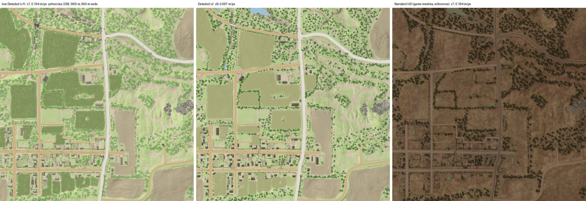

*Рисунок 16.2.* Yehorivka, 900 м: пшеничные поля — поля (v1 рисовала их лесом), ряды деревьев вдоль них как в HD.

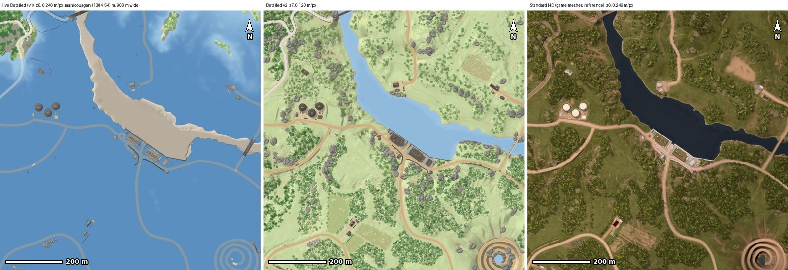

*Рисунок 16.3.* Manicouagan, 900 м у плотины: v1 рисовала сушу морем (уровень моря по звуковым сплайнам); в v2 водохранилище доходит до плотины.

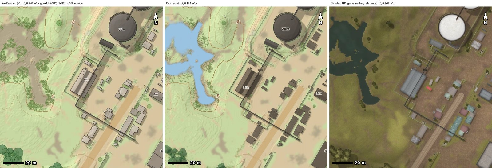

*Рисунок 16.4.* Gorodok, 160 м: контуры зданий по мешам клиента (v1: серверная коллизия 0,25 м).

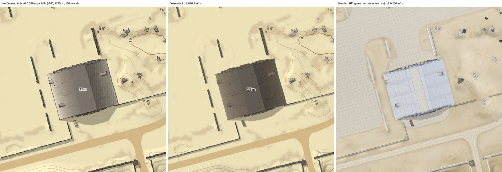

*Рисунок 16.5.* Tallil, 160 м: 0,071 м/px против 0,286; панели крыши и световые фонари как в HD.

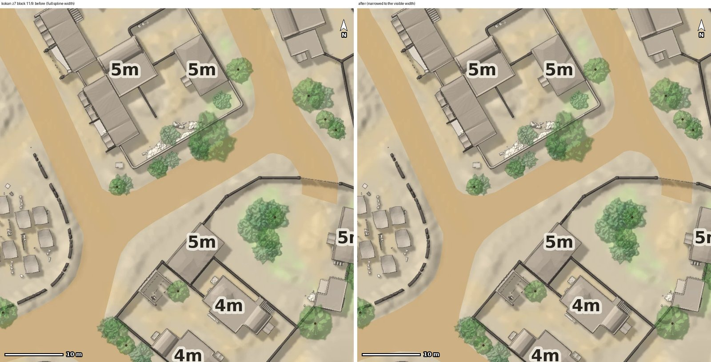

*Рисунок 16.6.* Kokan, зум 7: грунтовки по уложенной ширине (слева) и по ширине, которую показывает их материал (справа).

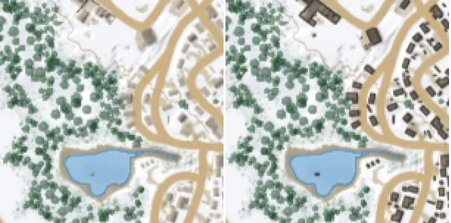

*Рисунок 16.7.* Goose Bay, зум 3 (1,97 м/px): до и после трёх правил читаемости.

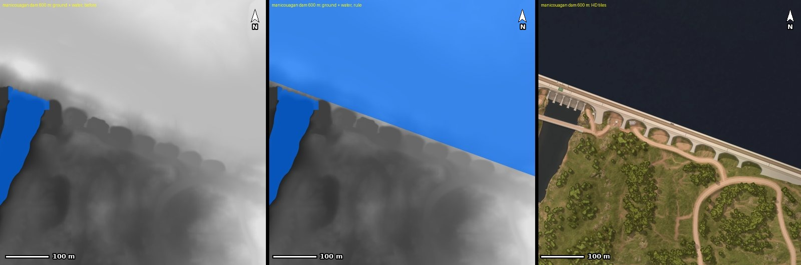

*Рисунок 16.8.* Manicouagan, 600 м у плотины: вода до исправлений, вода после (плоскость озера кончается у плотины), Standard HD.

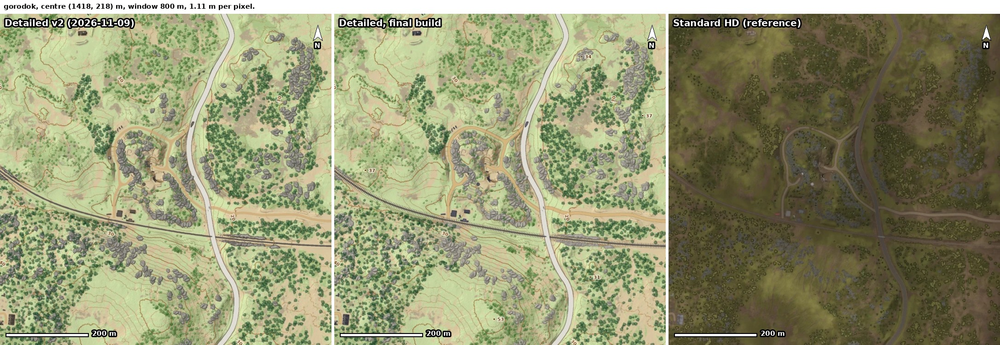

*Рисунок 16.9.* Gorodok, 800 м у железнодорожной развилки (1418, 218): v2, ревизия, Standard HD. Сланцевые здания, железная дорога со шпалами, грунтовки с кантом, вершины с высотой, более светлые камни.

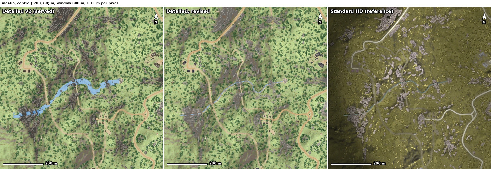

*Рисунок 16.10.* Mestia, 800 м (-700, 60): пруд 60 м и широкие ручьи v2 — это границы мешей на сплайнах; ревизия рисует ручьи по ширине их мешей; земля за пределами ландшафта спокойна.

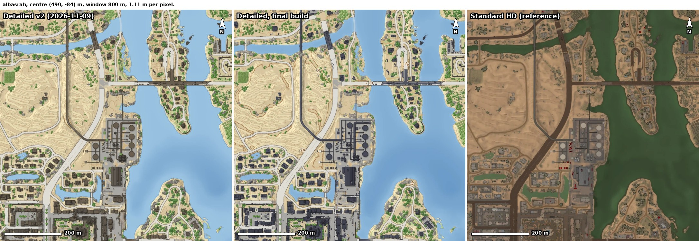

*Рисунок 16.11.* Al Basrah, 800 м у нефтезавода (490, -84): строения на песке и глубина реки.

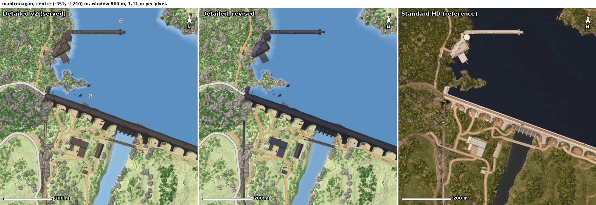

*Рисунок 16.12.* Manicouagan, 800 м у плотины (-352, -1240): на водохранилище нет подписей горизонталей, на суше — вершины.

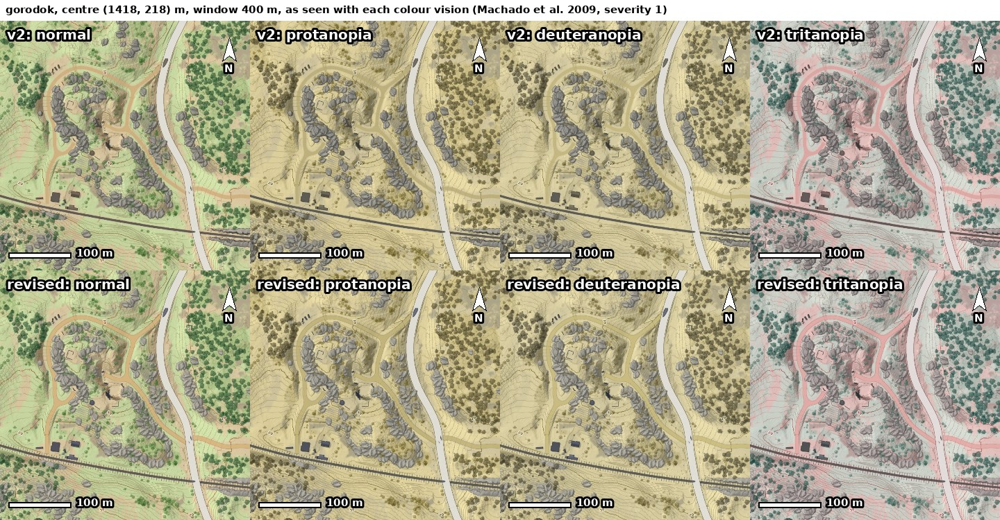

*Рисунок 16.13.* Gorodok, 400 м, v2 (сверху) и ревизия (снизу) при нормальном зрении, протанопии, дейтеранопии и тританопии (Machado и др. 2009): здания отделены от крон, грунтовки сохраняют кант.

*Рисунок 16.14.* Anvil, 700 м реки (660, -390): v2, ревизия (тайлы пересборки остальных карт), Standard HD. v2 рисует реку сухой; ревизия — до поверхности её меша.

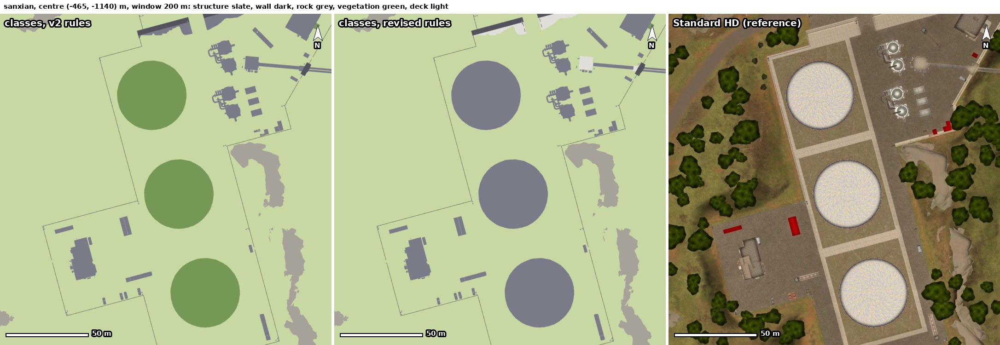

*Рисунок 16.15.* Sanxian, 200 м у электростанции (-465, -1140): классы объектов по правилам v2 (силосы — растительность) и по правилам ревизии, Standard HD.

*Рисунок 16.16.* Легенда, которую тайлы ревизии несут в своём meta.json, как её показывает страница.

### 16.8 Ограничения

* Покров — физический материал сервера, а не нарисованные слои клиента: где арт карты расходится с её физикой (грунт Lashkar, который
  игра красит зелёным), тайлы следуют физике.
* Крыши рисуются по шкале карты и темнее многих крыш в игре (раздел 16.5).
* Низкополигональные декорации Kohat за пределами ландшафта нарисованы как рельеф.
* Растр меряет высоты над `ground.npy`, а рендерер добавляет обратно `top_ground.npy`, который отличается там, где декорации заполняют
  пустоту за ландшафтом (Skorpo 7,1 км², Kohat 4,6 км²); на проверенных картах ни одна ячейка объекта не лежит на таком заполнении
  (Kokan 0 из 253 680, Mutaha 0), значит, ни одна нарисованная крыша не затронута; для остальных карт — INFERRED.
* Standard HD, эталон 16.3.1, рендерит те же меши клиента: он проверяет растеризатор и кадр, а не содержание игры.
* F1 контуров зависит от текстур миникарты, которые поставляются со слоем: оценить можно шесть слоёв пяти карт, а Black Coast привязать нельзя.
* GPU против CPU (16.3.2) сравнены на одной карте, Narva; для остальных — INFERRED из общего кода.
* Меры 16.3.6-16.3.8 и ворота принимают Standard HD за истину. HD рисуется из того же извлечения сцены клиента, так что объект,
  которого в извлечении нет или который в нём смещён, неверен в обоих и не находится ни одним; только 16.3.9 и 16.3.10 сравнивают с
  данными другой сборки и другого инструмента (отдаваемая карта высот).
* Читаемость обоснована аудитом на глаз по 336 сравнительным картинкам и цветовыми различиями, вычисленными для смоделированного
  цветового зрения (16.10); ни один читатель с нарушением цветового зрения и ни один игрок не тестировались. Как результат об удобстве —
  UNVERIFIED.
* Ревизия 16.10 отрисована и измерена в этом тексте на 17 из 25 карт; строки PENDING — карты, пересборка которых ещё не
  закончилась. Отдаваемые тайлы остаются v2 и сохраняют ошибки 16.6 с пометкой PENDING, пока пересобранные тайлы не выложены;
  числа 16.3 описывают v2, если не сказано «ревизия».
* Интервалы F1 контуров (16.3.3) посчитаны на зоне растра коллизии; для зоны сцены из таблицы 16.3.3 нужно сохранять растры сцены после сборки.
* Класс — это класс меша, а не его назначение: подпорная стена, уложенная причалом (Manicouagan, `SM_Foundations_RetainingWall_01`
  около (−300, −1547) м), нарисована стеной, а HD показывает светлую пристань.
* Редкий кустарник при 3 м/px и грубее — ковёр точек крон (Kamdesh, Logar). Рисовать кроны меньше 1,5 px их суммарным покрытием
  пробовали и вернули назад: кустарник успокаивался, но леса становились бледнее, а их опушки мягче, чем в v2, а игрок читает именно опушку.
* Кроны имеют один цвет на класс и породу: пустынный куст так же зелен, как куст умеренного пояса (Logar, Kamdesh), а в игре он сухой.

### 16.9 Воспроизводимость

Сборки игры: выделенный сервер Squad 26005357 и клиент Squad 26234431 (приложения SteamCMD 403240 и 393380). Одна рабочая станция
(16.4). Каждый случайный выбор (станции, деревья, окна, выборки бутстрепа) делается с фиксированным зерном, так что повторный запуск
даёт те же числа.

| Результат | Команда (корень репозитория `AGL`) |
|---|---|
| Все тайлы | `tools/maptiles/maptiles.sh extract`, `prep`, `scene`, `render` (по карте или все; `WORKERS`, `MEMORY`; растр на GPU на хосте с `$PYTHON`) |
| Ворота положения, высотная привязка | `tools/maptiles/maptiles.sh check <map>` → `$WORK/check/<map>.json` |
| F1 контуров | `OUTLINE_BEFORE=<тайлы v1> tools/maptiles/maptiles.sh outline <map>` → `$WORK/check/<map>_outline_<pair>.json` |
| GPU против CPU | `SCENE_RASTER=cpu tools/maptiles/maptiles.sh scene narva` во второй рабочий каталог, затем сравнение `top_h0`, `top_c0`, `top_v0` по ячейкам |
| Тесты | `docker run ... squadcalc-maptiles-py python -m unittest discover -p 'test_*.py'` в `tools/maptiles/py` (`M-README`, список файлов); `test_scene_gpu.py` на хосте |
| Standard HD | `tools/maprender` (`AGL:tools/maprender/README.md`) |

### 16.10 Ревизия условных знаков (2026-11-10)

**Аудит.** Каждая карта просмотрена на 336 картинках: вся карта и окна 800 м, 120 м и 36 м у её зданий, берега, самого
сильного рельефа, дорог и опушки, каждое рядом со Standard HD и собственной миникартой игры. Аудит записал 399 дефектов, из них 44 — того рода, что вводит игрока в заблуждение или прячет нужное ему; полная таблица хранится с исходниками отчёта. Те, на которые отвечает ревизия, — в таблице изменений; те, на которые не отвечает, — в 16.8.

**Конвенции, которым следует ревизия.** Правила Имхофа для рельефа (основной свет слева сверху, ровная земля в среднем тоне:
*Cartographic Relief Presentation*, 1965, английское издание 2007) и многонаправленный вариант Mark (1992) у слоя уже были. Из условных
знаков швейцарской национальной карты (swisstopo, *Conventional signs*, 2022: дороги по классам ширины, железные дороги со шпалами,
отметки высот, глубина озёр) и цветовой конвенции военных топографических карт (чёрный — рукотворные объекты, синий — вода, зелёный —
растительность, коричневый — рельеф: TC 3-25.26, *Map Reading and Land Navigation*) взяты тёмные нейтральные здания, дороги с кантом,
шпалы и отметки высот. Цвета классов выбраны по измеренному различию, вслед за Harrower & Brewer (2003, *The Cartographic Journal*
40(1)): CIEDE2000 цветов как они нарисованы, при нормальном зрении и трёх дихромазиях, смоделированных матрицами Machado, Oliveira &
Fernandes (2009, *IEEE TVCG* 15(6)); цвета карты надёжно различаются начиная с различия около 10 (Brychtová & Çöltekin 2017, *CaGIS*
44(3)).

**Изменения.** У каждого есть причина, измеренная или увиденная в аудите, правило и тест, который падает, если правило вернуть назад
(`AGL:tools/maptiles/py/test_cartography.py`; все 18 возвратов пойманы).

| Знак | Было (v2) | Причина | Ревизия |
|---|---|---|---|
| Строения | серо-коричневая шкала по высоте | 8,5 от хвойного дерева при дейтеранопии (21,2 в норме), 9,4 от тени; здания терялись среди крон и камней при 1,5 м/px | сланцевая шкала (тон CIELAB 285°, L* от 74 до 25 равными шагами): 25,7 (29,8) и 19,4 |
| Камни | серые с тёмным кантом зданий | громче зданий (Gorodok, Fallujah, Yehorivka) | светлее, с серым кантом |
| Грунтовые дороги | заливка без канта | заливка в 2,6 от лесной подстилки при дейтеранопии и в 3,5 при протанопии | кант вполовину силы канта асфальтовой дороги: 10 и больше на любой земле, кроме грунта и грязи |
| Железные дороги | тёмная линия | 2,7 от стены | шпалы через 4 м при 1 м/px и мельче |
| Цвет воды | линейно от мелкой к глубокой на 12 м | брод и русло глубиной 2 м различались на 4 уровня серого | квадратный корень из глубины: половина диапазона на первых 3 м |
| Берег | кромка покрытия воды | бледная полоса на самых мелких зумах | линия уровня половины покрытия, 1,2 px на любом зуме |
| Реки | ниже осевой линии сплайна | 16.6: Anvil сухой | ниже верха меша реки |
| Статические плоскости воды | границы любого меша воды | 16.6: ручьи шириной 40 м | без мешей, уложенных вдоль сплайнов |
| Вершины | нет | вершины холмов не читались (Lashkar, Pacific, Kohat) | вершины, стоящие на 4 м и больше над землёй в 60 м вокруг, точкой с высотой |
| Земля за пределами ландшафта игры | с отмывкой и горизонталями, как земля | самая громкая поверхность Kohat, Skorpo, Chora, Mestia, Sumari | к серому, треть рельефа, без горизонталей, подписей и вершин |
| Подписи горизонталей | где угодно на утолщённой горизонтали | подписи на озёрах (водохранилище Manicouagan) | не под водой и не за пределами ландшафта |
| Настилы, тротуары | строения | 16.6: мост — тёмная полоса | один класс, светлый с тёмным кантом; ниже 1 м над землёй рисуется плоско как тротуар |
| Низкие посевы | оттенок в 3,7 от высокой травы (0,2 при протанопии) | поля не видны без штриховки | цвет пшеницы |
| Легенда | нет | у читателя не было ключа к знакам | `legend` в `meta.json` тайлов, показывается страницей (`SC:src/js/detailedLegend.js`) |

**Контраст палитры** (`AGL:tools/maptiles/py/palette_contrast.py`, `maptiles.sh palette`): наименьшее CIEDE2000 по десяти покровам земли
для пар классов, которые встречаются на карте, и для каждого класса против его земли.

| Классы | v2: норма / протан / дейтан / тритан | ревизия: норма / протан / дейтан / тритан |
|---|---|---|
| здание 5 м – хвойное | 21,2 / 10,9 / 8,5 / 28,4 | 29,8 / 27,7 / 25,7 / 18,7 |
| здание 5 м – лиственное | 27,5 / 22,2 / 20,0 / 31,6 | 35,8 / 33,9 / 32,4 / 27,5 |
| здание 5 м – камень | 12,7 / 13,0 / 12,4 / 13,0 | 23,7 / 23,2 / 24,0 / 22,4 |
| здание 5 м – тень | 9,4 / 9,0 / 8,9 / 9,0 | 19,4 / 19,0 / 19,5 / 17,8 |
| стена – хвойное | 21,2 / 13,5 / 10,6 / 23,7 | 27,3 / 24,3 / 21,8 / 18,3 |
| грунтовка – горизонталь | 21,7 / 22,0 / 19,3 / 21,2 | 22,9 / 23,1 / 20,4 / 22,2 |
| посевы низкие – высокие | 7,5 / 5,3 / 5,6 / 10,0 | 9,6 / 6,0 / 7,3 / 17,8 |
| хвойное – лиственное | 11,1 / 11,0 / 11,6 / 10,2 | 11,1 / 11,0 / 11,6 / 10,2 |
| против своей земли: здание 2 м | 23,0 / 23,1 / 22,9 / 22,7 | 31,1 / 30,9 / 31,1 / 30,7 |
| против своей земли: стена | 28,4 / 28,6 / 28,1 / 28,5 | 34,1 / 33,8 / 34,0 / 33,1 |
| против своей земли: хвойное | 21,8 / 14,7 / 16,6 / 29,1 | 21,8 / 14,7 / 16,6 / 29,1 |
| против своей земли: лиственное | 14,9 / 7,8 / 7,2 / 21,2 | 14,9 / 7,8 / 7,2 / 21,2 |
| против своей земли: куст | 12,0 / 6,8 / 5,7 / 13,8 | 12,0 / 6,8 / 5,7 / 13,8 |
| против своей земли: грунтовка, заливка | 12,8 / 3,5 / 2,6 / 23,7 | 12,8 / 2,8 / 3,3 / 24,4 |
| против своей земли: грунтовка, кант | – | 10,4 / 10,2 / 9,5 / 10,5 |
| против своей земли: вода мелкая | 35,2 / 34,0 / 34,4 / 14,5 | 35,2 / 34,0 / 34,4 / 14,5 |
| против своей земли: горизонталь утолщённая | 23,0 / 22,3 / 19,2 / 23,0 | 23,0 / 22,3 / 19,2 / 23,0 |
| против своей земли: посевы низкие | 3,7 / 0,2 / 0,8 / 8,6 | 6,4 / 6,6 / 6,1 / 3,2 |

Заливки классов, похожих на землю (камень на асфальте, дорога с покрытием на гравии, настил моста), остаются ниже 10 намеренно: их
несёт кант. Каждая подпись выше текстового контраста WCAG 2.1, равного 4,5, на своём ореоле (горизонталь 6,8, крыша 14,3, вершина 9,8).

**Тайлы ревизии.** Полные тайлы пересобраны конвейером ревизии, объединённым с исправлением крена мешей на сплайнах и правил для оставляемых старых объектов: растр сцены на GPU, шаг сцены и рендер, из подготовленных данных prep.py с исправленными плоскостями воды. Шесть карт отрисовала эта ревизия; остальные 19 — пересборка замороженной копией тех же инструментов, из них к моменту сборки этого текста готовы 11. Измерены 17 из 25 карт; 17 из них проходят ворота положения, наибольший медианный сдвиг 0,067 м. Строки PENDING заполняются повторным запуском генераторов после окончания пересборки (16.11).

| Карта | Ворота, v2: медиана x, y (м) | Ворота, ревизия: медиана x, y (м); окон / в пределах 0,1 м | Тайлы МБ, v2 → ревизия | Рендер (с) | Кем отрисована |
|---|---|---|---|---|---|
| skorpo | 0,002, -0,032 | PENDING (пересборка идёт) | – | – | – |
| yehorivka | 0,011, -0,014 | PENDING (пересборка идёт) | – | – | – |
| tallil | -0,034, -0,010 | PENDING (пересборка идёт) | – | – | – |
| kohat | -0,017, -0,033 | -0,027, -0,037; 8 / 7 | 673,5 → 653,5 | 4145 | пересборка остальных карт |
| sanxian | 0,019, 0,012 | PENDING (пересборка идёт) | – | – | – |
| blackcoast | 0,012, -0,031 | -0,007, -0,046; 6 / 4 | 635,9 → 625,5 | 4876 | пересборка остальных карт |
| lashkar | 0,008, -0,067 | PENDING (пересборка идёт) | – | – | – |
| gorodok | 0,001, -0,008 | 0,000, -0,004; 7 / 7 | 251,7 → 251,8 | 3430 | эта ревизия |
| chora | -0,037, -0,020 | -0,036, -0,018; 8 / 8 | 155,2 → 127,3 | 1163 | пересборка остальных карт |
| pacific | 0,007, 0,015 | PENDING (пересборка идёт) | – | – | – |
| harju | -0,013, -0,027 | -0,017, -0,021; 8 / 8 | 216,9 → 218,9 | 1762 | эта ревизия |
| manicouagan | -0,014, -0,039 | -0,021, -0,045; 8 / 7 | 256,0 → 257,9 | 1662 | эта ревизия |
| goosebay | -0,007, -0,020 | -0,007, -0,021; 8 / 7 | 207,6 → 207,9 | 2258 | эта ревизия |
| jensen | -0,016, -0,017 | -0,013, -0,022; 6 / 4 | 109,3 → 109,8 | 645 | пересборка остальных карт |
| albasrah | -0,013, 0,016 | -0,040, 0,002; 8 / 6 | 190,9 → 192,7 | 2095 | эта ревизия |
| kamdesh | 0,016, -0,003 | 0,012, -0,002; 8 / 8 | 219,4 → 217,4 | 1087 | пересборка остальных карт |
| anvil | -0,012, 0,017 | -0,021, 0,017; 8 / 8 | 203,8 → 204,3 | 1761 | пересборка остальных карт |
| fallujah | -0,003, 0,011 | -0,002, 0,001; 8 / 8 | 162,9 → 165,0 | 1528 | пересборка остальных карт |
| narva | -0,022, -0,005 | PENDING (пересборка идёт) | – | – | – |
| mutaha | -0,003, -0,037 | -0,006, -0,038; 8 / 8 | 154,6 → 154,8 | 1942 | пересборка остальных карт |
| kokan | 0,005, 0,002 | 0,005, 0,004; 8 / 8 | 153,1 → 153,6 | 1311 | пересборка остальных карт |
| mestia | 0,006, -0,003 | 0,002, -0,000; 8 / 7 | 158,9 → 153,6 | 2114 | эта ревизия |
| foolsroad | -0,006, -0,007 | -0,005, -0,006; 7 / 7 | 58,9 → 59,2 | 397 | пересборка остальных карт |
| logar | -0,056, -0,052 | -0,067, -0,047; 8 / 4 | 60,6 → 60,8 | 404 | пересборка остальных карт |
| sumari | -0,001, 0,002 | PENDING (пересборка идёт) | – | – | – |

**Меры на тайлах ревизии.** Каждая ячейка — v2 → ревизия, обе измерены методами 16.3.6-16.3.10 против одних и тех же эталонов. По 17 измеренным картам наибольший медианный сдвиг оси дорог ревизии от оси HD — 0,081 м (blackcoast); медианная разность подписей крыш не изменилась на 17 из 17 карт, медианное расстояние горизонталей — на 10 из 17 (наибольшее изменение 0,05 px); каждое одиночное дерево нарисовано на 16 из 16 карт с деревьями. IoU воды растёт больше чем на 0,02 на 3 из 14 карт, где вода есть в обеих сборках (anvil 0,06 → 0,79, chora 0,61 → 0,67, kamdesh 0,05 → 0,10). На mestia (0,03) вода v2 была в основном ложной (в скобках — доля воды v2, которая в HD вода), а у ревизии её меньше 0,05 % карты, нужных мере.

| Карта | Ось дорог, большая ось (м) | Ширина дорог, тайлы / HD | IoU воды | Вода, доля карты (%) | Подпись крыши − карта высот (м) | Горизонтали, мелкий зум (px) | Одиночных деревьев нарисовано |
|---|---|---|---|---|---|---|---|
| skorpo | PENDING (пересборка идёт) | – | – | – | – | – | – |
| yehorivka | PENDING (пересборка идёт) | – | – | – | – | – | – |
| tallil | PENDING (пересборка идёт) | – | – | – | – | – | – |
| kohat | 0,002 → 0,001 | 1,20 → 1,24 | 0,545 → 0,557 | 0,684 → 0,678 | 0,07 → 0,07 | 0,40 → 0,43 | 300 → 300 / 300 |
| sanxian | PENDING (пересборка идёт) | – | – | – | – | – | – |
| blackcoast | 0,092 → 0,081 | 1,32 → 1,22 | 0,964 → 0,960 | 21,468 → 21,605 | 0,19 → 0,19 | 0,54 → 0,55 | 300 → 300 / 300 |
| lashkar | PENDING (пересборка идёт) | – | – | – | – | – | – |
| gorodok | 0,002 → 0,006 | 1,06 → 1,11 | 0,865 → 0,871 | 3,729 → 3,857 | 0,18 → 0,18 | 0,21 → 0,21 | 300 → 300 / 300 |
| chora | 0,002 → 0,002 | 1,04 → 1,10 | 0,614 → 0,670 | 0,998 → 0,970 | 0,11 → 0,11 | 0,22 → 0,26 | 298 → 300 / 300 |
| pacific | PENDING (пересборка идёт) | – | – | – | – | – | – |
| harju | 0,017 → 0,017 | 0,78 → 0,75 | 0,984 → 0,981 | 34,164 → 34,311 | 0,14 → 0,14 | 0,21 → 0,21 | 300 → 300 / 300 |
| manicouagan | 0,003 → 0,003 | 0,76 → 0,76 | 0,934 → 0,947 | 8,722 → 8,907 | 0,08 → 0,08 | 0,21 → 0,21 | 300 → 300 / 300 |
| goosebay | 0,100 → 0,043 | 0,86 → 0,87 | 0,964 → 0,972 | 15,472 → 15,349 | 0,12 → 0,12 | 0,26 → 0,26 | 300 → 300 / 300 |
| jensen | 0,029 → 0,021 | 1,20 → 1,51 | – → – | 0,000 → 0,000 | 0,08 → 0,08 | 0,22 → 0,22 | 0 → 0 / 0 |
| albasrah | 0,000 → 0,000 | 0,99 → 1,00 | 0,907 → 0,901 | 10,516 → 10,830 | 0,12 → 0,12 | 0,20 → 0,20 | 235 → 235 / 235 |
| kamdesh | 0,045 → 0,045 | 0,48 → 0,48 | 0,053 → 0,101 | 0,101 → 0,120 | 0,01 → 0,01 | 0,21 → 0,21 | 300 → 300 / 300 |
| anvil | 0,000 → 0,001 | 1,00 → 1,03 | 0,062 → 0,791 | 0,124 → 1,245 | 0,08 → 0,08 | 0,21 → 0,22 | 300 → 300 / 300 |
| fallujah | 0,007 → 0,006 | 2,22 → 2,22 | 0,762 → 0,772 | 3,917 → 4,009 | 0,08 → 0,08 | 0,20 → 0,20 | 300 → 300 / 300 |
| narva | PENDING (пересборка идёт) | – | – | – | – | – | – |
| mutaha | 0,000 → 0,000 | 0,92 → 0,95 | 0,921 → 0,910 | 2,029 → 2,119 | 0,05 → 0,05 | 0,22 → 0,27 | 300 → 300 / 300 |
| kokan | 0,006 → 0,021 | 1,26 → 1,22 | 0,289 → 0,287 | 7,970 → 8,087 | 0,07 → 0,07 | 0,51 → 0,52 | 300 → 300 / 300 |
| mestia | 0,000 → 0,002 | 1,68 → 1,07 | 0,032 → – | 0,229 → 0,034 | 0,15 → 0,15 | 0,45 → 0,45 | 300 → 300 / 300 |
| foolsroad | 0,043 → 0,047 | 0,89 → 0,87 | 0,329 → 0,342 | 1,133 → 1,205 | 0,21 → 0,21 | 0,21 → 0,21 | 300 → 300 / 300 |
| logar | 0,002 → 0,044 | 1,41 → 1,39 | – → – | 0,050 → 0,042 | 0,07 → 0,07 | 0,21 → 0,22 | 300 → 300 / 300 |
| sumari | PENDING (пересборка идёт) | – | – | – | – | – | – |

### 16.11 Воспроизводимость ревизии

| Результат | Команда |
|---|---|
| Меры 16.3.6-16.3.10 | `tools/maptiles/maptiles.sh measure [map ...]` → `$WORK/check/<map>_{roads,water,crowns,heights,contours}.json`; образ Python из `maptiles.sh setup` (numpy 2.5.4, scipy 1.18.1, Pillow 13.0.0), зерно бутстрепа 0 |
| Сводная статистика ворот, таблицы 16.3 и 16.10 | `collect_v3.py <рабочий каталог>`, затем `assemble16.py <parity json> <каталог>` (генераторы хранятся с исходниками отчёта) |
| Контраст палитры | `tools/maptiles/maptiles.sh palette` |
| Вода v2 и ревизии против HD | `water_eval.py` (с генераторами отчёта): `render.draw_water` на подготовленной земле, зум 4 |
| Тесты и возвраты | `python -m unittest test_scene test_cartography test_layer_minimaps` в образе Python; `mutation_check.py` |
| Легенда на странице | `SC`: `npm test` (`tests/detailedLegend.test.mjs`), `detailed_legend_check.mjs <URL сайта>` |
| F1 контуров с интервалами (16.3.3) | `outline_revised.sh` (с генераторами отчёта): `outline_revised.py <map> <pair> <out json> v1=<тайлы> v2=<тайлы> revised=<тайлы> hd=<тайлы>` → `check_new/outline/<pair>.json` |
| Строки PENDING | после окончания пересборки остальных карт: `outline_revised.sh`, `collect_v3.py`, `assemble16.py`, `insert16.py`; сборщик берёт каждую карту, чья пересборка записала свои ворота и меры |
